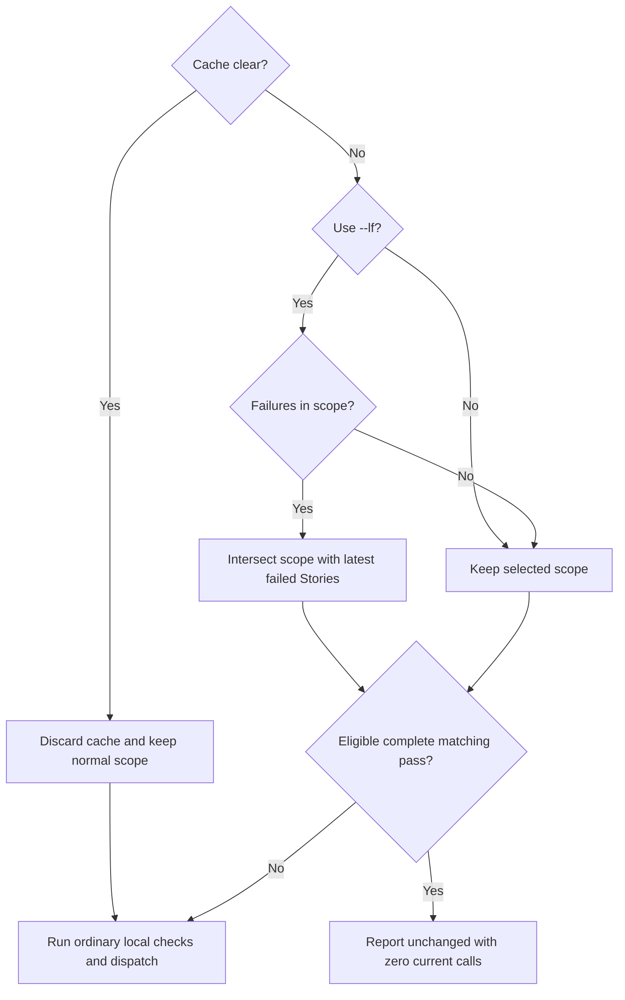
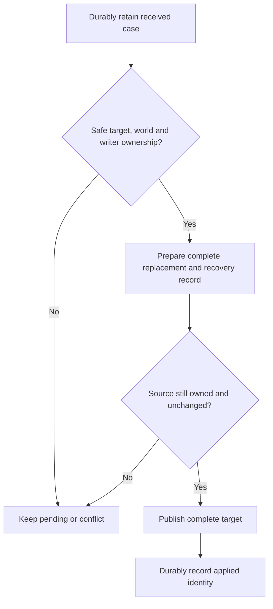
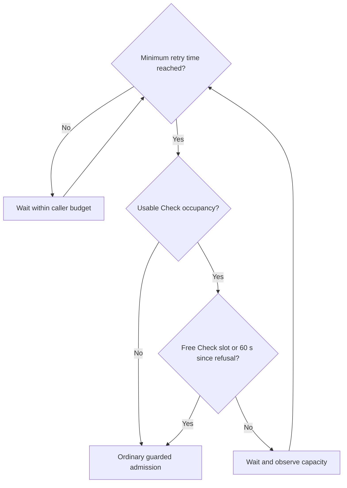
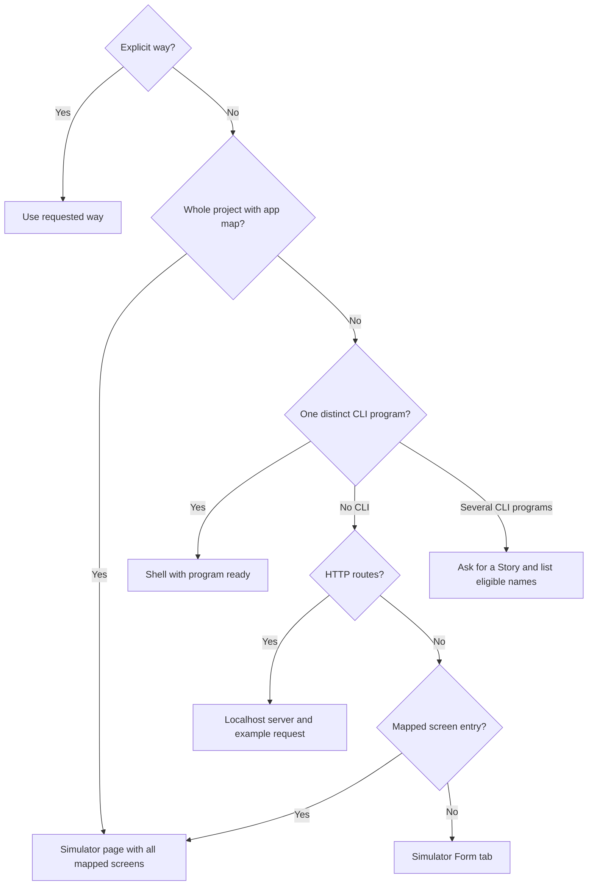

# Runtime client

Own `src/runtime/runtime-client.mjs`. Export `runCheck({words, options, cwd, cache=false, client, workflow}, ports)` and `runTry({words, options, cwd}, ports)`. Each returns an exit code. These commands and the Try MCP tools call the PDD interpreter with the person's `gh` login (recording read tokens through `ports.redaction.remember` or `ports.rememberSecrets`, falling back to the standalone package redactor only when no redaction port is supplied, and forwarding `ports.redaction` to `createAgentBridge`). Lines that pdd writes itself use plain service wording ("PDD interpreter", never internal slot, pool, or account jargon), except the plain busy-check messages owned below.

## Runtime interface refusal diagnostics

For Runtime interface refusals, preserve a server-provided field or JSON pointer and its rule in lint and check output, in text and JSON. If `invalid-interface` has no field or pointer, show any supported local schema findings for the named prompt as local advice, without claiming they caused the server refusal. If none are available, say the Runtime did not identify the field and ask the person to inspect the interface or request a detailed Runtime diagnostic. Always retain the supplied Runtime rule text, including when no field pointer exists. Show the rule together with a field-unknown note and any separately labeled local findings in text and JSON. Never guess a rejected field.

## Recent passing lint receipts

A normal `pdd test` may reuse a terminal passing lint received at most ten
minutes ago, inclusive, for exactly the current captured source and selected
tests. Local discovery, preflight, source validation, account authentication and
ordinary check admission still run. Explicit lint always requests a fresh lint;
Try, saved reads/retries and standalone local modes keep their existing routes.
This is lint admission evidence, never a behavioral pass or approval.

Persist one recent receipt per canonical repository in private state, separate
from the complete Story pass cache. Bind it to root, Runtime origin, GitHub
login and user ID, captured source_sha256, authored_sha256, sorted unique selected
test paths, caller client version (`client.version` or `ports.clientVersion`, `null` when omitted — never a hardcoded version literal) and the lint selected cap (null for preliminary lint).
`authored_sha256` is the SHA-256 of the capture's authored file hashes
(`raw_file_hashes`, as JSON of its `[path, hash]` pairs sorted by path). The upload
hash alone is not enough: the [interface-kind transport](runtime-preflight.prompt.md#interface-kind-transport)
removes a `full` or `partial` kind from the upload copy, so a kind change leaves
source_sha256 equal but changes authored_sha256 and runs a fresh lint. A capture
without authored file hashes runs a fresh lint. Use the
[receipt eligibility owner](runtime-lint-receipt.prompt.md) for metadata checks.
Retain the actual answer and its engine_sha. Reuse only a confirmed lint answer
with matching UUID requestId/id, command lint, state passed, complete per-test
lint evidence and a passing existing lint outcome for every selected test.
Missing, corrupt, expired, future-dated, incomplete, refused, pending or unknown
records run a fresh lint. Storage failure also falls back to fresh lint.

Before adopting a candidate, perform normal capacity/access/maintenance checks.
Reuse only when capacity supplies the current engine_sha and it equals the
receipt's engine_sha. An unknown current engine (a 404 capacity reply, an omitted
or null engine_sha, or no capacity reply) cannot prove that no deployment occurred
during the ten-minute window, so it runs a fresh lint.
Copy the original answer and request ID into the new batch for saved reads and
restart recovery; do not POST lint again, fabricate a receipt or refresh its
original received time on reuse. Print `Reusing recent passing lint for unchanged source.`
on stderr. Before a fresh lint request, discard the prior optional receipt so a newer
refusal or unknown cannot leave an older pass reusable. Serialize short receipt
metadata operations with an exclusive local file lock, never held over network
or waits. Each fresh lint publishes its batch ownership marker first; only
that marker's owner can replace it with a passing answer. An older in-flight
lint cannot supersede a newer attempt. After a capacity wait, recheck the same
saved candidate under this transaction before adopting it. Lock contention,
an abandoned lock or any bookkeeping failure falls back to fresh lint without
blocking or repairing the lock. When a fresh attempt cannot acquire ownership,
write a separate per-batch blocker before dispatch; any blocker prevents reuse.
At that attempt's exit, clear the optional receipt and remove only its blocker
under the metadata lock. If cleanup cannot lock, retain the blocker and run
fresh lint on later calls. Never remove another attempt's blocker. A newly received passing lint can replace the saved receipt only
when all selected rows have their own pass and complete evidence. Store no token.

Standalone lint JSON, including saved reads and pending/unknown lint results, adds `report_url`: the server's
report_url sanitized against known secrets and validated by the existing
same-origin report-link rules, or null
when absent or unsafe. Save the same field in summary.json and print a supplied
valid link as `Report: <url>` in text. Local lint has no server report link.

## Native lint selection and display (draft)

For explicit `pdd lint STORY` (including `--local` without `--timeout`,
existing path/directory and multiple Story operands), obtain preflight's bounded `nativeSelections` with the ordinary
Runtime selection. Resolve the owned run and exact Story/profile association
from existing saved workflow evidence through `ports.allRuns` and `ports.usableResult`; if no unique owned run/profile exists,
show that reason and no native proof. Do not pick a first report or create an
association. For each selected native descriptor call the shared
`ports.assessNativeEvidence` with its actual root/run/profile/Story selectors and the
production default reader, and format proof lines with `ports.resultLines` (if `allRuns`, `assessNativeEvidence`, `usableResult`, or in text mode `resultLines` is omitted, throw a clear unbound-port `Error`). Use its current Story criteria, not an old mapping
list. Missing/ambiguous/unreviewed declarations and missing evidence are native
missing-proof results, not a bare Runtime missing-test line.

Text and `--json` show one native assessment per selected Story/profile. Show
every current criterion's identity/text, mapped native test IDs and observed
outcomes, its supported/unproved reason, required gate/fixture rows, profile and
source identity/currentness, original source/stage, origin, original references
and limits. Keep unknown/empty Story facts explicit. Label a whole Story natively
proved only from `storyNativeProof`; `profileNativeProof` alone is profile
completion. Qualified external evidence keeps that qualifier and checked/unchecked
limits. Missing fixtures, required skips, unexecuted gates and incomplete/stale/
unknown evidence retain the shared judgment even at process exit zero.

A native-only explicit lint reads this saved evidence locally and sends no
hosted request. This native assessment precedes SVG-only local lint when a
native Story is explicitly selected; ordinary Runtime selections with `--local`
keep their SVG-only advisory route. A missing native proof returns 1; complete current whole-Story
native proof returns 0. Existing command/boundary errors retain their exits.
For mixed/native-and-Runtime selection, process ordinary Runtime rows through
their unchanged lint route and exit rules; any native missing proof prevents
overall success without replacing a Runtime unknown/refused/not-run exit.
Show native proof separately from hosted lint/schema verdicts, Runtime capability
and modeled observations. Native results add no Runtime pass, check count, AI
usage, capability claim or Try support. Do not alter saved-lint receipt policy,
Runtime check dispatch, cache or the separate Story-count owner.

The same saved association/assessment is available to workflow/PR readers; this
client never promotes historical PR 1 evidence to current code proof. No reading
executes a native test, repairs fixtures, asks for permissions or broadens source
discovery. Physical reader, CLI display and mixed-selection integration require
native tests; the supplied assessor scenarios do not prove them.

## Independent selected tests

For `pdd lint`, `pdd test` and `pdd test --files`, isolate missing/unreadable dependency and invalid-file failures per selected test before combined source capture. Refuse that row locally, set `unsent:true`, retain its reason and actionable hint, and continue the other selected tests. Never upload or dispatch a broken test. Preserve other refusal rules, including shared configuration and aggregate capture limits.

Retain `not_checked` criteria in rows and saved batches. Retain capture refusal codes, sections and missing-coverage reasons, including when capture finds no exact criterion. Use the preflight owner’s capture validation before upload, cache reuse or dispatch; generated exemptions cannot erase authored P3/P5 refusals. Before dispatch or cache reuse, reconcile criterion coverage, texts and steps with the actual effective captured scenario. A source edit between preflight and capture cannot hide a captured exemption or retain a stale exemption after the captured test becomes complete. A server pass with not-checked criteria becomes `not_run`, with its real checked results, usage and report retained: the Story is not a full pass. Failures remain failures. Lint also reports incomplete criterion coverage and cannot exit zero. Recovery retains these facts and uses the same effective capture. Such a Story cannot enter the complete-pass cache.

List broken tests first in text and JSON, with file, reason and fix step. Count unsent refused rows as `N tests could not run` in summaries, including files preview. Any broken selection exits nonzero even when all other rows pass. Save both broken and executed rows when a batch exists; JSON files preview records rows and the actual manifest. With no runnable test, report locally without authentication or upload.

## Reuse complete Story passes

Ordinary test CLI calls opt into local reuse with `cache:true`; direct `runCheck`
callers retain `cache:false` by default. Explicit `--lf` or `--cache-clear` also
opts in. Apply this only to ordinary checks: lint, files, fill-hash, screen,
request, saved reads/retries and Try keep their current behavior. Cache options
mixed with those modes are input errors before effects.

The existing [source capture](runtime-preflight.prompt.md#source-capture) owns
Story footprints. Use its complete sibling-test membership, effective source
hashes and reference provenance, plus exact Story/test bytes and reached raw
prompt/interface bytes for eligibility. Do not substitute upload-wide hashes or
a second dependency walk. An unavailable footprint never authorizes reuse.
Changed execution origin, explicit call-budget settings or caller client version (`client.version` or `ports.clientVersion`, `null` when omitted, with no hardcoded version literal) invalidate reuse. Interpreter identity comes from each confirmed job answer: `engine_sha` and `requested_model` (the reported usage/evaluation requested model), never the local `ENGINE_SHA` constant. Store this identity with each pass and include it in eligibility. Missing, empty, unknown or conflicting identity cannot authorize reuse, including legacy entries and inconsistent sibling answers. Date each pass from the original batch start (saved created_at on either read path), never the time it was read or stored; use an earlier reported finish time if present. An expired saved pass reports `runs again: saved pass is older than seven days`. Reuse requires a complete pass at most seven days old, inclusive, measured by the injected clock; future or invalid pass times cannot authorize reuse. `CI` unset or set to the empty string, `0` or `false` permits ordinary reuse; every other value runs every selected Story. These edit-loop guards do not invalidate a saved pass of at most seven days for prompt approval.

When any confirmed test-job answer in the current invocation reports a build or requested model different from a provisionally skipped Story's saved identity, run that Story's selected tests in this same invocation. Replace its provisional cached row with the actual result, report `runs again: interpreter build or model changed`, and count its calls and outcome normally. Do not leave both cached and executed rows, rerun an already executed test, or expand operand scope. Differing identities within a run cannot create reusable whole-Story evidence: compare every known build and every known requested model, even on partial identities. A Story may be reused only when one clean identity record names the same known build and model as its complete pass, and that pass is at most seven days old. In every other case it runs. A clean record comes from one normal invocation that started after the previous record's sample time, whose record did not change during the invocation, and whose every observation agrees on a known build and model. Overlap, a read writing the record (including a read that resends a check), an older or unknown writer, mixed or partial observations, or stored multiple build/model values makes the record doubt: it matches no pass, regardless of a false conflict flag. A read's identity is fixed when the read starts; later scheduling cannot turn it into a normal invocation. The next clean normal run can write clean evidence again. Before sending checks, write an in-progress mark with this invocation's unique ownership token, pid and start time in the same begin transaction that invalidates the selected passes. Any other invocation's mark, live or dead, blocks reuse. Preserve other live marks until their owners finish; retire dead marks only after treating their presence as doubt for this run. At finish, write clean evidence only when this invocation still owns its mark, no other mark remains, the record has not changed since it began, and the ordinary clean-run rules hold. Remove only this invocation's mark when it finishes; preserve others. A sign-in failure before any check can be sent removes only its own mark and leaves the record in doubt, without writing new identity evidence. Every check send goes through one run-owned boundary, including normal checks, second-phase checks, saved-read continuations, retries, capacity retries and restart recovery. It holds this run's own mark from before the first check POST until all sends and their resulting observations finish. A retry keeps ownership across its initial read and all subsequent checks; the read cannot release it early. Saved reads and retries finish with doubt after recording their observations. Direct callers with reuse disabled still participate in ownership when they send; this does not enable reuse for those callers. If complete new identity evidence cannot be recorded, finish with doubt. Preserve fail-open behavior when safe cache bookkeeping is unavailable. Clearing the cache preserves every in-progress mark so it cannot hide another run. A crash before the finish leaves its mark, so the next run sends checks. One later clean normal run restores reuse after overlap or a crash. Do not merge competing identities or try to infer which one is newer. If time has expired, an interrupt occurred, or reading stopped, invalidate affected provisional skips and mark them not_run with zero calls and one of `not sent: time limit reached`, `not sent: interrupted`, `not sent: reading stopped`, or `not sent: stopped`; keep the original timeout state and Still running recovery line. Otherwise the second phase says `Sending N more checks: interpreter build or model changed` (`Sending 1 more check: interpreter build or model changed` for one) instead of repeating the lint/send estimate. An all-reused local invocation cannot discover a server update without calls; `pdd test --cache-clear` sends again, although the interpreter may return a saved answer for the same key.

### Declarations that require a run

Use only captured prompts reached by the selected tests; a sibling-only prompt outside that capture is not a declaration failure. A plain dependency with no Runtime interface declares no resources. Missing Story footprints, missing captured sources or an actual declaration parse failure runs with `runs again: resource declarations unavailable`. Reuse may resume once complete declarations and a matching complete pass are available.

Known zero-call resource kinds are `key-value`, `collection`, `blob`, `sql` and `compute`; an unknown kind always runs. Other declared kinds (`http`, `command`, `model`, `port`) require every declared operation to be bound deterministically in every applicable step. Only these simulation actions establish determinism: `fixture.lookup` with nonempty cases, `port.write` with a fixed result, `key-value.get`, `key-value.put`, `collection.get`, `collection.get-or-null`, `collection.merge`, `blob.read`, `blob.write`, `blob.stat`, `sql.execute` and `compute`. Any other action, including any action ending in `.prompt` on any resource kind, runs. The row says `runs every time: uses an AI-played fake (<resource>)` using the declared resource or binding name. Partial bindings do not establish determinism.

A reached `prompts/fakes/<resource>.prompt.md` always runs with that same AI-played-fake reason, including transitive reaches. A reached `port` named `clock` with operation `now` instead says `runs every time: uses the real clock`, unless initial_world sets `{"clock":{"now":…}}` to a finite number or an ISO 8601 date-time string with a finite Date.parse result, or simulation binds `clock.now` deterministically. Fixed zero is present data; null, empty strings and labels such as `now`, `real 2026` or `1` are not fixed clocks. Step simulation overrides apply only to that step. Other operations remain subject to the ordinary resource guard. A resource that a later declaration marks as real always runs; no current real-resource marker is defined.

Apply the age, identity, CI and declaration guards before reuse, alongside complete-pass/source checks. The Mermaid eligibility question below includes all these guards.



`--cache-clear` takes precedence over `--lf` while retaining operand scope: discard the local pass and identity evidence, preserve every in-progress mark, and send the normal selected scope again. The interpreter may return a saved answer for the same key; fresh server execution is not guaranteed. Print exactly one progress line to stderr, including in JSON mode: `pdd: test cache cleared. Running N selected Stories; the interpreter may reuse saved answers.` If safe local clearing is unavailable, truthfully replace `test cache cleared` with `test cache unavailable`; still report selected dispatch and the same replay caveat. Use `1 selected Story` when N is one and `N selected Stories` otherwise. Count distinct selected Stories, retain the named scope, and do not add this progress notice to the warnings array.

Otherwise preserve explicit selection scope. `--lf` reads validated `lastfailed.json` to select each Story whose latest known outcome is `failed`, including all its test files within the selected scope. If no failure belongs to the selected scope, run the normal selected scope (including ordinary unchanged-pass reuse), even when failures exist elsewhere. Forget records for deleted Stories in both metadata files, using authoritative discovered Git-visible regular files rather than operand scope or cached-path filesystem lookups. An existing Story with temporarily invalid text retains its failure; unselected existing failures survive. Keep a known failure selected until a confirmed pass, even if a later attempt has no verdict (including sign-in failure, interruption, timeout or unavailable accounting). Refused/not-run/unknown attempts without an earlier failure are not last-failed selections, but normal tests must always retry them. Do not expand a selected test file to sibling files silently.

Reuse requires all discovered sibling files to have confirmed passes for the
same current footprint. A partial run must never manufacture a complete pass.
Before a fresh attempt, invalidate any older pass for that Story; local refusal,
interruption, unknown/transient outcomes and unavailable accounting cannot leave
an older pass eligible. Only confirmed complete terminal success becomes a new
pass. Keep latest outcomes for unselected Stories. A completed `pdd test --read` writes confirmed results into this cache only when saved repository, source fingerprint and complete sibling accounting verify; running or unknown results never become passes. A saved read can update only its original local cache epoch and Story attempt generation; after a newer attempt or cache clear, an older read must leave the newer cache outcome and pass untouched. Source changes cannot attach an old result to the new fingerprint. Saved retry guards and existing recovery semantics remain in force.

Perform current local validation/capture before reuse, and filter reusable work
before gh, capacity, lint, POSTs, GETs or fresh runtime IDs. An all-reused command
has no gh/server requests. Mixed commands dispatch only fresh selected work.
Existing runtime state and saved-batch recovery remain outside the repository.

Store versioned, bounded Story pass metadata in `.pdd/cache/test/stories.json` and last-known failures in `.pdd/cache/test/lastfailed.json`; never credentials or
source copies. Read last-failed metadata safely and validate its version, epoch, generation and failed Story set against the Story metadata before using it. A missing last-failed file after Story metadata exists, damaged metadata or inconsistent metadata invalidates the whole cache with one warning, runs selected work fresh and heals after the next completed run. A cold absent cache remains warning-free. Never reuse a cache when any path under `.pdd/cache/test/` is Git-tracked: warn once and run selected checks. Bind cache eligibility to a repository-keyed local epoch or key stored only in the external `PDD_STATE_DIR`; a cache copied to fresh external state cannot authorize reuse. Arrange Git ignore in each user's repository using its local Git
exclude, including linked worktrees, without editing tracked ignore files.
Use injected cache filesystem, clock and capture/hash ports for decision tests;
native tests establish actual safe writes and Git effects. Never follow symlinks
in repository cache paths or Git excludes, traverse outside their intended roots, or trust
cached paths as filesystem authority. Atomic replacement and serialized updates
must prevent truncated/concurrent writes from authorizing stale passes. Malformed,
truncated, incompatible, oversized or otherwise unsafe cache data invalidates the
whole cache: run all selected work with exactly one plain warning. Unwritable
cache also fails open with one warning; it cannot block checks or claim a new
pass was saved. An unsafe cache-clear target is left untouched and fails open. A damaged regular cache is replaced after the next completed run and then becomes reusable; the warning includes `pdd test --cache-clear`. A lock whose recorded owner PID is dead is taken over with one warning, including during `--cache-clear`; live owners remain protected. Recovery warnings describe the stale lock or claim recovered and truthfully say that previous passes may remain eligible; never claim that recovery necessarily runs all work. Resolve the external state root with realpath so symlinked ancestors (such as macOS `/tmp`) are accepted, while refusing a final state-directory symlink. Safety checks below that trusted root still apply.

If cache writes fail, persist a small, bounded repository-keyed invalidation
tombstone in the existing external runtime-state directory. It contains no
source or credentials; Story fingerprints and results remain only in the ignored
`.pdd/cache/test/`. Check recovery state before any reuse. A tombstone prevents
every older pass from becoming eligible after permissions recover or source is
reverted. Retire it only after a safe cache clear or reliable fresh cache
generation has made those older passes ineligible; concurrent failures must not
be lost during recovery. Unreadable, oversized or unsafe recovery state also
disables reuse and fails open to ordinary checks with the same single cache
warning. This recovery state does not change saved-batch reads or retries.

## Bounded authored source

Use the [workspace authority](runtime-workspace.prompt.md) and preflight's shared capability before discovery, source hints, shared-source advice, local/server lint, `--files`, check/Try selection, guide connection and source-sensitive continuation. Carry it through retries, held lint, saved-answer refresh, doors, owner reads and contract history. Required-path refusal precedes gh authentication, capacity/model queries, network, listeners and dispatch. Validate current required source locally even on a reused Try before owner metadata. Pure result reads retain existing original-ID recovery and never create work to repair a boundary failure.

Optional excluded app-map defaults, advice files and unrelated discovery candidates are not read. An explicitly selected map or selected program's required crossing refuses; no silent pruning. Bootstrap controls and private state are local metadata, not uploaded context. Keep `--files` exactly the capture `files` manifest and sizes. Disclose capture `reads` separately, plus any later guide/card/scenario reads; distinguish reference/preparation/footprint/discovery/guide roles from uploads. Do not claim a small tar bounds all local reads.

Reuse/currentness compares the existing complete selected test set, effective source, raw pins and used reference baseline under today's permission. Narrowing permission can make source unavailable; unrelated excluded edits cannot stale selected source. Wider permission alone is not a new verdict. Hash filling uses preflight on authored targets, with existing approved/stale and byte-preservation semantics. Contract history and saved evidence consume the injected `evidenceEligibility` (`readEvidenceEligibility`) port's association/eligibility result (`{state, producer?, stage?, reason?}`); retain original receipts and stage scope. A historical PR 1 pass is not current code-head proof.

## Received-case import

This module owns append policy and the native durable transaction for browser collection, terminal Save, MCP saves and migrated pending cases. Keep `saveDoorCase(root,saved,options={})`; add `applyPendingCase({root,pendingId,writeOwnership,signal},ports={})` to retry a retained case without server redispatch. Native ownership is an opaque capability, not payload JSON or a server permission. The private transaction and `applyPendingCase` return `{state,path,pendingId,reason,recoveryPath}`, with `state` one of `pending`, `conflict` or `committed`; a committed duplicate is a no-op. Keep `saveDoorCase`'s existing printable-string result for callers: success only for established publication; pending/conflict uses the existing `not added:` failure prefix with a reason and recovery location. A duplicate preserves its existing already-saved success meaning. No pending result starts with a success prefix.

### Original target and preservation

Retain full received bytes, parsed case and original root/session/action/selected-test association durably in private `<state>/case-import/` before any authored mutation. Use the existing state safety, owner-only modes and no-link directory rules. Failure to establish durable receipt refuses mutation and reports the failure; it never acknowledges/discards that case. The payload's path is not target authority. Exact original selected test comes from the original native session/action, preserved across reopen and migration. Several tests for one Story never permit first-match fallback. Another Story with no exact association remains pending until explicitly selected; do not silently create a substitute original.

Before applying, require that exact target to be in-bound, Git-visible regular scenario JSON of the original Story with safe no-link ancestors. Missing, renamed, conflicting, malformed, out-of-bound or changed-identity target retains the case pending; it does not create a replacement. Preserve existing schema, metadata, criterion texts, initial world, simulation, context and every prior step/input/check/expected value. Retain the existing promise to keep every other authored byte; insert the append in the existing array's style. Map criterion IDs only by the existing criterion-text rule. Unknown criterion mapping is pending, never a rewritten expectation. Unique generated step names do not supply duplicate identity.

A case's confirmed starting world must hold after the original prior steps for an append. No confirmed compatible continuation means pending with a world reason. Never change the original setup or invent reset steps. `isolated:true` remains an explicit separate action: preserve the current confirmed-world variant policy, original association, original bytes and honest partial coverage. Its no-overwrite variant target must also be allowed and no-link. Do not silently choose isolated mode to satisfy requested original append.

### Supported writer ownership

Support cooperating PDD savers and editor integrations on local filesystems that provide exclusive create, complete-file atomic replacement and directory synchronization. PDD serializes by exact canonical destination in its private target-ownership record, reads the latest source while holding that ownership, and holds it through publication and durable ledger update. Competing savers wait or retain pending; they do not overwrite a peer. Editor integrations must hand over an exclusive target lease and stop editing until release. A person may explicitly close their editor and hand over the target for the apply operation. This handoff means no uncoordinated writer is active; it does not prove arbitrary-process exclusion. In the existing terminal collection and `--save-last` flows, offer one explicit closed-editor handoff for the named target and pending cases; this write handoff does not approve expectations. End it when the apply operation releases ownership. A noninteractive automatic collection with no supported handoff retains pending and shows its recovery path.

Add native `acquireCaseWriteOwnership({root,testPath,handoff,signal},ports={})`, returning an opaque ownership object with `release()`. `handoff` is a local supported-editor lease or explicit person-closed-editor event, never received case data. The private lock records process/owner/target identity; recover an abandoned lock only after proving its owner ended, otherwise retain pending. A lease from another target, released lease, missing handoff, unsupported filesystem or uncertain owner cannot authorize publication. No new global gate affects unconfigured capture or result reading. While the person edits the target, keep the complete case durably pending until coordinated editor ownership or explicit confirmation that the named file is closed. Only that file save waits; independent work continues.

Normal supported-owner release can remove the lock at any point before a contender's exclusive publication, including between existence and safety checks. With safe no-link ancestors, an absent lock permits another exclusive acquisition within the existing wait and cancellation bounds. Exclusive publication must never overwrite an existing file, symlink or directory. A present unsafe or unreadable lock, or unsafe ancestor, still refuses ownership; disappearance alone is not proof that a present owner ended.

Abandoned-owner recovery uses the same no-link safety rules for `<target-lock>.recover`. A collision with a present symlink or non-regular recovery guard refuses ownership without changing the guard, original lock or authored target. A regular guard belongs to another recovery attempt and must remain untouched. Recovery retries, including guard contention or a guard that disappears after collision, honor the existing ownership wait limit and yield so live cancellation can interrupt them. Successful recovery still permits acquisition of the abandoned target.

An observed non-cooperating edit causes conflict with received payload and observed authored versions retained. For uncoordinated editors with no handoff, stage the received case and leave authored bytes unchanged. Exact byte/inode comparison and atomic rename alone cannot guarantee protection from an arbitrary editor; do not claim universal compare-and-swap or safely append through a known uncoordinated edit.

### Local retained-case application

Export asynchronous native module function
`applyPendingCaseWithHandoff({cwd,pendingId,handoff,signal},ports={})` for a retained
case, including after the caller restarts. Resolve the canonical Git root from
the server's `cwd`; neither the pending identity nor the handoff chooses a root.
Use the existing pending reader, acquisition, apply, interrupt and formatter
owners, returning the same [native outcome](#native-received-case-outcomes) as
`saveDoorCaseResult`. Do not rebuild or normalize the saved case, change its raw
bytes, payload fields, identity/equality inputs or isolated/append mode.

Only this entry's `kind:'case'` outcome also carries read-only
`coverage:{scope,covered,total}`; it changes neither `result` nor `message`.
For well-formed nonempty retained scenario criteria with unique nonempty string IDs,
`total` is that retained ID count and `covered` counts distinct referenced IDs
that are valid members of that set, once each. Repeated checks add no coverage;
pass/fail observations are irrelevant. Missing/malformed criteria or checks,
duplicate criterion IDs, or an unknown referenced ID make `scope:'unavailable'`
with both counts null; never repair IDs or fabricate a count.

Normally use `scope:'retained-scenario'`: these counts describe that saved
scenario, not the complete Story or mapped original criteria. Generic append
can map by text and collapse distinct saved IDs; its retained counts are never
claimed as mapped original coverage. Use `scope:'original-story'` only when
already-retained original context establishes the complete original MCP Story
criterion inventory and identical criterion identity. A matching selected
`seed_scenario` alone does not establish complete Story scope. Do not read a
current Story to supply a denominator, infer a missing original inventory, or
add receipt/source metadata. Coverage is a projection after transaction
classification, not an eligibility rule. Unavailable coverage cannot override a
committed duplicate, change its historical result/message, reapply or restore a
case, create a variant or claim current-source proof. Failure has no coverage.

Before waiting, validate the private receipt's safe regular path, exact root and
pending identity, retained original test/Story binding, and the named handoff's
exact match to that original test. JSON input cannot supply an opaque lease or
retarget a case. An invalid, unreadable or foreign receipt returns `kind:'failure'`
without a pending claim, wait or publication authority. A valid receipt held by
an unresolved confirmation, source, target or ownership condition retains its
actual pending/conflict identity, reason and recovery location.

Use one shared transaction classification, in this precedence:

| Established observation | Result and permitted effect |
|---|---|
| Same identity has conflicting received payloads | Retain conflict; publish neither payload. |
| Matching durable committed identity | Return the existing committed duplicate without authored mutation. Later source/target change or deliberate removal cannot restore it or create another variant. This is historical application, not current-source proof. |
| An interrupted publication is proved by the owner's matching transaction and actual published bytes | Reconcile the ledger under existing custody rules; do not rewrite or restore the target. Changed or uncertain bytes retain the existing pending/conflict outcome. |
| No application is established | New publication requires the original local authority below and the existing safe apply transaction. |

For new publication, bind the retained action to the existing safe local
`calls/<action>.meta.json`: its `id` equals that action, its `root` equals the
canonical server root, and its `session_id` identifies exactly one owned
repository Try entry. That entry's test-path key and `storyPath` must match the
receipt's original test/Story. A nonnull retained session must agree; preserve a
null retained session without filling it. Never choose the first or latest
record, infer a replacement session or create an association. Missing, malformed,
foreign or ambiguous local authority leaves the valid receipt held.

Require that original record's `story_sha256`, complete `prompt_hashes` and
`effective_prompt_hashes`, using the existing local source readers and pin
comparison owner. Require its original `contract_references` baseline where
those readers need it. Missing or legacy pins cannot be replaced with current
bytes or a newly captured baseline.
Stale or unavailable authority never authorizes new publication or current-source
proof. Revalidate the original binding, saved pin set, current source and exact
target after awaiting acquisition and before unapplied publication; changed,
replaced or missing authority retains the case instead of writing.

No gh authentication, credential lookup or sign-in is performed or required.
This operation is local: no owner HTTP read, Try setup, model/provider request,
saved read, retry or gate action. Hold supported ownership through the existing
publication/ledger boundary. Forward the same standard `AbortSignal`; reuse the
owner's SIGINT/SIGHUP/SIGTERM subscription and bounded cleanup. Before publication,
abort prevents delayed writes; after it, preserve existing reconciliation.
Release only this operation's lease/subscription.

### Duplicate and interruption recovery

Durable import identity is original session/action/saved-case identity plus exact selected target; retain payload bytes separately for equality. Identical committed payload is a no-op across process restart. Same identity with different payload retains both as conflict. Distinct cooperating savers each append once using the latest owned target. A later editor's deliberate removal of an applied step does not cause duplicate polling to restore it. Missing ledger proof does not mean no append occurred.



Before publication preserve original revision, proposed full bytes, append placement and recovery information durably. Prepare an exclusive temporary regular file beside the safe target, synchronize its complete content, publish only under supported ownership and synchronize the containing directory. Do not truncate the original in place. Keep the complete old or new JSON through interruption. Record the applied identity durably before reporting success; release ownership in bounded cleanup. Remove only operation-owned temporary files after recovery, never another writer's file.

At restart, reconcile durable received/prepared/published/committed records and actual target bytes before another append. A matching established published revision resolves committed without adding again. Later changed bytes with insufficient proof remain conflict/pending; do not guess. Inject failures after receive, during preparation, before/after publication, before ledger persistence and during recovery. Preserve the received case and all observed authored revisions, valid complete target and original identities at each point. A failed append is not permanently handled merely because it was fetched. Native locks, races, fsync and power/interruption claims require native proof; fake replies cannot establish them.

### Live cancellation and publication boundary

The native cancellation input is optional standard `AbortSignal` `signal`: `saveDoorCase` accepts `options.signal`; `applyPendingCase` and `acquireCaseWriteOwnership` accept the named `signal`. Collection passes its invocation signal to the saver; the existing `onInterrupt` port aborts that same signal on SIGINT, SIGHUP or SIGTERM. Omitted signal preserves callers. A live abort interrupts ownership waits and prevents delayed acquisition/publication. An already-aborted save still retains the complete received case durably before returning pending; if durable receipt fails, report failure without acknowledging or discarding the case.

Publication begins when the operation first attempts the target replacement that can make proposed bytes visible. Before that boundary, an abort stops further authored effects, leaves the complete receipt and prepared recovery data durably pending, and releases only this operation's acquired lease/lock and temporary files. Never release another saver/editor's resource. Check cancellation again under ownership immediately before publication; no late callback may publish after returning pending. Return the existing pending result and recovery location with cancellation as its reason.

Once publication may have begun, abort stops new work but does not skip custody and reconciliation. Retain ownership for bounded reconciliation of actual target and durable received/prepared/published/committed records. Established durable application returns committed; insufficient or conflicting proof returns pending/conflict with retained payload, observed revisions and recovery path. If reconciliation cannot finish, preserve the durable recovery records before releasing owned resources. Never claim an aborted write was unsent, discard its receipt, append again on doubt, or restart Runtime work. Cancellation does not roll back a proven commit or restore a deliberately removed case.

## Projection migration caller

Expose the [workspace migration](runtime-workspace-migration.prompt.md) native operation using the existing private state and save transaction. Pass only the shared workflow evidence owner's separate eligibility result; do not duplicate its authorization or rewrite root provenance. Migration performs no new/replacement Runtime dispatch, model read, check, Try/reopen or paid call. Keep original recovery commands for unknown/pending jobs. Read-only status/history uses eligible stage-scoped associations without inferring current code proof from a frozen PR 1 result.

## Setup

- Repo root = `git rev-parse --show-toplevel` (a worktree is its own root). No Git repo: exit 2.
- The runtime address is one setting: `PDD_RUNTIME_URL`, else the exported constant `DEFAULT_RUNTIME_URL` in this module. Fixed immutable report links in RUNBOOK evidence are not configuration. No other code, prompt, test or doc names the runtime configuration address; tests use the override or import the constant. It must be an HTTPS origin with no user, password, path, query or fragment. Only for local tests, `http://` is allowed for `127.0.0.1`, `localhost` and `[::1]`. Else exit 2.
- `PDD_STATE_DIR`, default `~/.pdd/runtime`. Refuse a state folder inside the repo (exit 2).
- Ports (callers and tests inject them): `env`, `stdout`, `stderr`, `fetch`, `gh(args)`, `now`, `randomUUID`, `sleep`, `onInterrupt`, `openUrl`, `pollMs`, `postMs`, `interactive` (stdin and stdout are both terminals), `redaction` (`{remember, redact, known}`, or `rememberSecrets` / `redactSecrets`), `clientVersion` (fallback when `client.version` is omitted), `headerPrompts`, `workflowBaseSha` (`({root, env}) => sha | null` or 40-hex string), `allRuns`, `evidenceEligibility` (`readEvidenceEligibility`) and `evidencePorts`, `assessNativeEvidence`, `usableResult`, `resultLines`, `lintSvgLayouts`, `compareScreen`, `formatScreenComparison`, `parseProductDocuments`, `parseProductWorldWriters`, `loadAgentDefinitions` (`agents.loadDefinitions`), `discoverAgents` (`agents.list`), `askAgent` (`agents.ask`), `guidePorts`, `askApproval`, `promptPath`, `lineReader`, `tryLauncherUrl`, `caseHandoff`, `cacheFiles`, `cacheHash`, `acquireBatchLock`, `agentBridge`, `signal`, `ghPath`, `shell`, `serve`. Read the environment only from `env`. onInterrupt(handler) covers SIGINT, SIGHUP and SIGTERM and returns an unsubscribe function. Forward supplied slotFiles, isAlive and pid to the matching slots dependencies; optional timers and random bind the slots heartbeat timers and jitter. Optional captureSource(root, options) binds the actual [preflight capture function](runtime-preflight.prompt.md), with that module function as its native default; forward the real selection/options and require its ordinary captured-source result. It cannot supply a verdict or bypass source validation. These dependency ports do not change command arguments or result schemas.

## Subprocess input

Git repository-root and revision lookups are noninteractive: explicitly ignore their stdin and keep stdout and stderr captured as before. This is defensive isolation for scripted callers, including callers whose stdin is an SSH socket; a helper or its descendants must not retain the caller's stdin after pdd exits. Git file discovery belongs to [runtime preflight](runtime-preflight.prompt.md#files).

The default `gh` port likewise ignores stdin and captures stdout and stderr; it must never prompt through the caller's input. The default browser opener ignores all three standard streams. Preserve terminal input for pdd's own interactive approval flow and the explicitly requested Try shell; this policy does not change their owners' contracts.

## Sign-in

- Token = `gh auth token`, in memory only: never in files, logs, argv, URLs or error text. No `gh`: exit 5, `Install the GitHub CLI, then run gh auth login`. Empty: exit 5, `Run gh auth login`.
- `gh api user --jq '.login + " " + (.id|tostring)'` once per batch; save the login and the user ID.
- Every call sends `Authorization: Bearer <token>` with TLS on and `redirect: 'manual'`.

## Free interpreter health check

Export `checkRuntimeHealth({env}, ports)` for host health callers (#3039). It is the free health check: one `GET /v1/capacity` to the configured origin with the `gh auth token` bearer and a 10-second limit, the same read that admission uses. It sends no source, starts no check or lint and makes no AI call. It returns `{state, detail}`, and `fix` for `access`. An answer that is neither healthy nor down is never treated as either: it is a sign-in or setup problem on this machine that a person must fix.

| Answer | state |
| --- | --- |
| 200 with a JSON object and no future `maintenance.until`, or 404 with a JSON object body (an older interpreter that still answered) | `healthy` |
| no answer (network error or timeout), HTTP 408, 429 or 5xx, or a future `maintenance.until` | `unavailable` |
| HTTP 401 or 403, or no gh token (then nothing is sent) | `access`; `fix` says to run `gh auth status` and sign in again with `gh auth login`, or to ask the PDD team for interpreter access |
| an invalid `PDD_RUNTIME_URL` origin (nothing is sent), a 3xx redirect (not followed), a 200 or 404 that is not a JSON object such as an HTML page or an empty body, or any other status | `access`; `fix` says to check `PDD_RUNTIME_URL` |

`detail` is a short text such as `HTTP 503`, `not reached`, `no answer`, `maintenance`, `no gh sign-in` or `HTTP 401: The interpreter did not accept the gh login`; neither `detail` nor `fix` ever holds the token. For a future `maintenance.until` the result also has `until` (that time as an ISO string) and `reason` (the maintenance reason as clean text, or null), so a host caller can wait for the end and name it (#3241).

## `pdd test`

Modes: `--fill-hash [PATH|STORY...]` accepts selection operands and makes no network call; `--compact` keeps its no-operand restriction. `--files [STORY...] [--app-map PATH]` prints the exact selected upload manifest, each file size and total bytes, with no network or sign-in. For linked entries, display `authored/path -> canonical/target` with the target byte size using the additive target metadata owned by [source-reading policy](runtime-preflight.prompt.md#files); preserve ordinary file lines. Normalize STORY paths as for a check. Use the same selection as Check, lint and Try: the selected tests and their dependency closure, optional includes and the chosen app map, as owned by [source capture](runtime-preflight.prompt.md#source-capture). Check, lint and the default file preview do not infer an app map; explicit scenario `app_maps` remain part of the preflight owner's selected source. `--app-map` is accepted on Check only with `--files`, to preview the map used by a Try (including a default Try map named explicitly). Keep original test paths for Try seeds and saved cases. `--lint [STORY...] [--json] [--timeout MIN]` runs local SVG layout advice through `ports.lintSvgLayouts` (throwing a clear unbound-port `Error` when omitted, including `--lint --local`), then the server's lint, `POST /v1/lint` (0 AI calls), on the captured files, sets `complete: true` in its lint request, and sends no checks. Every lint that can authorize a check or Try requests `complete: true`, so admission has per-test evidence. Before batch creation, holding any row for lint, capture or sign-in, apply only the selected entry/called prompts’ `/limits` admission problems from [runtime preflight](runtime-preflight.prompt.md), keeping its reason code, prompt path, field and fix hint. Use `readPrompt` and `promptSchemaRefusals` from that owner, retaining only `/limits` problems at this existing local gate; other schema checks keep their server route. Inspect the reached interfaces independently of P1–P10 refusal precedence, so an unrelated bad Story/schema/hash does not hide a rejected limit. If any limits are refused, return exit 4 with no authentication lookup or upload; report affected rows as refused and other selected rows as not run, with no batch. Deduplicate problems by code, prompt path and pointer in text and JSON, while retaining every selected row and its own refusal state even when rows reach the same prompt. Text gives the reason/fix, one line per selected test in the server lint format (`refused: <codes>` or `not run`), and says no files were sent; JSON retains the lint response keys with lint_state refused, problems, rows and zero calls. Apart from this limits gate and the SVG advisory, locally it runs only discovery and the privacy and capture checks (secret names, links, size and file limits); all other local-copy engine problems remain server-lint owned. A selected test with a [discovery refusal](runtime-preflight.prompt.md#test-name-rule) (`discoveryRefusal`: a conflict, a file pdd cannot read or parse, a file over the upload limit, or a `story_path` that names another Story) is refused locally with that sentence and is neither sent nor named in the lint request; the other selected tests are linted. A local discovery refusal keeps its state, phase and reason while remote lint waits or cannot run. Every later capture, including a UUID receipt cache refresh, uses the saved set of sent tests. The same holds for Check and `--files`: a test whose discovery gave an `error` is never uploaded (Check keeps this in the saved batch row as `unsent`, so a read, retry or restart recaptures the same files), and `--files` prints `Warning: not sent: <sentence>` for it. When every selected test is refused this way, pdd sends nothing: `Lint refused every selected test before sending. 0 AI calls. No files were sent.`, exit 4. It prints every problem the server reports, all at once (each `refused_prompts` entry: code, path, section, message; and each reached prompt that is not approved or a current draft, with the plain hints), one line per selected test (`passes lint` or `refused: <codes>`), and `Lint: N of M tests pass. 0 AI calls. No checks were sent.`. Exit 0 only when lint finished and passed for every selected test, 4 on lint refusals, 5 for not run, not invited or update required, and 3 while queued/running or unknown. A pending explicit lint retains its batch and prints its GET-only read command; sends no checks or Try. `--json` gives `{batch, repo, exit_code, lint_state, summary_line, problems, rows, warnings}`. Normal `pdd test` keeps its local preflight for now. `--read [BATCH|CALL_ID] [--json] [--timeout MIN]` reads saved batch results (and may dispatch original held checks under saved-lint continuation below) or an owner-scoped call by UUID. Hidden `--request UUID` reads one run with GET only. A wrong mix is exit 2.

### Cap-aware remote lint (draft)

`pdd lint STORY --max-calls N` and the existing hidden `test --lint` alias accept
one integer cap in 1..1000 before capture, sign-in, state or network effects.
The only other allowed options are json and timeout. Local lint, files, read,
retry, hash filling, binding explanations and screen comparison reject this mix.
Keep the selected cap separately from paid Check rows, so standalone lint cannot
acquire paid intent. Include numeric `max_calls` in a standalone lint request
only when explicitly selected and the last capacity answer advertises
`lint-call-preflight`. Missing feature support returns exit4 with code
`lint-call-preflight-unsupported`, explaining that the interpreter cannot inspect
the selected cap and no lint or checks were sent. Never ignore or enlarge it.
No cap means the ordinary lint request remains compatible with older servers.

For each selected test, copy the server's `call_preflight` object unchanged to
that lint JSON row, from its unique matching `result.tests` row or, if absent,
`result.report.lint.tests`. Copy `result.call_preflight_context`, else
`result.report.lint.call_preflight_context`, unchanged into the lint JSON result.
Absent or ambiguous facts are null, never an invented fit. JSON also includes
`call_preflight_requested_cap` (selected integer or null), separate from the
server facts. Preserve future keys and exact values. The objects are advisory,
never inputs to lint admission or paid Check dispatch. Warnings leave existing
lint verdict, exit status, Check admission, guards and ceilings unchanged.

[Call preflight display](lint-call-preflight.prompt.md) owns exact text and the
server field meanings. Use its pure renderer for each selected lint row,
including saved standalone lint reads. Save the requested cap in lint metadata
for those reads, never as a row's paid `max_calls`. Retain the server facts in
the saved summary and recover them from the saved raw answer. No preflight
estimate is calculated locally. Lint still sends no Check or Try request and
uses no provider calls.

### Hash filling

The optional `ports.fillHashes` replaces the imported preflight `fillHashes` at this boundary; its production default is that import. Optional `ports.prepareHashSelection` replaces local selection and closure preparation for scoped filling; its production default performs the preflight selection and capture described below. It receives `{root, cwd, words}` and returns `{files, targets}`: the complete read inventory and deduplicated selected prompt paths. It must reject before returning on a selection or closure failure. The unscoped call continues to use the default `fillHashes({root})` shape. A scoped call supplies `{root, files, targets}`. Existing `ports.captureSource` remains the source-capture replacement used by production selection. `ports.stdout` remains the actual writable stream. These optional ports supply deterministic orchestration tests; native temporary-repository tests must establish actual filesystem/Git effects and unchanged bytes.

Use the [preflight hash-fill contract](runtime-preflight.prompt.md#prose-hash) for local classification and updates. With no operands, inspect all eligible Git-visible prompts, independently of whether any tests exist. With operands, pass the invocation directory and selections to [preflight’s scoped hash inputs](runtime-preflight.prompt.md#scoped-hash-inputs) and use its validated targets for filling. Keep the complete required source inventory available to preflight when bounding dependency reads. Forward `--compact` as `compact: true` to `fillHashes`; without it retain the default hash-only call. For execution with `--compact`, require exactly `--fill-hash` and `--compact`, with no other option or STORY word; reject other execution combinations with exit 2 before file writes, runtime state, authentication, network or AI effects, including direct `runCheck` callers. Accepted CLI help requests are handled by the caller before this handler runs, and the removed `check` command name remains rejected by the caller's argument parser. `--lf` and `--cache-clear` are incompatible with `--compact`, like every other execution option. Print to stdout in this group order: warnings as `Warning: <message>`, filled paths as `Filled prose_sha256: <path>`, refusals as `Refused: <message>`, then stale approved paths with the existing stale hint. Preserve each result array's order within its group. Finish with `Hashes: N filled, N current, N refused, N stale.` Warnings do not enter those counts. Return exit 4 if any refusal or stale result exists, otherwise exit 0, including when only warnings were reported and nothing was filled. Do not require tests for unscoped or explicit prompt-path filling; never require sign-in or a runtime request for hash filling. Only with `--compact`, print `Compacted Runtime interface: <path>` for each `compacted` record after the filled paths and before refusals. Print `Interfaces: N compacted.` immediately before the existing final hash summary. Preserve the hash-only output exactly.

### Local drawing checks

`--lint --local [STORY...] [--json]` runs local SVG layout lint through `ports.lintSvgLayouts({root, paths})`, with no runtime, network, token lookup or AI call. With no Story, inspect every Git-visible prompt, including prompts without a Runtime interface or tests. With Story words, use ordinary Story selection and the selected source dependency closure to select prompts; unknown selection is exit 2. Do not run engine P1–P10 or require an approved interface for this advisory. Its warnings never change exit 0. Print every warning and the partial result; [Named check results](#named-check-results) owns local persistence, the JSON record and saved reads. The existing [interface findings](#missing-and-native-only-interfaces) still refuse default local lint with exit 4; selected local lint stays advisory. An actual repository/discovery failure is exit 2. `--local` requires `--lint` and mixes only with `--json` and Story words.

Ordinary `--lint` runs the same advisory on its selected captured prompts before sign-in/server work; merge its warnings into the existing text/JSON warnings without changing server lint semantics, rows, refusal rules, request shapes or call counts. Warning-only SVG differences do not become server refusals.

`--screen URL --drawing PATH [--json]` is a separate local Check mode with no Story operand, gh sign-in, runtime call, saved batch or AI call. Reject all other options/modes, an orphan `--drawing`, or a missing drawing option with exit 2 before side effects. Call the injected `ports.compareScreen` and `ports.formatScreenComparison` browser comparison ports with `cwd`, URL and drawing path (throwing a clear unbound-port `Error` when `compareScreen`, or in text mode `formatScreenComparison`, is omitted); pass `PDD_CHROME_PATH` from the injected environment when present. Text prints its `Screen vs drawing` Markdown table and summary, JSON prints the returned report plus `exit_code`. Exit 0 when all parts pass, 1 for a comparison failure, 2 for invalid input and 5 for unavailable browser, navigation or execution failure. An error must not print a passing table. Keep stdout valid JSON in JSON mode and diagnostics on stderr. These local modes return before runtime address/authentication setup; local lint alone saves the evidence specified in [Named check results](#named-check-results).

For the screen comparator's `screen-not-ready` outcome, preserve its
`state`, `reason`, and actionable `message` and return exit 6. This is a distinct
local result, not a failed drawing comparison or unavailable browser. Text prints
`Screen not ready (<state>; <reason>): <message>` without a parts table. JSON
prints exactly `{drawing, url, outcome:"not-ready", code:"screen-not-ready",
state, reason, message, exit_code:6}`; `drawing` is the resolved reference path
and `url` is the requested URL, as for ordinary screen reports. It has no `rows`
or `passed` field. Keep stdout valid JSON and retain ordinary pass/mismatch
reports and invalid-input/execution errors. The comparator owns detection,
waiting, selected app surface and the no-action rule.

For explicit complete lint, print every canonical diagnostic from `result.problems` (or the kept report's problems on older servers), preserving file, section, severity, JSON pointer and plain reason/fix. Merge legacy `program.refused_prompts` without duplicating the same code/file/section. A selected test's confirmed `result.tests` refusal also refuses that row, including Story/criterion mismatches even when prompt admission passed. Unselected tests or diagnostics remain visible without overriding selected rows. Preserve unknown and transport rules; complete lint is zero AI calls, never a check.

For lint-only JSON, `lint_state` summarizes selected outcomes under the Outcome contract below. Keep every returned diagnostic in `problems`, including unselected refusals.

**Saved standalone lint.** The new local-layout record uses [Named check results](#named-check-results). For other saved batches with explicit lint-only intent,
`--read BATCH` (including latest-batch reads) reports the same selected lint
outcomes, diagnostics, lint summary and exit policy as explicit complete lint
above, in text and JSON. This holds whether the original command ended pending
or already passed. A confirmed passing lint row remains `passed`, never
`not_run` or `lint-finished` merely because no Check was requested. A fully passing
read exits 0 with `Lint: N of M tests pass. 0 AI calls. No checks were sent.`;
refusals remain refused with exit 4. A row with not-checked criteria follows Independent selected tests instead of becoming a full pass. Send no fresh lint or paid Check and give no
advice to start a fresh Check for this lint-only read. Preserve unresolved-lint
handling and the existing [saved Check intent and continuation policy](#continue-the-original-saved-check),
including its legacy classification; passing lint alone never establishes Check intent.

Order:
1. [Preflight](runtime-preflight.prompt.md), scoped capture and sign-in. Nothing is sent yet. If every selected test is refused locally, print the result and exit 4 with no sign-in. The result warnings include the preflight warning about source files that two prompts own, scoped to the selected tests when Story words, `--affected` or `--lf` narrow the run (and repository-wide otherwise). Before Check dispatch, use the check scope plan defined below.
2. Batch ID `YYYYMMDD-HHMMSS-xxxx` (local time). Allocate one new `crypto.randomUUID()` for lint at batch creation and write `batch.json`. Allocate each test's first check UUID only at its first authorized dispatch after the applicable dispatch gates; pending lint allocates no check UUID. Print to stderr `If pdd stops, read the results with: pdd test --read <batch>` after lint passes and right before the first check POST, and again at the end of an exit 3. A pending lint also has a saved result to read: name its batch when the wait limit ends.
3. Lint: write `<id>.posted` (exclusive create), then POST `/v1/lint` multipart (`request` = `{requestId, source_sha256, complete: true}`, no `paths`; `source` = the tar). When the last `/v1/capacity` answer of this command lists `"lint-tests"` in its `features` array, the request also carries `tests` (the selected test paths that are sent, sorted; never a test refused locally) and `app_maps` (the sorted, distinct union of maps named by the CLI and `app_maps` declared by the selected tests that are sent, or `[]` when neither names a map), so the interpreter lints exactly the tests that pdd found by the [test name rule](runtime-preflight.prompt.md#test-name-rule). Without that feature (an older interpreter, or no capacity answer) the request stays as it is; such an interpreter refuses fields it does not know, and it finds tests in the upload by itself. Read until terminal within the caller wait defined below; there is no independent 120-second lint cap. Judge selected tests through the Outcome contract below.
4. Checks: validate an explicit --max-calls as a whole number from1 through1000 before sign-in, capture or network effects, including direct runCheck callers. For each test write `<id>.posted`, then POST `/v1/check` with `{requestId, source_sha256, scenario: <test path>, max_calls}` and the same tar. `max_calls` = `--max-calls` or the preflight default (12 for each step, 18 to 1000). Each remote lint, test and new Simulator setup uses the shared local admission contract below. Hold remaining tests locally only when an explicit local job cap, the per-process upload setting below or confirmed server backpressure requires it; do not reserve a batch slot while its child jobs wait for slots. POST timeout is the earlier 90 s and remaining command budget. Reuse one immutable source Blob per packed tar across all its lint, test, retry and Simulator setup POSTs, preserving exact tar bytes and source hash; multipart request metadata remains distinct for each attempt. Reuse must not copy the source per upload or impose a default job cap.
5. Read: GET `/v1/runs/<id>` for each open row every 2 s (at most 8 GETs at a time) until all rows end or the time limit, counted from the start of remote admission, including local-slot, maintenance and capacity waiting, ends. Ordinary Check and saved-batch `--read` have no caller wait limit, in interactive and noninteractive shells alike: keep waiting until every Story ends. `--read` must repeatedly refresh open original request IDs, not return a single pending snapshot. Only an explicit `--timeout MIN` supplies a caller deadline, counted from remote admission for this invocation; interruption and terminal outcomes retain their existing handling. `batch.json` keeps the invocation limit as `timeout_min` (MIN when explicit, null otherwise). This does not change the separate 90-second POST transport timeout, Try lint wait policy or finite default for explicit batch retry. While rows are open, in both modes, print ONE progress line to stderr every 30 s after the checks are sent, so an agent that is cut off still has output: `Still running: 2 of 3 Stories done · 14 AI calls so far · 4 min`. A Story is done when all its rows have known terminal outcomes; `Story` when there is one; the AI calls are the sum of the known `usage.calls` of all rows, the running ones too (rows with server progress: see [Outcome](#outcome)); the time is since the checks were sent, `N s` under a minute, else whole minutes. For a saved read, emit the same 30-second stderr progress while open rows remain; measure elapsed time from this invocation's reading start. Save each answer as `<id>.json`. Then print the [output](runtime-output.prompt.md), write `summary.json` and return the exit code.

| Answer to a POST | Row | Next step |
|---|---|---|
| 200/202 JSON, same `requestId` and `id`, right `command` | accepted | read it |
| 429 `server-full` with `dispatch: "not_started"` | waiting | a NEW request ID after the command-specific confirmed capacity wait below, within the caller deadline. Keep the old ID |
| 503 `check-queue-full` or `lint-queue-full`, with authoritative not-started admission | waiting | wait under the capacity rules below |
| 503 `maintenance`, confirmed not started | waiting | wait/recheck maintenance below |
| 429 without `dispatch: "not_started"` | not run | no new attempt |
| 503 JSON `pool-low-room`, `pool-copy-*`, `github-unavailable` | not run | no new attempt; show the server text |
| 503 text `The runtime opens soon.`, or 401 | not run | send no more POSTs; the gate text or `Run gh auth login` |
| any status with `code` `update-required` (top level or `error.code`) | not run | stop the batch before anything else is sent: the server's `message` as one plain line (else `Please update pdd: npm install -g github:promptdriven/pdd`), exit 5 (0.1.6: the server retires an old address) |
| 403 `not-invited` (top-level `code` or `error.code`, with `login` at the top level or in `error.details`) | not run | stop the batch: one plain line `Your GitHub login <login> is not on the PDD interpreter invite list yet. Ask the PDD team to add you.`, exit 5 (lint, checks, GETs, `pdd simulate` and its stop alike) |
| 403 `no-cloud-access` (top-level `code` or `error.code`; PDD Cloud sign-in did not approve this GitHub account) | not run | final at once, the same stop as `not-invited`: no GET, no wait, no new attempt. One plain line: the server's `message` (top level or `error.message`), else `Your GitHub account does not have PDD interpreter access yet. Sign up at https://promptdriven.ai/login with GitHub; you can use the interpreter when your account is approved.`, exit 5 |
| 503 `cloud-unavailable` (top-level `code` or `error.code`; PDD Cloud could not confirm access) | not run | the same stop at once: no GET and no silent wait. One plain line `PDD Cloud could not confirm your access. Try again in a minute.` (not the server's text, which says that pdd retries), exit 5. The person runs the same command again |
| 400, 413, 415, 422 JSON | refused | no new attempt; show code and message |
| timeout, lost connection, other 5xx, non-JSON, 409, wrong ID or command | unknown | GET that same ID only. Never POST again for this test in this batch, except a later confirmed service-restarted receipt below |
- Read the `code` and `message` of these answers from `error` first, else from the top level. A server may also send a top-level `update-required` for pdd 0.1.9 with `error.code` `no-cloud-access`: that is the access answer, not an update. An `update-required` with no `error.code`, or with `error.code` `update-required`, still says to update pdd.

- GET: 200 gives the state. 404 after a POST: keep reading, also when its body says `state: refused` with `job_created: false`; it is never a refusal. A row whose POST answer was lost (timeout, lost connection) is read by the same ID for 5 min after the loss when no caller limit is supplied; then it is unknown. A lost lint answer is read the same way. The standalone lint agent default caps its reads at 90 seconds. An explicit caller deadline bounds these reads, whether earlier or later than 5 min; at that deadline pdd exits 3 and `--read` reads the same ID later. Try setup receipt reads, including lost lint replies, use the original shared five-minute setup deadline in every shell; a lost reply never extends that deadline or adds saved Try-lint continuation. 410: unknown, `result expired`. 401: stop reading; open rows stay open (exit 3) and pdd prints `Run gh auth login`. A wrong ID or command: unknown. Server `state: unknown`: show its `why`.
- A check that pdd proves it never posted has 0 AI calls, including checks held behind an unknown/unfinished lint or stopped before sending. Keep lint uncertainty and the existing exit code; lint failure does not imply a submitted check. Persist this proof and repair older `--read` rows with no check request IDs. Mark usage unknown when a check is about to be posted; a lost or incompletely accounted server run stays unknown. Never replace server `usage.calls: "unknown"` with report `provider_calls: 0` when accounting is incomplete.
- At the time limit: open rows stay `queued`/`running` (exit 3; the jobs keep running on the server); waiting rows are not run (exit 5), with the [plain busy display](runtime-output.prompt.md#busy-check-display) for confirmed unstarted attempts; locally held work stays explicitly unsent. After the table, pdd prints to stderr `Still running. Read the results later with: pdd test --read <batch>` in place of the `If pdd stops` line. `Retry-After` is whole seconds from 1 to 300; no header means 5 s.
- A row is marked `sending` before its POST. If pdd was killed, `--read` recovers accepted or uncertain posted rows by their IDs under the recovery lifecycle below (a posted row with no answer is unknown, exit 3) and calls a row with no request ID not run.
- A server refusal `invalid-input` gets the local P9 rule as its hint. A server `interface-stale` on `steps[N]` gets the P7 hint. A server `interface-unapproved` for a draft row gets the message `The server does not run draft prompts yet. Approve the prompt first, or wait for the server update.` (exit 4), until the server runs drafts.
- Save `engine_sha` from each answer. The local rules match engine `eae2202a68d00ab762fcbbf1eba0d8607a132a15` (checked on Oct 27: the rules copied from 7b03d3ea are the same there). Warn only when the server's sha is another engine: it is not this sha and not a prefix of it with at least 7 hex digits (case does not matter). The warning: `Warning: the interpreter engine is <first 12 of its sha>, but pdd's local checks copy engine eae2202a68d0. The engine stays the judge.` Show it at most once a day for each engine sha (a stamp in `$PDD_STATE_DIR/engine-warnings.json`).
- Ctrl-C after `batch.json` exists: stop all calls, keep the state, print the `--read` line, exit 3. A waiting row is then not run: `pdd stopped while the interpreter was busy.`
- `--read`: the batch in BATCH, else the last batch of this repo. Use the saved origin. A different gh login: exit 5, `These runs belong to <login>. Run: gh auth switch -u <login>`. Use the recovery lifecycle below to distinguish final POST outcomes from accepted or uncertain submissions; a request ID alone does not prove acceptance. A local phase on an older row with a known check ID must not suppress recovery. It never makes a request ID or POSTs except the narrowly defined saved-lint continuation and confirmed restart recovery below.


Use one long shell call for ordinary Check and saved-batch read: the tool's longest timeout or a background task with an exit notification (Claude Code: `run_in_background`; Codex: a long `timeout_ms`). If the tool stops pdd, run the printed recovery read once to keep waiting. Never poll every minute. Final output remains owned by [runtime output](runtime-output.prompt.md), including its table, per-Story summary, reports, coverage, failures and single JSON document.

## Selected compatibility consumption

Use [selected compatibility](runtime-outcome.prompt.md#selected-compatibility)
for the existing selected lint gate in `runCheck` and `runTry`. Supply its new
`sourceFiles` context from native SHA-256 of the exact immutable capture's
`sources[].bytes` under the uploaded paths. Forward the same context through
`projectAnswer`; no new source crawl, endpoint, include, fixture fact or upload
is authorized. Keep the archive hash, scenario hash and interpreter closure hash
separate. Recovered lint evidence must still match the saved archive and current
saved-source guards before its selected compatibility can authorize dispatch;
unavailable reconstruction holds that test without fresh paid work.

Standalone `pdd lint` text and JSON show each selected root/test, all reported
operations and edges with exact selection and effective modes, safe source
location, server verdict/reason, report source/build/capability identity,
association and selected completeness. Preserve inventory diagnostics and the
envelope coverage flag separately. Show unknown instead of an empty ready list.
The selected outcome owns admission and exit; display cannot override it.

Advice is visibly `client_advice:{owner,next_step}`, never a server fact. For `binding-missing`,
name the application/binding author and advise supplying the actual binding.
For `source-mismatch` or `source-admission-refused`, name the source/prompt author
and advise repairing the reported source/admission problem. For retained
attachment/mutation or mode refusal, name the interpreter owner and advise
reviewing the unsupported capability/mode. For `engine-build-unknown`, name the
interpreter deployment owner and advise identifying the executing build.
For `analysis-unavailable`, `requirement-uninspectable`, conflicting/missing
reports or unavailable association, owner is unresolved; advise source and
interpreter review without guessed blame. Client association mismatch advises
reviewing captured source and interpreter deployment identity. Supported rows
need no repair advice; state that behavioral execution remains required.
Preserve the server's closed code as-is; client issues use their own field.

Use the shared output cleaning for every string. No token, host path, arbitrary
fixture body or raw exception can enter compatibility text/JSON. Report
configured build association separately from installed-engine, host/profile and
physical-observation proof, which this wire contract does not supply. Keep those
unknown/unproved; do not infer logical phases from physical call totals, effects
from acceptance, or missing fixture facts from expected values. Report counts
of zero capability provider/resource calls as preflight facts only; they never
replace submitted-job accounting. This view makes no new approval or behavioral
evidence record. Preserve auth, ownership, capacity, saved-read intent,
continuation, identity, uncertain-job recovery and dispatch-claim guards.

## Check admission and confirmed capacity recovery

### Check-capacity accounting authority

A recognized Check queue/capacity refusal may become a busy retry only when its preserved raw receipt proves complete zero work. Require typed `dispatch:"not_started"` on at least one supplied dispatch surface, `usage.calls:0`, a typed zero provider count on `provider_calls` or `report.provider_calls`, and at least one typed `accounting_complete:true`. Check every supplied accounting surface, including both top-level `report` and `result.report` when both exist. Every supplied dispatch, provider count, call counter (`calls`, `known_calls`, `unknown_calls`) and completion flag must be well-typed and agree with zero, `not_started` or `true`; reject positive, unknown, malformed, missing-required or conflicting evidence. A nonempty evaluated-check list, any evaluated criterion result, or a claimed job creation also rejects retry authority. Apply this same rule to direct POST admission replies, terminal and GET receipts, saved admission reads, and again immediately before a capacity-driven UUID, claim or POST, after any wait and while holding the new local reservation. If revalidation fails, release that unsent reservation and keep the accounting unknown. A direct response's HTTP status or refusal code does not replace the accounting proof.

Keep every raw observation by request ID. A later receipt cannot erase an earlier contradictory capacity observation. Missing or conflicting proof is an unknown Check outcome: retain the ID, claim, reservation and raw data; show unknown usage and advice to read that same ID; clear busy/can_retry and zero-charge wording; do not recommend a fresh submission. A later `--read` reads existing IDs only. It does not create a Check attempt from complete-zero capacity evidence. An in-command continuation or explicit `--retry` may proceed only for a revalidated complete-zero capacity attempt after its saved wait and ordinary ownership, source, lint, deadline and admission guards. This uncertainty rule does not consume or replace the one structured service-restart replacement.

A terminal same-ID `check` refusal is busy, not a test problem, when it is a recognized queue/capacity/server-full refusal and meets the [Check-capacity accounting authority](#check-capacity-accounting-authority). An explicitly unknown job or lost/wrong-ID response never qualifies. Read raw `result.report.refusal` as well as `result.refusals`; keep every ID and raw answer, including direct admission receipts and the absolute retry-after deadline. Direct check-queue-full/server-full backpressure must meet the same authority. Do not retry invalid-source refusals or any request with executed checks, positive/unknown calls, or incomplete accounting.

For each confirmed unstarted Check capacity refusal, use the existing parsed delay: Retry-After first, else positive details.retry_after (bound 1..300 seconds, default 5). Retain the refusal observation time and an absolute minimum retry time equal to that time plus max(the parsed delay, 10 seconds). There is no attempt-count ceiling within the existing caller deadline. This Check wait also applies to explicit batch retry; lint and Try retain their own existing admission waits. After a confirmed busy Check refusal, reduce this command's check dispatch window to 1 while retaining already submitted jobs and reading their original IDs. Print busy progress and keep reading other submitted jobs.

<details>
<summary>Check retry wait — when another source upload may start</summary>



Use the [shared capacity observations](#shared-local-admission-and-maintenance), including owner/origin cache scope and authenticated GET safeguards. Usable supported Check running/limit counts show a free slot only when `running < limit`; zero available or limit 0 is full. With usable full occupancy, hold the next Check upload until a free slot is observed or 60 seconds have elapsed since the confirmed busy answer, and always honor the minimum retry time. Unsupported 404 or absent/unusable occupancy follows existing warning/fail-open compatibility after the minimum wait; never invent a free count or a new refusal.

Deadline, interruption, maintenance, authentication/access, source identity and recovery guards apply throughout and before every ID or POST. The 60-second capacity bound waives only the full-occupancy hold: it cannot shorten a longer Retry-After (75 seconds still means at least 75 seconds), maintenance or another guard. Capacity waits use bounded, non-hot GET observation under the shared cache rules, outside every local claim lock. While only waiting, create no new Check attempt/request ID or dispatch claim and upload no archive; ordinary local exclusion remains required before dispatch.

Save both absolute retry time and the refusal's 60-second capacity bound with its evidence. Reads and later explicit retries preserve them rather than starting a new wait or attempt; read-only recovery stays read-only. A new confirmed unstarted refusal establishes its own wait. Missing or unverifiable execution evidence never authorizes capacity retry.

For an older record with authoritative confirmed-unstarted busy proof but without these new timestamps, the first batch read or retry under this rule establishes and saves one conservative anchor at the current observation time: minimum retry no earlier than max(any valid saved retry time, now plus 10 seconds), and capacity bound now plus 60 seconds. Do not infer the busy-answer time from a POST start time. Subsequent operations reuse the saved anchors; a longer saved server delay still wins. This timing repair grants no dispatch eligibility, changes no ID or accounting, and does not apply to a never-posted held row with no busy proof. UUID-only reads keep their existing raw-receipt-only behavior.

</details>

For an accepted queued job, keep its ID and GET it. When `queue.ahead` is a nonnegative safe integer, print on stderr exactly `⏳ PDD is busy right now. Your check is in line (N ahead of you) and starts by itself. You are not charged while you wait.` with the real count N; zero instead prints `⏳ PDD is busy right now. Your check is next in line and starts by itself. You are not charged while you wait.` No other queue fields are required. Missing or invalid ahead prints no queue line. Suppress an unchanged line for the same request ID; show an updated count. Never resubmit an accepted queued/running/lost job. Missing aggregate fields do not authorize guessed counts or change admission.

Progress for locally waiting checks uses the actual local count: one says exactly `⏳ PDD is busy right now. 1 of your checks is waiting to start. You are not charged while you wait.`; more than one says exactly `⏳ PDD is busy right now. N of your checks are waiting to start. You are not charged while you wait.` It must not claim server acceptance or automatic start. Terminal busy-check wording belongs to [runtime output](runtime-output.prompt.md#busy-check-display); preserve existing technical notes, JSON evidence, scheduling and accounting.

When time runs out, show busy/not-run with zero calls and plain advice that no checks ran; do not display the server's source-repair Fix text. Preserve verified passed and running results under the recovery lifecycle below. Hold tests with no check POST as zero-call not-run, never a failed assertion. `--read` only reads the old IDs; a terminal capacity receipt becomes busy/not-run without posting. JSON distinguishes `busy` and `can_retry`, and text offers `pdd test --retry BATCH` for eligible rows.

`pdd test --retry BATCH [--json] [--details] [--timeout MIN]` is explicit recovery for that batch only. Check owner login and repository, refresh prior IDs, recapture the original selected source and require the exact saved source SHA before any POST. Retry only confirmed unstarted capacity rows or locally held eligible rows with no POST. Keep all earlier IDs/answers, original per-test caps and original source identity; never re-execute completed, running or unknown submissions. Recover their evidence under the lifecycle below. Reuse confirmed lint for identical source. A changed capture, missing proof, unresolved lint or expired/unverifiable receipt cannot authorize a retry; explain how to start a fresh selected check. Honor the saved absolute Check retry time and capacity-hold bound across recovery invocations. Each recovery invocation gets its own finite caller wait (including refreshing prior IDs), with no admission-attempt ceiling. `--read` remains GET-only except saved-lint continuation and confirmed restart recovery below. No other check-mode options mix with --retry except json/details/timeout, and it takes no Story words.

## Concurrent saved-batch operations

The new local-layout record uses the read-only route in [Named check results](#named-check-results); the following recovery ownership applies to other saved batches.

One batch has one writer across processes, including separate terminals. A new Check and
explicit `--lint` own their batch from before the first saved record until the command ends,
including its final batch and summary saves. Batch `--read` and `--retry` acquire the same
ownership before loading the saved record and retain it through all refreshes, retry
decisions, request-ID persistence, POSTs and final saves. Different batches remain independent.
A later retry loads the current record anew and never resends a submitted/completed check.
Local ticket, lease and claim IDs may also use the injected randomUUID port. Identify check
dispatches by actual check POSTs and their request identities, never by total UUID allocations;
local bookkeeping cannot authorize or create another paid dispatch. A refused live competitor
allocates no IDs.
UUID reads keep the raw-receipt-only rule below and do not acquire batch ownership.
Saved-lint continuation and permanent dispatch-claim adoption run inside this same ownership.
The lock owner still applies every saved-lint gate and adopts existing claims before deciding
whether a check was unsent; the lock does not replace the per-attempt claim or its receipt rules.

The native `acquireRuntimeBatchLock(folder, {onWarning})` boundary, replaceable by
`ports.acquireBatchLock` for runtime-faked execution, resolves to an idempotent release
function. Publish the complete PID, host and start-time record atomically beside batch.json:
write a unique private temporary file, fsync it, then `linkSync` it to the lock path;
EEXIST means the path already has an owner. Remove the temporary name on every exit.
Never expose an empty or partially written lock. Folders stay 0700 and files 0600.

| Existing ownership | Outcome for a competing batch read or retry |
|---|---|
| Valid same-host live PID, including EPERM on its existence check | Exit 3, no GET, POST or save. One plain line names the running batch, PID and start time and says `run pdd test --read BATCH after it ends`. This also applies while a new Check or explicit lint owns that batch. |
| Provably dead same-host PID (ESRCH) | Serialize takeover and print one warning through `onWarning`; never use an age-based expiry. |
| Malformed, foreign-host or unverifiable record | Exit 2. Name the lock file and say to delete it only if no pdd command is running on that host, then run the command again. Never take it over. |
| Other acquisition error | Exit 2 with `Could not lock batch BATCH (CODE). Nothing was sent.` |

During guarded takeover, reread the current record: unlink only when both the exact file
identity and all three record fields (PID, host, start time) still match the record that
proved dead. Apply the same identity-and-content check during release, so inode reuse or
a replacement record cannot remove another owner's lock. Recovery guards follow the same
dead-owner rules; valid metadata from a crashed recoverer cannot strand the batch.
Release after the final batch/summary save on success, refusal, interruption and exception.
If release fails, warn through the warning boundary; do not replace the command's exit code
or original exception. Missing batches retain `No saved batch BATCH.` and exit 2 without
creating a folder. Preserve the existing interrupted saved-evidence projection when ownership
is free, including unknown usage when a saved success lacks its terminal receipt.

## Preserve recovered check receipts

A locally held check becomes a submitted server check as soon as dispatch may have occurred. Recover each latest attempt by this lifecycle; request ID allocation alone is not acceptance:

| Evidence | Batch read and retry |
|---|---|
| Final POST refusal or nonbusy not-run answer (including legacy saved `refused` or nonbusy `not_run` without a raw receipt) | Preserve its verdict, explanation and exit code; no GET and no new attempt. This includes 422 invalid-input, 503 pool-low-room and 429 rate-limited. |
| Verified same-ID terminal check receipt | Rebuild checks, criteria, failed checks, usage, timing, model and report metadata from the raw receipt. Do not persist unused duplicate projections in batch rows. |
| Accepted or uncertain submission with open, missing or unverifiable receipt | Clear stale busy/retry eligibility unless authoritative unstarted capacity proof remains; GET the same ID, irrespective of stale local phase or saved verdict. Without terminal evidence a saved passed label becomes unknown (exit 3), an intentional exception to preserved verdicts/exits. |
| Confirmed unstarted capacity or positively unsent held check | Apply the admission/retry rules above and the saved-lint continuation below. A missing receipt, stale busy flags or unavailable GET is never proof of safe retry. |

A terminal receipt with 17/17 checks, four passed criteria and four AI calls must show those facts in retry and later batch read. Keep existing summary formatting and `no verdict ·` marks; accounting projection belongs to [runtime output](runtime-output.prompt.md#rows). Batch recovery preserves all earlier attempts, source identity, ownership and interruption guards, never POSTs for an accepted or uncertain submission, and continues polling its original ID until terminal, interruption or deadline even when zero rows qualify for a new attempt. At the caller deadline or interruption, retain a verified same-ID queued/running receipt as open; a missing or unverifiable receipt remains unknown. A final result received in this invocation takes precedence over an older cached open receipt. Receipt projection must not invent a loss merely because another row consumed the wait budget.

A verified `pdd test --read UUID` check answer saves only its raw receipt in matching batch caches for the same repository root, runtime origin, login and user ID. Never rewrite `batch.json` or `summary.json` during UUID reads: the next batch read lazily projects the latest attempt from its refreshed receipt. Reading an older attempt must not replace the latest result. Exclude call receipts, mismatched IDs and the hidden `--request UUID` path. For `pdd test --read UUID`, the verified receipt may also complete the local Story test cache through matching saved batch tokens and all sibling receipts, under the same epoch/generation and source-fingerprint guards as a batch read. This never rewrites batch or summary files. Leave unrelated caches unchanged; a failure to cache in one batch must not crash the direct read or prevent other matching caches from being attempted.

## Retry confirmed lint capacity refusals

For Check's preflight, explicit `--lint`, and Try, a confirmed terminal lint refusal
`lint-queue-timeout` with literal `details.retryable: true` is busy, never unknown or a prompt
fault. Read that signal from `result.report.refusal` or `result.refusals`. A direct503
`lint-queue-full` with the same literal flag is also a confirmed capacity refusal. Check admission uses its separate no-execution proof above. Never apply
this lint exception to a paid Try action, a wrong-ID reply, a nonretryable refusal or a lost result.

Retry confirmed busy lint replies until the caller deadline, with no attempt-count ceiling and a fresh saved request ID
and the same captured archive/options each time. Honor Retry-After first, else positive numeric details.retry_after in
seconds (bound1..300, default5), before retrying. Print `The server is busy. Waiting for a lint
slot…` before the wait. No attempt or wait starts after interruption or the total lint deadline:
the caller deadline. Ordinary Check, including its preliminary lint, waits without a default
limit in every shell; only explicit --timeout bounds it. Standalone remote lint retains its
90-second agent default and unlimited interactive wait, with explicit --timeout override.
Try uses its total 5-minute setup allowance in every shell, with no separate agent lint cap; passing lint does not restart the setup clock.
The effective lint deadline also bounds dead-owner GETs, local claim waits and request-ID
recording before lint POST; do not reset that deadline during preparation.
There is no independent 120-second lint cap. Bound each lint HTTP request/read by the remaining wait.
A lost reply still reads only that ID; it may retry only after that read confirms the retryable
terminal capacity refusal. Do not submit checks or create a Try until lint succeeds.

When the caller deadline ends, return not-run (exit5; door wrappers retain their125 contract),
0check AI calls, and plain advice naming the wait that ended (local slot, maintenance or confirmed server capacity), that no checks ran, and that the person can run the same command again later. A local-slot or maintenance wait before the first lint POST must never claim that the server stayed busy after 0 lint attempts. Preserve every prior ID/answer. Unknown outcomes retain
the existing read-only recovery and unknown wording; do not relabel them as safe capacity.

## Lint still running when the wait ends

A matching lint job whose last confirmed state is `queued` or `running` is pending,
not an unknown result or a capacity refusal. Queue time, retry backoff and lint work
share the caller wait in [shared local admission](#shared-local-admission-and-maintenance):
ordinary Check and saved-batch read are unlimited unless --timeout is explicit; standalone
lint, Try and explicit retry retain their separate defaults. Only a deadline or interruption
ends a wait while matching lint remains pending. Save the last lint ID,
state and pending marker. Return exit 3 with a plain “Lint is still queued/running”
message, no check/Try dispatch, and zero check AI calls. Check and explicit lint name
`pdd test --read BATCH`; `pdd simulate` says that no Try was made and lint used no AI calls.
Lost replies, wrong IDs/commands and explicit unknown states retain unknown handling.

A saved read refreshes unresolved lint using only its latest saved ID, or uses a matching
saved terminal answer. Continue reading matching pending lint within this invocation's
caller wait; exit3 only when that wait ends. Wrong-ID/command or unknown lint cannot
authorize dispatch. Clear stale unknown/pending wording on confirmed terminal lint;
report global and reached prompt refusals with their paths. Never rejudge posted check rows
or local preflight refusals. Terminal busy lint stays busy without resubmission.

### Saved Check row validity

Use one shared row predicate for legacy Check identification and saved-lint
continuation. A valid row has integer `max_calls` in 1..1000, positive integer
`criteria_total`, and a nonempty `steps` array. Each step is an object with
nonblank string `step_id`, `entry_path` and `operation`; step IDs are unique.
Each step has a nonempty `checks` array of objects with nonblank string
`criterion_id`. The number of distinct criterion IDs across those checks equals
`criteria_total`. This predicate identifies authored Check rows; it does not
establish a receipt's success or authorize dispatch by itself.

### Continue the original saved Check

Only `--read BATCH` (including latest-batch reads) and `--retry BATCH` may continue a normal
Check held solely by pending lint. This lint-continuation exception never applies to UUID call reads, hidden
--request, standalone lint, Try, posted-job reads or capacity receipts; confirmed restart recovery is separately scoped below. New batches save
explicit normal-Check versus lint-only intent. For supported version 1 legacy records produced
by 0.1.9/0.1.10, recover normal-Check intent only when every held row meets
[saved Check row validity](#saved-check-row-validity). Require
producer evidence of an unsent lint-held row: pending-lint evidence, prior unknown-lint
`not_run` evidence, or the known already-read state with phase `lint`, state `not_run`,
no check request IDs and note.code `lint-finished`. The latter is written by the
legacy reader after terminal lint clears its pending/unknown markers. Each evidence form
requires the [shared lint gate](#outcome) and all owner, repository, source and exclusive-dispatch
guards below, no check IDs and no existing dispatch claim for the held row. Establish
zero check calls from this known never-posted producer state: supported legacy batch
serialization omits row.calls, so its absence is allowed here. If call evidence is
present, require confirmed zero; positive, unknown or incomplete call evidence refuses
continuation. This does not infer zero for posted, claimed or unknown jobs, and no
evidence form independently authorizes a paid check. These producer fields distinguish
Check from standalone lint, which omits max_calls and criteria_total. Reject missing, contradictory or ambiguous intent with a plain explanation;
never infer paid intent from a passing lint or Story path alone.

Before any new ID, authenticate the saved owner, use the saved runtime origin (never redirect to a changed environment setting), require the saved repository,
recapture exactly the saved selected test paths and require the saved source SHA. Require a
matching terminal lint that passes the [shared lint gate](#outcome), valid saved per-test call ceilings,
and proof that each eligible row was held solely for lint and has never had a check POST.
A changed capture, unresolved proof or interruption sends nothing. Reuse the completed lint:
no new lint or redundant lint upload; each check retains its required source multipart from the recaptured identical archive. Preserve original batch/source, selection, call ceilings, all
prior IDs and answers, completed/running/lost/unknown jobs. An unsent row has zero check calls;
posted or incompletely accounted usage never becomes zero by inference. Saved reads preserve eligible no-verdict `why` and `next_step` for existing check results; refreshing lint replaces a lint-held row's advice with the fresh lint judgment. Capture original unsent call evidence before normalizing local display rows; dispatch claims and recovered request IDs take precedence over any local zero-call classification.

<a id="interruption-note-precedence"></a>
**Interruption-note precedence.** Adopting a recovered claim ID clears stale local notes,
`why`, `next_step` and busy/retry eligibility. Preserve only the truthful `Stopped before sending.`
note established by this invocation's live knowledge that it interrupted before invoking the
current POST, even when that request's permanent claim was already recorded or adopted.
The note describes only that current unsent request, never earlier submissions. This exception
owns wording alone: claims and the receipt-recovery lifecycle still own request identity,
execution, known/unknown accounting and retry eligibility. A stored note or older local phase
alone is never proof of safe retry; older ambiguous saves retain same-ID recovery and uncertainty.
A later verified same-ID receipt supplies the current result under the recovery lifecycle above
and supersedes the interruption note. Do not change accounting, receipt projection or dispatch
authority merely to retain the note.

Each continuation gets a fresh caller wait, including receipt refresh, source validation
and check polling: saved-batch --read has no default limit in either shell; --timeout MIN
bounds it when supplied. Explicit --retry retains its finite default of 90 seconds,
with --timeout override. Allocate the original held
row's first check ID only after these gates; save it and an exclusive dispatch claim before
POST. Repeated reads or retries share the claim; batch ownership refuses an overlapping
command with exit 3 and no dispatch. Neither duplicates a paid POST. A saved dispatch claim
or uncertain/lost POST is read by the same ID, never replayed,
even after interruption. A completed read/retry only shows existing results. Existing capacity
recovery rules remain unchanged. Remote --lint and --read allow --timeout (1..120 minutes),
with no Story words on --read; standalone/local SVG lint combinations remain separate.

## Shared local admission and maintenance

With no `PDD_MAX_JOBS`, impose no fixed local job cap: send all selected eligible checks, including selections larger than five, without waiting for earlier server jobs to finish, subject to the independent upload setting below. A valid `PDD_MAX_JOBS` is a positive safe integer written as decimal digits with no sign, whitespace or leading zero; honor that explicit shared cap for tests, remote lint and Simulator setup. An invalid value prints one warning line per command naming `PDD_MAX_JOBS` and the absence of a cap, then uses no cap. Resolve and retain this policy once per command so admission and scheduling cannot repeat the warning. Server backpressure, maintenance and all existing dispatch/ownership guards still apply.

Limit outstanding test source POSTs to 8 per pdd process by default. `PDD_MAX_UPLOADS` selects a positive safe integer written as decimal digits (leading zeros allowed); absent means 8. Empty, zero, sign, whitespace, fraction, text or unsafe integer values warn once per command naming `PDD_MAX_UPLOADS` and fallback 8. Resolve this setting once per command. An upload is in flight until its POST request is answered or settles with a transport failure; release that upload place then, allowing the next eligible POST while accepted server jobs still run. GET reads and server-side queued/running jobs consume no upload places. This laptop setting protects the person's own connection from the 90-second POST timeout; it is not a server capacity limit. Do not put upload admission in the shared filesystem job-slot queue. Explicit job caps, busy-window reduction to 1, Retry-After, interruption and duplicate-dispatch safeguards still apply independently.

Use [runtime slots](runtime-slots.prompt.md) for every remote lint, test and new Simulator setup before submission, passing the explicit cap or `Infinity` for no cap. This helper owns local fairness, leases and dead-owner reclamation. Preserve per-row exclusive dispatch claims and immutable .posted evidence: admission never authorizes a duplicate send. Register every allocated request ID on its reservation before POST; record terminal evidence before release. Polling ending, interruption or a lost reply does not end the interpreter job: retain its reservation for later confirmation/reclamation. Capacity attempts proved unstarted may release/rejoin fairly; a batch holds no reservation while waiting for child jobs. Local test modes and paid Simulator actions/open browser session lifetime take no setup slot.

Before each new submission, authenticate GET /v1/capacity at the configured/saved origin with the ordinary credential and redirect safeguards. Its aggregate response is `{slots:{check:{running,limit,waiting},lint:{running,limit,waiting}},tries:{open,limit,yours,per_account},maintenance:null|{until,reason}}`. These counts are progress, not a substitute for local exclusion or confirmed admission. Cache capacity observations for about 10 seconds per process, scoped to the authenticated owner and exact runtime origin (including port); concurrent submissions share the read. Fresh clear and unclear outcomes can each serve later submissions without another GET; retain their distinct meanings. An unclear outcome expires about 10 seconds after the shared read completes, then the next submission refreshes capacity and can discover maintenance. A maintenance observation remains subject to its absolute until and is rechecked when the bounded wait ends; caching cannot turn an ended window into another full pause. No cache crosses owners/origins or changes local exclusion, admission authority or existing gate handling.

HTTP 404 means this runtime lacks capacity: continue using admission replies. An unrecognized capacity response or read failure (including HTML, 405, other unrecognized 5xx, timeout or unreachable read) fails open: print one finite warning per command on stderr, then continue to ordinary submission/admission rules within the remaining wait. Cache that outcome as unclear under the shared cache rule above; each command using it still warns at most once. It never becomes a clear response or suppresses refresh after its TTL. It does not authorize retries of an uncertain POST. Recognized 401, access/cloud/update refusals and the legacy opens-soon gate retain their existing stop behavior and take precedence over fail-open. Only clear maintenance with a valid future until pauses new submissions; malformed, absent or past until does not create an indefinite wait.

Each caller observing a shared capacity GET keeps its own deadline and interruption. Ending that observer must not cancel the shared GET or discard its eventual cached outcome for another caller. Split finite observer waits into positive chunks of at most 60 seconds, rechecking the remaining deadline and interruption between chunks even when --timeout exceeds the native timer range; do not overflow, spin at 1 ms, shorten the promised deadline or report an observer ending as an unclear capacity reply.

A valid future maintenance.until pauses new submission until that time, then rechecks capacity. Each maintenance sleep is positive and at most 60 seconds, further bounded by the remaining caller wait and time to until; recheck after each chunk. A far-future until beyond the native timer range must not overflow into a 1 ms wait, hot polling or repeated notices on each queue tick. Suppress unchanged maintenance notices during the same wait; a changed window/reason may be shown. Show the end time and supplied reason in the maintenance notice. Render human-facing maintenance end times in the host/user-configured local time zone, including the zone applicable at the end instant and respecting daylight-saving changes: for example, `until 19:25 PDT`, or `PST` in winter. The example zone is not a global default. Preserve existing machine JSON schemas, values and accounting, with no new public maintenance-end field or localized maintenance time. Keep existing structured UTC fields and captured raw admission data, including the original UTC `until`, unchanged; local rendering belongs only in human-facing text.

A confirmed not-started 503 maintenance receives the same bounded sleep chunks, wait and local-time notice, honoring Retry-After and rechecking capacity; an older runtime's 404 still allows later admission-code recovery. Invalid/past maintenance is not an indefinite pause. Do not reinterpret unrelated 503, cloud-unavailable or the legacy opens-soon gate as maintenance.

Local waiting, maintenance, HTTP, queue reads and all backoffs share the caller deadline: ordinary Check and saved-batch read unlimited in every shell unless --timeout is explicit; explicit lint keeps its existing 90-second agent wait and unlimited interactive wait; explicit batch retry keeps its finite default; Try uses the [lint deadline policy](#retry-confirmed-lint-capacity-refusals). No new Try timeout flag. `--no-wait` changes collection after the link is ready, never lint admission or its wait. After this test’s lint passes with setup time remaining, create the requested Try once, preserving the captured source, selected app map and explicit max_calls; accepted or uncertain dispatch is read by its original ID. Apply the [lint deadline boundary](#retry-confirmed-lint-capacity-refusals) to lint preparation and reads. Check the remaining wait before each outside read/update, and cap each GET by that remainder. At the deadline or interrupt, allocate/send nothing further; keep pending receipts/reservations and valid JSON stdout, with progress only on stderr. For interruption wording, use the interrupted stage and submission history: the admitted-but-unsent boundary follows [interruption-note precedence](#interruption-note-precedence). During a confirmed busy or maintenance pause after a POST, say `Stopped.` and describe what was already submitted and its confirmed or unknown outcome; do not report a wait deadline or imply that nothing was sent. Preserve prior receipts, IDs, known/unknown usage and read-only recovery advice for uncertain submissions. Both interruption cases take precedence over wait-ended wording, keep existing mode-specific exit codes and JSON schemas, and send nothing further. Release only definitely unsent reservations and retain every uncertain dispatched lease under the slots contract. A confirmed admission refusal needs no-execution evidence; positive/unknown usage, evaluated checks and incomplete accounting forbid capacity replay.

## One replacement after a confirmed runtime restart

The workflow resend child sets PDD_CHECK_SINGLE_ATTEMPT=1. For that invocation, persist single_attempt:true in batch.json and restore it on saved reads and retries. It prohibits automatic restart replacement at the recovery dispatch boundary: retain the structured unknown receipt, IDs and usage, return the ordinary nonzero no-verdict result and send no replacement. Later reads or retries retain this restriction even without the environment setting. Confirmed unstarted capacity recovery keeps its existing rules. Ordinary test invocations retain the replacement rule below.

Only a same-ID, correct-command terminal check receipt with state unknown and structured reason code service-restarted in result.refusals or result.report.refusal authorizes one automatic replacement for that original Story row. result.why is display text, never an authority inferred by matching message text. A generic unknown, lost POST, wrong ID/command, expired/unverifiable receipt or another reason never authorizes it. This exception can follow read-only same-ID recovery; the receipt, not an error message, authorizes dispatch.

Persist the consumed replacement allowance across reads/retries and capacity attempts. Before allocating the replacement UUID, require the [shared lint gate](#outcome) on the saved lint, saved owner, repository, identical recaptured source and original per-row max_calls, a live caller wait and an exclusive per-row replacement claim. Overlapping readers cannot both send. Print `The interpreter restarted during this check. pdd sends it again (1 of 1).` Keep both IDs, raw receipts and their known/unknown call accounting; do not reset usage or enlarge the row ceiling. Apply ordinary admission to the replacement. A second restarted receipt ends unknown with read/report advice, never a second replacement. UUID call reads and paid Try calls remain GET-only. A deadline-ended eligible replacement stays saved for guarded recovery; approval is never inferred. Source identity validation remains mandatory, but reuse one captured identical archive for a recovery decision instead of packing and hashing it twice per scheduler turn. Repeated visits to the same pending replacement without a new dispatch decision do not recapture source. An actual later recovery invocation or newly authorized replacement still validates against the saved source before sending.

Aggregate usage from every original, replacement and capacity-attempt ID in the row. Keep every raw observation. For one ID, queued and running observations are provisional progress, not separate attempts: use terminal accounting when a terminal observation exists, and use the latest progress accounting only while no terminal exists. A correctly identified same-ID `unknown` receipt is terminal accounting evidence. Preserve every terminal incomplete or conflicting observation; a later complete-looking terminal observation for that ID cannot settle it because this Runtime contract defines no reconciliation signal. Keep `calls` unknown and `accounting_complete:false` when a terminal component is incomplete or conflicting. Then sum known and unknown parts across distinct IDs. Likewise, accumulate `input_tokens`, `cached_input_tokens` and `output_tokens` across `request_ids` only when every attempt has complete call accounting, at least one attempt dispatched, and every dispatched attempt has a valid integer for that token counter (confirmed unstarted zero-work capacity attempts contribute `0` only alongside a dispatched complete attempt; rows whose attempts are all pre-dispatch or incomplete keep `'unknown'` and `cached_input_share:null`). Reused Story-cache rows (`cached:true`) report `0` calls and `0` token counts with `cached_input_share:null`. A complete replacement cannot erase an incomplete original, change its raw receipt, authorize capacity replay or make the cohort cache-eligible. Only a future explicit Runtime reconciliation contract may settle that component. Local lease release or reclamation does not change provider usage.

## Shared contract advice

Every Check/lint/Try/file-preview capture, held-lint continuation, retry, restart
and workflow freshness recapture uses preflight's effective reference bytes.
Validate selected references before sign-in or upload, including explicit lint,
without adding local engine validation to explicit lint. Missing references send
nothing. Unused contracts are not added to the selected upload.

Surface capture-provided advisory warnings, including causes under preflight's
[unavailable-footprint rule](runtime-preflight.prompt.md#source-capture), in Check,
explicit remote lint, Try and file preview through each mode's existing text and
JSON warning conventions. Preserve JSON stdout; add no public field, refusal or
gate, and do not change selected results or exit status for these advisories.

Only explicit remote `pdd lint` additionally compares selected prompt
schemas with the current local contract catalog, reading it with preflight
safe-file rules. Catalog-only reads do not extend the upload selection. Use the reference module's
comparison authority. Print differing copies with consumer/schema location,
canonical target, changed/missing/extra fields or constraints and a `$contract`
suggestion. Exact copies need no drift warning; ambiguous candidates warn and
skip. Merge this advice into existing warnings; it changes no server request,
check expectation, refusal or exit status. Ordinary Check's preliminary lint and
SVG-only `--lint --local` do not run this catalog comparison.

## Shared contract Check history

Export synchronous module function `readContractHistory({root,env}, ports={})`, returning
`{stories,warnings}` without gh, network, slots, model calls or writes, and consuming `ports.evidenceEligibility` (or `ports.readEvidenceEligibility`, reporting unavailable when omitted) with `ports.evidencePorts`. Each story
row has `story_path`, `baseline` (`checked`, `not-checked`, `unavailable`),
`checked_at` (timestamp or null), `result_state` (`passed`, `failed` or null),
`files` (per-Story effective `{path,sha256}` rows)
and `references` (the resolver's provenance rows). Missing snapshots yield
`unavailable`, never fabricated values. Keep data private under existing state
permissions; no repository metadata file or new record-hash pins.

Save each actual terminal Check's source footprint and reference snapshots from
its submitted capture, individually for each Story, even in a multi-Story batch.
Advance the baseline only for an actual evaluated Check, never a refusal before
execution, pending/not-run/unknown receipt, standalone lint, Try or file preview.
Use the latest actual Check for that Story, retaining its real pass/fail result.
Persist unavailable submitted footprint or reference provenance honestly with its
cause; never mark a partial snapshot complete. A latest evaluated failed Check or
Check with unavailable snapshots must not be hidden by returning an older passed
or complete baseline. Keep earlier complete evidence on disk; the latest Check's
unavailable evidence remains unavailable.
Reading a receipt later can establish that original Check, never substitute the
current files for its submitted snapshots. Missing legacy snapshots remain
unavailable until a new actual Check. Do not use unrelated rows' dependencies or
a whole batch SHA as the Story's freshness identity.

For equal original Check timestamps, prefer a real evaluated failed Check over
a passed Check. Resolve other equal-time/equal-result choices deterministically
without implying chronology. A strictly later original Check always wins.

New reference-backed Try records also retain uploaded effective prompt hashes
and the corresponding contract provenance. Apply the existing pinned-prompt
freshness promise to the expanded current prompt bytes before connected reuse,
doors or owner-tool access, so a contract-only prompt change requires `--new`.
Use the preflight owner's executable-interface projection for these effective
hashes, as for uploaded capture bytes; explicit full/partial classification
metadata must not make unchanged source appear stale.
Keep raw authored prompt hashes for compatibility. For legacy records, use the
existing raw-hash rule; if a currently referenced prompt lacks the matching
expanded snapshot, explain that its reference baseline is unavailable and ask for
`--new`. Do not compare the whole scenario/seed/world hash for this guard: an
existing Try deliberately keeps its original persistent world. Preserve Story
identity checks and all existing owner/origin/budget guards.

## State (outside the repo; folders 0700, files 0600; no tar and no token on disk)

```
$PDD_STATE_DIR/repos/<key>.json        last batch and open Try per test; key = first 16 hex of sha256(repo root realpath)
$PDD_STATE_DIR/batches/<batch>/batch.json   origin, root, HEAD, login, user ID, source_sha256, files, bytes, lint, rows
$PDD_STATE_DIR/batches/<batch>/<id>.posted  written before its POST; a second POST with this ID is impossible
$PDD_STATE_DIR/batches/<batch>/<id>.json    last server answer (holds the secret report link)
$PDD_STATE_DIR/batches/<batch>/summary.json the --json output
$PDD_STATE_DIR/tries/<id>.json             Try records
```

Request IDs appear in state files, `--json`, and recovery diagnostics that identify an uncertain original Try.

## `pdd simulate`

A new Try requests a total session budget of400 calls, overridden by explicit `--max-calls N`.
Validate N as a positive whole safe integer from1 through1000 before sign-in, capture or network effects.
It cannot combine with --stop or --save-last. New multipart requests include max_calls.
A budget is a ceiling, not a charge. Report the owner's confirmed result.session.max_calls and
remaining_calls, never a guessed or requested value: `Try budget N calls; R remaining. You are charged
only for calls that run.` For browser mode this goes to stdout beside the ready link; for CLI/serve
setup it goes to stderr so command output stays lossless. Missing legacy metadata says the budget
is unavailable, without inventing a cap or refusing an otherwise valid link. For a newly created Try,
a different confirmed ceiling fails nonzero while retaining its receipt; do not open the link or a door
and imply that the requested ceiling was honored. An explicit budget whose confirmation is absent
also fails as unconfirmed. Default creation may show unavailable metadata for legacy compatibility.


Reusing a Try without an explicit budget keeps its current budget. An explicit budget is a total
ceiling, not extra calls. Raising must preserve session identity, saved data, actions, usage and expiry;
never lower a ceiling, refill spent calls or replace a world to satisfy a budget request. A request
no higher than its confirmed ceiling is a read-only no-op. An existing Try with no confirmed total
ceiling fails read-only before any reopen or budget mutation; never guess its budget. Budget reuse checks recorded origin and
GitHub login even outside door modes. Unknown, missing or ended existing-session state keeps the receipt and
fails without creating a replacement unless the user explicitly supplies --new. Failed or uncertain
budget changes must not be reported as success; an unsupported raise fails before any paused-session reopen; no new dispatch after interruption. The runtime's
owner API binding for this raise is pending the planner's contract; do not invent a mutation path.

### Choose how to open the program

`runTry` owns simulation selection; preserve its public signature, session identity, budgets,
source pins, authentication and saved-case behavior. These rules refine the former default page.
Run local preflight and bounded source capture for the selected Stories before interaction-kind eligibility. In particular,
a bounded workspace refusal retains its exit and reason before any mode choice, sign-in or HTTP.
Read Story entry interfaces through preflight, including shared-schema references. A CLI entry
has both CLI conventions; an HTTP entry has the declared `HTTP METHOD /path` input title.
Do not infer kinds from filenames, operation names or test results.



For a named Story, apply the CLI/HTTP/page alternatives only to its entries; a project app
map must not turn an unrelated CLI or typed-operation Story into a screen Story.
Read the selected entries strictly. Inspect other Stories only for eligible-name
advice: an unreadable prompt or failed shared-reference expansion in an unselected
Story cannot block the selected Story or the direct CLI adapter's mismatch advice.
Do not suppress failures in the selected Story's own source or dependencies.
Explicit `--cli` prints the
launcher/PATH and returns; `--cli --shell` opens the shell. `--shell` alone selects the CLI
shell. `--serve [PORT]` forces the existing localhost adapter, including its Screen support.
`--page` forces the Simulator page for any Story. Existing `--agent` and `--tab` requests also
select the page unless a conflicting explicit way is supplied. `--no-open` suppresses browser
opening only; `--no-wait` retains existing bridge behavior. Conflicting ways refuse with exit 2
before sign-in, capture or remote effects. Stop and Save retain their existing separate rules.

A typed operation accepts declared fields (for example `resolve_command` with
`{commands: [...]}` and a structured result), without CLI conventions or an HTTP route.
For a named typed Story whose entry is not a screen in the selected app map, open the page
on the **Form** tab (`tab: "call"` in the existing request protocol), even when an unrelated
project app map exists. Print one plain line: `This Story's operation takes typed input, so
it opens on the Form tab.` A Story whose entry really is mapped as a screen still opens
Screen. Explicit `--tab` retains its selected tab; do not mislabel an explicit tab as Form.
This change does not parse terminal flags into typed inputs or synthesize argv adapters.

For `--cli`, `--cli --shell` or standalone `--shell` on that typed Story, return the existing
door usage exit code **125**, with the plain non-command-line reason and eligible CLI Story
list below, followed by `pdd simulate STORY opens its Form tab.` Substitute the authored
Story name and shell-quote it when needed. If there are no eligible CLI Stories, retain the
plain no-eligible-Stories message. Never advise adding CLI conventions or an adapter in any
user-visible refusal or next step, including a direct CLI-adapter invocation. Direct adapters
must follow this same refusal policy before launcher writes or remote work.

STORY is optional. With no Story, use the complete selected app map, including every screen
and its dependency closure. Otherwise the one distinct CLI entry across Stories is the main
program: multiple Stories for that same prompt/operation are not ambiguous. Without CLI,
include all declared HTTP routes for the whole project. Choose a stable lexicographically
first eligible test path as the seed only; do not limit captured project capabilities to it.
Keep seed eligibility independent of the opening flags: prefer the unique CLI
program's first Story, otherwise the first HTTP Story, otherwise the first selected
Story. Opening a page instead of a shell or localhost must not change session identity.
Several distinct CLI programs have no inferred main: refuse with exit 2, list their Story names
and ask the person to name one. An empty project refuses plainly without authentication.
A named Story matching several case files keeps the existing exact-test-path ambiguity rule.
Preflight, capture and lint still apply to the selected source before creating a session.

An incompatible forced CLI/HTTP way refuses with a plain reason and sorted distinct eligible
Story names, without RUNBOOK/schema/convention jargon. For example: `This Story is not a
command-line program. These are: one-cli-one-action.` If none qualify, say `No Stories are
command-line programs.` The HTTP equivalent says `This Story has no HTTP routes or screens.`
and lists Stories with routes or an app map. Refuse a known local mismatch before sign-in or
runtime calls; do not create an unusable session. Ambiguous entries within a Story remain a
refusal. Explicit page mode remains usable for generic call-only Stories.


- Preflight, capture and lint apply to every selected Story; whole-project capture includes the complete selected app map and all selected Stories. A saved named session is not a whole-project session: retain the exact selected test paths, app-map path and raw hash as its simulation scope, and refuse incompatible scope reuse with exit 2 and `pdd simulate --new` recovery. Keep all other saved-session identity and recovery rules below.
  Find an existing whole-project session independently of the current seed choice.
  A changed or removed first seed cannot bypass that scope check. Reuse the original
  seed and its saved associations; never reset the world or allowance just to change
  the opening mode. If several whole-project records exist, refuse plainly and ask
  the person to stop a named saved Try rather than choosing one. Explicit `--new`
  stops the identified old session and removes its original key before storing the
  replacement under the new seed; never overwrite a different saved named Try there.
  Named recovery and delayed saved-case handoff validate that session's complete
  saved test/app-map scope against its original source and reference pins. A narrow
  named invocation or original-seed recapture cannot mislabel an omitted independent
  Story as changed source. Retain current workspace permission checks, the exact
  original case target and seed snapshot, and the existing world-continuation guards.
  Compare the saved app-map raw hash with its permission-checked captured bytes
  on these continuations too; a map-only edit cannot bypass source freshness by
  using a named recovery command or a later case handoff.
  Apply that saved-scope validation before authentication, showing a reused link
  or reopening a paused session, including page-only/no-wait recovery. On new
  setup, save the hash of the uploaded map capture; edits during lint/admission
  cannot relabel that session with later local bytes.
- If `repos/<key>.json` has a Try for this test and GET says `result.session.state` `running` with a valid link, open that link again. For `paused`, validate the same-origin link, then explicitly send one authenticated JSON `{}` POST to `/v1/try/<id>/reopen`. Keep the same ID and original seed identity. Read that ID until its session is running before showing/opening the link. Restore consumes no AI calls, creates no new Try and keeps the original expiry and remaining allowance. A lost reopen answer is read by the same ID; never automatically repeat the POST. A busy/refused/missing reopen or unconfirmed restore keeps the record and returns nonzero with its reason and retry advice naming the exact authored test path, shell-quoted when needed; never print a paused link as ready. `--new` stops the paused Try and creates a new one through its normal route, without reopening it. Options that apply only to a new Try remain refused before reopening. After interruption, send nothing new. `--new`: stop the old Try first, then make a new one. A plain repeat never replaces any saved setup, including a confirmed ended session; a separate setup requires explicit `--new`. A missing (404), expired (410), unknown setup or unknown session is not proof that its original intent did not execute. Without explicit `--new`, keep its complete saved record and request ID, exit 3, and make no lint, setup, stop or reopen submission. Name the original UUID, the authenticated read-only `GET <origin>/v1/runs/<UUID>` status endpoint, and an exact `pdd simulate <test path> --no-open --no-wait` repeat command (shell-quote the path when needed). Explain that a separate Try requires deliberate `--new` after reconciling the original outcome. Never infer zero AI calls or external effects from a setup receipt. A new setup that ends `unknown`, or first reports a passed job whose session is `unknown`, `stopped` or `stopping`, also keeps its complete original record, exits 3 and gives this same recovery advice. This applies both to a direct setup reply and the first status read; subsequent reads must not silently replace it. A Try that is still starting, or a GET with no answer, remains exit 3 with no new Try unless explicitly replaced through `--new`.
- After Ctrl-C, pdd sends nothing new: no POST starts after the interrupt.
- App map: `--app-map PATH`, else `app-map.json` at the repo root, else `app/app-map.json`. An app map is a Git-visible JSON object with `"schema_version": "prompt-runtime.app-map.v1"` and a nonempty `name` (the engine's first checks). A bad `--app-map` is exit 2 with the reason (`not a Git-visible file`, `not JSON`, wrong `schema_version`, no `name`) and `See RUNBOOK.md §13.`; a bad found file is skipped with a note. With an open Try, `--app-map` or `--tab` without `--new` is exit 2: they apply only to a new Try. POST `/v1/try` multipart `{requestId, source_sha256, seed: <test path>, app_map, tab}`: `app_map` only when there is one; `tab` = explicit `--tab`, else the selected Screen/Form/terminal way above (an unrelated app map does not change a typed Story's Form selection); `max_calls` is the explicit budget or400. Read until `state: passed`, `result.session.state: running` and a valid `result.url`: the origin's scheme and host, path `/s/<token>/`, no user or password. Else refused, not run or unknown, as for a check, with one exception.
- A Try setup that the server refuses (the POST or the job; runtime team, Oct 27) is not a check: no table and no `pdd test` advice, exit 4. Two plain lines: `The Try could not start: the app map was refused (<code>: <reason>).` and `Fix <app map path> (RUNBOOK §13), then run pdd simulate <story> --new.` It is the app map when one was sent and the code is `ambiguous-handler`, `template-reference-schema` or `app-map-*`, or the section names the app map. Else `the server refused it (…)` and `Fix what it names, then run pdd simulate <story> --new.`, with ` Details: <report link>` when there is one. Many refusals join with `; `; a refusal with a `where` (prompt-runtime #379) adds `; at <where>` after its reason. The reason is the server's `reason` (on each `result.refusals[]` item, or on `result.report.refusal` with the same code), else pdd's plain rule (`ambiguous-handler`: on one screen, all taps of one kind must match by the same key; `template-reference-schema`: a field that gets a value from the screen (`$ref`) must be a plain {"type": "string"}), else the engine message, else the server message unless it is the generic `The runtime refused this job…`. A server `fix` takes the place of pdd's fix words: `<fix> Then run pdd simulate <story> --new.` A Try that is ready but has an invalid link is exit 3 with one line and no table: `Try link refused: it points at <link origin>, not <configured address>. The server's address setting may be wrong; tell the PDD team.` (or `Try link refused: it is not a valid Try link. Tell the PDD team.` when the origin matches). pdd keeps its record so `pdd simulate --stop` can end it, a later `pdd simulate` says the same, and pdd never prints that link.
- A reused link says `It keeps its original 24-hour expiry; stop it with: pdd simulate --stop <story>`, so reopening never promises a fresh 24 hours.
- Open a newly created link with `open` (macOS) or `xdg-open` (Linux) and print the end line `Try ready for "<title>": <link> (open in your browser). It ends in 24 hours, or with: pdd simulate --stop <story>`. `--no-open`, or a failed open, prints `Try ready for "<title>": <link>` and then how to open it.
- `--stop [STORY]` finds the Try in the state record by the exact saved repository-relative Story path, story name, test path or test file name, so it works on a branch without the story (real-user issue 14). The selector must identify exactly one saved record before sign-in or a stop request; an unknown or ambiguous selector is exit 2 and stops nothing. No STORY stops the one open Try; none or several is exit 2 with the open names. It sends DELETE `/v1/try/<id>` with the header `X-Request-Id: <new UUID>`; read the stop job until `passed`; then forget only the selected Try. A DELETE answer 404 or 410 counts as stopped. A status GET 404 or 410 keeps the recorded setup and requires explicit `--new` for replacement. Only a confirmed explicit stop forgets the record; an unconfirmed stop keeps it and returns nonzero. The person never edits a state file.
- The note on other files prints once per command, in calm words, to stderr, after capture. Sending progress follows the actual admission and POST event in Named check results.
- Confirmed not-started 429 server-full or 503 check-queue-full/lint-queue-full during new Try setup waits under admission recovery within the existing setup allowance; accepted setup is read by its ID. Other 429 replies make no new attempt: exit 5 with the server's message, else `Too many Try links are open. Stop one with pdd simulate --stop`.
- Approvals from the Try page (#9, agreed fields): with the saved cases, pdd reads `GET /v1/try/<id>/approvals` (`{approvals: [{id, prompt_path, prose_sha256, requested_at, state}]}`). For each `pending` request in a person's terminal it uses the injected `ports.promptPath`, `ports.askApproval` and `ports.lineReader` approval ports (throwing a clear unbound-port `Error` before recording or posting any decision if `promptPath` or `askApproval` is omitted): the path must be a Git-visible `*.prompt.md` inside the repo (else declined), the request's `prose_sha256` must equal the local prose hash (else declined: `the prompt changed since you clicked Approve`), an approved and current prompt is done with no question, otherwise it shows the interface and asks the same y/n; one reader serves all questions. Then it sends `POST /v1/try/<id>/approvals/<request id>` with `{"state": "done" | "declined"}` (JSON). `tries/<id>.approvals.json` keeps each answer, so pdd never asks twice and resends only an answer whose POST failed. Without a terminal (an agent) pdd only prints `The Try page asks to approve <path>. A person answers it in a terminal: pdd simulate <story>` once and answers nothing. A missing endpoint (404) is skipped. Waiting needs both stdin and stdout to be terminals.
- Save as test: after the link is ready, fetch the existing `/v1/try/<id>/tests` endpoint with its unchanged response shape. Route every received case through [received-case import](#received-case-import); keep the exact seeded original test/session association across reopen. Do not use a first-test or handled-ID shortcut. Print successful append only after that owner establishes commit; pending/conflict reports its reason and recovery location. Terminal polling remains every 5 s until Ctrl-C/end; `--no-wait` or nonterminal reads once. Missing endpoint compatibility and Try exit handling remain unchanged. Collection of cases does not authorize an uncoordinated authored write.

## Progress and error causes

pdd reports each slow upload, lint and Try setup step. Use the [progress helpers](runtime-output.prompt.md#progress-and-causes): one stderr line before each slow step and a tick line every 15 s while it waits; stdout keeps the result, so `--json` stays valid.
- Lint (before a check, a Try, the door modes and `--lint`): `Checking N files (SIZE) on the PDD interpreter (lint, 0 AI calls)…`, then `Still checking the files: <in line | running>`.
- Try: `Stopping the old Try…` before `--new` stops one, `Stopping the Try for "<title>"…` for `--stop`, `Reopening your Try…` for a paused one, `Starting your Try: sending M files, SIZE…` right before the Try POST, then `Still starting your Try: <in line | running>`. Ticks of a check keep the `Still running:` line every 30 s.
- `--retry`: `Retrying N unstarted checks…`. `--read`: `Reading N results from the PDD interpreter…` when it reads any from the server.
- `gh` sign-in is quick, so it prints no line; a failed `gh api user` names gh's first error line.
- Outside the advisory capacity read's explicit fail-open rule, a network error that proves the request never reached the server (address not found, connection refused, no route, TLS certificate refused) stops at once, exit 5, nothing else sent: `pdd could not reach the PDD interpreter at <origin>: <reason> (<code>). Nothing was sent. Check your network and PDD_RUNTIME_URL, then run the command again.` A timeout or a lost answer keeps the one-shot rule: read the same request ID and never send it twice; the tick line names the reason while pdd reads again.
- HTTP 401: `The PDD interpreter did not accept your GitHub login (HTTP 401). Run gh auth login, then run the command again.` Another unexpected status keeps the unknown state and adds the server's message: `The interpreter answered HTTP 500: <message>.`

## Outcome

[Runtime outcome](runtime-outcome.prompt.md) decides each selected test's outcome
from a server answer: explicit lint rows, check rows, saved lint reads and Try
setup. Each row stores its outcome fields (`state`, and `progress` and `ahead`
when supplied), so saved reads and JSON keep them. Transport, polling, capacity
and job-lifecycle rules stay in this module.

**Shared lint gate.** Scope, not ignore, per test: pdd sends paid work for a
selected test only when that test's own lint outcome is `passed`. One rule serves
new checks, saved-lint continuation, retry, the restart replacement and a new Try;
each sends the tests that pass and holds back the others:

| Lint outcome of the test | The check | Note | Exit |
|---|---|---|---|
| passed | sent | | from its result |
| refused | `refused`, with its lint refusals | | 4 |
| not_run (the lint ended without a pass for it) | `not_run`, final | `No lint pass for this test (<reason>), so pdd sent no checks.` (Try: `… so pdd made no Try link.`) | 5 |
| unknown (the lint has not ended) | `not_run`, held for the saved-lint continuation | `The lint result is unknown, so pdd sent no checks.` | 3 |

A job refusal refuses only the tests that have no verdict of their own; a test with
its own passing verdict and admitting selected compatibility is sent. An
incomplete lint holds back tests without their own admitting evidence. Unsent checks keep zero calls. The send line keeps
`Lint passed.` only when every test passed; otherwise it says
`Lint refused R of N tests.` and/or `Lint gave no verdict for U of N tests.` before
the actual sending progress specified in Named check results. No sent test means no Sent line.
When a test is sent, each job refusal and refused prompt that did not refuse one of
the selected tests is added to the warnings as
`Lint diagnostic: <code>  <file>  <reason or message>` (Try prints them on stderr).
The gate keeps the saved-source, owner, intent, call-ceiling, identity and
dispatch-claim checks. `--retry` stops with exit 2 only when no retryable test
passes the gate. When the restart replacement holds a test back, print one line:
`The interpreter restarted a check, but the saved lint gives no pass of its own to that test, so pdd did not send it again. Start a fresh pdd test.`
(`<N> checks` for more than one).

`pdd lint` rows, `lint_state`, the summary and the exit code come from the same
outcomes, using the public state and nonempty reason code from runtime-outcome
in JSON and text. A final not-run row exits 5. With no ended lint answer, keep the existing
exit 3 line `The lint result is unknown. Run pdd lint again; a lint uses no AI calls.`

The progress line counts a Story as done only when all its rows are done
(`unknown` is not done). It shows one [progress fragment](runtime-outcome.prompt.md#progress-and-exit)
for all running rows with server progress, then the known calls of the other rows
(`N AI calls in other checks`, or `N AI calls so far` without a fragment, as in
step 5 above), or `AI calls unknown` when there is neither; never an invented zero. A row that a
read turns into a lost, unknown row drops its old `progress`.

The GET-only `--request UUID` route reads known criterion coverage from an owning batch matched by repository, runtime, login, account id and request id. Retain unchecked reasons and the full Story total before projecting an answer. This route writes no receipt, batch, summary or test cache and never reposts.

Explicit lint JSON uses the deciding selected row for its aggregate public state, reason and lint_state, including a locally broken capture. Local broken tests keep internal refusal recovery and exit 4, but all public and saved projections use `not run` with `broken-test` and retain their original refusal details. Apply the same projection in files preview.

## Missing and native-only interfaces

Use the preflight owner's missing-block, kind, native-reason and draft-gap findings in local lint over the repository prompts when no Story is selected, also in a repository without Stories. Local lint with selected Story words gives only its advice and never refuses for these findings. Server lint applies these findings to selected entries and called prompts before authentication/upload. Report the preflight local format advice (`interface-kind-explicit-full` at `/kind` and unsupported schema keywords) as warnings in explicit lint, for entry and called prompts, and report `missingCliImplementationWarnings` for tested CLI-convention entries; neither refuses a row or changes its state, exit code or upload. Do not merge general `preflight` input, number or schema-bound warnings into explicit lint; local-copy engine warnings remain server-lint owned. Local lint reports format advice for its selected prompt closure, or repository prompts when no Story is selected. Preserve server ownership of other schema/hash diagnostics in explicit lint, and retain the existing local limits gate, its hints and selected rows. Keep SVG advice separate. Server lint reports these local findings before authentication or upload. Checks and lint omit native-only scenarios from uploads even when criteria, checks or reached declarations are invalid. Preserve local refusals and native-only paths/reasons; internal recovery keeps invalid rows refused and valid rows not_run, including called prompts. Public output uses the outcome owner state and reason. Mixed selections still run the other scenarios. Save the exact source selection as source_selection {tests, exclude_fixture_projects}, and separately save native_source {tests, sha256} for omitted native-only scenarios. Neither the native capture nor its scenarios enter uploads. Preserve native_only [{path, reason}] in batch rows. Saved reads retain both source identities. A selection with only native-only scenarios still saves local check/lint evidence, coverage, refusals and reasons without authentication or Runtime requests; mark that batch local_only true and every row unsent, and allow its saved read without authentication or Runtime requests. This also applies when other selected rows are refused locally and no row is ready. An unavailable native capture keeps sha256 null and freshness unknown. Native-only is never a pass and does not silently turn a partial result into success. Each test summary shows repository Runtime coverage: N of M prompts checkable, K native-only. Count valid current full/partial blocks as checkable, valid current native-only declarations separately, and include missing/invalid/stale prompts in M. Keep this separate from module binding coverage.

Saved lint refresh and check continuation apply only to rows prepared for Runtime
lint. Exclude local rows and rows with native_only declarations from every
pending, unknown and completed lint mutation and continuation. Preserve their
state, refusals, native paths and reasons across saved reads. When local lint
stops a mixed selection before upload, save its native-only omissions and local
refusals through the shared local-result path. Text, JSON, saved reads and
workflow evidence retain coverage and reasons. Preserve the public lint state/reason projection and
exit 4 for a local lint refusal beside a native-only omission, including its
saved read.

Repository-wide lint without Story operands has the same local evidence rules.
Build selected rows and coverage before returning global interface findings;
retain selected refusals and native-only omissions in the local batch. Keep
global findings in `lint.problems` so saved reads retain diagnostics and exit 4
even when the finding is outside every selected scenario. A repository with no
Story tests still reports global interface findings locally with exit 4 and
empty rows. These paths require neither authentication nor Runtime requests.

## Native selection and no-verdict lint

Files previews and local/server lint report the [preflight local format advice](runtime-preflight.prompt.md) as warnings before authentication/upload; checks report its explicit-full warning. The files preview prints each warning with its path, JSON Pointer and repair message (stderr in text, a `warnings` list in JSON) and keeps every selected test's preview, state and exit code. The files preview uses the same native omission selection as a check. Exclude
native-only scenario closures from its upload inventory, retaining each local
path, reason, refusal and coverage in text/JSON. A valid native omission is not a
broken test and does not itself fail a files preview; a malformed native scenario
keeps exit 4. Ordinary preview discovery and per-test capture isolation remain
unchanged. The preview makes no Runtime request and does not claim execution.

Construct every negotiated named lint request from the exact executable source
selection used for that upload. Every named test must be present in the archive.
Exclude local refusals and native-only omissions. Preserve this selection in
saved batches and reconstruct it from saved eligible rows for continuation and
recovery when older records lack selection metadata. Never replace a native-only
row with a server verdict or continuation state.

Render immediate lint no-verdict responses with the shared lint result formatter.
Retain native-only paths, reasons, local refusals and Runtime coverage in text and
JSON, alongside the server error. A temporary service refusal sends no checks,
returns exit 5, and leaves locally omitted rows not run. Unknown service results
do not hide local evidence or turn it into a pass. All-local lint with a refused
row returns exit 4; a valid native omission alone returns exit 5. Public results
use the outcome owner vocabulary, including `not run` and `broken-test` for local
refusals. Saved recovery states remain separate from public states.

## Binding plan (#3135)

`pdd test --explain-bindings [STORY...] [--json]` is a read-only mode. Use the
binding-plan owner and the same safe source capture as Check. Print every edge,
its step, prompt, resource/operation, candidates, causes and smallest repair.
JSON returns `{schema_version:"pdd.binding-plans.v1",plans:[...]}`. Exit 4 for
missing bindings, otherwise 0; syntax/source failures keep existing exits.
Never authenticate, query capacity, send HTTP, create a queue ticket or save a
batch in this mode. It is a local selection plan, not a service verdict.
Before ordinary paid checks, retain this plan on each row as `binding_plan` and
print missing-edge details. A service binding refusal must retain the local
plan beside its authoritative compatibility evidence; a locally matched fixture
is evidence of disagreement, never permission to turn a refusal into a pass.

Canonical lint problems and legacy refused-prompt aliases for the same code,
file and original section are one problem. Preserve the canonical JSON pointer,
rule and other richer fields. Diagnostic display may replace section with a
pointer, but deduplication must retain the original location identity.

## Dependencies

- [Recent lint receipt eligibility](runtime-lint-receipt.prompt.md): required generation and testing context for bounded metadata reuse.
- [Product composition](product-composition.prompt.md): required generation/runtime/verification context for product assembly and journey selection under #808.

- [Call preflight display](lint-call-preflight.prompt.md): required generation, verification and testing context for the pure advisory renderer and exact server report fields.

- [Binding plan](runtime-binding-plan.prompt.md): required boundary parsing and local edge diagnostics for generation and verification.

- [Check planning](runtime-check-plan.prompt.md): required for affected Story
  selection, bounded work, saved scope and target/baseline recovery guidance.

- [Local interface inventory](interface-draft.prompt.md#inventory-results): required generation and verification context for `interfaceFindings` and Runtime coverage. This selection owns the local inventory APIs; automatic approval is a caller of this module and supplies no admission policy here.

- Load [runtime outcome](runtime-outcome.prompt.md) for the public result projection, reason codes and pass boundary used by this module.

- [Workspace authority](runtime-workspace.prompt.md): required generation/runtime/verification context for policy; native migration is invoked as a caller without loading it back into this module's required dependency closure.

- [Runtime outcome](runtime-outcome.prompt.md): required for generation and tests; selected outcomes and overall state.

- [Preflight](runtime-preflight.prompt.md): required generation/runtime/verification context for ordinary selection, source capture, direct-prompt closure and prose-hash classification, including its declared workspace and reference dependencies; also supplies advisory warnings and Story footprints.

- [References](contract-refs.prompt.md): required generation and verification
  context for canonical provenance and explicit-lint copy comparison.

- [Runtime slots](runtime-slots.prompt.md): required generation and verification context for shared local admission and jobs. Runtime listing binds its own files port; native process exclusion remains a native verification obligation.

- [Local bindings](runtime-bindings.prompt.md): required generation/runtime context for the local inventory helper.
Host ports supply native Story assessment (`allRuns`, `usableResult`, `assessNativeEvidence`, `resultLines`), workflow evidence eligibility (`evidenceEligibility` / `readEvidenceEligibility`), state-to-exit mapping (`exitFor`, `exitCodeFor`), paste-line wording (`promptTestsLabel`), Story/test selection (`{isStoryPath, hasAcceptance, expectedTestPath, matchTests, orphanSummary, selectTests, whyNoTests, NO_TESTS}`), local drawing advisories (`lintSvgLayouts`, `compareScreen`, `formatScreenComparison`), and private launcher definitions (`loadAgentDefinitions` / `agents.loadDefinitions`).

Read the full [Prompting guide](../../docs/prompting-guide.md) before you change this prompt.

## Caller navigation

Host CLI callers invoke `runCheck` and `runTry` through the Runtime package entry or host seam.

## Terminal and HTTP doors

`runTry` also accepts the explicit ways declared in [Choose how to open the program](#choose-how-to-open-the-program), plus `--save-last`.
These modes share the ordinary Story selection, lint, upload, owner authentication and saved Try.
Reject incompatible modes before any network effect. A door reuses an open Try only at its recorded origin and
with its recorded GitHub login. --cli selects terminal on new sessions and delegates local launch behavior to
[Try doors](try-doors.prompt.md); --serve delegates to [HTTP doors](try-http.prompt.md), passing the selected local app-map path and invocation directory for missing-map recovery guidance only; the authenticated pinned model still decides Screen capability. Show no browser link and do not open the browser for these modes.

Export `defaultLineReader(stdin)` as the shared readline line-queue helper (`{ ask(), close() }`) used as the default `lineReader` port across this module and [Try doors](try-doors.prompt.md).

Export `runDoorCall(descriptor, input, ports={})`: descriptor identifies root, session ID, original runtime origin,
GitHub login, prompt and operation. Sign in again, require the original login, and send exactly one JSON owner call
with a fresh request ID. Save the ID before sending. A lost POST is recovered only by GET of that same ID;
never repeat a dispatch. Read queued/running calls for up to 15 minutes, returning the confirmed owner GET's result.program_result verbatim (the display report is sanitized). Read the owner GET even when POST is already complete; absent program_result is an incompatible-server error.
Refusals, unknown outcomes, stopped sessions and invalid replies throw a plain error; redact credentials.
Return normalized usage alongside the confirmed result (usage.calls and result.report.remaining_calls; unknown when absent/invalid). A refusal carries its known usage on the thrown error for wrappers. Never dispatch again to obtain usage. No wrapper progress or report text may enter a program's stdout; the door adapter owns the separate usage line on stderr. Session budgets and saved worlds belong
to the runtime. Preserve paused-session refusals; never silently create a new world during a command.

Export `saveDoorCase(root, saved, options={})` as the existing printable-result native entry to [received-case import](#received-case-import). Obtain target authority from the retained original native association; a supplied path alone is not authority. Keep its explicit isolated option under that same owner.

<a id="native-received-case-outcomes"></a>

The synchronous native module function `saveDoorCaseResult(root, saved, options={})`
exposes that same operation as a typed outcome. Its normal branches return
`{kind:'case', result, message}`: `result` is the existing transaction result,
including its `pending`, `conflict` or `committed` state, and `message` is the
identical printable string for that result. A failure returns
`{kind:'failure', message}` with the same existing failure string and no `result`.
It must not report an unknown or failed receipt as pending or authorize an
ownership wait or publication. Both entries use the same receipt, payload,
identity, equality and transaction policy. `saveDoorCase` remains synchronous
with its existing signature and returns only this outcome's `message`, preserving
all existing printable results.

For CLI or HTTP setup every preflight, lint or runtime refusal is a wrapper failure on stderr prefixed `pdd:`
and exits 125. Argument combinations alone may exit 2. Session records capture hashes of uploaded prompt files
and the login. Before showing or opening a reused --serve door, compare every recorded uploaded prompt hash with the local files; missing hashes, removed files or changed bytes refuse with a --new hint before model metadata, a listener or a call. CLI doors apply the same source-identity rule. --new stops the old session first.
Door calls can provide a captured absolute gh executable path so a project shim named gh does not shadow sign-in. Preserve a stable PATH symlink when recording it; if that saved executable is gone, look up gh again using the launcher-safe PATH search.
A cancelled door call stops polling promptly and reports an unknown result if dispatch may have occurred. Never
resend it. Forward cancellation to polling waits so closing a local HTTP server cannot hang for the call deadline.
A door's lint can finish refused before producing a program report (for example lint-queue-timeout with
provider_calls=0 and dispatch=not_started). Preserve that confirmed refusal's plain reason on stderr/125;
do not mislabel it as an unknown result and do not send a Try. A later explicit setup may use a new lint ID.

Pass the captured source SHA into saved and printed check JSON, including saved reads, so a workflow can bind saved evidence to source without another execution.

## Ask your agent connection

Ordinary `pdd simulate STORY` connects the person's local agent through the owner-only [agent bridge](agent-chat.prompt.md) only when stdout is a terminal or `--agent` is explicitly supplied. Without a terminal and without --agent, print/open the shared Try link, collect saved cases once and return without loading agent configuration, discovering CLIs or connecting a bridge. An explicit --agent permits a background connection that stays running until Ctrl-C. --no-wait disables connection even with a terminal.
`--agent NAME` chooses a configured display name; builtin lowercase IDs remain aliases. Otherwise use the project's remembered name or discovery. Before sign-in or network in an ordinary connected Try, load private agent definitions (`[{id, name, kind, command, env}]`) through `ports.loadAgentDefinitions` (or `ports.agents.loadDefinitions`, throwing a clear unbound-port `Error` when omitted), reject an empty list or unknown explicit name, and keep them in context.agentDefinitions for the bridge (along with `ports.discoverAgents` / `ports.agents.list`, `ports.askAgent` / `ports.agents.ask`, `ports.redaction` and `ports.evidenceEligibility` / `ports.readEvidenceEligibility`). Never upload these definitions. Skip this configuration read for ordinary non-terminal Try without --agent, --no-wait, door/stop/save-last modes and the explicit agentBridge:false compatibility test port. Use the same connection eligibility for configuration loading, owner/origin and pinned-prompt reuse checks, and bridge startup; door and explicit-budget guards remain independent.
`--no-wait` explicitly returns without a bridge; it cannot combine with --agent. Agent choice is
not valid with --stop, --save-last, --cli or --serve. Validate conflicts before sign-in/network.
Explicit budget reuse and connected agent reuse both require the recorded login and runtime origin; neither may weaken the other owner check. Reuse must match the authenticated login/runtime and pinned prompt hashes before connecting; a
changed prompt requires --new. Never expose a chat key to another owner's session or print it.
Open the bridge's owner URL in the browser while printing only the ordinary shared Try link. With --no-open or a failed browser open, also print the owner chat URL explicitly labeled private: it contains only a scoped chat capability in the fragment, never the GitHub/provider token.
Keep collecting saved tests and approval requests while connected; an agent terminal cannot approve
prompts. Ctrl-C cancels the agent/poll and disconnects chat, leaving the Try open. --no-wait retains
one-shot saved-test collection. An older runtime with no bridge gets a plain compatibility message
and the ordinary Try behavior. Other relay errors fail plainly, without a new Try or program call.
The injected `agentBridge` port may replace bridge setup in tests; production loads the generic
module. No user configuration, model, global agent settings or login is changed.

## Display a server step time limit

Use [runtime output step time limits](runtime-output.prompt.md#step-time-limits) for check answers, saved reads, Try setup refusals and terminal/HTTP door call refusals. Supply authored step IDs when available. Print its step name, reported minutes, stopped message and small-step advice instead of a failed expectation. Preserve unknown execution, IDs, calls and report links; never replay it automatically. A Try setup time refusal must be displayed before the generic unknown-setup path and must not claim zero AI calls when the receipt says otherwise. Door failures, including CLI/HTTP Try setup, keep wrapper exit125 and the same specific timeout guidance and known usage. The hosted Try page's own runtime action UI remains server-owned.

## Explain failed checks

For an HTTP 422 refusal, retain sanitized server `reason`, `fix`, `hint` and `cause` in addition to the existing code and message. This only preserves diagnostics; admission, dispatch, retry, polling and spawn behavior stay unchanged.

Pass authored step IDs and short criterion text into runtime output. Preserve a failed check's runtime-contract `diagnosis`, including its `rerun`, and preserve the failed row's `why`, `who` and `next_step` for text and JSON; use the first failed check diagnosis when the run-level fields are empty. For refused, not-run and unknown rows, discard only the exact generic `Checks failed.` from sanitized server `why`; retain every other sanitized nonempty server `why`, including specific advice when `result.outcome` is absent or `Fail`. State alone controls verdicts; outcome does not filter the explanation. Preserve client-generated transport reasons and existing fallback explanations separately from this server filter. Retain sanitized server `next_step` independently of the why filter, but only when `checkCapacity(answer) === null`. Converting a capacity answer to busy clears both `why` and `next_step`; keep the true busy explanation separately so later lost-response or fresh-refusal outcomes cannot inherit stale retry advice. The initial lint-result mapping and saved-lint read mapping also apply this server-why filter and preserve eligible sanitized `next_step` independently on their refused or not-run rows, including unknown lint results. Saved batch rows retain `next_step` alongside `why` so repeated `--read` preserves server advice; older saved rows without `next_step` remain readable with the existing fallback. Keep `who` null outside failed state and `reason` null for passed and failed rows. Do not synthesize a failed-check diagnosis for a no-verdict row. The fallback is person-first: `A person decides expected values. The agent may propose a change, and never makes it.` For target `error` with actual `{"missing":true}`, display `got no error (a normal result)` only when the step has a result and no error, or diagnosis kind `no-error`/`needs-tool`; otherwise keep the missing object. Use the authored step ID when the report omits it. Preserve report-level rerun data in text and JSON: put one `Rerun:` line per failed step under its first failed check, from its diagnosis or matching report step; stable requires `stable` true, `runs >= 2` and every rerun failed, and says `A recheck of the same files will not help.`; `failed: 0` says passed reruns; `runs: 1` has no verdict. Rerun lines carry no call count. The server usage total includes rerun calls, while `report.rerun.calls` is the rerun share. When usage is missing, omit the unknown total rather than printing zero.

For a connected Try guide, report each newly handled saved case’s id/name/Story/result through the optional private context.onAgentCaseSaved callback after addSavedCase returns. Only successful “added to …” outcomes mark guide memory saved; refusals remain refusals. The callback does not change file selection, criteria, append behavior or save authority, and never receives raw saved-test data. A callback exception cannot undo a saved case or prevent collection of later cases.

## Read one call and recover an interrupted command

A UUID operand to `--read` uses the authenticated owner `GET /v1/runs/<id>` ledger, including `command: call` Try commands as well as check requests; the hidden `--request` remains compatible. Validate the returned identity and command. Do not require a saved batch or POST, create a session, or repeat the operation. A saved call descriptor preserves its original origin and login; refuse a different login before reading. Unknown IDs, unavailable receipts and running calls remain unknown/pending with their exact read command, never successful. Existing batch and no-operand latest-batch reads retain their behavior.

For a confirmed terminal call, text prints its ID, state and complete `result.program_result` (including stdout, stderr and program exit code), known usage and report link. JSON exposes `request_id`, `command`, `state`, `program_result`, `calls`, `report_url` and `exit_code`; absent usage stays unknown. Passed call receipts exit 0 even when the program's own exit_code is nonzero; failed/refused/pending receipts retain check status accounting. Never reinterpret a program exit code as a transport outcome. Missing program_result on a passed call is an incompatible receipt, not invented empty output. Sanitize secrets without losing ordinary output line breaks.

Before dispatch, save the call UUID with origin/login/session metadata privately. Every uncertain dispatched CLI/HTTP door command (interruption, lost response, poll deadline or read failure) gives `pdd test --read <UUID>` in its error, preserving wrapper exit 125. A definitely unsent command has no recovery claim. Read the same UUID later to obtain the runtime's final result; do not promise that a GET resumes execution or releases held calls. The runtime owns execution and settlement.

## Selected module binding coverage

Use the [preflight binding inventory](runtime-preflight.prompt.md#module-binding-inventory) for normal checks, explicit lint and file previews. Carry its coverage in text and JSON, preserving selected Story scope and showing every unbound module with its reason and port attempt. Metadata validation problems are lint problems, including absent/blank unbound reasons and port attempts; explicit lint still sends zero checks and consumes zero AI calls. Local metadata errors can refuse before transport. Coverage never changes a runtime assertion or claims that bound means passed. A missing inventory is explicitly unavailable, not zero modules fully bound.
## Owner access for Try tools

Owner reads and door calls must compare effective prompt hashes against the
same executable text saved at Try creation. When rebuilding these bytes without
a supplied capture, apply preflight's native `executableInterfaceText` to each
prepared `readPrompt` text under the [interface-kind transport contract](runtime-preflight.prompt.md#interface-kind-transport).
Keep the authored raw-hash comparison and changed-reference refusal intact.
Never remove an effective-hash check or replace saved baselines to accept a
genuinely changed prompt or shared contract.

Export `readTryOwner({cwd, story}={}, ports={})`. Resolve the Git root and discovered Story test using existing selection rules; no Story selects the sole open recorded test, otherwise the sole discovered test. When a Story name matches several test files, prefer its sole open recorded test; without that unique open selection, require an exact test path. Reject ambiguity, unknown Story, changed Story identity or changed/missing pinned prompt hashes before a door can run. Authenticate through the existing gh identity and require the saved Try's login. With no saved session, open through runTry with `--no-open` and `--no-wait`; then read its saved record. Read authenticated model metadata and current world from `/v1/try/ID/model` and `/v1/try/ID/state`. The latter returns `{world:...}`; failure leaves current data unavailable with a reason, never initial_world. Return `{root,test,record,model,data,data_error,actions}`. Model failures are actionable errors; a recorded ended session follows the explicit replacement rule in `pdd simulate`; owner lookup never silently creates another setup. Never automatically reopen after an unreachable read. Validate runtime origin before sending credentials.

New Try records pin the Story bytes as `story_sha256`; owner access rejects changed pinned Story bytes. Older records without this field retain their existing Story-path identity check. Return authenticated state action history as `actions` when available.

`saveDoorCase(root, saved, {isolated:true})` records a confirmed observed scenario separately instead of appending, through the same durable transaction and supported ownership. It is explicit isolated mode, never fallback for an incompatible requested append. Require the original discovered test/Story identity, an object `initial_world`, original simulation/context, criteria and recorded step. Write a collision-safe, no-overwrite regular `tests/<story>.try-<run-id>.json` using the exact Story basename and a safe run ID inside the real repository; never follow symlinks. Identical existing content is a no-op, conflicting content is refused. Keep the original scenario bytes unchanged. The caller explains partial Story coverage; this operation does not waive runtime whole-Story admission rules.
New Try records retain `seed_scenario` as the original uploaded scenario; owner access returns that snapshot for judging, so local appended recorded cases cannot silently change expected values for an existing Try. Older records use their current discovered scenario.

Door errors carry `unknownOutcome: true` whenever dispatch may have occurred and no confirmed terminal outcome is available, including lost replies, cancellation, mismatched receipts, or failed authenticated reads. This flag is independent of server error wording. Definite admission refusals and confirmed failed/refused terminal outcomes do not carry it; a passed receipt without its lossless program result remains uncertain. Callers must not infer dispatch certainty from error text.

For a confirmed door run, obtain exact before/after worlds from the owner state endpoint when its action list contains the receipt report.action_id. Match that immutable action ID exactly; never use another action or the top-level current world as this run's observation. These snapshots were captured under the server's action lock. A failed observation read cannot erase the confirmed program result or trigger a new dispatch; leave unavailable snapshots missing. Preserve existing receipt snapshots when no matched owner observation is available. This uses B1 state reads, not a new server endpoint or model call.

If owner metadata refuses a saved Try with session-stopped, read that same owner run record. A confirmed paused session is reopened through runTry without --new or a budget change, retaining its session ID, data and allowance; then read owner metadata again. Do not treat another refusal or an uncertain state as confirmation of pause. This makes an explicit tool request resume the same idle-paused Try without resetting it.


## Read saved Story evidence locally

Export module function `savedStoryEvidence({root, comparisonRoot=root, withTests=false}, ports={})`,
returning `{stories, warnings}`. Each Story row is
`{story, pass, current, result, at}`: repository-relative Story path, Boolean
pass/current, `result` equal to "✓" for pass and "no verdict" otherwise, and
Unix epoch milliseconds `at`. With `withTests: true` each row also has `tests`: the
sorted repository-relative test paths of that Story that its batch selected (for a
pass, every one of them was sent), so a caller can bind a pass to the exact tests that
it checked; `sent` (false for a row whose tests were never sent, for example refused
before execution or interrupted; such a row is listed too, with `pass` false); `failed`,
the number of failed checks in the answers of its tests (a failed check counts also
when the answer has no verdict) and `failedSteps`, their step ids (at most 10);
`refusals`, the refusal codes of its batch rows and answers; `states`, the batch row
states (for example `refused`, `not_run`, `unknown`); `codes`, the row reason codes
(for example `interrupted`, `server-busy`, `graph-provider-failure`); and `advice`, the
fix texts that pdd saved for it (at most 3, each at most 800 characters): each batch
warning that starts with `Warning: TEST ` for one of its tests and names one of its
refusal codes, and each refusal `fix`. Two more options read other folders: `anyRoot: true` reads batches of any
root (each compared with `comparisonRoot`), and `limit: N` reads only the newest N batch
folders. Without these options the rows are exactly as above. This read-only capability never resolves runtime
configuration, signs in, calls a service, creates a directory, writes saved state
or dispatches work. Use the injected `env` for the existing state-directory
selection. The optional raw ports are `readFile(path)` returning UTF-8 text,
`readDir(path)` returning entry names, `realpath(path)` returning a canonical
path, and `captureSource(root,{tests,appMap})` returning the existing capture.
Defaults use their native local owners; they supply file observations and
captured hashes, never Story verdicts.

Export module function `createSavedStoryEvidenceReader(ports={})`, returning an
async reader with the same input and result as `savedStoryEvidence`. The reader
owns a source-capture memo for its lifetime; `savedStoryEvidence` uses a fresh
reader for each standalone call. Share captures by canonical compared folder
and sorted unique original selected test paths, regardless of saved-record root
or test order. Store the captured source SHA, never a batch's currentness: each
batch compares its own saved SHA separately. Capture each such key at most once
per reader, including overlapping reads. Remember failed captures only for that
reader; affected evidence stays unverified. A fresh reader retries the capture.

Only check batches admitted by `ports.evidenceEligibility` (or `ports.readEvidenceEligibility`, reporting unavailable when omitted) supply evidence; lint and Try results do
not. Pass each batch's original producer, complete selection/source identity and saved run/stage association to that read binding. Preserve the same-root route and admit eligible associated originals without changing their recorded repository. Apply the remaining row/receipt rules below within the returned stage; historical PR 1 rows cannot become current-code evidence. Explicit `intent: "check"` retains the normal identification rules. An
absent intent is eligible only when every saved row meets
[saved Check row validity](#saved-check-row-validity); use the same row predicate,
without a second legacy policy. Any explicit other intent, including null,
lint-only or Try, is ineligible. For an otherwise readable eligible batch with absent intent and any invalid row, count none of its rows and emit
one deduplicated hint explaining that older checks are not counted and advising
the person to run `pdd test` again.
This advice adds no gate or dispatch. Eligible legacy batches use the same
source identity, Story identity and receipt rules as explicit Check batches.
For eligible legacy rows whose `criterion_texts` cannot supply the complete
authored criterion IDs, recover those IDs from the stored step checks validated
by the shared predicate. Require the receipt's criterion results to cover
exactly that complete ID set, every criterion passed and every selected check
passed. Text metadata is not required to prove these IDs. Incomplete authored
or receipt criterion coverage supplies no pass and adds the same single hint;
a complete failed result remains a failure. Explicit Check intent retains its
existing receipt rules.
Preserve the recorded Story/test identity. A well-formed row with empty
`request_ids` has no sent Check attempt: ignore it as evidence, regardless of its
saved state or lint receipt. It supplies no pass, failure, unknown or stale
result, and cannot supersede earlier evidence. A batch's lint request IDs are
not Check request IDs. Nonempty Check request IDs retain the existing latest
attempt and receipt rules: a saved pass label alone is insufficient; require
the latest attempt's matching-ID check receipt. Unknown, failed, refused,
missing or unverifiable receipts do not pass, even when an older attempt passed.

Whole-Story coverage uses the batch's original unique selected test paths for
that Story, including unsent rows. A pass requires sent, passing evidence for
every such test and complete criterion coverage. An unsent duplicate of a test
already covered by sent evidence adds no missing coverage or failure. If any
selected test has no sent attempt, omit an otherwise all-passing Story summary;
do not invent whole-Story success or erase an earlier pass with an unsent
failure. A genuinely sent nonpassing attempt still supplies a negative summary
under the existing receipt rules, even with incomplete sent coverage. An
all-unsent Story supplies no summary. Aggregate before exposing one row per
Story per batch, using its newest sent result time, otherwise batch creation time.

Currentness belongs here, not to the product reader. For an associated original,
compare its full original selected test set/source against the returned original
stage and sourceAnchor through the owner's exact source readers, not the generic
comparisonRoot. Retain that stage/anchor with the associated Story row and label
compatible PR 1 evidence historical; it cannot set current=true for current-code
proof. Ordinary same-root/current evidence keeps its existing comparisonRoot
capture with no app map and no new run or association. Compare the full original
selected set with the saved batch source hash; never use a one-test hash for a
multi-test batch or shorten selection to sent rows. Missing source/anchor,
changed inputs or failed capture leave affected compatibility unverified, not
current. An explicit null comparisonRoot still disables ordinary same-root/current
verification. root identifies saved records when comparisonRoot names a merged
run's current base. Missing state is empty. Malformed or unreadable
records produce finite warnings and no invented pass, while unrelated readable
batches remain usable. Do not recover by a network read or change saved caches.

## Read the Story checks that can be sent again

Export module function `resendableStoryChecks({root, since=0}, ports={})` for host orchestration callers (#3241, rule B5). It returns `{stories,
neverSent, noVerdict, failed, maintenance}`: sorted repository-relative Story paths of
`root` whose latest saved check can be sent once more (`stories` = `neverSent` and
`noVerdict` together), the Stories whose latest check has a failed check (never sent
again), and whether the note of a never-sent check names maintenance. It reads like
`savedStoryEvidence`: the same state directory from the injected `env`, the canonical
root match, the same optional `readFile`, `readDir` and `realpath` ports, and no
sign-in, service call, directory creation or write.

- Only batches with `intent: "check"` count, and with `since` above 0 only those
  whose `created_at` is at or after `since` (Unix epoch milliseconds). A batch that
  cannot be read or parsed is skipped with no warning.
- Batches are read in name order; a later batch that has rows of a Story replaces
  the earlier state of that Story.
- Each row is one of these. **Never sent**: no request ID, the recovery state
  `not_run`, no refusal, no `unsent` mark (a local discovery refusal or a native-only
  row) and no note with the code `blocked` (an access gate): held in maintenance,
  busy, or stopped before sending. **Passed** or **failed** by its recovery state.
  Else a sent row reads the saved answer of its latest request ID in the batch folder
  (`ID.json`, the same projection as `savedStoryEvidence`): a `failed` answer, or any
  failed check in it, is **failed**; an `unknown` answer with no failed check (for
  example `graph-provider-failure`, an AI provider failure) is **no verdict**. Any
  other row (a refusal, an open or unsaved answer) is **other**.
- A Story in one batch is failed when one of its rows failed; else other when one is
  other; else never sent when one was never sent; else no verdict when one has no
  verdict; else passed. Only never sent and no verdict are listed in `stories`.
- A Story is named as `savedStoryEvidence` names it: a row Story that is a `.md`
  path, else the unique captured `.md` file of the batch with that base name; a row
  whose Story cannot be named is skipped.

## Check scope plan

### Affected checks and historical baseline report (draft)

`pdd test --affected` is an explicit ordinary-check mode with no operands. Allow
only `--json`, `--details`, `--timeout`, `--max-calls` and `--cache-clear` beside
it. Reject other combinations, including `--lf`, journeys, files, bindings,
lint, read/retry, request, hash and screen modes, with exit 2 before state writes,
sign-in or network effects. Ordinary full and named selections remain unchanged.
No new comparison flag is introduced: use the existing unique saved-run base or
HEAD. A committed no-run change with no working changes falls back to all Stories.

Discover the ordinary full inventory and obtain the planning owner's complete
classification first. Use its `selectCheckTests` for actual dispatch selection.
Apply dispatch preflight, capture, lint, cache attempts and all call/admission
bounds only to that selection. Keep every selected Story variant and criterion.
`--cache-clear` clears the ordinary cache and sends the affected selection again;
all existing cache age/identity/CI/declaration and restart rules still apply.
An identity-change second phase cannot add an omitted baseline. Never widen a
saved read/retry, or recompute its affected scope from later edits.

Persist `check_selection:{mode,tests,baseline_tests}` alongside the full
`check_plan` and the exact selected `source_selection`. This metadata records
selection, not execution or proof. Current batch rows contain selected tests
only; omitted baselines never acquire synthetic rows, passes, calls or receipts.
Keep `check_scope`'s missing-row semantics. Its baseline unresolved guidance in
affected mode must identify omitted work, not imply that this batch has a pending
baseline request to read.

Build `baseline_report` through the planning owner's projection, using locally
saved Check history only. Scan every available eligible batch, not only the
newest batch and not the pass-only Story summary. Reuse `readEvidenceEligibility`,
saved Check row/receipt validation and source-capture authorities. Filter by the
actual original producer/selection/stage and known runtime/account identity;
unknown identity supplies unavailable evidence, never a guessed account. Do not
sign in, GET receipts or POST checks solely to populate this report. Read raw
files/directories and capture hashes through injected ports with native defaults.
Retain every available original failed Check receipt, including an older failed
attempt after a later passing receipt. Use a matching-ID Check receipt for sent
outcomes; never trust a saved passed label alone. Local unsent problems may appear
as local observations, never execution or success, and cannot erase sent history.
Retain failed/refused/partial/not-run distinctions through canonical outcomes.
Sort observations by original batch time (unknown last), batch ID, test path and
request ID; preserve distinct original attempts. Missing/corrupt/ineligible
records cannot attest a pass. Mark partial/unavailable history and finite warnings
without hiding other readable failures. Missing state gives empty history.

Compare each observation with its complete original source selection/hash under
the existing eligibility/stage authority: equal is current, different is stale,
and missing/unreadable identity is unavailable. Historical PR 1/before evidence
keeps that qualifier in its stage and cannot attest current-code proof. Validate
and redact original report links as usual. Never infer baseline age or owner.
Save the report snapshot in batch.json and summary.json; JSON exposes the same
field. Text lists baseline paths, original outcomes/batch/time/report and
currentness with the original-batch scope. Explicitly label this historical or
omitted evidence, not work performed in this invocation. Saved batch reads and
retries preserve that snapshot rather than refreshing history or paying for a
baseline rerun. No saved original is rewritten or deleted to assemble a report.

**Proposed exit contract for person review:** affected command status follows
the existing named-selection convention, based only on its selected target
results. A target pass can exit 0 beside a saved baseline failure. Always state
`Affected checks only; this is not a full workflow pass. Required full-pass gates still apply.`
This adds no failure waiver: `fullCheckPass`, Story/approval/publication/code/merge
gates, strict approval and repository-required native full-suite checks remain
unchanged and blocking, including failed, missing and stale baseline evidence.
The baseline snapshot itself is never submitted as current gate evidence.

Before normal Check dispatch, build the local plan owned by
[check planning](runtime-check-plan.prompt.md), using an explicit request `workflow.base_sha` when `workflow` is supplied, else resolving `ports.workflowBaseSha` right before planning inside `runBatch` after repository discovery, selection, cache opening, binding coverage and preflight (calling `ports.workflowBaseSha({root, env: ports.env})` when a function or accepting a 40-hex SHA string), else reading the unique same-worktree workflow run's `baseSha` through `ports.allRuns` (defaulting to `'HEAD'` for standalone calls that omit `workflow`, `workflowBaseSha` and `allRuns`, or when no unique 40-hex `baseSha` is found), and forwarding `ports.headerPrompts`. Print its text to stderr once before
sign-in and lint. Save it as `check_plan` in batch.json and summary.json; restore
it on saved reads and retries rather than recomputing against later edits.
JSON results include `check_scope` from that owner's result projection. Text
results show its separate group states and recovery guidance. Local full-check
prerequisites stop every paid Check with exit 4 and zero calls; keep existing
refusals, mark other rows not run and show the named prerequisite once in the
plan. Preserve all selected rows and existing full-batch gate requirements.
Give every blocked nonpassing row the local note code `check-plan-prerequisite`, with the
planning owner's named repair guidance in their note/reason. Preserve this cause
through saved rows and JSON/text reads. It is issue work, never a service failure.
A quiet local-only read returns rows to its caller. Retry of a local-only batch
returns its saved result (exit 4 for full-check prerequisites), names the repair
and asks for a fresh check. It neither signs in nor dispatches work, replaces the
batch, or changes its historical plan/rows.
Replace the old all-Story cost line with this plan's estimate and ceiling.
The planning owner is required dependency context for these uses.
Save every selected row, including reused passes with their `cached`,
`passed_at`, `checks` and `criteria` fields. Saved reads preserve that reuse
classification without dispatching it again or inventing a sent receipt.

## Named check results

Use the public result projection from runtime-outcome for every emitted lint or
check row, saved batch and summary. Saved rows may additionally keep
`recovery_state` with their transport state; restore it only for internal recovery.
This also applies to earlier rows when a later submission is interrupted.
Read older saved batches without that field. Lint metadata also carries the
public state and reason, with its internal state in recovery_state.

`pdd lint --local` retains its existing immediate text: every interface finding,
every advisory warning, then `partial: checked SVG layout only; prompts not
checked (local-only). N warnings. 0 AI calls. No checks were sent.` Completed
advisory inspection exits 0; default interface refusals retain exit 4. Named and
default selection, warning order and refusal precedence stay with their existing
owners. Native Story assessment keeps its separate route. Actual scope belongs
in the saved record and JSON; no new immediate text scope line is required.

Persist completed local inspection before returning its ordinary result. Write `batch.json` (`{version: 1, batch, root, created_at, intent: 'lint-only', local_only: true, source_sha256: null, local_scope: {tests, prompts}, summary_line, exit_code, warnings, problems, rows: [], lint: {state: 'partial', lint_state: 'partial', reason: {code: 'local-only', message: 'checked SVG layout only; prompts not checked'}, request_ids: []}}`) and matching `summary.json` (written last as the completion boundary; a missing or mismatched `summary.json` classifies as an incomplete local save with `exit_code: 2`). This is a version 1 `lint-only` batch in the
existing external state, with the canonical root, creation time and ordinary
batch identity. Its scope records the selected test paths and actually inspected
prompt paths; a repository scan has no selected tests. Keep the current local
advisory `rows: []`, even for a selected Story; do not fabricate a test row.
Expose that shared summary shape in immediate JSON. Do not broaden preflight
or interface admission to produce this record.

Use the existing native state writer and repository `last_batch` discovery.
Prepare the batch and update its repository pointer before publishing the
matching complete `summary.json`; that summary is the completion boundary.
Report completion only after its successful save. On a failure, retain any
newly prepared batch as incomplete, without a completed summary or saved-success
claim. Existing batches and summaries remain untouched. The workflow reader's
shared incomplete rule prevents this newer prepared record from exposing an
older hosted pass. This bounded native save needs no new public API or source
capture/refactor route.

Use the existing outside-repository state boundary, including exit 2 for a
state path inside the repository. Proposed persistence-failure policy for review:
if creating or saving this result fails, exit 2 with a clear state-save diagnostic.
No fallback calls the interpreter. Other preflight/refusal policies remain with
their owners. Saving needs no sign-in, Runtime-origin validation, network/model
call, Check or Try. It creates no full-pass cache or recent passing lint receipt,
server receipt, token, engine/model identity or report link.

Before the authenticated saved-read/recovery route, recognize only the new
shared local-layout discriminator. `pdd test --read BATCH`, with or without
`--json`, reads this new record offline, including its empty rows. A matching
complete record returns its original summary, scope, diagnostics, partial/local-only
classification and original exit (0 or 4), using the shared JSON shape or the
same immediate text facts. An incomplete record exits 2 with the shared incomplete
summary and a clear state-save diagnostic; JSON keeps the same shape with
`exit_code: 2`. A quiet read returns the saved rows without reclassifying them.
Retry of this new record returns the same saved result and asks for a fresh
local lint when new evidence is wanted; it starts no continuation. These reads
and retries perform no authentication, origin validation, source recapture,
network/model call, dispatch, lock/state/repository-pointer write, cache update
or receipt update. Apply the existing root and safe batch-path checks. Legacy
native-only local batches keep their existing separate read/retry route; their
`local_only: true` alone cannot identify this new SVG record.

Print a Sent progress line only after the Check POST has occurred and its reply
confirms admission (accepted job or terminal executed result). No such line may
precede admission, or describe a busy/refused unsent check as sent.
For a new Check, start the explicit --timeout clock after the free lint gate
returns. With no explicit limit, ordinary Check stays uncapped, including
free lint. For an explicitly bounded Check, free lint has its own finite wait in every
shell: the explicit timeout, capped at the standalone agent lint wait (90 seconds)
in a noninteractive shell. This wait is independent of
the paid Check clock. Admission, maintenance and local-slot waits obey it.
When that wait ends, keep the lint-pending recovery note but project deadline
for the held row and lint metadata. It is not a timeout-flag result. A standalone lint --timeout
still bounds lint. Each explicit timeout result names --timeout, with reason
code timeout-flag; server/default deadlines use deadline. This includes lint
admission, maintenance, local slots and capacity retry waits, even before a POST.
Retain the actual lint wait cause in text, JSON and saved rows and lint metadata.
The independent default free-lint wait remains deadline even when the later Check
has an explicit timeout. Interruption takes precedence over an expired wait.
Early local-limit refusals also use the shared projection and text formatter for
every selected row, including unaffected not-run siblings with no-server-verdict.
A partial lint cannot
admit Check or Try, including saved continuation and retry.

## Candidate compatibility boundaries

Request `includeRuntime: true` from bindingCoverage for command reports; direct inventory consumers retain their original shape. A lint access/transport stop with no native omissions keeps its original stderr-only exit 5. With native omissions, retain their reasons and coverage in the immediate and saved report. Exit-5 check reports without native declarations keep the prior module-only coverage shape; a transport/access failure is not an interpreter coverage verdict.

For named Runtime Story `lint --local`, keep the SVG-only advisory: captured dependency prompts are layout context, not a request to admit every dependency as a Runtime program. Default `lint --local` checks workspace interface declarations as well. Named nonlocal lint and checks retain executable interface admission. Native-validation Story selection keeps its separate saved-evidence route.

Local lint findings use a local heading; server findings retain interpreter attribution. Intentional native-only omissions count separately from malformed unsent tests in lint summaries. Native omissions never supply a pass.

User diagnostics name the PDD interpreter as the service; Runtime interface names the declaration. Preserve machine identifiers and server gate text.

When a generic refusal does not identify a field, explain that the PDD interpreter did not identify the Runtime interface field. Preserve the supplied rule, null field and local findings without guessing a field.


## Whole-product Simulator and journey checks (#808)

`runTry` accepts --product with optional comma-separated --parts and --journey. Those options require product mode; --product and --app-map conflict. Keep ordinary one-Story and door modes, current names, budgets, auth, source boundaries and no-resend semantics. Resolve one existing scenario with existing discovery and the composition owner's journey selector; ambiguity requests an exact Story/test. Do not invent a seed Story or discard authored steps.

Call the composition owner inside each existing captureSource prepareSource attempt, using only that attempt's read/stat ports and forwarding `ports.parseProductDocuments` and `ports.parseProductWorldWriters`. Return its two absent virtual artifacts, marking its map role app-map, plus effective replacement of only the selected tracked scenario's initial_world. Preserve every other scenario field and authored file. Capture failures and all pre-send composition/budget refusals create no hosted job or AI call. Print selected part/screen labels and distinguish the operation count from the separately established call bound.

Saved records retain original product selection, parts and journey with their source baseline. Reuse/reopen/owner-tool paths preserve that context, source identity, session ID, world and allowance. Refused setup diagnostics name authored source files and reconstruct a command with --product and its original selection. Never tell the person to edit a generated map that is absent on disk. Explicit incompatible selection changes require --new; uncertain or pending jobs are read at the same ID, never silently replaced. All published command hints say pdd simulate or pdd test.

`runCheck` accepts --journeys with zero or one journey selector. Use existing discovery, select only root user_stories/journeys/*.md through the composition selector, then delegate unchanged to normal checking. Preserve its cache, source, lint, cost, ordering and accounting rules. Reject incompatible read/retry/hash/screen modes before network. Do not add a local concurrency limit.

Required context for these new boundaries: [product composition](product-composition.prompt.md) owns assembly/selection; [preflight](runtime-preflight.prompt.md) owns the prepared effective snapshot and app-map role. The runtime-client owns only CLI orchestration, saved setup and recovery.


## Product presentation capability (#808)

Before a new whole-product upload, read the existing hosted version endpoint and require its service feature product-parts-v1. Missing/unsupported capability refuses with an actionable server-upgrade explanation before upload/model dispatch. Do not retry after silently dropping ownership. Send the composer's product_parts as the admitted separate Try option, include it in retained setup, and preserve it on reopen. Source labels and service feature metadata do not attest deployed engine/UI bytes. Ordinary non-product sessions do not acquire this gate or field.
