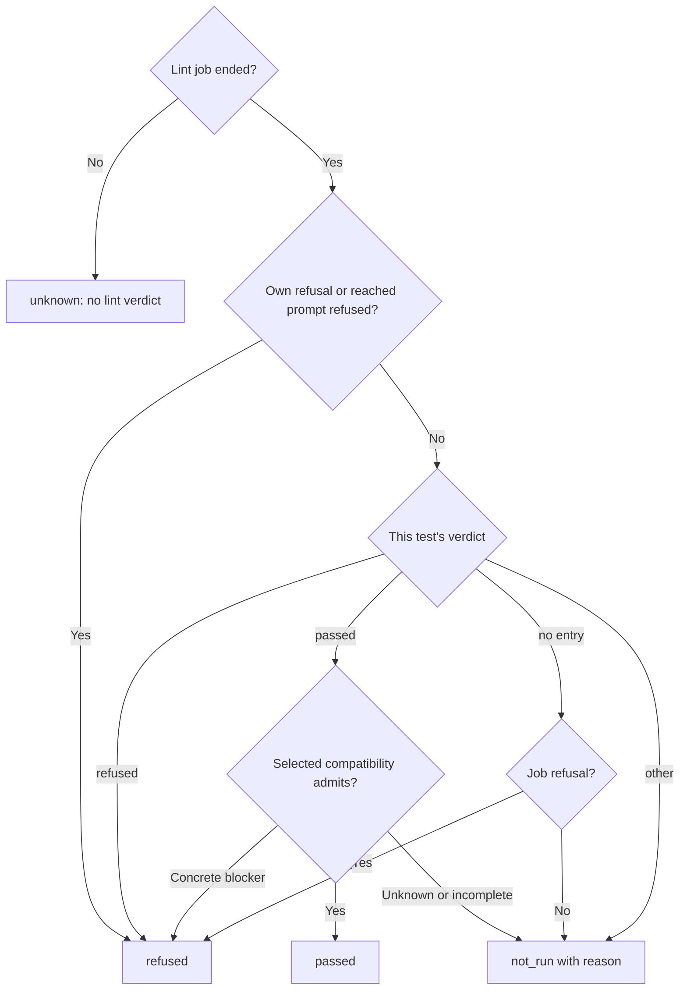

# Runtime outcome

Own `src/runtime/runtime-outcome.mjs`: the one place that decides what happened to one
selected test from one server answer. `pdd lint`, the lint gate for paid work, the
table, the Story summary, the progress line and the exit code all read this
decision, so two consumers can never disagree about the same answer. A pass needs
positive evidence about that test; missing or unrecognized evidence is never
`passed`. Pure module: no IO, clock, mutation of its input or module state.

## Public result vocabulary

Export `CHECK_STATES`, the fixed ordered list `waiting`, `sent`, `passed`,
`failed`, `refused`, `partial`, `not run`. Export pure
`resultOutcome(row)` returning `{state, reason}`. `reason` is null only for
`passed`; otherwise it is `{code, message}`, both nonempty strings.
This is the single owner of public result names and reason mapping. Transport
and recovery may retain their existing internal states. These are not public
result names. Keep raw server refusal codes in refusal records.

| Evidence or internal state | Public state | Default reason code |
|---|---|---|
| ready, waiting, no submission yet | waiting | awaiting-admission |
| queued, running | sent | awaiting-server-verdict |
| sending without a confirmed receipt | partial | dispatch-uncertain |
| positive pass | passed | none |
| failed check | failed | check-failed |
| explicit refusal | refused | first refusal code, else admission-refused |
| local SVG lint only | partial | local-only |
| unknown or missing verdict after submission | partial | no-server-verdict |
| not_run, not run | not run | no-server-verdict |

A supplied reason or note code wins over defaults. Map check-busy and lint-busy
to server-busy. Map the internal recovery note lint-pending to public deadline
when an invocation ends its wait for a running lint. During the original
free lint wait, interruption uses interrupted instead. A saved read can retain
the producer deadline reason until fresh lint evidence replaces it. A retryable not-run capacity refusal defaults to server-busy in
public rows; a supplied timeout-flag, deadline or interrupted cause takes precedence
over that capacity default. Keep the capacity evidence and raw refusal code separately.
A local row marked unsent with refusals is public `not run` with reason code `broken-test`; retain each original refusal code, message and hint separately. Preserve broken-test as a not-run reason, for a caller that cannot
run a malformed test; this module does not decide which tests to skip. A caller
stopped by its explicit `--timeout` reports timeout-flag and names `--timeout` in
the message. An internal or server deadline reports deadline. A known broken-test
reason means not run. Provider failures retain their provider code and the existing provider-failure
explanation in the public reason. A server step timeout retains its small-step
advice as part of the deadline explanation. Unknown supplied public state names become partial with
no-server-verdict. Keep supplied human explanations when available.

Use this projection for text, JSON, saved batch rows and PR evidence lines.
`outcomeText` uses the public state and includes its reason code. Progress may
append queue position and step/call counts. Summary lines include the public
states and reason codes of every non-passing row. Only passed counts as a full
pass. A partial result never admits a PDD gate, workflow step or Autopilot pass.
`resultOverall(outcomes, options)` projects the row that decides the existing
exit precedence. Lint metadata uses this selected aggregate after judging rows,
so a raw passing job without selected passes cannot appear as a full lint pass.
The internal functions below retain recovery and exit precedence compatibility;
a public partial result exits 3 unless its caller is the local SVG lint command.

## Outcomes

Module function `outcomeFor(answer, {test, steps = [], kind = answer.command, timeLimit = false, sourceFiles, capacityUncertain = false})`
returns one outcome object. `test` is the selected test path, `steps` its authored
steps (each with `entry_path`), `kind` is `lint` or `check`, and `timeLimit` is
true when the client found a typed step time-limit stop in the answer. The client
sets `capacityUncertain` for a Check when raw capacity evidence is incomplete or
conflicting. That flag returns `unknown` before generic retryable/not-started
refusal classification; the answer cannot project as busy or not run.

| State | When | Retained fields |
|---|---|---|
| queued | job state `queued` | `ahead` from `queue.ahead` when it is a whole number |
| running | job state `running` | `progress` when the server sent any, see [Progress](#progress-and-exit) |
| passed | check: job state `passed` with a result object; lint: see below | lint: `draft` |
| failed | check job state `failed` | `criteria` from `report.criterion_results` |
| refused | an explicit refusal, see below | `code`, `field`, `fix`, `message`, `refusals` |
| not_run | retryable pool refusal before dispatch; an ended lint with no pass for the test | nonempty `code`, `retryable`, `message` or `reason` |
| unknown | a lint or check that has not ended with a verdict, and every time-limit stop | `reason` |

`unknown` means "still open or not known": reading the same job again may change
it. An ended job that will not change is never `unknown`.

Rules for every answer, in this order:

1. A time-limit stop is `unknown`.
2. For a check, `capacityUncertain: true` is `unknown`, even when the raw receipt
   also says retryable and not started. It never becomes `not_run` from that
   generic refusal rule.
3. Refusal records are `result.refusals`; `report.refusal` stands in only when that
   list is empty. Any refusal record that the server declares `retryable: true` (on
   the record or in its `details`), in an answer with `dispatch: not_started`
   (report or answer), is `not_run` with its own code and the server's text, whatever
   the code is (for example `pool-copy-unavailable` or `login-queue-timeout`). The
   check did not start, so it is never refused or failed. Retryability is never
   inferred from a code name or from text.
4. Lint answers follow [Lint evidence](#lint-evidence-and-scope).
5. For a check: job state `unknown` is `unknown` with the server's `why` as reason;
   job state `failed` is `failed`; job state `refused`, or report `verdict:
   refused`, is `refused`. The first refusal record gives `code`, `field` (else
   `at`, else `section`), `fix` and `message` (`reason`, else `message`, else
   `code`).

## Lint evidence and scope

- **Ended**: job state `passed`, `failed` or `refused`. Queued, running, unknown or
  missing answers have no lint verdict yet.
- **This test's verdict**: the entries for exactly `test` in `result.tests`, else
  in `report.lint.tests`. Conflicting entries and `not-checked` are not a pass.
  The server lists per-test verdicts only for a lint that asked for `complete: true`.
- **Own evidence is enough.** The server lints the prompts first, then each test
  until its deadline, so a passing verdict for this test is real evidence even when
  the lint did not finish for other tests (`complete` is false). One slow or
  unchecked test never holds back a test that has its own pass and the selected
  compatibility evidence required below.
- **Complete**: `report.lint.complete === true`; when the report has no `lint`
  object, `result.problems_complete === true`. It only chooses the `not_run`
  reason.
- **Reached prompts**: each step's `entry_path`, then each declared
  `interface.calls[].target`, once each, from `report.program`. A prompt in
  `refused_prompts` refuses the test (`<path>: <message or code>`, keeping the
  record's fields). When `prompts` is a list: a missing reached prompt refuses as
  `unknown-target` (`<path> is not in the lint report.`) when lint is complete,
  and otherwise counts as not listed; admission state `stale` refuses as
  `interface-stale` (`<path> changed after its hash was filled or approved.`); any
  state other than `approved` or `draft` refuses as `interface-<state>` (`<path>
  has no usable Runtime interface.`). A reached `draft` sets `draft`. These
  refusals are marked as written for a reached prompt, so the client can add its
  local hint. A program with no `prompts` list gives no reached-prompt evidence,
  either way: the test's own verdict decides.
- **Own refusal**: a refusal record whose `file` (else `path`) is `test` refuses
  the test. A test refused this way or by its verdict keeps its own refusal records
  and error problems from `result.problems`; a refused verdict with none of them
  gets `<test> was refused by complete lint.` (`lint-refused`).
- **Job refusal**: job state `refused`, report `verdict: refused`, or any refusal
  record. It refuses only a selected test with no verdict entry of its own, even
  when a program report exists, and keeps the server's code and text (else
  `The interpreter refused lint.`). A test with its own passing verdict is
  eligible under the selected compatibility rule; the job refusal stays visible
  as a diagnostic in the client.
- **Not run code**: `deadline` when lint is incomplete; `no-server-verdict`
  when complete lint has no verdict. Keep a compatibility issue code when known.
- **Not run reason**: `lint did not finish` when lint is not complete, a reached
  prompt was not listed or the verdict is `not-checked`; else `lint gave no verdict
  for this test`.

## Selected compatibility

For lint only, `outcomeFor` also returns `compatibility`, a client view with
`reported` (the selected authoritative report or null), `state` (one of the five
server verdict names), `association` (`matched`, `mismatch` or `unknown`) and
`issue` (null or a client explanation code). This does not replace the server's
verdict or reason. Non-lint outcomes keep their current meaning and shape.
The new optional `sourceFiles` argument is the actual immutable uploaded file
manifest, `[{path, sha256}]`, computed natively from captured effective bytes.
It is production identity context, never a supplied admission Boolean.

Read the report for exactly `test` from `result.capabilities[].{path,report}`;
when absent, use `result.report.lint.tests[].capabilities`. If both forms exist,
they must agree for this test. Identical repeated deliveries count once;
conflicting reports or duplicate operation/edge identities leave compatibility
unknown (`issue: capability-report-conflict`). Preserve row order and full step,
node, operation, path and edge identities, including repeated target edges.
Do not find capabilities in the reduced `result.tests` list.

Accept the delivered v1 shape and its closed verdict/reason vocabulary in the
required wire reference below. Do not implement its feature/mode decision table,
search prose, derive absent rows or turn diagnostic text into support facts.
A missing report, unknown schema or malformed required field gives unknown with
`issue: capability-report-unavailable`; keep independently safe identity and
coverage facts for display. A valid incomplete report retains its concrete
blockers and unknown coverage. A selected complete report can admit even when
`capabilities_complete` is false because another scenario was not inspected.
The envelope flag never supplies a missing selected report or hides a blocker.

Association is matched only when the report has a lowercase 40-hex build equal
to this confirmed lint answer's `engine_sha`, its capability version is exactly
`program-capabilities.v1@` plus that build, and its non-null source has a valid
closure digest plus exact scenario/file digest matches against `sourceFiles`.
The scenario digest must match the captured bytes at `test`; every returned file
must occur once and match the captured effective bytes. Do not require unrelated
uploaded files in the selected report. The interpreter owns closure membership
and its digest; never recompute its projection or compare that digest to the
archive `source_sha256`. Missing comparison facts give unknown with
`issue: capability-association-unavailable`. A known file/scenario/build/version
disagreement gives `association:mismatch`, `state:unknown` and
`issue: capability-association-mismatch`, retaining the report as reported.
This client mismatch is not an invented server `source-mismatch` reason.

After existing own/reached-prompt refusal rules, a normal selected lint pass
first needs matched source/build association. A mismatch or unavailable
association keeps client `state:unknown`; any raw server blocker stays in
`reported` with its original codes and rows. It does not classify the current
source as supported or blocked. Ended lint is `not_run` (exit 5).

With matched association, admission needs a complete selected report and its
authoritative aggregate `supported`. Known authoritative `invalid-source`,
`unsupported-capability` or `missing-binding` gives `refused` (exit 4), preserving
those codes and rows, even with incomplete selected coverage. Without such a
concrete blocker, ended unknown/incomplete/missing/conflicting compatibility
gives `not_run` (exit 5). Unfinished/lost lint keeps its existing open outcome
(exit 3). Keep the compatibility state unknown even when the outer outcome is
final `not_run`. Unknown compatibility is never a reason to retry or send paid
work.

A matched report establishes structural support as reported for configured
build metadata. It does not attest which installed executable ran, prove a host
seam, identify a native validation profile, or map a physical observation.
Those claims remain unknown/unproved when evidence is absent; do not add a
mandatory global native-proof gate or invent a server field for them. A known
source/build disagreement blocks under association above. A supported binding
alone cannot prove a requested observation, modeled effect or fixture fact.

## Progress and exit

When a running answer has `progress: {steps_done, steps_total, step, calls_settled,
calls_open}`, keep each count that is a whole number, a `step` that is a whole
number from 1, and a nonempty step name. Missing or invalid fields stay absent;
never invent zero. This is a contract for a server field: use it when the server
sends it.

Presentation reads public state, reason, progress and queue fields. Recovery and
exit helpers below also accept the internal outcome states.

- Module function `outcomeText(outcome)` uses the public result vocabulary above.
  Append queue position when known. Append supplied progress: step number from
  `step` or `steps_done + 1`, with `of steps_total` when known, then a supplied
  step name in parentheses (or alone without a number). Append settled calls
  as `N AI calls so far` and positive open calls as `N not yet settled`.
- Module function `hasProgress(outcome)`: running with at least one progress field.
- Module function `progressText(outcomes)`: one fragment for a line, or null when
  no outcome has progress. With one such outcome, its `outcomeText`. With several,
  `sent (awaiting-server-verdict) · <sum of calls_settled> AI calls so far · <sum of calls_open> not yet
  settled`, without a step; a sum is left out when no outcome reports it.
- Module function `outcomeDone(outcome)`: true only for `passed`, `failed`,
  `refused`, `not_run` and public `not run`. `unknown` and `partial` are not done.
- Module function `outcomeOverall(outcomes, {interrupted, lintUnknown} = {})`: the
  state that decides a group. Any state that is not done counts as `unknown`. Empty,
  interrupted or `lintUnknown` is `unknown`. Else the first present of `unknown`,
  `not_run`, `refused`, `failed`, `passed`. State-to-exit-code mapping belongs to the host caller's exit-code mapper.

Without `criterion_results`, an outcome proves no criterion passed.

## Dependencies

No external runtime dependency. The required wire reference below supplies the
client consumption interface; the server remains the capability decision owner.

## Caller navigation

The client owns transport, native digest computation, saved evidence, capacity waits, local
hints and text cleaning; the host exit-code mapper maps `outcomeOverall` to process exit codes; [runtime output](runtime-output.prompt.md) renders the
retained fields. Server answer shapes: prompt-runtime `server/lint_driver.py`
(per-test verdicts with `--complete`), `server/runner.py` (`report.lint`) and
`server/app.py` (status view).

Required wire reference for native consumers

This reference transcribes the delivered
[server interface](https://github.com/promptdriven/prompt-runtime/blob/8a3d5d092f5e496190a3039694a822bf689d29aa/prompt_runtime/program_capabilities.prompt.md)
for generation and native verification. The link is navigation, not runtime
context. It supplies no client feature decision policy.

A report has `schema_version` exactly
`prompt-runtime.program-capabilities.v1`; string `capability_version` and
`engine_build`; null or object `source`; Boolean `complete`; closed `verdict`;
arrays `operations`, `edges`, `diagnostics`; and integer `provider_calls` and
`resource_calls` exactly zero. The five verdicts are `supported`,
`unsupported-capability`, `missing-binding`, `invalid-source`, `unknown`.
Unknown identity is literal `unknown` in both build/version fields. Known build
is full lowercase 40-hex; version is `program-capabilities.v1@<build>`.

Source has lowercase 64-hex `scenario_sha256`, `closure_sha256` and a sorted
`files` array of `{path,sha256}`. Each row has `selection`, `feature`,
`binding_kind`, `resource_mode`, `evaluator_mode`, `execution_mode`, `verdict`
and `reason_code`. Selection has `step_id`, `node_id`, `prompt_path`, `operation`;
an edge additionally has `edge:{edge_id,kind,call_operation,target_node_id,
target_path,target_operation,resource_operation}`. Preserve empty target fields
when no target is mapped. Operation identity is step/node; edge identity is
step/edge ID. Diagnostics have `{code,path,section}` with nullable path.

Features are `ordinary`, `constructor-retained-read`, `method-attachment`,
`retained-mutation`, `uninspectable`; bindings are `none`, `internal`, `fixture`,
`prompt`, `live`, `missing`; resource modes `simulated`, `live`; execution modes
`ordinary`, `checkpoint`, `resume`. Evaluator mode is a string. Reasons are
`supported`, `engine-build-unknown`, `source-mismatch`,
`source-admission-refused`, `retained-attachment-unsupported`,
`retained-mutation-unsupported`, `runtime-mode-unsupported`, `binding-missing`,
`analysis-unavailable`, `requirement-uninspectable`. Consume reported decisions;
these enums do not authorize rediscovering features or applying server policy.

