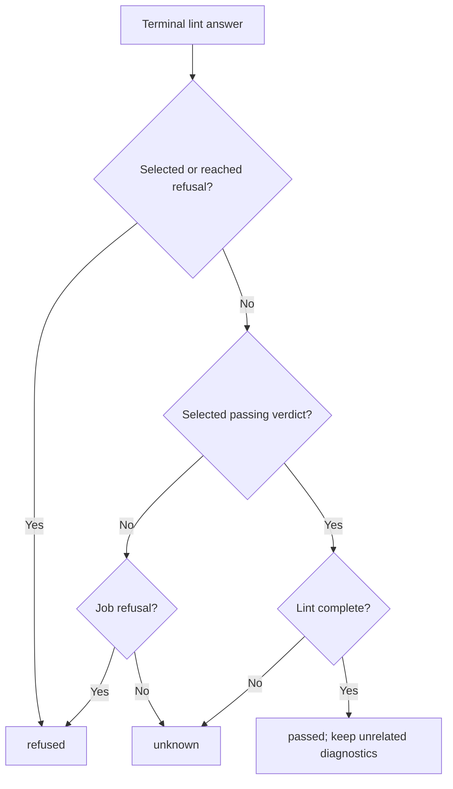

# Runtime outcome

Own `src/runtime-outcome.mjs`. Preserve the client's selected-test identity, server
reasons and existing exit precedence. Replace inference from absent failures with
positive evidence. No IO, clock, mutable input or module-global state.

Module function `outcomeFor(answer, {test, steps = [], kind} = {})` returns one
outcome for one selected test. `kind` defaults to the answer's command. Persisted
client rows may also be normalized by this function; they already contain the
outcome state, never a fresh server verdict. Missing or unrecognized evidence is
`unknown`, never a pass. The output's `state` is one of the following:

| State | Evidence and retained fields |
|---|---|
| queued | Explicit queued answer; retain `queue.ahead` when known. |
| running | Explicit running answer; retain supplied progress fields below. |
| passed | Positive selected-test verdict, subject to the lint rules below. |
| failed | A failed verdict; retain `criteria` from `report.criterion_results`. |
| refused | Admission/source refusal; retain `code`, `field`, `fix`, server text and refusal records. |
| not_run | Explicit unstarted result; retain `code`, `retryable` and server text. |
| unknown | No verdict or incomplete evidence; retain `reason`. |

## Lint evidence and scope

`result.report.lint.complete === true` is completion evidence. A public projection
with `result.problems_complete === true` is equivalent when the report has no
lint object. The selected verdict is the exact `test` path in `result.tests`,
falling back to `result.report.lint.tests`; absent, `not-checked` or conflicting
verdicts cannot pass. A complete lint with no selected verdict stays unknown.
Incomplete lint's reason is `lint did not finish`.

A refusal of an entry prompt or its declared called prompts refuses that selected
test; walk only the server program's declared call targets. Existing usable
admission states remain usable; a draft marks the row as draft. A missing prompts
array must never throw or serve as evidence of pass. A positive selected verdict
can stand alone without a program report. Job refusals (`state`, report `verdict`,
report `refusal`, public `refusals`) refuse a selected test lacking a per-test
verdict, even when a program report exists. Preserve their code and text. A
selected passing verdict with complete lint scopes out unrelated refusals, which
remain diagnostics. A selected `not-checked` verdict stays unknown.

A `pool-copy-unavailable` refusal with `retryable: true` (including refusal details)
and report `dispatch: not_started` is `not_run`, with the server's text. It never
becomes a failed assertion or a refused test. Do not infer retryability from prose.
Uncertain execution/accounting cannot authorize another paid dispatch.

## Progress and exit

When the server sends `progress: {steps_done, steps_total, step, calls_settled,
calls_open}` on a running answer, retain each valid nonnegative integer count and
its step label/index. Missing fields remain absent, including missing call counts;
never invent zero. Numeric `step` is one-based; when only `steps_done` and
`steps_total` are supplied, the current step is `steps_done + 1` while less than
the total. Module function `outcomeText(outcome)` gives `running · step 3 of 5 ·
4 AI calls so far · 1 in flight` for that supplied evidence. Omit only unavailable
fragments; retain a supplied named step even without counts. Queued retains its
known `ahead`. Unknown is never a completed Story.

Module function `outcomeExitCode(outcomes, {interrupted, lintUnknown} = {})` owns
exit precedence: unknown/open/empty/interrupted/lintUnknown → 3; not_run → 5;
refused → 4; failed → 1; nonempty all passed → 0. These decisions are reused by
all output and dispatch consumers. Criteria without per-criterion evidence stay
unknown; a passed job does not prove all authored criteria passed.

## Dependencies

None. Server answer shapes and client rows are supplied values. The client owns
transport identity, uncertain execution, capacity waiting and privacy cleaning;
output owns rendering of the retained evidence.
