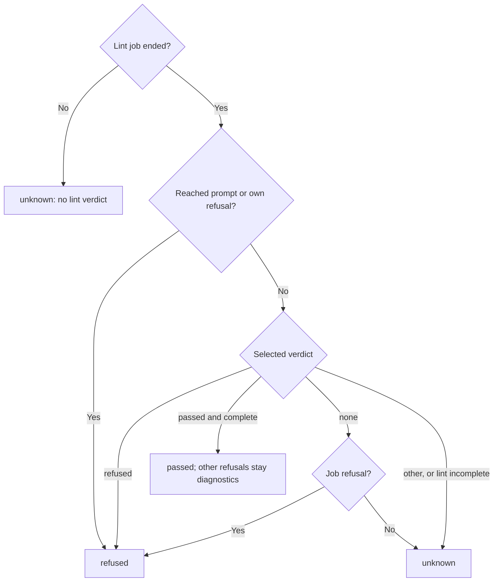

# Runtime outcome

Own `src/runtime-outcome.mjs`: the one place that decides what happened to one
selected test from one server answer. `pdd lint`, the paid-check gate, the table,
the Story summary, the progress line and the exit code all read this decision, so
two consumers can never disagree about the same answer. A pass needs positive
evidence: missing, unrecognized or incomplete evidence is `unknown`, never
`passed`. Pure module: no IO, clock, mutation of its input or module state.

## Outcomes

Module function `outcomeFor(answer, {test, steps = [], kind = answer.command, timeLimit = false})`
returns one outcome object. `test` is the selected test path, `steps` its authored
steps (each with `entry_path`), `kind` is `lint` or `check`, and `timeLimit` is
true when the client found a typed step time-limit stop in the answer.

| State | When | Retained fields |
|---|---|---|
| queued | job state `queued` | `ahead` from `queue.ahead` when it is a whole number |
| running | job state `running` | `progress`, see [Progress](#progress-and-exit) |
| passed | check: job state `passed` with a result object; lint: see below | lint: `draft` |
| failed | check job state `failed` | `criteria` from `report.criterion_results` |
| refused | an explicit refusal, see below | `code`, `field`, `fix`, `message`, `refusals` |
| not_run | retryable pool refusal before dispatch | `code`, `retryable: true`, `message` |
| unknown | anything else, and every time-limit stop | `reason` |

Rules for every answer, in this order:

1. A time-limit stop is `unknown`.
2. Refusal records are `result.refusals`; `report.refusal` stands in only when that
   list is empty. A `pool-copy-unavailable` record with `retryable: true` (on the
   record or in its `details`) and `dispatch: not_started` (report or answer) is
   `not_run` with the server's text. It is never refused or failed. Retryability is
   never inferred from text.
3. Lint answers follow [Lint evidence](#lint-evidence-and-scope).
4. For a check, job state `unknown` is `unknown` with the server's `why` as reason.
   Job state `refused` or report `verdict: refused` is `refused`; the first record
   gives `code`, `field` (else `at`, else `section`), `fix` and `message` (`reason`,
   else `message`, else `code`).

## Lint evidence and scope

- **Ended**: job state `passed`, `failed` or `refused`. Queued, running, unknown or
  missing answers have no lint verdict.
- **Complete**: `report.lint.complete === true`; when the report has no `lint`
  object, `result.problems_complete === true`. The server lists per-test verdicts
  only for a lint that asked for `complete: true`.
- **Selected verdict**: the entries for exactly `test` in `result.tests`, else
  `report.lint.tests`. Conflicting entries are no verdict. `not-checked` is not a pass.
- **Reached prompts**: each step's `entry_path`, then each declared
  `interface.calls[].target`, once each, from `report.program`. A prompt in
  `refused_prompts` refuses the test (`<path>: <message or code>`, keeping the
  record's fields). When `prompts` is a list: a missing reached prompt refuses
  as `unknown-target` (`<path> is not in the lint report.`) only when lint is
  complete, else the test is `unknown` ("lint did not finish"); admission state
  `stale` refuses as `interface-stale` (`<path> changed after its hash was filled or
  approved.`); any state other than `approved` or `draft` refuses as
  `interface-<state>` (`<path> has no usable Runtime interface.`). A reached `draft`
  sets `draft`. A missing `prompts` list is never a pass and never an error.
- **Own refusal**: a refusal record whose `file` (else `path`) is `test` refuses
  the test. A test refused this way or by its verdict keeps its own refusal records
  and error problems from `result.problems`; a refused verdict with none of them
  gets `<test> was refused by complete lint.` (`lint-refused`).
- **Job refusal**: job state `refused`, report `verdict: refused`, or any refusal
  record. It refuses only a selected test with no verdict of its own, even when a
  program report exists, and keeps the server's code and text (else
  `The interpreter refused lint.`).
- **Scope**: a complete passing verdict for the selected test is the only evidence
  that sets aside job refusals and other tests' refusals. The client keeps them
  visible as diagnostics.
- **Unknown reason**: `no lint verdict` when the job did not end, `lint did not
  finish` when lint is incomplete, else `lint gave no verdict for this test`.

## Progress and exit

When a running answer has `progress: {steps_done, steps_total, step, calls_settled,
calls_open}`, keep each field that is a whole number, and a nonempty step name.
Missing or invalid fields stay absent; never invent zero. This is a contract for a
server field: use it when the server sends it.

Each function below reads only `state`, `progress` and `ahead`, so a saved row
that carries these outcome fields is used as it is.

- Module function `outcomeText(outcome)`: `queued · 2 ahead` (or `queued`),
  `not run`, the state name for other ended states, and for running
  `running · step 3 of 5 · 4 AI calls so far · 1 in flight`. A whole-number `step`
  is one-based; without it, the step is `steps_done + 1` while that is below
  `steps_total`. A named step is shown as it is. Omit each missing fragment;
  `in flight` appears only when `calls_open` is above zero.
- Module function `hasProgress(outcome)`: running with at least one progress field.
- Module function `outcomeDone(outcome)`: true only for `passed`, `failed`,
  `refused` and `not_run`. `unknown` is not done.
- Module function `outcomeOverall(outcomes, {interrupted, lintUnknown} = {})`: the
  state that decides a group. Any state that is not done counts as `unknown`. Empty,
  interrupted or `lintUnknown` is `unknown`. Else the first present of `unknown`,
  `not_run`, `refused`, `failed`, `passed`.
- Module function `outcomeExitCode(outcomes, options)`: that state's exit code:
  unknown 3, not_run 5, refused 4, failed 1, passed 0.

Without `criterion_results`, an outcome proves no criterion passed.

## Dependencies

None. The client owns transport, identity, saved evidence, capacity waits, local
hints and text cleaning; [runtime output](runtime-output.prompt.md) renders the
retained fields. Server answer shapes: prompt-runtime `server/lint_driver.py`
(per-test verdicts with `--complete`), `server/runner.py` (`report.lint`) and
`server/app.py` (status view).
