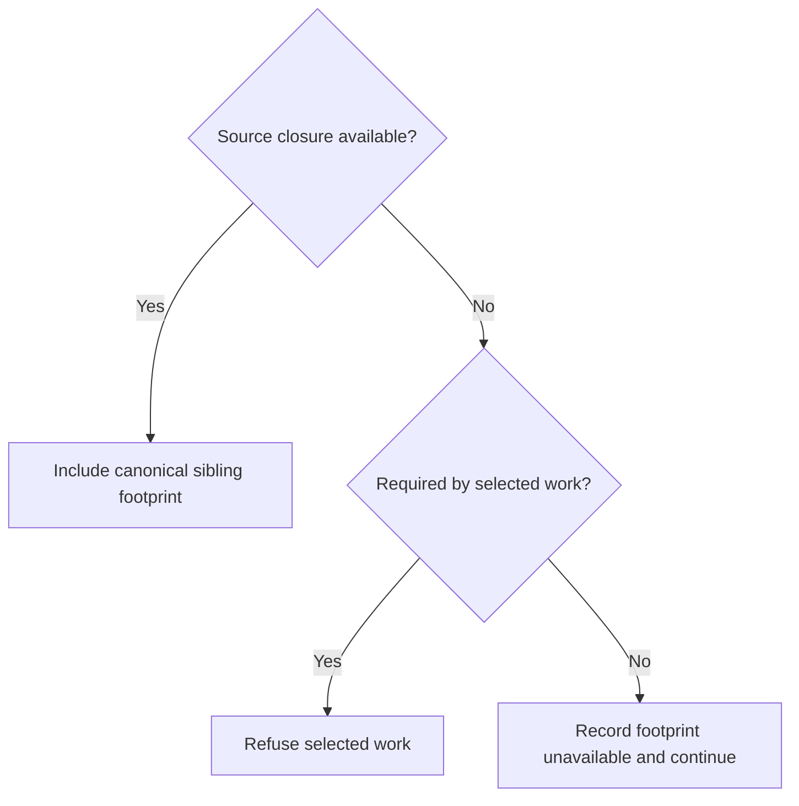

# Runtime preflight

Own `src/runtime-preflight.mjs`. It does all local work for `pdd check` and `pdd try` before anything goes to the PDD runtime: it finds the files, the tests and the stories, checks each test, computes the prose hash, fills draft hashes and builds the source tar. It makes no network call and never reads a token.

## Files

- Git files = `git ls-files -z -co --exclude-standard` in the repo root, unique and sorted. A deleted tracked file is skipped. This lookup is noninteractive: explicitly ignore stdin and retain captured stdout and stderr. Its helpers and descendants must not retain the caller's stdin after pdd exits; this defensive isolation leaves discovery results and errors unchanged.
- A test is a Git-visible `*.json` file of at most 1 MiB with the top-level `schema_version` `prompt-runtime.program-scenario.v1`. A `*.json` file that names `prompt-runtime.program-scenario` but is not valid JSON, or names another version, is a test that fails rule P1.
- A story is a Git-visible `*.md` file in a `user_stories` folder that has a `## Acceptance` / `## Acceptance criteria` heading and is not `PLAN.md` or `README.md` (an index is skipped silently; 2048 session, 0.1.6). Its name is the file name without `.md`. Its title is its first `# ` line. A story with no test gives a warning. Discovery follows the [bounded-read rules](#source-capture).
- No tests at all: say why, after `No tests found. …`, in at most 5 lines (then `…and N more`): each Git-visible `*.json` under a `tests` folder without the scenario `schema_version` (`tests/x.json is not a PDD test file (it has no "schema_version": "prompt-runtime.program-scenario.v1"). See RUNBOOK.md §2.`), each Git-visible `*.prompt` file (`PDD prompts must end in .prompt.md: rename prompts/board.prompt to prompts/board.prompt.md.`), and each `*.prompt.md` with no Runtime interface block (`prompts/x.prompt.md has no Runtime interface block. See RUNBOOK.md §2.`). Exit 2.
- Select tests by PATH or STORY words: a test path, a story path, a story name, a test file name without `.json`, or a repository directory. Resolve relative paths from invocation cwd, including `.`; directories select bounded descendants by path components, never similarly prefixed sibling directories or outside-repository paths. A directory containing Story files selects their tests. No word selects every test. Union multiple selections without duplicates. An unknown word is a command error that lists the stories with tests.

## Rules (engine eae2202a codes; `pdd-*` codes are pdd only)

A story may have more than one test file (for example a different starting world). Each file must still cover every criterion of its story (P5, P6). There is no P11.

Check each selected test. Stop at the first broken rule; that test is refused and is not sent.

| # | Rule | Code |
|---|---|---|
| P1 | Valid JSON; only the engine's top-level keys; `schema_version` is v1 | `invalid-document` |
| P2 | `story_path` is set and names a Git-visible file | `pdd-no-story`, `story-missing` |
| P3 | No `criteria_scope`; `check_exemptions` absent or empty | `pdd-partial-test` |
| P4 | The story has criteria | `story-criteria-missing` |
| P5 | Test criterion texts equal the story items (sorted). Name the first missing or extra line | `story-criterion-mismatch` |
| P6 | Unique IDs; each ID has a check and an exact check (the engine's exact predicate) | `duplicate-criterion`, `unchecked-criteria`, `criterion-needs-exact-check` |
| P7 | `entry_path` is a Git-visible `*.prompt.md` with one interface block, `approved` or `draft`, hash current | `entry-missing`, `interface-missing`, `pdd-two-interfaces`, `invalid-json`, `interface-unapproved`, `interface-stale` |
| P8 | `operation` is in the interface `entries` | `entry-operation-missing` |
| P9 | `input` matches `input_schema`. Skip an input that holds `$step_result`. Report every problem of every step at once | `invalid-input` |
| P10 | An error step's `expected_error` is in the entry `errors`, with one `equals` check on `error` `/code` | `pdd-unknown-error`, `missing-error-check` |

A broken step or check shape uses the engine code (`missing-steps`, `invalid-step`, `invalid-check`, `unknown-criterion`, `invalid-criterion`). A step may name a `model` (as the live engine eae2202a allows); a model that is not a nonblank string is `invalid-step-model`. pdd is never stricter than the live engine.
- Default `max_calls` for a test: 12 for each step, at least 18, at most 1000. This is a ceiling, not a charge; steps that use saved data or prompt calls need room for their whole call graph. A refusal has `code`, `section` (engine style, for example `steps[0].input.items[0].quantity`), `message`, an optional `hint` and the 1-based `step`.

- P7: drafts may run. A `draft` with a current hash passes, and its row is marked `draft`. A status that is neither `draft` nor `approved` is `interface-unapproved`. Stale hints: approved = `pdd: the text changed after approval: set status to draft, run pdd check --fill-hash, ask the person.`; draft = `pdd: <path> is a draft whose text changed after its hash was filled. Run pdd check --fill-hash.` Preflight never sets `approved`; only [pdd approve](prompt-approve.prompt.md) does, after a person's `y` in a terminal.
- Runtime interface limits admission (after P7, before upload, for the entry prompt and every prompt it calls): `limits` must be an object with exactly `max_steps` and `max_model_calls`. Both values must be integer JSON literals of at least 1; neither has an upper bound. Zero is invalid even for a pure operation. Reject missing/extra keys, null, arrays, strings, booleans, fractional numbers and decimal/exponent spellings such as `1.0` and `1e0`. Preserve the original number tokens from a read prompt so JavaScript rounding cannot turn a rejected decimal into an integer or impose a new upper cap on a valid large integer. For the exported `interfaceSchemaProblems(iface)` when given an object directly, use its integer numeric values (the JSON representation that object supplies).
  An absent `limits` field is `invalid-interface` at `/limits`. A present invalid limits value or field is `invalid-limits`, with a JSON pointer to the limits object or the specific missing/extra/invalid field. Explain the exact two-key shape or the positive-integer rule and provide a separate fix hint naming the required keys or field and minimum 1. For a missing field, explicitly say it is missing. For an absent limits object, tell the person to add `"limits": {"max_steps": 1, "max_model_calls": 1}`. For an extra key, tell the person to remove that named key. Retain the offending prompt path when converting these problems into preflight refusals. Do not rewrite a limit, change expectations, approve a prompt, contact the runtime or read authentication. Keep all existing schema/hash/input rules and discovery/capture behavior.
- Schema rules (after P7, for the entry prompt and the prompts it calls; real-user web test, issue 1): check the engine's executable schema subset (`graph_runtime_protocol.py` `_validate_schema_node`, eae2202a) on every `entries[].input_schema` and `result_schema` (any root type) and every `resources[].operations[].arguments_schema` and `result_schema` (an object root). Report ALL problems at once, each with the engine code, the JSON pointer into the interface (`/entries/0/input_schema/properties/read`) and the rule in words:
  - a schema is a nonempty object; a `type` list is `graph-schema-type-list` (use `oneOf`); `$ref`, `$dynamicRef`, `anyOf`, `allOf`, `not`, `if`, `then`, `else`, `contains`, `unevaluatedProperties`, `patternProperties`, `propertyNames`, `contentEncoding` are `graph-schema-unsupported-keyword`;
  - `oneOf` stands alone (only annotations beside it), is a nonempty list with no repeated schema, and each variant follows these rules;
  - `type` is null, boolean, string, integer, number, array or object (`graph-schema-type-invalid`), with only its own keywords: null/boolean `enum`, `const`; string also `minLength`, `maxLength`, `pattern`; integer/number also `minimum`, `maximum`, `exclusiveMinimum`, `exclusiveMaximum`, `multipleOf`; array `items` (required), `enum`, `const`, `minItems`, `maxItems`, `uniqueItems`; object `properties`, `required` (a list of property names; it may be empty, and a name not in it is optional), `additionalProperties` (must be `false`: `graph-schema-open-object`), `enum`, `const`, `minProperties`, `maxProperties`; annotations `default`, `description`, `title`, `examples`, `format` anywhere;
  - keyword values have the right shape (counts are whole numbers of 0 or more, bounds are numbers, `multipleOf` > 0, `enum` a nonempty list of distinct values of the type).
  pdd is never stricter than the engine: a rule it cannot judge for sure is not a refusal.
- P9 validator keywords: `type`, `oneOf` (exactly one variant fits), `properties`, `required`, `additionalProperties`, `items`, `enum`, `const`, `minimum`, `maximum`, `exclusiveMinimum`, `exclusiveMaximum`, `multipleOf`, `minLength`, `maxLength`, `minItems`, `maxItems`, `uniqueItems`, `minProperties`, `maxProperties`. A `pattern` miss is only a warning (JavaScript and Python regexes differ). For `oneOf`, determine membership using all predicates, including patterns, recursively through object fields and array items. Distinguish a definite match, a definite miss and an unknown predicate: absence of a hard error alone never proves membership. Local pattern evidence requires both a supported common syntax and a concrete input in its known equivalent domain across JavaScript and Python; ASCII spelling alone does not establish equivalence for Unicode character classes or end anchors. Unsupported syntax (including empty character classes) or unjudged input remains unknown. Locally supported portable patterns distinguish alternatives; a failed pattern does not count as a matching branch. Report overlap only when the concrete input definitely matches at least two complete branches. Invalid or nonportable regex syntax and any unjudged predicate cannot prove a match or an overlap; leave uncertainty to the runtime. Do not emit warnings for nonmatching alternatives when one branch uniquely matches. Preserve warning-only treatment for an ordinary pattern miss and for a union whose only misses are patterns; known type, bounds, enum and structural failures still refuse when no branch can fit. Annotations (`title`, `description`, `default`, `examples`, `format`, `$comment`, `$schema`, `$id`) change nothing. Any other keyword skips that input with a warning. The message is the step, the JSON pointer and the rule in words: `steps[0] input /items/0/quantity is 0. The prompt allows 1 to 20.`
- Two prompts that name the same source file: for each Git-visible file (not `*.md`) that more than one `*.prompt.md` names in backticks, one line `Warning: <file> is named by N prompts (<prompts>). One prompt should own each source file.` (real-user cli issue 10).
- Warnings never block. Input warnings show for refused tests too. Numeric typo advice applies only to numeric `equals` and `one_of` checks on `result` or `error`, within 10% of a different number in the criterion text. Use the result path and companion checks for that criterion: a distinct component is not a mismatch when another result path asserts the criterion's number. A named total/cap/limit/budget path still gets typo advice when the criterion names that same quantity, even if a different path asserts its number. A component named after `across` in an aggregate criterion also measures a different quantity. For a recognizable named quantity, associate each criterion number with the quantity it describes before comparing: a score is distinct from a move count or seed, and a checkpoint is distinct from a replay length. Thus a score of 28 after move 10 does not conflict with a criterion about a fixed 30 moves. Compare a score check against an explicitly stated score even if a different quantity happens to equal the check value; a score of 28 against a stated score of 30 still warns. Do not infer a different quantity from an unknown path: retain existing near-number advice when quantity identity is ambiguous. Keep call/world/count exclusions and silence for far numbers.
  Label remaining advice `Warning: possible numeric mismatch`, locate the test, step/check, target/path and Story criterion, and explain that the quantities may differ. Ask the author to confirm against the Story and prompt, retain a correct expected value, and record a scoped rationale in `pdd-numeric-reviews.json` if needed. Never edit a test or criterion automatically.
  The optional repository-root review file is local authoring metadata, not an automatic upload or a Runtime waiver. Read only a Git-visible regular non-symlink file, at most 16 KiB, with exactly `{schema_version:"pdd.numeric-reviews.v1",reviews:[...]}` (at most100 rows). Each closed row has `test_path`, `test_sha256` (current full test bytes,64hex), `step_id`, `criterion_id`, `target` (`result`/`error`), `path`, finite numeric `value`, and a nonblank one-line `reason` (at most1000 characters). Match all those identity fields to suppress only that advisory; a stale hash or other mismatch suppresses nothing. Invalid/unreadable review metadata gives a warning and applies no reviews. Keep P1–P10, exact criterion-text validation and all Runtime assertions unchanged. The count of files sent that are not prompt, story or test files is a calm note (see the [runtime client](runtime-client.prompt.md)).

## Story criteria

Port the engine's `explicit_story_criteria` and its 4 regexes exactly: the `## Acceptance` / `## Acceptance Criteria` heading (any case, at a line start, `\n` lines only), one numbered list from 1 with continued lines, and the bullet list in the heading section when there is no numbered list. Use Python `splitlines`, `strip` and `split` whitespace rules. The results must equal the engine for the same text.

## Prose hash

- The interface block is the engine `_INTERFACE` regex (`prompt_program_discovery.py` at eae2202a), in JS with the flags `gi`.
- `prose_sha256` = lowercase hex SHA-256 of the UTF-8 bytes of the text with every block removed. Read the file as UTF-8 and do not change newlines.
- `fillHashes({root, files})` examines Git-visible `*.prompt.md` files by default, independently of test discovery or source capture. It returns `filled`, `current`, `refused`, `stale` and `warnings` arrays; outcome records name `path`, and refusals and warnings also have `message`. A file without an interface block is skipped. Multiple blocks, invalid JSON or a non-object interface are refused before status classification.
- Classify absent keys by own-property presence, not truthiness or inherited values. Without its own `status` but with its own `prose_sha256` key (of any value), leave every byte unchanged and refuse: identify the path and advise adding `"status": "draft"` and rerunning `pdd check --fill-hash`. A misspelled `Status` is not `status`. Without either own key, leave every byte unchanged and return a warning identifying the path: its Runtime interface has no status and no prose_sha256, so pdd skipped it; if this is a prompt to check, add `"status": "draft"` and run `pdd check --fill-hash` again. Apply these rules in every directory, even without tests. A present status other than `draft` or `approved` (including null or an empty string) remains a refusal.
- For `draft`, replace only the string value of `"prose_sha256"` in its block and keep every other byte; a missing key is refused (`add "prose_sha256": ""`), as is a value that cannot be replaced safely. `approved` and current = no change; `approved` and stale = no change and a stale result, even when no test reaches that prompt. `--fill-hash` never sets `approved`.

## Source capture

Default shared-reference preparation uses the synchronous module function
`expandSource` from [references](contract-refs.prompt.md). Expand before
`readPrompt(root, visible, path)` parses/validates interface schemas and before
`checkTest` validates a scenario or its inputs. Preserve readPrompt's synchronous
public API. `--fill-hash` validates references but writes only its existing draft
hash string, never an expanded schema/world. Explicit lint prepares references
without adding local engine-rule validation.
Preparation preserves existing malformed no-reference consumer handling:
`readPrompt` still reports `invalid-json`, scenario failures keep their existing
diagnostics, and explicit lint leaves engine validation server-side. Necessary
syntax parsing does not turn ordinary malformed consumer source into a contract
error; malformed selected contract JSON still gives `contract-invalid`.

Capture uses that same resolver for selected prompt/scenario bytes. Every
contract/seed read uses the capture attempt's safe, snapshot-aware adapter and
participates in its before/after stat observations and closure retries. Apply
expansion within the existing capture path, including generated/replaced source
when present; do not build a second archive path. Discover dependencies from
effective prompt/scenario bytes. Reference-only reads do not automatically add
raw contract files to the upload: their selected record/world is already inline.
An explicit ordinary dependency still selects its full file. Missing or unsafe
references stop before upload/sign-in with consumer and target, exit 4.

Module function `sourceFilePort(root, visible = new Set(gitFiles(root)))` returns
the synchronous `{stat({path}), read({path})}` adapter for local consumers.
It applies this module's path, Git visibility, privacy and regular-file rules;
stat returns `{exists,is_symlink,size}` and read returns UTF-8 `{content}`.
Before each actual raw-file read, check its stat size against 10,485,760 bytes.
This guards this port, `readPrompt`, capture selection/metadata/reference reads
and preparation-hook `readFile`, including raw bytes read before replacement.
An oversized required raw file refuses before allocation/open/read, even when
sparse or above the native Buffer limit; preserve exit 4 and the finite too-big
diagnostic with total and largest files, never a RangeError. Deferring a selected
read cannot bypass this guard. Enforce selected-source totals and the 10,000
selected-file budget before selected reads. Reference/preparation-only raw reads
do not become upload members or accumulate again in selected totals.
A safe Git-visible regular path may instead receive prepared replacement bytes
without reading its raw original, even when that original is 2 GiB. Its stat size
alone must not refuse this replacement: only effective bytes enter the payload
and memory. Preserve the original path's privacy, Git-visibility and snapshot
checks. Virtual and replacement bytes are actual upload bytes. Discovery-only or
unselected footprint documents cannot refuse the selected work merely for their
size: skip or warn before allocating their contents and record affected footprints
as unavailable. Never replace an ignored-file refusal with an unbounded read.
Unrelated files do not count. Effective expanded/replacement bytes and tar retain their
separate selected-payload limits; equal byte/file boundaries are permitted before
applying the independent tar limit.
Missing stat reports absence; missing read refuses exit 4. Reuse the capture
reader's safe snapshots without selecting payload, creating an archive or writing
files. Capture additionally checks its attempt's observations and retries.

Retain original authored paths. Effective upload bytes determine byte limits,
tar contents and source SHA; no-reference captures keep exactly the prior bytes
and tar. For reference-only reads, unused contracts and unused records in a
shared file must not affect a selected Story's source or freshness. Expose expansion provenance per consumer
and a per-Story effective-file footprint for local Check history. For a selected
Story, include every discovered scenario belonging to it and each scenario's own
dependency closure, plus common explicit includes and supplied app-map context.
For a complete closure, the footprint for unchanged effective source is identical
whether capture selects one test, all that Story's tests or a multi-Story batch.
Footprint accounting does not select extra upload files. A batch hash cannot
substitute for a Story footprint; reference-only changes affect actual users.

A missing entry prompt, missing seed, unsafe path or other unresolved source in
an unselected sibling makes that sibling's footprint unavailable with its cause;
it does not refuse a selected good test. Keep complete valid sibling closures
selection-independent. An unavailable sibling leaves the affected Story footprint
incomplete: do not substitute a partial hash or claim current freshness, successful
sibling evaluation or a complete baseline from it. Selected closures and common
required inputs retain every existing refusal and privacy check, even when also
used by an unselected sibling. Capture instability still uses whole-attempt retries.

- Module function `captureSource(root, {tests, appMap, attempts, prepareSource})` captures a sorted, deduplicated selection with original repository-relative names. The optional preparation hook is defined below. `tests` is a list of test paths in the effective source; absent means every discovered test in that source. Include each selected test, its `story_path`, step `entry_path`s, declared `entry_paths`, test context `prompt_path`s and `paths`, and recursively every reached prompt's interface `calls[].target`. Missing declared files refuse with exit 4, naming the referring file and missing path; never silently send an incomplete program.
- Required Markdown context is declared in `## Dependencies`: local inline or reference-style Markdown links, and a backticked file path that leads a dependency list item (optionally followed by a colon and description). A bare declaration must name a directory-qualified file with an extension, or a filename with a common text, data or source-code extension (otherwise use a Markdown link); schema/version labels, dotted API identifiers, regular expressions, commands, absolute/home/environment paths and inline-code mentions inside descriptions or rules are not file declarations. Link destinations remain authoritative even when missing; classification must not depend on whether a descriptive token happens to match a Git file. Resolve links and context paths relative to the declaring file, with repository-root paths accepted when they name Git files. Include linked fragments' whole files, and recurse through dependencies in Markdown context files. Include local image links anywhere in reached Markdown, including SVG mockups, subject to the code-example rule below. Ignore remote URLs and same-file anchors; do not load ordinary navigation links outside Dependencies. Cycles terminate and files appear once. Invalid or escaping paths refuse. Unusual names can use the include list.
- Code examples do not declare Markdown dependencies: ignore inline/reference-style link and image uses, and reference definitions, inside code spans or backtick/tilde fenced code blocks. A code span closes with a backtick run of the same length. A fence opens with at least three identical backticks or tildes and closes only with the same character and at least its opening length; shorter or different markers remain example content, and an unclosed fence protects the remainder. An in-code reference definition cannot resolve an outside use or override an outside definition. Outside code, retain real links/images and their missing/unsafe-file refusals. The backticked bare file path leading a genuine Dependencies list item remains a declaration; a list item inside a fenced example does not. Apply these distinctions only to discovery, including section boundaries; never rewrite authored or captured bytes.
- The Dependencies section ends at the next level-one/two Markdown heading or a following `

` section headed `Required rules`, `Required module rules`, `Required interface reference` or `Decision path` (case-insensitive, optional `Required`, and an optional colon with a descriptive suffix). Inline emphasis tags (`strong`, `em`, `b`, `i`) and line breaks in those summaries do not change the boundary, including quoted tag attributes containing `>`. Unknown or malformed angle markup does not establish a boundary: retain subsequent dependency declarations and their safety checks. This reads a section name only; never treat it as sanitized HTML or alter captured bytes. Literal HTML section markers inside backtick/tilde fenced examples, inline code or HTML comments are not boundaries; they must not hide a genuine dependency declaration or bypass its missing/unsafe-file refusal. Later rule/reference links and source/test filename list items are not dependency declarations, even when Git contains those files. Other details blocks may wrap genuine dependency declarations and do not end the section. Preserve their inline/reference links, bare file declarations, recursive context and missing/unsafe-file refusals. Image links still apply anywhere in the full reached Markdown. This scopes discovery only; never trim the captured prompt or infer file exclusions from its extension.
- `appMap` names the app map used by the caller, or null for none. Include that file, all its screen, router, handler and after-operation `prompt_path`s, their dependency closures, and `stylesheets`. App-map paths are repository-relative. Only path-bearing map fields supply dependencies; arbitrary input or saved-state strings do not.
- Optional root `pdd-source.json` contains only `{"include": ["docs/shared-policy.md", "data/menu.json"]}`. Entries are exact Git-visible repository-relative file paths, not folders or globs; reject invalid JSON, unknown keys, non-string entries, absolute paths and traversal. Include these files and their Markdown/prompt dependencies. The config itself is local selection metadata, sent only if explicitly included. No include list can override safety rules or limits.
- Apply safety only to the selected payload, selection metadata and preparation/reference reads before reading them. Refuse (exit 4, with the paths) a symlink (including an ancestor), a submodule or another non-regular file, and a secret name: `.env*`, `auth.json`, `credentials.json`, `id_rsa`, `id_ed25519`, `id_ecdsa`, `id_dsa`, `.npmrc`, `.netrc`, `.git-credentials`, `.pypirc`, `*.pem`, `*.key`, `*.p12`, `*.pfx`, `*.keystore`, `*.tfstate`, `*.tfvars`, `.docker/config.json`, `.pdd/agents.json`, `.config/pdd/agents.json` (agent config path matches are case-insensitive), or a path part `secrets`, `.ssh`, `.codex`, `.terraform`, `.aws`. Refuse more than 10,485,760 bytes or more than 10,000 selected files, with the total and the 5 largest files. The tar must also fit the byte limit. Unrelated tracked or unignored files do not count and are not sent.
- Write the tar in memory in Node: ustar, Git names with no `./`, mode 0600, mtime 0, uid and gid 0, empty user and group names, a PAX `path` record for a name that is not ASCII or is longer than 100 bytes, and two zero blocks at the end. The same files give the same bytes. `source_sha256` = SHA-256 of the tar bytes.
- Stat each file and selection metadata before and after (ino, size, mtime in ns). Include preparation/reference observations, even when their raw files are not uploaded, and observed absence for generated paths or missing-file stats. If an observed file, absence or the Git file list changes, discard the entire attempt and discover/prepare/capture again; `attempts` defaults to 3, then stop with exit 5. Keep the captured bytes consistent with these observations and never follow a symlink while reading.

Prepare generated or replaced upload files

`prepareSource` is an optional synchronous callback, called once per capture
attempt before selection and dependency discovery. It receives exactly the
attempt's `{readFile, statFile}` ports; it returns an array of `{path, bytes}`
files. An empty array adds nothing. Absence of the hook preserves the existing
invocation and results; without references its tar remains byte for byte exact.
There is no second archive builder and no write to authored source.

Both ports take a repository-relative path string and observe the raw repository
in this attempt, including when that path will be replaced. `readFile(path)`
returns a Buffer with the exact file bytes; changing that Buffer cannot change
the captured snapshot or a later read. `statFile(path)` returns a fresh
`{exists, is_symlink, size}` object, with byte size, matching the
[references file port](contract-refs.prompt.md#target-identity-and-reading).
A missing path returns `{exists:false,is_symlink:false,size:0}` from stat;
reading it refuses with exit 4. Existing files must be Git-visible regular files. Both
ports apply the capture path, secret-name, ancestor and nonregular-file checks
before access; an unsafe path refuses even for a stat. All successful reads and
stats, including absence, join the attempt's consistency observations. Reading
alone never selects a file for upload. Callers use these ports for every input
that contributes to prepared bytes; no outside reads or effects belong in the
callback. The ports are valid only during that callback invocation.

Returned `bytes` accepts Buffer, Uint8Array or a string encoded as UTF-8; copy it
before use so caller mutation cannot change the payload. Keep binary bytes exact.
Returned paths use ordinary capture normalization and safety rules. Each returned
file joins the payload and the effective source: a matching existing Git-visible
regular file is replaced for this capture; an absent path is a virtual file and is exempt
only from the requirement to be Git-visible and present on disk. Check existing
ancestors and any disk entry at its path before accepting it; returning bytes
cannot hide a secret, symlink, submodule, directory or other nonregular entry.
Reject duplicate normalized output paths, even with equal bytes, and file/ancestor
collisions among outputs or selected files with exit 4 and the conflicting paths.
Never choose a first or last output. Invalid callback/result/byte shapes, including
an asynchronous result, refuse capture with exit 4 without printing file contents.
A callback failure stops capture; observed source instability instead follows
the existing whole-attempt retry rule, with fresh ports and fresh output.

Selection and discovery see one effective source: Git-visible files overlaid by
these returned files. Explicit `tests` and `appMap`, ordinary dependencies,
includes and reference targets may name virtual outputs. Apply the same roles
and discovery rules to effective test, prompt, Markdown and app-map bytes,
including an effective `pdd-source.json`. Before discovering dependencies from
each reached effective prompt/scenario, apply default shared-reference expansion
using this same attempt's safe adapter; generated/replaced contract targets are read from this effective
source. The adapter maps bytes to the references port's UTF-8 `{content}` reply
and supplies its actual stat shape. Preserve malformed no-reference handling.
Reference-only raw files stay unselected unless independently selected or
returned by the hook. Replaced raw bytes never enter the payload merely because
they were read or statted.

All returned files and discovered dependencies use the existing effective-byte,
file-count and tar limits, canonical sorted unique names, provenance/Story
footprints and exact tar SHA path. A changed replacement changes that same
`sha256`; reads of unselected inputs affect consistency, not archive membership.
The whole-product Try caller can use this hook to compose a map and seed from
attempt-local inputs; this module owns capture policy, not product composition.

## Dependencies

- [References](contract-refs.prompt.md): required generation and verification
  context for synchronous expansion and provenance; native adapters preserve
  this module's privacy, snapshot and capture rules.

Read the full [Prompting guide](../../docs/prompting-guide.md) before you change this prompt. Follow the [alpha boundary](public-boundary.prompt.md). The [runtime client](runtime-client.prompt.md) calls this module.

## Module binding inventory

Optional Git-visible root `pdd-bindings.json` is local selection metadata, never a runtime test schema extension or automatically uploaded context. Its exact format is documented in [binding inventory](../../docs/runtime-bindings.md), required for generation and testing of this capability. Discover only declared modules; never treat every source file as part of the selected Stories. No inventory means coverage unavailable.

Validate the inventory before use, with ordinary safe-file and repository-relative path rules: no secrets, symlinks, traversal or missing files. Select entries whose authored Story paths intersect the selected tests' Story paths. Count unique module paths once. A bound module must name a prompt reachable from those selected tests through step entries or declared prompt calls, with a valid executable Runtime interface; a prompt merely included as prose is not bound. An unbound declaration requires a nonblank reason and nonblank port_attempt describing the attempted runtime port and why it did not suffice. Missing explanations are lint problems. Invalid, duplicate or conflicting declarations and unknown Story references are lint problems, not silently ignored coverage. Other Stories' modules do not enter the selected denominator. Expose fresh coverage metadata and diagnostics to the client; never change expected test values.
