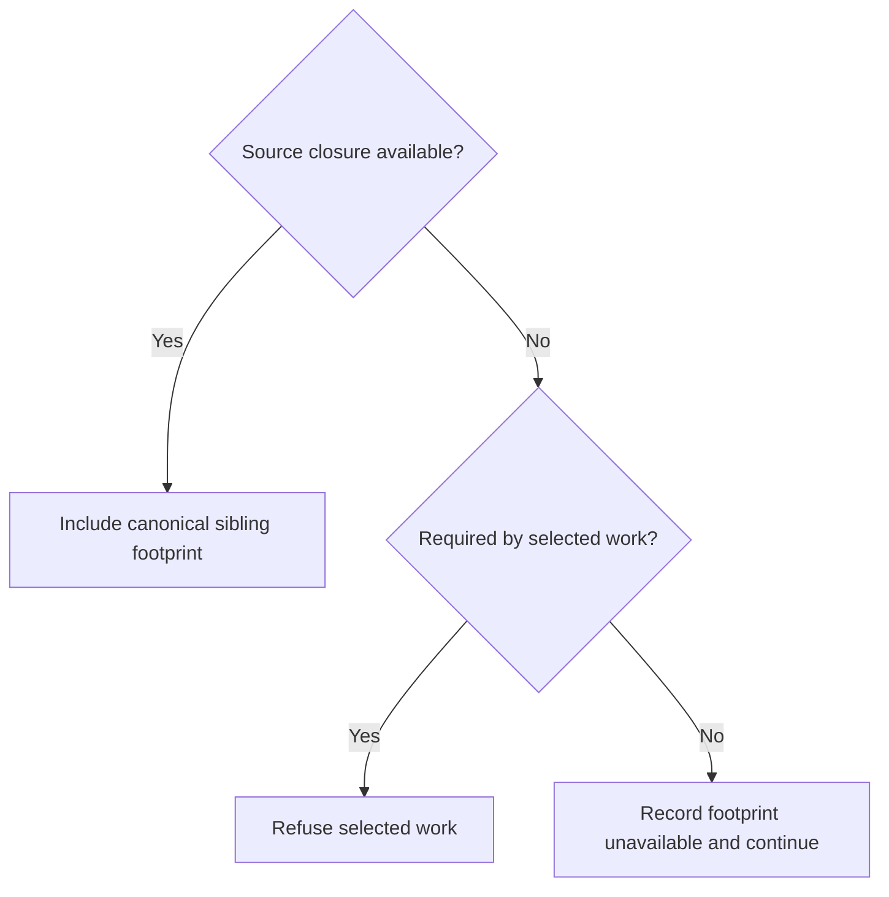

# Runtime preflight

Own `src/runtime-preflight.mjs`. It does all local work for `pdd test` and `pdd simulate` before anything goes to the PDD runtime: it finds the files, the tests and the stories, checks each test, computes the prose hash, fills draft hashes and builds the source tar. It makes no network call and never reads a token.

## Opt-in authored workspace

Load the [workspace authority](runtime-workspace.prompt.md) before authored discovery. Carry its policy through `findTests`, `readPrompt`, `checkTest`, `fillHashes`, `sourceFilePort`, `captureSource` and every method/descendant of `createStrictSourceAccess`, preserving existing invocation defaults. Accept additive `workspace` in the existing object arguments of `findTests`, `preflight` and `fillHashes`, in capture options, and as the last optional argument of `readPrompt`, `sourceFilePort` and `createStrictSourceAccess`. A strict capability retains it for all methods. Absence loads policy for that root; `checkTest` is private and inherits its caller capability. Do not use ambient mutable mode. Convert workspace configuration or required-path failures to `PreflightError` exit 4 while retaining the boundary code, chain and remedy.

Filter names before Story/test/advice content reads. An explicitly excluded selection gives the boundary diagnostic; unrelated excluded Stories, invalid tests or prompts are not opened and do not fail independent work. Keep name-only matching and selection syntax. Excluded same-Story siblings make the canonical local footprint unavailable, not complete; an in-bound unselected sibling with an excluded dependency is also unavailable. Selected required closure still refuses. Never derive a cache/current pass from a partial footprint.

All access paths use the authority: selected files, includes, required Markdown/call/context paths, `$contract`/`$seed` ports, app-map prompts/stylesheets, raw/effective preparation reads/stats and returned virtual/replacement paths. `prepareSource` cannot replace or weaken bootstrap policy. Resolve references by their existing authored meaning before permission. Keep the complete boundary cause/chain through wrapped reference errors. Apply the ceiling to every link substitution as well as authored/final paths while retaining existing stricter callers and snapshot rules.

Expose `reads` beside the unchanged upload `files`: sorted unique `{path,roles}` records of actual non-upload authored content reads, with roles `reference`, `preparation`, `footprint`, `discovery` or `guide`. A path can have several roles. This is local read disclosure, not added upload membership. Existing `files`, byte sizes, effective bytes and tar remain the sole upload manifest. `--files` and send use the same stable capture; unchanged unconfigured tar and source identity stay exact.

Hash filling checks allowed draft targets and required reference inputs before reading/writing. Update authored files directly, retain exact non-hash bytes and approved/stale rules. Excluded prompts are not opened or edited; a required crossing is a refusal. Root source-selection control is read locally under its existing safe-source rules; its includes remain subordinate to the workspace ceiling. Binding metadata never grants content access.

## Files

- Git files = `git ls-files -z -co --exclude-standard` in the repo root, unique and sorted. A deleted tracked file is skipped. This lookup is noninteractive: explicitly ignore stdin and retain captured stdout and stderr. Its helpers and descendants must not retain the caller's stdin after pdd exits; this defensive isolation leaves discovery results and errors unchanged.
- A test is found by its name and folder, never by its content: the [test name rule](#test-name-rule) below. Discovery opens no `*.json` file to decide what is a test, so no size and no byte position can hide a test. After matching and workspace eligibility, read each matched test in full, at any size. A matched test that is not valid JSON fails rule P1 with its path. pdd has no size limit for one test file; the only size limit is the [upload limit](#source-capture) when the test is sent.
- A story is a Git-visible `*.md` file in a `user_stories` folder that has a `## Acceptance` / `## Acceptance criteria` heading and is not `PLAN.md` or `README.md` (an index is skipped silently; 2048 session, 0.1.6). Its name is the file name without `.md`. Its title is its first `# ` line. A story with no test gives a warning. Discovery follows the [bounded-read rules](#source-capture). A title fallback for a linked Story uses the checked final target and its byte size, with the same identity-bound read as other source. An oversized fallback retains the filename title. A test's title is the title of the Story that the [test name rule](#test-name-rule) matched, else that Story's name.
- No tests at all: say why, after `No tests found. The test of Story user_stories/S.md is S.json in a test or tests folder. See RUNBOOK.md §2.`, in at most 5 lines (then `…and N more`): the [test name rule](#test-name-rule) lines without the `Warning: ` prefix (each Story with no test, then each test-folder JSON file that matches no Story), each Git-visible `*.prompt` file (`PDD prompts must end in .prompt.md: rename prompts/board.prompt to prompts/board.prompt.md.`), and each `*.prompt.md` with no Runtime interface block (`prompts/x.prompt.md has no Runtime interface block. See RUNBOOK.md §2.`). This opens no JSON file. Exit 2.
- Select tests by PATH or STORY words with the same rule: a test path (or any file of a conflict), a story path or a story name (all of that Story's tests), a test file name without `.json`, or a repository directory. Resolve relative paths from invocation cwd, including `.`; directories select bounded descendants by path components, never similarly prefixed sibling directories or outside-repository paths. A directory containing Story files selects their tests. Union multiple selections without duplicates. No word selects every test. A word that names a Story with no test stops with exit 2 and that Story's `has no test` line, never `Unknown story`. A word that names no Story and no test file is a command error that lists every Story with its test path, or `no test` and the expected path.

## Nested fixture projects (proposed)

For an unqualified all-Story selection, exclude a nested fixture project from
Story and test discovery when its root is below `test/fixtures` and has both
a direct `user_stories` directory and a direct `tests` directory containing
Git-visible files. Exclude only descendants of that project root; do not infer
an exclusion from a folder named `fixtures` or `examples` alone. Report each
excluded project root so the selection is visible. Apply the exclusion before
name matching, warnings and content reads.

Explicit Story, test or directory selections retain existing selection and
validation semantics, including missing dependency refusals and root-relative
references; they do not silently skip a selected fixture. Outside the excluded
roots, preserve name conflicts, missing dependency errors, and behavior when no
fixture project is present. Do not remove or modify fixture files.

## Native Story discovery and selection (draft)

For explicit `pdd lint` Story selection, retain ordinary name/path/directory
resolution and expose a separate `nativeSelections` list beside Runtime tests.
A current Story can declare `## Native validation` with a local Markdown link
to its owning module prompt's `#native-validation-profile-PROFILE_ID` anchor.
Resolve that link from the Story path under the same workspace/source capability.
Read only the selected Story and its explicitly linked native owner/required
closure. Return `{storyPath,promptPath,profileId}` and actual selected source
references; the shared results reader interprets the declaration, review and
evidence. A link or declaration establishes no native pass.

Do not scan excluded prompts or all repository source to find a guessed mapping.
Missing, ambiguous, unreadable or excluded owner references retain their concrete
reason; required boundary failures keep existing refusal precedence. A native
candidate lets explicit lint select that Story even without a Runtime scenario,
so the client can explain native proof or missing native evidence. An undeclared
Story keeps its existing missing-test result. Preserve ordinary Runtime discovery,
conflicts, P1-P10, capture and exact test-selection behavior. For mixed selection,
keep native descriptors and Runtime test rows distinct, with no duplicate Story
selection or silent widening. Other commands keep their existing unsupported
Runtime behavior; a native link adds no executable Runtime entry or capability.

This passage owns only bounded source discovery and selector output. Native
profile syntax/admission/judgment belongs to the shared result reader called by
the client; preflight does not assess or import evidence. No new CLI option,
network request, native command or authored configuration key is introduced.

Required rules: test name rule

The tests of Story `S` (`user_stories/**/S.md`) are the Git-visible regular files `S.json` and `S.<variant>.json` in a folder named `test` or `tests`, at any depth: `tests/S.json`, `tests/runtime/S.json`, `runtime/tests/S.json` and `tests/S.empty-shop.json` all count. A *Story file* is a Git-visible `*.md` file in a `user_stories` folder that is not `PLAN.md` or `README.md`; a *test-folder JSON file* is a Git-visible `*.json` file with a folder named `test` or `tests` anywhere in its path, not only as the direct parent (`test/runtime/S.json` and `runtime/tests/S.json` both count). The rule uses paths only. A test-folder JSON file named `N.json` fits the Story name `N` and each Story name `S` where `N` is `S.<variant>`. It belongs to the one Story name it fits; it matches no Story when it fits none; it is a conflict when it fits two or more (`tests/a.b.json` with Stories `a` and `a.b`): pdd never picks one. A Story file with no acceptance heading still owns its tests (rule P4 then refuses them), but it is not a Story, so it never gets a `has no test` line. Each result is visible:

| Names found | Result | Line (a warning; never blocks other Stories) |
|---|---|---|
| A Story and its files, each file name used once | Each file is a test of the Story | none |
| A Story with no file | The Story has no test | `Warning: <story> has no test: expected <dir>tests/S.json (or S.json in any test or tests folder).` `<dir>` is the path up to the Story's nearest `user_stories` folder, empty at the repository root. |
| Files that belong to no Story | They match no Story | One line: for one file `Warning: <file> matches no Story (user_stories/**/N.md).`; for more, `Warning: K JSON files in test folders match no Story (the tests of user_stories/**/S.md are S.json and S.<variant>.json). pdd test --files lists them.` `pdd test --files` and every `--json` result list each file's line. |
| One file name used by two or more files of a Story | A conflict | `Warning: <story> has N files named <name>.json: <file> and <file>. Keep one.` |
| A file that fits two or more Story names, or two or more Story files with one name and their files | A conflict | `Warning: <file> matches N Stories: <story> and <story>. Rename one.` (with two or more files, name the files joined by `and`) |

A conflict is one test entry: its `path` is the first of its files in sort order, it lists every file, and it fails rule P1 with the same sentence when it is selected, so pdd checks none of its files and never picks one. Lists are sorted; three or more items are joined with commas and a final `and`.

`findTests` returns `{visible, tests, stories, warnings, untested, orphans}`. Each test has `path`, `files`, `story`, `storyPath`, `storyPaths` and `title` from the Story file that the rule matched (not from `story_path` inside the file), and its parsed `doc` or an `error` sentence that names the file: a conflict, invalid JSON (`<test> is not valid JSON: <reason>`), a file it cannot read (`<test> cannot be read: <code>.`), or a file over the upload limit, which is not read (`<test> is <size>. The upload limit is 10 MB, so pdd cannot send it.`). One test's error never stops discovery of the others. `untested` and `orphans` are the `matchTests` lists. The order of tests is the sort order of their paths; warnings list conflicts, then Stories with no test, then the files that match no Story. Module function `matchTests(storyPaths, files)` is the rule on names only: it takes Story file paths and Git-visible file paths and returns `{tests, untested, orphans}`, where each test is `{path, files, story, storyPath, storyPaths, problem}` (`problem` is the conflict sentence or null), `untested` lists `{story, storyPath, line}` and `orphans` lists `{path, line}`; `line` has no `Warning: ` prefix. Module function `expectedTestPath(storyPath)` returns the expected path of the `has no test` line. Module function `discoveryRefusal(test)` returns the refusal that discovery alone proves (P1 with the `error` sentence, or the P2 `story_path` mismatch), else null. The [agent project card](agent-project.prompt.md), source capture and Try saved cases use these functions; no other module repeats the rule.

## Rules (engine eae2202a codes; `pdd-*` codes are pdd only)

A story may have more than one test file (for example a different starting world): `S.json` and `S.<variant>.json` by the [test name rule](#test-name-rule). Each file reports coverage of every Story criterion under P5, P6 and Criteria with no check. There is no P11.

Check each selected test. Stop at the first broken rule; that test is refused and is not sent. A missing or unreadable dependency, invalid file or source boundary failure belongs to that test. Keep its reason and fix hint and continue with the other selected tests. Shared configuration, source consistency and aggregate upload limits retain their existing refusal rules.

Export native `scenarioShapeRefusal(doc,path)` for the client to apply the same document, criterion, step and check shape rules to captured bytes. Return the existing refusal shape or null. This reuses P1, criterion/ID and step/check/model shape checks; it adds no authored rule and does not replace prompt/schema admission. A malformed captured test is unsent, and the client rebuilds the upload without it before dispatch or cache reuse.

### Criteria with no check

P5 still refuses extra or changed criterion text. A Story item omitted from the test is instead not checked. P6 still refuses duplicate IDs and malformed or unknown checks. A criterion with no assigned check or no exact check is not checked, with that structural reason. Do not guess observability from English wording. Negative behavior can have an exact world or call-count check.

Expose `not_checked` on preflight rows as an array of `{criterion_id,text,reason}`. Keep authored IDs; omitted Story items get a unique `ac-N` ID based on their Story position, with a suffix if needed. Keep the full Story total and texts. Continue all other validation rules. If no criterion has an exact check, return a local refusal with a fix hint and send nothing.

For a valid test with some exact checks, source capture keeps every authored step, input and expected value. In the captured scenario only, append omitted Story items to `criteria` and add engine `check_exemptions` with `reason:"out-of-scope"` and nonblank `detail` from each not-checked reason. This is automatic structural coverage metadata; authored `criteria_scope` and nonempty `check_exemptions` remain refused by P3. Leave Story and repository bytes unchanged. Use the same effective bytes for files preview, lint, paid checks, source identity and recovery. Do not claim the exempt criteria passed.

| # | Rule | Code |
|---|---|---|
| P1 | Valid JSON; only the engine's top-level keys; `schema_version` is v1 | `invalid-document` |
| P2 | `story_path` is set, names a Git-visible file, and names the Story that the [test name rule](#test-name-rule) matched: `<test> is the test of <story> by its name, but its story_path names <other>. Make them agree.` | `pdd-no-story`, `story-missing`, `pdd-story-mismatch` |
| P3 | No `criteria_scope`; `check_exemptions` absent or empty | `pdd-partial-test` |
| P4 | The story has criteria | `story-criteria-missing` |
| P5 | Test criterion texts belong to the Story items, including multiplicity. Extra or changed text refuses; omitted items follow Criteria with no check | `story-criterion-mismatch` |
| P6 | Unique IDs; report missing checks under Criteria with no check | `duplicate-criterion`, `unchecked-criteria` |
| P7 | `entry_path` is a Git-visible `*.prompt.md` with one interface block, `approved` or `draft`, hash current | `entry-missing`, `interface-missing`, `pdd-two-interfaces`, `invalid-json`, `interface-unapproved`, `interface-stale` |
| P8 | `operation` is in the interface `entries` | `entry-operation-missing` |
| P9 | `input` matches `input_schema`. Skip an input that holds `$step_result`. Report every problem of every step at once | `invalid-input` |
| P10 | An error step's `expected_error` is in the entry `errors`, with one `equals` check on `error` `/code` | `pdd-unknown-error`, `missing-error-check` |

A broken step or check shape uses the engine code (`missing-steps`, `invalid-step`, `invalid-check`, `unknown-criterion`, `invalid-criterion`). A step may name a `model` (as the live engine eae2202a allows); a model that is not a nonblank string is `invalid-step-model`. pdd is never stricter than the live engine.
- Default `max_calls` for a test: 12 for each step, at least 18, at most 1000. This is a ceiling, not a charge; steps that use saved data or prompt calls need room for their whole call graph. A refusal has `code`, `section` (engine style, for example `steps[0].input.items[0].quantity`), `message`, an optional `hint` and the 1-based `step`.

- P7: drafts may run. A `draft` with a current hash passes, and its row is marked `draft`. A status that is neither `draft` nor `approved` is `interface-unapproved`. Stale hints: approved = `pdd: the text changed after approval: set status to draft, run pdd test --fill-hash, ask the person.`; draft = `pdd: <path> is a draft whose text changed after its hash was filled. Run pdd test --fill-hash.` Preflight never sets `approved`; only [pdd approve](prompt-approve.prompt.md) does, after a person's `y` in a terminal.
- Runtime interface limits admission (after P7, before upload, for the entry prompt and every prompt it calls): `limits` must be an object with exactly `max_steps` and `max_model_calls`. Both values must be integer JSON literals of at least 1; neither has an upper bound. Zero is invalid even for a pure operation. Reject missing/extra keys, null, arrays, strings, booleans, fractional numbers and decimal/exponent spellings such as `1.0` and `1e0`. Preserve the original number tokens from a read prompt so JavaScript rounding cannot turn a rejected decimal into an integer or impose a new upper cap on a valid large integer. For the exported `interfaceSchemaProblems(iface)` when given an object directly, use its integer numeric values (the JSON representation that object supplies).
  An absent `limits` field is `invalid-interface` at `/limits`. A present invalid limits value or field is `invalid-limits`, with a JSON pointer to the limits object or the specific missing/extra/invalid field. Explain the exact two-key shape or the positive-integer rule and provide a separate fix hint naming the required keys or field and minimum 1. For a missing field, explicitly say it is missing. For an absent limits object, tell the person to add `"limits": {"max_steps": 1, "max_model_calls": 1}`. For an extra key, tell the person to remove that named key. Retain the offending prompt path when converting these problems into preflight refusals. Do not rewrite a limit, change expectations, approve a prompt, contact the runtime or read authentication. Keep all existing schema/hash/input rules and discovery/capture behavior.
- Schema rules (after P7, for the entry prompt and the prompts it calls; real-user web test, issue 1): check the engine's executable schema subset (`graph_runtime_protocol.py` `_validate_schema_node`, eae2202a) on every `entries[].input_schema` and `result_schema` (any root type) and every `resources[].operations[].arguments_schema` and `result_schema` (an object root). Report ALL problems at once, each with the engine code, the JSON pointer into the interface (`/entries/0/input_schema/properties/read`) and the rule in words:
  - a schema is a nonempty object; a `type` list is `graph-schema-type-list` (use `oneOf`); `$ref`, `$dynamicRef`, `anyOf`, `allOf`, `not`, `if`, `then`, `else`, `contains`, `unevaluatedProperties`, `patternProperties`, `propertyNames`, `contentEncoding` are `graph-schema-unsupported-keyword`;
  - `oneOf` stands alone (only annotations beside it), is a nonempty list with no repeated schema, and each variant follows these rules;
  - `type` is null, boolean, string, integer, number, array or object (`graph-schema-type-invalid`), with only its own keywords: null/boolean `enum`, `const`; string also `minLength`, `maxLength`, `pattern`; integer/number also `minimum`, `maximum`, `exclusiveMinimum`, `exclusiveMaximum`, `multipleOf`; array `items` (required), `enum`, `const`, `minItems`, `maxItems`, `uniqueItems`; object `properties`, `required` (a list of property names; it may be empty, and a name not in it is optional), `additionalProperties` (must be `false`: `graph-schema-open-object`), `enum`, `const`, `minProperties`, `maxProperties`; annotations `default`, `description`, `title`, `examples`, `format` anywhere;
  - keyword values have the right shape (counts are whole numbers of 0 or more, bounds are numbers, `multipleOf` > 0, `enum` a nonempty list of distinct values of the type).
  pdd is never stricter than the engine: a rule it cannot judge for sure is not a refusal.
- P9 validator keywords: `type`, `oneOf` (exactly one variant fits), `properties`, `required`, `additionalProperties`, `items`, `enum`, `const`, `minimum`, `maximum`, `exclusiveMinimum`, `exclusiveMaximum`, `multipleOf`, `minLength`, `maxLength`, `minItems`, `maxItems`, `uniqueItems`, `minProperties`, `maxProperties`. A `pattern` miss is only a warning (JavaScript and Python regexes differ). For `oneOf`, determine membership using all predicates, including patterns, recursively through object fields and array items. Distinguish a definite match, a definite miss and an unknown predicate: absence of a hard error alone never proves membership. Local pattern evidence requires both a supported common syntax and a concrete input in its known equivalent domain across JavaScript and Python; ASCII spelling alone does not establish equivalence for Unicode character classes or end anchors. Unsupported syntax (including empty character classes) or unjudged input remains unknown. Locally supported portable patterns distinguish alternatives; a failed pattern does not count as a matching branch. Report overlap only when the concrete input definitely matches at least two complete branches. Invalid or nonportable regex syntax and any unjudged predicate cannot prove a match or an overlap; leave uncertainty to the runtime. Do not emit warnings for nonmatching alternatives when one branch uniquely matches. Preserve warning-only treatment for an ordinary pattern miss and for a union whose only misses are patterns; known type, bounds, enum and structural failures still refuse when no branch can fit. Annotations (`title`, `description`, `default`, `examples`, `format`, `$comment`, `$schema`, `$id`) change nothing. Any other keyword skips that input with a warning. The message is the step, the JSON pointer and the rule in words: `steps[0] input /items/0/quantity is 0. The prompt allows 1 to 20.`
- Two prompts that name the same source file: for each Git-visible file (not `*.md`) that more than one `*.prompt.md` names in backticks, one line `Warning: <file> is named by N prompts (<prompts>). One prompt should own each source file.` (real-user cli issue 10).
- Warnings never block. Input warnings show for refused tests too. Numeric typo advice applies only to numeric `equals` and `one_of` checks on `result` or `error`, within 10% of a different number in the criterion text. Use the result path and companion checks for that criterion: a distinct component is not a mismatch when another result path asserts the criterion's number. A named total/cap/limit/budget path still gets typo advice when the criterion names that same quantity, even if a different path asserts its number. A component named after `across` in an aggregate criterion also measures a different quantity. For a recognizable named quantity, associate each criterion number with the quantity it describes before comparing: a score is distinct from a move count or seed, and a checkpoint is distinct from a replay length. Thus a score of 28 after move 10 does not conflict with a criterion about a fixed 30 moves. Compare a score check against an explicitly stated score even if a different quantity happens to equal the check value; a score of 28 against a stated score of 30 still warns. Do not infer a different quantity from an unknown path: retain existing near-number advice when quantity identity is ambiguous. Keep call/world/count exclusions and silence for far numbers.
  Label remaining advice `Warning: possible numeric mismatch`, locate the test, step/check, target/path and Story criterion, and explain that the quantities may differ. Ask the author to confirm against the Story and prompt, retain a correct expected value, and record a scoped rationale in `pdd-numeric-reviews.json` if needed. Never edit a test or criterion automatically.
  The optional repository-root review file is local authoring metadata, not an automatic upload or a Runtime waiver. Read only a Git-visible regular non-symlink file, at most 16 KiB, with exactly `{schema_version:"pdd.numeric-reviews.v1",reviews:[...]}` (at most100 rows). Each closed row has `test_path`, `test_sha256` (current full test bytes,64hex), `step_id`, `criterion_id`, `target` (`result`/`error`), `path`, finite numeric `value`, and a nonblank one-line `reason` (at most1000 characters). Match all those identity fields to suppress only that advisory; a stale hash or other mismatch suppresses nothing. Invalid/unreadable review metadata gives a warning and applies no reviews. Keep P1–P10, exact criterion-text validation and all Runtime assertions unchanged. The count of files sent that are not prompt, story or test files is a calm note (see the [runtime client](runtime-client.prompt.md)).

## Story criteria

Port the engine's `explicit_story_criteria` and its 4 regexes exactly: the `## Acceptance` / `## Acceptance Criteria` heading (any case, at a line start, `\n` lines only), one numbered list from 1 with continued lines, and the bullet list in the heading section when there is no numbered list. Use Python `splitlines`, `strip` and `split` whitespace rules. The results must equal the engine for the same text.

## Prose hash

- The interface block is the engine `_INTERFACE` regex (`prompt_program_discovery.py` at eae2202a), in JS with the flags `gi`.
- `prose_sha256` = lowercase hex SHA-256 of the UTF-8 bytes of the text with every block removed. Read the file as UTF-8 and do not change newlines.
- Module function `fillHashes({root, files, compact = false})` examines Git-visible `*.prompt.md` files by default, independently of test discovery or source capture. It returns `filled`, `current`, `refused`, `stale` and `warnings` arrays; outcome records name `path`, and refusals and warnings also have `message`. Only when `compact` is true, also return `compacted`, an array of `{path}` records for drafts whose JSON whitespace changed, in examined-file order. Keep hash classification independent: `filled` means its hash changed; a compacted draft whose hash was already current remains in `current`. The default result has exactly its existing five fields. A file without an interface block is skipped. Multiple blocks, invalid JSON or a non-object interface are refused before status classification.
- Classify absent keys by own-property presence, not truthiness or inherited values. Without its own `status` but with its own `prose_sha256` key (of any value), leave every byte unchanged and refuse: identify the path and advise adding `"status": "draft"` and rerunning `pdd test --fill-hash`. A misspelled `Status` is not `status`. Without either own key, leave every byte unchanged and return a warning identifying the path: its Runtime interface has no status and no prose_sha256, so pdd skipped it; if this is a prompt to check, add `"status": "draft"` and run `pdd test --fill-hash` again. Apply these rules in every directory, even without tests. A present status other than `draft` or `approved` (including null or an empty string) remains a refusal.
- For `draft`, replace only the string value of `"prose_sha256"` in its block and keep every other byte unless compaction is explicitly requested below; a missing key is refused (`add "prose_sha256": ""`), as is a value that cannot be replaced safely. `approved` and current = no change; `approved` and stale = no change and a stale result, even when no test reaches that prompt. `--fill-hash` never sets `approved`.

### Draft interface compaction

With `compact: true`, apply the same discovery, reference validation, status, refusal and skip rules. Only a `draft` may change, including a draft with an already-current hash. When its hash needs replacement, check the existing replacement safety rules before either edit; an unsafe replacement is a refusal with no edit to that file. A current draft needs no hash replacement, so preserve its existing current classification while compacting its JSON. Preserve independent successful files when another file refuses. Never compact approved, statusless, invalid or multiple-block files.

Remove only JSON whitespace (space, tab, CR and LF) between tokens inside the root interface object's original span. Preserve every field, member order, duplicate non-hash member, number spelling, escape spelling and string byte, including whitespace and escaped quotes inside strings. Do not parse and reserialize to obtain compact bytes. Leave all prose, fences, wrappers and whitespace outside that root span exact. Apart from the normal hash-string replacement, the compacted interface's parsed value must equal the original. The prose hash remains the hash of the same outside-block bytes; never change status or approval rules. An already compact, current draft causes no write and no `compacted` record. This operation is local and adds no AI or network call.

## Source capture

Return `raw_file_hashes`, keyed by repository-relative path, containing SHA-256 of exact authored Story, test and reached prompt bytes from the same captured snapshot. Keep these separate from effective source hashes, including when interface formatting or reference expansion changes effective bytes.

Default shared-reference preparation uses the synchronous module function
`expandSource` from [references](contract-refs.prompt.md). Expand before
`readPrompt(root, visible, path)` parses/validates interface schemas and before
`checkTest` validates a scenario or its inputs. Preserve readPrompt's synchronous
public API. `--fill-hash` validates references but writes only its existing draft
hash string and, only with explicit compaction, interface JSON whitespace; never an expanded schema/world. Explicit lint prepares references
without adding local engine-rule validation.
Preparation preserves existing malformed no-reference consumer handling:
`readPrompt` still reports `invalid-json`, scenario failures keep their existing
diagnostics, and explicit lint leaves engine validation server-side. Necessary
syntax parsing does not turn ordinary malformed consumer source into a contract
error; malformed selected contract JSON still gives `contract-invalid`.

Capture uses that same resolver for selected prompt/scenario bytes. Every
contract/seed read uses the capture attempt's safe, snapshot-aware adapter and
participates in its before/after stat observations and closure retries. Apply
expansion within the existing capture path, including generated/replaced source
when present; do not build a second archive path. Discover dependencies from
effective prompt/scenario bytes. Reference-only reads do not automatically add
raw contract files to the upload: their selected record/world is already inline.
An explicit ordinary dependency still selects its full file. Missing or unsafe
references stop before upload/sign-in with consumer and target, exit 4.

Module function `sourceFilePort(root, visible = new Set(gitFiles(root)))` returns
the synchronous `{stat({path}), read({path})}` adapter for local consumers.
It applies this module's path, Git visibility, privacy and regular-file rules;
stat returns `{exists,is_symlink,size}` and read returns UTF-8 `{content}`. An accepted linked source is logically regular: stat reports `is_symlink:false` and the final target byte size. Callers with stricter read/write boundaries retain them; standalone contracts commands use the [contracts owner](contracts.prompt.md), rather than inheriting source-upload eligibility.
Before each actual raw-file read, check its stat size against 10,485,760 bytes.
This guards this port, `readPrompt`, capture selection/metadata/reference reads
and preparation-hook `readFile`, including raw bytes read before replacement.
An oversized required raw file refuses before allocation/open/read, even when
sparse or above the native Buffer limit; preserve exit 4 and the finite too-big
diagnostic with total and largest files, never a RangeError. Deferring a selected
read cannot bypass this guard. Enforce selected-source totals and the 10,000
selected-file budget before selected reads. Reference/preparation-only raw reads
do not become upload members or accumulate again in selected totals.
A safe Git-visible regular path may instead receive prepared replacement bytes
without reading its raw original, even when that original is 2 GiB. Its stat size
alone must not refuse this replacement: only effective bytes enter the payload
and memory. Preserve the original path's privacy, Git-visibility and snapshot
checks. Virtual and replacement bytes are actual upload bytes. Discovery-only or
unselected footprint documents cannot refuse the selected work merely for their
size: skip or warn before allocating their contents and record affected footprints
as unavailable. Never replace an ignored-file refusal with an unbounded read.
Unrelated files do not count. Effective expanded/replacement bytes and tar retain their
separate selected-payload limits; equal byte/file boundaries are permitted before
applying the independent tar limit.
Missing stat reports absence; missing read refuses exit 4. Reuse the capture
reader's safe snapshots without selecting payload, creating an archive or writing
files. Capture additionally checks its attempt's observations and retries.

Required interface reference: scoped strict source access

For native callers with a stricter boundary, `src/runtime-preflight.mjs` exports
module function `createStrictSourceAccess(root)`. `root` is the repository-root
path string. It returns an object with these synchronous bound methods:

- `sourceFilePort(visible = new Set(gitFiles(root)))` takes Git-visible
  repository-relative paths as a Set and returns the existing
  `{stat({path}), read({path})}` adapter with the reply shapes above.
- `findTests({files = gitFiles(root)} = {})` takes Git-visible repository-relative
  paths as an array and returns the existing `{visible, tests, stories, warnings}`
  discovery result. `visible` is a Set; tests retain `path`, parsed `doc` or parse
  `error` and Story metadata; warnings are strings.
- `captureSource(options = {})` takes the existing
  `{tests, appMap, attempts, prepareSource}` capture options and defaults. It
  returns the existing capture result, including tar, SHA, file/byte totals,
  references, Story footprints, warnings, raw prompt hashes and source bytes.

Each method uses the bound root and preserves its corresponding module function's
results, error types/codes, limits and snapshot/retry obligations. The capability
adds a no-follow constraint: refuse a symlink at the requested path or any
ancestor before reading its contents, including a link otherwise safe for source
upload. All other path/privacy/visibility rules remain this module's authority.
Apply the constraint to every read and stat performed by these methods or their
returned ports: discovery and Story-title fallbacks, selection and root metadata
(including bindings), payload, preparation, reference expansion, and sibling
footprints. Nested helpers must retain the same constraint; privately wrapping
only the returned file port is insufficient. Discovery skips/warnings and
unavailable unselected footprints retain their existing isolation semantics;
required inputs retain their refusals. Never inspect or reject unrelated source
merely because a Git-visible link exists elsewhere.

The constraint is confined to the returned capability and its operations. No
ambient mutable mode, repository-wide link rejection, or CLI option is added.
Existing module functions and their signatures/defaults remain unchanged and
continue to use the source-reading policy. The [contracts owner](contracts.prompt.md)
decides when its command requires this capability; that link is navigation-only.

Retain original authored paths. Effective upload bytes determine byte limits,
tar contents and source SHA; no-reference captures keep exactly the prior bytes
and tar. For reference-only reads, unused contracts and unused records in a
shared file must not affect a selected Story's source or freshness. Expose expansion provenance per consumer
and a per-Story effective-file footprint for local Check history. For a selected
Story, include every discovered scenario belonging to it and each scenario's own
dependency closure, plus common explicit includes and supplied app-map context.
For a complete closure, the footprint for unchanged effective source is identical
whether capture selects one test, all that Story's tests or a multi-Story batch.
Footprint accounting does not select extra upload files. A batch hash cannot
substitute for a Story footprint; reference-only changes affect actual users.

A missing entry prompt, missing seed, unsafe path or other unresolved source in
an unselected sibling makes that sibling's footprint unavailable with its cause;
it does not refuse a selected good test. Keep complete valid sibling closures
selection-independent. An unavailable sibling leaves the affected Story footprint
incomplete: do not substitute a partial hash or claim current freshness, successful
sibling evaluation or a complete baseline from it. Selected closures and common
required inputs retain every existing refusal and privacy check, even when also
used by an unselected sibling. Capture instability still uses whole-attempt retries.

- Module function `captureSource(root, {tests, appMap, attempts, prepareSource})` captures a sorted, deduplicated selection with original repository-relative names. The optional preparation hook is defined below. `tests` is a list of test paths in the effective source; absent means every discovered test in that source. Include each selected test, its `story_path`, step `entry_path`s, declared `entry_paths`, test context `prompt_path`s and `paths`, and recursively every reached prompt's interface `calls[].target`. Missing declared files refuse with exit 4, naming the referring file and missing path; never silently send an incomplete program.
- Required Markdown context is declared in `## Dependencies`: local inline or reference-style Markdown links, and a backticked file path that leads a dependency list item (optionally followed by a colon and description). A bare declaration must name a directory-qualified file with an extension, or a filename with a common text, data or source-code extension (otherwise use a Markdown link); schema/version labels, dotted API identifiers, regular expressions, commands, absolute/home/environment paths and inline-code mentions inside descriptions or rules are not file declarations. Link destinations remain authoritative even when missing; classification must not depend on whether a descriptive token happens to match a Git file. Resolve links and context paths relative to the declaring file, with repository-root paths accepted when they name Git files. Include linked fragments' whole files, and recurse through dependencies in Markdown context files. Include local image links anywhere in reached Markdown, including SVG mockups, subject to the code-example rule below. Ignore remote URLs and same-file anchors; do not load ordinary navigation links outside Dependencies. Cycles terminate and files appear once. Invalid or escaping paths refuse. Unusual names can use the include list.
- Code examples do not declare Markdown dependencies: ignore inline/reference-style link and image uses, and reference definitions, inside code spans or backtick/tilde fenced code blocks. A code span closes with a backtick run of the same length. A fence opens with at least three identical backticks or tildes and closes only with the same character and at least its opening length; shorter or different markers remain example content, and an unclosed fence protects the remainder. An in-code reference definition cannot resolve an outside use or override an outside definition. Outside code, retain real links/images and their missing/unsafe-file refusals. The backticked bare file path leading a genuine Dependencies list item remains a declaration; a list item inside a fenced example does not. Apply these distinctions only to discovery, including section boundaries; never rewrite authored or captured bytes.
- The Dependencies section ends at the next level-one/two Markdown heading or a following `

` section headed `Required rules`, `Required module rules`, `Required interface reference` or `Decision path` (case-insensitive, optional `Required`, and an optional colon with a descriptive suffix). Inline emphasis tags (`strong`, `em`, `b`, `i`) and line breaks in those summaries do not change the boundary, including quoted tag attributes containing `>`. Unknown or malformed angle markup does not establish a boundary: retain subsequent dependency declarations and their safety checks. This reads a section name only; never treat it as sanitized HTML or alter captured bytes. Literal HTML section markers inside backtick/tilde fenced examples, inline code or HTML comments are not boundaries; they must not hide a genuine dependency declaration or bypass its missing/unsafe-file refusal. Later rule/reference links and source/test filename list items are not dependency declarations, even when Git contains those files. Other details blocks may wrap genuine dependency declarations and do not end the section. Preserve their inline/reference links, bare file declarations, recursive context and missing/unsafe-file refusals. Image links still apply anywhere in the full reached Markdown. This scopes discovery only; never trim the captured prompt or infer file exclusions from its extension.
- `appMap` names the app map used by the caller, or null for none. Include that file, all its screen, router, handler and after-operation `prompt_path`s, their dependency closures, and `stylesheets`. App-map paths are repository-relative. Only path-bearing map fields supply dependencies; arbitrary input or saved-state strings do not.
- Optional root `pdd-source.json` contains only `{"include": ["docs/shared-policy.md", "data/menu.json"]}`. Entries are exact source-readable repository-relative file paths, not folders or globs; reject invalid JSON, unknown keys, non-string entries, absolute paths and traversal. Include these files and their Markdown/prompt dependencies. The config itself is local selection metadata, sent only if explicitly included. No include list can override safety rules or limits.
- Apply safety only to the selected payload, selection metadata and preparation/reference reads before reading them. Source-reading policy: accept a direct file symlink or a file reached through a folder symlink only when its full resolution stays inside the repository and ends at a Git-visible regular file. The authored file must be Git-visible, or have a Git-visible symlink ancestor; the final target must independently be Git-visible. Eligibility belongs to the authored path: a Git-visible link encountered later in a resolution chain cannot authorize an ignored authored file or folder path. Only a Git-visible symlink ancestor of that authored path supplies the ancestor exception. Internal absolute link destinations and multi-link chains obey the same policy. Preserve the authored repository-relative selection/archive path and resolve relative Markdown dependencies from that authored path. Apply this policy consistently to selection metadata (including linked `pdd-source.json`), selected payload and raw preparation/reference reads; reading reference-only source never selects it. Refuse outside resolutions, broken links and loops with exit 4, naming the authored path, the link whose own destination resolution fails and its destination (the attempted destination for a missing target or loop), and the reason. Nested successful links must not replace the failing link in the diagnostic. Allow up to 40 traversed links; refuse a repeated resolution state or a chain longer than 40 with a bounded diagnostic (for the latter, say "too many links", including the 40-link limit), including expanding loops such as `d -> d/d`. An outside refusal explicitly says "outside the repository". An ignored authored link is refused as the link itself not being Git-visible; do not blame a visible target. Plain non-link refusals retain their existing exact wording: `<from>: <path> is not a Git-visible file. Add it to Git or correct the declared dependency.`, `<from>: <path> is not a Git-visible file on disk. Restore it or correct the declared dependency.`, and `<from>: <path> has a non-directory ancestor (<ancestor>).` For accepted linked manifest entries only, add canonical repository-relative final-target metadata (for example `services/api/shared.md` resolves to `shared/shared.md`); retain existing public fields and ordinary entries. Refuse (exit 4, with the paths) a submodule or another non-regular final file. At the start of each requested-path inspection, check the entire normalized authored path for secret names before filesystem observation of that path, a cached result or any missing-path return, including raw stat requests and virtual prepared outputs below missing ancestors. The refusal decision is unconditional and precedes existence, missing-path and eligibility decisions. Only after deciding to refuse may narrowly safe non-following lstat/readlink metadata enrich the message with the link destination. Such enrichment must never open/read target bytes, follow an unchecked link ancestor, turn refusal into absence/success, or let metadata errors override the secret refusal. A missing ancestor still gives the secret refusal. Prefer the existing resolver/metadata boundary; add no public API for diagnostics. Keep the per-link and resolved-target secret checks too. Thus `gen/.env`, `gen/id_rsa`, `gen/server.pem`, `newdir/secrets/x.md` and a stat of missing `nodir/.env` refuse with exit 4. Apply the following secret-name rule to authored paths, link-chain paths and final targets; a linked refusal names both link and target without printing contents: `.env*`, `auth.json`, `credentials.json`, `id_rsa`, `id_ed25519`, `id_ecdsa`, `id_dsa`, `.npmrc`, `.netrc`, `.git-credentials`, `.pypirc`, `*.pem`, `*.key`, `*.p12`, `*.pfx`, `*.keystore`, `*.tfstate`, `*.tfvars`, `.docker/config.json`, `.pdd/agents.json`, `.config/pdd/agents.json` (agent config path matches are case-insensitive), or a path part `secrets`, `.ssh`, `.codex`, `.terraform`, `.aws`. Refuse more than 10,485,760 bytes or more than 10,000 selected files, with the total and the 5 largest files. These two numbers are the interpreter's upload limit (`server/uploads.py` in the interpreter). Keep them in one constant with a comment that names that file; they are the only size limit on what pdd sends. The tar must also fit the byte limit. Unrelated tracked or unignored files do not count and are not sent.
- Write the tar in memory in Node: ustar, authored selected names with no `./`, regular-file type `0` (never symlink entries), final target bytes for linked source, mode 0600, mtime 0, uid and gid 0, empty user and group names, a PAX `path` record for a name that is not ASCII or is longer than 100 bytes, and two zero blocks at the end. The same files give the same bytes. `source_sha256` = SHA-256 of the tar bytes.
- Stat each file and selection metadata before and after (ino, size, mtime in ns). Include preparation/reference observations, even when their raw files are not uploaded, and observed absence for generated paths or missing-file stats. If an observed file, absence or the Git file list changes, discard the entire attempt and discover/prepare/capture again; `attempts` defaults to 3, then stop with exit 5. Observe every traversed ancestor, each link identity and destination, and the final regular target before and after, including preparation/reference reads. Never read via an unchecked symlink-following path: bind the byte read to the verified final regular-file identity and detect link/ancestor substitution across resolution and read. An unobserved escape or target substitution must never contribute bytes. Apply whole-attempt retry to changed resolution observations as to changed files. Keep captured bytes consistent with these observations. Linked bytes count under each authored selected path for existing byte, count, tar/PAX and deterministic SHA rules; linking cannot evade a limit.

Prepare generated or replaced upload files

`prepareSource` is an optional synchronous callback, called once per capture
attempt before selection and dependency discovery. It receives exactly the
attempt's `{readFile, statFile}` ports; it returns an array of `{path, bytes}`
files. An empty array adds nothing. Absence of the hook preserves the existing
invocation and results; without references its tar remains byte for byte exact.
There is no second archive builder and no write to authored source.

Both ports take a repository-relative path string and observe the raw repository
in this attempt, including when that path will be replaced. `readFile(path)`
returns a Buffer with the exact file bytes; changing that Buffer cannot change
the captured snapshot or a later read. `statFile(path)` returns a fresh
`{exists, is_symlink, size}` object, with byte size, matching the
[references file port](contract-refs.prompt.md#target-identity-and-reading).
A missing path returns `{exists:false,is_symlink:false,size:0}` from stat;
reading it refuses with exit 4. Existing source files obey the source-reading policy above, including safe linked reads. The stat shape and public adapter invocation stay unchanged. Both
ports apply the capture path, secret-name, ancestor and nonregular-file checks
before access; an unsafe path refuses even for a stat. All successful reads and
stats, including absence, join the attempt's consistency observations. Reading
alone never selects a file for upload. Callers use these ports for every input
that contributes to prepared bytes; no outside reads or effects belong in the
callback. The ports are valid only during that callback invocation.

Returned `bytes` accepts Buffer, Uint8Array or a string encoded as UTF-8; copy it
before use so caller mutation cannot change the payload. Keep binary bytes exact.
Returned paths use ordinary capture normalization and safety rules. Each returned
file joins the payload and the effective source: a matching existing Git-visible
regular file is replaced for this capture; an absent path is a virtual file and is exempt
only from the requirement to be Git-visible and present on disk. Check existing
ancestors and any disk entry at its path before accepting it; returning bytes
cannot hide a secret, symlink, submodule, directory or other nonregular entry.
Reject duplicate normalized output paths, even with equal bytes, and file/ancestor
collisions among outputs or selected files with exit 4 and the conflicting paths.
Never choose a first or last output. Invalid callback/result/byte shapes, including
an asynchronous result, refuse capture with exit 4 without printing file contents.
A callback failure stops capture; observed source instability instead follows
the existing whole-attempt retry rule, with fresh ports and fresh output.

Selection and discovery see one effective source: Git-visible files overlaid by
these returned files. Explicit `tests` and `appMap`, ordinary dependencies,
includes and reference targets may name virtual outputs. Apply the same roles
and discovery rules to effective test, prompt, Markdown and app-map bytes,
including an effective `pdd-source.json`. Before discovering dependencies from
each reached effective prompt/scenario, apply default shared-reference expansion
using this same attempt's safe adapter; generated/replaced contract targets are read from this effective
source. The adapter maps bytes to the references port's UTF-8 `{content}` reply
and supplies its actual stat shape. Preserve malformed no-reference handling.
Reference-only raw files stay unselected unless independently selected or
returned by the hook. Replaced raw bytes never enter the payload merely because
they were read or statted.

All returned files and discovered dependencies use the existing effective-byte,
file-count and tar limits, canonical sorted unique names, provenance/Story
footprints and exact tar SHA path. A changed replacement changes that same
`sha256`; reads of unselected inputs affect consistency, not archive membership.
The whole-product Try caller can use this hook to compose a map and seed from
attempt-local inputs; this module owns capture policy, not product composition.

## Dependencies

- [Workspace authority](runtime-workspace.prompt.md): required generation/runtime/verification context for opt-in policy and permission outcomes.

- [References](contract-refs.prompt.md): required generation and verification
  context for synchronous expansion and provenance; native adapters preserve
  this module's privacy, snapshot and capture rules.

Read the full [Prompting guide](../../docs/prompting-guide.md) before you change this prompt. Follow the [alpha boundary](public-boundary.prompt.md).

## Caller navigation

The [runtime client](runtime-client.prompt.md) calls this module.

## Module binding inventory

Optional Git-visible root `pdd-bindings.json` is local selection metadata, never a runtime test schema extension or automatically uploaded context. Its exact format is documented in [binding inventory](../../docs/runtime-bindings.md), required for generation and testing of this capability. Discover only declared modules; never treat every source file as part of the selected Stories. No inventory means coverage unavailable.

The root inventory is an explicit exception to source-link acceptance: keep `pdd-bindings.json` and every declaration on strict Git-visible regular paths without symlink ancestors, as owned by [binding inventory](runtime-bindings.prompt.md). Do not read a linked inventory, even if its target is safe. Validate declared native module targets under their separate executable-binding rules: no secrets, symlinks, traversal or missing files; safe source reading does not relax executable bindings. Select entries whose authored Story paths intersect the selected tests' Story paths. Count unique module paths once. A bound module must name a prompt reachable from those selected tests through step entries or declared prompt calls, with a valid executable Runtime interface; a prompt merely included as prose is not bound. An unbound declaration requires a nonblank reason and nonblank port_attempt describing the attempted runtime port and why it did not suffice. Missing explanations are lint problems. Invalid, duplicate or conflicting declarations and unknown Story references are lint problems, not silently ignored coverage. Other Stories' modules do not enter the selected denominator. Expose fresh coverage metadata and diagnostics to the client; never change expected test values.
