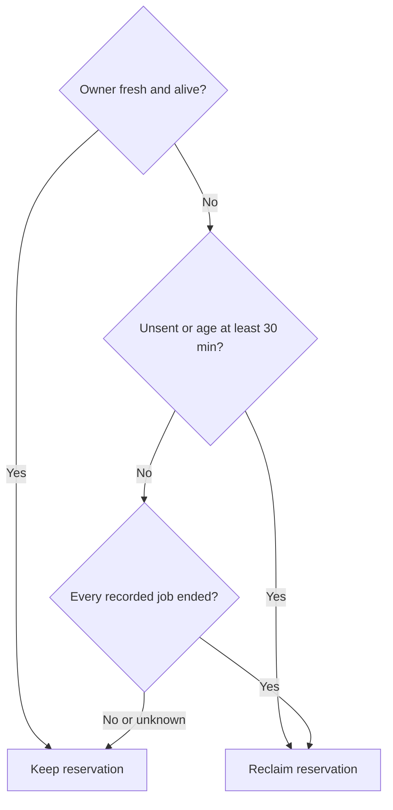

# Shared local runtime slots

Own `src/runtime-slots.mjs`: admit independent local pdd jobs fairly under one person's runtime limit, and expose a local snapshot for `pdd jobs`. Preserve the public module functions, reservation identity, listing schema, private state safety and dispatch evidence; internal exclusion and heartbeat representation may vary. Client transport, paid execution and batch policy belong to the caller.

## Reservations and waiting

Use `<stateDir>/slots/<encoded URL.host>/`, where stateDir is the caller's resolved PDD_STATE_DIR (default ~/.pdd/runtime), and URL.host includes a port when present. Encode the host with encodeURIComponent as one path component; repositories/worktrees sharing this folder share the limit. Folders 0700 and files 0600, no credentials or source archives. The caller owns environment parsing and warnings; this module receives a positive safe integer cap or `Infinity` for no cap.

Module function `acquireRuntimeSlot({stateDir,origin,limit,kind,deadline}, ports)` returns a reservation `{id,directory}` or null if the caller wait ends/interruption occurs before acquisition. An omitted limit means no cap, as does `Infinity`. With no cap, create an active reservation immediately without capacity/FIFO waiting, dead-owner probes or a waiting-ticket phase, even when older waiting tickets or uncertain active leases exist. Never print `Waiting for a local slot` in this mode. Preserve durable active records, heartbeat ownership, request registration before dispatch, exact predecessor validation, uncertain leases and listing; no cap does not mean no bookkeeping. Ordinary registration exclusion and cancellation/deadline guards still apply. kind is check, lint or try; deadline is an absolute millisecond timestamp or null for no deadline. Supply pid, isAlive(pid), now(), randomUUID(), sleep(ms), interrupted(), files and readRun(id) as ports. Native defaults use process/file/clock operations; no network implementation is hidden in this helper. The client supplies authenticated readRun, returning ended, running or unknown for that exact ID, bounded by this acquisition's deadline. The required native dependency bindings below keep outside effects injectable without adding a public command or Runtime operation.

With a finite cap, one durable ticket per waiting job retains its original timestamp through contention. Order live tickets by creation time, then stable ticket ID for equal times, never directory enumeration. Only the oldest live ticket tries to claim a free slot; later tickets wait without repeatedly competing for the claim lock. Atomically exclude competing claimants using exclusive create; rescan under that exclusion before assigning. Failed contention keeps the same ticket and retries with bounded backoff and injected jitter; later tickets wait longer than the head. Contention must make progress without synchronized claim retries starving the head ticket or blocking request recording for already admitted jobs. A job has one ticket or one active reservation, never duplicates. A dead waiter's ticket can be removed under the owner-freshness rule below. Print changing queue status through say(line), e.g. `Waiting for a local slot: 4 of 4 busy, 2 ahead of you. (Set PDD_MAX_JOBS to change the limit.)`; all progress goes to stderr in the caller.

An active record holds its unique id, state active, owner pid, kind, started_at (epoch milliseconds), and request_ids. Module function `recordRuntimeRequest(reservation, requestId, ports)` durably appends the ID without duplicates before dispatch, preserving earlier IDs. Module function `releaseRuntimeSlot(reservation, {ended}, ports)` releases only when ended is confirmed, or no dispatch was possible; ended false retains the record. Local timeout/interruption does not prove a posted job ended. Remove an interrupted waiter's ticket without releasing another job's reservation.

### Owned record transitions

For tickets and active reservations, a known owned snapshot consists of id, pid, state, kind, started_at and the complete ordered request_ids. Before registration, promotion, refresh or own-record cleanup, verify the current predecessor against that snapshot; matching only ID/PID, path or active state is insufficient. Registration validates under the existing claim immediately before its update. A changed predecessor is foreign even at the same path with the same ID/PID: registration throws the existing finite local-state-unavailable error without appending, refreshing or transferring ownership. Release and signal cleanup stop this owner's refresh work but preserve the foreign file, including when ended is true for the original job.

Only a verified owned transition advances the accepted snapshot: waiting-to-active promotion changes state/start time, and registration appends a previously absent request ID in order. A duplicate succeeds without changing the request list. Registration through a separately resolved native port advances the live owner's heartbeat snapshot only after its verified mutation. A write cannot authenticate itself merely by becoming the latest file contents.

Reservations remain ordinary `{id,directory}` references, including saved/adopted references and existing active records without an acquisition in this process. Do not require a new field, token, port, local-owner registration or global gate. When no owned snapshot is known, preserve those existing active-record registration/release calls and their errors; absence of a local owner alone is not a refusal. Historical ownership cannot be independently proved from such a reference. This does not permit bypassing a known owner's predecessor check. Ended false stops ownership work while retaining uncertain paid-job evidence and the same returned reservation object's snapshot for a later ended true release. That object's known snapshot takes precedence over a newer owner at the same path. Retaining that evidence must not keep released references alive or restart ended heartbeat work.

### Owner freshness and paid-job leases

While this command owns a waiting ticket, active reservation or claim lock, refresh that file about every 5 seconds, including during slow outside operations.

During an ongoing acquisition, exclude the caller's own waiting ticket from stale-owner reclamation. If that ticket disappears, including when two live waiters reclaim each other's apparently stale tickets after a wall-clock jump, restore this acquisition's waiting ticket with its original ID and started_at before competing for admission. Restore only a missing record, using exclusive creation without overwriting an existing record; never create a second ticket or replace an active reservation. Restored tickets keep the original started_at/ID ordering, and acquisition must continue toward the next free slot rather than wait until timeout for a ticket that no longer exists. This exception supplies no evidence that a dispatched job ended and does not protect other owners.

For other owners, a file with no refresh for >= 60 seconds has an expired owner even if its PID now belongs to a live unrelated process. For existing records without explicit heartbeat metadata, use the file refresh time with the same expiry; missing freshness evidence cannot let an alive PID retain ownership indefinitely. Process death also expires ownership; PID liveness alone cannot keep a stale ticket, active owner or claim alive. Freshness is private metadata and must not add fields to the public jobs snapshot.

Heartbeat refresh alone never recreates a removed record or touches another owner's file. Missing waiting-ticket recovery belongs only to the still-pending acquisition above, including when disappearance was observed before inspection or by a heartbeat: restore the waiting ticket's refresh lifecycle even if an absent-file refresh stopped it. Interruption or the caller deadline wins over restoration and admission; once acquired or ended, never restore that waiting ticket. Stop refresh work when ownership ends; command return with an uncertain dispatched job retains the lease record without pretending the command remains alive.



An active record's lease age is measured from started_at, never extended by refresh. For an expired/dead owner, no request IDs proves unsent; otherwise running/unknown, missing, wrong-ID or unreadable evidence keeps the reservation before the 30-minute boundary. A confirmed service-restarted terminal receipt counts as ended for this lease; the client separately owns replacement authorization. Heartbeat expiry and signal cleanup never establish that a potentially paid job ended. A fresh live owner's active reservation stays occupied even beyond 30 minutes.

Network probes must never run while this process holds any local claim lock. Read dead-owner request states outside exclusion, caching each exact runtime-origin/request-ID/command observation (including unknown or failed reads) for about 15 seconds per process. Repeated acquisition attempts reuse that observation rather than issuing a GET per queue tick. Before deleting an active record, reacquire exclusion and verify that its identity, owner freshness, started_at and full request_ids still match the probed snapshot. Changed, refreshed, replaced or missing records invalidate that reclamation decision; never let an old ended answer erase a newly recorded request. No network probe is needed for safely unsent records or an already expired 30-minute dead-owner lease.

SIGINT, SIGHUP and SIGTERM stop new acquisition/dispatch and clean this command's waiting ticket and claim locks. Release active records only under the ended/unsent release rule above; preserve every uncertain dispatched lease. Cleanup and claim updates remain private and atomic; do not delete another claimant's record.

<details>
<summary>Required native dependency bindings</summary>

These ports supplement the existing module-function arguments for admission and recording, and are not public snapshot fields or a check-only API. Existing files operations are listRecords({directory}), exclusiveCreate(path,record), writeAtomic(path,record) and unlink(path). Admission additionally accepts files.modifiedAt(path), returning the last refresh epoch milliseconds or null when absent, and files.touch(path), refreshing an existing owned file and returning false if absent without recreating it. Native defaults preserve regular-file, permission and owner-identity safeguards. Claim files use their own unique owner identity so stale cleanup cannot unlink a successor. A changed or replaced owned claim is no longer held: it cannot authorize admission or registration, and cleanup must preserve the foreign claim.

The optional timers port supplies setInterval(callback, milliseconds) and clearInterval(handle), with native timer defaults; timer handles remain private and cannot keep a finished command alive. The optional random() port supplies a value in [0,1) for jitter, with a native randomness default. Clock, file freshness, timers and randomness used by decisions must use their supplied ports. Existing now(), sleep(ms), interrupted() and isAlive(pid) retain their bindings. recordRuntimeRequest also honors ports.deadline (absolute epoch milliseconds, absent for no deadline) before waiting for exclusion or updating state and returns false when it cannot register within the caller wait; no POST is then authorized. onInterrupt(handler) covers SIGINT/SIGHUP/SIGTERM for cleanup and returns an unsubscribe function, with native process-signal defaults when omitted.

</details>

## Local inspection

Module function `listRuntimeJobs({stateDir,origin}, ports={})` calls `ports.files.listRecords({directory})` exactly once with the resolved host folder above, and returns `{jobs}`. The native files port reads the private active/ticket records and normalizes each to `{id,state,pid,kind,started_at,request_ids}`; absent folder means an empty list. Incomplete/unreadable state throws an error with code local-state-unavailable, never silently shown as no work. Wrap files.listRecords read failures with that same code. Listing neither reclaims records nor contacts gh/runtime/processes. Return active rows first, then waiting, ordered within each state by started_at and id. Preserve record IDs, PIDs, request IDs and timestamps. The declared port is this actual filesystem dependency, not an admission decision supplied by a test.

Module function `runJobs({env}, {stdout,stderr,files,now}={})` resolves the same default state directory and uses the existing public runtimeOrigin(env) export of src/runtime-client.mjs for the runtime origin (no sign-in or network effect) and calls listRuntimeJobs. It requires no repository or authentication. Use the optional now() clock port (native default Date.now) for ages. Print active/waiting rows with kind, PID, age and request IDs, or a plain empty message; return 0. Read errors print a finite cause on stderr and return 5; do not present a successful empty snapshot. Output lines end with a newline. No additional command options are introduced.

The [lock pattern](workflow-herdr-layout.prompt.md) is a navigation-only native implementation example for exclusive creation and process liveness. This module owns the reservation and reclamation rules above.

## Dependencies

The listing Runtime needs only the supplied files port declared below; no other prompt context is required.

Only listRuntimeJobs is bound below. The files.listRecords resource uses write access solely so port.write can record the supplied read arguments as a spy; the real dependency only reads slot records and does not mutate them. Its native function receives the ordinary ports argument; the Runtime transport serializes the options and binds files.listRecords. Acquisition, atomic exclusion, crash consistency, process death and native runJobs formatting require ordinary Node/child-process tests. A prompt replay of a supplied snapshot proves ordering/forwarding only.

<details><summary>Runtime interface</summary>

```json
{
  "status": "draft",
  "prose_sha256": "989bd0d5c4111d63f03817d5d3c07d52fac0a2176be2f907f6098667eea97401",
  "entries": [
    {
      "operation": "listRuntimeJobs",
      "input_schema": {
        "type": "object",
        "properties": {
          "stateDir": {
            "type": "string"
          },
          "origin": {
            "type": "string"
          }
        },
        "required": [
          "stateDir",
          "origin"
        ],
        "additionalProperties": false
      },
      "result_schema": {
        "type": "object",
        "properties": {
          "jobs": {
            "type": "array",
            "items": {
              "type": "object",
              "properties": {
                "id": {
                  "type": "string"
                },
                "state": {
                  "type": "string",
                  "enum": [
                    "active",
                    "waiting"
                  ]
                },
                "pid": {
                  "type": "integer",
                  "minimum": 1
                },
                "kind": {
                  "type": "string",
                  "enum": [
                    "check",
                    "lint",
                    "try"
                  ]
                },
                "started_at": {
                  "type": "integer",
                  "minimum": 0
                },
                "request_ids": {
                  "type": "array",
                  "items": {
                    "type": "string"
                  }
                }
              },
              "required": [
                "id",
                "state",
                "pid",
                "kind",
                "started_at",
                "request_ids"
              ],
              "additionalProperties": false
            }
          }
        },
        "required": [
          "jobs"
        ],
        "additionalProperties": false
      },
      "errors": ["local-state-unavailable"]
    }
  ],
  "calls": [],
  "resources": [
    {
      "name": "files",
      "kind": "port",
      "access": "write",
      "operations": [
        {
          "name": "listRecords",
          "access": "write",
          "arguments_schema": {
            "type": "object",
            "properties": {
              "directory": {
                "type": "string"
              }
            },
            "required": [
              "directory"
            ],
            "additionalProperties": false
          },
          "result_schema": {
            "type": "object",
            "properties": {
              "jobs": {
                "type": "array",
                "items": {
                  "type": "object",
                  "properties": {
                    "id": {
                      "type": "string"
                    },
                    "state": {
                      "type": "string",
                      "enum": [
                        "active",
                        "waiting"
                      ]
                    },
                    "pid": {
                      "type": "integer",
                      "minimum": 1
                    },
                    "kind": {
                      "type": "string",
                      "enum": [
                        "check",
                        "lint",
                        "try"
                      ]
                    },
                    "started_at": {
                      "type": "integer",
                      "minimum": 0
                    },
                    "request_ids": {
                      "type": "array",
                      "items": {
                        "type": "string"
                      }
                    }
                  },
                  "required": [
                    "id",
                    "state",
                    "pid",
                    "kind",
                    "started_at",
                    "request_ids"
                  ],
                  "additionalProperties": false
                }
              }
            },
            "required": [
              "jobs"
            ],
            "additionalProperties": false
          }
        }
      ]
    }
  ],
  "limits": {
    "max_steps": 4,
    "max_model_calls": 4
  },
  "conventions": []
}
```
</details>
