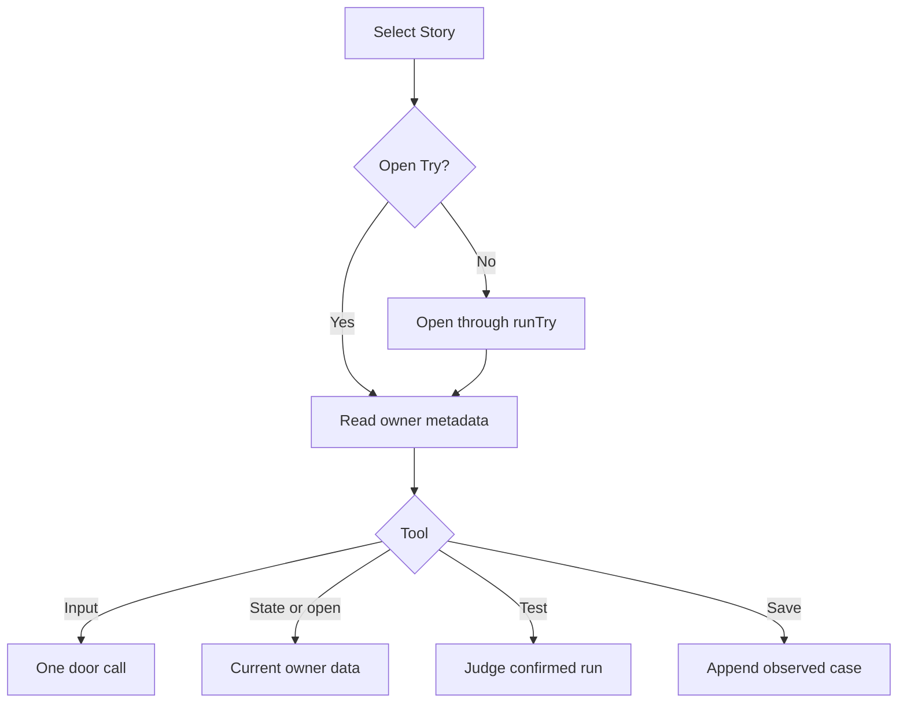

# Simulator tools for the person's agent

Own `src/try-mcp.mjs`. Export `runMcp({cwd, words}={}, ports={})`, a newline-delimited stdio JSON-RPC MCP server returning exit code 0 after input closes and outstanding work finishes. Export `createTryTools({cwd,words}={}, ports={})` returning a `call(name,args)` interface for embedding and verification. This new interface preserves the existing Try, door and judge behavior.

The five tools are `simulate_open`, `simulate_state`, `simulate_input`, `simulate_test` and `simulate_save_case`. These are the only tool names: the older `try_*` names are unknown tools, with no alias. Tool descriptions and tool errors name these tools and call the session the Simulator ([command words](public-boundary.prompt.md#command-words)). Select the Git repository containing cwd and exactly one discovered Story test; optional `story` selects by the existing Story selection rules. Without it prefer the only open Try, otherwise the only test. If a Story matches multiple tests, prefer its only open Try; otherwise require the exact test path. Ambiguity names the choices and sends nothing. Open a missing or ended Try through runTry with no waiting or agent bridge. Reuse its private identity, session and source hashes. Refuse changed prompt or Story identity; never label uploaded old behavior as current source.

State includes Story criteria, judge bindings, admitted entries and schemas, actual current saved data, known runs, server action history, budget metadata and judge progress. Read actual data from authenticated GET `/v1/try/ID/state` with `{world:...}`; never substitute initial test data when unavailable. Return a clear unavailable reason. `simulate_input` runs one input with runDoorCall once; preserve its confirmed before/after worlds and lossless result. `entry` is `prompt_path#operation`, `input` is a JSON object. Alternatively `argv` is a string array for the single admitted CLI entry, preserving words exactly. Never execute a project program or shell. Reject incompatible run arguments and unknown entries before dispatch. Every run spends the existing Try budget and appears in the server history through the door API. No automatic retry of an uncertain run; block subsequent runs in this connection after a door error carrying unknownOutcome: true, regardless of its message text.

`simulate_test` checks a named confirmed run or the last run using createRunJudge; report unsupported checks honestly. Saving selects a Story criterion explicitly, or uses the unique criterion tied to the entry. Save an isolated scenario through saveDoorCase with the confirmed before-world, original simulation/context and criteria, and one exact observed-result step; leave the original scenario untouched. Refuse saving when the before-world is missing. For partial Story coverage, prominently report "Recorded case; covers N of M Story criteria. Complete coverage before pdd test"; this recorded case is not claimed to pass runtime admission. Save records an observation, does not approve a prompt and does not claim the result is correct. Repeated save of the same run is a no-op. Explain saved-data setup needs review when the before-world is nonempty.

Expose honest MCP annotations: `simulate_open`, `simulate_input` and `simulate_save_case` change state; `simulate_test` and `simulate_state` are read-only observations, although `simulate_state` can open a missing Try. All tools accept optional `story`; `simulate_input` accepts `entry`, `input`, `argv`; `simulate_test` and `simulate_save_case` accept optional `run_id`; `simulate_save_case` accepts optional `criterion_id` and `name`. Reject extra fields and malformed values. Tool failures are MCP `isError` results, not protocol crashes. Serialize tool calls so simultaneous mutations cannot open or run twice accidentally. Replayed JSON-RPC request IDs return the same response without redispatch; conflicting reuse is an invalid request. Keep stdout exclusively JSON-RPC. Send readable errors/progress to stderr, and `notifications/progress` only for a caller-supplied progress token. Emit progress during slow tools and clear timers afterwards.

Support initialize with version negotiation (2025-06-18, 2025-03-26, 2024-11-05; default newest), ping, tools/list, tools/call and notifications. Invalid JSON gets -32700, invalid envelopes -32600, invalid method parameters -32602, unknown methods -32601. Ignore valid notifications without executing tool calls. Reject batches. Bound incoming lines and response replay memory; never print tokens, stacks or private owner URLs. Closing input waits for queued requests; it does not close the Try.

## Dependencies

- [Runtime client](runtime-client.prompt.md): required generation/runtime context for selection, owner identity, opening, current owner reads, door execution and safe case append.
- [Runtime preflight](runtime-preflight.prompt.md): required generation/runtime context for Story selection.
- [Agent judge](agent-judge.prompt.md): required generation/runtime context for per-run comparison and progress.
- [Prompting guide](../../docs/prompting-guide.md): required authoring context.
