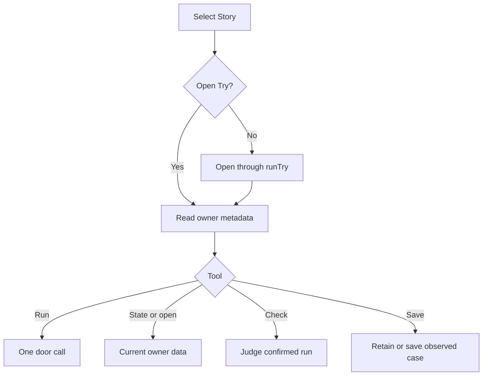

# Try tools for the person's agent

Own `src/try-mcp.mjs`. Export `runMcp({cwd, words}={}, ports={})`, a newline-delimited stdio JSON-RPC MCP server returning exit code 0 after input closes and outstanding work finishes. Export `createTryTools({cwd,words}={}, ports={})` returning a `call(name,args)` interface for embedding and verification. This new interface preserves the existing Try, door and judge behavior.

The five tools are `try_open`, `try_state`, `try_run`, `try_check`, and `try_save_case`. Select the Git repository containing cwd and exactly one discovered Story test; optional `story` selects by the existing Story selection rules. Without it prefer the only open Try, otherwise the only test. If a Story matches multiple tests, prefer its only open Try; otherwise require the exact test path. Ambiguity names the choices and sends nothing. Open a missing or ended Try through runTry with no waiting or agent bridge. Reuse its private identity, session and source hashes. Refuse changed prompt or Story identity; never label uploaded old behavior as current source.

State and open return Story criteria, judge bindings, admitted entries and schemas, `source_sha256` and `engine_sha` (`string | null` from `owner.model` else `owner.record`, `null` when unavailable), actual current saved data, known runs, server action history, budget metadata and judge progress. Read actual data from authenticated GET `/v1/try/ID/state` with `{world:...}`; never substitute initial test data when unavailable. Return a clear unavailable reason. Runs use runDoorCall once; preserve its confirmed before/after worlds and lossless result. `entry` is `prompt_path#operation`, `input` is a JSON object. Alternatively `argv` is a string array for the single admitted CLI entry, preserving words exactly. Never execute a project program or shell. Reject incompatible run arguments and unknown entries before dispatch. Every run spends the existing Try budget and appears in the server history through the door API. No automatic retry of an uncertain run; block subsequent runs in this connection after a door error carrying unknownOutcome: true, regardless of its message text.

Check a named confirmed run or the last run using createRunJudge; report unsupported checks honestly. Saving selects a Story criterion explicitly, or uses the unique criterion tied to the entry. Save an isolated scenario through saveDoorCase with the confirmed before-world, original simulation/context and criteria, and one exact observed-result step; leave the original scenario untouched. Refuse saving when the before-world is missing. For partial Story coverage, prominently report "Recorded case; covers N of M Story criteria. Complete coverage before pdd test"; this recorded case is not claimed to pass runtime admission. Save records an observation, does not approve a prompt and does not claim the result is correct. Repeated save of the same run is a no-op. Explain saved-data setup needs review when the before-world is nonempty.

Expose honest MCP annotations: open/run/save change state, check/state are read-only observations although state can open a missing Try. All tools accept optional `story`; run accepts `entry`, `input`, `argv`; check/save accept optional `run_id`; save accepts optional `criterion_id` and `name`. Reject extra fields and malformed values. Tool failures are MCP `isError` results, not protocol crashes. Serialize tool calls so simultaneous mutations cannot open or run twice accidentally. Replayed JSON-RPC request IDs return the same response without redispatch; conflicting reuse is an invalid request. Keep stdout exclusively JSON-RPC. Send readable errors/progress to stderr, and `notifications/progress` only for a caller-supplied progress token. Emit progress during slow tools and clear timers afterwards.

`try_save_case` also accepts an explicit retained-case apply mode: paired string
arguments `pending_id` and `closed_editor_for`. `pending_id` is the existing
received-case identity, two lowercase 64-hex components separated by a dot;
`closed_editor_for` is a nonempty exact repository-relative original test path.
The ordinary argument validator requires both and rejects `story`, `run_id`,
`criterion_id` and `name` in this mode, plus all unknown fields. With neither new
argument, preserve the current confirmed-run staging operation. Either new
argument alone is invalid; no implicit last-run apply or replacement target.

The tool description must state that `closed_editor_for` represents the person's
actual confirmation that this named file is closed and handed over until the
apply finishes. Obtain that specific confirmation; a physical close, missing
lock, saved payload, generic tool approval or unrelated earlier message is not
confirmation. It coordinates writing and does not approve expectations.

Branch to the runtime client's [local retained-case application](runtime-client.prompt.md#local-retained-case-application)
before `readTryOwner`, remote metadata or in-memory run lookup. Delegate with the
server's `cwd`, explicit pending identity, the existing local closed-editor
handoff type and invocation signal. Never supply a JSON opaque lease or rebuild
the payload. This mode also works after MCP restart without a run in memory;
it makes no HTTP/model/Runtime request and does not open a Try.
It performs no gh authentication or credential lookup and requires no sign-in.

Only the owner's typed committed result is success, including an established
duplicate no-op; return its identical printable result associated with
`pending_id`. Format the warning solely from the owner's coverage projection.
For `original-story`, use the existing "Recorded case; covers N of M Story
criteria" warning. For `retained-scenario`, say "Recorded case; references N of M
retained scenario criteria. Whole-Story coverage is unavailable." For
`unavailable`, say "Recorded case; criterion coverage is unavailable." In the
latter two cases require completion of coverage before `pdd test`; keep the
observed-output, expectation and saved-data review reminder in every case.
Neither count nor warning claims passed criteria or current-source proof.
Ordinary confirmed-run save wording/counts remain unchanged. Do not parse a
message, read current Story criteria or change transaction outcome to fill
missing coverage. Pending/conflict is an
MCP `isError` with the owner's actual identity, reason and recovery location;
failure is an error without an invented pending result. Reuse owner outcome
classification and formatting, not English-message parsing or a second policy.
Use a fresh JSON-RPC request ID for an apply attempt while preserving the pending
identity; existing response replay and conflicting-ID refusal still apply.

Support initialize with version negotiation (2025-06-18, 2025-03-26, 2024-11-05; default newest), ping, tools/list, tools/call and notifications. Initialize returns serverInfo name `pdd-try` and this package's current version from package metadata, never a release-number literal. Invalid JSON gets -32700, invalid envelopes -32600, invalid method parameters -32602, unknown methods -32601. Ignore valid notifications without executing tool calls. Reject batches. Bound incoming lines and response replay memory; never print tokens, stacks or private owner URLs. Closing input waits for queued requests; it does not close the Try.

## Workspace and save association

Carry the [workspace authority](runtime-workspace.prompt.md) through owner lookup, source refresh and every tool. Required source validation precedes authentication, model metadata or dispatch. Exact original selected test/session association comes from the runtime client, never the first test for a Story. Durable received-case import, not an in-memory saved flag, owns duplicate safety.

Preserve the current isolated observed-world save operation. It still uses the native save transaction and bounded no-link variant target, retains original test association and requires the confirmed `world_before`. When an exact-original append is requested, delegate to the runtime client: if that starting world cannot hold after the authored prior steps, retain the case pending. Do not change original `initial_world`, invent reset steps or silently substitute a variant for requested append. An explicitly selected isolated variant remains a separate reviewed action with honest partial coverage.

## Dependencies

- [Workspace authority](runtime-workspace.prompt.md): required generation/runtime/verification context for opt-in permission.

- [Runtime client](runtime-client.prompt.md): required generation/runtime/verification context for selection, owner identity, opening, current owner reads, door execution, safe case append and local retained-case application through `applyPendingCaseWithHandoff`.
- [Runtime preflight](runtime-preflight.prompt.md): required generation/runtime context for Story selection.
- [Agent judge](agent-judge.prompt.md): required generation/runtime context for per-run comparison and progress.
- [Prompting guide](../../docs/prompting-guide.md): required authoring context.
