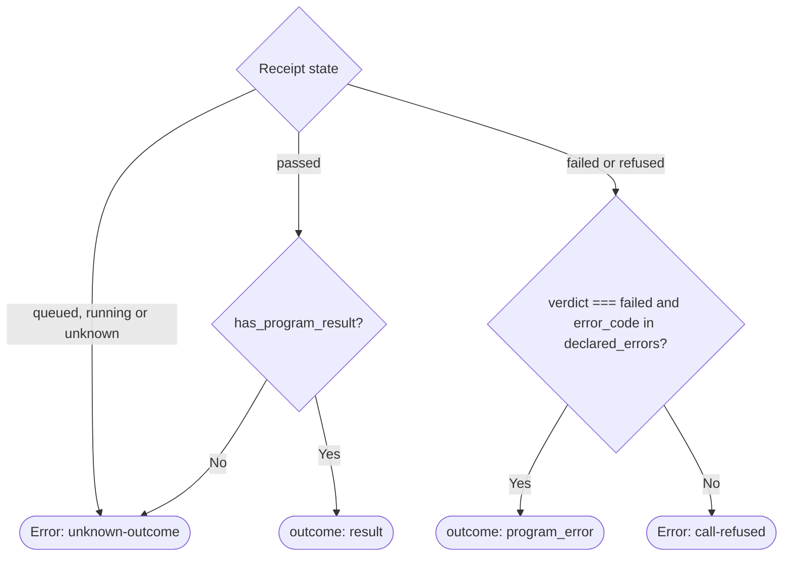

# Existing Try session binding, call projection and stop selection

Own `src/try-session.mjs`. Decide exact existing-session binding, terminal call outcome classification, read-only call observation projection and saved-session stop selection from supplied local records and runtime replies. This deterministic module performs no filesystem, Git, authentication or network I/O; callers supply captured records and HTTP replies and execute the resulting transport or state updates.

Export `bindExistingTry({try_id, story, records, drift, model})`, `projectTryCall({request_id, declared_errors, state, has_program_result, usage_calls, report})`, `projectTryObservation({try_id, run_id, status, body})` and `selectTryToStop({selector, records})`. Throw a plain `Error` carrying string `code` for each refused guard below.

## Existing-session binding (`bindExistingTry`)

When a caller supplies an explicit `try_id`, bind only that already-created simulation. Never authorize opening a missing simulation, replacing an ended simulation or reopening an idle-paused simulation.

Evaluate these guards in order:

| Order | Guard | Refusal code | Consequence |
|---|---|---|---|
| 1 | Count items in `records` with `record.id === try_id`; require count `1` | `try-not-found` | Missing or duplicate saved ID; open nothing |
| 2 | When `story` is provided and nonempty (`story !== ""`), require `[record.story, record.story_path, record.test_path, record.test_name].includes(story)` | `story-mismatch` | Keep saved sessions untouched |
| 3 | Require `drift === null` | `source-drift` | Local Story bytes, prompt hashes, login or runtime origin changed |
| 4 | Require `model.status === 200` | `session-not-running` | Paused, stopped, missing (`404`), expired (`410`) or unreachable model reply; never call `/reopen` or `/v1/try` |
| 5 | When `record.max_calls !== null` and `model.cap !== null`, require `record.max_calls === model.cap` | `cap-mismatch` | Reject any cap change such as a `400`-call replacement |

When all guards pass, return `{try_id: record.id, test_path: record.test_path, story_path: record.story_path, source_sha256: record.source_sha256, engine_sha: record.engine_sha, server_commit: record.server_commit, cap: model.cap !== null ? model.cap : record.max_calls, remaining: model.remaining}`.

## Call outcome projection (`projectTryCall`)

Classify a `/v1/try/<try_id>/call` receipt so pure JSON entries preserve declared domain errors, replay accounting and separate external/internal identifiers.



- External `run_id` is always the caller's `request_id` (`X-Request-Id` / `/v1/runs/<request_id>`). Internal `action_id` is `report.action_id` when `report !== null`, otherwise `null`. Never substitute one identifier for the other.
- On `outcome: "result"`, return `{outcome: "result", run_id: request_id, action_id: report !== null ? report.action_id : null, error_code: null, replayed: report !== null ? report.replayed : false, calls: usage_calls, remaining_calls: report !== null ? report.remaining_calls : null}`.
- On `outcome: "program_error"`, require `report !== null`, `report.verdict === "failed"`, `report.error_code !== null` and `declared_errors.includes(report.error_code)`. Return `{outcome: "program_error", run_id: request_id, action_id: report.action_id, error_code: report.error_code, replayed: report.replayed, calls: usage_calls, remaining_calls: report.remaining_calls}`.
- Every other `failed` or `refused` receipt throws `call-refused`. Nonterminal states (`queued`, `running`, `unknown`) and `passed` receipts without `has_program_result` throw `unknown-outcome`.

## Read-only observation projection (`projectTryObservation`)

Validate a read-only `GET /v1/try/<try_id>/calls/<run_id>/observation` reply without authorizing `GET /v1/runs/<run_id>` recovery or replay:

1. `status === 404` throws `run-not-found`.
2. `status === 410` throws `result-expired`.
3. Any other non-`200` status, `body === null`, `body.session_id !== try_id` or `body.request_id !== run_id` throws `observation-unavailable`.
4. Otherwise return `{try_id: body.session_id, run_id: body.request_id, action_id: body.action_id, state: body.state, session_state: body.session_state, terminal: body.state === "passed" || body.state === "failed" || body.state === "refused", unknown_outcome: body.state === "unknown", source_sha256: body.source_sha256, server_commit: body.server_commit, engine_sha: body.engine_sha}`. Observation remains valid across every `session_state`, including `"stopped"` and `"paused"`.

## Stop-target selection (`selectTryToStop`)

Select the unique saved simulation record for `pdd simulate --stop [STORY]`:

- When `selector` is omitted or `""`, require `records.length === 1`: `0` throws `stop-not-found`, more than `1` throws `stop-ambiguous`.
- When `selector` is nonempty, match every record where `[record.id, record.story_path, record.story, record.test_path, record.test_name].includes(selector)`. `0` matches throws `stop-not-found`; more than `1` match throws `stop-ambiguous`.
- Return `{id: matched.id, test_path: matched.test_path, story_path: matched.story_path}`.

## Dependencies

- [Prompting guide](../../docs/prompting-guide.md): required authoring context.

<details><summary>Runtime interface</summary>

```json
{"status":"approved","prose_sha256":"46a1d2ac651569c95d9c9dc3de86dcb9a4c63d311aa099e2cb3af3de5ea44853","entries":[{"operation":"bindExistingTry","input_schema":{"type":"object","properties":{"try_id":{"type":"string","minLength":1},"story":{"type":"string"},"records":{"type":"array","items":{"type":"object","properties":{"id":{"type":"string"},"test_path":{"type":"string"},"test_name":{"type":"string"},"story":{"type":"string"},"story_path":{"type":"string"},"source_sha256":{"oneOf":[{"type":"string"},{"type":"null"}]},"engine_sha":{"oneOf":[{"type":"string"},{"type":"null"}]},"server_commit":{"oneOf":[{"type":"string"},{"type":"null"}]},"max_calls":{"oneOf":[{"type":"integer","minimum":1},{"type":"null"}]}},"required":["id","test_path","test_name","story","story_path","source_sha256","engine_sha","server_commit","max_calls"],"additionalProperties":false}},"drift":{"oneOf":[{"type":"string"},{"type":"null"}]},"model":{"type":"object","properties":{"status":{"type":"integer"},"error_code":{"oneOf":[{"type":"string"},{"type":"null"}]},"cap":{"oneOf":[{"type":"integer","minimum":1},{"type":"null"}]},"remaining":{"oneOf":[{"type":"integer","minimum":0},{"type":"null"}]}},"required":["status","error_code","cap","remaining"],"additionalProperties":false}},"required":["try_id","records","drift","model"],"additionalProperties":false},"result_schema":{"type":"object","properties":{"try_id":{"type":"string"},"test_path":{"type":"string"},"story_path":{"type":"string"},"source_sha256":{"oneOf":[{"type":"string"},{"type":"null"}]},"engine_sha":{"oneOf":[{"type":"string"},{"type":"null"}]},"server_commit":{"oneOf":[{"type":"string"},{"type":"null"}]},"cap":{"oneOf":[{"type":"integer","minimum":1},{"type":"null"}]},"remaining":{"oneOf":[{"type":"integer","minimum":0},{"type":"null"}]}},"required":["try_id","test_path","story_path","source_sha256","engine_sha","server_commit","cap","remaining"],"additionalProperties":false},"errors":["try-not-found","story-mismatch","source-drift","session-not-running","cap-mismatch"]},{"operation":"projectTryCall","input_schema":{"type":"object","properties":{"request_id":{"type":"string","minLength":1},"declared_errors":{"type":"array","items":{"type":"string"}},"state":{"type":"string","enum":["passed","failed","refused","queued","running","unknown"]},"has_program_result":{"type":"boolean"},"usage_calls":{"oneOf":[{"type":"integer","minimum":0},{"type":"null"}]},"report":{"oneOf":[{"type":"object","properties":{"action_id":{"oneOf":[{"type":"string"},{"type":"null"}]},"verdict":{"oneOf":[{"type":"string"},{"type":"null"}]},"error_code":{"oneOf":[{"type":"string"},{"type":"null"}]},"replayed":{"type":"boolean"},"remaining_calls":{"oneOf":[{"type":"integer","minimum":0},{"type":"null"}]}},"required":["action_id","verdict","error_code","replayed","remaining_calls"],"additionalProperties":false},{"type":"null"}]}},"required":["request_id","declared_errors","state","has_program_result","usage_calls","report"],"additionalProperties":false},"result_schema":{"type":"object","properties":{"outcome":{"type":"string","enum":["result","program_error"]},"run_id":{"type":"string"},"action_id":{"oneOf":[{"type":"string"},{"type":"null"}]},"error_code":{"oneOf":[{"type":"string"},{"type":"null"}]},"replayed":{"type":"boolean"},"calls":{"oneOf":[{"type":"integer","minimum":0},{"type":"null"}]},"remaining_calls":{"oneOf":[{"type":"integer","minimum":0},{"type":"null"}]}},"required":["outcome","run_id","action_id","error_code","replayed","calls","remaining_calls"],"additionalProperties":false},"errors":["unknown-outcome","call-refused"]},{"operation":"projectTryObservation","input_schema":{"type":"object","properties":{"try_id":{"type":"string","minLength":1},"run_id":{"type":"string","minLength":1},"status":{"type":"integer"},"body":{"oneOf":[{"type":"object","properties":{"request_id":{"type":"string"},"action_id":{"oneOf":[{"type":"string"},{"type":"null"}]},"session_id":{"type":"string"},"state":{"type":"string","enum":["queued","running","passed","failed","refused","unknown"]},"session_state":{"type":"string","enum":["running","paused","stopping","stopped","unknown"]},"source_sha256":{"oneOf":[{"type":"string"},{"type":"null"}]},"server_commit":{"oneOf":[{"type":"string"},{"type":"null"}]},"engine_sha":{"oneOf":[{"type":"string"},{"type":"null"}]}},"required":["request_id","action_id","session_id","state","session_state","source_sha256","server_commit","engine_sha"],"additionalProperties":false},{"type":"null"}]}},"required":["try_id","run_id","status","body"],"additionalProperties":false},"result_schema":{"type":"object","properties":{"try_id":{"type":"string"},"run_id":{"type":"string"},"action_id":{"oneOf":[{"type":"string"},{"type":"null"}]},"state":{"type":"string","enum":["queued","running","passed","failed","refused","unknown"]},"session_state":{"type":"string","enum":["running","paused","stopping","stopped","unknown"]},"terminal":{"type":"boolean"},"unknown_outcome":{"type":"boolean"},"source_sha256":{"oneOf":[{"type":"string"},{"type":"null"}]},"server_commit":{"oneOf":[{"type":"string"},{"type":"null"}]},"engine_sha":{"oneOf":[{"type":"string"},{"type":"null"}]}},"required":["try_id","run_id","action_id","state","session_state","terminal","unknown_outcome","source_sha256","server_commit","engine_sha"],"additionalProperties":false},"errors":["run-not-found","result-expired","observation-unavailable"]},{"operation":"selectTryToStop","input_schema":{"type":"object","properties":{"selector":{"type":"string"},"records":{"type":"array","items":{"type":"object","properties":{"id":{"type":"string"},"test_path":{"type":"string"},"test_name":{"type":"string"},"story":{"type":"string"},"story_path":{"type":"string"}},"required":["id","test_path","test_name","story","story_path"],"additionalProperties":false}}},"required":["records"],"additionalProperties":false},"result_schema":{"type":"object","properties":{"id":{"type":"string"},"test_path":{"type":"string"},"story_path":{"type":"string"}},"required":["id","test_path","story_path"],"additionalProperties":false},"errors":["stop-not-found","stop-ambiguous"]}],"calls":[],"resources":[],"limits":{"max_steps":16,"max_model_calls":6},"conventions":[]}
```

</details>
