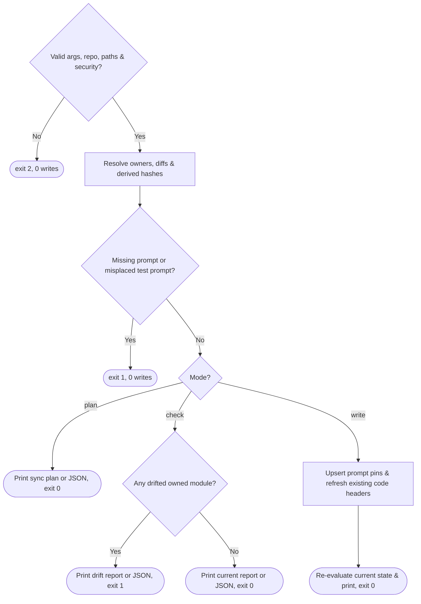

# Code-to-prompt sync

Own `src/update-sync.mjs`. Export `runUpdate(input, ports)`, `analyzeUpdate(input, ports)`, `extractDiffSummary(diffText)`, `formatUpdateText(report)`, and `formatUpdateJson(report)`. It implements `pdd update [FILE...] [--from RANGE] [--check] [--write] [--json]`: scoping strictly to explicitly named files, a Git diff range, or working-tree changes; mapping touched files to owning `.prompt.md` contracts through [File owner lookup](file-owner.prompt.md); tracking conflict-free per-module derived hashes (`prompt_sha256` and `module_sha256`) with zero shared global `source_baseline` and zero extra keys in `pdd-bindings.json`; and checking or refreshing derived pins offline with zero AI subprocesses.

## Domain decisions

- **Offline deterministic core.** `update-sync` operates strictly on local Git metadata and local working-tree files. It spawns zero AI agent subprocesses (`codex`, `claude`, `gemini`, `agy`), makes zero network or interpreter calls, and never mutates approval journals or `pdd-bindings.json`.
- **Scoped target selection (mutually exclusive modes).**
  - Explicit `files` (`pdd update FILE...`): scope strictly to those repository-relative paths. Reject combining `files` with `--from` (`exit 2`, 0 writes). Every explicitly named file must exist as a regular in-repo file (`exit 2` if missing).
  - Range `from` (`pdd update --from RANGE`): accept either `<base>..<head>` or a single `<base>` (normalized to `<base>..HEAD`). Reject empty strings, length `> 256`, whitespace, ASCII control characters, `...`, more than one `..`, empty `<base>` or `<head>`, or any segment starting with `-` (Git option injection) with `exit 2` before calling Git. Resolve touched paths strictly with `git -c core.quotepath=false diff --name-status -z -M --no-ext-diff <range> --` (NUL-delimited UTF-8 so non-ASCII and spaced filenames resolve verbatim). If Git exits non-zero, refuse with `exit 2`.
  - Default working-tree mode (neither `files` nor `from`): resolve modified, staged, renamed, deleted, and untracked non-ignored files strictly from working-tree and staged changes (`git diff --name-status -z -M --no-ext-diff HEAD --` when `HEAD` exists, merged with `git status --porcelain=v1 -z -uall`, falling back cleanly to `git status --porcelain=v1 -z -uall` on unborn branches). Never scan untouched files across the repository.
  - Reject combining `--check` and `--write` (`exit 2`, 0 writes). Outside a Git repository, write `pdd update works inside a Git repository.` to stderr and exit `2`.
  - Empty scope (zero touched files): print a clean no-op summary (or empty JSON arrays with `ok: true`) and exit `0` in plan, `--check`, and `--write` modes.
- **Security and input guards.** Pre-validate every target path before any write:
  - Reject any typed path starting with `-`, containing `\0`, ASCII control characters (`U+0000`–`U+001F`, `U+007F`), `\`, or any `..` path segment, or resolving outside the canonical Git root (`exit 2`).
  - Walk every path segment from the canonical Git root with `lstat` and open files with `O_NOFOLLOW` where supported: reject symbolic links (`exit 2`) and non-regular files on active targets (`exit 2`).
  - Reject secret-looking paths matching [Runtime seam](runtime-seam.prompt.md#public-contract) `isSecretPath(path)` or basenames matching `.env`, `.env.*`, `credentials`, `credentials.*`, or `.aws-credentials` (case-insensitive) without reading their contents (`exit 2`).
  - Reject binary files containing NUL (`0x00`) bytes when explicitly targeted or owned by a prompt (`exit 2`); unowned binary assets touched in `--from` or working-tree diffs are listed under `unowned` with reason `binary file (skipped)` without reading them as text.
  - Bound regular file reads to 10 MiB (matching [File owner lookup](file-owner.prompt.md)).
- **Owner mapping, prompt touches, and grouping.**
  - Delegate ownership lookup to [File owner lookup](file-owner.prompt.md) `findOwners` (`pdd-bindings.json`, `Generated from` / `Prompt:` headers, opening-sentence prose claims, and unique path/stem matches), handling missing `pdd-bindings.json` cleanly.
  - When a touched file is itself a canonical `*.prompt.md`, refuse misplaced test prompts (`isTestPromptPath`) with `exit 1`; otherwise expand scope to include the production code files owned by that prompt (via bindings, headers, prose claims, or existing `<!-- pdd:module-sync ... -->` pins in that prompt) so prompt-only edits surface `prompt-stale` drift rather than appearing as unowned.
  - Refuse any touched file owned by a misplaced test prompt (`isTestPromptPath`) with `exit 1` and 0 writes.
  - Group owned code modules by owning `.prompt.md` (sorted lexicographically by prompt path, with modules sorted by path) so each owning prompt appears once with its touched modules, aggregated `+added/-removed` diff stats, changed exports/functions summary, and concrete next-step instructions.
  - List touched unowned files separately in sorted `unowned` order (informational only; never fabricate ownership and never fail `--check`).
- **Deterministic diff stats and symbol summary.**
  - For each touched owned code file, inspect its unified diff (`git diff --no-color --no-ext-diff -U0` against the `--from` range or `HEAD`, or all lines as additions for newly untracked files) to count `+added` and `-removed` lines (excluding `+++`/`---` headers).
  - Extract changed exported or top-level symbol declarations deterministically from `+`/`-` diff lines (JS/TS `export [default] [async] function|const|let|var|class|interface|type`, Python `def`/`async def`/`class`, Go `func`, Rust `pub [async] fn`), classifying each symbol as `added`, `removed`, or `updated` (when present on both `-` and `+`).
- **Per-module derived hashes and status machine.**
  - Compute `prompt_sha256` using `promptHeaderHash(promptContent)` and `module_sha256` using `moduleContentHash(codeContent)` from [File owner lookup](file-owner.prompt.md). Neither hash depends on the other's derived pin, guaranteeing a single-pass non-circular fixed point and zero cascading churn on untouched sibling modules.
  - Per-module pins live inside the owning `.prompt.md` as sorted one-line HTML comments (`<!-- pdd:module-sync path=PATH sha256=MODULE_SHA prompt_sha256=PROMPT_SHA -->`, accepting optional `prompt_sha256`), never in a shared global `source_baseline` file and never as extra fields in `pdd-bindings.json`. Two parallel PRs touching different modules therefore modify disjoint files with zero merge conflicts.
  - Classify each active `(module, owner)` pair from `promptDrifted` (code header hash is `stale`, or when unheaded/path-only the pin's `prompt_sha256` mismatches `prompt_sha256`) and `codeDrifted` (the prompt pin's `sha256` mismatches `module_sha256`):
    - `both-drifted`: both `promptDrifted` and `codeDrifted` are true.
    - `prompt-stale`: `promptDrifted` is true and `codeDrifted` is false.
    - `code-drifted`: `promptDrifted` is false and `codeDrifted` is true.
    - `current`: neither drifted and a matching module pin exists (and prompt hash matches when present).
    - `unpinned`: neither drifted, but no per-module pin exists yet in the owning prompt.
    - `deleted`: the owned module was deleted in `--from` or working-tree diff (drifted if a stale pin remains in the owning prompt, otherwise informational).

## Public contract

- `extractDiffSummary(diffText)`: pure function returning `{ added: number, removed: number, changed_symbols: Array<{ kind: "added" | "removed" | "updated", symbol: string }> }`.
- `analyzeUpdate({ cwd, files, from, check, write }, ports)`: validate scope, security guards, ownership, diffs, and derived hashes; return `{ ok, exitCode, error, report }` without writing files unless `write: true` is executed through `runUpdate`.
- `runUpdate({ cwd = process.cwd(), files = [], from, check = false, write = false, json = false }, { stdout = process.stdout, stderr = process.stderr, ...ports } = {})`: execute `pdd update`, write formatted text or JSON (`\n`-terminated) to `stdout` (or diagnostic to `stderr` on error), and return integer exit code (`0`, `1`, or `2`).
  - With `--write`: pre-validate everything first, then for each affected owning prompt update only the touched modules' `<!-- pdd:module-sync ... -->` pins (removing obsolete pins for deleted or renamed-from paths, leaving all prompt prose and untouched module pins byte-for-byte unchanged) and update any existing `Generated from` / `Prompt:` header line in each touched owned code file to `(sha256: <prompt_sha256>)` without injecting new headers into headerless files. Write each file only when its bytes actually change.
- `formatUpdateJson(report)`: return JSON string + `\n` with exact top-level fields `{ schema_version: "pdd.update-sync.v1", ok, mode, scope, prompts, modules, unowned, drifted, updated }`.
- `formatUpdateText(report)`: return deterministic human-readable text ending in `\n` listing each affected prompt group, module status, `+added/-removed` diff stats, changed symbols, next-step instructions, updated files (when `--write`), and unowned files.

## Consequential operations

| Step | Failure condition | Surviving state & exit |
|---|---|---|
| 1. Parse/validate mode & args | `--check` + `--write`, `files` + `--from`, outside Git, invalid `--from` range | `0` writes; stderr diagnostic; `exit 2` |
| 2. Validate targets & security | Missing explicit file, leading `-`, `..` traversal, symlink, secret path, binary file | `0` writes; stderr diagnostic; `exit 2` |
| 3. Resolve owners & prompts | Misplaced test prompt or named owning prompt missing/unreadable | `0` writes; stderr diagnostic; `exit 1` |
| 4. `--check` evaluation | One or more touched owned modules not `current` | `0` writes; report on stdout; `exit 1` |
| 5. `--write` refresh | Target prompt or code file changed to symlink before write | Refuse write via `lstat`/non-symlink check; `exit 2` |

## Dependencies

- [File owner lookup](file-owner.prompt.md): canonical ownership lookup (`findOwners`, `resolveOwners`, `isTestPromptPath`), `promptHeaderHash`, `headerEntries`, `headerHashState`, `moduleContentHash`, `parseModuleSyncPins`, `updateModuleSyncPins`, and `updateHeaderHash`.
- [Runtime seam](runtime-seam.prompt.md#public-contract): `gitFiles(root)` and `isSecretPath(path)` via `runtimePreflightSlice()`.
