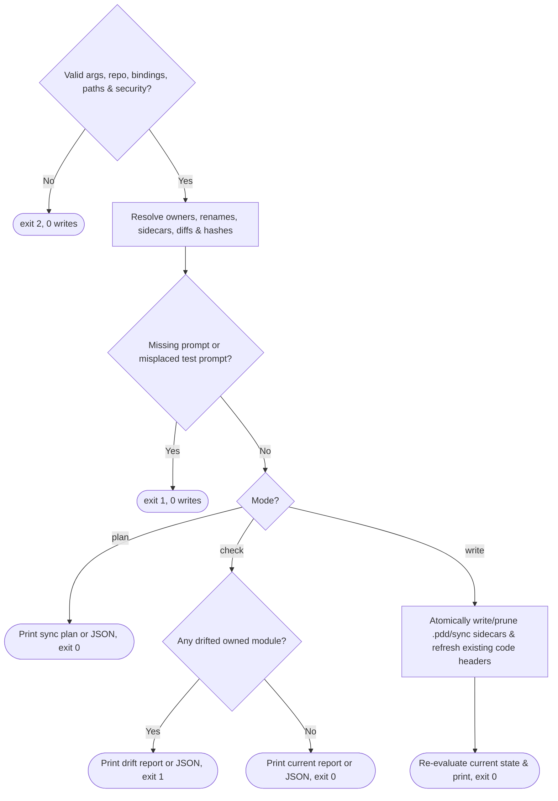

# Code-to-prompt sync

Own `src/update-sync.mjs`. Export `runUpdate(input, ports)`, `analyzeUpdate(input, ports)`, `syncRecordPathForModule(modulePath)`, `extractDiffSummary(diffText)`, `formatUpdateText(report)`, and `formatUpdateJson(report)`. It implements `pdd update [FILE...] [--from RANGE] [--check] [--write] [--json]`: scoping strictly to explicitly named files, a Git diff range, or working-tree changes; mapping touched files to owning `.prompt.md` contracts through [File owner lookup](file-owner.prompt.md); tracking conflict-free per-module derived hashes (`prompt_sha256` and `module_sha256`) in disjoint per-module sidecar files under `.pdd/sync/` without mutating `.prompt.md` files, `pdd-bindings.json`, or any shared global `source_baseline`; and checking or refreshing derived pins offline with zero AI subprocesses.

## Domain decisions

- **Offline deterministic core and immutable prompt/binding boundaries.** `update-sync` operates strictly on local Git metadata and local working-tree files. It spawns zero AI agent subprocesses (`codex`, `claude`, `gemini`, `agy`), makes zero network or interpreter calls, NEVER mutates `.prompt.md` files (preserving `proseSha256`, Runtime interface approval metadata, and approval journals byte-for-byte), NEVER mutates `pdd-bindings.json`, and writes zero global baseline files.
- **Disjoint per-module sidecar storage (`.pdd/sync/<canonical-module-path>.json`).**
  - `syncRecordPathForModule(modulePath)` maps a canonical non-secret repository path `<module>` (not under `.pdd/`) to `.pdd/sync/<module>.json`.
  - Each sidecar file is deterministic JSON with exact schema `pdd.module-sync.v1`: `schema_version`, `module`, `prompt`, `module_sha256`, `prompt_sha256` (plus optional `prompts` map of `{ [promptPath]: sha256 }` only when a module has more than one owner). Two parallel PRs touching different modules—even modules owned by the SAME `.prompt.md`—write completely disjoint sidecar paths with zero merge conflicts.
  - Validate `.pdd`, `.pdd/sync`, every intermediate directory, and every sidecar file with `lstat` and `O_NOFOLLOW` (reject symlinks with `exit 2`). Malformed or schema-invalid sidecars fail closed with `exit 2` before any write.
  - Write sidecars and refreshed code headers atomically via a same-directory exclusive temp file (`O_CREAT | O_EXCL | O_WRONLY | O_NOFOLLOW`, preserving existing file mode or `0o644` for new sidecars) followed by `rename`, removing the temp file on failure.
  - Ignore `.pdd/sync/**` paths when resolving `--from` or working-tree touched files so derived sidecars never pollute `unowned`.
- **Scoped target selection (mutually exclusive modes).**
  - Explicit `files` (`pdd update FILE...`): scope strictly to those repository-relative paths. Reject combining `files` with `--from` (`exit 2`, 0 writes). Every explicitly named file must exist as a regular in-repo file (`exit 2` if missing). Detect untracked explicit files so newly added explicit files report full line additions and symbols.
  - Range `from` (`pdd update --from RANGE`): accept either `<base>..<head>` or a single `<base>` (normalized to `<base>..HEAD`). Reject empty strings, length `> 256`, whitespace, ASCII control characters, `...`, more than one `..`, empty `<base>` or `<head>`, or any segment starting with `-` (Git option injection) with `exit 2` before calling Git. Resolve touched paths with `git --literal-pathspecs -c core.quotepath=false -c diff.noprefix=false -c diff.mnemonicPrefix=false diff --name-status -z -M --no-ext-diff <range> --` so non-ASCII, spaced, and glob-character filenames resolve verbatim regardless of user Git config. If Git exits non-zero, refuse with `exit 2`.
  - Default working-tree mode (neither `files` nor `from`): resolve modified, staged, renamed, deleted, and untracked non-ignored files strictly from working-tree and staged changes (`git diff --name-status -z -M` against `HEAD` when `HEAD` exists, merged with `git status --porcelain=v1 -z -uall`, falling back cleanly on unborn branches). Never scan untouched files across the repository.
  - Reject combining `--check` and `--write` (`exit 2`, 0 writes). Outside a Git repository, write `pdd update works inside a Git repository.` to stderr and exit `2`. Wrap unexpected Git/FS errors into finite `exit 2` diagnostics without uncaught exceptions.
  - Empty scope (zero touched files): print a clean no-op summary (or empty JSON arrays with `ok: true`) and exit `0` in plan, `--check`, and `--write` modes.
- **Security, secret isolation, binary probing, and fail-closed bindings.** Pre-validate every path and control file before any write:
  - Reject any typed path starting with `-`, containing `\0`, ASCII control characters (`U+0000`–`U+001F`, `U+007F`), `\`, or any `..` path segment, or resolving outside the canonical Git root (`exit 2`).
  - Walk every path segment from the canonical Git root with `lstat` and open with `O_NOFOLLOW`: reject symlinks (`exit 2`) and non-regular active targets (`exit 2`).
  - Reject secret-looking paths matching [Runtime seam](runtime-seam.prompt.md#public-contract) `isSecretPath(path)` or basenames matching `.env`, `.env.*`, `credentials`, `credentials.*`, or `.aws-credentials` (case-insensitive) BEFORE opening or reading them—including explicit targets, touched diff entries, candidate lookups, and claimed owning prompt paths (`exit 2`). Filter secret paths out of candidate lists before calling `findOwners` so secret files in the repository are never opened.
  - Fail closed (`exit 2`, 0 writes) if `pdd-bindings.json` exists but is a symlink, unreadable, exceeds 64 KiB, is invalid JSON, or does not have `schema_version: "pdd.bindings.v1"` and an array `modules`.
  - Probe binary content on active files using a bounded 8 KiB prefix read (never failing `too-large` for files > 8 KiB!): reject binary files containing NUL (`0x00`) bytes when explicitly targeted or owned by a prompt (`exit 2`); list unowned binary assets touched in `--from` or working-tree diffs under `unowned` with reason `binary file (skipped)`. Bound full text reads of owned code files and prompts to 10 MiB.
- **Owner mapping, prompt touches, renames, and deletions.**
  - Delegate ownership lookup to [File owner lookup](file-owner.prompt.md) `findOwners` (`pdd-bindings.json`, `Generated from` / `Prompt:` headers, opening-sentence prose claims, and unique path/stem matches), handling absent `pdd-bindings.json` cleanly.
  - When a touched file is a canonical `*.prompt.md`, refuse misplaced test prompts (`isTestPromptPath`) with `exit 1`; otherwise narrow candidate discovery to bindings targeting that prompt, its `promptClaims`, existing `.pdd/sync/` sidecars referencing that prompt (including deleted modules with stale sidecars!), and eligible non-secret production code files so prompt-only edits surface `prompt-stale` or stale `deleted` drift without scanning or opening secrets.
  - When any touched entry is renamed (`renamedFrom`), also inspect `renamedFrom` via `.pdd/sync/` sidecars and bindings so any lingering stale sidecar for `renamedFrom` is flagged as drifted under `--check` (even if the new path is unowned, moved to another prompt, or already pinned) and pruned cleanly (along with empty parent directories under `.pdd/sync`) under `--write`.
  - When any touched entry is deleted, check both `findOwners` and `.pdd/sync/<deleted>.json` so deleted header-owned pinned modules still resolve their owner, fail `--check` while their sidecar remains, and get pruned cleanly on `--write`.
  - Refuse any touched file owned by a misplaced test prompt (`isTestPromptPath`) with `exit 1` and 0 writes.
  - Group owned modules by owning `.prompt.md` (sorted lexicographically by prompt path, with modules sorted by path) and list touched unowned files separately in sorted `unowned` order.
- **Deterministic diff stats and symbol summary.**
  - Inspect unified diffs with `--literal-pathspecs`, `-c core.quotepath=false`, `-c diff.noprefix=false`, `-c diff.mnemonicPrefix=false`, `--src-prefix=a/`, `--dst-prefix=b/`, `--no-color`, `--no-ext-diff`, `-M`, `-U0` (including `renamedFrom` in the pathspec for renames, and synthesizing `+` lines for untracked new files).
  - Count `+added`/`-removed` lines (excluding `+++`/`---` headers) and extract changed exported/top-level symbol declarations deterministically across JS/TS, Python, Go, and Rust, classifying each as `added`, `removed`, or `updated`.
- **Per-module derived hashes and status machine.**
  - Compute `prompt_sha256 = promptHeaderHash(promptContent)` and `module_sha256 = moduleContentHash(codeContent)` from [File owner lookup](file-owner.prompt.md).
  - Classify each `(module, owner)` pair from `promptDrifted` (code header hash is `stale`, or sidecar `prompt_sha256` mismatches `prompt_sha256`) and `codeDrifted` (sidecar `module_sha256` mismatches `module_sha256`):
    - `both-drifted`: both `promptDrifted` and `codeDrifted`.
    - `prompt-stale`: `promptDrifted` only.
    - `code-drifted`: `codeDrifted` only.
    - `current`: neither drifted and a matching sidecar exists for `(module, owner)`.
    - `unpinned`: neither drifted and no matching sidecar exists yet.
    - `deleted`: owned module is missing/deleted (drifted while a sidecar remains at `.pdd/sync/<module>.json`, clean once pruned).
  - Exclude deleted paths from suggested `pdd update --write ...` instructions and POSIX-quote paths containing spaces or shell metacharacters.

## Public contract

- `syncRecordPathForModule(modulePath)`: pure function mapping a canonical non-secret repository path (not under `.pdd/`) to `".pdd/sync/" + modulePath + ".json"`.
- `extractDiffSummary(diffText)`: pure function returning `{ added: number, removed: number, changed_symbols: Array<{ kind: "added" | "removed" | "updated", symbol: string }> }`.
- `analyzeUpdate({ cwd, files, from, check, write }, ports)`: validate scope, security guards, bindings, sidecars, ownership, diffs, and derived hashes; return `{ ok, exitCode, error, report }` (executing atomic writes only when `write: true`).
- `runUpdate({ cwd = process.cwd(), files = [], from, check = false, write = false, json = false }, { stdout = process.stdout, stderr = process.stderr, ...ports } = {})`: execute `pdd update`, write formatted text or JSON (`\n`-terminated) to `stdout` (or diagnostic to `stderr` on error), and return integer exit code (`0`, `1`, or `2`).
  - With `--write`: pre-validate everything first, never modify `.prompt.md` or `pdd-bindings.json`, atomically write/update `.pdd/sync/<module>.json` for active touched owned modules, prune `.pdd/sync/<old>.json` (and empty parent dirs under `.pdd/sync`) for deleted or renamed-from modules, and atomically refresh any existing `Generated from` / `Prompt:` header line in active touched owned code files without injecting headers into headerless files.
- `formatUpdateJson(report)`: return JSON string + `\n` with exact top-level fields `{ schema_version: "pdd.update-sync.v1", ok, mode, scope, prompts, modules, unowned, drifted, updated }`.
- `formatUpdateText(report)`: return deterministic human-readable text ending in `\n` listing each affected prompt group, module status, `+added/-removed` diff stats, changed symbols, next-step instructions, updated files (when `--write`), and unowned files.

## Consequential operations

| Step | Failure condition | Surviving state & exit |
|---|---|---|
| 1. Validate mode, args, repo, `pdd-bindings.json` | `--check` + `--write`, `files` + `--from`, outside Git, invalid `--from`, malformed/symlink `pdd-bindings.json` | `0` writes; stderr diagnostic; `exit 2` |
| 2. Validate targets, sidecars & security | Missing explicit file, leading `-`, `..` traversal, symlink, secret path (including secret prompt), binary owned/explicit file, malformed sidecar | `0` writes; stderr diagnostic; `exit 2` |
| 3. Resolve owners & prompts | Misplaced test prompt or named owning prompt missing/unreadable | `0` writes; stderr diagnostic; `exit 1` |
| 4. `--check` evaluation | One or more touched owned modules (or stale renamed/deleted sidecars) not `current` | `0` writes; report on stdout; `exit 1` |
| 5. `--write` atomic refresh | Target dir/file symlink or write error | Temp file cleaned up; original files intact; `exit 2` |

## Dependencies

- [File owner lookup](file-owner.prompt.md): canonical ownership lookup (`findOwners`, `promptClaims`, `isTestPromptPath`), `promptHeaderHash`, `headerEntries`, `headerHashState`, `moduleContentHash`, and `updateHeaderHash`.
- [Runtime seam](runtime-seam.prompt.md#public-contract): `gitFiles(root)` and `isSecretPath(path)` via `runtimePreflightSlice()`.
