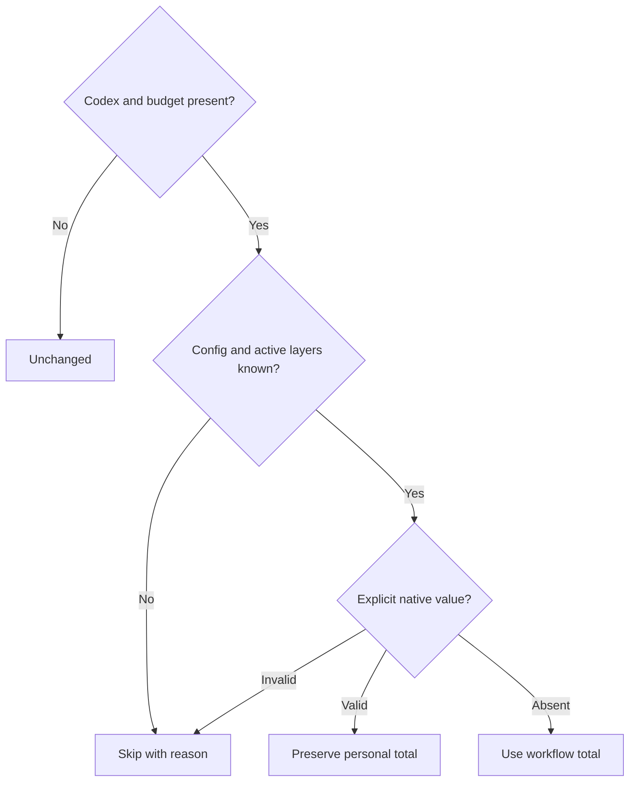

# Workflow Codex thread selection

Own `src/workflow-agent-limits.mjs`: the pure module function
`selectThreadBudget({agent, budget, configState, configText, layersSafe})` chooses
an inspectable total-slot policy for a pdd-created chat. This module owns selection;
chat owns config acquisition and launch effects. Preserve explicit personal values,
even below the workflow request. Never write configuration or read credentials.



`budget` is optional; supplied values are integer 4 through 8. The area validator
owns rejection before this function. Omitted budget or agent other than `codex`
returns `{total:null,source:"unchanged",override:null,reason:""}` without parsing
config. This keeps legacy runs and Claude independent of config failures.

Config inputs are supplied by the caller: `configState` is `absent`, `read` or
`unreadable`; `configText` is the complete TOML string for `read`; `layersSafe`
means the caller has established the effective active layers/profile and supplied
their effective configuration without losing relevant explicit values. An unknown
layer, read error, malformed TOML or invalid explicit value returns
`{total:null,source:"unknown",override:null,reason:REASON}`. REASON is a nonempty,
secret-free explanation identifying the uncertainty. Unknown never means absent.
Use a real TOML parser, including quoted/dotted keys, inline tables and comments.

With safe layers, modern `features.multi_agent_v2.max_concurrent_threads_per_session`
wins over `agents.max_concurrent_threads_per_session`, which wins over
`agents.max_threads`. The first present key must be a positive safe integer;
invalid higher-precedence values cannot fall through. Modern values count the main
thread; aliases exclude it, so add one to an alias. An unsafe resulting total is
unknown rather than rounded. Personal totals have no workflow cap. Return
`{total,source:KEY,override:null,reason:""}` for a personal value: omit the CLI
thread override and let native configuration apply. With no explicit value,
return `{total:budget,source:"workflow",override:budget,reason:""}`.

## Dependencies

- [Vendored TOML parser](../../src/vendor/smol-toml/parse.js): required implementation/generation dependency,
  real TOML parsing; it is not a separate policy owner.
- Runtime inputs carry all config data; selection has no outside effects.
  Native config loading, interactive Codex acceptance, filesystem, Herdr and
  process execution are unsupported by this pure Runtime interface and require
  native tests with injected ports.

<details><summary>Runtime interface</summary>

```json
{
  "status": "approved",
  "prose_sha256": "55953ba9941e1f144b3961df5766c5d2e46efa3f5c6e9a051dc4794131f47382",
  "entries": [
    {
      "operation": "selectThreadBudget",
      "input_schema": {
        "type": "object",
        "properties": {
          "agent": {
            "type": "string"
          },
          "budget": {
            "type": "integer",
            "minimum": 4,
            "maximum": 8
          },
          "configState": {
            "type": "string",
            "enum": [
              "absent",
              "read",
              "unreadable"
            ]
          },
          "configText": {
            "type": "string"
          },
          "layersSafe": {
            "type": "boolean"
          }
        },
        "required": [
          "agent",
          "configState",
          "configText",
          "layersSafe"
        ],
        "additionalProperties": false
      },
      "result_schema": {
        "type": "object",
        "properties": {
          "total": {
            "oneOf": [
              {
                "type": "integer"
              },
              {
                "type": "null"
              }
            ]
          },
          "source": {
            "type": "string"
          },
          "override": {
            "oneOf": [
              {
                "type": "integer"
              },
              {
                "type": "null"
              }
            ]
          },
          "reason": {
            "type": "string"
          }
        },
        "required": [
          "total",
          "source",
          "override",
          "reason"
        ],
        "additionalProperties": false
      },
      "errors": []
    }
  ],
  "calls": [],
  "resources": [],
  "limits": {
    "max_steps": 1,
    "max_model_calls": 1
  },
  "conventions": []
}
```

</details>
