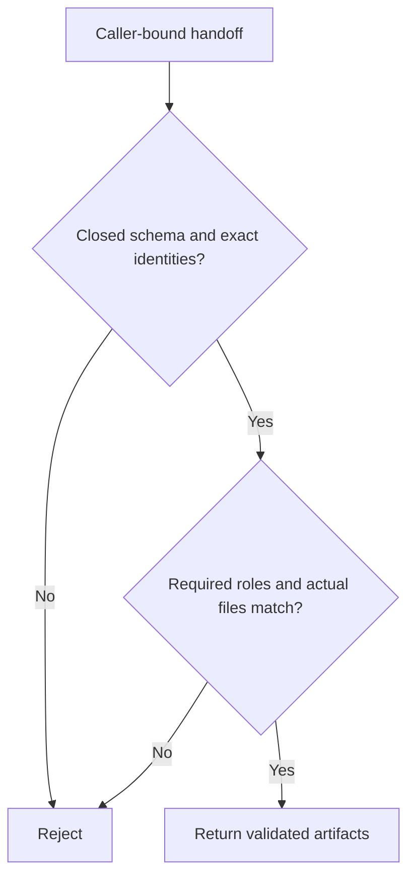

# Local workflow artifacts

`src/workflow-artifacts.mjs` owns the local handoff between an agent-produced
artifact list and its workflow caller. Preserve the caller's exact run, stage,
issue and input revision; an agent's summary or claimed test pass is never an
observation. This new module promises behavioral refinement of the interfaces
below. It reads files and executes explicit local test argv only. The caller
owns Git HEAD, approval/currentness, journal and publication decisions.

## Public module functions

- `readWorkflowHandoff({handoffPath,cwd,expected:{runId,stageId,issueUrl,inputRevision},requiredRoles:[]}, ports={})`
  asynchronously returns the validated handoff only after its identities,
  required roles and actual file bytes agree.
- `assertWorkflowArtifacts({cwd,files}, ports={})` returns `Promise<void>` after
  checking every listed artifact against its actual file and digest.
- `runWorkflowTestCommands({cwd,testCommands}, ports={})` returns a promise of
  `{passed,results:[{argv,exitCode,stdout,stderr}]}`. `passed` requires all
  commands to execute and finish with exit code zero.

Required handoff schema and identity

Schema V1 has exactly `version:1`, `runId`, `stageId`, `issueUrl`,
`inputRevision`, `summary`, `files`, and optionally `testCommands`. Identity
values and summary are nonempty strings; each expected identity is supplied by
the caller and must match exactly, without normalization. `files` is an array; empty is allowed when requiredRoles is empty for
report-only stages, whose executable-evidence classification remains caller-owned.
Every requested role must still be present. Each entry has exactly `path`, `sha256`, `role`. SHA256 is a 64-digit hexadecimal
digest compared with the actual bytes; hexadecimal letter case is immaterial.
Roles are `prompt`, `story`, `cases`, `implementation`, `tests`, `evidence`,
`notes`. Required roles are caller-selected from that set and must be present;
prompt/Story callers select prompt/story/cases. Duplicate artifact paths and
unknown keys/roles are errors. Return the original parsed values without
manufacturing evidence, defaults or approval.

The handoff itself is a regular file at the exact caller-supplied path within
the project's Git metadata directory. Support a regular `.git` directory or a
regular Git worktree `.git` pointer file; do not execute Git or scan for another
handoff. Missing Git metadata or a handoff outside the selected metadata fails.

Required project containment and actual bytes

Artifacts use canonical project-relative slash paths: no absolute/drive paths,
backslashes, empty/dot/traversal components or `.git` component (case-insensitive).
Resolve from the actual selected project directory. Every ancestor inside that
root must be a real directory and every artifact a regular file, never a symlink
or directory. Apply the same no-symlink rule to the selected root and the
handoff path beneath its actual Git metadata root. Read through a no-follow
file descriptor where supported, check the open file against the selected path,
and reject changes detected while reading. Recompute SHA256; a supplied digest
alone proves nothing. Reassert these checks whenever the caller asks, including
after earlier validation. This is a local validation boundary, not an OS sandbox
or protection against arbitrary concurrent hostile filesystem mutation.

Required test argv and observed outcomes

`testCommands`, when present, is a nonempty array of nonempty argv arrays. Each
entry is a string without NUL; executable is nonempty, without whitespace or
shell control characters. Arguments preserve spaces and shell metacharacters as
literal arguments. Shell command strings and explicit shell launchers are not
test argv. A missing or empty command set cannot produce a test pass; reject
malformed command sets before executing any entry. An executable containing
spaces is outside this narrow argv interface.

Execute commands in order using Node's ordinary `execFile(file,args,{cwd})`,
without shell evaluation. The optional injected `ports.execFile` supports that callback signature or
the ordinary promisified execFile result/rejection contract. Successful completion
means exit zero; explicit nonzero result codes are never ignored. Record actual stdout/stderr and zero/nonzero numeric exit
codes; spawn/operational failures and signal termination have `exitCode:null`
and diagnostic stderr. Continue collecting results after an individual failure.
Reject an invalid project directory or malformed argv rather than reporting a
pass. Never treat output containing PASS, an agent claim, an invalid explicit exit status or a rejected process as success. Optional `ports.fs` supplies the
Node promises-filesystem interface for local test injection.

## Dependencies

Node built-ins only: filesystem promises/constants for real files, crypto for
SHA256, path for containment, child_process for ordinary local execution. No
Runtime, solver, server, GitHub, managed session, private account or journal.
