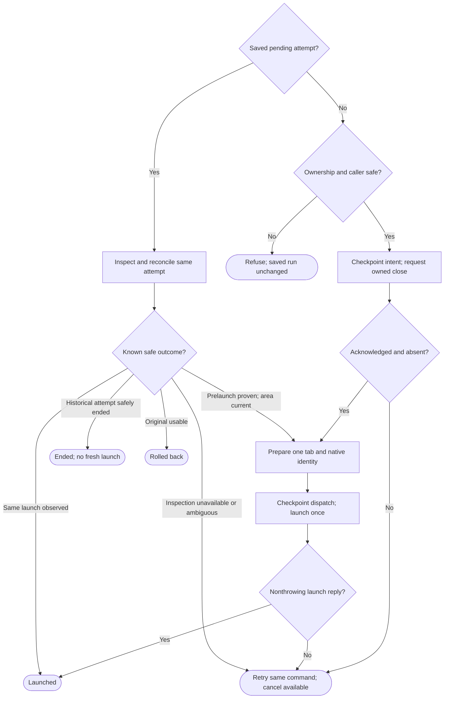
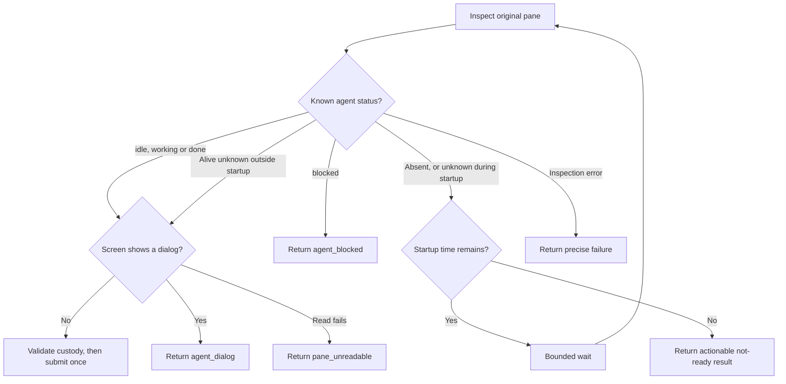

# Area chats in Herdr

Own `src/workflow-chat.mjs`. An area chat is one native Codex, Claude, Gemini or Antigravity CLI (`agy`) session in its own tab of the Herdr session `pdd`. pdd starts it and then leaves. Automatic fresh chats can be observed by the runner’s one-shot [completion bridge](workflow-worker-completion.prompt.md).

- Use only the session `pdd` (`herdr --session pdd …`). Never touch the person's default session or another session.
- If the `pdd` server is not running, start `herdr --session pdd server` in the background. Remove agent-session markers (`CLAUDECODE`, `CLAUDE_CODE_*` session values, `CODEX_THREAD_ID`, `HERDR_*`, `PDD_AGENT_SESSION`) from its environment, so chats in it save their transcripts. Wait for it only while that server process is alive.
- `homeVariable(agent)` is `CLAUDE_CONFIG_DIR` for Claude and `CODEX_HOME` for Codex and `GEMINI_CLI_HOME` for Gemini; it is null for agy, which has no config-folder variable, so an agy run keeps no config folder and its command sets none. `expandHome(dir, env)` returns null for an empty value, the home folder (`HOME`, else `os.homedir()`) for `~`, `<home>/x` for `~/x`, and any other value as it is. `isFolder(dir)` says whether a folder is there. Every place that starts or resumes a chat, or reads its sessions, expands the saved config folder first, so a run saved with the `~` text still works.
- `startChat({run, area, message}, ports)`: use the [run layout](workflow-herdr-layout.prompt.md) for live workspace and area-tab lookup; the layout owner decides adoption or creation. Write the first message to `<run folder>/<area>-start.md`. In the tab, run one short shell line: `cd '<worktree>' && env PDD_AGENT_SESSION=1 [CLAUDE_CONFIG_DIR=…|CODEX_HOME=…|GEMINI_CLI_HOME=…] claude --dangerously-skip-permissions --session-id <new uuid> "$(cat '<file>')"`, or for Gemini `GEMINI_CLI_TRUST_WORKSPACE=true gemini --yolo --prompt-interactive "$(cat '<file>')"` (the variable trusts the run worktree for the session, so a new worktree never stops at Gemini's folder-trust question; it is in the chat's environment, not a flag, so older Gemini CLI versions still start), or for agy `agy --dangerously-skip-permissions --settings '{"trustedWorkspaces":["<worktree>"]}' --add-dir <runs folder> --add-dir <worktrees folder> --prompt-interactive "$(cat '<file>')"`, or for Codex `codex --no-daemon --dangerously-bypass-approvals-and-sandbox -c 'projects={"<worktree>"={trust_level="trusted"}}' "$(cat '<file>')"`. The config folder is the run's persisted `configDir`, initially selected by the terminal that started the run. Later areas inherit that saved choice, including an account change committed by the runner's explicit fresh-session route; approval from another terminal alone does not select an account. Every launch and resume line, here and in open, closed-workspace recovery and replacement, also carries the [chat login](#chat-login), and a run with a saved agents.json entry starts that entry's command in place of the bare program. Return the chat record (tab, pane, terminalId, workspace, label, start time, session `{agent,id}` when known, config folder). Prepare that identity before the pane launch. If its reply fails, attach that same record as `error.chat` with `startUnconfirmed: true`; the caller saves it because the command may have dispatched.
- Module function `sendToChat(chat, text, ports)` owns bounded readiness, the [dialog check](#never-answer-a-dialog) and one ordered Herdr submission; see [Message delivery](#message-delivery). Return `{ok:true}` on acknowledgement or `{ok:false, code}` on failure, with `uncertain:true` only when submission may have happened, and a one-line `reason` for a dialog or an unread screen.
- `chatSession(chat, ports)`: read `herdr agent get <pane>`. Return `{alive, status, sessionId}`; when Herdr fails, `{alive: false, status: null, sessionId: null, code, message}` with Herdr's error code (`agent_not_found` when no agent runs in the pane).
- Module function `chatHealth({run, chat, live}, ports)`: say whether an alive agent cannot work because its login failed or it reached a usage limit. See [Chat health](#chat-health).
- `openChat({run, chat}, ports)`: if the tab is gone, make a new tab in the run workspace, except for an unconfirmed launch: inspect its saved agent first. If the tab and agent/pane are both confirmed missing, return restartAvailable without creating a tab, launching or resuming. The caller archives that stale start and offers an explicit new open to start this area again in the same run. A live agent or an unavailable inspection retains the original identity and refuses replacement. Subject to the shared lifecycle (starting/unknown absence does not permit resume), resume a positively ended native session there (`claude --resume <id>`, `codex resume <id>`, `gemini --resume <id>`, `agy --conversation <id>`, with the same full-access flags (and, for agy, the same `--add-dir` folders) and, for Gemini, the same `GEMINI_CLI_TRUST_WORKSPACE=true`), and set `chat.resumedAt` to now. An inspection failure other than confirmed `agent_not_found` must throw before any native launch/resume; unavailable Herdr is not proof of an empty pane. For a retained `startUnconfirmed` chat, an observed live agent confirms the original launch. Without it, refuse another launch/resume and tell the person to inspect that same pane; never send a fresh first message blindly after a lost reply. A failed resume request marks that same chat unconfirmed too. Successful positive observation clears the unconfirmed flag. Focus the tab. Terminal attachment with `herdr session attach pdd` is separate from opening effects and observation persistence: the runner must persist observations and release its run lock before attachment. An optional awaited `ports.beforeAttach(chat)` caller hook may perform that handoff after all opening effects and observations, before attach; a rejected hook prevents attach. Without the hook, direct `openChat` calls retain normal attachment behavior. Attach completion or failure must not trigger later unprotected chat/run writes. Attach only when the caller has a terminal and is not inside Herdr. Otherwise print where the chat is.
- `closeChats(run, ports)`: close each chat tab, then the run workspace, then request repository cleanup under the layout owner's creation-ownership rule. Failures are warnings. A warning names the error code, or the code once with the first line of its message (for example the layout's [identity refusal](workflow-herdr-layout.prompt.md#identity-refusal)). Chat labels are `<repo name>#N NAME › AREA`.

Pass input preAgentRefusal to the layout only for a saved first-start run with no chats, completed steps or
PRs and the canonical linked_worktree_source chat failure (or its exact saved startup warning on legacy runs).
The layout owns live inventory lookup; neither chat startup nor recovery allocates another Git worktree.
Forward the command execFile port to the layout's verified repository-parent lookup.

Herdr transport reads complete stdout/stderr before interpreting JSON or a nonzero exit. Responses larger than a pipe buffer must retain their full content, and a nonzero response must keep its structured error code. `pane read` prints plain text, not JSON: its reply is the complete stdout as one string. Attaching to a session waits for stream closure before reporting its exit status.

**Start in the worktree.** Every shell line that `chatCommand` returns starts with `cd <shell-quoted worktree> && `: start, resume, replacement and recovery, for every agent. A new Herdr pane runs the person's shell startup files, and a `cd` there can move the shell to another folder before pdd types the line. The `cd` makes the agent start in the run's worktree anyway. If the `cd` fails, the shell does not start the agent. Without a worktree folder `chatCommand` throws `invalid_worktree` and returns no line. The pane's live folder is not chat identity; see [pane identity](workflow-herdr-layout.prompt.md#pane-identity).

Full-access flags stay. Do not pin tool versions. No workflow or native-session lifetime timeouts; the message-readiness deadline below is the local exception. Shell-quote every path and the resume id in the shell line. A native session id (from Herdr, a session file or the run record) is stored or used only when it is a UUID; `chatCommand` refuses any other resume id.

<a id="explicit-fresh-session"></a>
## Closed workspace recovery

Export `rebuildClosedChat({run, chat, message}, ports)`, returning false when the saved workspace remains usable and true after rebuilding a closed or safely recovered workspace. The runner calls it before ordinary open or `--new`. This recovery restores the saved conversation for either command; a later `--new` on the live workspace keeps the normal fresh-session behavior. A pending replacement keeps its existing recovery protocol.

Require a complete, valid workspace inventory. A saved ID that now identifies another checkout or clone refuses, without mutation. Confirmed workspace absence or the layout owner's safe closure of a changed idle layout authorizes reconstruction. Verify the existing worktree through the worktree owner's saved assignment, using lookupIssueWorktree with the run record's current branch (including its normal code branch). Require the same run ID, repository, common directory and assigned path. The layout owner also verifies the repository parent and origin. A missing folder throws `invalid_worktree` with the folder and recovery advice. Never allocate another Git worktree. Use the layout owner under its lock to open the verified assigned worktree and area tab. Do not adopt another run's tab or launch in an occupied rebuilt area pane. Preserve area, agent, saved config folder, native UUID, workflow progress and approvals.

Resume the saved valid native session with the agent's existing resume command. With no resumable saved session, start one fresh chat with the supplied area's start message; Claude preallocates its UUID. An unconfirmed prior launch requires matching native-session evidence before recovery. Checkpoint new layout IDs and chat identity before dispatch, including starting state and startUnconfirmed. A failed or lost dispatch retains that identity and does not authorize a second first message. Checkpoint the acknowledged result. The awaited `ports.checkpoint(chatOrNull, layoutOrNull)` is required and a failure stops the next effect. Returned layout custody uses initial root IDs, as startChat does. Retrying after allocation uses the saved IDs and shared lifecycle; allocation alone never permits redispatch.

Before deciding that a present workspace needs no rebuild, use the [layout owner's restart and changed-layout recovery](workflow-herdr-layout.prompt.md) under the same lock. Check the saved Git assignment before a possible rebuild. A recovery checkpoint containing only root custody saves no chat record. Checkpoint refreshed root custody and the selected chat's actual terminal ID when its tab and pane still match. When recovery closes an idle changed layout, follow the closed-workspace resume path with the same saved native session. A live or uncertain chat prevents closure. This applies to ordinary open and --new; caller safety still precedes recovery.

`chatSession` may add `workspaceClosed:true` only when an absent agent/pane and a complete workspace inventory prove the saved workspace is gone. Inventory failure leaves activity unknown; it never establishes closure.

## Shared lifecycle observations

The [runner lifecycle](workflow-runner.prompt.md#chat-lifecycle) is authoritative for start, open, status and projections. Before ordinary start dispatch, prepare the chat identity and await `ports.checkpoint(chat)` so its starting state is durable; checkpoint failure sends nothing. An absent native agent or expired grace is not end evidence. Opening a starting chat uses injected clock/sleep and session/Herdr inspection until confirmation or the shared grace deadline; it does not launch or resume while confirmation is pending. Preserve the same identity on an uncertain reply. Report positive running/end/failure evidence to the runner before terminal attachment.

## Explicit fresh session

Export module function `restartChat({run,chat,message,pending}, ports={})`, returning the active chat record after replacement or rollback; a safely ended historical attempt returns its saved original custody without asserting that it is usable. The [runner](workflow-runner.prompt.md#open-a-saved-area-or-replace-its-session) owns selection, continuation content, run locking, archives and persistence. This module owns native ownership verification and replacement effects; ordinary start/open follows the shared lifecycle below. Use the same saved agent and assigned worktree, full-access flags and shell quoting. The caller supplies the effective replacement profile in `run.configDir`; [attempt configuration](#attempt-configuration) pins it for recovery. Never pass a resume id for the fresh launch.



A failed checkpoint stops before the next native effect. Never retry a native request internally after uncertainty. Any nonthrowing `pane run` reply confirms launch, as for ordinary startChat; do not require an empty JSON object. Recovery is an explicit later --new invocation, not a fresh attempt.

Before intent, inspect complete workspace/tab/pane inventories and agent state once. Require the saved workspace to be the run's linked worktree (`checkout_path` canonically equals assigned `run.root`, `repo_key` canonically equals `run.commonDir`, using the layout owner's two-sided normalization), the tab in that workspace, and its single pane to match saved pane and any saved terminal id. The pane's live folder takes no part in this or any later ownership check ([pane identity](workflow-herdr-layout.prompt.md#pane-identity)). Refuse missing/changed/extra-pane ownership, malformed inventories and inspection failures. Export `assertRestartCaller({chat,pending}, ports={})` for the runner to apply caller safety before closed-workspace inspection on --new, and call it from restartChat too. It returns nothing on success and throws the caller errors below. This module owns caller safety: refuse whenever injected `ports.env` (default process env) has `PDD_AGENT_SESSION` set. Also refuse the caller's selected pdd pane, or an undetermined pane when inside Herdr, with another-terminal advice. Identify the pdd caller using `HERDR_PANE_ID` and the `pdd` session component of `HERDR_SOCKET_PATH`; the same pane id in another session is not the target. Do not duplicate these checks in the runner. An unconfirmed original launch requires positive observation of that same saved agent before replacement; absence never clears uncertainty. Preserve any positively observed valid native UUID in the archived original; an alive original need not expose a UUID or invalidate an already saved valid Claude id.

Close only this verified area tab, retaining peer tabs and both workspaces. Record closeRequested before close and record its acknowledgement separately from absence; `closed` requires fresh inventories confirming both tab and pane absent, plus either an acknowledged close or the lost-acknowledgement recovery proof below that the original native session cannot still be running. A lost/malformed close reply is not an acknowledgement. Reuse the verified layout under its existing lock; no new Git worktree or workspace cleanup. Before tab creation persist createRequested with the complete preallocation inventory and the area label, so a later inspection can identify a created tab despite a lost reply. The visible tab label stays exactly the area name, without an attempt UUID; saved inventory and verified ownership distinguish this attempt from peers. Before dispatch prepare/checkpoint the exact replacement identity (tab, pane, workspace, terminal, area, agent, configDir, startedAt, label, messageFile and known native UUID). Claude preallocates a UUID; Codex retains null until observed. Never pass a resume id on the fresh launch. A thrown/lost launch reply retains this same `error.chat` with startUnconfirmed:true.

<details>
<summary>Recovery and rollback by durable phase</summary>

`restartChat` also accepts an optional `pending` saved envelope in its existing object input. Reconcile custody from that record and fresh inventories, never from a new identity invented on retry. Its area/original identify the recovery target even when legitimate workflow progress has advanced run.area; inspect and reconcile that recorded chat, never substitute the newer current chat. If the recorded area is no longer current, this restriction wins over every phase continuation below: only restore a verified usable original or end the historical attempt after safe inspection; never allocate or dispatch a fresh historical-area native session. Do not resume a stopped historical agent merely to make rollback usable. A historical prepared attempt that never requested launch closes only its exact verified owned empty shell tab before ending; require authoritative shell process information and no Codex/Claude process. Unknown process information preserves pending custody; never close an unknown or agent-bearing pane. A previously dispatched historical launch may be positively observed and recorded without any new dispatch. Ambiguous or unavailable inspection stays retryable, preserving custody and the newer current chat. Use one native ownership/observation path for initial replacement and recovery; keep only checks needed for the observed phase.

- `intent`: no close was dispatched. If the original is still owned and usable, roll back to it, retain the archive, and finish this invocation without closing it. Otherwise retain a retryable attempt until inspection can establish ownership.
- `closeRequested`: close may have happened. If the exact original remains owned and usable, roll back without reissuing close. If its tab/pane are absent, distinguish a saved acknowledged close from a lost acknowledgement. The former may continue prelaunch; for the latter inspect the saved original native session/agent as well as inventories, and establish that it cannot still be running before continuing. Unavailable or inconclusive inspection refuses retryably; mere tab absence is insufficient.
- `closed`: closure is confirmed and allocation has not been requested. Continue the same explicit attempt through createRequested.
- `createRequested`: allocation may have happened, launch has not. Reconcile the saved inventory and allocation identity: adopt the unique owned new tab/pane for this attempt and checkpoint prepared; if complete inspection proves no allocation occurred, create once for this same attempt. Ambiguous/unavailable inventory cannot authorize another allocation. Never adopt a peer tab.
- `prepared`: launch has not been requested. Verify the exact prepared tab/pane is owned and has no agent, then launch its same identity once. If that prepared tab is confirmed gone and no launch was requested, safely recreate its prelaunch container under the same attempt, preserving the preallocated native identity; never reuse this rule for launchRequested.
- `launchRequested`: dispatch may have happened. Positive observation of the exact saved replacement agent/session confirms launched without another launch. Inspect native session evidence and its exact identity before any fresh retry, whether the pane is present or absent. Claude lookup uses the saved UUID and expanded saved configuration; Codex lookup uses the canonical assigned worktree and the time window beginning at the saved launch request. A matching session means this attempt ran: resume that exact session after the shared grace or retain pending custody. Multiple candidates, malformed identity or unavailable lookup remain pending. An unrelated session never supplies attempt evidence. Never allocate or dispatch another fresh session from absence alone. If authoritative inspection establishes that dispatch never occurred, continue that same prepared identity; if a saved session exists but stopped, resume that exact native session in a verified owned container instead of sending a new first message. If the available agent cannot establish its exact native identity, retain a retryable refusal rather than inventing an id or launching again.

A `pane_not_found` inspection reply establishes missing only when the same complete inventory also proves the selected pane absent; treat it then like `agent_not_found`. If inventory still contains the pane, refuse retryably; never infer absence from the error alone.

Before any phase continuation, including proven-unsent recovery, check `recovery.resumeRequested`: when true, only positive observation of the exact saved resume-target agent/session can finish the attempt without dispatch; absent or unavailable observation retains pending custody and cancel, with neither fresh dispatch nor another resume. Otherwise, before launchRequested recovery can dispatch or resume, apply the shared startup grace `START_GRACE_MS` used by status, measured from the latest finite timestamp among replacement startedAt, replacement resumedAt and `recovery.latestLaunchRequest.at`; older envelopes without request metadata use the latest finite replacement startedAt/resumedAt. Legacy envelopes remain valid: derive their initial request identity from the existing attempt id; never reset their grace to the retry time or reject them for lacking new fields. Positive observation of the exact saved replacement always confirms without dispatch; the following proven-unsent branch applies only when no agent is positively observed. Until it expires, absent observation of the newly launched agent remains pending with the resolving --new command, even when its exact native session file exists; never inject resume into a possibly starting agent. At expiry, authoritative Herdr `pane process-info --pane <id>` can establish an unsent launch only after authoritative native lookup establishes no session from this attempt exists, and only when the exact owned replacement pane is alive and all these facts hold: `pane_id` matches, positive `shell_pid` equals `foreground_process_group_id`, and nonempty `foreground_processes` contains only that shell PID with a recognized shell `name` (bash, zsh, sh, dash, fish, ksh or tcsh), with no Codex/Claude process. For a current area, checkpoint `recovery.unsentProof` tied to the inspected latest request and a new `recovery.latestLaunchRequest` before sending the same prepared launch once under the run lock, retaining its native identity; a failed checkpoint sends nothing. A present Codex/Claude process always forbids another launch, even without a native UUID. Missing, malformed or unknown process information is not proof: retain safe pending custody and name the resolving --new command and cancel. A lost reply to this recovery dispatch remains uncertain; repeating --new cannot resend from the earlier proof. Any further dispatch requires the startup grace measured from the latest finite anchor defined above and new authoritative proof that this latest request never ran; no lifetime retry cap applies. Otherwise the exact-session recovery rules below apply.

Before any recovery resume, persist `recovery.resumeRequested:true` in the same envelope. Its exact saved native-session target is original for intent/closeRequested rollback and replacement for launchRequested recovery; never allocate a new native identity. On subsequent recovery, the resumeRequested guard above applies, including after a lost reply.

Rollback marks rolledBack, restores the verified usable original as active and preserves immutable archive custody. Where the original is confirmed closed, continue the explicit prelaunch attempt only if its area remains current. Otherwise mark terminal `ended` without a fresh launch, without installing a nonexistent chat as usable, and without changing the newer current chat. Unavailable external inspection may temporarily prevent either result: retain the exact phase and offer only `pdd workflow open ISSUE --new` as the resolving command, with cancel still available. This protocol adds no approval gate and never requires manual record edits. All retries return after recovery; they do not immediately replace the recovered chat again.

</details>

<details>
<summary>Required checkpoint and message artifact interface</summary>

<a id="attempt-configuration"></a>
**Attempt configuration.** Every new attempt snapshots its effective expanded `run.configDir` (null when absent, falling back to the original chat's saved folder only for a legacy run without this field) in envelope `configDir` at `intent`, before close or allocation. This snapshot is immutable for the attempt and supplies every replacement record, native launch, replacement-session lookup and replacement recovery resume. Never derive it again from a retry's terminal environment or a later run profile. Keep the original chat's config unchanged; original-session inspection and rollback resume use that original config. An older envelope without `configDir` remains valid: use its saved replacement config when present, otherwise the expanded saved run/original config under the same fallback; pin that value at the next awaited checkpoint before any effect. A saved null is a selection, not permission to use incoming account variables. A prepared replacement's config must agree with its attempt snapshot. This optional envelope field changes no module function signature or Interpreter entry.

`ports.checkpoint(record)` is required and awaited; it resolves only after runner persistence. The JSON-serializable envelope is `{id,area,phase,at,original,configDir?,replacement?,recovery?}`. `configDir`, when present, is null or a nonempty folder-path string under attempt configuration above. `id` is a new UUID for the attempt, `area` is the selected area's name, `at` is its initial epoch milliseconds, and `phase` is exactly `intent`, `closeRequested`, `closed`, `createRequested`, `prepared`, `launchRequested` or `launched`, with terminal `rolledBack` for a recovered usable original and `ended` for a safely ended historical attempt. `recovery`, when present, is `{closeAcknowledged?,allocationLabel?,tabIdsBefore?,resumeRequested?,latestLaunchRequest?,unsentProof?}`: closeAcknowledged and resumeRequested are optional Booleans (absence means not acknowledged or not yet requested, respectively), allocationLabel is the area tab label, and tabIdsBefore is the complete preallocation tab-id list. Save acknowledgement immediately after a successful close response, before further inspection. Save allocationLabel and tabIdsBefore before allocation. `latestLaunchRequest` is `{id,at}`: a fresh UUID identifying each fresh-launch request and its finite epoch-millisecond intent time, checkpointed before the initial launch and before every proven-unsent recovery dispatch. Create this metadata only when committing to the next dispatch, never merely for inspection or a retry that remains pending. `unsentProof` is `{requestId,requestAt,observedAt,paneId,shellPid,foregroundProcessGroupId,shellName}`: the inspected request UUID and intent epoch milliseconds, finite epoch-millisecond observation time, exact replacement pane id, positive shell PID and matching foreground process group id, and recognized shell name from the authoritative process-info response. For older envelopes without request metadata, use the existing attempt id as requestId and the latest finite replacement startedAt/resumedAt as requestAt; retain their saved replacement identity. If no finite anchor exists, remain pending rather than inventing one. Proof must be obtained after the inspected request's startup grace. Save the proof with the new request intent before dispatch; its old requestId then remains audit custody only and cannot authorize another request. Failure of this checkpoint sends nothing. `at` remains the immutable initial attempt time, and fresh dispatch intent never changes the prepared replacement identity or its startedAt/resumedAt. The prepared identity stays in replacement. `original` is the complete saved chat plus `originalMessageFile` (its prior path) and `messageFile` (the immutable archived path); retain original session/config/identity fields. `replacement` is absent until prepared and required in prepared, launchRequested and launched; rolledBack and ended may retain it as custody metadata. launchRequested carries `replacement.startUnconfirmed:true`; launched clears that flag only after a nonthrowing launch reply or positive observation of the same installed launchRequested identity; observation recovery never dispatches again. No callback takes a bare phase string or mutates unrelated run fields.

Before intent and before touching `<area>-start.md`, copy the original first-message file's exact bytes to `<runDir>/abandoned-chats/<id>-start.md` with exclusive creation, and point `original.messageFile` there. Missing/unreadable original bytes refuse before close; never substitute the continuation text. Write the fresh continuation to `<runDir>/<area>-restart-<id>-start.md`; never overwrite an original or archived message artifact. A failed checkpoint prevents the next native effect and retains earlier effects and the last durable custody record. Eligibility and ownership refusals before intent leave the saved run unchanged, with at most these local artifacts. After intent is durably saved, checkpoint or transport failure retains that exact pending custody for recovery; it is not an eligibility refusal. No failed checkpoint permits the next close, allocation or launch. The final launchRequested checkpoint rechecks cancellation before dispatch. Cancellation observed there prevents launch. Cancellation arriving after that final check but before native dispatch remains a narrow race because legacy cancel does not take this lock; do not claim the check makes those two effects atomic. All filesystem, clock, UUID and Herdr effects use injected boundaries for native testing; these contracts add no unsupported Interpreter interface or check-only export.

</details>

## Message delivery

A pane-launch acknowledgement does not establish agent readiness. For `sendToChat`, the startup window ends 30,000 ms after the latest finite `startedAt` or `resumedAt`; missing timestamps supply no startup grace. At entry, capture the nonnegative remaining window and an elapsed-clock baseline. Every later wait/check must satisfy both that original elapsed budget and the persisted startup deadline, so a wall-clock change never extends the window. Use injected wall-clock `now`, monotonic millisecond `elapsedNow` and `sleep(ms)` ports, with production clock/delay defaults. A retry never restarts either budget. The first inspection and its known-ready submission are allowed at any chat age. After a not-ready observation or confirmed submission rejection, do not start another inspection or retry submission when either bound has expired. Wait up to 250 ms between inspections, shortened only by the remaining budget.



During startup, an alive agent with Herdr status `idle`, `working` or `done` is ready; an absent agent or unknown/missing/unrecognized status may wait only within the original window. `blocked` returns `agent_blocked` immediately at any age. A `working` agent does not wait for its turn to finish. Expiry after waiting returns `chat_still_starting`; a first confirmed absence outside the window returns `agent_not_found`. Outside startup, preserve existing delivery to an alive agent even when its status is unknown, missing or unrecognized. Other inspection failures return their actual code immediately and are never proof of readiness.

<a id="never-answer-a-dialog"></a>
**Never answer a dialog.** Text and its Enter that reach an open agent dialog answer it. One example is Codex's near-limit offer `Switch to <model> for lower credit usage?`: an answer there changes the run's model. So pdd reads the chat screen before each submission and never sends into a dialog.

- After each ready inspection, read the screen once with `herdr pane read <pane> --source detection` (the bottom of the screen that Herdr reads for its own agent detection). Read it before `beforeSubmit`, so a held request records no submission intent.
- A dialog shows only when its footer is live: one of the last 3 nonblank lines is a footer line, and no input line comes after it. After trimming spaces and box-drawing characters, a footer line is either the compact `enter select · esc back`, in any letter case, or holds nothing but these key hints: an optional `Press` or `Use`, then hints `<key> to <action>` (one to three action words) joined by `·`, `,`, `|` or `or`, optionally in parentheses. In the latter form, at least one hint is exactly `enter to confirm`, `enter to select`, `esc to go back` or `esc to cancel`, in any letter case. An input line starts with the agent's input marker (`›`, `>` or `❯`) and a space, or holds the marker alone; an agent hides its input line while a dialog is open.
- So agent text that quotes or explains a hint is not a dialog: its line has other words, a bullet or quotes, or the agent's input line follows it. Gemini's working line `(esc to cancel, 5s)` is not a footer, and a chat question with `[y/n]` is not a dialog: the agent waits for an ordinary answer.
- The first line of the dialog: from the hint line, go up and stop at a rule line (only box-drawing, dash or space characters), at two blank lines in a row, or after 15 lines. Take the first nonblank line of that block, trim spaces and box-drawing characters, and keep at most 160 characters.
- On a dialog, return `{ok:false, code:"agent_dialog", reason:"the chat shows a dialog: <first line>"}`. Send nothing and do not call `beforeSubmit`.
- If the read fails, or its reply is not a string, return `{ok:false, code:"pane_unreadable", reason:"pdd could not read the chat screen (<Herdr code>)"}` and send nothing. An unread screen is never proof that no dialog shows.
- For Herdr status `blocked`, read the screen too, only to name the dialog: `agent_blocked` carries `the chat shows a dialog: <first line>`, or `the chat shows a dialog` when the read fails or finds no hint. A submission that Herdr rejects with `agent_blocked` carries `the chat shows a dialog`.
- pdd never answers, closes or waits for a dialog. It adds no wait, cap or retry for it. A later delivery inspects and reads the screen again.

Immediately before each transport attempt, await optional `ports.beforeSubmit()`. It returns true only after its caller has validated the original target and durably recorded submission intent; false returns `{ok:false,code:"chat_target_changed"}` without transport. Callback failure must also send nothing. Invoke it again before an allowed retry after a confirmed rejection; never call it merely for an inspection. The runner owns the callback's journal and target policy.

Send `herdr agent prompt <pane> <text>` as its single ordered paste-and-Enter submission. This generic transport preserves its supplied text, including gate-message line breaks; user-input normalization belongs only to `changeRun`. Do not add separate terminal key/paste calls, arbitrary paste delays or `--wait`. Herdr acknowledgement proves submission, not that the agent acted on it.

A submission rejected with `agent_not_found` may return to readiness inspection only within the same bounds. A confirmed `agent_blocked` returns that code. Never retry any potentially dispatched submission automatically: return its actual code and `uncertain:true`. No readiness path starts, resumes, replaces, focuses or closes an agent, tab or server, or changes its saved identity.

Gemini uses the same user/workspace `.agents/skills` discovery paths as Codex; the workflow first message names the selected PDD skill file. Preserve the caller's model and Vertex/authentication environment. There is no Gemini native chat-file evidence reader: approvals use explicit recorded `--said` words under the runner's shared approval policy. Native session lookup for Gemini is unavailable; a positively observed Herdr session UUID may still be saved and resumed.

Antigravity CLI (`agy`) follows the same rules as Gemini: the first message names the selected skill file, approvals use recorded `--said` words, and native session lookup is unavailable. Its file tools read only its workspace, so every agy launch (start, resume and replacement) passes `--add-dir` once for each folder of module function `agentDirs(run)`: the same two folders Gemini gets with `--include-directories`, the run metadata's `commonDir/pdd/runs` (`<clone>/.git/pdd/runs`) and the folder that holds the run worktree, the parent folder of the run's `root` (`<clone>.pdd-worktrees`, or the run worktrees folder of the [Git layout](workflow-worktree.prompt.md#supported-git-layouts) when the run starts from a linked checkout), each shell-quoted; without `commonDir` and `root` it passes none. The start file, the run record and other runs' worktrees are then inside its workspace, so the chat never needs a shell command to read them. `chatCommand` accepts these folders as optional `addDirs`; other agents ignore them. `--dangerously-skip-permissions` gives agy the same full access as Codex and Claude. In a new worktree agy first asks "Do you trust the contents of this project?"; the `--settings` value trusts the run worktree for this session only (agy never saves it and keeps the person's other settings), on start, resume and replacement.

<a id="chat-login"></a>
## Chat login and agents.json commands

The `pdd` Herdr server keeps the environment of the terminal that first started it, and every pane shell inherits it. So a login variable from that old terminal must never decide a later chat's login. The person who runs the current pdd command decides it: `ports.env`, default the process environment.

For every native launch and resume (start, open resume, replacement launch, replacement resume and rollback resume), the chat line carries the caller's login for the chat's agent kind:

| Variable | Caller has a nonempty value | Caller has none or an empty value |
| --- | --- | --- |
| each name in [`LOGIN_VARIABLES[kind]`](workflow-agents.prompt.md#login-variables) | the chat gets that value | `env -u NAME` removes the server's copy |
| the config-folder variable (`homeVariable`) | not read here: the saved `configDir` decides, as before | `env -u NAME` when `configDir` is null, so the server's folder never wins |

The `-u` options come first in the line's `env`, in list order, before `PDD_AGENT_SESSION=1`. A login value never appears in the shell line, the pane screen, the shell history, the run record, an error or a log. Values go in a new private file `<run folder>/login-<uuid>.env` (mode 0600, created exclusively) as `export NAME='value'` lines with the usual shell quoting. The program part of the line becomes:

```sh
sh -c 'set +xv && exec 3<"$0" && { command -p rm -f -- "$0" 2>/dev/null || rm -f -- "$0"; } && . /dev/fd/3 && exec "$@" 3<&-' '<file>' <program> <arguments>
```

The child `sh` first disables xtrace and verbose output, including options inherited through `SHELLOPTS`, so reading login values cannot print them. It opens the file, deletes it, then reads the values from the open descriptor and replaces itself with the agent; the agent does not get descriptor 3. The delete comes before any value takes effect, so a value from the file (for example an entry's `PATH` without `rm`) can never keep the file. `command -p rm` finds `rm` in the system's standard folders, whatever `PATH` is; plain `rm` with the pane's own `PATH` is the fallback for a shell whose `command -p` does not work (ksh93 on macOS). Each step must succeed: when the file cannot be opened or deleted, or a value cannot be set, the `sh` stops and the agent does not start. The arguments and the `"$(cat '<file>')"` message stay as before. Without values there is no file and no `sh`. When the `pane run` request fails, pdd deletes the file at once. The server's own environment keeps its current rule (only agent markers are removed).

**Stale login files.** A login file can stay when pdd stops after it writes the file and before it sends the line, or when the pane never runs the line. `removeStaleLoginFiles(runDir, {maxAgeMs})` deletes such files. It reads only the run folder itself (no subfolders), takes at most 100 entries whose whole name is `login-<uuid>.env` and that are regular files (never a symlink or a folder), and deletes each one whose modification time is `maxAgeMs` or more before now (default `LOGIN_FILE_MAX_AGE_MS`, five minutes, far longer than a pane needs to run a line); `maxAgeMs: 0` deletes every such file, whatever its time. It never throws: a missing folder, a file that is already gone or a failed delete is skipped. Every launch and resume calls it for the run folder before it writes its own file. The runner calls it at status of one run and, with `maxAgeMs: 0`, at cancel after it closes the tabs. A line that runs after its file was removed stops at `exec 3<"$0"`, so the agent does not start; `pdd workflow open N --new` starts it again.

**agents.json entry.** A run started with an agents.json entry name saves `agentDefinition: {name, kind, command, envNames}` (`run.agent` is the entry's kind). `envNames` lists the entry's env names; the run record never keeps an env value. When the chat's agent is that kind, every launch and resume of the run:

- starts the saved `command`, shell-quoted as one word, in place of the bare `claude`, `codex` or `gemini`, with the same kind arguments;
- reads the entry again from `~/.config/pdd/agents.json` by its saved name, with the caller's environment ([named local agents](agent-config.prompt.md) `loadAgentDefinitions`), and adds that entry's current env values to the login file after the caller's login values, so the entry wins; the entry's config-folder variable is left out, because the run's saved `configDir` (selected from that entry at start) decides the folder;
- refuses with code `agent_definition_unavailable` when the entry is gone, has another kind, or agents.json is invalid: `This run uses the agents.json entry "<name>" (<kind>), but ~/.config/pdd/agents.json has no such <kind> entry now. Add it again, then retry.` (or the loader's plain error, then `The run uses the agents.json entry "<name>". Fix ~/.config/pdd/agents.json, then retry.`). It refuses with the same code and the message of [workflow agents](workflow-agents.prompt.md#shell-reserved-names) `reservedEnvMessage` when the entry's env now sets a shell-reserved name: the child `sh` could not set it. `startChat` and `restartChat` check this before any Herdr effect; `openChat` checks it only when it must resume.

A run without `agentDefinition` (every built-in agent) starts the bare program as before.

<a id="chat-health"></a>
## Chat health

An agent can stay alive in its pane while every turn fails. Its login failed (for example, a disabled `ANTHROPIC_API_KEY` or a revoked token), or its account reached a usage limit and it shows the limit message or the limit menu. Herdr still reports the agent, so the lifecycle says running and no exit check fires. `chatHealth({run, chat, live}, ports)` reads what the agent itself shows and returns one problem or null. The runner's status is its caller.

- It only reads. It never sends text, keys or Enter to the chat. It never answers, picks or closes a dialog or menu option, and never uses a usage-limit reset. It makes no AI call and no network call. It never throws: a failed or partial read is not evidence.
- Inputs: `live` is the current `chatSession` result (null for an agent that is not alive); `chat` is the saved chat record (`agent`, `paneId`, `session`, `configDir`, `startedAt`); `run.root` is the worktree. Ports: `herdr`, `env`, `now`, `timeZone` (optional; the local time zone when it is not set), and `sessionFs` (default `node:fs`; it supplies `openSync`, `fstatSync`, `readSync`, `closeSync`, `readdirSync`, `statSync`).
- Result: null, or `{kind, agent, until, resets, resetsAt, message}`. `kind` is `login` or `usage-limit`. `agent` is the chat's agent. `until` is the epoch milliseconds when the limit ends, from the agent's structured data, else null. `resets` is the agent's own [reset words](#reset-words) for that time (`Oct 28 at 3pm (UTC)`, `Nov 3rd, 2026 10:35 PM`, `4:17 PM`), else null. `resetsAt` is the epoch milliseconds of these words when `until` is null and pdd can read them as one exact time, else null. `resets` and `resetsAt` are null for `login`. `message` is the agent's error text on one line, at most 160 characters. For `usage-limit` it is only the limit sentence, and the reset words when they come right after it (`You've hit your weekly limit · resets Nov 6 at 3pm (America/Los_Angeles)`, `You've hit your usage limit.`). The limit sentence ends at `.`, `!` or `?`, at ` · `, before a slash command (` /…`), or at the end of the agent's own error line. So pdd never repeats the agent's plan or account offers, or a line that the agent draws under its error.
- Only Claude and Codex chats are checked. Other agents return null.

**Sources, in this order.** The session id is `live.sessionId`, else the saved `chat.session.id`; it must be a UUID. Without one, only the screen counts.

1. The agent's own session file. Read only its last 256 KiB, never the whole file. When the read starts inside the file, drop its first row. Drop the last row when no newline ends it (a write in progress). Ignore rows that are not JSON objects. The file gives one of three answers: a problem, no problem, or no answer.
   - Claude: `<config>/projects/<worktree path, each character that is not a letter or a digit replaced by "-">/<id>.jsonl`. `<config>` is the expanded `chat.configDir`, else the expanded `CLAUDE_CONFIG_DIR` of `ports.env`, else `<home>/.claude`. The newest conversation row decides: the last `user` or `assistant` row that is not `isMeta` or `isSidechain`. If it is an `assistant` row with `isApiErrorMessage: true`, then `error: "rate_limit"` or `apiError: "usage_limit_reached"` is `usage-limit`, with `until` from `apiErrorParams.rate_limit_info.resetsAt`, else `quotaLimits.resetsAt` (epoch seconds); `error: "authentication_failed"` or `"oauth_org_not_allowed"`, or login text in the row, is `login`; another API error is no problem. Any other newest row is no problem. No file, or no conversation row, is no answer.
   - Codex: `<codex home>/sessions/YYYY/MM/DD/rollout-*-<id>.jsonl`. `<codex home>` is the expanded `chat.configDir`, else the expanded `CODEX_HOME` of `ports.env`, else `<home>/.codex`. Look only in the local-date day folders from one day before the chat's `startedAt` (or before the session start that a UUIDv7 id holds, when it is earlier) to one day after now, and at most 31 days back. When more files match, use the newest. Codex marks each turn with an `event_msg` row: `task_started` when the turn starts, then `task_complete` when it ends, or `turn_aborted` when the person stops it. A failed turn keeps its error in its `task_complete` row as `error {message, codex_error_info}`. The newest of these three rows decides, so a later turn that worked clears an older error. In a newest `task_complete` error, `codex_error_info` `usage_limit_exceeded`, or usage-limit text in `message`, is `usage-limit`, with `resets` and `resetsAt` from the [reset words](#reset-words) of its message and `until` null. A `codex_error_info` object whose value has `http_status_code` 401 (for example `{http_connection_failed: {http_status_code: 401}}`), or login text in `message`, is `login`. Any other newest `task_complete` (no error, or another error such as `server_overloaded`) and a newest `turn_aborted` are no problem. A newest `task_started` (a turn in progress), or none of these rows, is no answer. The `token_count` rows do not decide: at a real usage limit their `rate_limits` windows are empty.
2. The bottom of the screen, only when the file gives no answer and Herdr does not report the agent as `working`. A working agent shows its work, so its screen is no evidence. Read it once with `herdr pane read <pane> --source detection`. Go up from the bottom through at most 15 nonblank lines, after trimming spaces and box-drawing characters. Stop with no problem at agent output (a line that starts with `⏺`, `●` or `•`), or at the second input line from the bottom (the user's prompt of the last turn; the first is the agent's input box). An error line counts only in the place where the agent itself draws one. The same marker in another place is text that a reply, a tool result or a prompt shows, so it does not count:
   - Codex draws its error line as `■ ` at column 0 of the screen. Its replies, tool output and the person's prompt continue at an indent, so an indented `■` line is quoted text.
   - Claude draws its error line as `  ⎿  ` (two spaces, `⎿`, two spaces). Its tool results and its indented reply lines can look the same. So a Claude error line counts only when the nearest line above it that is not blank and not indented is the user's prompt line of the turn (an input line), not agent output or a tool call.

   The indented lines below an error line continue it. Codex wraps its error text onto them. Claude wraps its error line onto them, and it also draws the other lines of its limit block there (offers and key hints, in dim text). So for Claude, the end of its error line ends the limit sentence; only the reset words can go on to the next line. An error line with usage-limit text is `usage-limit`, with `resets` from its [reset words](#reset-words). An error line with login text is `login`. Other error lines do not decide. A line of Claude's limit menu (`1. Stop and wait for limit to reset`, `2. Wait here, then continue automatically`) is `usage-limit` only when no input line is below it: the menu takes the place of the input box, so menu words above an input line are quoted text. An error line above the menu still gives its text and reset words.

<a id="reset-words"></a>
**Reset words.** `resets <time>` or `resets at <time>` (Claude) and `try again at <time>` (Codex). `<time>` is an optional date (`Nov 6`, `Nov 6, 2027`, `Nov 3rd, 2026`, then an optional `at`), a clock time (`3pm`, `7:10pm`, `4:17 PM`) and an optional time zone in parentheses (`(America/Los_Angeles)`). `resets` keeps only these words, never the words after them. Other words give no `resets`. For `resetsAt`, resolve the offset at the resulting instant and verify that it formats back to the requested local date and time. A missing local time during a clock change, or a repeated local time with two possible instants, gives null. For `resetsAt`:

- Claude names its time zone. A Claude date and time is that wall time in that zone. A Claude time without a date gives null.
- Codex writes its time in the local time of its own process and names no zone. A Codex date and time is that wall time in `ports.timeZone`, else in the local zone. Codex leaves out the date only when the reset is on the same day as the failed turn. So a Codex time without a date is that time on the local date of the failed turn's `task_complete` row; on the screen, where that row is not known, it gives null.
- A date without a year is in the year of now in that zone, or in the year before when that time would be more than 32 days after now.

Usage-limit text: `You've hit your … limit`, `You have reached your … limit`, `usage limit`, `out of usage`, `out of credits`. Login text: `ANTHROPIC_API_KEY`, `ANTHROPIC_AUTH_TOKEN`, `API key`, `/login`, `not logged in`, `log in again`, `sign in again`, `authenticat…`, `OAuth`, `401`, `unauthorized`, `access token`, `refresh token` (or `refresh_token`), `disabled organization`, `organization has disabled`. Check usage-limit text first.

Limits: the screen is a fallback. A Claude error that comes after a tool call in the same turn is found only in the transcript. When no transcript is readable, a person's prompt that quotes a `⎿` error line on its second line can look like one. Codex wording that pdd does not know stays unknown. pdd reads a Codex time in its own local zone; when the Herdr server runs in another zone, `resetsAt` is off by the difference. A time without a date on the screen keeps `resetsAt` null, so status can still name that time after it has passed. A Claude error line so long that it wraps inside its limit sentence gives only the part on its first line as `message`.

## Dependencies

- [Herdr layout](workflow-herdr-layout.prompt.md): required authoring/generation/verification context for workspace ownership, allocation and its existing lock. The runner's replacement protocol is the caller contract above, not a recursively loaded dependency.
- [Worktree assignment](workflow-worktree.prompt.md): load for closed-workspace recovery verification through `lookupIssueWorktree`, including the saved current branch.
- [Workflow agents](workflow-agents.prompt.md#login-variables): required context for `LOGIN_VARIABLES`, the one per-kind list of login variables.
- [Named local agents](agent-config.prompt.md): required context for reading a saved agents.json entry again at launch (`loadAgentDefinitions`).
- Native `herdr`, `now`, `elapsedNow` and `sleep` ports supply transport, wall time, monotonic elapsed time and delay; optional `beforeSubmit` supplies the caller-owned durable precondition. The `sessionFs` port supplies the bounded session-file reads of [chat health](#chat-health). The scoped Interpreter entry describes the real module function's JSON-visible arguments/results; it does not bind native Herdr, clock, terminal or session effects. Native stub and private-Herdr tests must establish readiness and submission behavior.

<details><summary>Runtime interface</summary>

```json
{"status":"approved","prose_sha256":"1ee6e379d9a9787f5f8e93f554975c26267bd45138c41678b0a8186f3ed65d2f","entries":[{"operation":"sendToChat","input_schema":{"type":"object","properties":{"chat":{"type":"object","properties":{"paneId":{"type":"string"},"startedAt":{"type":"number"},"resumedAt":{"type":"number"}},"required":["paneId"],"additionalProperties":false},"text":{"type":"string"}},"required":["chat","text"],"additionalProperties":false},"result_schema":{"type":"object","properties":{"ok":{"type":"boolean"},"code":{"type":"string"},"uncertain":{"type":"boolean"},"reason":{"type":"string"}},"required":["ok"],"additionalProperties":false},"errors":[]}],"calls":[],"resources":[],"limits":{"max_steps":4,"max_model_calls":1},"conventions":[]}
```
</details>

For workflow chats, set `PDD_BIN` to this running package’s executable so the short `"$PDD_BIN"` invocation works despite PATH shadowing. For every Gemini launch and resume, including replacement and recovery, pass exactly two separately shell-quoted `--include-directories` arguments: the two folders of `agentDirs(run)`. When a caller gives no `addDirs`, they are `commonDir/pdd/runs` and `sourceRoot + ".pdd-worktrees"`. agy chats get the same `PDD_BIN` and use the same short `"$PDD_BIN"` hints, never a long absolute path. Preserve all other agent behavior.

The commands that a Codex chat runs must receive `PDD_BIN` and `PDD_AGENT_SESSION` under any Codex `shell_environment_policy`. Codex builds each command environment from that policy, and `inherit = "core"` or `"none"` removes the process values. So every Codex launch and resume, including replacement and recovery, keeps `PDD_AGENT_SESSION=1 PDD_BIN=…` in its `env` prefix and also passes two invocation-only overrides directly after the `projects` override: `-c shell_environment_policy.set.PDD_BIN=<the same path>` and `-c shell_environment_policy.set.PDD_AGENT_SESSION="1"`. Each value, and the worktree path in the `projects` key, is one TOML basic string from the shared encoder `tomlString` (`src/toml-string.mjs`, also used by the Autopilot launcher), so a control character such as DEL stays valid, and each argument is shell-quoted like the others. `codex resume <id>` accepts `-c` after the id, so both forms use the same place. Codex applies `set` after `inherit`; the profile's other policy keys and `set` entries stay in effect. Do not change the profile. Limit: a profile `include_only` list that omits a name still removes it, because Codex applies `include_only` last. Claude, Gemini and agy launches do not change.
