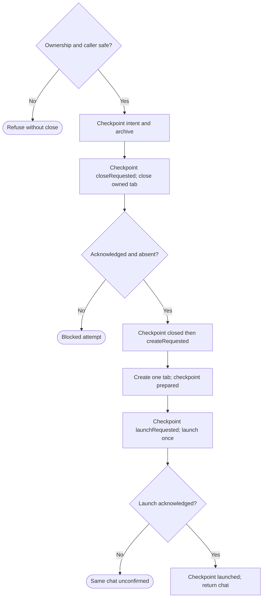

# Area chats in Herdr

Own `src/workflow-chat.mjs`. An area chat is one native Codex or Claude session in its own tab of the Herdr session `pdd`. pdd starts it and then leaves. pdd never watches it.

- Use only the session `pdd` (`herdr --session pdd …`). Never touch the person's default session or another session.
- If the `pdd` server is not running, start `herdr --session pdd server` in the background. Remove agent-session markers (`CLAUDECODE`, `CLAUDE_CODE_*` session values, `CODEX_THREAD_ID`, `HERDR_*`, `PDD_AGENT_SESSION`) from its environment, so chats in it save their transcripts. Wait for it only while that server process is alive.
- `homeVariable(agent)` is `CLAUDE_CONFIG_DIR` for Claude and `CODEX_HOME` for Codex. `expandHome(dir, env)` returns null for an empty value, the home folder (`HOME`, else `os.homedir()`) for `~`, `<home>/x` for `~/x`, and any other value as it is. `isFolder(dir)` says whether a folder is there. Every place that starts or resumes a chat, or reads its sessions, expands the saved config folder first, so a run saved with the `~` text still works.
- `startChat({run, area, message}, ports)`: use the [run layout](workflow-herdr-layout.prompt.md) (a workspace per repository, a workspace `#N NAME` per run, a new tab per area named after the area). Write the first message to `<run folder>/<area>-start.md`. In the tab, run one short shell line: `env PDD_AGENT_SESSION=1 [CLAUDE_CONFIG_DIR=…|CODEX_HOME=…] claude --dangerously-skip-permissions --session-id <new uuid> "$(cat '<file>')"`, or for Codex `codex --no-daemon --dangerously-bypass-approvals-and-sandbox -c 'projects={"<worktree>"={trust_level="trusted"}}' "$(cat '<file>')"`. The config folder is the run's `configDir`: the `CLAUDE_CONFIG_DIR` or `CODEX_HOME` of the terminal that started the run. So every area chat of a run uses the same account, even when someone approves from another terminal. Return the chat record (tab, pane, workspace, label, start time, session `{agent,id}` when known, config folder). Prepare that identity before the pane launch. If its reply fails, attach that same record as `error.chat` with `startUnconfirmed: true`; the caller saves it because the command may have dispatched.
- `sendToChat(chat, text, ports)`: `herdr agent prompt <pane> <text>`. Return `{ok}` or `{ok:false, code}` (`agent_not_found`, `agent_blocked`, …).
- `chatSession(chat, ports)`: read `herdr agent get <pane>`. Return `{alive, status, sessionId}`; when Herdr fails, `{alive: false, status: null, sessionId: null, code, message}` with Herdr's error code (`agent_not_found` when no agent runs in the pane).
- `openChat({run, chat}, ports)`: if the tab is gone, make a new tab in the run workspace, except for an unconfirmed launch: inspect its saved agent first. If the tab and agent/pane are both confirmed missing, return restartAvailable without creating a tab, launching or resuming. The caller archives that stale start and offers an explicit new open to start this area again in the same run. A live agent or an unavailable inspection retains the original identity and refuses replacement. If no agent runs in the pane, resume the native session there (`claude --resume <id>`, `codex resume <id>`, with the same full-access flags), and set `chat.resumedAt` to now. An inspection failure other than confirmed `agent_not_found` must throw before any native launch/resume; unavailable Herdr is not proof of an empty pane. For a retained `startUnconfirmed` chat, an observed live agent confirms the original launch. Without it, refuse another launch/resume and tell the person to inspect that same pane; never send a fresh first message blindly after a lost reply. A failed resume request marks that same chat unconfirmed too. Successful positive observation clears the unconfirmed flag. Focus the tab. Attach with `herdr session attach pdd` only when the caller has a terminal and is not inside Herdr. Otherwise print where the chat is.
- `closeChats(run, ports)`: close each chat tab, then the run workspace, then the repository workspace when no other run uses it. Failures are warnings. Chat labels are `<repo name>#N NAME › AREA`.

Pass input preAgentRefusal to the layout only for a saved first-start run with no chats, completed steps or
PRs and the canonical linked_worktree_source chat failure (or its exact saved startup warning on legacy runs).
The layout owns inventory-backed recovery; neither chat startup nor recovery allocates another Git worktree.
Forward the command execFile port to the layout's verified repository-parent lookup.

Herdr transport reads complete stdout/stderr before interpreting JSON or a nonzero exit. Responses larger than a pipe buffer must retain their full content, and a nonzero response must keep its structured error code. Attaching to a session waits for stream closure before reporting its exit status.

Full-access flags stay. Do not pin tool versions. No timeouts. Shell-quote every path and the resume id in the shell line. A native session id (from Herdr, a session file or the run record) is stored or used only when it is a UUID; `chatCommand` refuses any other resume id.

## Explicit fresh session

Export module function `restartChat({run,chat,message}, ports={})`, returning one replacement chat record. The [runner](workflow-runner.prompt.md#open-a-saved-area-or-replace-its-session) owns selection, continuation content, run locking, archives and persistence. This module owns native ownership verification and replacement effects; ordinary start/open retains its existing behavior. Use the same saved agent/config and assigned worktree, full-access flags and shell quoting. Never pass a resume id for the fresh launch.

Any failed inspection/checkpoint/creation interrupts this route before its next effect. Never retry a native request internally. Unknown/malformed replies are uncertainty, not success. A pending saved attempt follows the runner's refusal/observation rules, not a fresh pass through this diagram.

Before intent, inspect complete workspace/tab/pane inventories and agent state. Require the saved workspace to be the run's linked worktree (`checkout_path` equals assigned `run.root`, `repo_key` equals `run.commonDir`), the tab in that workspace, and its single pane to match saved pane, cwd and any saved terminal id. Refuse missing/changed/extra-pane ownership, malformed inventories and inspection failures. The caller's Herdr pane (from injected `ports.env`, default process env) uses the existing runner `chatPane` session identity rule: `HERDR_PANE_ID` together with the `pdd` session component in `HERDR_SOCKET_PATH`. Equal owned pane refuses with another-terminal advice; a matching pane id in another session is not the target. When inside Herdr but caller pane cannot be determined, refuse. An unconfirmed original launch requires positive observation of that same saved agent before replacement; absence never clears uncertainty. Preserve any positively observed valid native UUID in the archived original; an alive original agent need not expose a session UUID, and absence of that UUID does not invalidate an already saved valid Claude session id.

Close only this verified area tab, retaining peer tabs and both workspaces. Require the documented tab-close success response and fresh inventories confirming both selected tab and pane absent; a failed/lost acknowledgement blocks even when a later read shows absence. Reuse the verified run layout under its existing lock for the new tab; no new Git worktree or workspace cleanup. Persist createRequested before requesting allocation so interruption cannot allocate twice. Before dispatching pane run, prepare and checkpoint the exact new identity, including tab/pane/workspace/terminal, area, agent, configDir, startedAt, label, messageFile and known native session UUID (Claude preallocates; Codex remains null until observed). On a thrown/lost launch reply attach this same `error.chat` with `startUnconfirmed:true`; never invent a different identity.

Required checkpoint and message artifact interface

`ports.checkpoint(record)` is required and awaited; it resolves only after runner persistence. The JSON-serializable envelope is `{id,area,phase,at,original,replacement?}`. `id` is a new UUID for the attempt, `area` is the selected area's name, `at` is its initial epoch milliseconds, and `phase` is exactly `intent`, `closeRequested`, `closed`, `createRequested`, `prepared`, `launchRequested` or `launched`. `original` is the complete saved chat plus `originalMessageFile` (its prior path) and `messageFile` (the immutable archived path); retain original session/config/identity fields. `replacement` is absent until prepared and required thereafter. launchRequested carries `replacement.startUnconfirmed:true`; launched clears that flag only after an acknowledged launch or the runner's positive observation of the same installed launchRequested identity; observation recovery never dispatches again. No callback takes a bare phase string or mutates unrelated run fields.

Before intent and before touching `<area>-start.md`, copy the original first-message file's exact bytes to `<runDir>/abandoned-chats/<id>-start.md` with exclusive creation, and point `original.messageFile` there. Missing/unreadable original bytes refuse before close; never substitute the continuation text. Write the fresh continuation to `<runDir>/<area>-restart-<id>-start.md`; never overwrite an original or archived message artifact. A failed checkpoint prevents the next native effect and retains earlier effects and the last durable custody record. Before the initial close authorization, failure leaves at most these local artifacts, never a close or launch. All filesystem, clock, UUID and Herdr effects use injected boundaries for native testing; these contracts add no unsupported Runtime interface or check-only export.

## Dependencies

- [Herdr layout](workflow-herdr-layout.prompt.md): required authoring/generation/verification context for workspace ownership, allocation and its existing lock. The runner's replacement protocol is the caller contract above, not a recursively loaded dependency.
