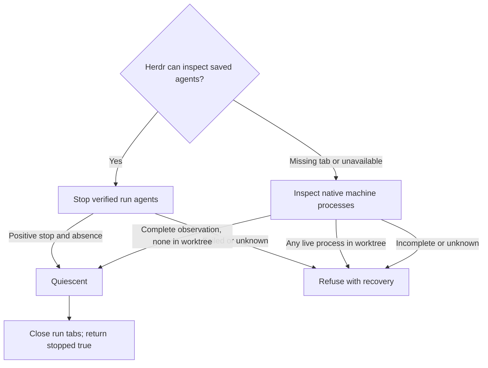

# Area chats in Herdr

Own `src/workflow-chat.mjs`. An area chat is one native Codex or Claude session in its own tab of the Herdr session `pdd`. pdd starts it and then leaves. pdd never watches it.

- Use only the session `pdd` (`herdr --session pdd …`). Never touch the person's default session or another session.
- If the `pdd` server is not running, start `herdr --session pdd server` in the background. Remove agent-session markers (`CLAUDECODE`, `CLAUDE_CODE_*` session values, `CODEX_THREAD_ID`, `HERDR_*`, `PDD_AGENT_SESSION`) from its environment, so chats in it save their transcripts. Wait for it only while that server process is alive.
- `homeVariable(agent)` is `CLAUDE_CONFIG_DIR` for Claude and `CODEX_HOME` for Codex. `expandHome(dir, env)` returns null for an empty value, the home folder (`HOME`, else `os.homedir()`) for `~`, `<home>/x` for `~/x`, and any other value as it is. `isFolder(dir)` says whether a folder is there. Every place that starts or resumes a chat, or reads its sessions, expands the saved config folder first, so a run saved with the `~` text still works.
- `startChat({run, area, message}, ports)`: use the [run layout](workflow-herdr-layout.prompt.md) (a workspace per repository, a workspace `#N NAME` per run, a new tab per area named after the area). Write the first message to `<run folder>/<area>-start.md`. In the tab, run one short shell line: `env PDD_AGENT_SESSION=1 [CLAUDE_CONFIG_DIR=…|CODEX_HOME=…] claude --dangerously-skip-permissions --session-id <new uuid> "$(cat '<file>')"`, or for Codex `codex --no-daemon --dangerously-bypass-approvals-and-sandbox -c 'projects={"<worktree>"={trust_level="trusted"}}' "$(cat '<file>')"`. The config folder is the run's `configDir`: the `CLAUDE_CONFIG_DIR` or `CODEX_HOME` of the terminal that started the run. So every area chat of a run uses the same account, even when someone approves from another terminal. Return the chat record (tab, pane, workspace, label, start time, session `{agent,id}` when known, config folder). Prepare that identity before the pane launch. If its reply fails, attach that same record as `error.chat` with `startUnconfirmed: true`; the caller saves it because the command may have dispatched.
- `sendToChat(chat, text, ports)`: `herdr agent prompt <pane> <text>`. Return `{ok}` or `{ok:false, code}` (`agent_not_found`, `agent_blocked`, …).
- `chatSession(chat, ports)`: read `herdr agent get <pane>`. Return `{alive, status, sessionId}`; when Herdr fails, `{alive: false, status: null, sessionId: null, code, message}` with Herdr's error code (`agent_not_found` when no agent runs in the pane).
- `openChat({run, chat}, ports)`: if the tab is gone, make a new tab in the run workspace, except for an unconfirmed launch: inspect its saved agent first. If the tab and agent/pane are both confirmed missing, return restartAvailable without creating a tab, launching or resuming. The caller archives that stale start and offers an explicit new open to start this area again in the same run. A live agent or an unavailable inspection retains the original identity and refuses replacement. If no agent runs in the pane, resume the native session there (`claude --resume <id>`, `codex resume <id>`, with the same full-access flags), and set `chat.resumedAt` to now. An inspection failure other than confirmed `agent_not_found` must throw before any native launch/resume; unavailable Herdr is not proof of an empty pane. For a retained `startUnconfirmed` chat, an observed live agent confirms the original launch. Without it, refuse another launch/resume and tell the person to inspect that same pane; never send a fresh first message blindly after a lost reply. A failed resume request marks that same chat unconfirmed too. Successful positive observation clears the unconfirmed flag. Focus the tab. Attach with `herdr session attach pdd` only when the caller has a terminal and is not inside Herdr. Otherwise print where the chat is.
- `stopChats(run, ports)`: module function owning [cancellation quiescence](#cancellation-quiescence); return `{stopped, warnings}`. No native relaunch, push or PR action.
- `closeChats(run, ports)`: close each chat tab, then the run workspace, then the repository workspace when no other run uses it. Failures are warnings. Chat labels are `<repo name>#N NAME › AREA`.

Pass input preAgentRefusal to the layout only for a saved first-start run with no chats, completed steps or
PRs and the canonical linked_worktree_source chat failure (or its exact saved startup warning on legacy runs).
The layout owns inventory-backed recovery; neither chat startup nor recovery allocates another Git worktree.
Forward the command execFile port to the layout's verified repository-parent lookup.

Herdr transport reads complete stdout/stderr before interpreting JSON or a nonzero exit. Responses larger than a pipe buffer must retain their full content, and a nonzero response must keep its structured error code. Attaching to a session waits for stream closure before reporting its exit status.

Full-access flags stay. Do not pin tool versions. No timeouts. Shell-quote every path and the resume id in the shell line. A native session id (from Herdr, a session file or the run record) is stored or used only when it is a UUID; `chatCommand` refuses any other resume id.

<a id="cancellation-quiescence"></a>
## Cancellation quiescence



**Normal Herdr path.** Inspect every saved stage agent in this run's own `pdd` panes. Signal only positively identified Codex/Claude agents or their known launcher in the matching worktree and native process group, with birth/group identity rechecked before signalling. An ordinary argument mentioning an agent is not executable identity. Confirm native termination and reject surviving descendants or other worktree writers before success. Preserve the existing recognized idle-shell and caller-ancestor exclusions in this normal path. A lost stop reply, malformed successful inspection, identity mismatch or failed native stop remains a refusal; none authorizes weaker proof. Never signal another run's agent.

**Herdr-unavailable path.** A missing tab/pane (`tab_not_found`, `pane_not_found`) or unavailable session/server/transport, including `server_not_running`, requires native machine inspection rather than immediate refusal or assumed absence. Also use this path for an active failed/unconfirmed start with no saved pane identity. Obtain a fresh, complete inventory of live processes and their working directories, native birth identities and observed commands, across users. "Inside" means the physical run worktree itself or a descendant directory, with path-component boundaries; sibling names with the same prefix are outside. Do not silently limit inspection to this UID. Missing tools, permissions, unreadable live cwd, hidden inventory, malformed/truncated output, unstable identity or unsupported OS make absence unknown. Exclude a vanished or zombie process only with positive native stopped/absence evidence; PID reuse is not evidence that a process still belongs to the run or has stopped. A stale saved PID or absent pane supplies no native proof.

This fallback counts **any** live process inside the worktree: ordinary commands, detached writers, saved idle shells, other users, the caller and its ancestors. Do not inherit normal-path shell/group/ancestor exclusions, and do not automatically kill an unknown process. A positively observed live process blocks even if other inspection is incomplete. Return `stopped: false`, preserve tabs, and identify every known blocker by PID and observed command in the primary diagnostic `warnings[0]`. Put the cause and recovery there too, so callers can retain one complete diagnostic. Tell the person to stop it in its owning terminal, or after rechecking its current command and identity use `kill -TERM PID` if appropriate, then rerun the exact cancellation/replacement command. For an idle/calling shell, explain `cd` to the source repository or exit that shell and retry from outside the worktree; do not tell a person to kill the cancellation request itself. The runner owns the requested retry command. If command/identity cannot be read, name the PID and actual inspection failure, never invent a command or a safe signal target.

With no known blocker but incomplete inspection, return `stopped: false` with the real cause and concrete recovery: restore the missing inspection tool/permission or restore Herdr and inspect the original pane, then retry. Never ask the person to delete claims or records. Only a complete native observation with no live process inside permits `stopped: true`, even after a reboot or an unconfirmed launch. This is evidence at the native observation, not a guarantee against later unrelated process creation. After either path proves quiescence, call `closeChats`; close failures become warnings and do not undo the proof. Refusal never closes tabs or releases custody; the runner owns persistence/release/allocation order.

## Dependencies

- [Run layout](workflow-herdr-layout.prompt.md): required authoring/generation context for session/workspace/tab ownership and close operations; its transport is represented below for runtime checks.
- [Approval evidence](approval-evidence.prompt.md): required authoring/generation context for existing native-session lookup used by open/resume. Cancellation does not resume a session.
- Runtime/verification use injected Herdr and machine-observation ports for outside-world replies. `machine.inspect` binds the production fallback's native inspection dependency, supplied as `ports.inspectMachineProcesses({root})`; the default obtains real OS evidence. It returns coverage (`complete`), live process observations (`pid`, `uid`, `birth`, `command`, `cwd`) and the actual incomplete-coverage `reason`. Nullable metadata or an unestablished birth makes absence unknown. This port supplies observations, never a precomputed stopped/empty decision. `native.processes`, `native.identity` and `native.stopProcessGroup` retain the existing normal-path dependencies: JSON-serialize the native process array and nullable `{birth, group}` identity as `value`; signalling receives the exact group and returns an empty object. `herdr.processInfo` and `herdr.listPanes` serialize the corresponding Herdr pane/workspace inspection: `value` is complete JSON on success, otherwise empty with the actual code/message. `chats.close` binds `closeChats(run, ports)`. For transport, `run` is compact JSON decoded to the actual run argument; signatures stay unchanged. The new cases exercise the fallback; real native parsing, process ownership, permission coverage, races and termination require code verification.

<details>
<summary>Runtime interface</summary>

```json
{"status":"draft","prose_sha256":"3ce8181c53e5b75b95f305f9a44f88dfe3e518878a5474cb4c0c367a47a39452","entries":[{"operation":"stopChats","input_schema":{"type":"object","properties":{"run":{"type":"string"}},"required":["run"],"additionalProperties":false},"result_schema":{"type":"object","properties":{"stopped":{"type":"boolean"},"warnings":{"type":"array","items":{"type":"string"}}},"required":["stopped","warnings"],"additionalProperties":false},"errors":[]}],"calls":[],"resources":[{"name":"herdr","kind":"port","access":"read","operations":[{"name":"processInfo","access":"read","arguments_schema":{"type":"object","properties":{"pane":{"type":"string"}},"required":["pane"],"additionalProperties":false},"result_schema":{"type":"object","properties":{"value":{"type":"string"},"code":{"type":"string"},"message":{"type":"string"}},"required":["value","code","message"],"additionalProperties":false}},{"name":"listPanes","access":"read","arguments_schema":{"type":"object","properties":{"workspace":{"type":"string"}},"required":["workspace"],"additionalProperties":false},"result_schema":{"type":"object","properties":{"value":{"type":"string"},"code":{"type":"string"},"message":{"type":"string"}},"required":["value","code","message"],"additionalProperties":false}}]},{"name":"machine","kind":"port","access":"read","operations":[{"name":"inspect","access":"read","arguments_schema":{"type":"object","properties":{"root":{"type":"string"}},"required":["root"],"additionalProperties":false},"result_schema":{"type":"object","properties":{"complete":{"type":"boolean"},"processes":{"type":"array","items":{"type":"object","properties":{"pid":{"type":"integer","minimum":1},"birth":{"oneOf":[{"type":"string"},{"type":"null"}]},"command":{"oneOf":[{"type":"string"},{"type":"null"}]},"cwd":{"oneOf":[{"type":"string"},{"type":"null"}]},"uid":{"type":"integer","minimum":0}},"required":["pid","birth","command","cwd","uid"],"additionalProperties":false}},"reason":{"type":"string"}},"required":["complete","processes","reason"],"additionalProperties":false}}]},{"name":"native","kind":"port","access":"write","operations":[{"name":"processes","access":"read","arguments_schema":{"type":"object","properties":{},"required":[],"additionalProperties":false},"result_schema":{"type":"object","properties":{"value":{"type":"string"}},"required":["value"],"additionalProperties":false}},{"name":"identity","access":"read","arguments_schema":{"type":"object","properties":{"pid":{"type":"integer"}},"required":["pid"],"additionalProperties":false},"result_schema":{"type":"object","properties":{"value":{"oneOf":[{"type":"string"},{"type":"null"}]}},"required":["value"],"additionalProperties":false}},{"name":"stopProcessGroup","access":"write","arguments_schema":{"type":"object","properties":{"group":{"type":"integer"}},"required":["group"],"additionalProperties":false},"result_schema":{"type":"object","properties":{},"required":[],"additionalProperties":false}}]},{"name":"chats","kind":"port","access":"write","operations":[{"name":"close","access":"write","arguments_schema":{"type":"object","properties":{"run":{"type":"string"}},"required":["run"],"additionalProperties":false},"result_schema":{"type":"object","properties":{"warnings":{"type":"array","items":{"type":"string"}}},"required":["warnings"],"additionalProperties":false}}]}],"limits":{"max_steps":32,"max_model_calls":24},"conventions":[]}
```
</details>
