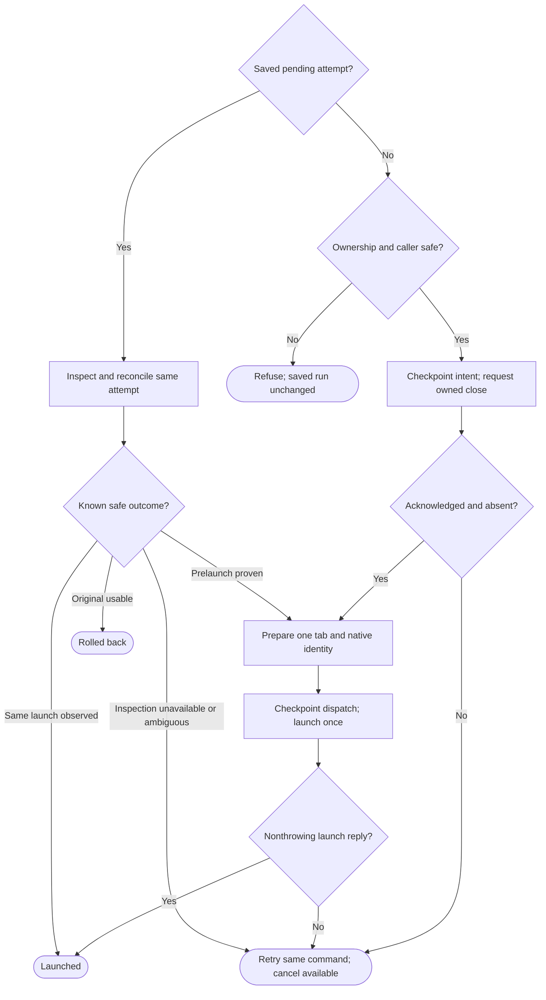
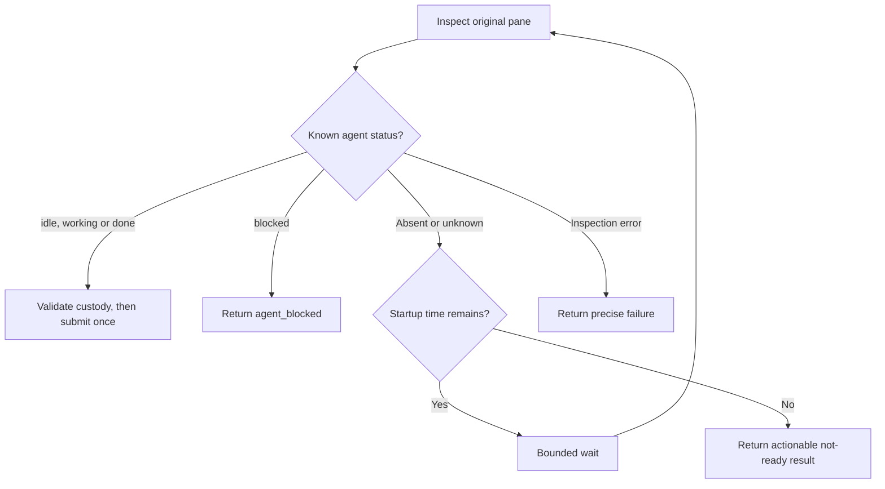

# Area chats in Herdr

Own `src/workflow-chat.mjs`. An area chat is one native Codex or Claude session in its own tab of the Herdr session `pdd`. pdd starts it and then leaves. pdd never watches it.

- Use only the session `pdd` (`herdr --session pdd …`). Never touch the person's default session or another session.
- If the `pdd` server is not running, start `herdr --session pdd server` in the background. Remove agent-session markers (`CLAUDECODE`, `CLAUDE_CODE_*` session values, `CODEX_THREAD_ID`, `HERDR_*`, `PDD_AGENT_SESSION`) from its environment, so chats in it save their transcripts. Wait for it only while that server process is alive.
- `homeVariable(agent)` is `CLAUDE_CONFIG_DIR` for Claude and `CODEX_HOME` for Codex. `expandHome(dir, env)` returns null for an empty value, the home folder (`HOME`, else `os.homedir()`) for `~`, `<home>/x` for `~/x`, and any other value as it is. `isFolder(dir)` says whether a folder is there. Every place that starts or resumes a chat, or reads its sessions, expands the saved config folder first, so a run saved with the `~` text still works.
- `startChat({run, area, message}, ports)`: use the [run layout](workflow-herdr-layout.prompt.md) (a workspace per repository, a workspace `#N NAME` per run, a new tab per area named after the area). Write the first message to `<run folder>/<area>-start.md`. In the tab, run one short shell line: `env PDD_AGENT_SESSION=1 [CLAUDE_CONFIG_DIR=…|CODEX_HOME=…] claude --dangerously-skip-permissions --session-id <new uuid> "$(cat '<file>')"`, or for Codex `codex --no-daemon --dangerously-bypass-approvals-and-sandbox -c 'projects={"<worktree>"={trust_level="trusted"}}' "$(cat '<file>')"`. The config folder is the run's `configDir`: the `CLAUDE_CONFIG_DIR` or `CODEX_HOME` of the terminal that started the run. So every area chat of a run uses the same account, even when someone approves from another terminal. Return the chat record (tab, pane, workspace, label, start time, session `{agent,id}` when known, config folder). Prepare that identity before the pane launch. If its reply fails, attach that same record as `error.chat` with `startUnconfirmed: true`; the caller saves it because the command may have dispatched.
- Module function `sendToChat(chat, text, ports)` owns bounded readiness and one ordered Herdr submission; see [Message delivery](#message-delivery). Return `{ok:true}` on acknowledgement or `{ok:false, code}` on failure, with `uncertain:true` only when submission may have happened.
- `chatSession(chat, ports)`: read `herdr agent get <pane>`. Return `{alive, status, sessionId}`; when Herdr fails, `{alive: false, status: null, sessionId: null, code, message}` with Herdr's error code (`agent_not_found` when no agent runs in the pane).
- `openChat({run, chat}, ports)`: if the tab is gone, make a new tab in the run workspace, except for an unconfirmed launch: inspect its saved agent first. If the tab and agent/pane are both confirmed missing, return restartAvailable without creating a tab, launching or resuming. The caller archives that stale start and offers an explicit new open to start this area again in the same run. A live agent or an unavailable inspection retains the original identity and refuses replacement. If no agent runs in the pane, resume the native session there (`claude --resume <id>`, `codex resume <id>`, with the same full-access flags), and set `chat.resumedAt` to now. An inspection failure other than confirmed `agent_not_found` must throw before any native launch/resume; unavailable Herdr is not proof of an empty pane. For a retained `startUnconfirmed` chat, an observed live agent confirms the original launch. Without it, refuse another launch/resume and tell the person to inspect that same pane; never send a fresh first message blindly after a lost reply. A failed resume request marks that same chat unconfirmed too. Successful positive observation clears the unconfirmed flag. Focus the tab. Attach with `herdr session attach pdd` only when the caller has a terminal and is not inside Herdr. Otherwise print where the chat is.
- `closeChats(run, ports)`: close each chat tab, then the run workspace, then the repository workspace when no other run uses it. Failures are warnings. Chat labels are `<repo name>#N NAME › AREA`.

Pass input preAgentRefusal to the layout only for a saved first-start run with no chats, completed steps or
PRs and the canonical linked_worktree_source chat failure (or its exact saved startup warning on legacy runs).
The layout owns inventory-backed recovery; neither chat startup nor recovery allocates another Git worktree.
Forward the command execFile port to the layout's verified repository-parent lookup.

Herdr transport reads complete stdout/stderr before interpreting JSON or a nonzero exit. Responses larger than a pipe buffer must retain their full content, and a nonzero response must keep its structured error code. Attaching to a session waits for stream closure before reporting its exit status.

Full-access flags stay. Do not pin tool versions. No workflow or native-session lifetime timeouts; the message-readiness deadline below is the local exception. Shell-quote every path and the resume id in the shell line. A native session id (from Herdr, a session file or the run record) is stored or used only when it is a UUID; `chatCommand` refuses any other resume id.

<a id="explicit-fresh-session"></a>
## Explicit fresh session

Export module function `restartChat({run,chat,message,pending}, ports={})`, returning the active chat record after replacement or rollback. The [runner](workflow-runner.prompt.md#open-a-saved-area-or-replace-its-session) owns selection, continuation content, run locking, archives and persistence. This module owns native ownership verification and replacement effects; ordinary start/open retains its existing behavior. Use the same saved agent/config and assigned worktree, full-access flags and shell quoting. Never pass a resume id for the fresh launch.



A failed checkpoint stops before the next native effect. Never retry a native request internally after uncertainty. Any nonthrowing `pane run` reply confirms launch, as for ordinary startChat; do not require an empty JSON object. Recovery is an explicit later --new invocation, not a fresh attempt.

Before intent, inspect complete workspace/tab/pane inventories and agent state once. Require the saved workspace to be the run's linked worktree (`checkout_path` equals assigned `run.root`, `repo_key` equals `run.commonDir`), the tab in that workspace, and its single pane to match saved pane, cwd and any saved terminal id. Refuse missing/changed/extra-pane ownership, malformed inventories and inspection failures. This module owns caller safety: refuse whenever injected `ports.env` (default process env) has `PDD_AGENT_SESSION` set. Also refuse the caller's selected pdd pane, or an undetermined pane when inside Herdr, with another-terminal advice. Identify the pdd caller using `HERDR_PANE_ID` and the `pdd` session component of `HERDR_SOCKET_PATH`; the same pane id in another session is not the target. Do not duplicate these checks in the runner. An unconfirmed original launch requires positive observation of that same saved agent before replacement; absence never clears uncertainty. Preserve any positively observed valid native UUID in the archived original; an alive original need not expose a UUID or invalidate an already saved valid Claude id.

Close only this verified area tab, retaining peer tabs and both workspaces. Record closeRequested before close and record its acknowledgement separately from absence; `closed` requires fresh inventories confirming both tab and pane absent, plus either an acknowledged close or the lost-acknowledgement recovery proof below that the original native session cannot still be running. A lost/malformed close reply is not an acknowledgement. Reuse the verified layout under its existing lock; no new Git worktree or workspace cleanup. Before tab creation persist createRequested with the complete preallocation inventory and an attempt-identifying allocation label, so a later inspection can identify a created tab despite a lost reply. Before dispatch prepare/checkpoint the exact replacement identity (tab, pane, workspace, terminal, area, agent, configDir, startedAt, label, messageFile and known native UUID). Claude preallocates a UUID; Codex retains null until observed. Never pass a resume id on the fresh launch. A thrown/lost launch reply retains this same `error.chat` with startUnconfirmed:true.

<details>
<summary>Recovery and rollback by durable phase</summary>

`restartChat` also accepts an optional `pending` saved envelope in its existing object input. Reconcile custody from that record and fresh inventories, never from a new identity invented on retry. Its area/original identify the recovery target even when legitimate workflow progress has advanced run.area; inspect and reconcile that recorded chat, never substitute the newer current chat. Use one native ownership/observation path for initial replacement and recovery; keep only checks needed for the observed phase.

- `intent`: no close was dispatched. If the original is still owned and usable, roll back to it, retain the archive, and finish this invocation without closing it. Otherwise retain a retryable attempt until inspection can establish ownership.
- `closeRequested`: close may have happened. If the exact original remains owned and usable, roll back without reissuing close. If its tab/pane are absent, distinguish a saved acknowledged close from a lost acknowledgement. The former may continue prelaunch; for the latter inspect the saved original native session/agent as well as inventories, and establish that it cannot still be running before continuing. Unavailable or inconclusive inspection refuses retryably; mere tab absence is insufficient.
- `closed`: closure is confirmed and allocation has not been requested. Continue the same explicit attempt through createRequested.
- `createRequested`: allocation may have happened, launch has not. Reconcile the saved inventory and allocation identity: adopt the unique owned new tab/pane for this attempt and checkpoint prepared; if complete inspection proves no allocation occurred, create once for this same attempt. Ambiguous/unavailable inventory cannot authorize another allocation. Never adopt a peer tab.
- `prepared`: launch has not been requested. Verify the exact prepared tab/pane is owned and has no agent, then launch its same identity once. If that prepared tab is confirmed gone and no launch was requested, safely recreate its prelaunch container under the same attempt, preserving the preallocated native identity; never reuse this rule for launchRequested.
- `launchRequested`: dispatch may have happened. Positive observation of the exact saved replacement agent/session confirms launched without another launch. Inspect native session evidence and its exact identity when the pane is absent. Never allocate or dispatch another fresh session from absence alone. If authoritative inspection establishes that dispatch never occurred, continue that same prepared identity; if a saved session exists but stopped, resume that exact native session in a verified owned container instead of sending a new first message. If the available agent cannot establish its exact native identity, retain a retryable refusal rather than inventing an id or launching again.

Before any recovery resume, persist `recovery.resumeRequested:true` in the same envelope. Its exact saved native-session target is original for intent/closeRequested rollback and replacement for launchRequested recovery; never allocate a new native identity. If resumeRequested is true, only positive observation of that same agent/session can finish the attempt; absent or unavailable observation remains retryable and must not dispatch resume again after a lost reply.

Rollback marks rolledBack, restores the verified usable original as active and preserves immutable archive custody. Where the original is confirmed closed, finish the explicit prelaunch attempt instead of pretending the old chat is usable. Unavailable external inspection may temporarily prevent either result: retain the exact phase and offer only `pdd workflow open ISSUE --new` as the resolving command, with cancel still available. This protocol adds no approval gate and never requires manual record edits. All retries return after recovery; they do not immediately replace the recovered chat again.

</details>

<details>
<summary>Required checkpoint and message artifact interface</summary>

`ports.checkpoint(record)` is required and awaited; it resolves only after runner persistence. The JSON-serializable envelope is `{id,area,phase,at,original,replacement?,recovery?}`. `id` is a new UUID for the attempt, `area` is the selected area's name, `at` is its initial epoch milliseconds, and `phase` is exactly `intent`, `closeRequested`, `closed`, `createRequested`, `prepared`, `launchRequested` or `launched`, with terminal `rolledBack` for a recovered usable original. `recovery`, when present, is `{closeAcknowledged?,allocationLabel?,tabIdsBefore?,resumeRequested?}`: closeAcknowledged and resumeRequested are optional Booleans (absence means not acknowledged or not yet requested, respectively), allocationLabel is the attempt-specific tab label, and tabIdsBefore is the complete preallocation tab-id list. Save acknowledgement immediately after a successful close response, before further inspection. Save allocationLabel and tabIdsBefore before allocation. The prepared identity stays in replacement. `original` is the complete saved chat plus `originalMessageFile` (its prior path) and `messageFile` (the immutable archived path); retain original session/config/identity fields. `replacement` is absent until prepared and required in prepared, launchRequested and launched; rolledBack may retain it as custody metadata. launchRequested carries `replacement.startUnconfirmed:true`; launched clears that flag only after a nonthrowing launch reply or positive observation of the same installed launchRequested identity; observation recovery never dispatches again. No callback takes a bare phase string or mutates unrelated run fields.

Before intent and before touching `<area>-start.md`, copy the original first-message file's exact bytes to `<runDir>/abandoned-chats/<id>-start.md` with exclusive creation, and point `original.messageFile` there. Missing/unreadable original bytes refuse before close; never substitute the continuation text. Write the fresh continuation to `<runDir>/<area>-restart-<id>-start.md`; never overwrite an original or archived message artifact. A failed checkpoint prevents the next native effect and retains earlier effects and the last durable custody record. Eligibility and ownership refusals before intent leave the saved run unchanged, with at most these local artifacts. After intent is durably saved, checkpoint or transport failure retains that exact pending custody for recovery; it is not an eligibility refusal. No failed checkpoint permits the next close, allocation or launch. All filesystem, clock, UUID and Herdr effects use injected boundaries for native testing; these contracts add no unsupported Runtime interface or check-only export.

</details>

## Message delivery

A pane-launch acknowledgement does not establish agent readiness. For `sendToChat`, the startup window ends 30,000 ms after the latest finite `startedAt` or `resumedAt`; missing timestamps supply no startup grace. At entry, capture the nonnegative remaining window and an elapsed-clock baseline. Every later wait/check must satisfy both that original elapsed budget and the persisted startup deadline, so a wall-clock change never extends the window. Use injected wall-clock `now`, monotonic millisecond `elapsedNow` and `sleep(ms)` ports, with production clock/delay defaults. A retry never restarts either budget. The first inspection and its known-ready submission are allowed at any chat age. After a not-ready observation or confirmed submission rejection, do not start another inspection or retry submission when either bound has expired. Wait up to 250 ms between inspections, shortened only by the remaining budget.



Only an alive agent with Herdr status `idle`, `working` or `done` is ready. `blocked` returns `agent_blocked` immediately. An absent agent, an alive `unknown` status or a missing/unrecognized status may wait only within the original window. A `working` agent does not wait for its turn to finish. Expiry after waiting returns `chat_still_starting`; a first confirmed absence outside the window returns `agent_not_found`, while an alive but unknown agent outside it returns `herdr_status_unknown`. Other inspection failures return their actual code immediately and are never proof of readiness.

Immediately before each transport attempt, await optional `ports.beforeSubmit()`. It returns true only after its caller has validated the original target and durably recorded submission intent; false returns `{ok:false,code:"chat_target_changed"}` without transport. Callback failure must also send nothing. Invoke it again before an allowed retry after a confirmed rejection; never call it merely for an inspection. The runner owns the callback's journal and target policy.

Send `herdr agent prompt <pane> <text>` as its single ordered paste-and-Enter submission. This generic transport preserves its supplied text, including gate-message line breaks; user-input normalization belongs only to `changeRun`. Do not add separate terminal key/paste calls, arbitrary paste delays or `--wait`. Herdr acknowledgement proves submission, not that the agent acted on it.

A submission rejected with `agent_not_found` may return to readiness inspection only within the same bounds. A confirmed `agent_blocked` returns that code. Never retry any potentially dispatched submission automatically: return its actual code and `uncertain:true`. No readiness path starts, resumes, replaces, focuses or closes an agent, tab or server, or changes its saved identity.

## Dependencies

- [Herdr layout](workflow-herdr-layout.prompt.md): required authoring/generation/verification context for workspace ownership, allocation and its existing lock. The runner's replacement protocol is the caller contract above, not a recursively loaded dependency.
- Native `herdr`, `now`, `elapsedNow` and `sleep` ports supply transport, wall time, monotonic elapsed time and delay; optional `beforeSubmit` supplies the caller-owned durable precondition. The scoped Runtime entry describes the real module function's JSON-visible arguments/results; it does not bind native Herdr, clock, terminal or session effects. Native stub and private-Herdr tests must establish readiness and submission behavior.

<details><summary>Runtime interface</summary>

```json
{"status":"approved","prose_sha256":"8396f800f6a549a3c45f68b932c1dfa5e7b12bf63f9f7554cc1abc7760ab9f39","entries":[{"operation":"sendToChat","input_schema":{"type":"object","properties":{"chat":{"type":"object","properties":{"paneId":{"type":"string"},"startedAt":{"type":"number"},"resumedAt":{"type":"number"}},"required":["paneId"],"additionalProperties":false},"text":{"type":"string"}},"required":["chat","text"],"additionalProperties":false},"result_schema":{"type":"object","properties":{"ok":{"type":"boolean"},"code":{"type":"string"},"uncertain":{"type":"boolean"}},"required":["ok"],"additionalProperties":false},"errors":[]}],"calls":[],"resources":[],"limits":{"max_steps":4,"max_model_calls":1},"conventions":[]}
```
</details>
