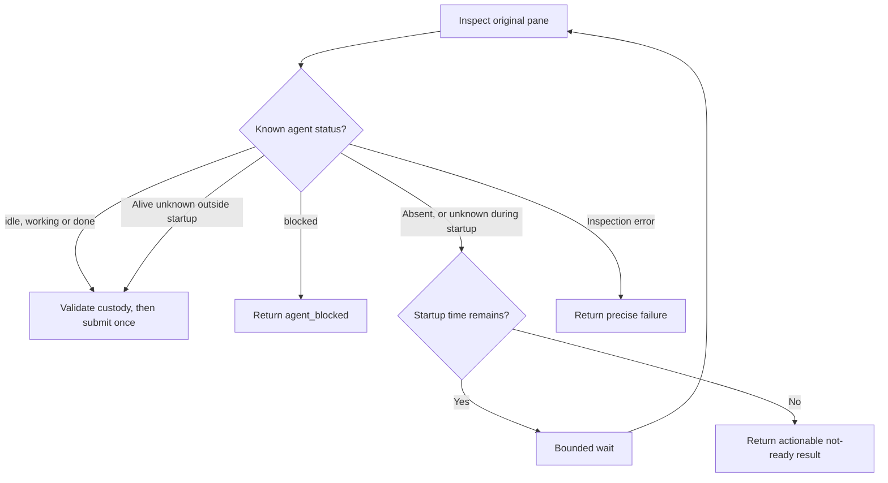

# Area chats in Herdr

Own `src/workflow-chat.mjs`. An area chat is one native Codex or Claude session in its own tab of the Herdr session `pdd`. pdd starts it and then leaves. pdd never watches it.

- Use only the session `pdd` (`herdr --session pdd …`). Never touch the person's default session or another session.
- If the `pdd` server is not running, start `herdr --session pdd server` in the background. Remove agent-session markers (`CLAUDECODE`, `CLAUDE_CODE_*` session values, `CODEX_THREAD_ID`, `HERDR_*`, `PDD_AGENT_SESSION`) from its environment, so chats in it save their transcripts. Wait for it only while that server process is alive.
- `homeVariable(agent)` is `CLAUDE_CONFIG_DIR` for Claude and `CODEX_HOME` for Codex. `expandHome(dir, env)` returns null for an empty value, the home folder (`HOME`, else `os.homedir()`) for `~`, `<home>/x` for `~/x`, and any other value as it is. `isFolder(dir)` says whether a folder is there. Every place that starts or resumes a chat, or reads its sessions, expands the saved config folder first, so a run saved with the `~` text still works.
- `startChat({run, area, message}, ports)`: use the [run layout](workflow-herdr-layout.prompt.md) (a workspace per repository, a workspace `#N NAME` per run, a new tab per area named after the area). Write the first message to `<run folder>/<area>-start.md`. In the tab, run one short shell line: `env PDD_AGENT_SESSION=1 [CLAUDE_CONFIG_DIR=…|CODEX_HOME=…] claude --dangerously-skip-permissions --session-id <new uuid> "$(cat '<file>')"`, or for Codex `codex --no-daemon --dangerously-bypass-approvals-and-sandbox -c 'projects={"<worktree>"={trust_level="trusted"}}' "$(cat '<file>')"`. The config folder is the run's `configDir`: the `CLAUDE_CONFIG_DIR` or `CODEX_HOME` of the terminal that started the run. So every area chat of a run uses the same account, even when someone approves from another terminal. Return the chat record (tab, pane, workspace, label, start time, session `{agent,id}` when known, config folder). Prepare that identity before the pane launch. If its reply fails, attach that same record as `error.chat` with `startUnconfirmed: true`; the caller saves it because the command may have dispatched.
- Module function `sendToChat(chat, text, ports)` owns bounded readiness and one ordered Herdr submission; see [Message delivery](#message-delivery). Return `{ok:true}` on acknowledgement or `{ok:false, code}` on failure, with `uncertain:true` only when submission may have happened.
- `chatSession(chat, ports)`: read `herdr agent get <pane>`. Return `{alive, status, sessionId}`; when Herdr fails, `{alive: false, status: null, sessionId: null, code, message}` with Herdr's error code (`agent_not_found` when no agent runs in the pane).
- `openChat({run, chat}, ports)`: if the tab is gone, make a new tab in the run workspace, except for an unconfirmed launch: inspect its saved agent first. If the tab and agent/pane are both confirmed missing, return restartAvailable without creating a tab, launching or resuming. The caller archives that stale start and offers an explicit new open to start this area again in the same run. A live agent or an unavailable inspection retains the original identity and refuses replacement. If no agent runs in the pane, resume the native session there (`claude --resume <id>`, `codex resume <id>`, with the same full-access flags), and set `chat.resumedAt` to now. An inspection failure other than confirmed `agent_not_found` must throw before any native launch/resume; unavailable Herdr is not proof of an empty pane. For a retained `startUnconfirmed` chat, an observed live agent confirms the original launch. Without it, refuse another launch/resume and tell the person to inspect that same pane; never send a fresh first message blindly after a lost reply. A failed resume request marks that same chat unconfirmed too. Successful positive observation clears the unconfirmed flag. Focus the tab. Attach with `herdr session attach pdd` only when the caller has a terminal and is not inside Herdr. Otherwise print where the chat is.
- `closeChats(run, ports)`: close each chat tab, then the run workspace, then the repository workspace when no other run uses it. Failures are warnings. Chat labels are `<repo name>#N NAME › AREA`.

Pass input preAgentRefusal to the layout only for a saved first-start run with no chats, completed steps or
PRs and the canonical linked_worktree_source chat failure (or its exact saved startup warning on legacy runs).
The layout owns inventory-backed recovery; neither chat startup nor recovery allocates another Git worktree.
Forward the command execFile port to the layout's verified repository-parent lookup.

Herdr transport reads complete stdout/stderr before interpreting JSON or a nonzero exit. Responses larger than a pipe buffer must retain their full content, and a nonzero response must keep its structured error code. Attaching to a session waits for stream closure before reporting its exit status.

Full-access flags stay. Do not pin tool versions. No workflow or native-session lifetime timeouts; the message-readiness deadline below is the local exception. Shell-quote every path and the resume id in the shell line. A native session id (from Herdr, a session file or the run record) is stored or used only when it is a UUID; `chatCommand` refuses any other resume id.

## Message delivery

A pane-launch acknowledgement does not establish agent readiness. For `sendToChat`, the startup window ends 30,000 ms after the latest finite `startedAt` or `resumedAt`; missing timestamps supply no startup grace. At entry, capture the nonnegative remaining window and an elapsed-clock baseline. Every later wait/check must satisfy both that original elapsed budget and the persisted startup deadline, so a wall-clock change never extends the window. Use injected wall-clock `now`, monotonic millisecond `elapsedNow` and `sleep(ms)` ports, with production clock/delay defaults. A retry never restarts either budget. The first inspection and its known-ready submission are allowed at any chat age. After a not-ready observation or confirmed submission rejection, do not start another inspection or retry submission when either bound has expired. Wait up to 250 ms between inspections, shortened only by the remaining budget.



During startup, an alive agent with Herdr status `idle`, `working` or `done` is ready; an absent agent or unknown/missing/unrecognized status may wait only within the original window. `blocked` returns `agent_blocked` immediately at any age. A `working` agent does not wait for its turn to finish. Expiry after waiting returns `chat_still_starting`; a first confirmed absence outside the window returns `agent_not_found`. Outside startup, preserve existing delivery to an alive agent even when its status is unknown, missing or unrecognized. Other inspection failures return their actual code immediately and are never proof of readiness.

Immediately before each transport attempt, await optional `ports.beforeSubmit()`. It returns true only after its caller has validated the original target and durably recorded submission intent; false returns `{ok:false,code:"chat_target_changed"}` without transport. Callback failure must also send nothing. Invoke it again before an allowed retry after a confirmed rejection; never call it merely for an inspection. The runner owns the callback's journal and target policy.

Send `herdr agent prompt <pane> <text>` as its single ordered paste-and-Enter submission. This generic transport preserves its supplied text, including gate-message line breaks; user-input normalization belongs only to `changeRun`. Do not add separate terminal key/paste calls, arbitrary paste delays or `--wait`. Herdr acknowledgement proves submission, not that the agent acted on it.

A submission rejected with `agent_not_found` may return to readiness inspection only within the same bounds. A confirmed `agent_blocked` returns that code. Never retry any potentially dispatched submission automatically: return its actual code and `uncertain:true`. No readiness path starts, resumes, replaces, focuses or closes an agent, tab or server, or changes its saved identity.

## Dependencies

- [Run layout](workflow-herdr-layout.prompt.md): required generation/verification context for existing startup and layout behavior.
- Native `herdr`, `now`, `elapsedNow` and `sleep` ports supply transport, wall time, monotonic elapsed time and delay; optional `beforeSubmit` supplies the caller-owned durable precondition. The scoped Interpreter entry describes the real module function's JSON-visible arguments/results; it does not bind native Herdr, clock, terminal or session effects. Native stub and private-Herdr tests must establish readiness and submission behavior.

<details><summary>Runtime interface</summary>

```json
{"status":"approved","prose_sha256":"d257582871747fec17cf4551a0fb4a469b20d7c4a8deca9165253dd053f3323f","entries":[{"operation":"sendToChat","input_schema":{"type":"object","properties":{"chat":{"type":"object","properties":{"paneId":{"type":"string"},"startedAt":{"type":"number"},"resumedAt":{"type":"number"}},"required":["paneId"],"additionalProperties":false},"text":{"type":"string"}},"required":["chat","text"],"additionalProperties":false},"result_schema":{"type":"object","properties":{"ok":{"type":"boolean"},"code":{"type":"string"},"uncertain":{"type":"boolean"}},"required":["ok"],"additionalProperties":false},"errors":[]}],"calls":[],"resources":[],"limits":{"max_steps":4,"max_model_calls":1},"conventions":[]}
```
</details>
