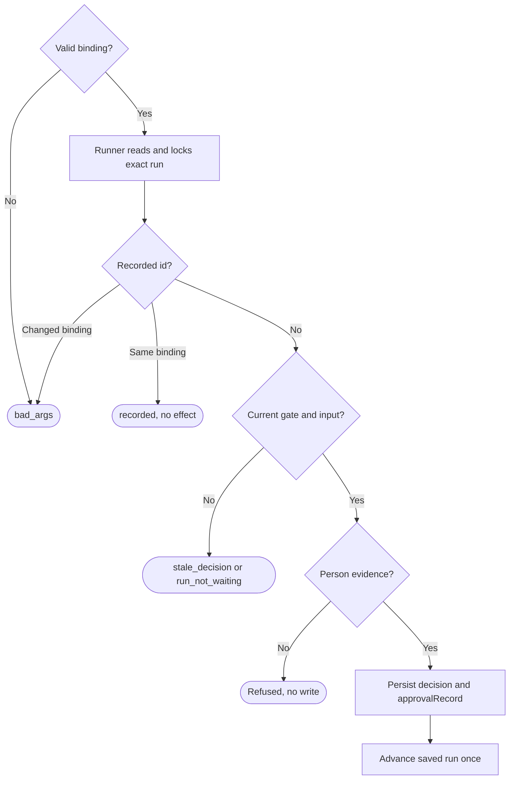

# A person's decision, once

Own `src/workflow-decide.mjs`. Export module function `decideWorkflow(input, ports={})`
for the terminal, short commands and authenticated Link. It validates a person's
approve, changes or skip request and delegates locked admission to the saved
runner. Preserve Alpha's foreground runner and stage validation; introduce no
persistent controller, private service or installer. Status is never authority.

Input is `{runId,decision,decisionId,expectStage,expectSeq,text?,cwd,packageRoot,
yes?,via?,phoneId?,approval?}`.
IDs are lowercase UUIDv4, stage is 1–64 lowercase letters/digits separated by single
hyphens, seq is a positive safe integer. Changes requires 1–4000 Unicode characters,
with no control characters except tab/newline. Other decisions forbid text.
Malformed input returns refused/bad_args/2 before reads or effects.

The runner invokes an authorization callback with the authoritative state under
its existing lock. A trusted host may supply `ports.authorizeDecision({input,state})`
returning `{kind:'phone',authenticated:true}` plus audit fields after its own Link
authentication; CLI arguments/environment never manufacture phone authority.
Otherwise, a real stdin and stderr TTY prompts with repo, issue number and title;
only y/yes accepts, default is no. `yes:true` skips that question only on a TTY.
`PDD_AGENT_SESSION` chooses chat evidence even with a TTY, not blanket refusal.
Non-TTY calls likewise require verified chat evidence; no evidence means refusal.

Chat verification calls W11's `readApprovalEvidence({stage:{agent,root,startedAt,
endedAt},gateAskedAt,decision}, ports)`. Values come from the saved run and gate;
root is the assigned worktree; the saved gate's evidenceStage carries the current
pending or latest completed native stage's actual start/end window, and
gateAskedAt is its durable gate time. Missing historical times cannot be invented. Require exactly one native session and
a USER message strictly after the gate. A verified message proves provenance,
not consent: require an explicit person intent matching the requested approve,
changes or skip decision before admission. Recognize complete, unqualified decision
statements (case-insensitive, surrounding whitespace and final period/exclamation
allowed), such as `approve`, `I approve this plan`, `approved`, `request changes`,
`I request changes`, `skip`, or `please skip this step`. Changes may include
`Request changes: <text>` with the exact submitted changes text. Refusals,
questions, quoted commands, conditional or mixed instructions, unrelated text,
ambiguous assent and another decision all refuse with person_required. Do not
infer consent from a keyword or the reader's echoed decision. Explain that a
clear matching statement is needed. Preserve phone and terminal authorization.
Persist its returned userMessage,
userMessageAt, sessionId and agent as approvalRecord. Missing verifier refuses
approval_evidence_unavailable; verifier refusal is person_required with its plain
message. A caller cannot supply the claimed message in place of file evidence.
W11 owns accepted session formats and decision types; unsupported types refuse.
This evidence check is defence in depth, not protection from arbitrary local
code able to edit the journal and native session files.

Result is `{exitCode,state,code,runId,decisionId,decision,stage,journalSeq,
controller:null,message,approvalRecord?}`. Success recorded/started exits 0;
bad_args exits 2; other failures exit 1. Codes include unknown_run,
stale_decision, run_not_waiting, person_required, approval_evidence_unavailable,
unsupported. Uncertain means a possible effect and must not trigger retry.
The CLI prints one JSON line with v:1 and all fields except exitCode, or one
finite message. Native progress uses stderr in JSON mode. recorded means durable
admission, not stage success; started requires actual stage/chat identity proof.
Repeated ids never launch twice; an interrupted admitted request stays inspect-only.

### Phone subprocess

Input optionally supplies the complete trio `{via:'phone',phoneId,approval}`.
It takes priority over TTY/host callback: verify the signed token with
[phone approval](phone-approval.prompt.md), a required runtime/generation contract
for this mode, using the trusted `ports.lookupPhone` fleet-ledger port. Pass
every durable phone nonce from this run, across phoneIds. A different active
phone using an admitted nonce is also phone_token_replayed. No HMAC fallback exists.
The CLI adds `--via phone --phone PHONE_ID --approval TOKEN`; missing companions
are bad_args. Successful signed proof is persisted as approvalRecord before
advancement. Signature refusal never falls back to another person path.

The final phone contract accepts signed time in the inclusive interval now−5min
through now+5min. Complete durable per-run decisions retain each phone nonce,
without pruning: this covers the entire ten-minute acceptance interval and
survives process restart. A reused nonce for a new decision is refused even at
the far end of that interval; exact bound decision-id retries remain inspect-only.
The ledger port may be supplied as lookupPhone or as clientAdapter.lookupPhone
from mobile's createPhoneLookupAdapter; preserve receiver and prefer an explicit
port. Unknown/unreadable/unverifiable ledger authority is phone_ledger_unavailable.

## Dependencies

- [Runner](workflow-runner.prompt.md): generation/runtime, `applyWorkflowDecision`
  owns exact journal/assignment validation, lock, binding, durable admission,
  proposal revision and subsequent advancement.
- [CLI](pdd-cli.prompt.md), [catalog](command-catalog.prompt.md) and
  [parser](argument-parser.prompt.md): CLI invocation and output.
- Optional runtime W11 module `src/approval-evidence.mjs`, export
  `readApprovalEvidence`: required only for chat relay. Absence refuses safely;
  terminal/phone operation remains available. Interface is declared above so
  this independently mergeable branch does not require an unavailable file.
- [Phone verification](phone-approval.prompt.md): required generation/runtime
  for phone mode; canonical signed fields, clock window and active-ledger proof.
