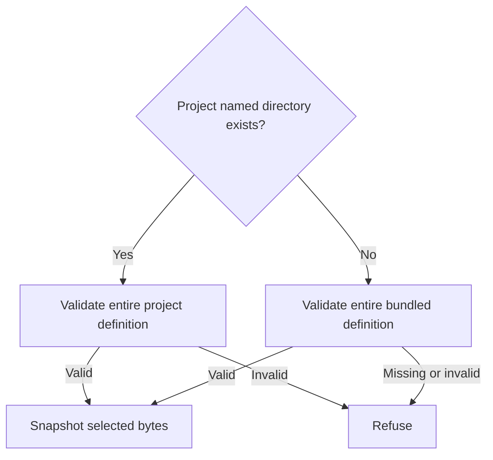

# Editable local workflow definitions

`src/workflow-definition-loader.mjs` owns selection, validation and immutable content snapshots of user-editable local workflow recipes. A user can add a safe workflow directory or change its stages and Markdown without editing a PDD module. The loader performs no Git, native-session or publication effects. The runner owns saved-run identity, approval, artifacts, test execution and advancement.

Export synchronous module functions `loadWorkflowDefinition({name,cwd,packageRoot}) -> {name,version,root,stages,files,digest}` and `listWorkflowDefinitions({cwd,packageRoot}) -> [{name,source}]`. `root` is the canonical selected recipe directory. `source` is project or bundled. Names and stage IDs contain 1–64 characters, start with a lowercase letter and contain lowercase letters, digits and single separating hyphens. Discovery is sorted, includes arbitrary valid names, and uses the same validator rather than a second catalog schema. Invalid discovered definitions refuse discovery with a useful error.

## Selection and content ownership

The roots are `<cwd>/.pdd/workflows/NAME` and `<packageRoot>/.pdd/workflows/NAME`. An existing project directory claims the whole recipe, even if its workflow.json is missing or malformed; do not combine local and bundled stages or silently fall back. Missing project parents permit bundled fallback. Existing parents and all selected path components must be ordinary canonical directories, not symlinks. The selected workflow.json, overview and referenced Markdown must be ordinary single-linked files, remain unchanged while read and stay within the selected directory. Reject absolute paths, backslashes, empty/dot/traversal components, metadata paths, symlinks and non-Markdown instruction paths. Read no undeclared project files.

`files` snapshots unique files in sorted path order as `{path,sha256,content}` using actual UTF-8 bytes. Include workflow.json, overview and every referenced stage file. `digest` is SHA256 over the version/name, normalized ordered stages and ordered file path/hash pairs; it must change on semantic JSON or Markdown changes. The returned value and nested values are immutable. A file is at most256KiB, a snapshot at most2MiB, and a workflow contains1–64 stages; refuse oversized inputs before effects. The runner persists these exact bytes and digest before allocation and never silently substitutes later source edits.

## Closed definition and semantic stage rules

workflow.json has exactly `{version:1,name,overview,stages}`; its name must equal the selected directory. Each stage requires `id`, `kind`, `file`; optional false is the default. Reject unknown fields, null or wrong types and duplicate IDs. `kind` is agent, human, pr or merge. Only agent and PR stages may be optional. Merge conditionality comes from its referenced PR, not a separate optional decision.

| Kind | Additional fields and meaning |
| --- | --- |
| agent | Required `protocol`: report, proposal, work or verify. Optional unique `requiredRoles` from prompt/story/cases/implementation/tests/evidence/notes. Proposal alone requires `approval`: human or next-advance and a nonempty role set. Proposal and verify cannot be optional. |
| human | Accepts the preceding single proposal with approval human; cannot precede it or accept it twice. |
| pr | Required `publication`: proposal or verified; the former requires an accepted proposal, the latter a prior mandatory verify. |
| merge | Required `prStage` naming one preceding PR; each PR can have at most one matching merge. |

Agent work and verify require a prior accepted proposal. Exactly one proposal may exist; it supplies the independent cases/contract and concrete native argv plan. For next-advance approval, the runner pauses before the next effect for a current explicit advance without inventing a human stage. For human approval, a mandatory human stage must occur before work/verify/PR. A verify stage uses the accepted plan, never a model PASS. Reports alone may omit project files; work/proposal/verify must supply actual files. Required artifact roles express the contract without reserving particular stage IDs.

Optional `requiresMerge` on agent work or PR names a preceding merge. A skipped optional PR permits its matching merge/dependent transition to skip that merge requirement; an executed PR requires its actual recorded merge revision and unchanged pinned artifacts. This field replaces special treatment of a stage named build or prompt-merge. It does not authorize checkout, reset, merge or native effects.

Reject meaningless field combinations, missing/forward/wrong-kind references, duplicate merge references, any PR before proposal acceptance, and verified publication without a mandatory verify after the latest work stage. Every work stage invalidates prior graph verification; a later verify restores it. This ordering check supplements the runner's exact output binding and never certifies changed source by itself. File/graph errors must identify the definition or stage. Definition validation never executes a command from JSON; actual test argv comes from the independently accepted stage handoff under the runner's existing protocol.

## Dependencies

- Node built-ins are the only required implementation dependencies. [Runner](workflow-runner.prompt.md) is navigation to the runtime consumer, not a required input back into this loader; it owns saved snapshots, handoffs and effects.
- Bundled `.pdd/workflows/*/workflow.json` and their declared Markdown are runtime inputs; project overrides follow the same schema.
- Node built-in filesystem/path/crypto support regular-file validation and actual byte hashing; no package, network or native call is required.
