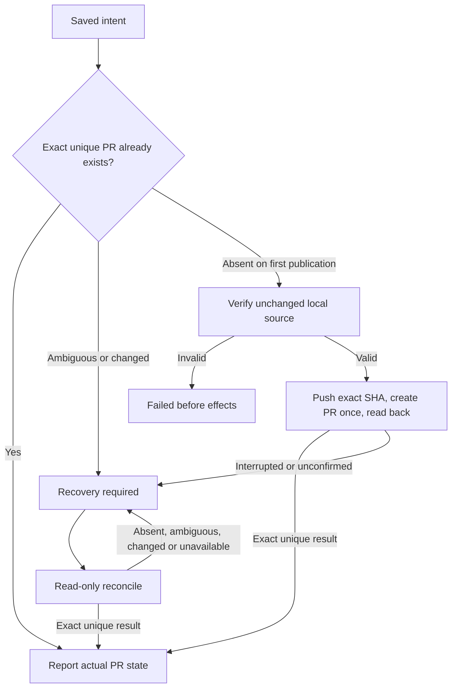

# Local workflow GitHub effects

Own `src/workflow-github.mjs`, exporting only the four module functions below. Help the local runner associate an actual issue and publish one committed topic branch through the person's normal Git and `gh` login. The runner owns durable intent, locks, stage state and the decision to publish; this helper owns repository/PR identity and finite effect results. Preserve cwd and environment, use executable names with argv arrays and no shell, and never launch an agent, switch accounts, copy credentials, merge, automatically retry or advance a workflow.

## Resolve an actual issue in this checkout

`resolveWorkflowIssue({cwd,issue},ports)` returns `{repository,defaultBranch,issue:{number,url,title,body}}`, using the checkout's GitHub `origin` and its actual repository/default branch. Accept a positive issue number, `owner/repo#number` or canonical `https://github.com/owner/repo/issues/number`; canonicalize against the actual repository and reject foreign repositories, malformed URLs and pull-request selectors. GitHub issue API data containing `pull_request` is a PR, even when supplied as a number: refuse it. Verify actual returned number/repository/URL and preserve title/body (null body becomes empty). Invalid input, unavailable commands and missing/malformed remote data throw a finite error without echoing command output or credentials in its message. A failed command attaches the tool's stderr as `detail` on the error, so the runner can show its cleaned first line as the real reason (Serhan, Oct 28).

## Prepare before the runner saves intent

`prepareWorkflowPr({cwd,runId,stageId,repository,baseBranch,title?},ports)` returns exactly `{repository,runId,stageId,headBranch,baseBranch,headSha,marker,title}`. Run/stage identifiers are nonempty ASCII letters/digits/dot/underscore/hyphen, at most160 characters, so the marker is unambiguous. Verify repository matches origin, HEAD is a committed named topic branch different from base, the selected remote base ref exists, and at least one committed change is ahead of it. Refuse staged/unstaged changes and unrelated untracked files. A repository reached through a folder symlink is a valid checkout alias; safety is based on the clean checkout, named topic branch and canonical GitHub origin, not on the checkout folder name or a PR body filename. Use the supplied title (one line, at most 256 characters) or else the actual latest commit subject. Return the marker `<!-- pdd-workflow:<runId>:<stageId> -->` for the caller to include once in the PR body. This preparation step never reads or writes a body file and performs no push or PR write.

## One publication and read-only recovery

The runner must durably save the exact prepared intent BEFORE calling `publishWorkflowPr({cwd,intent,body},ports)` once. The helper has no journal and cannot certify that save; unknown effects normally use only `reconcileWorkflowPr({cwd,intent},ports)`. Reconciliation reads the PR body marker from GitHub and never needs a local body file. Missing PR alone never permits another publication. The explicit absence-checked recovery below is the only exception.



Publication receives the final PR body text from the runner; the body must contain the returned marker exactly once on its own line. It sends that text to `gh pr create` with `--body-file -` and stdin, never by writing or validating a body file. Publication verifies that origin has exactly one push URL naming the same GitHub repository, and verifies the current repository, named branch, clean worktree and exact saved HEAD before effects. It also measures the final body, marker included, in characters (Unicode code points, as GitHub counts them). GitHub refuses more than 65,536 (0.1.7 tester: `GraphQL: Body is too long (maximum is 65536 characters) (createPullRequest)` after the push, hidden behind "unconfirmed"), so a longer body returns failed before any effect: `The PR description has N characters. GitHub accepts at most 65,536. Nothing was pushed. Make it shorter, then try again.` (N with thousands commas). Read the remote head first (`git ls-remote --exit-code --refs origin refs/heads/<savedHeadBranch>`): when it already holds exactly the saved SHA (an earlier attempt pushed it and GitHub refused the PR), do not push again. Otherwise push the saved SHA to the saved branch without force. Then use explicit repository/head/base/title and `--body-file -` for `gh pr create`. Its stdout/URL is not completion evidence: read the actual PR back. Nonzero/throw/timeout after either write starts is recovery_required; do not repeat a command or automatically create after an uncertain push. One exception names a certain result: when `gh pr create` exits nonzero, read back first (an exact PR is reported as usual); when the readback is absent and gh's stderr has GitHub's own refusal, `GraphQL: <reason> (createPullRequest)`, GitHub did not create the PR, so return `rejected`: `GitHub refused to open the PR: REASON. The branch is pushed; no PR was opened. FIX` (for `Body is too long`, REASON is `its description is too long (GitHub's limit is 65,536 characters)` and FIX `Make the PR description shorter, then try again.`; else REASON is GitHub's reason and FIX `Fix what GitHub names, then try again.`). Any other create failure stays recovery_required: `PR creation is unconfirmed (gh: LINE). Reconcile this same saved intent; do not publish again.`, with gh's first error line when it has one. An already exact PR is reported without push/create. A failed pre-effect local/input check returns failed. Reconcile issues only Git/gh reads and never writes a file or pushes/creates/merges.

### Explicit recovery only when both original effects are absent

`publishWorkflowPr({cwd,intent,body,unpublishedOnly:true},ports)` is a bounded exception selected only by the runner after a fresh explicit person approval of the same pending PR intent. Ordinary resume without that decision remains read-only. The runner owns durable admission of this one attempt; the flag is a request for stricter absence checks, not evidence of a prior failure or permission to bypass them. The existing saved intent has no push/create phase receipt: never infer one. Missing/false unpublishedOnly preserves first-publication behavior; other nonboolean values refuse. Do not add fields to the saved intent or alter its original repository, run, stage, marker, branch, SHA, base or title.

Both bounded all-state original marker and head PR lookups must succeed and return no candidates. Any existing PR, malformed/ambiguous/saturated result or unavailable lookup returns recovery_required with no effects, even when an existing PR matches. Revalidate the original clean committed topic, exact saved HEAD, canonical repository and single same-repository origin push URL, and the supplied body with its exact original marker. Then issue `git ls-remote --exit-code --refs origin refs/heads/<savedHeadBranch>`: only its normal no-match exit2 with completely empty stdout proves absence. Any present head, including the exact saved SHA, malformed output, nonzero operational failure or unreadable result stays recovery_required without push/create. Recheck supplied body and local topic after the remote await; a body or source changed during this attempt refuses. The saved intent stores no body bytes/digest; each publication attempt must supply the body again and validate its marker before any effect.

After those checks the existing ordinary nonforce push/create/readback runs once with the same intent. A rejected, timed-out or lost push never proceeds to create; any unconfirmed write stays recovery_required. Later inspection/reconciliation remains read-only. This mode neither replays native stages nor automatically authorizes another attempt. Repeated invocation after a real push is refused by the remote-head check. The absence reads describe actual observations before publication, not an atomic guarantee against another external writer.

<details>
<summary>Exact reconciliation, outcomes and ports</summary>

Look up all-state PR candidates using both the exact marker and the saved head branch, so a changed branch/marker is not silently ignored. Refuse a saturated bounded result rather than assume uniqueness. Require exactly one candidate, exactly one own-line marker, no competing workflow marker, canonical same-repository PR URL/number, same-repository head (no fork), exact head/base branch and exact saved head SHA. Missing, multiple or any mismatched candidate gives recovery_required with pr:null. Do not select newest, adopt a similar PR or treat absence as success. OPEN maps to open, MERGED to merged with its real merge commit, CLOSED to closed; merged requires an actual merge commit. A closed PR is not merged.

Every effect/reconciliation outcome is `{state,pr,message}`, where state is open|merged|closed|recovery_required|rejected|failed and pr is null or `{repository,number,url,headBranch,baseBranch,headSha,mergeCommit}`. Nonmerged mergeCommit is null. Messages are finite actionable text, not raw subprocess errors: a quoted gh line or GitHub reason is one line, cleaned of tokens, control characters and private absolute local paths (POSIX under any root, Windows drive/UNC paths and file URLs, including quoted paths with spaces), at most 300 characters. Apply path redaction before bounding both a known GraphQL refusal and an uncertain gh diagnostic; retain the useful cause. Returned identities come from verified actual data, never a generated PR URL or inferred merge.

Optional `ports.execFile(file,args,{cwd})` returns or resolves `{stdout,stderr?,code?}` (missing code means successful execFile-style completion). Nonzero code or rejection fails the command. A rejection carrying numeric code zero is still failure, never successful completion; genuine nonzero process exits remain available for the untracked-file check. Production uses Node execFile with shell:false, unchanged environment, bounded output and no timeout. Optional `ports.execFile(file,args,{cwd, input})` receives the UTF-8 body as `input` for the `gh --body-file -` call; normal defaults use Node execFile stdin. There is no body-file read or write seam. These are test seams, not alternate authorization or transport. Inputs are captured before the first await to preserve the supplied intent. No caller journal, callbacks or serialized flag can substitute for the runner's durable-save obligation.

</details>

## PR status for the runner

`readWorkflowPrStatus({cwd,url},ports)` reads one PR with `gh pr view <url> --json state,mergedAt,statusCheckRollup` and returns `{state,ci}`. `state` is open, merged or closed. `ci` is none, pending, passing or failing: any failed, cancelled or timed-out check is failing; else any check not complete is pending; else passing when there are checks. A read failure returns `{state:'unknown',ci:'unknown'}`. It never writes.

## Dependencies

- Load the entire [Prompting guide](../../docs/prompting-guide.md) for authoring and generation; it owns module contracts and preservation. The helper owns local-runner GitHub effects, not CLI dispatch.
- Runtime: Node `child_process.execFile`, `fs/promises`, `path` and `util`; installed normal Git and GitHub CLI (`git remote/status/symbolic-ref/rev-parse/rev-list/log/check-ref-format/push/ls-files/ls-remote`, `gh repo view`, `gh api`, `gh pr list/create`). Use their normal login/environment. [Runtime output](runtime-output.prompt.md) `causeText` bounds and scrubs a quoted gh line after this module removes private absolute paths; preserve HTTP URLs as useful diagnostics. No private modules or service dependencies.

<details>
<summary>Runtime interface</summary>

```json
{"status":"draft","prose_sha256":"","entries":[{"operation":"prepareWorkflowPr","input_schema":{"type":"object","properties":{"cwd":{"type":"string","minLength":1},"runId":{"type":"string","minLength":1},"stageId":{"type":"string","minLength":1},"repository":{"type":"string","minLength":1},"baseBranch":{"type":"string","minLength":1},"title":{"type":"string","minLength":1}},"required":["cwd","runId","stageId","repository","baseBranch"],"additionalProperties":false},"result_schema":{"type":"object","properties":{"repository":{"type":"string"},"runId":{"type":"string"},"stageId":{"type":"string"},"headBranch":{"type":"string"},"baseBranch":{"type":"string"},"headSha":{"type":"string"},"marker":{"type":"string"},"title":{"type":"string"}},"required":["repository","runId","stageId","headBranch","baseBranch","headSha","marker","title"],"additionalProperties":false},"errors":["workflow_github_intent_invalid","workflow_github_repository_mismatch","workflow_github_worktree_dirty","workflow_github_topic_required"]}],"calls":[],"resources":[],"limits":{"max_steps":4,"max_model_calls":2},"conventions":[]}
```

</details>
