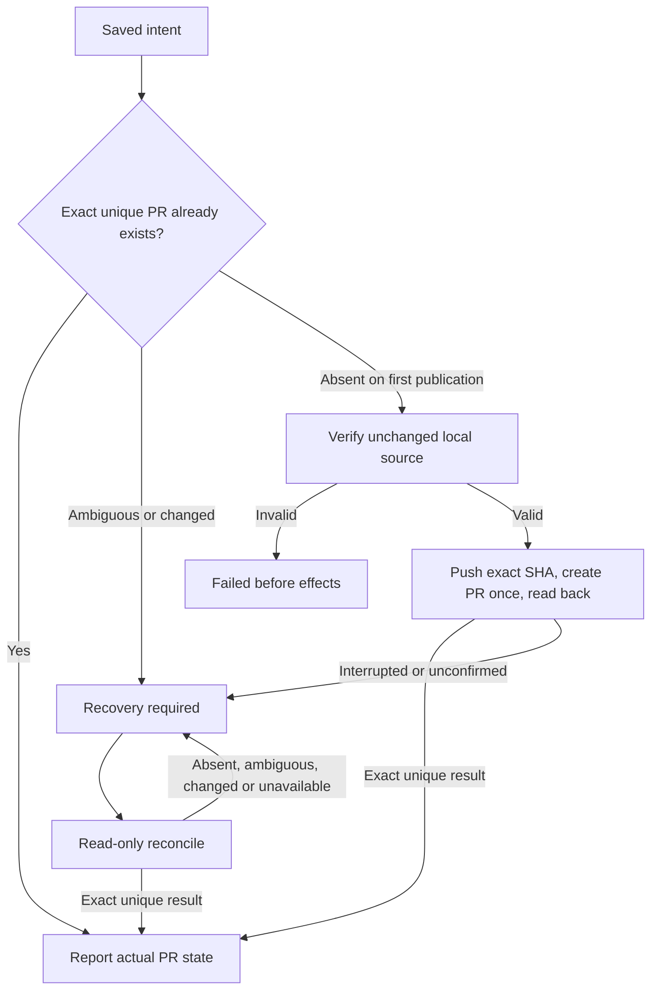

# Local workflow GitHub effects

Own `src/workflow-github.mjs`, exporting only the four module functions below. Help the local runner associate an actual issue and publish one committed topic branch through the person's normal Git and `gh` login. The runner owns durable intent, locks, stage state and the decision to publish; this helper owns repository/PR identity and finite effect results. Preserve cwd and environment, use executable names with argv arrays and no shell, and never launch an agent, switch accounts, copy credentials, merge, retry or advance a workflow.

## Resolve an actual issue in this checkout

`resolveWorkflowIssue({cwd,issue},ports)` returns `{repository,defaultBranch,issue:{number,url,title,body}}`, using the checkout's GitHub `origin` and its actual repository/default branch. Accept a positive issue number, `owner/repo#number` or canonical `https://github.com/owner/repo/issues/number`; canonicalize against the actual repository and reject foreign repositories, malformed URLs and pull-request selectors. GitHub issue API data containing `pull_request` is a PR, even when supplied as a number: refuse it. Verify actual returned number/repository/URL and preserve title/body (null body becomes empty). Invalid input, unavailable commands and missing/malformed remote data throw a finite error without echoing command output or credentials.

## Prepare before the runner saves intent

`prepareWorkflowPr({cwd,runId,stageId,repository,baseBranch,bodyFile},ports)` returns exactly `{repository,runId,stageId,headBranch,baseBranch,headSha,marker,title,bodyFile}`. Run/stage identifiers are nonempty ASCII letters/digits/dot/underscore/hyphen, at most160 characters, so the marker is unambiguous. Verify repository matches origin, HEAD is a committed named topic branch different from base, the selected remote base ref exists, and at least one committed change is ahead of it. Refuse staged/unstaged changes and unrelated untracked files. The declared PR body file may itself be untracked metadata; never overwrite a tracked file. Refuse a body path with a symlink at the file or any ancestor, a nonregular file, or a multiply linked file; metadata aliases must not redirect body writes into source. Preserve existing regular authored body files, and leave parent creation to the caller. Preserve an existing authored body, use the actual latest commit subject as title, and write one own-line `<!-- pdd-workflow:<runId>:<stageId> -->` marker. An existing different/duplicate workflow marker refuses rather than replacing another intent. Return its absolute body file path. No push or PR write occurs here.

## One publication and read-only recovery

The runner must durably save the exact prepared intent BEFORE calling `publishWorkflowPr({cwd,intent},ports)` once. The helper has no journal and cannot certify that save; unknown effects must subsequently use only `reconcileWorkflowPr({cwd,intent},ports)`. Never interpret a missing PR after an interrupted push/create as permission to resend.

Publication verifies that origin has exactly one push URL naming the same GitHub repository, and verifies the current repository, named branch, clean worktree, exact saved HEAD and body marker before effects. Push the saved SHA to the saved branch without force, then use explicit repository/head/base/title/body-file for `gh pr create`. Its stdout/URL is not completion evidence: read the actual PR back. Nonzero/throw/timeout after either write starts is recovery_required; do not repeat a command or automatically create after an uncertain push. An already exact PR is reported without push/create. A failed pre-effect local/input check returns failed. Reconcile issues only Git/gh reads and never writes a file or pushes/creates/merges.

Exact reconciliation, outcomes and ports

Look up all-state PR candidates using both the exact marker and the saved head branch, so a changed branch/marker is not silently ignored. Refuse a saturated bounded result rather than assume uniqueness. Require exactly one candidate, exactly one own-line marker, no competing workflow marker, canonical same-repository PR URL/number, same-repository head (no fork), exact head/base branch and exact saved head SHA. Missing, multiple or any mismatched candidate gives recovery_required with pr:null. Do not select newest, adopt a similar PR or treat absence as success. OPEN maps to open, MERGED to merged with its real merge commit, CLOSED to closed; merged requires an actual merge commit. A closed PR is not merged.

Every effect/reconciliation outcome is `{state,pr,message}`, where state is open|merged|closed|recovery_required|failed and pr is null or `{repository,number,url,headBranch,baseBranch,headSha,mergeCommit}`. Nonmerged mergeCommit is null. Messages are finite actionable text, not raw subprocess errors. Returned identities come from verified actual data, never a generated PR URL or inferred merge.

Optional `ports.execFile(file,args,{cwd})` returns or resolves `{stdout,stderr?,code?}` (missing code means successful execFile-style completion). Nonzero code or rejection fails the command. A rejection carrying numeric code zero is still failure, never successful completion; genuine nonzero process exits remain available for the untracked-file check. Production uses Node execFile with shell:false, unchanged environment, bounded output and finite timeout. Optional `ports.readFile(path,'utf8')` and `ports.writeFile(path,text,'utf8')` replace only body-file I/O for stand-in controls; normal defaults are Node filesystem APIs. These are test seams, not alternate authorization or transport. Inputs are captured before the first await to preserve the supplied intent. No caller journal, callbacks or serialized flag can substitute for the runner's durable-save obligation.

## Dependencies

- Load the entire [Prompting guide](../../docs/prompting-guide.md) for authoring and generation; it owns module contracts and preservation. This new helper is the explicitly authorized local-runner addition; it does not change existing CLI dispatch.
- Runtime: Node `child_process.execFile`, `fs/promises`, `path` and `util`; installed normal Git and GitHub CLI (`git remote/status/symbolic-ref/rev-parse/rev-list/log/check-ref-format/push/ls-files`, `gh repo view`, `gh api`, `gh pr list/create`). Use their normal login/environment. No private modules or service dependencies.
