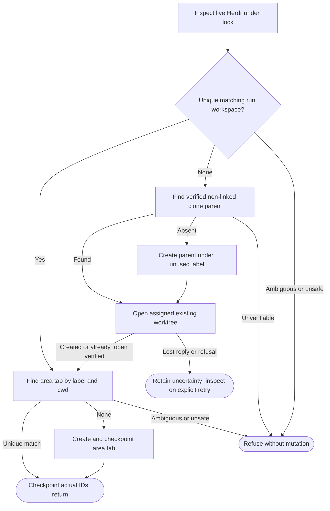

# Repository and run layout in Herdr

Own `src/workflow-herdr-layout.mjs`: session naming, finding or creating repository/run workspaces and area tabs, and verified run cleanup. Export module functions `withHerdrLayoutLock(action, ports)`, `openHerdrRunLayout(input, ports)`, `closeHerdrRunLayout(input, ports)`, `closeHerdrRepoLayoutIfIdle({repository, commonDir}, ports)` and `samePath(a,b)`, plus `PDD_HERDR_SESSION` (`pdd`). Preserve these native interfaces and behavior outside the authorized replacement of PDD's layout registry with live Herdr lookup. Git assignments and native-agent dispatch remain with their existing owners.

Use only session `pdd`. The area-chat owner supplies compatible-server startup and a session-bound command port. Keep the cross-process layout lock around complete find/create operations and session bootstrap in the same HOME. A live owner is exclusive; return `herdr_layout_busy` immediately, without waiting or polling. Recover only a proved-absent process, with synchronous exclusive inspection/replacement; malformed or interrupted claims fail finitely. Ctrl+C must not leave a dead owner blocking later runs.

Inputs retain run UUID, origin-verified `owner/repo`, sourceRoot, commonDir, assigned run cwd, issue/workflow and stageId; optional run/repair inputs remain accepted. Ports retain command, awaited checkpoint, optional directory and execFile. The directory holds the lock, not layout state. Never read, write, repair, migrate or delete `registry.json`; old repository rows, run intents and refusal phases have no authority over allocation. No credentials, configuration or version checks belong here.

## Find live identity before creating

Resolve the verified repository parent through the worktree owner's read-only lookup, forwarding execFile. Keep the invoking sourceRoot and assigned cwd unchanged; a linked caller is never the parent checkout. Normalize both sides of filesystem comparisons with the same realpath-based identity rule, including sourceRoot, parent, commonDir, checkout_path, repo_key and pane cwd. Symlink aliases compare equally in either direction; inability to establish identity is uncertainty, never label-based equality. CommonDir separates independent clones of the same repository.



**Run match:** the unique live workspace whose checkout_path equals assigned cwd, repo_key equals commonDir and is_linked_worktree is true. Workspace labels are not identity. Saved layout/chat IDs are live-checked lookup hints, not a second registry; stale IDs alone cannot defeat a unique verified run match. Conflicting live checkout/repo identity or ambiguous candidates refuse before mutation. Preserve runId, original Git assignment, native session and workflow progress.

**Parent match:** any live non-linked workspace whose checkout_path equals the verified parent and repo_key equals commonDir is usable, including one opened by the person. Multiple matching parents do not require the person to close one; use an existing match. Missing Git metadata does not establish a parent. In particular, an old workspace at another linked checkout without worktree metadata remains untouched and does not block creation of a verified parent for this clone.

If no parent exists, choose the unused short repository name, otherwise `owner/repo`, otherwise `owner/repo@` plus the first 12 lowercase SHA-256 hex characters of canonical commonDir. Refuse an occupied final label. Preserve all existing workspace labels: adopting a parent does not authorize renaming it or qualifying peer workspaces.

Open the already-assigned Git worktree with `worktree open --workspace <parent-id> --path <cwd> --label '<repo name>#<issue> <workflow>' --no-focus`; never create/remove a Git checkout through Herdr. Treat Herdr's `already_open` response as adoption, not refusal: verify its actual workspace through complete live inventory before using it. A lost create reply never licenses blind duplicate allocation; an explicit retry first inspects live identity and adopts a unique match.

**Area match:** inside the verified run workspace, select the unique tab labelled exactly stageId whose single pane cwd equals assigned cwd. Adopt that tab, including a prelaunch tab left after a crash, or create one when no match exists. Never select a peer tab by label alone. Preserve the initial shell tab. Repeated lookup, including repair:true, returns the same verified area tab; explicit native-session replacement remains the chat owner's separate protocol. Allocation alone never authorizes another native launch after an uncertain dispatch.

Checkpoint before effects and checkpoint returned identities before proceeding; checkpoint failure stops the next effect. Return actual `repoWorkspaceId`, `workspaceId`, `tabId`, `paneId`, `terminalId` and `root` (initial run tab/pane/terminal IDs), never predicted IDs. Run-record creation/close custody remains available for cleanup but cannot override contradictory live identity. A closed saved run does not silently reopen. Unavailable/malformed inventory or identity uncertainty refuses finitely, retaining custody. For unsafe live identity, diagnostics identify session/workspace, failed field, escaped expected/observed values and one inspect/retry action; do not recommend closing or deleting anything.

## Cleanup

After the caller closes its verified area tabs, close only the saved run workspace with `workspace close`, never worktree remove or group close. Revalidate its checkout/repo identity and saved initial root tab/pane/terminal; require exactly that original tab and pane. Extra tabs, split panes or changed roots prevent closure. Require documented acknowledgement and valid inventory proving absence. A lost close reply is not blindly repeated. Preserve peer/unrelated workspaces and Git checkout; Git removal remains the worktree owner's responsibility.

`closeHerdrRepoLayoutIfIdle` returns true if a safely owned idle parent was closed or is already gone, false when retained. Adoption is not creation ownership: never close a parent merely because it is a non-linked workspace of the clone. A parent may be closed only with durable run-record evidence that PDD created this exact parent/root, no remaining open run uses it, unchanged verified parent identity and exactly its one original tab/pane. Existing run records with workspace IDs alone do not prove parent creation or its initial roots; preserve those parents and return false. Without that evidence preserve it, including legacy or person-opened parents. Never create another durable layout registry to establish cleanup ownership.

## Dependencies

- Load the complete [Prompting guide](../../docs/prompting-guide.md) for authoring/generation.
- Load the [worktree assignment owner](workflow-worktree.prompt.md) for generation/verification of origin, commonDir, verified parent and assigned paths. No Git allocation rule is changed here.
- Runtime Herdr public workspace/worktree/tab/pane commands and JSON identities, capability baseline 0.9.1 without version pin, supplied by the area-chat command port.
- Node filesystem/crypto primitives supply canonical identity, SHA-256 label qualification and the private cross-process lock. Durable run custody is supplied by the caller, not reconstructed from a registry.

<details><summary>Runtime interface</summary>

The native module remains unbound to the Interpreter: its callback/checkpoint ports, real filesystem identity and cross-process lock have no declared JSON transport binding. No check-only entry or invented adapter is part of this contract. Native tests must establish allocation, chat dispatch and cleanup effects; an Interpreter pass cannot prove them.

```json
{"status":"draft","prose_sha256":"","entries":[],"calls":[],"resources":[],"limits":{"max_steps":1,"max_model_calls":0},"conventions":[]}
```
</details>
