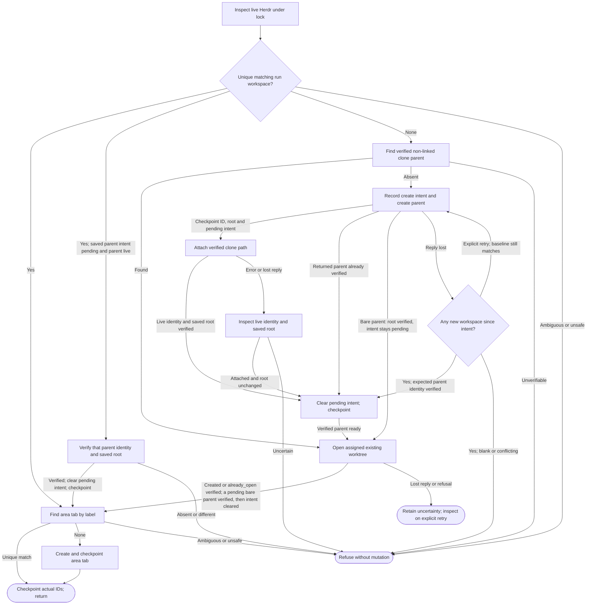

# Repository and run layout in Herdr

Own `src/workflow-herdr-layout.mjs`: session naming, finding or creating repository/run workspaces and area tabs, and verified run cleanup. Export module functions `withHerdrLayoutLock(action, ports)`, `openHerdrRunLayout(input, ports)`, `closeHerdrRunLayout(input, ports)`, `closeHerdrRepoLayoutIfIdle({repository, commonDir}, ports)`, `recoverHerdrRunLayout({run,cwd,commonDir}, ports)` and `samePath(a,b)`, plus `PDD_HERDR_SESSION` (`pdd`). Preserve these native interfaces and behavior outside live Herdr lookup and the restart and changed-layout recovery specified here. Git assignments and native-agent dispatch remain with their existing owners.

Use only session `pdd`. The area-chat owner supplies compatible-server startup and a session-bound command port. Keep the cross-process layout lock around complete find/create operations and session bootstrap in the same HOME. A live owner is exclusive; return `herdr_layout_busy` immediately, without waiting or polling. Recover only a proved-absent process, with synchronous exclusive inspection/replacement; malformed or interrupted claims fail finitely. Ctrl+C must not leave a dead owner blocking later runs.

Inputs retain run UUID, origin-verified `owner/repo`, sourceRoot, commonDir, assigned run cwd, issue/workflow and stageId; optional run/repair inputs remain accepted. Ports retain command, awaited checkpoint, optional directory and execFile. The directory holds the lock, not layout state. Never read, write, repair, migrate or delete `registry.json`; old repository rows, run intents and refusal phases have no authority over allocation. No credentials, configuration or version checks belong here.

## Find live identity before creating

Export `validateHerdrInventory(reply, kind, workspaceId?)` as the shared validator
for workspace, tab and pane inventories, including chat cleanup. Return the
complete rows only when the result type is `<kind>_list`, its plural field is an
array, and every row has a unique nonempty string `<kind>_id`. Tab and pane rows
also require nonempty string `workspace_id`; pane rows require nonempty string
`tab_id` and `terminal_id`. For a scoped request, every row's `workspace_id`
must equal the requested workspace. Otherwise throw `invalid_<kind>_inventory`.
An empty valid scoped list can prove absence only after a valid workspace list
establishes that the requested workspace exists; a valid workspace list can
itself prove that workspace absent. Malformed or out-of-scope evidence is unknown
and cannot authorize a close or a confirmed absence record.

Resolve the verified repository parent through the worktree owner's read-only lookup, forwarding execFile. Keep the invoking sourceRoot and assigned cwd unchanged; a linked caller is never the parent checkout. Normalize both sides of filesystem comparisons with the same realpath-based identity rule, including sourceRoot, parent, commonDir, checkout_path and repo_key. Symlink aliases compare equally in either direction; inability to establish identity is uncertainty, never label-based equality. CommonDir separates independent clones of the same repository.

<a id="pane-identity"></a>**Pane identity.** A tab or pane is identified by its Herdr IDs (tab, pane and terminal) inside a workspace whose live worktree `checkout_path` and `repo_key` match. The live folder of a pane's shell (Herdr `cwd` and `foreground_cwd`) is never identity: the person's shell startup file can `cd` a new pane to another folder, and a command in the pane can move it at any time. So no root-pane, parent-root, area-tab or new-area-pane check compares it: a shell in another folder is still the same pane, and it alone never causes a refusal. The [area chat](workflow-chat.prompt.md) starts each agent with its own `cd` to the worktree.



**Run match:** the unique live workspace whose checkout_path equals assigned cwd, repo_key equals commonDir and is_linked_worktree is true. Workspace labels are not identity. Before adopting any matching workspace, check a saved layout workspace ID (or the latest chat workspace ID when no layout ID is saved) if it is present in live inventory. Its checkout_path, repo_key and linked-worktree identity must match the assigned checkout and repository, even when another workspace matches. A contradiction refuses before any checkpoint or Herdr effect. An ID absent from complete live inventory permits safe retry and adoption of a unique verified match. Conflicting live checkout/repo identity or ambiguous candidates refuse before mutation. Preserve runId, original Git assignment, native session and workflow progress.

**Restart and changed-layout recovery.** `recoverHerdrRunLayout` runs under the caller's layout lock, through the injected command and awaited checkpoint ports. It returns `{workspaceClosed, root, panes}`: `workspaceClosed` is true when the saved workspace is absent or safely closed for rebuilding; `root` is the verified initial tab/pane/terminal identity when present, otherwise null; `panes` is the validated live pane list, otherwise empty. When a root is returned, also return Boolean `restartTerminal`: true when its terminal was refreshed or its saved restart cleanup custody is already true, false otherwise. Verify the saved workspace's linked checkout and common directory before recovery. A foreign workspace, ambiguous match, malformed inventory or unavailable inspection never authorizes closure. Rebuilding by closure also requires saved creation custody for this exact workspace, as defined under Cleanup; adoption never grants closure authority.

A saved root with the same tab, pane and title in that verified workspace is the same layout even when its terminal ID changed after a server restart. Re-save the actual identity and set layout `restartTerminal: true` before continuing when its terminal changes; later cleanup must retain the restart safety guards. Save `rootLabel` with new root custody; legacy roots without it use the initial shell title `1`. Shell cwd remains excluded from identity. A split root or different root tab, pane or title is a changed layout. Before rebuilding it, protect the caller's `HERDR_PANE_ID` from the injected environment (default process environment), and inspect every live pane through `agent get`: only `agent_not_found` proves no agent. A confirmed live agent in any pane establishes the identity refusal before probing foreground occupancy of agent-free panes. Every agent-free pane must also have authoritative idle foreground-shell evidence under the Cleanup rule. Recheck caller and foreground protection after the checkpoint, including any area pane; an unknown or busy shell prevents rebuilding. A live agent, an unconfirmed launch without ended evidence, or unknown inspection preserves the workspace and refuses finitely. This protects all live chats of the run, including earlier areas. Recovery checkpoints carry initial identity only in `root` and omit top-level `tabId`, `paneId` and `terminalId`, which are reserved for an allocated area tab. This lets the chat owner persist root custody without inventing an area chat. Checkpoint before closing the verified idle workspace; then recheck creation custody, checkout/clone identity, unique run match, the same complete tab/pane/terminal/title inventory and agent absence before the close effect. Any change or unknown observation preserves the workspace. Require close acknowledgement and complete inventory proving absence. A lost reply stops the call; a later call inspects live inventory again. Then use the same allocation path as a closed workspace. Keep peer workspaces, Git assignments, native sessions, gates and approvals. Both next-area startup and ordinary workflow open use this recovery. Never ask a person to undo a server restart.

**Parent match:** any live non-linked workspace whose checkout_path equals the verified parent and repo_key equals commonDir is usable, including one opened by the person. Multiple matching parents do not require the person to close one; use an existing match. Missing Git metadata does not establish a parent. In particular, an old workspace at another linked checkout without worktree metadata remains untouched and does not block creation of a verified parent for this clone.

If no parent exists, choose the unused short repository name, otherwise `owner/repo`, otherwise `owner/repo@` plus the first 12 lowercase SHA-256 hex characters of canonical commonDir. Refuse an occupied final label. Preserve all existing workspace labels: adopting a parent does not authorize renaming it or qualifying peer workspaces.

Before creating a parent, checkpoint a namespaced create intent containing the chosen label, canonical parent root and common directory, plus the live workspace IDs already present. It is evidence for detecting an interrupted allocation, not proof that a workspace with that label belongs to PDD. On explicit retry with no saved workspace ID, inspect live identity first. If no workspace appeared since the intent, clear it and creation may retry. If any workspace appeared and no independently verified parent matches the expected clone, refuse without creating another. A verified parent may be reused by its canonical checkout and repository identity, never by its label. This intent keeps a lost reply from causing another empty workspace while retaining ownership uncertainty.

When PDD creates a parent, retain the actual workspace ID and its returned initial tab, pane, terminal and parent cwd in run custody before the next Herdr effect. Keep the create intent with that ID and root until live non-linked checkout and clone identity are verified, then clear it. The live workspace may have no Git identity after `workspace create`; this does not make its label identity. After verification, the ID and root cannot authorize reattaching a parent whose metadata later changes. Preserve that stale parent and use another verified parent or the normal free-label search; an old metadata-free linked caller cannot block recovery after a failed run-worktree open.

Use `worktree open --workspace <saved-id> --path <verified-parent-root> --no-focus` to attach that already-created parent to the verified clone. Before retrying an interrupted attachment, find that saved ID in live inventory and verify the same original root tab, pane and terminal. If the saved ID is missing, or a complete saved root is gone or changed, refuse without attaching another workspace. If the same ID already has the exact non-linked checkout_path and repo_key, reuse it and clear the pending intent. When root custody is incomplete but that live identity is independently verified, reuse without attachment. If its Git identity is absent, run the attach command, then verify the resulting live identity and unchanged root before clearing the intent. If the attach command errors or its reply is lost, inspect live inventory in that call; continue only when the saved workspace now has the exact non-linked checkout_path and repo_key and its original root remains unchanged. Otherwise retain custody and refuse without attaching another workspace. A partial create reply with an actual workspace ID must checkpoint that ID before refusing; without enough root custody, do not attach it on retry unless live identity independently verifies the expected parent.

A bare verified parent (lookup `bare: true`: `project.git`, P for a bare repository in `P/.git`, or `P/.bare`) is never attached with that command. Herdr 0.9.1 refuses `worktree open --path` on a bare repository folder with `worktree_not_found`. It accepts the created workspace at that folder as the source of the run worktree open, and only then gives the parent the non-linked checkout_path R and repo_key C. So for a bare parent without Git identity, verify the saved root, keep the create intent pending and open the assigned run worktree from that workspace. Then verify the run match, the parent's exact non-linked checkout_path and repo_key and its unchanged saved root, and only then clear the intent. If the parent identity is then absent or different, refuse with the identity diagnostic and retain custody. On explicit retry with the intent still pending, the same saved ID and unchanged root authorize that open again. When the unique run match already exists while the intent is still pending (after that refusal, or after a lost reply of a run open that Herdr did), every later open checks the saved parent again before it uses the run workspace: the saved ID is live and new since the intent, has the exact non-linked checkout_path and repo_key, and keeps its saved root. Missing or incomplete saved root custody cannot pass this pending bare-parent check, even when live Git identity matches. Only then clear the intent. Otherwise refuse with the identity diagnostic, retain custody and start no agent. A saved parent ID that is no longer live is a stale hint and does not defeat the verified run match. A bare parent that has its Git identity is a parent match like any other. Herdr refuses a linked checkout as the source (`linked_worktree_source`) and a workspace outside Git (`not_git_worktree`), so neither the invoking linked checkout nor the run worktree can be the parent.

The saved root proves continuity only while the create intent is pending. After PDD verifies and clears the intent, a later stale parent ID or changed parent metadata cannot supply attachment authority or block safe allocation. Preserve the old workspace, including a metadata-free linked caller, and use another live verified parent or the normal free-label search.

Open the already-assigned Git worktree with `worktree open --workspace <parent-id> --path <cwd> --label '<repo name>#<issue> <workflow>' --no-focus`; never create/remove a Git checkout through Herdr. Treat Herdr's `already_open` response as adoption, not refusal: verify its actual workspace through complete live inventory before using it. A lost create reply never licenses blind duplicate allocation; an explicit retry first inspects live identity and adopts a unique match.

**Area match:** inside the verified run workspace, select the unique tab labelled exactly stageId; it must have exactly one pane. Its pane's live folder takes no part (see pane identity). Adopt that tab, including a prelaunch tab left after a crash, or create one when no match exists. Never select a tab of another workspace. Preserve the initial shell tab. Repeated lookup, including repair:true, returns the same verified area tab; explicit native-session replacement remains the chat owner's separate protocol. Allocation alone never authorizes another native launch after an uncertain dispatch.

Checkpoint before effects and checkpoint returned identities before proceeding; checkpoint failure stops the next effect. Return actual `repoWorkspaceId`, `repoRoot`, `repoCreateIntent`, `workspaceId`, `tabId`, `paneId`, `terminalId` and `root` (initial run tab/pane/terminal IDs and `rootLabel`, the initial tab title), never predicted IDs. `repoRoot` is the saved original tab, pane, terminal and cwd of a newly created parent; its cwd is the folder in Herdr's create reply, which must equal the verified parent root, and it is never compared with the pane's later live folder. It proves attachment continuity only with a pending `repoCreateIntent`; alone it does not override later live identity. `repoCreateIntent` records the checked pre-create inventory and target identity until PDD verifies the created parent or a safe retry. Run-record creation/close custody remains available for cleanup but cannot override contradictory live identity. An explicitly closed saved run (`layout.phase` is closed) does not silently reopen. When the saved workspace ID is absent from complete live inventory, open the assigned existing worktree through the verified parent and checkpoint its new IDs. A missing hint alone does not block rebuilding. A present hint with conflicting worktree identity still refuses. Unavailable/malformed inventory or identity uncertainty refuses finitely, retaining custody.

<a id="identity-refusal"></a>**Identity refusal.** For unsafe live identity, throw an error with `code` `herdr_layout_identity_changed` and the structured `field` (the failed field), `expected` and `found`. The first line of its `message` starts with the code, as every layout error does, then says in plain words: session pdd and the workspace, what changed, and one inspect/retry action (inspect that workspace in Herdr, then retry when its live chat has ended or its ownership can be verified). It holds no JSON. Two later lines, `Expected <field>: …` and `Found <field>: …`, show the escaped values as readable `name value` pairs: strings stay JSON-quoted with invisible and direction characters escaped, so a value cannot fake a line, and Herdr screen fields (`agent_status`, `focused`, `revision`, `scroll`, `foreground_cwd`) are left out. Both lines also leave out a pane's `cwd`, because it is not identity (see [pane identity](#pane-identity)), so neither line suggests that a folder caused the refusal. Only `parent_custody` shows a folder, on both lines, because there pdd's saved folder is what failed. "What changed" names the right tab: the run's own first tab in a run workspace (`root_pane`), the first tab of a repository workspace that has other tabs or panes or other Herdr IDs (`parent_root`, or `parent_custody` when pdd's saved record of that tab is incomplete or names another folder than the repository root), or, without saved root custody, a run workspace that does not have exactly one shell tab (`root_tab`). Callers show the first line as the reason and the later lines after it. Do not recommend closing or deleting anything.

## Cleanup

Persist `createdWorkspaceId` in run layout custody: a workspace ID string when creation is proved, null otherwise; legacy records may omit it. Allocation also carries Boolean `restartTerminal`, true only when retaining restart cleanup custody for the same workspace, false for a new workspace. Both fields survive the chat owner's flat-root adapters. It is the actual run
workspace ID returned by a successful `worktree open` that created a new workspace,
with explicit `already_open: false` in its reply, not an `already_open: true` reply or a match adopted from inventory. An omitted or malformed flag supplies no creation authority. Checkpoint this
creation evidence together with the returned initial root IDs (under `root`, never as an area tab) before any later effect. Parent-intent checkpoints must retain that root. Incomplete legacy root custody uses normal live root discovery, without granting creation authority. Preserve creation evidence through root refresh,
area allocation and reopen. Retain it on adoption only for that same workspace ID.
A lost reply, a workspace label or checkout identity alone cannot establish creation.
Both cleanup and changed-layout rebuilding require `createdWorkspaceId` equal to
the target ID; otherwise retain the workspace with `layout_cleanup_uncertain`.
Only the finished/parking chat cleanup consumer may adopt a legacy record with a genuinely absent `createdWorkspaceId` field: complete live inventory must show the saved workspace ID, canonical checkout_path equal to run.root, repo_key equal to run.commonDir, is_linked_worktree true and label exactly `<repository name>#<number> <workflow>`. It must checkpoint the adopted ID before any close. This exception does not apply to allocation adoption or changed-layout rebuilding. An explicit null records that creation was not proved; null, malformed values and conflicting creator IDs never gain closure authority from a matching label or checkout. Other legacy records remain protected. This does not authorize
closing repository parents or unowned workspaces.

After the caller closes its verified area tabs, close only the saved run workspace with `workspace close`, never worktree remove or group close. Revalidate its checkout/repo identity and saved initial root tab/pane/terminal; require exactly that original tab and pane. Extra tabs, split panes or changed roots prevent closure; a split root tab or a changed root refuses with the identity refusal above, an extra tab with `run_has_open_tabs`. A moved root shell does not prevent closure. For terminal-only restart drift,
require the same saved root tab, pane and title (legacy title defaults to `1`),
exactly one tab/pane, authoritative agent absence and an idle foreground shell.
Refresh the root terminal in custody and await its checkpoint before close intent.
Persist `restartTerminal: true` on the layout so retries also require absence and
idle-shell evidence, including forced cancellation. Recheck exact refreshed IDs,
title, creation custody, caller protection and occupancy after close intent;
a second terminal change at this boundary refuses, including on later retries of the saved close intent. Never use the allocation
recovery path to close a changed or extra cleanup pane. Preserve peer/unrelated workspaces and Git checkout; Git removal remains the worktree owner's responsibility.

Workspace closure protects every pane it would remove. Never close the caller's
`HERDR_PANE_ID` from `ports.env` (default process environment), including explicit
cancellation; refuse with `run_shell_caller`. Automatic cleanup also requires a
matching `agent get` pane with status idle/done, or confirmed `agent_not_found`
plus authoritative `pane process-info --pane ID` showing only its shell in the
foreground: matching pane ID, positive shell PID equal to foreground process
group ID, and exactly one foreground process with that PID and a recognized
shell name (bash, zsh, sh, dash, fish, ksh or tcsh). Working/blocked agents or
other foreground work refuse with `run_shell_busy`; malformed, unavailable or
unknown occupancy refuses with `run_shell_unknown`. `ports.force:true` permits
explicit cancellation to bypass occupancy checks only. Check these guards and
ownership both before saving close intent and again after its awaited checkpoint,
immediately before the close effect. Failed checkpoints send no close.
After all final native inspections, await optional `ports.beforeClose()` immediately
before `workspace close`, so the caller can revalidate workflow progress, authority
and check custody. A rejection propagates unchanged and sends no close; retain
the saved close intent for a safe retry. With no callback, preserve existing cleanup.

Save `layout.phase = "close_intent"` before the request and `"closed"` after
documented acknowledgement and complete valid inventory proving absence. A
failed request or lost reply retains intent. On a later call, reconcile that
intent from fresh inventory: absence confirms closed without another close;
presence permits retry only with the same verified workspace identity, original
root and safety guards above. Changed or unknown ownership remains pending and
untouched. No intent alone authorizes a repeated close.

Complete valid workspace inventory also confirms an already absent run workspace
as closed before any close intent exists. Require valid saved workspace and
original root fields; checkpoint closed and send no close request. Absence does
not grant creation authority. Every request to close a present workspace still
requires the saved creation authority above.

`closeHerdrRepoLayoutIfIdle` returns true if a safely owned idle parent was closed or is already gone, false when retained. Adoption is not creation ownership: never close a parent merely because it is a non-linked workspace of the clone. A parent may be closed only with durable run-record evidence that PDD created this exact parent/root, no remaining open run uses it, unchanged verified parent identity and exactly its one original tab/pane. Existing run records with workspace IDs alone do not prove parent creation or its initial roots; preserve those parents and return false. Without that evidence preserve it, including legacy or person-opened parents. Never create another durable layout registry to establish cleanup ownership.

## Pane budget

Before any workspace or area-tab create, use the caller's awaited `beforeCreate`
port with the number of missing panes: parent shell if absent, run shell if
absent, and area tab if absent. Reserve the whole missing layout before its first
creation, so a refusal cannot leave a partial layout. An existing layout with
no allocation needs no budget. The chat owner supplies the pane-budget policy.

## Deliberate park reopening

A layout with phase closed normally refuses reopening. Permit it only for its same run with parking.phase waking, under the workflow runner's park identity guard. Reuse ordinary worktree ownership verification and layout allocation; no second allocator. Newly checkpointed layout custody has phase open. Preserve normal closed/cancelled refusal.

## Dependencies

- Load the complete [Prompting guide](../../docs/prompting-guide.md) for authoring/generation.
- Load the [worktree assignment owner](workflow-worktree.prompt.md) for generation/verification of origin, commonDir, verified parent and assigned paths. No Git allocation rule is changed here.
- Runtime Herdr public workspace/worktree/tab/pane commands and JSON identities, capability baseline 0.9.1 without version pin, supplied by the area-chat command port.
- Node filesystem/crypto primitives supply canonical identity, SHA-256 label qualification and the private cross-process lock. Durable run custody is supplied by the caller, not reconstructed from a registry.

<details><summary>Runtime interface</summary>

The native module remains unbound to the Interpreter: its callback/checkpoint ports, real filesystem identity and cross-process lock have no declared JSON transport binding. No check-only entry or invented adapter is part of this contract. Native tests must establish allocation, chat dispatch and cleanup effects; an Interpreter pass cannot prove them.

```json
{"status":"draft","prose_sha256":"4caf8e60223b95e7b91e43c74c4eb39db1621bb731386c379625b0740f21826f","entries":[],"calls":[],"resources":[],"limits":{"max_steps":1,"max_model_calls":0},"conventions":[]}
```
</details>
