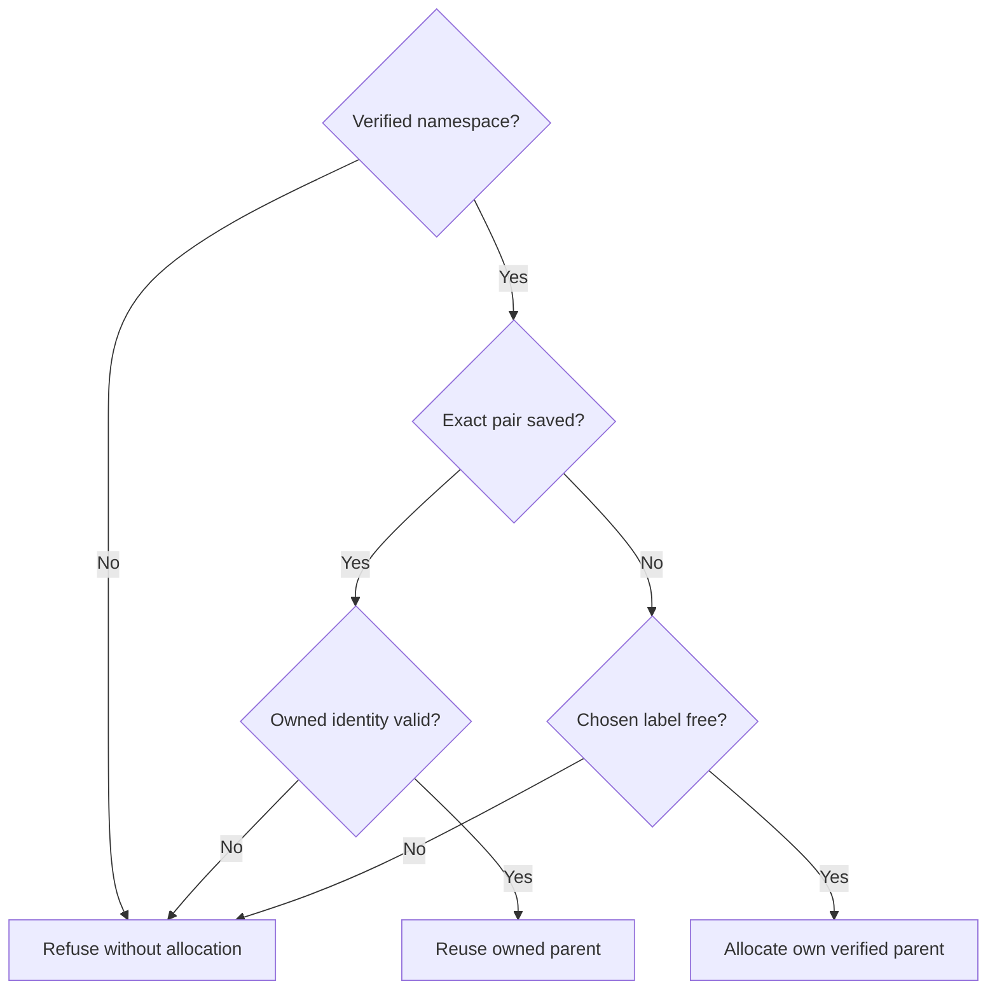

# Repository and run layout in Herdr

Own `src/workflow-herdr-layout.mjs`: shared session naming, owned repository and run workspace allocation, and run workspace closure. Export `PDD_HERDR_SESSION` (`pdd`), `withHerdrLayoutLock(action, ports)`, `openHerdrRunLayout(input, ports)` and `closeHerdrRunLayout(input, ports)`. Preserve public invocation and existing effects except the authorized independent-checkout isolation below: stage acceptance and Git worktree allocation remain with their existing owners.

All new runs use the explicit session `pdd`, never the person's `default` or a per-run server. The [area chat owner](workflow-chat.prompt.md) owns compatible-server startup. Serialize session bootstrap and layout mutations across processes in the same HOME; unrelated repositories may have concurrent active agents. A live owner remains exclusive. Recover a lock only when its recorded process is proved absent; a normal Ctrl+C must not block all later runs. When a live owner holds the lock, fail at once with `herdr_layout_busy`; never wait or poll. Serialize owner inspection/replacement in a synchronous claim section; malformed or interrupted claims fail finitely and require inspection.

Inputs identify the run UUID, canonical repository (`owner/repo`) verified against the Git origin remote by the worktree assignment owner, source checkout, common Git directory, assigned run cwd, issue number, workflow and stage. Ports supply a Herdr command function already bound to `pdd`, an awaited checkpoint, and optionally a state directory (normally the person's local PDD state). No credential/configuration reads or tool-version checks belong here.

## Repository parent and confirmed pre-agent recovery

Resolve input sourceRoot through the worktree owner's read-only verified repository-parent lookup before
allocating. Use that root for Herdr's repository workspace, including a verified bare primary; retain the
actual invoking sourceRoot separately from the assigned run cwd. Never treat a linked caller as a parent.
Pass the optional execFile port through to that identity lookup; no bypass or independently guessed path.

A structured `linked_worktree_source` rejection of worktree open is confirmed before any child workspace or
native launch. Persist that run as refused with the code, retaining its original cwd/runId and repository binding.
On a later explicit open, retry only this refused action after inventory shows no workspace for that cwd.
Other failures/lost replies retain uncertain intent and must never authorize another allocation.

For an affected saved run, optional input preAgentRefusal=`linked_worktree_source` conveys the runner's
confirmed original pre-agent refusal. A legacy intent without a returned workspace/root identity can become
refused only with this evidence and no inventory workspace at its cwd.
Always reassert the refused run's saved common directory, assigned cwd and issue/workflow label before
any recovery persistence or mutation; a refusal does not authorize rebinding those identities.
For a legacy repository workspace created at the linked caller, require same saved common directory and sourceRoot, no other run sharing it,
and this one confirmed refused run. Archive the old repository entry, preserve its workspace untouched,
create a verified parent workspace under an unused label, and rebind only that refused run to it. Never
adopt, close or rename the old workspace. Unknown child allocation or an unrelated identity blocks recovery.
A further confirmed refusal stays retryable. Before retrying, durably mark the new attempt; a lost retry reply
is uncertain even when an earlier startup warning records a refusal. Never reuse that warning to retry again.
Pin the parent workspace root tab/pane/terminal returned at creation. If parent inventory lacks Git metadata,
reuse only with those same root identities and exact parent cwd, one tab and one pane; conflicting metadata refuses.
Apply that same repository-parent identity rule to reuse, name qualification and idle cleanup. Parent Git metadata
must identify a non-linked parent; absent metadata cannot justify accepting changed root identities.

## Allocation and identity

Keep a durable, private ownership registry, retaining readable version 1 records. **Namespace** means the pair of case-insensitive canonical GitHub `owner/repo` and exact canonical Git common directory verified by the worktree owner. Select by the entire pair before comparing the selected entry's parent path or validating its inventory. A repository-only match belonging to another common directory is a peer, never the selected owner. Duplicate entries for one pair or inconsistent selected ownership fail closed. Preserve legacy records and their bindings in place; no global migration or manual registry edit is needed.

The existing confirmed pre-agent recovery is the only exception to selected-parent mismatch refusal; its evidence and guards above remain mandatory. Uncertain intents, existing run binding failures and forged or changed inventory interrupt either allocation or reuse and refuse without fallback.

**Labels.** For the first namespace, retain the repo short name. For collisions between different canonical repositories, retain qualification to verified `owner/repo`, including qualification of an existing owned short label only after validating its identity. HD2: an unregistered workspace holding that short label for a different folder also requires origin-qualified naming. Never use a caller folder name as origin identity.
For a new namespace when the same repository already has an owned namespace, use `<owner/repo>@<checkout-token>`, where checkout-token is the first 12 lowercase hexadecimal characters of SHA-256 over the UTF-8 canonical commonDir. Keep this choice stable across explicit retries; an occupied candidate refuses with `repository_label_unavailable`, without searching alternate suffixes or adopting its occupant. Compute the digest deterministically, never by model estimation. Once allocated, reuse that namespace's saved label and opaque workspace identity. Adding a clone must not rename, adopt, close, rebind or otherwise mutate another namespace of the same repository, its registry records, workspaces or tabs. Qualification caused by another repository likewise must not rename a same-repository peer as a side effect. Existing legacy clone A keeps its parent while clone B allocates concurrently in a separate namespace. Linked callers with the same commonDir reuse their verified parent, including a bare primary.

Each run gets one `worktree open --workspace <repo-id> --path <assigned-cwd> --label '<repo name>#<issue> <workflow>' --no-focus` workspace (the repository name keeps runs with the same issue number in two repositories apart; a saved run with the older label `#<issue> <workflow>` still matches). PDD's Git worktree already exists; never ask Herdr to create or remove the Git checkout. Every area chat gets a fresh tab inside that workspace, named after its area (input `stageId`). Preserve the worktree's initial shell tab so closing a stage tab cannot close the run workspace. Return actual `repoWorkspaceId`, `workspaceId`, `tabId`, `paneId`, and `terminalId`; never predict opaque IDs.

Checkpoint and persist allocation intent before mutations and returned ownership before proceeding. Lost replies or interrupted intents remain uncertain; do not repeat allocation or adopt unrelated workspaces by label. Validate actual owned inventory before reuse: require worktree checkout path, common Git directory and linked-worktree kind; pin the returned initial root tab, pane and terminal identities and reassert them through pane list. Require exactly the initial tab and its one original pane before run closure; an added or unknown tab or split pane prevents closure. Registry labels describe ownership but do not authorize closing a workspace with changed checkout identity. A closed run cannot silently reopen.

## Cleanup

The caller invokes run cleanup after it closed the run's area tabs (for example on cancel). Close exactly the saved run workspace using `workspace close`, never `worktree remove` or group close. Require the documented close acknowledgement and a valid inventory proving absence. Preserve repository workspaces, peer runs, unrelated workspaces and the Git checkout. Uncertain close must not be blindly repeated. Git removal, permitted only after merge or cancellation, remains the Git-worktree owner's responsibility.

Export `closeHerdrRepoLayoutIfIdle({repository, commonDir}, ports)`. Select by the exact namespace pair, including when a peer occurs earlier in the registry. After the last open run belonging to that pair is closed, close only that namespace's own workspace too, so no empty shell workspace stays after cancel. Close it only when no saved run of it is open, its identity still matches, and it holds exactly its one tab and one pane (a person may use more). Remove only that namespace entry from the registry, so a later run opens a new repository workspace. Preserve every peer namespace and its runs, including active runs of the same repository in another common directory. Return true when it closed or was already gone, false when it stays.

## Public bindings and native context

All exports above are module functions, apart from the session constant. Keep `withHerdrLayoutLock(action, ports = {})`, `openHerdrRunLayout(input, ports)`, `closeHerdrRunLayout({runId, cwd, layout}, ports)` and `closeHerdrRepoLayoutIfIdle({repository, commonDir}, ports)` intact. Open input fields are `repository`, positive integer `issueNumber`, nonempty `runId`, `workflowName`, `stageId`, `sourceRoot`, `commonDir`, `cwd`, and optional `preAgentRefusal`. The returned IDs are exactly the five named above. Run closure uses its saved layout identity; idle closure returns the Boolean defined above. Preserve UUID/cwd/label/commonDir guards on an existing run: selecting a new namespace never authorizes moving that run from its saved parent. An explicit retry of a saved run retains its original UUID and assigned cwd.

Native ports retain `command(args)` for public Herdr JSON replies, awaited `checkpoint()`, optional `execFile(file, args, {cwd})` for Git verification and optional `directory` for local registry/locking. Preserve actual native exports and these injected boundaries; no check-only API or replacement Runtime authority is introduced. Host filesystem canonicalization, locking, persistence and process inspection remain native effects. Runtime execution is unbound until those native boundaries have an accepted interface/resource contract.

## Dependencies

Load [Prompting guide](../../docs/prompting-guide.md) for authoring and generation. The installed Herdr CLI's public workspace/worktree/tab commands and JSON identities supply runtime transport, with 0.9.1 as the capability baseline and no version pin. The [worktree assignment owner](workflow-worktree.prompt.md) supplies origin-verified repository identity and canonical checkout paths; load its contract for generation and verification. Node filesystem primitives provide durable local ownership and cross-process serialization. The area chat owner supplies a session-bound command function; it keeps native-agent identity and prompt delivery.
