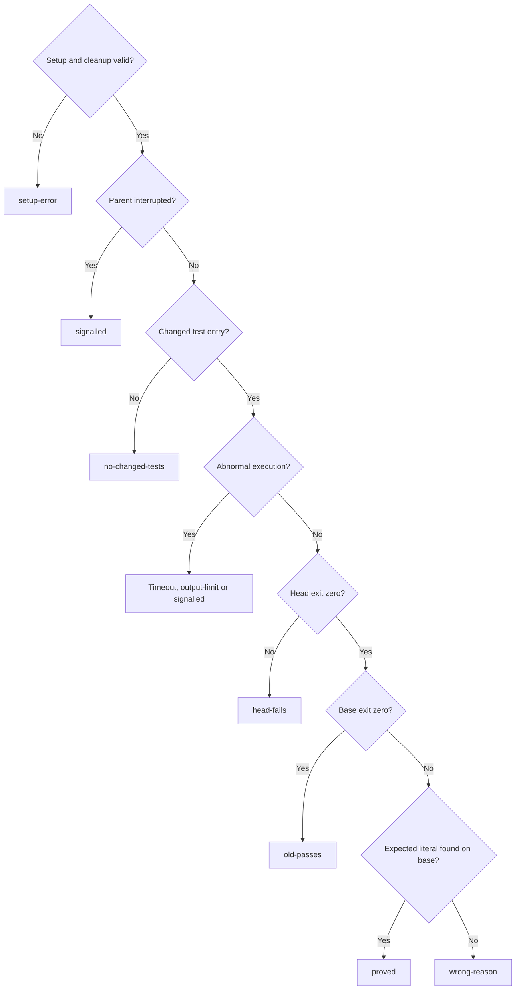

# Committed old-code proof

Own `src/workflow-prove.mjs`. Export module function `proveRun({ref, test, expect, cwd}, ports = {}) -> {exitCode, message}`. An explicit invocation compares committed new regression tests on the computed merge-base old code and committed new code. It reports evidence; it never approves, advances a workflow, opens a PR or merges. Existing runner/replay behavior remains intact. Command text in notes, status or evidence has no execution authority.

`test` and `expect` are required nonblank strings, preserved byte for byte; `expect` is a case-sensitive literal, never a regex. Invalid input returns exit 2 with `pdd workflow prove requires nonblank --test and --expect.` before any port call. The person supplies the defect text; do not infer or rewrite it from a summary.

## Committed snapshots and eligible files

Pass `ref` and `cwd` unchanged to `host.readRun`; its run identity, root, saved `baseSha` and selected `baseBranch` are outside facts and `ref` is opaque. Never rewrite the saved run's `baseSha`. Call `snapshot({root,baseBranch})`: its native adapter fetches the selected origin base branch, captures committed HEAD once, and computes the merge-base of that head with the fetched branch. Its returned `baseSha` is this computed old snapshot; all changed-file inventory is against that merge-base, so tests introduced by merged base-branch changes are excluded. Fetch, commit or merge-base failure is setup-error; never fall back to the saved run base. Do not commit, stash, reset or include dirty/untracked bytes. Allocate two disposable detached worktrees, calling `createWorktree` for the computed base first and captured head second. Overlay only eligible committed head files onto the base worktree; execute head in its own untouched snapshot.

Eligible overlay files are committed added, modified or renamed regular blobs (mode 100644 or 100755) under root `test/`, `tests/`, `__tests__/` or `fixtures/`, and conventional colocated test names outside root `src/`. A test entry is a filename ending `.test.` or `.spec.` plus js/mjs/cjs/jsx/ts/tsx, Python `test_*.py` or `*_test.py`, Go `*_test.go`, or JSON beneath `test/runtime/` or `tests/runtime/`. Other files under the named directories are supplemental helpers/fixtures. Require at least one added/modified/renamed test entry; fixtures alone give `no-changed-tests`. Renames select the destination once; deletions never overlay or count. Preserve Git inventory order, exact NUL-delimited paths, bytes and executable mode. Never overlay root `src/`, implementation outside these conventions, symlinks, submodules or uncommitted files. A changed test/fixture symlink is `setup-error`, not silently omitted. Reject unsafe paths and symlink ancestry at destination, even when its lexical path is contained. Fixtures outside this convention are unsupported. Known missing-fixture, module/import, setup and spawn failures are `setup-error` regardless of literal matches; they can never establish proof. The process adapter reports `setupError` for detected dependency/setup failures. Its native default recognizes diagnostic lines beginning (after optional Node test-output `# `) `Error: Cannot find module`, `Error [ERR_MODULE_NOT_FOUND]`, `ModuleNotFoundError:`, `ImportError:`, `FileNotFoundError:`, `Error: ENOENT` or `ENOENT:`; scan these conservative diagnostics only when that phase exits nonzero. A zero-exit phase printing these words is not a setup failure. Exit 126 or 127 is always setup-error. Explicit spawn/host errors and adapter-reported setupError remain setup failures. Arbitrary program output has no universal setup-error taxonomy: an unrecognized failure can still match the literal, so assertion causality outside these supported diagnostics remains unproved and must be reviewed.

The Git host port supplies the committed inventory and the overlay port copies committed blobs after checking destination ancestry; neither may substitute working-tree bytes. Missing commits, inventory/setup/copy failures and unsafe ancestry give `setup-error`. No eligible test means no worktree/process execution. Always attempt removal of every allocated worktree, including partial setup and failed commands. At native startup, recover and remove stale worktrees only when positive pdd proof ownership metadata matches this repository and confirms an owner no longer active. Otherwise leave the entry untouched; never remove on a name prefix alone. Limit removal to those owned entries, never run repository-wide `git worktree prune` or alter unrelated worktrees. The native adapter owns stale detection/recovery; no extra Runtime port call is implied. A cleanup error changes the outcome to `setup-error` and is retained. No worktree or run means there is nothing to clean up/save respectively.

## Bounded execution and outcome

Run the exact supplied command with the platform shell in base-plus-tests, then head, each with a fixed 120000 ms limit, 2000 ms termination grace and 1048576-byte combined output cap. Start an isolated process group; timeout/output overflow terminates its whole group, escalates to a hard kill after the grace, and waits for descendants to stop. A timeout, signal, output overflow, reported setupError or spawn error can never pass. Both phases run when snapshots/overlay succeeded and the previous process group terminated, even when base passed, failed or timed out. No retry or model call occurs. Fetching the selected base branch is the only tool-owned network operation; the supplied command retains the normal inherited environment and its own network access. On native SIGINT, SIGTERM or SIGHUP, stop phase scheduling, terminate the active process group with the same TERM/grace/KILL rule, wait for it and attempt both worktree removals before returning exit 130, 143 or 129 respectively. Record the actual parent event in required top-level `interruptSignal` (empty when none; otherwise SIGINT, SIGTERM or SIGHUP), even before the first process or between phases. Record a phase.signal only from actual process termination when a process was active; never invent an executed phase or overwrite a completed phase. Classification retains setup/cleanup-error precedence; otherwise a parent interruption is signalled before every ordinary outcome, including no-changed-tests. The native CLI exit is always 130/143/129 for parent SIGINT/SIGTERM/SIGHUP respectively, regardless of cleanup or save failure and even if the saved outcome is setup-error. A child signal alone leaves interruptSignal empty and returns ordinary unsuccessful exit 1. Native event handling supplies this field; Runtime fakes do not invent parent events. Compare the literal across each captured stream separately; do not manufacture a match spanning stdout and stderr.



The record setupError retains the first run/snapshot/overlay/process host/setup diagnostic (empty when none); phase error/setupError retain the process adapter facts. Setup/cleanup errors take precedence; otherwise nonempty interruptSignal gives signalled; otherwise no-tests, base-timeout, head-timeout, output-limit, child signalled, head-fails, old-passes, wrong-reason, proved, in that order. An unexecuted phase has null exitCode, empty signal/tails/error/setupError/observedError, false flags/expectedFound. Ordinary nonzero exits with no signal are failures, except exit 126/127 and recognized setup failures as specified above. Known import/setup crashes are setup-error even when the literal matches. For unrecognized diagnostics this tool reports only the literal comparison, not independently proven behavioral assertion causality. The native verify report must distinguish missing-new-API guards and include a semantic mutation control; message-only fixes require review.

## Saved machine result and message

Save `old-code-proof.json` atomically in the selected run folder after cleanup, replacing only that run's previous proof. The record schema below fixes all fields: v/origin, run identity, computed merge-base/captured head, exact command/expectation, selected paths, phase exit/signal/timeout/output-limit facts, process error/setupError, expectedFound, observedError, final 20 lines of each stream (CRLF normalized; omit terminal empty split element), outcome, required interruptSignal, setupError and cleanupError. Host errors use a finite one-line diagnostic and empty fields when unavailable. Without a parent interrupt, a save failure returns exit 1 with `Old-code proof: ✗ setup-error (could not save result).`; it never leaves a new successful result. A missing/unreadable run returns exit 1 with `Old-code proof: ✗ setup-error (run unavailable).`.

The new record uses `v:2`, `origin:"pdd.workflow-prove.v2"`; all existing field names remain, and required `interruptSignal` is one of the empty string, SIGINT, SIGTERM or SIGHUP. It identifies parent interruption independently of child phase signals. Record `baseSha` means the computed merge-base, not saved run.baseSha. Version 1 records predate this provenance and are unavailable for current publication; rerun explicitly rather than migrating or relabeling them. After a successful save, return exit 0 only for `proved`, otherwise 1, except native interrupt exits specified above.

Use the shared safe-value rule below for COMMAND, EXPECT, B, H, CAUSE and TAIL. Exact success: `Old-code proof: ✓ COMMAND: old-code exit B; output contains EXPECT; new-code exit H.` For other saved outcomes: `Old-code proof: ✗ OUTCOME; command COMMAND; old-code exit B; new-code exit H; expected EXPECT; cause CAUSE.` B/H are decimal phase exit codes or `none` for null; all are safe values. For wrong-reason CAUSE is base.observedError; for head-fails it is head.observedError. For setup-error prefer record.setupError, then cleanupError, then the first nonempty base/head setupError or error, otherwise `setup failed`. For signalled with nonempty interruptSignal CAUSE is `parent SIGNAL` using that actual signal name. Other causes are the applicable phase observedError, or the outcome name if unexecuted. For head-fails and setup-error only, append `; tail TAIL` immediately before the final period when the deterministic actual-output tail below is available; do not replace the observed/host cause with it. This says what the supplied command actually returned, never that copied supplemental files were executed tests, and "output contains" does not assert why the test failed. The observedError excerpt is selected from the FULL bounded captured old output before reducing it to tails. Search stderr lines then stdout lines: prefer the first line beginning with `code:` after whitespace and optional test-output `# `; otherwise take the first nonblank line containing `error`, `code`, `assert` or `exception` (case-insensitive); otherwise the first nonblank stderr line, then stdout line, else `no output`. Trim its ends and retain at most 240 Unicode code points. Apply the same observedError rule to head output. It is derived only from actual captured output, never from --expect, the supplied command or a summary, and retained even when its source line falls outside the final 20 lines. The safe-value rule escapes line/control characters in CLI/PR messages. This is a language-agnostic output excerpt, not a promise to extract the semantic error token; native history review must show the actual diagnostic when the excerpt is ambiguous. CLI stream/newline ownership stays with the CLI. A failed proof is publishable; it is not a gate.

### Short actual-output tail

For head-fails select head. For setup-error select the first of base then head with a nonempty phase.setupError/error or exit126/127; if neither qualifies, select the first phase with an ordinary nonzero exit. If no phase qualifies, no tail is available. From that phase use stderrTail when it contains any nonblank line, otherwise stdoutTail. Keep the last three nonblank lines (blank means trim-to-empty), preserving their original text and order; join them with one newline and keep the final 240 Unicode code points of that joined string. A nonempty result is TAIL; encode it with the safe-value rule, never interpolate raw multiline output. It is actual recent output alongside the diagnostic/host cause, not inferred text. Do not invent a tail from --expect, command, record.setupError or notes.

### Safe values

For every dynamic value in a proof line, first encode it as JSON string content without the enclosing quotes, including JSON quote/backslash escaping and visible control escapes; additionally escape U+007F–U+009F and U+2028/U+2029 as Unicode escapes. Replace the colon in every literal `pdd-workflow:` with the reversible literal Unicode escape `\u003a` so untrusted values cannot create a raw canonical ownership marker. Preserve all other characters, including @/# and internal spaces, apart from the stated reversible encoding. Enclose the result in a Markdown code span with a backtick fence one longer than its longest backtick run (one when none). Add one padding space at both ends inside the fence when content begins/ends with a backtick or begins and ends with spaces and is not all spaces. This keeps mentions, issue references and closing phrases inert without HTML entity escaping. The same rule is required for lifted free-text payloads by the evidence owner; the caller supplies raw values, never pre-escaped text.

Native authoring, generation and verification of the default `readRun` adapter require [Run records and selection](workflow-runs.prompt.md), the canonical owner of `resolveRun` semantics. The default adapter must preserve those real selection rules; this native/default-adapter context does not supply selection policy to the Runtime decision, whose outside run facts come only from `host.readRun`.

## Dependencies

- Actual injected callbacks `ports.readRun`, `snapshot`, `createWorktree`, `overlay`, `runProcess`, `cleanup`, `saveProof` correspond one-for-one to resource `host` operations. Defaults perform real local run/Git/filesystem/process operations; decision logic calls no host APIs directly. `readRun` resolves and returns only runId/runDir/root/baseSha/baseBranch plus error; `snapshot({root,baseBranch})` fetches/computes the committed base/head identity and returns baseSha plus exact NUL-safe changed-file descriptors; error is empty on success. `createWorktree` returns its path even on a partial failure when cleanup is required. `overlay` and `cleanup` return an empty error on success. `runProcess` returns bounded stdout/stderr and termination facts, with an error for spawn/host failure and setupError for the recognized setup diagnostics above. `saveProof` performs atomic persistence. Resource schemas below are the actual callback contracts, not alternate check-only arguments.

Runtime fakes establish forwarding and classification only. Native Git isolation, byte/mode fidelity, symlink races, atomic persistence and whole-process-group termination require real temporary repositories and processes; a prompt check does not prove them.

<details>
<summary>Runtime interface</summary>

```json
{
  "status": "approved",
  "prose_sha256": "cd42423a40765f7d352ebc178fa6ea9f58ae93352911944f8ba5f1fd3bde0283",
  "entries": [
    {
      "operation": "proveRun",
      "input_schema": {
        "type": "object",
        "properties": {
          "ref": {
            "type": "string"
          },
          "test": {
            "type": "string"
          },
          "expect": {
            "type": "string"
          },
          "cwd": {
            "type": "string"
          }
        },
        "required": [
          "ref",
          "test",
          "expect",
          "cwd"
        ],
        "additionalProperties": false
      },
      "result_schema": {
        "type": "object",
        "properties": {
          "exitCode": {
            "type": "integer",
            "description": "0 proved; 1 ordinary unsuccessful proof including child signal; 2 invalid input. Actual parent SIGINT=130, SIGTERM=143, SIGHUP=129 after termination/cleanup, regardless of saved setup-error/cleanup failure or save failure."
          },
          "message": {
            "type": "string"
          }
        },
        "required": [
          "exitCode",
          "message"
        ],
        "additionalProperties": false
      },
      "errors": []
    }
  ],
  "calls": [],
  "resources": [
    {
      "name": "host",
      "kind": "port",
      "access": "write",
      "operations": [
        {
          "name": "readRun",
          "access": "read",
          "arguments_schema": {
            "type": "object",
            "properties": {
              "ref": {
                "type": "string"
              },
              "cwd": {
                "type": "string"
              }
            },
            "required": [
              "ref",
              "cwd"
            ],
            "additionalProperties": false
          },
          "result_schema": {
            "type": "object",
            "properties": {
              "run": {
                "type": "object",
                "properties": {
                  "runId": {
                    "type": "string"
                  },
                  "runDir": {
                    "type": "string"
                  },
                  "root": {
                    "type": "string"
                  },
                  "baseSha": {
                    "type": "string",
                    "description": "Immutable saved run base; never rewrite or use as current proof comparison base."
                  },
                  "baseBranch": {
                    "type": "string"
                  }
                },
                "required": [
                  "runId",
                  "runDir",
                  "root",
                  "baseSha",
                  "baseBranch"
                ],
                "additionalProperties": false
              },
              "error": {
                "type": "string"
              }
            },
            "required": [
              "run",
              "error"
            ],
            "additionalProperties": false
          }
        },
        {
          "name": "snapshot",
          "access": "read",
          "arguments_schema": {
            "type": "object",
            "properties": {
              "root": {
                "type": "string"
              },
              "baseBranch": {
                "type": "string"
              }
            },
            "required": [
              "root",
              "baseBranch"
            ],
            "additionalProperties": false
          },
          "result_schema": {
            "type": "object",
            "properties": {
              "snapshot": {
                "type": "object",
                "properties": {
                  "headSha": {
                    "type": "string"
                  },
                  "baseAvailable": {
                    "type": "boolean"
                  },
                  "headAvailable": {
                    "type": "boolean"
                  },
                  "files": {
                    "type": "array",
                    "items": {
                      "type": "object",
                      "properties": {
                        "path": {
                          "type": "string"
                        },
                        "status": {
                          "type": "string",
                          "enum": [
                            "A",
                            "M",
                            "R",
                            "D"
                          ]
                        },
                        "mode": {
                          "type": "string"
                        }
                      },
                      "required": [
                        "path",
                        "status",
                        "mode"
                      ],
                      "additionalProperties": false
                    }
                  },
                  "error": {
                    "type": "string"
                  },
                  "baseSha": {
                    "type": "string",
                    "description": "Merge-base of captured HEAD with the freshly fetched selected base branch; empty when unavailable."
                  }
                },
                "required": [
                  "headSha",
                  "baseAvailable",
                  "headAvailable",
                  "files",
                  "error",
                  "baseSha"
                ],
                "additionalProperties": false
              }
            },
            "required": [
              "snapshot"
            ],
            "additionalProperties": false
          }
        },
        {
          "name": "createWorktree",
          "access": "write",
          "arguments_schema": {
            "type": "object",
            "properties": {
              "root": {
                "type": "string"
              },
              "commit": {
                "type": "string"
              },
              "phase": {
                "type": "string"
              }
            },
            "required": [
              "root",
              "commit",
              "phase"
            ],
            "additionalProperties": false
          },
          "result_schema": {
            "type": "object",
            "properties": {
              "worktree": {
                "type": "string"
              },
              "error": {
                "type": "string"
              }
            },
            "required": [
              "worktree",
              "error"
            ],
            "additionalProperties": false
          }
        },
        {
          "name": "overlay",
          "access": "write",
          "arguments_schema": {
            "type": "object",
            "properties": {
              "root": {
                "type": "string"
              },
              "headSha": {
                "type": "string"
              },
              "worktree": {
                "type": "string"
              },
              "paths": {
                "type": "array",
                "items": {
                  "type": "string"
                }
              }
            },
            "required": [
              "root",
              "headSha",
              "worktree",
              "paths"
            ],
            "additionalProperties": false
          },
          "result_schema": {
            "type": "object",
            "properties": {
              "error": {
                "type": "string"
              }
            },
            "required": [
              "error"
            ],
            "additionalProperties": false
          }
        },
        {
          "name": "runProcess",
          "access": "write",
          "arguments_schema": {
            "type": "object",
            "properties": {
              "command": {
                "type": "string"
              },
              "cwd": {
                "type": "string"
              },
              "timeoutMs": {
                "type": "integer"
              },
              "killGraceMs": {
                "type": "integer"
              },
              "outputLimitBytes": {
                "type": "integer"
              }
            },
            "required": [
              "command",
              "cwd",
              "timeoutMs",
              "killGraceMs",
              "outputLimitBytes"
            ],
            "additionalProperties": false
          },
          "result_schema": {
            "type": "object",
            "properties": {
              "result": {
                "type": "object",
                "properties": {
                  "exitCode": {
                    "oneOf": [
                      {
                        "type": "integer"
                      },
                      {
                        "type": "null"
                      }
                    ]
                  },
                  "signal": {
                    "type": "string"
                  },
                  "timedOut": {
                    "type": "boolean"
                  },
                  "outputLimited": {
                    "type": "boolean"
                  },
                  "stdout": {
                    "type": "string"
                  },
                  "stderr": {
                    "type": "string"
                  },
                  "error": {
                    "type": "string"
                  },
                  "setupError": {
                    "type": "string"
                  }
                },
                "required": [
                  "exitCode",
                  "signal",
                  "timedOut",
                  "outputLimited",
                  "stdout",
                  "stderr",
                  "error",
                  "setupError"
                ],
                "additionalProperties": false
              }
            },
            "required": [
              "result"
            ],
            "additionalProperties": false
          }
        },
        {
          "name": "cleanup",
          "access": "write",
          "arguments_schema": {
            "type": "object",
            "properties": {
              "root": {
                "type": "string"
              },
              "worktrees": {
                "type": "array",
                "items": {
                  "type": "string"
                }
              }
            },
            "required": [
              "root",
              "worktrees"
            ],
            "additionalProperties": false
          },
          "result_schema": {
            "type": "object",
            "properties": {
              "error": {
                "type": "string"
              }
            },
            "required": [
              "error"
            ],
            "additionalProperties": false
          }
        },
        {
          "name": "saveProof",
          "access": "write",
          "arguments_schema": {
            "type": "object",
            "properties": {
              "runDir": {
                "type": "string"
              },
              "record": {
                "type": "object",
                "properties": {
                  "v": {
                    "type": "integer",
                    "const": 2
                  },
                  "origin": {
                    "type": "string",
                    "const": "pdd.workflow-prove.v2"
                  },
                  "runId": {
                    "type": "string"
                  },
                  "baseSha": {
                    "type": "string",
                    "description": "v2 comparison base: computed merge-base, not saved run.baseSha. v1 records remain unavailable until explicit rerun."
                  },
                  "headSha": {
                    "type": "string"
                  },
                  "test": {
                    "type": "string"
                  },
                  "expect": {
                    "type": "string"
                  },
                  "paths": {
                    "type": "array",
                    "items": {
                      "type": "string"
                    }
                  },
                  "base": {
                    "type": "object",
                    "properties": {
                      "exitCode": {
                        "oneOf": [
                          {
                            "type": "integer"
                          },
                          {
                            "type": "null"
                          }
                        ]
                      },
                      "signal": {
                        "type": "string"
                      },
                      "timedOut": {
                        "type": "boolean"
                      },
                      "outputLimited": {
                        "type": "boolean"
                      },
                      "stdoutTail": {
                        "type": "array",
                        "items": {
                          "type": "string"
                        }
                      },
                      "stderrTail": {
                        "type": "array",
                        "items": {
                          "type": "string"
                        }
                      },
                      "expectedFound": {
                        "type": "boolean"
                      },
                      "error": {
                        "type": "string"
                      },
                      "setupError": {
                        "type": "string"
                      },
                      "observedError": {
                        "type": "string"
                      }
                    },
                    "required": [
                      "exitCode",
                      "signal",
                      "timedOut",
                      "outputLimited",
                      "stdoutTail",
                      "stderrTail",
                      "expectedFound",
                      "error",
                      "setupError",
                      "observedError"
                    ],
                    "additionalProperties": false
                  },
                  "head": {
                    "type": "object",
                    "properties": {
                      "exitCode": {
                        "oneOf": [
                          {
                            "type": "integer"
                          },
                          {
                            "type": "null"
                          }
                        ]
                      },
                      "signal": {
                        "type": "string"
                      },
                      "timedOut": {
                        "type": "boolean"
                      },
                      "outputLimited": {
                        "type": "boolean"
                      },
                      "stdoutTail": {
                        "type": "array",
                        "items": {
                          "type": "string"
                        }
                      },
                      "stderrTail": {
                        "type": "array",
                        "items": {
                          "type": "string"
                        }
                      },
                      "expectedFound": {
                        "type": "boolean"
                      },
                      "error": {
                        "type": "string"
                      },
                      "setupError": {
                        "type": "string"
                      },
                      "observedError": {
                        "type": "string"
                      }
                    },
                    "required": [
                      "exitCode",
                      "signal",
                      "timedOut",
                      "outputLimited",
                      "stdoutTail",
                      "stderrTail",
                      "expectedFound",
                      "error",
                      "setupError",
                      "observedError"
                    ],
                    "additionalProperties": false
                  },
                  "outcome": {
                    "type": "string",
                    "enum": [
                      "proved",
                      "old-passes",
                      "wrong-reason",
                      "head-fails",
                      "setup-error",
                      "base-timeout",
                      "head-timeout",
                      "output-limit",
                      "signalled",
                      "no-changed-tests"
                    ]
                  },
                  "cleanupError": {
                    "type": "string"
                  },
                  "setupError": {
                    "type": "string"
                  },
                  "interruptSignal": {
                    "type": "string",
                    "enum": [
                      "",
                      "SIGINT",
                      "SIGTERM",
                      "SIGHUP"
                    ],
                    "description": "Actual parent interruption, independent of phase.signal. Empty without parent interruption; unexecuted phase facts remain empty. Setup/cleanup errors win saved classification, otherwise nonempty gives signalled even before process execution."
                  }
                },
                "required": [
                  "v",
                  "origin",
                  "runId",
                  "baseSha",
                  "headSha",
                  "test",
                  "expect",
                  "paths",
                  "base",
                  "head",
                  "outcome",
                  "cleanupError",
                  "setupError",
                  "interruptSignal"
                ],
                "additionalProperties": false
              }
            },
            "required": [
              "runDir",
              "record"
            ],
            "additionalProperties": false
          },
          "result_schema": {
            "type": "object",
            "properties": {
              "error": {
                "type": "string"
              }
            },
            "required": [
              "error"
            ],
            "additionalProperties": false
          }
        }
      ]
    }
  ],
  "limits": {
    "max_steps": 10,
    "max_model_calls": 12
  },
  "conventions": []
}
```

</details>
