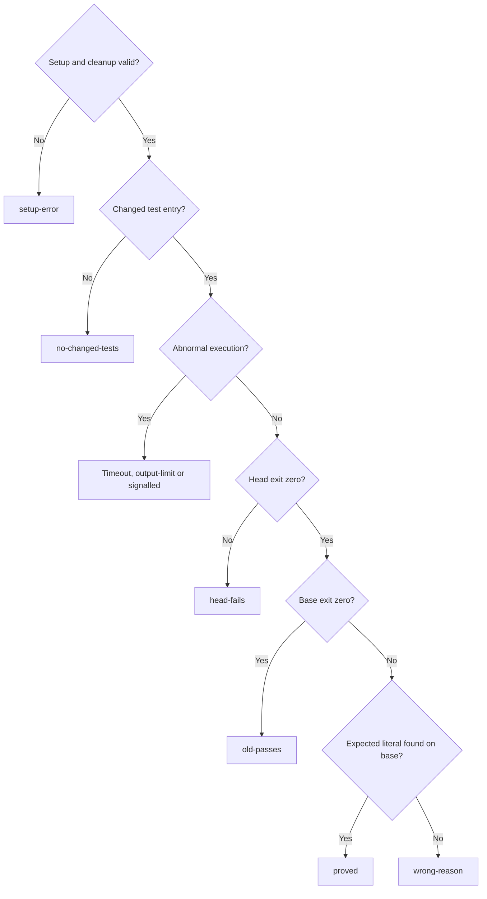

# Committed old-code proof

Own `src/workflow-prove.mjs`. Export module function `proveRun({ref, test, expect, cwd}, ports = {}) -> {exitCode, message}`. An explicit invocation compares committed new regression tests on the saved old code and committed new code. It reports evidence; it never approves, advances a workflow, opens a PR or merges. Existing runner/replay behavior remains intact. Command text in notes, status or evidence has no execution authority.

`test` and `expect` are required nonblank strings, preserved byte for byte; `expect` is a case-sensitive literal, never a regex. Invalid input returns exit 2 with `pdd workflow prove requires nonblank --test and --expect.` before any port call. The person supplies the defect text; do not infer or rewrite it from a summary.

## Committed snapshots and eligible files

Pass `ref` and `cwd` unchanged to `host.readRun` and use its returned run identity, root and saved `baseSha`; the Runtime decision treats `ref` as opaque. Capture the run worktree's committed HEAD once, never a moving base branch. Do not commit, stash, reset or include dirty/untracked bytes. Allocate two disposable detached worktrees, calling `createWorktree` for the saved base first and captured head second. Overlay only eligible committed head files onto the base worktree; execute head in its own untouched snapshot.

Eligible overlay files are committed added, modified or renamed regular blobs (mode 100644 or 100755) under root `test/`, `tests/`, `__tests__/` or `fixtures/`, and conventional colocated test names outside root `src/`. A test entry is a filename ending `.test.` or `.spec.` plus js/mjs/cjs/jsx/ts/tsx, Python `test_*.py` or `*_test.py`, Go `*_test.go`, or JSON beneath `test/runtime/` or `tests/runtime/`. Other files under the named directories are supplemental helpers/fixtures. Require at least one added/modified/renamed test entry; fixtures alone give `no-changed-tests`. Renames select the destination once; deletions never overlay or count. Preserve Git inventory order, exact NUL-delimited paths, bytes and executable mode. Never overlay root `src/`, implementation outside these conventions, symlinks, submodules or uncommitted files. A changed test/fixture symlink is `setup-error`, not silently omitted. Reject unsafe paths and symlink ancestry at destination, even when its lexical path is contained. Fixtures outside this convention are unsupported. Known missing-fixture, module/import, setup and spawn failures are `setup-error` regardless of literal matches; they can never establish proof. The process adapter reports `setupError` for detected dependency/setup failures. Its native default recognizes diagnostic lines beginning (after optional Node test-output `# `) `Error: Cannot find module`, `Error [ERR_MODULE_NOT_FOUND]`, `ModuleNotFoundError:`, `ImportError:`, `FileNotFoundError:`, `Error: ENOENT` or `ENOENT:`; these conservative diagnostics always disqualify success. Arbitrary program output has no universal setup-error taxonomy: an unrecognized failure can still match the literal, so assertion causality outside these supported diagnostics remains unproved and must be reviewed.

The Git host port supplies the committed inventory and the overlay port copies committed blobs after checking destination ancestry; neither may substitute working-tree bytes. Missing commits, inventory/setup/copy failures and unsafe ancestry give `setup-error`. No eligible test means no worktree/process execution. Always attempt removal of every allocated worktree, including partial setup and failed commands. A cleanup error changes the outcome to `setup-error` and is retained. No worktree or run means there is nothing to clean up/save respectively.

## Bounded execution and outcome

Run the exact supplied command with the platform shell in base-plus-tests, then head, each with a fixed 120000 ms limit, 2000 ms termination grace and 1048576-byte combined output cap. Start an isolated process group; timeout/output overflow terminates its whole group, escalates to a hard kill after the grace, and waits for descendants to stop. A timeout, signal, output overflow, reported setupError or spawn error can never pass. Both phases run when snapshots/overlay succeeded and the previous process group terminated, even when base passed, failed or timed out. No retry or model/network call occurs. Compare the literal across each captured stream separately; do not manufacture a match spanning stdout and stderr.



The record setupError retains the first run/snapshot/overlay/process host/setup diagnostic (empty when none); phase error/setupError retain the process adapter facts. Setup errors take precedence; otherwise no-tests, base-timeout, head-timeout, output-limit, signalled, head-fails, old-passes, wrong-reason, proved, in that order. An unexecuted phase has null exitCode, empty signal/tails/error/setupError/observedError, false flags/expectedFound. Ordinary nonzero exits with no signal are failures, not setup errors. Known import/setup crashes are setup-error even when the literal matches. For unrecognized diagnostics this tool reports only the literal comparison, not independently proven behavioral assertion causality. The native verify report must distinguish missing-new-API guards and include a semantic mutation control; message-only fixes require review.

## Saved machine result and message

Save `old-code-proof.json` atomically in the selected run folder after cleanup, replacing only that run's previous proof. The record schema below fixes all fields: v/origin, run identity, saved base/captured head, exact command/expectation, selected paths, phase exit/signal/timeout/output-limit facts, process error/setupError, expectedFound, observedError, final 20 lines of each stream (CRLF normalized; omit terminal empty split element), outcome, setupError and cleanupError. Host errors use a finite one-line diagnostic and empty fields when unavailable. A save failure returns exit 1 with `Old-code proof: ✗ setup-error (could not save result).`; it never leaves a new successful result. A missing/unreadable run returns exit 1 with `Old-code proof: ✗ setup-error (run unavailable).`.

After a successful save, return exit 0 only for `proved`, otherwise 1. Exact messages are `Old-code proof: ✓ tests PATHS fail on the old code with EXPECT and pass on the new code.` for proved, `Old-code proof: ✗ tests PATHS pass on the old code too. It does not show the bug.` for old-passes, `Old-code proof: ✗ tests PATHS fail on the old code, but not with EXPECT (got DIAGNOSTIC).` for wrong-reason, and `Old-code proof: ✗ OUTCOME.` for each other outcome. EXPECT and DIAGNOSTIC are JSON-quoted text. PATHS is the first three selected paths, each JSON-quoted and joined with `, `, followed by ` (+N more)` when needed. DIAGNOSTIC is saved `base.observedError`, selected from the FULL bounded captured old output before reducing it to tails. Search stderr lines then stdout lines: prefer the first line beginning with `code:` after whitespace and optional test-output `# `; otherwise take the first nonblank line containing `error`, `code`, `assert` or `exception` (case-insensitive); otherwise the first nonblank stderr line, then stdout line, else `no output`. Trim its ends and retain at most 240 Unicode code points. Apply the same observedError rule to head output. It is derived only from actual captured output, never from --expect, the supplied command or a summary, and retained even when its source line falls outside the final 20 lines. JSON quoting escapes line/control characters in CLI/PR messages. This is a language-agnostic output excerpt, not a promise to extract the semantic error token; native history review must show the actual diagnostic when the excerpt is ambiguous. CLI stream/newline ownership stays with the CLI. A failed proof is publishable; it is not a gate.

Native authoring, generation and verification of the default `readRun` adapter require [Run records and selection](workflow-runs.prompt.md), the canonical owner of `resolveRun` semantics. The default adapter must preserve those real selection rules; this native/default-adapter context does not supply selection policy to the Runtime decision, whose outside run facts come only from `host.readRun`.

## Dependencies

- Actual injected callbacks `ports.readRun`, `snapshot`, `createWorktree`, `overlay`, `runProcess`, `cleanup`, `saveProof` correspond one-for-one to resource `host` operations. Defaults perform real local run/Git/filesystem/process operations; decision logic calls no host APIs directly. `readRun` resolves and returns only runId/runDir/root/baseSha plus error; `snapshot` validates both commits and returns exact NUL-safe changed-file descriptors; error is empty on success. `createWorktree` returns its path even on a partial failure when cleanup is required. `overlay` and `cleanup` return an empty error on success. `runProcess` returns bounded stdout/stderr and termination facts, with an error for spawn/host failure and setupError for the recognized setup diagnostics above. `saveProof` performs atomic persistence. Resource schemas below are the actual callback contracts, not alternate check-only arguments.

Runtime fakes establish forwarding and classification only. Native Git isolation, byte/mode fidelity, symlink races, atomic persistence and whole-process-group termination require real temporary repositories and processes; a prompt check does not prove them.

<details>
<summary>Runtime interface</summary>

```json
{
  "status": "draft",
  "prose_sha256": "c1ac860a63b974f94f139940f213b5cf4936149aa7225ed34a63eefc51a0beb3",
  "entries": [
    {
      "operation": "proveRun",
      "input_schema": {
        "type": "object",
        "properties": {
          "ref": {
            "type": "string"
          },
          "test": {
            "type": "string"
          },
          "expect": {
            "type": "string"
          },
          "cwd": {
            "type": "string"
          }
        },
        "required": [
          "ref",
          "test",
          "expect",
          "cwd"
        ],
        "additionalProperties": false
      },
      "result_schema": {
        "type": "object",
        "properties": {
          "exitCode": {
            "type": "integer"
          },
          "message": {
            "type": "string"
          }
        },
        "required": [
          "exitCode",
          "message"
        ],
        "additionalProperties": false
      },
      "errors": []
    }
  ],
  "calls": [],
  "resources": [
    {
      "name": "host",
      "kind": "port",
      "access": "write",
      "operations": [
        {
          "name": "readRun",
          "access": "read",
          "arguments_schema": {
            "type": "object",
            "properties": {
              "ref": {
                "type": "string"
              },
              "cwd": {
                "type": "string"
              }
            },
            "required": [
              "ref",
              "cwd"
            ],
            "additionalProperties": false
          },
          "result_schema": {
            "type": "object",
            "properties": {
              "run": {
                "type": "object",
                "properties": {
                  "runId": {
                    "type": "string"
                  },
                  "runDir": {
                    "type": "string"
                  },
                  "root": {
                    "type": "string"
                  },
                  "baseSha": {
                    "type": "string"
                  }
                },
                "required": [
                  "runId",
                  "runDir",
                  "root",
                  "baseSha"
                ],
                "additionalProperties": false
              },
              "error": {
                "type": "string"
              }
            },
            "required": [
              "run",
              "error"
            ],
            "additionalProperties": false
          }
        },
        {
          "name": "snapshot",
          "access": "read",
          "arguments_schema": {
            "type": "object",
            "properties": {
              "root": {
                "type": "string"
              },
              "baseSha": {
                "type": "string"
              }
            },
            "required": [
              "root",
              "baseSha"
            ],
            "additionalProperties": false
          },
          "result_schema": {
            "type": "object",
            "properties": {
              "snapshot": {
                "type": "object",
                "properties": {
                  "headSha": {
                    "type": "string"
                  },
                  "baseAvailable": {
                    "type": "boolean"
                  },
                  "headAvailable": {
                    "type": "boolean"
                  },
                  "files": {
                    "type": "array",
                    "items": {
                      "type": "object",
                      "properties": {
                        "path": {
                          "type": "string"
                        },
                        "status": {
                          "type": "string",
                          "enum": [
                            "A",
                            "M",
                            "R",
                            "D"
                          ]
                        },
                        "mode": {
                          "type": "string"
                        }
                      },
                      "required": [
                        "path",
                        "status",
                        "mode"
                      ],
                      "additionalProperties": false
                    }
                  },
                  "error": {
                    "type": "string"
                  }
                },
                "required": [
                  "headSha",
                  "baseAvailable",
                  "headAvailable",
                  "files",
                  "error"
                ],
                "additionalProperties": false
              }
            },
            "required": [
              "snapshot"
            ],
            "additionalProperties": false
          }
        },
        {
          "name": "createWorktree",
          "access": "write",
          "arguments_schema": {
            "type": "object",
            "properties": {
              "root": {
                "type": "string"
              },
              "commit": {
                "type": "string"
              },
              "phase": {
                "type": "string"
              }
            },
            "required": [
              "root",
              "commit",
              "phase"
            ],
            "additionalProperties": false
          },
          "result_schema": {
            "type": "object",
            "properties": {
              "worktree": {
                "type": "string"
              },
              "error": {
                "type": "string"
              }
            },
            "required": [
              "worktree",
              "error"
            ],
            "additionalProperties": false
          }
        },
        {
          "name": "overlay",
          "access": "write",
          "arguments_schema": {
            "type": "object",
            "properties": {
              "root": {
                "type": "string"
              },
              "headSha": {
                "type": "string"
              },
              "worktree": {
                "type": "string"
              },
              "paths": {
                "type": "array",
                "items": {
                  "type": "string"
                }
              }
            },
            "required": [
              "root",
              "headSha",
              "worktree",
              "paths"
            ],
            "additionalProperties": false
          },
          "result_schema": {
            "type": "object",
            "properties": {
              "error": {
                "type": "string"
              }
            },
            "required": [
              "error"
            ],
            "additionalProperties": false
          }
        },
        {
          "name": "runProcess",
          "access": "write",
          "arguments_schema": {
            "type": "object",
            "properties": {
              "command": {
                "type": "string"
              },
              "cwd": {
                "type": "string"
              },
              "timeoutMs": {
                "type": "integer"
              },
              "killGraceMs": {
                "type": "integer"
              },
              "outputLimitBytes": {
                "type": "integer"
              }
            },
            "required": [
              "command",
              "cwd",
              "timeoutMs",
              "killGraceMs",
              "outputLimitBytes"
            ],
            "additionalProperties": false
          },
          "result_schema": {
            "type": "object",
            "properties": {
              "result": {
                "type": "object",
                "properties": {
                  "exitCode": {
                    "oneOf": [
                      {
                        "type": "integer"
                      },
                      {
                        "type": "null"
                      }
                    ]
                  },
                  "signal": {
                    "type": "string"
                  },
                  "timedOut": {
                    "type": "boolean"
                  },
                  "outputLimited": {
                    "type": "boolean"
                  },
                  "stdout": {
                    "type": "string"
                  },
                  "stderr": {
                    "type": "string"
                  },
                  "error": {
                    "type": "string"
                  },
                  "setupError": {
                    "type": "string"
                  }
                },
                "required": [
                  "exitCode",
                  "signal",
                  "timedOut",
                  "outputLimited",
                  "stdout",
                  "stderr",
                  "error",
                  "setupError"
                ],
                "additionalProperties": false
              }
            },
            "required": [
              "result"
            ],
            "additionalProperties": false
          }
        },
        {
          "name": "cleanup",
          "access": "write",
          "arguments_schema": {
            "type": "object",
            "properties": {
              "root": {
                "type": "string"
              },
              "worktrees": {
                "type": "array",
                "items": {
                  "type": "string"
                }
              }
            },
            "required": [
              "root",
              "worktrees"
            ],
            "additionalProperties": false
          },
          "result_schema": {
            "type": "object",
            "properties": {
              "error": {
                "type": "string"
              }
            },
            "required": [
              "error"
            ],
            "additionalProperties": false
          }
        },
        {
          "name": "saveProof",
          "access": "write",
          "arguments_schema": {
            "type": "object",
            "properties": {
              "runDir": {
                "type": "string"
              },
              "record": {
                "type": "object",
                "properties": {
                  "v": {
                    "type": "integer",
                    "const": 1
                  },
                  "origin": {
                    "type": "string",
                    "const": "pdd.workflow-prove.v1"
                  },
                  "runId": {
                    "type": "string"
                  },
                  "baseSha": {
                    "type": "string"
                  },
                  "headSha": {
                    "type": "string"
                  },
                  "test": {
                    "type": "string"
                  },
                  "expect": {
                    "type": "string"
                  },
                  "paths": {
                    "type": "array",
                    "items": {
                      "type": "string"
                    }
                  },
                  "base": {
                    "type": "object",
                    "properties": {
                      "exitCode": {
                        "oneOf": [
                          {
                            "type": "integer"
                          },
                          {
                            "type": "null"
                          }
                        ]
                      },
                      "signal": {
                        "type": "string"
                      },
                      "timedOut": {
                        "type": "boolean"
                      },
                      "outputLimited": {
                        "type": "boolean"
                      },
                      "stdoutTail": {
                        "type": "array",
                        "items": {
                          "type": "string"
                        }
                      },
                      "stderrTail": {
                        "type": "array",
                        "items": {
                          "type": "string"
                        }
                      },
                      "expectedFound": {
                        "type": "boolean"
                      },
                      "error": {
                        "type": "string"
                      },
                      "setupError": {
                        "type": "string"
                      },
                      "observedError": {
                        "type": "string"
                      }
                    },
                    "required": [
                      "exitCode",
                      "signal",
                      "timedOut",
                      "outputLimited",
                      "stdoutTail",
                      "stderrTail",
                      "expectedFound",
                      "error",
                      "setupError",
                      "observedError"
                    ],
                    "additionalProperties": false
                  },
                  "head": {
                    "type": "object",
                    "properties": {
                      "exitCode": {
                        "oneOf": [
                          {
                            "type": "integer"
                          },
                          {
                            "type": "null"
                          }
                        ]
                      },
                      "signal": {
                        "type": "string"
                      },
                      "timedOut": {
                        "type": "boolean"
                      },
                      "outputLimited": {
                        "type": "boolean"
                      },
                      "stdoutTail": {
                        "type": "array",
                        "items": {
                          "type": "string"
                        }
                      },
                      "stderrTail": {
                        "type": "array",
                        "items": {
                          "type": "string"
                        }
                      },
                      "expectedFound": {
                        "type": "boolean"
                      },
                      "error": {
                        "type": "string"
                      },
                      "setupError": {
                        "type": "string"
                      },
                      "observedError": {
                        "type": "string"
                      }
                    },
                    "required": [
                      "exitCode",
                      "signal",
                      "timedOut",
                      "outputLimited",
                      "stdoutTail",
                      "stderrTail",
                      "expectedFound",
                      "error",
                      "setupError",
                      "observedError"
                    ],
                    "additionalProperties": false
                  },
                  "outcome": {
                    "type": "string",
                    "enum": [
                      "proved",
                      "old-passes",
                      "wrong-reason",
                      "head-fails",
                      "setup-error",
                      "base-timeout",
                      "head-timeout",
                      "output-limit",
                      "signalled",
                      "no-changed-tests"
                    ]
                  },
                  "cleanupError": {
                    "type": "string"
                  },
                  "setupError": {
                    "type": "string"
                  }
                },
                "required": [
                  "v",
                  "origin",
                  "runId",
                  "baseSha",
                  "headSha",
                  "test",
                  "expect",
                  "paths",
                  "base",
                  "head",
                  "outcome",
                  "cleanupError",
                  "setupError"
                ],
                "additionalProperties": false
              }
            },
            "required": [
              "runDir",
              "record"
            ],
            "additionalProperties": false
          },
          "result_schema": {
            "type": "object",
            "properties": {
              "error": {
                "type": "string"
              }
            },
            "required": [
              "error"
            ],
            "additionalProperties": false
          }
        }
      ]
    }
  ],
  "limits": {
    "max_steps": 10,
    "max_model_calls": 12
  },
  "conventions": []
}
```

</details>
