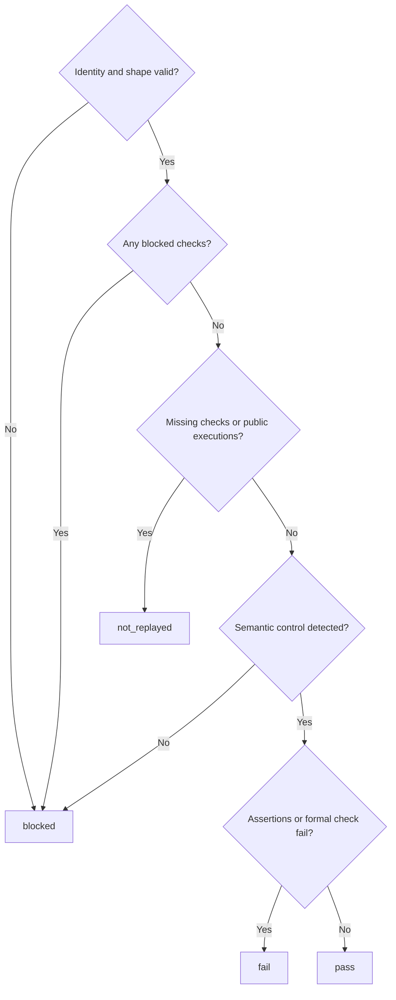

# Validate structured code replay evidence

Own src/workflow-replay.mjs. Bind an agent's replay report to the original approved prompt-space vectors and
current Git-visible code. Validate structure and identity only: never run a test, invoke supplied commands,
prove equivalence, approve a prompt, or infer success from prose. Preserve existing runtime source fingerprints.

Export REPLAY_POLICY (`pdd.replay-evidence.v1`), sourceFingerprint(root), pinReplayVectors(root, paths),
readReplayEvidence(run), formatReplayEvidence(result), and adoptReplayCorpus(root, declarationPath, ports). The runner owns policy opt-in and publication.

## Original identities

sourceFingerprint returns the SHA256 of the JSON-encoded sorted Git-visible path tuples, or null on unreadable
source: regular file [path, executable bits, SHA256(bytes)], symbolic link [path,"link",link target], missing
tracked file [path,"missing"]. Include uncommitted and untracked non-ignored files, independently of commit SHA.

pinReplayVectors receives the prompt area's selected original scenario paths at approved publication. Return
an anchor containing version pdd.replay-vectors.v1, each raw file SHA256 and each original step/check identity,
or an explicit blocked anchor with a reason. No paths or no checks is not_replayed. Paths must be unique,
Git-visible, canonical repo-relative regular files with no symlink ancestors or hardlinks; refuse missing,
empty, unreadable or malformed scenarios. Limit200files,10MiB aggregate vector bytes,2MiB per file and10000
steps/checks. Each scenario uses prompt-runtime.program-scenario.v1, unique nonempty step_id, entry_path and
operation, and nonempty checks. A check identity is vector path, step_id and zero-based check_index, plus the
original entry_path, operation, criterion_id, target, JSON path and assertion op. Supported targets are result,
error, world and calls. Preserve every original identity; do not substitute generated fixtures or expected values.

## Corpus adoption

`adoptReplayCorpus` is a module function selecting an existing corpus for the runner.
It reads a declaration and independently resolved source through the injected
`readAdoptionSnapshot({root,declarationPath})` port (`adoption.read` at runtime), once.
A missing/malformed declaration may make the port throw; catch it as unavailable.
The port does read-only local Git/filesystem work, never gh, Herdr, approval or models.
It captures current files from the runner's selected base at startup and the run
worktree thereafter. Port failures become `blocked/unavailable`, never an empty corpus.

A declaration is version `pdd.replay-adoption.v1`, with `repository` (canonical
owner/repo), `commit` (full immutable commit ID), nonempty unique repo-relative
`prompts` (entry prompt paths), and `approval {kind:"external-human-assertion",
reference, asserted_by}` (both nonblank, at most 1000 characters). The assertion
explicitly covers this repository, commit, named prompts, all their required context,
and **every** scenario in that repository snapshot. A string saying "approved",
a commit message, a runtime receipt or ordinary agent prose is insufficient.

Trust boundary: pdd verifies the declaration's structure, source identity and exact
content. It cannot independently authenticate the external assertion's human author
or authorization. Retain and display `external-assertion-unverified`, the original
reference and asserted identity; the person is responsible for the assertion's truth.
Never invent a new authorization or make the artifact's presence prove human approval.

<details>
<summary>Authoritative inventory, byte identity and port snapshot</summary>

The approved source is the declaration's commit resolved locally in the same
repository. Enumerate its **entire tracked tree**, with exact NUL-delimited paths.
Parse every JSON candidate and include every `prompt-runtime.program-scenario.v1`
file; unreadable/unclassifiable candidates fail closed. No caller subset, roots,
file list or new directory scan defines the approved corpus scope. Enumerate the
current whole repository too, including Git-visible untracked files. Require the
same nonempty scenario path set; missing, extra and duplicate rows block adoption.
This deliberately requires approval covering the whole repository corpus.

Seed required context with the union of declaration prompts and every original
scenario step entry_path, each scenario story_path and its explicit scenario context.
An unlisted second entry prompt, Story or test context cannot escape validation.
Resolve that complete required dependency closure from both
snapshots using the runtime's source-selection rules, including required context
and prompt call targets. Missing dependencies, cycles or unresolved selections block.
Require the same path set and raw SHA256 bytes for that closure and every scenario;
JSON formatting and newline edits count as changes. Do not trust digest claims in
the declaration. The port computes digests from independently read raw files/blobs.
Original scenarios must pass `pinReplayVectors` validation and bounds; retain the
complete original step/check identities, with exact equality against current rows.
Reuse the original-path safety and size limits. Declaration is a regular single-link
file of at most 64 KiB, with no symlink ancestors; bound reads before parsing.
A dirty current prompt/dependency/scenario cannot reuse authorization from the commit.

The port returns `snapshot`: `available`, resolved `repository`, `commit`, the parsed
`declaration`, its computed raw `declaration_sha256`, `approved_vectors`, `current_vectors`, `approved_context`, and
`current_context`. Vector rows contain `path`, computed raw `sha256`, and `checks`
(the ordered original check identity tuples encoded as JSON strings). Context rows
contain `path` and computed raw `sha256`. These are independently enumerated facts,
never accepted as user-supplied CLI claims. The port checks raw-file safety, scenario
structure/bounds and dependency closure completeness before `available:true`.
At runtime the supplied fake models this native port, not actual Git or byte hashing.

Validate declaration version/types, nonempty unique prompt paths and assertion
fields; malformed declarations block as invalid-approval. Require 64 lowercase hex
SHA256 values and unique context paths as well as unique vector paths; malformed
snapshot facts block as unavailable. Compare declaration repository/commit to resolved source first; foreign identity
returns `blocked/foreign-source`. Missing/invalid assertion returns
`blocked/invalid-approval`. Empty, duplicate or unequal inventories return
`blocked/inventory-mismatch`; unequal bytes or check identities return
`blocked/content-mismatch`. Successful selection returns `adopted`, empty reason,
sorted scenario `paths` and provenance `{repository,commit,reference,asserted_by,
trust:"external-assertion-unverified",declaration_sha256,prompts}`. Blocked selection returns no paths and
empty provenance strings and prompts (the trust label stays explicit). Do not throw through startup.

</details>

## Manifest contract

readReplayEvidence reads only <runDir>/replay-evidence.json, a regular single-link file of at most2MiB; reject
symbolic links in the path and avoid unbounded reads. Open nonblocking so a FIFO or device cannot wait for
a writer before the regular-file check. It requires a valid saved original anchor and unchanged,
still-visible original files with identical nonempty bytes. A missing original anchor cannot be reconstructed
from code-space files. Bind run_id to run.runId and source to current sourceFingerprint(run.root).
Missing/stale/malformed evidence returns blocked with a finite reason, never throws through publication.
An empty original vector set is not_replayed, never pass.

<details>
<summary>Required versioned JSON fields</summary>

- schema_version: pdd.replay-evidence.v1; run_id: the saved run ID.
- source: {kind:"git-content-v1",sha256:64hex}.
- vectors: unique exact original {path,sha256} rows; no additions, omissions or changed hashes.
- checks: at most10000 rows, each {vector,step_id,check_index,entry_path,operation,criterion_id,target,path,op,
  outcome}. outcome is pass, fail, blocked or not_replayed. A blocked/not_replayed row needs a nonblank reason.
  Each row must match an original identity exactly and occur once; unknown/duplicate identities are malformed.
  Missing identities are counted as not_replayed. Empty checks cannot pass.
- operations: unique {vector,step_id,entry_path,operation,executed,outcome,boundary,command,exit_code} rows,
  one per original step. boundary is {kind:function|command|route,name:nonblank}. command is the agent's
  recorded test command, not a command for pdd to execute. executed is boolean; outcome is returned,
  expected_error, crash or not_run. exit_code is an integer0..255 for executed steps, null for not_run.
  Only executed+returned/expected_error is public-boundary execution evidence. A missing or unexecuted
  operation makes its checks not_replayed, even if the supplied check rows say pass. An unknown/duplicate
  operation is malformed. Missing/unexecuted operations need no invented success metadata.
- counts: {total,pass,fail,blocked,not_replayed}, nonnegative safe integers exactly equal to the derived original
  check outcomes (including missing/unexecuted checks). No extra checks or zero-total pass.
- mutation: {kind:"semantic",description:nonblank,command:nonblank,exit_code:integer0..255,
  outcome:assertion_failure|crash|survived|not_run,failed_checks:[{vector,step_id,check_index}],reason?}.
  Detection requires assertion_failure, nonzero exit and at least one unique known failed-check reference.
  A crash, empty failure list, unknown assertion, survived control or not-run control is never detection.
  For not_run, command and exit_code may be null and a nonblank reason is required; never invent an exit.
- formal: {result:proved_bounded|proved_solver|failed|not_run|not_applicable,scope:nonblank,reason:nonblank,
  control_outcome:assertion_failure|crash|survived|not_run,counterexample?}. failed requires a counterexample;
  proved results require assertion_failure control. Not-run/not-applicable remain explicit scoped results.

All identifier/reason/command strings are bounded (at most1000characters); collections stay within the limits
above. Reject wrong types and unsupported versions; never coerce truthy flags or counts. SHA256 comparison
uses the actual original bytes. The manifest is agent-supplied evidence, not an independently verified execution.
</details>

## Result and report



An invalid proved formal control is blocked. Record exact derived counts, public operation totals/executed,
mutation outcome and formal type/scope/reason. Retain explicit assertion/formal failure lines even alongside
blocked/not_replayed; real failures do not prevent publication. Hash the bounded manifest bytes for provenance.
formatReplayEvidence emits a compact PR section with prominent Code replay PASS/FAIL/BLOCKED/NOT REPLAYED,
exact counts, source and manifest hashes, vector hashes, public execution totals, semantic control and typed
formal result. Include: `Agents execute the tests and supply this record. pdd validates structure and identity;
it does not independently prove execution or prompt/code equivalence.` Keep details bounded and sanitize
control characters, private local paths and Try capabilities. Escape HTML and Markdown in displayed metadata
so JSON errors, vector paths, scopes or reasons cannot open comments/details or hide the report/trust boundary.
Escape only when rendering, retaining the original structured values without double escaping.
Full evidence stays in the run folder. Never
let an agent's free-form PASS summary replace this status.

## Dependencies

- [Runtime preflight](runtime-preflight.prompt.md): required generation/runtime context for gitFiles(root).
- [Runtime output](runtime-output.prompt.md): required generation/runtime context for safe diagnostic text.

<details>
<summary>Runtime interface</summary>

```json
{
  "status": "draft",
  "prose_sha256": "",
  "entries": [
    {
      "operation": "adoptReplayCorpus",
      "input_schema": {
        "type": "object",
        "properties": {
          "root": {
            "type": "string"
          },
          "declarationPath": {
            "type": "string"
          }
        },
        "required": [
          "root",
          "declarationPath"
        ],
        "additionalProperties": false
      },
      "result_schema": {
        "type": "object",
        "properties": {
          "outcome": {
            "type": "string",
            "enum": [
              "adopted",
              "blocked"
            ]
          },
          "reason": {
            "type": "string"
          },
          "paths": {
            "type": "array",
            "items": {
              "type": "string"
            }
          },
          "provenance": {
            "type": "object",
            "properties": {
              "repository": {
                "type": "string"
              },
              "commit": {
                "type": "string"
              },
              "reference": {
                "type": "string"
              },
              "asserted_by": {
                "type": "string"
              },
              "trust": {
                "type": "string"
              },
              "declaration_sha256": {
                "type": "string"
              },
              "prompts": {
                "type": "array",
                "items": {
                  "type": "string"
                }
              }
            },
            "required": [
              "repository",
              "commit",
              "reference",
              "asserted_by",
              "trust",
              "declaration_sha256",
              "prompts"
            ],
            "additionalProperties": false
          }
        },
        "required": [
          "outcome",
          "reason",
          "paths",
          "provenance"
        ],
        "additionalProperties": false
      },
      "errors": []
    }
  ],
  "calls": [],
  "resources": [
    {
      "name": "adoption",
      "kind": "collection",
      "access": "read",
      "operations": [
        {
          "name": "read",
          "access": "read",
          "arguments_schema": {
            "type": "object",
            "properties": {
              "root": {
                "type": "string"
              },
              "declarationPath": {
                "type": "string"
              }
            },
            "required": [
              "root",
              "declarationPath"
            ],
            "additionalProperties": false
          },
          "result_schema": {
            "type": "object",
            "properties": {
              "snapshot": {
                "type": "object",
                "properties": {
                  "available": {
                    "type": "boolean"
                  },
                  "repository": {
                    "type": "string"
                  },
                  "commit": {
                    "type": "string"
                  },
                  "declaration": {
                    "type": "object",
                    "properties": {
                      "schema_version": {
                        "type": "string"
                      },
                      "repository": {
                        "type": "string"
                      },
                      "commit": {
                        "type": "string"
                      },
                      "prompts": {
                        "type": "array",
                        "items": {
                          "type": "string"
                        }
                      },
                      "approval": {
                        "type": "object",
                        "properties": {
                          "kind": {
                            "type": "string"
                          },
                          "reference": {
                            "type": "string"
                          },
                          "asserted_by": {
                            "type": "string"
                          }
                        },
                        "required": [
                          "kind",
                          "reference",
                          "asserted_by"
                        ],
                        "additionalProperties": false
                      }
                    },
                    "required": [
                      "schema_version",
                      "repository",
                      "commit",
                      "prompts",
                      "approval"
                    ],
                    "additionalProperties": false
                  },
                  "approved_vectors": {
                    "type": "array",
                    "items": {
                      "type": "object",
                      "properties": {
                        "path": {
                          "type": "string"
                        },
                        "sha256": {
                          "type": "string"
                        },
                        "checks": {
                          "type": "array",
                          "items": {
                            "type": "string"
                          }
                        }
                      },
                      "required": [
                        "path",
                        "sha256",
                        "checks"
                      ],
                      "additionalProperties": false
                    }
                  },
                  "current_vectors": {
                    "type": "array",
                    "items": {
                      "type": "object",
                      "properties": {
                        "path": {
                          "type": "string"
                        },
                        "sha256": {
                          "type": "string"
                        },
                        "checks": {
                          "type": "array",
                          "items": {
                            "type": "string"
                          }
                        }
                      },
                      "required": [
                        "path",
                        "sha256",
                        "checks"
                      ],
                      "additionalProperties": false
                    }
                  },
                  "approved_context": {
                    "type": "array",
                    "items": {
                      "type": "object",
                      "properties": {
                        "path": {
                          "type": "string"
                        },
                        "sha256": {
                          "type": "string"
                        }
                      },
                      "required": [
                        "path",
                        "sha256"
                      ],
                      "additionalProperties": false
                    }
                  },
                  "current_context": {
                    "type": "array",
                    "items": {
                      "type": "object",
                      "properties": {
                        "path": {
                          "type": "string"
                        },
                        "sha256": {
                          "type": "string"
                        }
                      },
                      "required": [
                        "path",
                        "sha256"
                      ],
                      "additionalProperties": false
                    }
                  },
                  "declaration_sha256": {
                    "type": "string"
                  }
                },
                "required": [
                  "available",
                  "repository",
                  "commit",
                  "declaration",
                  "approved_vectors",
                  "current_vectors",
                  "approved_context",
                  "current_context",
                  "declaration_sha256"
                ],
                "additionalProperties": false
              }
            },
            "required": [
              "snapshot"
            ],
            "additionalProperties": false
          }
        }
      ]
    }
  ],
  "limits": {
    "max_steps": 1,
    "max_model_calls": 3
  },
  "conventions": []
}
```

</details>
