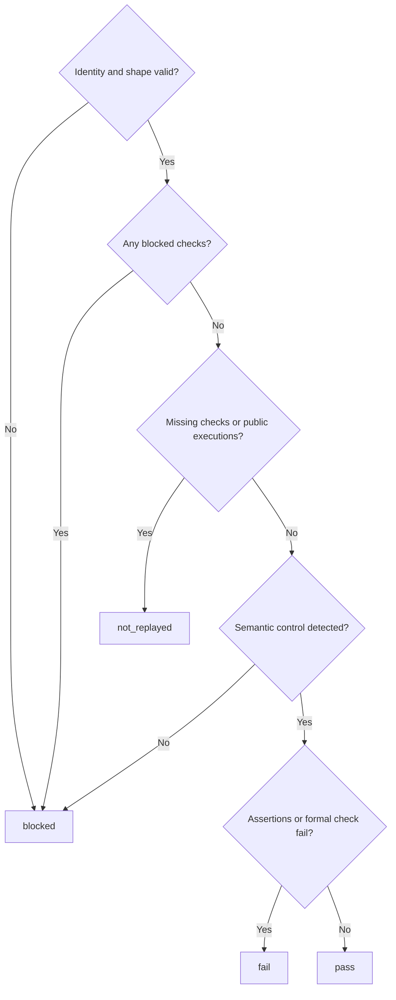

# Validate structured code replay evidence

Own src/workflow-replay.mjs. Bind an agent's replay report to the original approved prompt-space vectors and
current Git-visible code. Validate structure and identity only: never run a test, invoke supplied commands,
prove equivalence, approve a prompt, or infer success from prose. Preserve existing runtime source fingerprints.

Export REPLAY_POLICY (`pdd.replay-evidence.v1`), sourceFingerprint(root), pinReplayVectors(root, paths),
readReplayEvidence(run), and formatReplayEvidence(result). The runner owns policy opt-in and publication.

## Original identities

sourceFingerprint returns the SHA256 of the JSON-encoded sorted Git-visible path tuples, or null on unreadable
source: regular file [path, executable bits, SHA256(bytes)], symbolic link [path,"link",link target], missing
tracked file [path,"missing"]. Include uncommitted and untracked non-ignored files, independently of commit SHA.

pinReplayVectors receives the prompt area's selected original scenario paths at approved publication. Return
an anchor containing version pdd.replay-vectors.v1, each raw file SHA256 and each original step/check identity,
or an explicit blocked anchor with a reason. No paths or no checks is not_replayed. Paths must be unique,
Git-visible, canonical repo-relative regular files with no symlink ancestors or hardlinks; refuse missing,
empty, unreadable or malformed scenarios. Limit200files,10MiB aggregate vector bytes,2MiB per file and10000
steps/checks. Each scenario uses prompt-runtime.program-scenario.v1, unique nonempty step_id, entry_path and
operation, and nonempty checks. A check identity is vector path, step_id and zero-based check_index, plus the
original entry_path, operation, criterion_id, target, JSON path and assertion op. Supported targets are result,
error, world and calls. Preserve every original identity; do not substitute generated fixtures or expected values.

## Manifest contract

readReplayEvidence reads only <runDir>/replay-evidence.json, a regular single-link file of at most2MiB; reject
symbolic links in the path and avoid unbounded reads. Open nonblocking so a FIFO or device cannot wait for
a writer before the regular-file check. It requires a valid saved original anchor and unchanged,
still-visible original files with identical nonempty bytes. A missing original anchor cannot be reconstructed
from code-space files. Bind run_id to run.runId and source to current sourceFingerprint(run.root).
Missing/stale/malformed evidence returns blocked with a finite reason, never throws through publication.
An empty original vector set is not_replayed, never pass.

Required versioned JSON fields

- schema_version: pdd.replay-evidence.v1; run_id: the saved run ID.
- source: {kind:"git-content-v1",sha256:64hex}.
- vectors: unique exact original {path,sha256} rows; no additions, omissions or changed hashes.
- checks: at most10000 rows, each {vector,step_id,check_index,entry_path,operation,criterion_id,target,path,op,
  outcome}. outcome is pass, fail, blocked or not_replayed. A blocked/not_replayed row needs a nonblank reason.
  Each row must match an original identity exactly and occur once; unknown/duplicate identities are malformed.
  Missing identities are counted as not_replayed. Empty checks cannot pass.
- operations: unique {vector,step_id,entry_path,operation,executed,outcome,boundary,command,exit_code} rows,
  one per original step. boundary is {kind:function|command|route,name:nonblank}. command is the agent's
  recorded test command, not a command for pdd to execute. executed is boolean; outcome is returned,
  expected_error, crash or not_run. exit_code is an integer0..255 for executed steps, null for not_run.
  Only executed+returned/expected_error is public-boundary execution evidence. A missing or unexecuted
  operation makes its checks not_replayed, even if the supplied check rows say pass. An unknown/duplicate
  operation is malformed. Missing/unexecuted operations need no invented success metadata.
- counts: {total,pass,fail,blocked,not_replayed}, nonnegative safe integers exactly equal to the derived original
  check outcomes (including missing/unexecuted checks). No extra checks or zero-total pass.
- mutation: {kind:"semantic",description:nonblank,command:nonblank,exit_code:integer0..255,
  outcome:assertion_failure|crash|survived|not_run,failed_checks:[{vector,step_id,check_index}],reason?}.
  Detection requires assertion_failure, nonzero exit and at least one unique known failed-check reference.
  A crash, empty failure list, unknown assertion, survived control or not-run control is never detection.
  For not_run, command and exit_code may be null and a nonblank reason is required; never invent an exit.
- formal: {result:proved_bounded|proved_solver|failed|not_run|not_applicable,scope:nonblank,reason:nonblank,
  control_outcome:assertion_failure|crash|survived|not_run,counterexample?}. failed requires a counterexample;
  proved results require assertion_failure control. Not-run/not-applicable remain explicit scoped results.

All identifier/reason/command strings are bounded (at most1000characters); collections stay within the limits
above. Reject wrong types and unsupported versions; never coerce truthy flags or counts. SHA256 comparison
uses the actual original bytes. The manifest is agent-supplied evidence, not an independently verified execution.

## Result and report

An invalid proved formal control is blocked. Record exact derived counts, public operation totals/executed,
mutation outcome and formal type/scope/reason. Retain explicit assertion/formal failure lines even alongside
blocked/not_replayed; real failures do not prevent publication. Hash the bounded manifest bytes for provenance.
formatReplayEvidence emits a compact PR section with prominent Code replay PASS/FAIL/BLOCKED/NOT REPLAYED,
exact counts, source and manifest hashes, vector hashes, public execution totals, semantic control and typed
formal result. Include: `Agents execute the tests and supply this record. pdd validates structure and identity;
it does not independently prove execution or prompt/code equivalence.` Keep details bounded and sanitize
control characters, private local paths and Try capabilities. Escape HTML and Markdown in displayed metadata
so JSON errors, vector paths, scopes or reasons cannot open comments/details or hide the report/trust boundary.
Escape only when rendering, retaining the original structured values without double escaping.
Full evidence stays in the run folder. Never
let an agent's free-form PASS summary replace this status.

## Dependencies

- [Runtime preflight](runtime-preflight.prompt.md): required generation/runtime context for gitFiles(root).
- [Runtime output](runtime-output.prompt.md): required generation/runtime context for safe diagnostic text.
