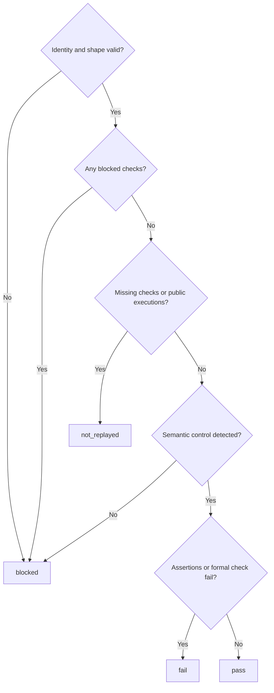

# Validate structured code replay evidence

Own src/workflow-replay.mjs. Bind an agent's replay report to current scenarios and Git-visible code,
retaining approved prompt-space vectors for comparison. Validate structure and identity only: never run a test, invoke supplied commands,
prove equivalence, approve a prompt, or infer success from prose. Preserve existing runtime source fingerprints.

Export REPLAY_POLICY (`pdd.replay-evidence.v1`), sourceFingerprint(root), pinReplayVectors(root, paths),
pinRunAnchor(root, options), readReplayEvidence(run, paths?), readFormalEvidence(run), formalStatusText(formal), formatReplayEvidence(result, options?),
and adoptReplayCorpus(root, declarationPath, ports). The runner owns policy opt-in and publication.

## Original identities

sourceFingerprint returns the SHA256 of the JSON-encoded sorted Git-visible path tuples, or null on unreadable
source: regular file [path, executable bits, SHA256(bytes)], symbolic link [path,"link",link target], missing
tracked file [path,"missing"]. Include uncommitted and untracked non-ignored files, independently of commit SHA.

pinReplayVectors receives the prompt area's selected original scenario paths at approved publication. Return
an anchor containing version pdd.replay-vectors.v1, each raw file SHA256, parsed scenario snapshot and original step/check identity,
read with the [exact scenario number](scenario-json.prompt.md) rules. The snapshot stays the ordinary JSON value. A vector
with a whole number above 2^53 adds `exact_integers`: its `{pointer, value}` digit rows, so the saved anchor keeps them exactly;
a vector without one has no such field,
or an explicit blocked anchor with a reason. No paths or no checks is not_replayed. Paths must be unique,
Git-visible, canonical repo-relative regular files with no symlink ancestors or hardlinks; refuse missing,
empty, unreadable or malformed scenarios. Limit200files,10MiB aggregate vector bytes,2MiB per file and10000
steps/checks. Each scenario uses prompt-runtime.program-scenario.v1, unique nonempty step_id, entry_path and
operation, and nonempty checks. A check identity is vector path, step_id and zero-based check_index, plus the
original entry_path, operation, criterion_id, target, JSON path and assertion op. Supported targets are result,
error, world and calls. Preserve every original identity; do not substitute generated fixtures or expected values.

## Approved scenarios on the base

pinRunAnchor(root, {paths, commit, changed, scenarios, codeSpace}) builds a run's anchor without a declaration.
`paths` are the run's changed scenario files, pinned as pinReplayVectors pins them. `commit` is the run's full
base commit, `changed` the run's changed paths against it, and `scenarios` the current changed scenario files.
A file on the base branch counts as approved. Also anchor each base scenario that belongs to the run's changed
area. Read the base with local Git only: one `git grep -F` for the schema name in `*.json`, one `ls-tree`, one
`git cat-file --batch`; never gh, a model or the worktree copy of a base file. Ignore user Git color
settings when parsing Git output; the scenario search must emit no color codes.

A base scenario is a regular `.json` blob of at most 10 MiB, found by that search, whose parsed schema_version is
prompt-runtime.program-scenario.v1; skip other and unparsable JSON. Search matches over 10 MiB are not read;
report each path, byte size and limit in the base note and the PR Anchor line, even when other files are
selected. Never silently omit them. Its links are its story_path, every step
entry_path and its entry_paths. The changed area is every changed path, the links of each changed scenario
(current file and base blob), the `stories` and `prompt` of each changed path that the base commit's
`pdd-bindings.json` (pdd.bindings.v1) declares as a `module`, and each header prompt. A base scenario belongs when
one of its links is in the changed area. Use no other link: no folder, name, prose or AI guess. A malformed
pdd-bindings.json adds no links.

A header prompt is the prompt that a changed file names in its PDD header, in its base blob or its current file.
Read headers only with the shared [header reader](file-owner.prompt.md#generated-from-header) (`headerPrompts`):
any complete line in the first 4 KiB, with its exact form and line limit. Other text, such as
`Generated from the canonical m1_policy prompt`, is no header. The Stories of a header prompt or a changed
prompt file (the story_path of each base scenario that links to it) are also in the changed area.

The base commit's root `pdd.json` selects the base scenarios with `replay.base_scenarios`: `linked` (the rule
above) or `all` (every base scenario belongs). A missing file, `replay` or `base_scenarios` means `linked`. A
pdd.json that is not valid JSON or not a JSON object, a `replay` that is not an object, an unknown key inside
`replay`, or another value blocks. The reason names pdd.json on the base and the unknown key or invalid
value setting. Read pdd.json in the same `ls-tree` and `cat-file` calls.

Without codeSpace, skip base files in `changed`; the changed route pins their current bytes. A linked base
scenario removed or renamed by PR 1 blocks the anchor, like any unreadable changed scenario; never retain
its old path as an unchanged base vector. With codeSpace
(a run with no prompt area before code), ignore `paths` and also select changed base files, always with their
base bytes, so code space cannot change approved values. Each base vector keeps path, raw SHA256, snapshot,
steps, checks and `base` (the full commit). The anchor keeps `base:{commit,note,select}` (select is `linked` or
`all`); the note says plainly why no base file was added, says when no changed file has a header, and names an
absent or malformed pdd-bindings.json. Order changed vectors first, then base vectors by path. Apply the
original limits to the whole anchor, also with `all`. A refusal states the count and the limit, for example
`250 scenario files (3 changed + 247 linked approved on base 6b58b76); the limit is 200` or
`201 scenario files (0 changed + all 201 approved on base 6b58b76); the limit is 200`. A selected base
scenario that fails original validation blocks with its path. No vectors is not_replayed with the note; with
codeSpace it is blocked, because no anchor exists. Git failure blocks. Never throw.

## Corpus adoption

`adoptReplayCorpus` is a module function selecting an existing corpus for the runner.
It reads a declaration and independently resolved source through the injected
`readAdoptionSnapshot({root,declarationPath})` port (`adoption.read` at interpreter execution), once.
A missing/malformed declaration may make the port throw; catch it as unavailable, retaining one useful cleaned single-line cause.
The port does read-only local Git/filesystem work, never gh, Herdr, approval or models.
It captures current files from the runner's selected base at startup and the run
worktree thereafter. Port failures become `blocked/unavailable`, never an empty corpus.
Native temporary views use realpath-resolved scratch directories, including under a
symlinked TMPDIR. Resolve the declaration parent directory with realpath before
reading; allow symlink ancestors but still refuse a final symlink or hardlink.
Use `git cat-file --batch` for immutable blob reads rather than per-file processes.
Refuse a `.git` path segment in any letter case, including `.GIT`, in all
selected paths and temporary-view tree entries before writing them into the view.

A declaration is version `pdd.replay-adoption.v1`, with `repository` (canonical
owner/repo), `commit` (full immutable commit ID), nonempty unique repo-relative
`prompts` (entry prompt paths), nonempty unique canonical repo-relative `scenarios`
(at most 200 paths, the asserted complete inventory), and `approval {kind:"external-human-assertion",
reference, asserted_by}` (both nonblank, at most 1000 characters). The assertion
explicitly covers this repository, commit, named prompts, all their required context,
and every scenario in this declared inventory. The assertion defines scope; it does
not prove that unrelated repository scenarios were reviewed. A string saying "approved",
a commit message, an interpreter receipt or ordinary agent prose is insufficient.

Trust boundary: pdd verifies the declaration's structure, source identity and exact
content. It cannot independently authenticate the external assertion's human author
or authorization. Retain and display `external-assertion-unverified`, the original
reference and asserted identity; the person is responsible for the assertion's truth.
Never invent a new authorization or make the artifact's presence prove human approval.

<details>
<summary>Authoritative inventory, byte identity and port snapshot</summary>

The approved source is the declaration's commit resolved locally in the same
repository. Select exactly the declaration's scenario paths from the approved commit
and current source. Both selected row sets must exactly equal the declared list:
empty, missing, duplicate, subset and extra rows block. Derive bytes and original
check identities from the immutable commit, never declaration digest claims.
Unrelated scenarios outside the declared scope, including repository test fixtures,
do not participate and cannot block adoption. The runner's changed-scenario guard
reports new code-stage vectors under the saved-value warning rule below.
Require `approved_commit_ancestor:true`: the native port checks the approved commit
is an ancestor of the selected base at startup and allocated/current HEAD thereafter.
A resolved but unrelated commit returns `blocked/unrelated-commit`, even with equal bytes.

Seed required context with the union of declaration prompts and every original
scenario step entry_path, each scenario story_path and its explicit scenario context.
An unlisted second entry prompt, Story or test context cannot escape validation.
Resolve that complete required dependency closure from both
snapshots using the interpreter's source-selection rules, including required context
and prompt call targets. Missing dependencies, cycles or unresolved selections block.
Require the same path set and raw SHA256 bytes for that closure and every scenario;
JSON formatting and newline edits count as changes. Do not trust digest claims in
the declaration. The port computes digests from independently read raw files/blobs.
Original scenarios must pass `pinReplayVectors` validation and bounds; retain the
complete original step/check identities, with exact equality against current rows.
Reuse the original-path safety and size limits. Declaration is a regular single-link
file of at most 64 KiB; apply the resolved-parent rule above and bound reads before parsing.
A dirty current prompt/dependency/scenario cannot reuse authorization from the commit.

The port returns `snapshot`: `available`, resolved `repository`, `commit`, the parsed
`declaration`, its computed raw `declaration_sha256`, `approved_vectors`, `current_vectors`, `approved_context`, and
`current_context`, `approved_commit_ancestor` (boolean), and `cause` (string, empty
on success). Vector rows contain `path`, computed raw `sha256`, and `checks`
(the ordered original check identity tuples encoded as JSON strings). Context rows
contain `path` and computed raw `sha256`. These are independently enumerated facts,
never accepted as user-supplied CLI claims. The port checks raw-file safety, scenario
structure/bounds and dependency closure completeness before `available:true`.
The strict Runtime `snapshot` has no declaration bytes or undeclared properties.
The private native reader returns `{snapshot, internal:{declarationBytes}}`. The
helper unwraps snapshot for decision logic and, when supplied, calls native-only
`ports.onNativeDeclaration(bytes)` once with the bounded raw declaration bytes.
The runner supplies this callback to capture bytes for freezing. No private reader
export is required. The injected `readAdoptionSnapshot` port supplies snapshot facts;
its Runtime `adoption.read` transport reply is exactly `{snapshot}`. The capture
callback is native metadata transport, not a Runtime resource or approval effect.
Do not add internal bytes to the helper's public result, Runtime snapshot or user evidence.
At interpreter execution the supplied fake models this native port, not actual Git or byte hashing.
Clean native causes to one finite line (at most 1000 characters), removing private
absolute paths, credentials and Simulate URLs; keep a useful operation/cause explanation.
For a missing declared scenario, name whether the approved or current source is
missing it and retain its repo-relative path, including a deleted worktree file.
Declaration-shape refusals must identify the failed rule: more than 200 scenario
paths names the count and limit, a missing `scenarios` key names that key and its
absence, duplicate paths name the duplicate and its repo-relative path, and
noncanonical paths name the path and canonical-path problem (for example
`./tests/a.json`). Never leave these causes empty. Invalid absolute path input
must still be sanitized. Runtime declaration transport permits malformed scenario
lists so this module, rather than schema admission, owns their diagnosis.

Validate declaration version/types, nonempty unique prompt and scenario paths and assertion
fields; malformed declarations block as invalid-approval. Require 64 lowercase hex
SHA256 values and unique context paths as well as unique vector paths; malformed
snapshot facts block as unavailable. Compare declaration repository/commit to resolved source first; foreign identity
returns `blocked/foreign-source`. Missing/invalid assertion returns
`blocked/invalid-approval`. Empty, duplicate or unequal inventories return
`blocked/inventory-mismatch`; unequal bytes or check identities return
`blocked/content-mismatch`. Successful selection returns `adopted`, empty reason,
sorted scenario `paths` and provenance `{repository,commit,reference,asserted_by,
trust:"external-assertion-unverified",declaration_sha256,prompts,scenarios}`. Blocked selection returns no paths, a cleaned `cause` (empty when none), and
retains structurally valid available adoption provenance, including declared scope,
without implying acceptance. Unavailable/invalid provenance fields use empty strings
or lists; the trust label stays explicit. Successful selection has empty `cause`.
Do not throw through startup.

</details>

## Manifest contract

readReplayEvidence reads only <runDir>/replay-evidence.json, a regular single-link file of at most2MiB; reject
symbolic links in the path and avoid unbounded reads. Open nonblocking so a FIFO or device cannot wait for
a writer before the regular-file check. It requires a valid saved original anchor. A missing original anchor cannot be reconstructed
from code-space files. Bind run_id to run.runId and source to current sourceFingerprint(run.root).
Missing/stale/malformed evidence returns blocked with a finite reason, never throws through publication.
An empty current vector set is not_replayed, never pass.
A saved anchor outcome may only be blocked or not_replayed and remains that outcome even when current
paths are supplied; still collect comparable saved-value warnings before returning it. Any other saved
outcome is malformed and blocked. A report with zero checks never displays PASS.

### The formal result on its own

The formal step proves the Story's `## Rules to check` with its own tests, also when the approved prompt area
has no scenario vectors. So pdd reads the `formal` block on its own (#3029). readFormalEvidence(run) reads the
same bounded manifest file for its formal status only. readReplayEvidence always attaches this status as
`formal`, on every return: no anchor, a saved not_replayed or blocked anchor, no current vectors, a missing,
stale or malformed manifest, and a full replay. In a full replay it validates the bytes that the replay read.
The scenario replay outcome and reason stay exactly as the rules above say: a formal result never turns
NOT REPLAYED or BLOCKED into a pass, and an invalid formal block still blocks a full replay as before.

| Status | When | Repair step |
|---|---|---|
| recorded | every check below passes | none |
| missing | no replay-evidence.json, or the file has no `formal` key | write the formal block per docs/replay-evidence.md |
| malformed (FIELD) | the first failed check names FIELD: `file`, `JSON`, `schema_version`, `run_id`, `source`, `formal`, a `formal.*` field or `mutation` | correct FIELD per docs/replay-evidence.md (`file`: write replay-evidence.json as one regular file in the run folder; `JSON`: write it as valid UTF-8 JSON) |
| stale (source changed) | `source.sha256` is not the current sourceFingerprint(run.root), or the current source cannot be read | run the formal check on the current source and write its formal block with the current fingerprint |

Each repair step ends with "then run pdd workflow done formal again". Check order decides the status, and the
first failed check wins: read the file (absent is missing; unsafe or unreadable is malformed `file`), UTF-8 JSON,
schema_version, run_id, the `formal` key (absent is missing), the source shape, the current fingerprint (stale),
then the typed formal fields, the counterexample of a failed result and the control below. Causes are pdd's own
finite sentences: never a parser message, a file snippet or a local path.

Control for a proved result (`proved_bounded`, `proved_solver`) always needs `control_outcome: assertion_failure`
(else malformed `formal.control_outcome`): the planted mistake (in a bug run, the old code) fails the formal check
by assertion, not crash. Present `control_command` and `control_exit_code` values are always typed as below.
- With scenario vectors (the saved anchor, or the current full replay, has original checks): the manifest's
  semantic mutation control must detect, by the mutation rule below, with failed checks that name known original
  assertions. Otherwise malformed `mutation`.
- With no scenario vectors: the formal block carries its own control, `control_command` (nonblank) and
  `control_exit_code` (integer 1..255). Otherwise malformed `formal.control_command` or `formal.control_exit_code`.
`failed` needs its counterexample; `not_run` and `not_applicable` need only their typed scope and reason.

With scenario vectors (the same test as for the control), the full code replay needs a typed formal block of any
result. So every status then has `required: true`: a block that is missing, malformed or stale holds the code
replay, and the formal line always gives its status, reason and repair step, never "not needed".

The status object has `status` and, with scenario vectors, `required: true`; recorded adds `result`, `scope`, `reason`, `control_outcome`, the optional
control command and exit code, and `source`; every other status adds `cause`, `field` for malformed, and
`reported` (the block's result word when it is a known one, so the text can say what pdd did not accept).
When pdd read the bytes, `manifest_sha256` is their hash. readReplayEvidence fills its own empty
`manifest_sha256` from it, and its empty `source` only from a recorded status, which confirmed the fingerprint.

formalStatusText(formal, rules?) gives `{status, words, detail, repair, cause, notNeeded, note}` for the
[readable PR owner](workflow-pr-body.prompt.md) and this report (status is the normalized status word below). `rules` is
the runner's `rulesToCheck`: true, false, or null (unknown: pdd found no Story file of the run). `notNeeded` is true
only when the status is not recorded, `rules` is false and the status is not `required`. `note` is
"pdd found no Story file of this run, so the formal check counts as needed. When the Story has no Rules to check, name
its path (user_stories/NAME.md) in the formal step summary." when the status is not recorded and `rules` is null, else empty. Words are `recorded`, `missing`, `malformed (FIELD)` or `stale (source changed)`. For missing
the detail is "evidence not recorded: CAUSE"; for malformed and stale it is "evidence not accepted: CAUSE",
with "the record says RESULT, but " before CAUSE when `reported` is set. A saved status without `status` but
with a known `result` is recorded (an older saved record); an absent status is missing, cause "pdd has not read
the formal result for this record".

### Saved-value changes: show, do not lock

Keep the original anchor for comparison; never replace it or approve changed expectations.
Compare its snapshots to current files, using optional `paths` to include newly discovered scenarios.
List every changed JSON value with vector path, JSON Pointer, before and after values; distinguish
exact whole numbers by their digits (restore `exact_integers` on both sides and write values with exact digits, so a change in a
last digit above 2^53 is a changed value, never "JSON values unchanged"); distinguish
missing from null, zero, false and empty. Include additions, removals, moved files and byte-only changes.
For older anchors without snapshots, report old/current hashes and say original values are unavailable.
Unreadable, empty or malformed vectors get a warning with their path and cause.
Warnings appear in command output and the PR, even when replay evidence is absent or stale.
They never require returning to prompt space, block code work/publication or imply approval.
The checker or person decides whether the changes are correct. These diagnostics do not authorize an
agent to edit test values in code space; the authoring rules stay with the Prompting guide.
Do not cap the saved list of changed values. The runner saves it in status.json at /replayEvidence/warnings.

Render complete JSON Pointers and before/after JSON values reversibly, without path/URL cleaning or
identity truncation. Distinct values must remain visibly distinct. Use JSON Unicode escapes for code
units outside printable ASCII, including invisible and bidi characters. Escape Markdown, HTML, controls and
path separators so outer body cleaning cannot collapse different paths or damage quoted URLs.
Escape pdd-workflow: and pdd-product: as in the runner's inert summary text; they cannot become ownership markers.
Missing is distinct from a literal string or null. The default report shows all warnings. Optional
maxCharacters is a display budget for the entire replay section: retain its status, counts and trust
boundary, show the longest prefix of whole warning items that fits, then name the exact omitted count
and status.json /replayEvidence/warnings containing the complete list. Never silently omit or cut an item.
The runner supplies space from its whole-description budget; a long warning list never locks publication.

Validate the manifest against the current readable scenarios and their current hashes and identities.
Missing current vectors/checks in an older manifest mean not_replayed, with the warning retained;
never claim changed cases were executed from an old record. Unavailable vectors mean not_replayed,
not a value-change lock. All unrelated evidence validation and source-fingerprint rules remain.

For code-stage adoption revalidation only, native option `scenarioReference` selects the original
scenario bytes from the frozen commit in a disposable current-source view. This preserves validation
of the original prompt/dependency closure and authority while allowing scenario edits. Startup and
prompt-space adoption still require exact scenario bytes. Never change the source worktree.

<details>
<summary>Required versioned JSON fields</summary>

- schema_version: pdd.replay-evidence.v1; run_id: the saved run ID.
- source: {kind:"git-content-v1",sha256:64hex}.
- vectors: unique exact current {path,sha256} rows; no substituted hashes.
- checks: at most10000 rows, each {vector,step_id,check_index,entry_path,operation,criterion_id,target,path,op,
  outcome}. outcome is pass, fail, blocked or not_replayed. A blocked/not_replayed row needs a nonblank reason.
  Each row must match a current identity exactly and occur once; unknown/duplicate identities are malformed.
  Missing identities are counted as not_replayed. Empty checks cannot pass.
- operations: unique {vector,step_id,entry_path,operation,executed,outcome,boundary,command,exit_code} rows,
  one per current step. boundary is {kind:function|command|route,name:nonblank}. command is the agent's
  recorded test command, not a command for pdd to execute. executed is boolean; outcome is returned,
  expected_error, crash or not_run. exit_code is an integer0..255 for executed steps, null for not_run.
  Only executed+returned/expected_error is public-boundary execution evidence. A missing or unexecuted
  operation makes its checks not_replayed, even if the supplied check rows say pass. An unknown/duplicate
  operation is malformed. Missing/unexecuted operations need no invented success metadata.
- counts: {total,pass,fail,blocked,not_replayed}, nonnegative safe integers exactly equal to the derived current
  check outcomes (including missing/unexecuted checks). No extra checks or zero-total pass.
- mutation: {kind:"semantic",description:nonblank,command:nonblank,exit_code:integer0..255,
  outcome:assertion_failure|crash|survived|not_run,failed_checks:[{vector,step_id,check_index}],reason?}.
  Detection requires assertion_failure, nonzero exit and at least one unique known failed-check reference.
  A crash, empty failure list, unknown assertion, survived control or not-run control is never detection.
  For not_run, command and exit_code may be null and a nonblank reason is required; never invent an exit.
- formal: {result:proved_bounded|proved_solver|failed|not_run|not_applicable,scope:nonblank,reason:nonblank,
  control_outcome:assertion_failure|crash|survived|not_run,control_command?:nonblank,control_exit_code?:integer0..255,
  counterexample?}. failed requires a counterexample; proved results require assertion_failure control, bound to
  the semantic mutation with vectors, else to the block's own command and nonzero exit (see
  [the formal result on its own](#the-formal-result-on-its-own)). Not-run/not-applicable remain explicit scoped results.

All identifier/reason/command strings are bounded (at most1000characters); collections stay within the limits
above. Reject wrong types and unsupported versions; never coerce truthy flags or counts. SHA256 comparison
uses the actual current bytes. The manifest is agent-supplied evidence, not an independently verified execution.
</details>

## Result and report



An invalid proved formal control blocks a full replay; the formal status says why. Record exact derived counts, public operation totals/executed,
mutation outcome and formal type/scope/reason. Retain explicit assertion/formal failure lines even alongside
blocked/not_replayed; real failures do not prevent publication. Hash the bounded manifest bytes for provenance.
For adopted runs, retain structured adoption provenance even when replay is blocked.
The PR replay section displays "Anchor adopted from REPO@COMMIT; approval reference R
by A; external-assertion-unverified", using cleaned recorded values.
When the saved anchor has `base` and either vectors or a note, the result has `anchor`
{commit, select, changed, changed_checks, files, checks, note}, counted from the saved vectors, and the section
counts files and checks by source: `Anchor: 3 changed scenarios (40 checks) + 18 linked approved on base 6b58b76
(1,722 checks).`, `Anchor: 0 changed scenarios (0 checks) + all 18 approved on base 6b58b76 (1,722 checks;
pdd.json sets replay.base_scenarios to "all").`, or `+ 0 linked approved on base 6b58b76 (NOTE).` Base approval
never gives PASS by itself.
`formatFormalEvidence(formal, rules?)` returns the formal line specified below on its own. It is the same formatter used by the replay section and by PRs without scenario replay; it reads no files and supplies no evidence of its own.

formatReplayEvidence emits a compact PR section with prominent Code replay PASS/FAIL/BLOCKED/NOT REPLAYED,
exact counts, source and manifest hashes, current vector hashes labeled "Current vector", public execution totals, semantic control and typed
formal result. The formal line uses formalStatusText:
- recorded: `Formal check (agent reported): recorded — RESULT; scope: S; reason: R; control: C.`, where RESULT is
  Proved (bounded), Proved (solver), Failed + counterexample, Not run or Not applicable, and C is the control
  outcome in words (assertion failure, crash, survived, not run) with ` (exit N)` when the block has its exit code.
- not recorded: `Formal check (agent reported): WORDS — DETAIL. Repair: STEP.`, then ` NOTE` when the note is not
  empty. Never a bare "not recorded", and never "has no formal result" when the file holds a formal block that pdd
  did not accept.
- not recorded and `notNeeded` (option `rules` is false: the runner read the run's Stories and none has
  `## Rules to check`; and no scenario vectors need the block): `Formal check: not needed (no Rules to check in the
  Story).`; for malformed or stale it adds ` The formal block is not accepted: WORDS — CAUSE.` Any other case shows
  the not-recorded line. So one PR never says "not needed" while its code replay is blocked for the formal block.
Include: `Agents execute the tests and supply this record. pdd validates structure and identity;
it does not independently prove execution or prompt/code equivalence.` Keep details bounded and sanitize
control characters, private local paths and Try capabilities. Escape HTML and Markdown in displayed metadata
so JSON errors, vector paths, scopes or reasons cannot open comments/details or hide the report/trust boundary.
Escape only when rendering, retaining the original structured values without double escaping.
Full evidence stays in the run folder. Never
let an agent's free-form PASS summary replace this status.

A present base `pdd.json` must be a regular readable blob within the 10 MiB read limit. An oversized or nonregular config (including a directory at that path) blocks the anchor with a reason naming base `pdd.json`; only an absent config defaults to linked.

## Dependencies

- [Runtime preflight](runtime-preflight.prompt.md): required generation/runtime context for gitFiles(root).
- [Runtime output](runtime-output.prompt.md): required generation/runtime context for safe diagnostic text.
- [File owner lookup](file-owner.prompt.md#generated-from-header): required generation context for the header rule.
- [Exact scenario numbers](scenario-json.prompt.md): required generation context for reading, saving and comparing scenario values.

<details>
<summary>Runtime interface</summary>

```json
{
  "status": "approved",
  "prose_sha256": "5177102bd022915a457a31ad9c1f3665edb83147605edaa2ff8426c2564b1118",
  "entries": [
    {
      "operation": "adoptReplayCorpus",
      "input_schema": {
        "type": "object",
        "properties": {
          "root": {
            "type": "string"
          },
          "declarationPath": {
            "type": "string"
          }
        },
        "required": [
          "root",
          "declarationPath"
        ],
        "additionalProperties": false
      },
      "result_schema": {
        "type": "object",
        "properties": {
          "outcome": {
            "type": "string",
            "enum": [
              "adopted",
              "blocked"
            ]
          },
          "reason": {
            "type": "string"
          },
          "paths": {
            "type": "array",
            "items": {
              "type": "string"
            }
          },
          "provenance": {
            "type": "object",
            "properties": {
              "repository": {
                "type": "string"
              },
              "commit": {
                "type": "string"
              },
              "reference": {
                "type": "string"
              },
              "asserted_by": {
                "type": "string"
              },
              "trust": {
                "type": "string"
              },
              "declaration_sha256": {
                "type": "string"
              },
              "prompts": {
                "type": "array",
                "items": {
                  "type": "string"
                }
              },
              "scenarios": {
                "type": "array",
                "items": {
                  "type": "string"
                }
              }
            },
            "required": [
              "repository",
              "commit",
              "reference",
              "asserted_by",
              "trust",
              "declaration_sha256",
              "prompts",
              "scenarios"
            ],
            "additionalProperties": false
          },
          "cause": {
            "type": "string"
          }
        },
        "required": [
          "outcome",
          "reason",
          "paths",
          "provenance",
          "cause"
        ],
        "additionalProperties": false
      },
      "errors": []
    }
  ],
  "calls": [],
  "resources": [
    {
      "name": "adoption",
      "kind": "collection",
      "access": "read",
      "operations": [
        {
          "name": "read",
          "access": "read",
          "arguments_schema": {
            "type": "object",
            "properties": {
              "root": {
                "type": "string"
              },
              "declarationPath": {
                "type": "string"
              }
            },
            "required": [
              "root",
              "declarationPath"
            ],
            "additionalProperties": false
          },
          "result_schema": {
            "type": "object",
            "properties": {
              "snapshot": {
                "type": "object",
                "properties": {
                  "available": {
                    "type": "boolean"
                  },
                  "repository": {
                    "type": "string"
                  },
                  "commit": {
                    "type": "string"
                  },
                  "declaration": {
                    "type": "object",
                    "properties": {
                      "schema_version": {
                        "type": "string"
                      },
                      "repository": {
                        "type": "string"
                      },
                      "commit": {
                        "type": "string"
                      },
                      "prompts": {
                        "type": "array",
                        "items": {
                          "type": "string"
                        }
                      },
                      "approval": {
                        "type": "object",
                        "properties": {
                          "kind": {
                            "type": "string"
                          },
                          "reference": {
                            "type": "string"
                          },
                          "asserted_by": {
                            "type": "string"
                          }
                        },
                        "required": [
                          "kind",
                          "reference",
                          "asserted_by"
                        ],
                        "additionalProperties": false
                      },
                      "scenarios": {
                        "type": "array",
                        "items": {
                          "type": "string"
                        }
                      }
                    },
                    "required": [
                      "schema_version",
                      "repository",
                      "commit",
                      "prompts",
                      "approval"
                    ],
                    "additionalProperties": false
                  },
                  "approved_vectors": {
                    "type": "array",
                    "items": {
                      "type": "object",
                      "properties": {
                        "path": {
                          "type": "string"
                        },
                        "sha256": {
                          "type": "string"
                        },
                        "checks": {
                          "type": "array",
                          "items": {
                            "type": "string"
                          }
                        }
                      },
                      "required": [
                        "path",
                        "sha256",
                        "checks"
                      ],
                      "additionalProperties": false
                    }
                  },
                  "current_vectors": {
                    "type": "array",
                    "items": {
                      "type": "object",
                      "properties": {
                        "path": {
                          "type": "string"
                        },
                        "sha256": {
                          "type": "string"
                        },
                        "checks": {
                          "type": "array",
                          "items": {
                            "type": "string"
                          }
                        }
                      },
                      "required": [
                        "path",
                        "sha256",
                        "checks"
                      ],
                      "additionalProperties": false
                    }
                  },
                  "approved_context": {
                    "type": "array",
                    "items": {
                      "type": "object",
                      "properties": {
                        "path": {
                          "type": "string"
                        },
                        "sha256": {
                          "type": "string"
                        }
                      },
                      "required": [
                        "path",
                        "sha256"
                      ],
                      "additionalProperties": false
                    }
                  },
                  "current_context": {
                    "type": "array",
                    "items": {
                      "type": "object",
                      "properties": {
                        "path": {
                          "type": "string"
                        },
                        "sha256": {
                          "type": "string"
                        }
                      },
                      "required": [
                        "path",
                        "sha256"
                      ],
                      "additionalProperties": false
                    }
                  },
                  "declaration_sha256": {
                    "type": "string"
                  },
                  "approved_commit_ancestor": {
                    "type": "boolean"
                  },
                  "cause": {
                    "type": "string"
                  }
                },
                "required": [
                  "available",
                  "repository",
                  "commit",
                  "declaration",
                  "approved_vectors",
                  "current_vectors",
                  "approved_context",
                  "current_context",
                  "declaration_sha256",
                  "approved_commit_ancestor",
                  "cause"
                ],
                "additionalProperties": false
              }
            },
            "required": [
              "snapshot"
            ],
            "additionalProperties": false
          }
        }
      ]
    }
  ],
  "limits": {
    "max_steps": 1,
    "max_model_calls": 3
  },
  "conventions": []
}
```

</details>
