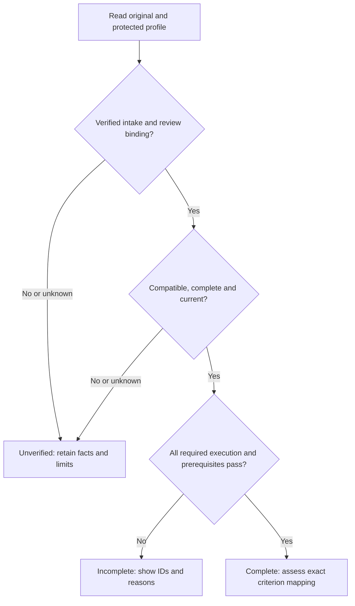

# pdd's own results for a run

Own `src/workflow-results.mjs`. A person and a checker must tell which results pdd recorded and which ones an agent typed (#2904). This module reads pdd's own saved results for one workflow run. It reads files only: it never runs a test, calls the interpreter, changes a file or stops a command.

Export `readRunResults({root, runDir, runId, since, baseBranch}, {env, capture, git, workspace})`. It returns a list, in this order, of what it finds:

- `pdd test`: the newest saved check batch (`intent` `check`) in the runtime state folder (`PDD_STATE_DIR`, else `~/.pdd/runtime`, then `batches/<BATCH>/`) whose original batch is admitted by the supplied canonical `ports.workspace` read binding (same-root or associated original, retaining original producer and stage) and whose `created_at` is at or after `since` (epoch ms). Its result is the `summary_line` of its `summary.json` and each distinct per-Story `summary_line` (else `result not saved (the check did not finish)`). For an associated original, determine `source` compatibility against the returned original stage and `sourceAnchor`, using the owner's exact source readers for the full selected tests; a matching saved source gives `current` at that stage, a mismatch gives `changed`, and an unavailable anchor gives `unknown`. Keep that original stage/anchor with the result. For ordinary same-root/current evidence, retain `capture(root, {tests, appMap: null})`: matching the batch's `source_sha256` gives `current`, a difference gives `changed`, else `unknown`, with no new run or association. A compatible frozen PR 1 result remains historical PR 1 evidence, never current-code proof. `engine` is the first known row `engine_sha` (12 characters) and `model` the first known `requested_model`, when known. A cached row (a pass that `pdd test` reused) keeps its identity only in `cache_identity`: when no row has a known direct value, use the first known `cache_identity.engine_sha` or `cache_identity.requested_model` of a row whose `cache_identity` is an object, and set `engineCached` or `modelCached` to true. A value is known when it is a nonblank string other than `unknown`. `requests` keeps every row's `request_ids` and `reports` every row's `report_url` (http or https), each once and with no cap, so a reader can trace the result to every saved report. It also keeps `sourceSha256` (the batch's full `source_sha256`, else null) and `tests` (the sorted complete selected test paths), so status can check the source again later.
- `pdd lint`: the newest saved lint batch (`intent` `lint-only`) under the same rules. Its result is `Lint: N of M tests pass. 0 AI calls.` when the lint ended, else `Lint: result unknown (the lint did not finish).` `requests` keeps the batch's `lint.request_ids`.
- `pdd workflow prove`: `<runDir>/old-code-proof.json` when the file exists, with the file time. pdd judges it with the PR renderer's own `judgeOldCodeProof` ([PR evidence](workflow-pr-evidence.prompt.md)), passing `runId`, `since` as `startedAt`, `git rev-parse --verify HEAD^{commit}` in `root` as the head and `git merge-base HEAD refs/remotes/origin/<baseBranch>` as the base (empty when `baseBranch` is unknown or the read fails; pdd does not fetch here). Its `line` is the result and its `status` gives `state`: `current` for an outcome, else `unavailable` or `stale`. So a step record and a PR top always say the same thing about a proof, a base that cannot be read is never current, and a missing file gives no result. None of these stops a command.

Before asking the canonical read-only `workspace` binding to admit a saved batch, exclude batches whose `created_at` is invalid or older than `since`, and batches whose intent is neither `check` nor `lint-only`. Every remaining candidate, including an alternate producer, still receives full canonical admission; do not reject it merely for a different root. Keep newest selection and existing tie behavior, source states, original stage and anchor, and ordinary same-root changed/unknown fallback. This ordering avoids repeated expensive workspace inventories for unrelated historical batches: thousands of old batches can each cause an inventory of many runs. It introduces no cross-command cache or new eligibility rule.

Skip unreadable, foreign, malformed or older records without a warning. Batch names match `YYYYMMDD-HHMMSS-xxxx`. Clean each shown value to one line, and write `pdd-workflow:` inside it as `pdd-workflow\u003a`, so saved text never makes an ownership marker.

Export `resultLines(results, {kinds})`. Each result becomes one line that starts with `pdd result: `: `pdd result: KIND (batch B, ISO time, source S, engine E[ (cached)], model M[ (cached)], requests R…, head H): RESULT[; STORY LINE…][; Report: URL (report links expire after 7 days)…]`, leaving out unknown facts. For an associated result, render its original stage beside source; label `pr1` as `PR 1 (historical)`, even when its frozen source is compatible. Never describe that result as a current-code pass. A line shows at most the first 10 requests and the first 10 report links; when there are more, it ends with `; K more requests and L more reports not shown (all in the run record)` (singular for one; naming only the kinds that have more), so nothing is dropped in silence. Export `usableResult(result)`: false only for a prove result that is not `current`. `kinds` limits the kinds shown. With nothing to show, the one line is `noResultLine(kinds)`: `pdd result: none. pdd has no pdd test, pdd lint or pdd workflow prove result of its own for this run (pdd:no-verdict).`, naming only the selected kinds. Also export `PDD_RESULT` (`pdd result`) and `NO_VERDICT` (`pdd:no-verdict`).

Export `checkCause(rows)` and `savedCheckCause(batch, {env})`: why a saved check has no verdict, so a run waits for Runtime only for a service cause (#3039). `savedCheckCause` reads `batches/<BATCH>/summary.json` rows, else `batch.json` rows, in the same state folder. A name that is not a batch gives `none`. A named batch whose rows cannot be read gives `unknown`, and so does a check whose `batch.json` still has a `ready`, `waiting`, `sending`, `queued` or `running` row, or a `summary.json` whose row states differ from the `batch.json` rows of the same test and Story (an interrupted `pdd test --retry` left the old summary). It reads files only. `checkCause` judges the rows that did not pass:

| Rows | Cause |
| --- | --- |
| none | `none` |
| all passed | `passed` |
| a `failed` row; a `refused` row with no code or a code other than `graph-provider-failure` and `graph-uncertain-child-dispatch` (a file rule); or a step time limit: a `time_limit` field, a `step_timeout` code, or an AI-service code whose words name a timeout, time limit or `took more than N minutes and was stopped` (split the step) | `issue` |
| a `not_run` or `unknown` row whose note or reason code is `blocked` or `auth-required`, or whose note, reason or `why` says `(HTTP 401)`, `(HTTP 403)` or `gh auth login` (a Runtime 401 with any error code), unless its note or reason says `Try again in a minute` | `access` |
| every other row is `refused` with an AI-service code, `not_run` (also pdd's temporary PDD Cloud answer, a `blocked` note that says `Try again in a minute`: a 503 `cloud-unavailable`), or `unknown` that names `graph-provider-failure` | `service` |
| anything else (an unknown outcome, a check still queued or running) | `unknown` |

Export `checkVerdictSince({root, since}, {env})` for the Autopilot test wake: true when a `check` batch of this worktree (`batch.json` root, compared by real path) has a `passed` or `failed` row whose `ended_at` is at or after `since`. A cached pass or a read of an older answer has no new `ended_at`, so it is no proof. It reads files only.

## Native profile and criterion assessment (draft)

The existing [preflight capture owner](runtime-preflight.prompt.md#source-capture)
remains authoritative for the supplied capture callback; this link is navigation.
This module also owns the shared native judgment for
[profile completeness](../../user_stories/native-validation-profile.md) and
[criterion support](../../user_stories/native-criterion-evidence.md). These links
are navigation only. Preserve all existing exports and saved-result behavior.
Generic `usableResult` does not establish native proof. Lint, workflow and PR
consumers must use this single assessment; they must not invent another policy.
`readRunResults` appends native evidence records selected from that run's native
evidence history after its existing result kinds. Each has `kind:"native evidence"`,
original saved time/source/stage and the same assessment, including proof origin,
criteria, references and limits. `resultLines` renders that distinct kind without
changing existing Runtime/lint/prove lines or their counts. A native record with
no current proof remains visible with its reason and cannot become a usable
current-pass claim through generic `usableResult`.

New public module function
`assessNativeEvidence({root,runDir,runId,profileId,storyPath}, {readNativeContext})`
returns the assessment below. It calls the injected read-only
`readNativeContext` once with these selectors; its Runtime resource is
`native.read_context`. The native default is this module's `readNativeContext` below. It obtains
originals and derives checked facts; it does not accept a stored assessment as
authority. This is a production assessment/read boundary for lint and
workflow consumers. Selector runId/profileId/storyPath must match the reader's
saved association, protected profile and current Story. A foreign or unknown
association yields unverified/unknown without fallback. No read executes tests, fetches, probes, downloads, repairs
fixtures, asks for permissions, approves, advances workflow or writes.



Unverified results retain failure, skip and missing observations. An earlier pass
never masks the selected current report. This coverage judgment does not change
ordinary process exit or add a merge, publication or all-project-test gate.

<details>
<summary>Original intake, report interpretation and protected requirements</summary>

### Original evidence route and admission owner

This module owns native report interpretation and admission. New public module
function `prepareNativeEvidence({root,runDir,runId,summaryFile}, ports={})` reads
an import descriptor and returns `{originals,record,assessment}` for the existing
workflow evidence writer. It changes no file. New public module function
`readNativeContext({root,runDir,runId,profileId,storyPath}, ports={})` reads saved
originals and reconstructs the context for `assessNativeEvidence`. Both use the
same checks below. The default assessor calls this reader. A caller-injected
`readNativeContext` is an outside port for supplied facts, as in the synthetic
scenarios; it does not remove any default-reader obligation.

Use the existing `pdd workflow evidence ISSUE --summary FILE` route. A native
FILE is a descriptor with `schema:"pdd.native-evidence-import.v1"`, `profileId`,
`storyPath`, and `originals:[{path,role}]`; optional `baseline` names a separate
descriptor. Roles are `report`, `source`, `selection`, `execution`, `fixture` or
`gate`. Paths resolve from FILE's directory to existing local regular files,
under the existing evidence-file safety rules. Require one unambiguous report.
Source/fixture/gate records are original companion evidence when available,
never newly typed success substitutes. A descriptor references bytes; its
fields, agent annotations, `verified` flags and origin claims prove nothing.
Keep every original byte unchanged, with original filename/report identity,
runner/version, source, stage, time and limits. Store the descriptor, original
copies and derived admission record separately in the run's existing append-only
evidence history. Do not re-encode an old report as a PDD capture. Unavailable
originals remain unavailable; do not run a replacement command.

The default reader must obtain and recheck the following finite facts through
injected native `files`, `source`, `approvals` and `workspace` adapters. Defaults
use existing local file/Git/journal/run readers. No supplied normalized snapshot,
stored `verified` value or reference string is a substitute:

1. Obtain original report and companion bytes from the owned evidence record,
   or from the descriptor during preparation. Check readable regular-file
   identity and retained-byte agreement. Identify a PDD-owned capture only from
   its saved command/capture association. Otherwise identify imported external
   machine evidence from a parseable runner result; plain prose, summaries and
   agent-authored result assertions remain notes. Parsing does not authenticate
   a runner or speaker.
2. Obtain the selected run/repository, producer root, exact selected test paths,
   stage and source anchor from the actual `readEvidenceEligibility` binding supplied as
   `ports.workspace` below. Pass selectors from original evidence/owned association,
   never desired authority from FILE; revalidate the returned owner and stage. Same-worktree eligibility and alternate-root registration keep
   that owner's existing rules. Missing, contradictory or ineligible association
   cannot establish admission. Do not infer association from equal hashes,
   nesting or a shared remote. Frozen PR 1 evidence keeps that original stage.
3. Resolve the reviewed profile snapshot below. Bind selected implementation,
   native test inventory and requirements to actual source bytes using the
   existing capture/Git readers, including declared native implementation/test
   paths, not only the Runtime upload. Compare those observations with the
   original source/capture references. Bind test names/locations to that selected
   test source. A report's asserted source/profile identity alone is unverified.
4. Parse the original format under the reviewed reader rules below. Preserve
   each occurrence, outcome, skip reason and available selection/start/completion
   fact. Check terminal/completeness evidence against that format's actual
   records. Aggregate totals never supply absent rows, starts or selection.
5. Resolve every relevant original fixture/artifact and gate reference. Check
   its actual observed identity, result, source and stage against the reviewed
   requirement and report occurrence. A path, expected value, report flag or
   copied reference cannot establish a verified fixture or executed gate.

The derived record lists original references and, for each check, the checked
facts, mismatches, unavailable facts and validation limits. Contradiction is
unverified; unavailable detail stays unknown. `intake.admission` is `verified`
only when these checks establish the report's origin/association and its claimed
identities; unknown optional observations stay explicit. Required unknown facts
still prevent acceptance under the assessment rules. Qualified external evidence
means checked original evidence with these exact limits. It never means PDD
observed execution or authenticated an external speaker. On read, recheck
originals, association, review and source; a saved prior judgment is no authority.
No new cryptographic guarantee, receipt-policy engine or global gate is added.

### Read existing runner reports

There is no required Node producer. The reviewed profile names the original
`reportFormat` and its interpretation. Support `junit-xml`, `tap13` and structured
`json` originals, as well as optional `pdd.native-node-report.v1` captures.
For structured JSON, the profile's `reader` gives JSON Pointers for the report
identity/versions, source references, occurrence array and each row's ID,
selection, start, terminal outcome and skip reason, plus explicit outcome-value
mapping. `reader` is `{rows,fields,outcomes}`: rows is an absolute JSON
Pointer to the original occurrence array; fields maps the named normalized
report fields to absolute pointers and observation fields to row-relative
pointers; outcomes maps original literal outcome strings to the defined outcome
names. Optional fields identify completeness, gate and fixture reference rows.
Preserve pointer-to-original-row references in the admission record. No mapping
may assert constants as observed facts. Pointers extract data only: no executable parser code or arbitrary evaluation.
Missing fields have unknown meaning; a pointer cannot manufacture a fact.

JUnit reads suite/testcase identity, file/class/name/location where present,
failure/error/skipped records and original properties/references. An otherwise
terminal testcase records reported completion/pass under that runner's declared
JUnit semantics. TAP reads version, nested test/result identity, plan, terminal
results, skip/TODO directives and bailout/truncation. A plan is not selection or
execution; a skipped/TODO result is not an executed pass. For both, bind names to
reviewed native IDs; absent/ambiguous locations remain unresolved. A terminal
executed outcome can establish start only when the identified runner/format
semantics entail execution; record that interpretation and its external limit.
Missing runner/version, source, start, complete selection or fixture information
stays unknown. Preserve any supplied aggregate with its unit; never invent its
underlying rows. XML entity/network retrieval is not part of reading a report.

Other or ambiguous formats retain original bytes and known observations, with
`incompatible`/unknown interpretation and explicit unsupported fields. They need
an identified reader contract before proof; they do not need a new execution or
PDD producer. The private retained report format/bytes are unavailable here.
These parser choices do not claim that the actual retained pair was read or
that every external format can be authenticated.

The optional `pdd-node-test-events` major-1 capture uses
`pdd.native-node-report.v1` and original Node TestsStream events plus its saved
selection/process envelope. Retain event order and locations. Enqueue means
discovery; dequeue plus an unqualified terminal pass can establish executed
completion; test:start is reporting order only. Skip/TODO never passes required
execution. Do not rely on later testId/parentId fields. Unresolved nested
file/name/location identity stays unknown. Capture is optional and unimplemented
by this draft; importing an older external report never assigns this producer.

The reader returns `{content}`: UTF-8 JSON for
`pdd.native-assessment-context.v1`. This internal read transport is not a CLI
option, pdd.json key, bindings key or user-controlled admission token. Required
fields are `schema,runId,protected,candidate,story,intake,report,baseline`.
Report/baseline may be null. Judge unavailable Story facts separately below;
missing/null/unknown Story facts do not invalidate a readable profile snapshot.
Unreadable, malformed or unknown essential profile content
returns unverified/unknown, never a native pass. Ignore claimed origin or admission fields
inside any report or wrapper. The owner derives intake facts from originals and
the independent run, source, workspace and approval readers above.

- `protected` has `profileId,requirementsId,promptPath,sourceRoot,approvalRef,
  review,requiredIds,requiredGates,fixtures,mappings`. Review is `approved`,
  `missing` or `unknown`. Requirements come from a matched approved prompt
  snapshot, including newly approved bytes in the workflow worktree. Match
  repository-relative path and prose identity with the existing common-directory
  approval journal. For workflow gate approval also match its saved prompt
  snapshot/decision; standalone approval uses its existing journal event without
  inventing a gate. Resolve the actual
  bytes from that worktree or its retained stage snapshot; the journal's hash
  alone cannot reconstruct missing content. `sourceRoot` remains the repository
  approval-configuration home, not the sole location of approved prompt bytes.
  ApprovalRef names the matching existing event; it does not authenticate a
  speaker. Do not add approval fields or edit the journal during reads.
  Missing, changed or unavailable matched bytes cannot bind current proof.
  Keep the last matched protected inventory until matching later review accepts
  a replacement. Candidate-local JSON or prose cannot lower it. Retained older
  bytes can explain historical requirements without proving current source.
- Required IDs and gates are distinct ordered inventories, not counts. Fixtures
  are `{id,artifactId}`. Mappings are
  `{storyPath,criterionId,criterionText,nativeIds}`. Every mapped ID must be a
  required ID in the named profile. All mapped tests are jointly required.
  This draft does not infer alternatives or thresholds from names.
- `candidate` has `sourceId,implementationId,testsId,requirementsId`. Capture
  Git-visible source including native implementation, selected tests and
  requirements. The Runtime upload identity alone cannot establish native
  implementation identity. Candidate-local requirement edits set
  `requiresReview`; retain the protected inventory until matching review
  accepts a replacement. No source edit silently lowers required coverage.
- `story` has `path,criteria:[{id,text}]`, read from the current selected Story.
  Missing, unknown or empty Story facts cannot establish whole-Story support.
  They do not discard an otherwise valid profile completion fact.
  Mapping identity is Story path AND criterion ID AND exact current criterion
  text. An index alone cannot preserve a mapping after the criterion changes.
- `intake` has `origin,admission,originalRef,verificationRef,limits`. Origin is
  `pdd-observed,external-machine,agent-note,modeled,unknown`; admission is
  `verified` or `unverified`. These are derived owner observations, separate
  from report/wrapper assertions. The finite admission checks above supply
  them; the normalized resource reply only transports their result. PDD-observed
  requires its saved command/capture. External-machine keeps the checked and
  unchecked facts. An unavailable chain stays unverified. Reuse preserves
  original origin, references, source/stage and limits.
  Optional `stage` is the independently resolved original `current` or `pr1`
  association stage; unavailable stage is `unknown`. `sourceRef` identifies the
  checked original source record. Existing contexts without these facts retain
  unknown values; the native default cannot omit an unavailable-stage limit.


The proposed profile declaration is one fenced JSON object inside a disclosure
whose summary is `Native validation profile: PROFILE_ID` in the owning module
prompt. It is part of approved prompt prose, not the Runtime interface block.
Its fields are `schema:"pdd.native-profile.v1",profileId,reportFormat,requiredIds,
requiredGates,fixtures,mappings,sourcePaths,testPaths`, with the list/row shapes
defined above. SourcePaths/testPaths are exact safe authored-relative path arrays
for the native implementation and native tests, captured with required closure.
ReportFormat identifies the original parser above; optional `reader` supplies
the structured-JSON interpretation. An explicit stable anchor
`native-validation-profile-PROFILE_ID` identifies the declaration for the
Story's native-owner link. Native source/test paths needed for source binding
are part of the reviewed profile, separate from Runtime bindings.
Require at least one required test or gate. Multiple declarations for one
profile or ambiguous mappings leave it unverified. The reader derives
requirementsId from prompt path, profileId and the matching approved prose
identity; an authored requirementsId cannot substitute for that binding.
The declaration and reader syntax are draft technical representation.
Review binds requirements, never execution. The existing workflow journal and
workspace owner remain authoritative; replay and Runtime import alone do not
supply native admission. The native default and intake described here still
require implementation and native verification.

Originals created before PDD profile support need no PDD profile identifier or
requirements digest. The owner binds the internal profile/requirements selectors
to the reviewed snapshot and checked original source/test selection; mark that
binding as derived in its record. Do not insert it into the original or claim
the original runner recorded it. If the originals and source readers cannot
establish the relationship, it stays unknown.

The report has `format,producer,producerVersion,runner,runnerVersion,
runtimeVersion,profileId,requirementsId,source,capture,complete,exitCode,gates,
prerequisites,observations`. Source has the four candidate identity fields.
This is the internal normalized view; `format`, producer and runner remain
those of the original, never of normalization. Versions/identities must be known
and nonblank for current proof. For optional Node capture, `capture` is
`{selectionComplete,terminalSeen,processEnded,eventRef}`; all three must be true
and eventRef checked against original saved events. External reports use their
own original terminal/completeness records and companion selection/execution
evidence. The reader may represent those observations in the same internal
fields while keeping their original format and references. Unknown capture
detail stays unknown; typed `complete:true` cannot repair missing terminal or
selection evidence. A complete report must account for the selected scope and
its terminal outcomes; ordinary exit zero alone establishes neither.

Gates are `{id,outcome}`, with `passed,failed,skipped,unknown`.
Prerequisites are `{id,artifactId,state,verificationRef}`, with state
`verified,missing,incompatible,unknown`. Verified requires a matching observed
artifact identity and verification reference from capture/intake. A path,
expected outcome or self-claimed digest does not verify an artifact. Do not put
private fixture bytes or secret paths in public output.

Observations are `{occurrenceId,testId,selected,started,outcome,skipReason}`.
Selected/started are Boolean or null (unknown). Outcome is
`passed,failed,skipped,todo,not-completed,unknown`; skipReason is text or null.
Retain original occurrence IDs, or assign stable row references in original
order without claiming discovery was observed. Test identity binds
repository-relative file, full nested name and source declaration location.
Ambiguous identity stays unknown. A pass requires actual completed execution;
false or unknown started cannot establish it. A required todo/unknown start is
unknown execution, not a pass. Preserve unknown selection without inventing it.
Optional tests are observations outside the protected required inventory.

</details>

<details>
<summary>Assessment, prior coverage and exact criterion results</summary>

Return the Runtime fields with these rules. ID arrays follow protected order
where defined; otherwise use first observation order. Deduplicate ID lists,
never original occurrences. Keep all observations and reasons.

- ReceiptState is `missing` for no report, `incompatible` for unsupported
  format/interpretation (or incompatible PDD capture producer), `unknown` for
  malformed/unknown essential facts, `partial` without complete original scope
  and terminal evidence, else `accepted`. A captured failed test
  does not make a report partial. SourceState is `current` only if every
  candidate source field and profile/requirements identity matches the report
  and protected requirements; known difference is `stale`, absent identity
  is `unknown`.
- MissingIds are required IDs with no observation. FailedIds and skippedIds
  retain required IDs with any such occurrence. UnknownIds retain required IDs
  with todo, unknown, not-completed, unknown/false start on a pass or
  contradictory facts. Any unsuccessful required occurrence prevents complete
  coverage, even if another passed. DuplicateIds list IDs with multiple
  occurrences; duplicate passes never replace another missing ID. Label
  occurrenceCount and uniqueIdCount separately; use null without an inventory.
  OptionalSkippedIds and original observations retain optional skips/reasons.
- Return Gates in protected required-gate order as `{id,outcome}`. Return
  Prerequisites in protected fixture order as
  `{id,expectedArtifactId,artifactId,state,verificationRef}`. Preserve observed
  artifact identity and original verification reference; use `unknown` when
  absent. State is `verified` only for a matching artifact whose reference is
  verified through admitted original capture/intake, never a report flag alone.
  Retain explicit observed `missing` or `incompatible`; absent evidence or an
  unverified claimed success is `unknown`. Gate outcome comes from admitted
  original execution; absent/unverified evidence is `unknown`. References alone
  grant no trust. These rows expose successful evidence as well as problems,
  with the same origin, original references and limits as the assessment.
  UnexecutedGates are required gates absent or not passed.
  PrerequisiteProblems are required fixtures without matching verified evidence.
  Required skip, missing prerequisite or unexecuted gate stays visible at exit
  zero. Do not infer missing fixture facts from an expected result.
Verified intake also requires origin `pdd-observed` or `external-machine`
with known originalRef and verificationRef. A verified flag alone cannot
authorize another origin or absent provenance. RequiresReview is true when
protected review is absent/unknown or candidate requirements differ; otherwise
false. On an unreadable/malformed snapshot, use empty ID/observation/criterion
arrays (including Gates and Prerequisites), null counts and unknown
identity/origin; return unverified profile,
unknown receipt/source, no proof and incomparable/unknown comparison.

- ProfileState is `unverified` if review/intake is unverified, requirements
  need review, source is not current or receipt is not accepted. Otherwise it
  is `incomplete` for any required ID/gate/prerequisite problem or process
  failure, else `complete`. Optional skips alone do not prevent complete.
  ProfileNativeProof is `pdd-observed` or `qualified-external` only for a complete
  profile with corresponding verified origin; else `none`. Agent notes,
  modeled physical ports, typed counts, declarations, lint/schema and replay
  cannot establish it. Always retain origin and limits.
- Identity retains candidate source/implementation/tests/requirements,
  protected prompt/approval, original/verification references and producer,
  report, runner/runtime versions. Also return original `stage` and `sourceRef`
  from independently checked intake; use `unknown` for unavailable values.
- Criteria is empty when current Story/criteria facts are unavailable; never
  invent criteria from old mappings. Otherwise it has one row per current
  Story criterion, in authored order:
  `{id,text,state,nativeIds,reason}`. Determine the mapping first: no mapping
  is `unmapped`; same Story/ID with changed text is `criterion-changed`;
  empty, ambiguous or out-of-profile mapping is `invalid-mapping`.
  With a valid mapping, unverified profile gives `profile-unverified`;
  incomplete profile gives `profile-incomplete`; complete profile gives
  `supported`. State is `supported` only for that last reason, else
  `unproved`. Preserve mapped IDs and observed outcomes even without proof.
- StoryNativeProof equals ProfileNativeProof only when the current selected
  Story has known path and nonempty criteria, every criterion has known nonblank
  ID/text with no duplicate identity, and every current criterion row is
  `supported`. Otherwise it is `none`, including missing/unknown/empty Story
  facts and unmapped, changed or invalid criteria. Preserve the exact criterion
  reasons and the legitimate complete-profile fact. Lint/workflow/PR consumers
  may label this Story natively proved only from StoryNativeProof, with its
  `pdd-observed` or `qualified-external` origin/limits; ProfileNativeProof alone
  never authorizes that label. This result/display rule adds no workflow gate.
- Baseline, when supplied, has its own `intake,report`. Compare only verified,
  complete current and prior original reports with the same reviewed requirements, required
  scope, producer/report interpretation and known compatible runner/runtime
  versions (v1 requires matching versions). Its source may name an earlier
  candidate; it remains historical. Otherwise Comparison.state is
  `incomparable` with reason `unknown,unverified,partial,scope-or-version`;
  absent baseline is `absent` with reason `none`. A comparable baseline
  gives state `comparable`, reason `none`, and LostIds for every previously
  passed distinct ID that no longer has exclusively executed passing
  occurrences, including missing IDs. Changes has `{id,before,after}`:
  before is `passed`; after is `missing` or distinct observed outcome names
  joined by commas in observation order. Unknown start on a claimed pass
  produces after `unknown`. Equal totals never imply equal coverage.
  No baseline replaces current evidence or establishes current proof.

Qualified external proof means the admitted original supports the reviewed
scope with stated validation limits. It does not mean PDD observed the command
or independently reproduced a physical effect. The synthetic Runtime cases
judge a supplied read boundary; they execute no filesystem, Git, pane or device
operation. Later native tests must replay these cases through this public
boundary and separately verify capture, source/approval lookup, original intake
and relevant physical effects.

</details>

The [workspace evidence owner](workflow-runner.prompt.md#read-evidence-eligibility) owns the read binding supplied below. This is navigation; the supplied interface closes this reader without loading its caller.

## Dependencies

- Existing local batch readers supply the `batch.json`/`summary.json` fields and original receipts declared above; the saved record is data, not an eligible/pass assertion.
- Required supplied `ports.workspace` is the actual synchronous `src/workflow-runner.mjs` module function `readEvidenceEligibility({root,producerRoot,tests,source_sha256,runId=null,stage=null}, ports={})`, returning `{state,reason,runId,repo,producerRoot,tests,stage,sourceAnchor,source_sha256}`. State is `eligible`, `ineligible` or `unavailable`; only eligible resolves the owned identity and `current`/`pr1` stage/anchor. Null unresolved fields and reasons cannot authorize a result. The owner supplies this local read without registration/import or writes; this module consumes it without a second association policy.
- Existing native `capture(root,{tests,appMap:null}) -> {sha256}` is the supplied preflight `captureSource` callback and default. It owns safe complete selection/capture; this module compares the returned hash and never recreates that policy.
- [Old-code proof](workflow-prove.prompt.md): required context for `old-code-proof.json`.
- [PR evidence](workflow-pr-evidence.prompt.md): required for `judgeOldCodeProof`, the one freshness rule for a saved proof.

- [Approval policy](approval-policy.prompt.md): required for configuration-root
  policy and the existing path/prose approval journal. Native review also uses
  the saved gate snapshot/decision supplied by the run reader.
- Native `files` supplies original bytes and safe identity; `source` supplies
  selected native implementation/test bytes and current identities; `approvals`
  supplies journal events, saved gate snapshot and actual matching prompt bytes.
  `workspace` is the same actual `readEvidenceEligibility` binding required above
  for native intake and saved batch reads. Its eligible result supplies owned
  run/repository, producer root, full tests/source and original stage/anchor;
  ineligible/unavailable results retain reasons and establish no admission. These are real outside-reader boundaries for the
  production intake, not report-controlled JSON. The runner supplies association
  eligibility under its existing workspace rule; this module never registers or
  reimplements association. The callback contract here is the required supplied
  interface; loading the runner/client caller is unnecessary and would cycle.
  Native original-byte intake, parser/source binding and association/approval
  lookup have no complete Runtime binding in this draft. `native.read_context`
  fakes only the derived context for assessment, never those physical checks.

<details><summary>Runtime interface</summary>

```json
{
  "status":"draft",
  "prose_sha256": "b89995fd24760bbda3c1f12b33cc08ed577ed788dc1b8de42cc003264a0b6f7b",
  "entries": [{"operation":"assessNativeEvidence","input_schema":{"type":"object","properties":{"root":{"type":"string"},"runDir":{"type":"string"},"runId":{"type":"string"},"profileId":{"type":"string"},"storyPath":{"type":"string"}},"required":["root","runDir","runId","profileId","storyPath"],"additionalProperties":false},"result_schema":{"type":"object","properties":{"profileId":{"type":"string"},"profileState":{"type":"string"},"sourceState":{"type":"string"},"receiptState":{"type":"string"},"origin":{"type":"string"},"requiresReview":{"type":"boolean"},"requiredIds":{"type":"array","items":{"type":"string"}},"missingIds":{"type":"array","items":{"type":"string"}},"failedIds":{"type":"array","items":{"type":"string"}},"skippedIds":{"type":"array","items":{"type":"string"}},"unknownIds":{"type":"array","items":{"type":"string"}},"unexecutedGates":{"type":"array","items":{"type":"string"}},"prerequisiteProblems":{"type":"array","items":{"type":"string"}},"optionalSkippedIds":{"type":"array","items":{"type":"string"}},"duplicateIds":{"type":"array","items":{"type":"string"}},"occurrenceCount":{"oneOf":[{"type":"integer","minimum":0},{"type":"null"}]},"uniqueIdCount":{"oneOf":[{"type":"integer","minimum":0},{"type":"null"}]},"observations":{"type":"array","items":{"type":"object","properties":{"occurrenceId":{"type":"string"},"testId":{"type":"string"},"selected":{"oneOf":[{"type":"boolean"},{"type":"null"}]},"started":{"oneOf":[{"type":"boolean"},{"type":"null"}]},"outcome":{"type":"string"},"skipReason":{"oneOf":[{"type":"string"},{"type":"null"}]}},"required":["occurrenceId","testId","selected","started","outcome","skipReason"],"additionalProperties":false}},"identity":{"type":"object","properties":{"sourceId":{"type":"string"},"implementationId":{"type":"string"},"testsId":{"type":"string"},"requirementsId":{"type":"string"},"profilePrompt":{"type":"string"},"profileApproval":{"type":"string"},"originalRef":{"type":"string"},"verificationRef":{"type":"string"},"producer":{"type":"string"},"producerVersion":{"type":"string"},"reportFormat":{"type":"string"},"runnerVersion":{"type":"string"},"runtimeVersion":{"type":"string"},"stage":{"type":"string"},"sourceRef":{"type":"string"}},"required":["sourceId","implementationId","testsId","requirementsId","profilePrompt","profileApproval","originalRef","verificationRef","producer","producerVersion","reportFormat","runnerVersion","runtimeVersion","stage","sourceRef"],"additionalProperties":false},"criteria":{"type":"array","items":{"type":"object","properties":{"id":{"type":"string"},"text":{"type":"string"},"state":{"type":"string"},"nativeIds":{"type":"array","items":{"type":"string"}},"reason":{"type":"string"}},"required":["id","text","state","nativeIds","reason"],"additionalProperties":false}},"comparison":{"type":"object","properties":{"state":{"type":"string"},"reason":{"type":"string"},"lostIds":{"type":"array","items":{"type":"string"}},"changes":{"type":"array","items":{"type":"object","properties":{"id":{"type":"string"},"before":{"type":"string"},"after":{"type":"string"}},"required":["id","before","after"],"additionalProperties":false}}},"required":["state","reason","lostIds","changes"],"additionalProperties":false},"limits":{"type":"array","items":{"type":"string"}},"profileNativeProof":{"type":"string"},"storyNativeProof":{"type":"string"},"gates":{"type":"array","items":{"type":"object","properties":{"id":{"type":"string"},"outcome":{"type":"string"}},"required":["id","outcome"],"additionalProperties":false}},"prerequisites":{"type":"array","items":{"type":"object","properties":{"id":{"type":"string"},"expectedArtifactId":{"type":"string"},"artifactId":{"type":"string"},"state":{"type":"string"},"verificationRef":{"type":"string"}},"required":["id","expectedArtifactId","artifactId","state","verificationRef"],"additionalProperties":false}}},"required":["profileId","profileState","sourceState","receiptState","origin","profileNativeProof","requiresReview","requiredIds","missingIds","failedIds","skippedIds","unknownIds","unexecutedGates","prerequisiteProblems","optionalSkippedIds","duplicateIds","occurrenceCount","uniqueIdCount","observations","identity","criteria","comparison","limits","storyNativeProof","gates","prerequisites"],"additionalProperties":false},"errors":[]}],
  "calls": [],
  "resources": [{"name":"native","kind":"port","access":"read","operations":[{"name":"read_context","access":"read","arguments_schema":{"type":"object","properties":{"root":{"type":"string"},"runDir":{"type":"string"},"runId":{"type":"string"},"profileId":{"type":"string"},"storyPath":{"type":"string"}},"required":["root","runDir","runId","profileId","storyPath"],"additionalProperties":false},"result_schema":{"type":"object","properties":{"content":{"type":"string"}},"required":["content"],"additionalProperties":false}}]}],
  "limits": {"max_steps":12,"max_model_calls":6},
  "conventions": []
}
```
</details>
