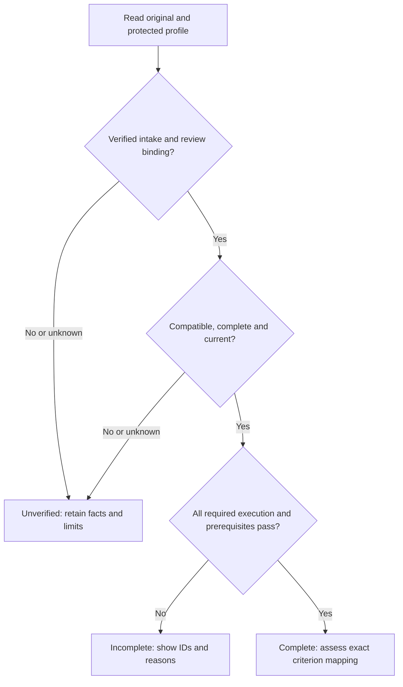

# pdd's own results for a run

Own `src/workflow-results.mjs`. A person and a checker must tell which results pdd recorded and which ones an agent typed (#2904). This module reads pdd's own saved results for one workflow run. It reads files only: it never runs a test, calls the interpreter, changes a file or stops a command.

Export `readRunResults({root, runDir, runId, since, baseBranch}, {env, capture, git})`. It returns a list, in this order, of what it finds:

- `pdd test`: the newest saved check batch (`intent` `check`) in the runtime state folder (`PDD_STATE_DIR`, else `~/.pdd/runtime`, then `batches/<BATCH>/`) whose `batch.json` names the same real folder as `root` and whose `created_at` is at or after `since` (epoch ms). Its result is the `summary_line` of its `summary.json` and each distinct per-Story `summary_line` (else `result not saved (the check did not finish)`). `source` is `current` when `capture(root, {tests, appMap: null})` of the batch's selected tests gives the batch's `source_sha256`, `changed` when it differs, else `unknown`. `engine` is the first known row `engine_sha` (12 characters) and `model` the first known `requested_model`, when known. A cached row (a pass that `pdd test` reused) keeps its identity only in `cache_identity`: when no row has a known direct value, use the first known `cache_identity.engine_sha` or `cache_identity.requested_model` of a row whose `cache_identity` is an object, and set `engineCached` or `modelCached` to true. A value is known when it is a nonblank string other than `unknown`. `requests` keeps every row's `request_ids` and `reports` every row's `report_url` (http or https), each once and with no cap, so a reader can trace the result to every saved report.
- `pdd lint`: the newest saved lint batch (`intent` `lint-only`) under the same rules. Its result is `Lint: N of M tests pass. 0 AI calls.` when the lint ended, else `Lint: result unknown (the lint did not finish).` `requests` keeps the batch's `lint.request_ids`.
- `pdd workflow prove`: `<runDir>/old-code-proof.json` when the file exists, with the file time. pdd judges it with the PR renderer's own `judgeOldCodeProof` ([PR evidence](workflow-pr-evidence.prompt.md)), passing `runId`, `since` as `startedAt`, `git rev-parse --verify HEAD^{commit}` in `root` as the head and `git merge-base HEAD refs/remotes/origin/<baseBranch>` as the base (empty when `baseBranch` is unknown or the read fails; pdd does not fetch here). Its `line` is the result and its `status` gives `state`: `current` for an outcome, else `unavailable` or `stale`. So a step record and a PR top always say the same thing about a proof, a base that cannot be read is never current, and a missing file gives no result. None of these stops a command.

Skip unreadable, foreign, malformed or older records without a warning. Batch names match `YYYYMMDD-HHMMSS-xxxx`. Clean each shown value to one line, and write `pdd-workflow:` inside it as `pdd-workflow\u003a`, so saved text never makes an ownership marker.

Export `resultLines(results, {kinds})`. Each result becomes one line that starts with `pdd result: `: `pdd result: KIND (batch B, ISO time, source S, engine E[ (cached)], model M[ (cached)], requests R…, head H): RESULT[; STORY LINE…][; Report: URL (report links expire after 7 days)…]`, leaving out unknown facts. A line shows at most the first 10 requests and the first 10 report links; when there are more, it ends with `; K more requests and L more reports not shown (all in the run record)` (singular for one; naming only the kinds that have more), so nothing is dropped in silence. Export `usableResult(result)`: false only for a prove result that is not `current`. `kinds` limits the kinds shown. With nothing to show, the one line is `noResultLine(kinds)`: `pdd result: none. pdd has no pdd test, pdd lint or pdd workflow prove result of its own for this run (pdd:no-verdict).`, naming only the selected kinds. Also export `PDD_RESULT` (`pdd result`) and `NO_VERDICT` (`pdd:no-verdict`).

## Native profile and criterion assessment (draft)

This module also owns the shared native judgment for
[profile completeness](../../user_stories/native-validation-profile.md) and
[criterion support](../../user_stories/native-criterion-evidence.md). These links
are navigation only. Preserve all existing exports and saved-result behavior.
Generic `usableResult` does not establish native proof. Lint, workflow and PR
consumers must use this single assessment; they must not invent another policy.

New public module function
`assessNativeEvidence({root,runDir,runId,profileId,storyPath}, {readNativeContext})`
returns the assessment below. It calls the injected read-only
`readNativeContext` once with these selectors; its Runtime resource is
`native.read_context`. The native default reads saved originals and trusted
source facts. This is a production assessment/read boundary for lint and
workflow consumers. Selector runId/profileId/storyPath must match the reader's
saved association, protected profile and current Story. A foreign or unknown
association yields unverified/unknown without fallback. No read executes tests, fetches, probes, downloads, repairs
fixtures, asks for permissions, approves, advances workflow or writes.



Unverified results retain failure, skip and missing observations. An earlier pass
never masks the selected current report. This coverage judgment does not change
ordinary process exit or add a merge, publication or all-project-test gate.

<details>
<summary>Proposed producer, original evidence and protected requirements</summary>

**Draft format, not approved configuration.** The proposed first producer is
`pdd-node-test-events`, major version 1, with report format
`pdd.native-node-report.v1`. Its later native implementation captures the
[Node 22 TestsStream](https://nodejs.org/download/release/v22.18.0/docs/api/test.html#class-testsstream)
and a selection/process envelope. This producer is not shipped by this draft.
V1 parsing must retain event order and locations. Enqueue/dequeue and terminal
pass/fail observations have different meanings. A pass/fail event marked skip or
todo is not executed proof. Do not rely on later Node testId/parentId fields.
When file/name/location and hierarchy cannot resolve an ID, retain the event as
unknown. Enqueue records discovery, dequeue records execution scheduling, and terminal
pass/fail records the outcome. A dequeue plus an unqualified terminal pass can
establish executed completion; test:start is reporting order only. Selection,
start and completion detail unavailable from capture remains unknown. An
aggregate TAP total, replay manifest or typed JSON is not this machine report.
Other producers or incompatible major versions remain incompatible until reviewed.

The reader returns `{content}`: UTF-8 JSON for
`pdd.native-assessment-context.v1`. This internal read transport is not a CLI
option, pdd.json key, bindings key or user-controlled admission token. Required
fields are `schema,runId,protected,candidate,story,intake,report,baseline`.
Report/baseline may be null. Unreadable, malformed or unknown essential content
returns unverified/unknown, never a native pass. Ignore claimed origin fields
inside the original report; trust facts come from the separate intake record.

- `protected` has `profileId,requirementsId,promptPath,sourceRoot,approvalRef,
  review,requiredIds,requiredGates,fixtures,mappings`. Review is `approved`,
  `missing` or `unknown`. Requirements live in selected module prompt prose
  from the saved run's trusted sourceRoot, outside candidate-local edits. The
  reader matches that path and current prose identity with the existing prompt
  approval journal. ApprovalRef names the matching event; it does not
  authenticate a speaker. Missing/mismatched review cannot bind requirements.
  Arbitrary candidate profile JSON cannot supply that authority.
- Required IDs and gates are distinct ordered inventories, not counts. Fixtures
  are `{id,artifactId}`. Mappings are
  `{storyPath,criterionId,criterionText,nativeIds}`. Every mapped ID must be a
  required ID in the named profile. All mapped tests are jointly required.
  This draft does not infer alternatives or thresholds from names.
- `candidate` has `sourceId,implementationId,testsId,requirementsId`. Capture
  Git-visible source including native implementation, selected tests and
  requirements. The Runtime upload identity alone cannot establish native
  implementation identity. Candidate-local requirement edits set
  `requiresReview`; retain the protected inventory until matching review
  accepts a replacement. No source edit silently lowers required coverage.
- `story` has `path,criteria:[{id,text}]`, read from the current selected Story.
  Mapping identity is Story path AND criterion ID AND exact current criterion
  text. An index alone cannot preserve a mapping after the criterion changes.
- `intake` has `origin,admission,originalRef,verificationRef,limits`. Origin is
  `pdd-observed,external-machine,agent-note,modeled,unknown`; admission is
  `verified` or `unverified`. These are trusted reader observations, separate
  from report assertions. PDD-observed requires its saved command/capture.
  External-machine requires original machine bytes, explicit run/workspace
  association, checked source/producer/report identity and a verification record
  stating what was and was not checked. Parsing or a claimed origin cannot
  establish admission. An unavailable chain stays unverified. Reuse preserves
  original origin, references and limits.

The proposed profile declaration is one fenced JSON object inside a disclosure
whose summary is `Native validation profile: PROFILE_ID` in the owning module
prompt. It is part of approved prompt prose, not the Runtime interface block.
Its fields are `schema:"pdd.native-profile.v1",profileId,reportFormat,requiredIds,
requiredGates,fixtures,mappings`, with the list/row shapes defined above.
ReportFormat is `pdd.native-node-report.v1` for this first reviewed parser.
Require at least one required test or gate. Multiple declarations for one
profile or ambiguous mappings leave it unverified. The reader derives
requirementsId from prompt path, profileId and the matching approved prose
identity; an authored requirementsId cannot substitute for that binding.
This declaration syntax is a concrete draft choice for the person to review.

Reuse existing approval/source/result mechanisms. Review binds requirements,
not execution. The external intake verification route and producer/capture
design need person review before implementation; today's replay and Runtime
import do not supply them. Without those facts, this reader gives no native proof.

The report has `format,producer,producerVersion,runner,runnerVersion,
runtimeVersion,profileId,requirementsId,source,capture,complete,exitCode,gates,
prerequisites,observations`. Source has the four candidate identity fields.
Versions and identities must be known and nonblank. Runner is `node:test`;
the runtime version names the actual Node version. Complete requires the
selection envelope, terminal report marker and completed process capture.
Capture is `{selectionComplete,terminalSeen,processEnded,eventRef}`, with three
Boolean observations and a reference to original event bytes admitted with the
report. Complete requires all three true and a verified eventRef. Missing
terminal capture cannot be repaired by a typed `complete:true`.

Gates are `{id,outcome}`, with `passed,failed,skipped,unknown`.
Prerequisites are `{id,artifactId,state,verificationRef}`, with state
`verified,missing,incompatible,unknown`. Verified requires a matching observed
artifact identity and verification reference from capture/intake. A path,
expected outcome or self-claimed digest does not verify an artifact. Do not put
private fixture bytes or secret paths in public output.

Observations are `{occurrenceId,testId,selected,started,outcome,skipReason}`.
Selected/started are Boolean or null (unknown). Outcome is
`passed,failed,skipped,todo,not-completed,unknown`; skipReason is text or null.
Capture assigns distinct occurrence IDs at discovery. Test identity binds
repository-relative file, full nested name and source declaration location.
Ambiguous identity stays unknown. A pass requires actual completed execution;
false or unknown started cannot establish it. A required todo/unknown start is
unknown execution, not a pass. Preserve unknown selection without inventing it.
Optional tests are observations outside the protected required inventory.

</details>

<details>
<summary>Assessment, prior coverage and exact criterion results</summary>

Return the Runtime fields with these rules. ID arrays follow protected order
where defined; otherwise use first observation order. Deduplicate ID lists,
never original occurrences. Keep all observations and reasons.

- ReceiptState is `missing` for no report, `incompatible` for unsupported
  producer/format, `unknown` for malformed/unknown essential facts, `partial`
  without complete terminal capture, else `accepted`. A captured failed test
  does not make a report partial. SourceState is `current` only if every
  candidate source field and profile/requirements identity matches the report
  and protected requirements; known difference is `stale`, absent identity
  is `unknown`.
- MissingIds are required IDs with no observation. FailedIds and skippedIds
  retain required IDs with any such occurrence. UnknownIds retain required IDs
  with todo, unknown, not-completed, unknown/false start on a pass or
  contradictory facts. Any unsuccessful required occurrence prevents complete
  coverage, even if another passed. DuplicateIds list IDs with multiple
  occurrences; duplicate passes never replace another missing ID. Label
  occurrenceCount and uniqueIdCount separately; use null without an inventory.
  OptionalSkippedIds and original observations retain optional skips/reasons.
- UnexecutedGates are required gates absent or not passed.
  PrerequisiteProblems are required fixtures without matching verified evidence.
  Required skip, missing prerequisite or unexecuted gate stays visible at exit
  zero. Do not infer missing fixture facts from an expected result.
Verified intake also requires origin `pdd-observed` or `external-machine`
with known originalRef and verificationRef. A verified flag alone cannot
authorize another origin or absent provenance. RequiresReview is true when
protected review is absent/unknown or candidate requirements differ; otherwise
false. On an unreadable/malformed snapshot, use empty ID/observation/criterion
arrays, null counts and unknown identity/origin; return unverified profile,
unknown receipt/source, no proof and incomparable/unknown comparison.

- ProfileState is `unverified` if review/intake is unverified, requirements
  need review, source is not current or receipt is not accepted. Otherwise it
  is `incomplete` for any required ID/gate/prerequisite problem or process
  failure, else `complete`. Optional skips alone do not prevent complete.
  NativeProof is `pdd-observed` or `qualified-external` only for a complete
  profile with corresponding verified origin; else `none`. Agent notes,
  modeled physical ports, typed counts, declarations, lint/schema and replay
  cannot establish it. Always retain origin and limits.
- Identity retains candidate source/implementation/tests/requirements,
  protected prompt/approval, original/verification references and producer,
  report, runner/runtime versions. Use `unknown` for unavailable values.
- Criteria has one row per current Story criterion, in authored order:
  `{id,text,state,nativeIds,reason}`. Determine the mapping first: no mapping
  is `unmapped`; same Story/ID with changed text is `criterion-changed`;
  empty, ambiguous or out-of-profile mapping is `invalid-mapping`.
  With a valid mapping, unverified profile gives `profile-unverified`;
  incomplete profile gives `profile-incomplete`; complete profile gives
  `supported`. State is `supported` only for that last reason, else
  `unproved`. Preserve mapped IDs and observed outcomes even without proof.
- Baseline, when supplied, has its own `intake,report`. Compare only verified,
  complete current and prior original reports with the same reviewed requirements, required
  scope, producer/report interpretation and known compatible runner/runtime
  versions (v1 requires matching versions). Its source may name an earlier
  candidate; it remains historical. Otherwise Comparison.state is
  `incomparable` with reason `unknown,unverified,partial,scope-or-version`;
  absent baseline is `absent` with reason `none`. A comparable baseline
  gives state `comparable`, reason `none`, and LostIds for every previously
  passed distinct ID that no longer has exclusively executed passing
  occurrences, including missing IDs. Changes has `{id,before,after}`:
  before is `passed`; after is `missing` or distinct observed outcome names
  joined by commas in observation order. Unknown start on a claimed pass
  produces after `unknown`. Equal totals never imply equal coverage.
  No baseline replaces current evidence or establishes current proof.

Qualified external proof means the admitted original supports the reviewed
scope with stated validation limits. It does not mean PDD observed the command
or independently reproduced a physical effect. The synthetic Runtime cases
judge a supplied read boundary; they execute no filesystem, Git, pane or device
operation. Later native tests must replay these cases through this public
boundary and separately verify capture, source/approval lookup, original intake
and relevant physical effects.

</details>

## Dependencies

- [Runtime client](runtime-client.prompt.md): required context for the saved batch files (`batch.json`, `summary.json`) that `pdd test` and `pdd lint` write.
- [Preflight](runtime-preflight.prompt.md): required for `captureSource`, the default `capture`.
- [Old-code proof](workflow-prove.prompt.md): required context for `old-code-proof.json`.
- [PR evidence](workflow-pr-evidence.prompt.md): required for `judgeOldCodeProof`, the one freshness rule for a saved proof.

- [Approval policy](approval-policy.prompt.md): required for trusted sourceRoot selection and the existing path/prose approval journal. Native requirements reuse this authority.

<details><summary>Runtime interface</summary>

```json
{
  "status": "draft",
  "prose_sha256": "51dfca83af74e5cceded48e81ddbf6130de6a6fd2c9ce71399080859627a3a05",
  "entries": [{"operation":"assessNativeEvidence","input_schema":{"type":"object","properties":{"root":{"type":"string"},"runDir":{"type":"string"},"runId":{"type":"string"},"profileId":{"type":"string"},"storyPath":{"type":"string"}},"required":["root","runDir","runId","profileId","storyPath"],"additionalProperties":false},"result_schema":{"type":"object","properties":{"profileId":{"type":"string"},"profileState":{"type":"string"},"sourceState":{"type":"string"},"receiptState":{"type":"string"},"origin":{"type":"string"},"nativeProof":{"type":"string"},"requiresReview":{"type":"boolean"},"requiredIds":{"type":"array","items":{"type":"string"}},"missingIds":{"type":"array","items":{"type":"string"}},"failedIds":{"type":"array","items":{"type":"string"}},"skippedIds":{"type":"array","items":{"type":"string"}},"unknownIds":{"type":"array","items":{"type":"string"}},"unexecutedGates":{"type":"array","items":{"type":"string"}},"prerequisiteProblems":{"type":"array","items":{"type":"string"}},"optionalSkippedIds":{"type":"array","items":{"type":"string"}},"duplicateIds":{"type":"array","items":{"type":"string"}},"occurrenceCount":{"oneOf":[{"type":"integer","minimum":0},{"type":"null"}]},"uniqueIdCount":{"oneOf":[{"type":"integer","minimum":0},{"type":"null"}]},"observations":{"type":"array","items":{"type":"object","properties":{"occurrenceId":{"type":"string"},"testId":{"type":"string"},"selected":{"oneOf":[{"type":"boolean"},{"type":"null"}]},"started":{"oneOf":[{"type":"boolean"},{"type":"null"}]},"outcome":{"type":"string"},"skipReason":{"oneOf":[{"type":"string"},{"type":"null"}]}},"required":["occurrenceId","testId","selected","started","outcome","skipReason"],"additionalProperties":false}},"identity":{"type":"object","properties":{"sourceId":{"type":"string"},"implementationId":{"type":"string"},"testsId":{"type":"string"},"requirementsId":{"type":"string"},"profilePrompt":{"type":"string"},"profileApproval":{"type":"string"},"originalRef":{"type":"string"},"verificationRef":{"type":"string"},"producer":{"type":"string"},"producerVersion":{"type":"string"},"reportFormat":{"type":"string"},"runnerVersion":{"type":"string"},"runtimeVersion":{"type":"string"}},"required":["sourceId","implementationId","testsId","requirementsId","profilePrompt","profileApproval","originalRef","verificationRef","producer","producerVersion","reportFormat","runnerVersion","runtimeVersion"],"additionalProperties":false},"criteria":{"type":"array","items":{"type":"object","properties":{"id":{"type":"string"},"text":{"type":"string"},"state":{"type":"string"},"nativeIds":{"type":"array","items":{"type":"string"}},"reason":{"type":"string"}},"required":["id","text","state","nativeIds","reason"],"additionalProperties":false}},"comparison":{"type":"object","properties":{"state":{"type":"string"},"reason":{"type":"string"},"lostIds":{"type":"array","items":{"type":"string"}},"changes":{"type":"array","items":{"type":"object","properties":{"id":{"type":"string"},"before":{"type":"string"},"after":{"type":"string"}},"required":["id","before","after"],"additionalProperties":false}}},"required":["state","reason","lostIds","changes"],"additionalProperties":false},"limits":{"type":"array","items":{"type":"string"}}},"required":["profileId","profileState","sourceState","receiptState","origin","nativeProof","requiresReview","requiredIds","missingIds","failedIds","skippedIds","unknownIds","unexecutedGates","prerequisiteProblems","optionalSkippedIds","duplicateIds","occurrenceCount","uniqueIdCount","observations","identity","criteria","comparison","limits"],"additionalProperties":false},"errors":[]}],
  "calls": [],
  "resources": [{"name":"native","kind":"port","access":"read","operations":[{"name":"read_context","access":"read","arguments_schema":{"type":"object","properties":{"root":{"type":"string"},"runDir":{"type":"string"},"runId":{"type":"string"},"profileId":{"type":"string"},"storyPath":{"type":"string"}},"required":["root","runDir","runId","profileId","storyPath"],"additionalProperties":false},"result_schema":{"type":"object","properties":{"content":{"type":"string"}},"required":["content"],"additionalProperties":false}}]}],
  "limits": {"max_steps":12,"max_model_calls":6},
  "conventions": []
}
```
</details>
