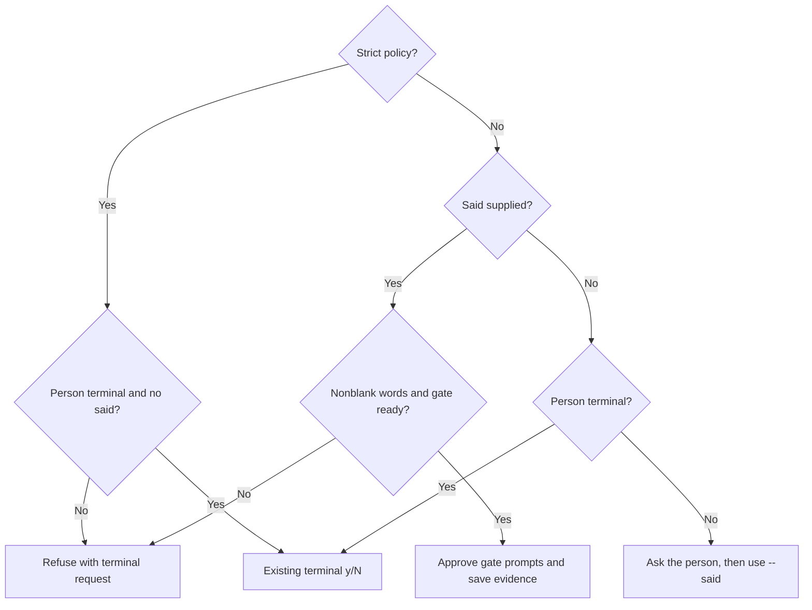
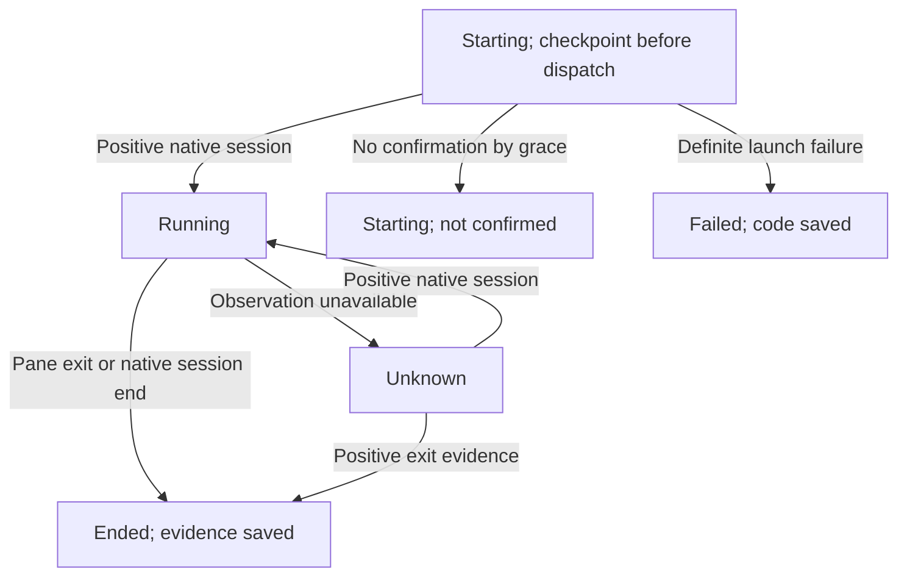
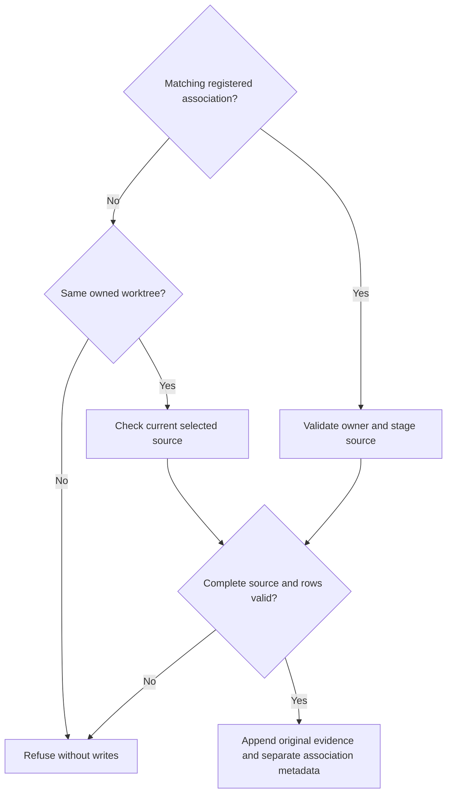

# Workflow runner (area chats)

Own `src/workflow-runner.mjs`. It runs a workflow for one GitHub issue as a few area chats. pdd has four jobs: start, gates, PR and status. The agent does the work. pdd does not watch the agent, run tests automatically, wait with a workflow timeout or merge. The explicit local [old-code proof](workflow-prove.prompt.md) command is the sole bounded supplied-command execution exception; this runner never executes a command from notes or evidence.

## Base selection

`startRun` accepts optional `base`, supplied by public `--base BRANCH`. Without it, use the repository’s actual default branch and retain the fetch-failure warning behavior. With it, require a nonempty branch name, not a revision expression, a full `refs/` name, an option or a filesystem path; slash-separated topic names are allowed. Validate as `refs/heads/BRANCH` without Git’s previous-checkout expansion. Do not alter the resolved repository/default metadata.

For an explicit base, fetch exactly `refs/heads/BRANCH` from `origin` into `refs/remotes/origin/BRANCH`, and verify that tracking ref resolves to a commit. A missing branch, rejected fetch or unavailable commit stops startup with a diagnostic naming the base: no stale/local/default fallback, worktree allocation, saved run, chat start or cancelled-run claim release. The branch must already be on origin so GitHub can use it as a PR base. Never publish the base as part of startup.

Allocate the issue branch from that selected origin ref and save the selection in `baseBranch` and its observed commit in `baseSha`. Keep that saved start commit immutable for replay anchors; inventory comparison below and old-code proof resolve their own fetched-original-base merge-bases without rewriting either saved field. Show the base in startup output. PR 1 (or a small-change PR) targets that saved branch. PR 2 stacks on an open PR 1; after PR 1 merges it starts from and targets the saved base. Existing runs retain their recorded bases. Only the allocated topic branches are pushed; choosing a base does not authorize pushing it, changing origin’s default branch, or merging.

## Adopt an existing approved corpus

`startRun` accepts optional `adoptCorpus`, the declaration path supplied by
`pdd workflow run NAME ISSUE --adopt-corpus FILE`. Preserve existing startup and
changed-scenario discovery when absent. Require a fresh run whose selected areas
explicitly opt in to replay evidence; adoption never enables a custom workflow's policy.
Before releasing a cancelled-run claim, allocating a worktree, saving a run or starting
Herdr, validate the selected base content through `adoptReplayCorpus` in
[replay evidence](workflow-replay.prompt.md#corpus-adoption). Failure exits 2 with a
finite repair reason and the replay owner's cleaned native cause when available; retain historical runs, branches and files unchanged. A failed startup fetch explicitly says that the fetch failed; a generic source-selection or local-operation failure alone is insufficient. Keep private absolute paths, credentials and Simulate URLs out of that diagnostic.

After worktree allocation, revalidate its actual content before saving an active run
or starting Herdr; report failure without fabricating success if it differs.
Save an immutable bounded copy of the declaration bytes and computed digest in the
new run folder, using a realpath-resolved temporary directory even under a symlinked TMPDIR; later validation uses this copy and pinned commit, never a caller
edit of FILE. Removing or changing the external FILE after successful startup cannot
alter or invalidate the frozen authority. Save the successful selection's provenance and the anchor produced by existing
`pinReplayVectors` as `run.replayAdoption` and `run.replayBaseline`. Preserve every
original raw hash and check identity. Adoption reuses exact content authorization;
it neither changes a prompt's approval state nor asks to reapprove unchanged content.
All ordinary workflow gates remain. Announce the external-assertion trust boundary
from the replay owner; never describe adoption as authenticated human approval or execution.

For an adopted run, prompt publication must revalidate the same approved prompt,
required dependency closure and complete declared scenario bytes against the original source.
Keep the adopted anchor; the changed-file refresh rule below applies only without
adoption. Revalidate immediately before entering code and each code publication,
including retries. Freeze declaration digest and declared scope with provenance.
After the automatic publication commit, perform one adoption validation scan per
publication and reuse its result for replay and publication decisions. Retries use
the frozen authority and revalidate current content; an invalid observation must
clear any old PASS before publication, never briefly publish stale PASS.
A changed, added, removed or unreadable covered prompt/dependency blocks reuse
with advice to start an ordinary approval workflow for changed requirements; it must
not replace the anchor or silently fall back to diff selection. Unrelated implementation
changes remain allowed and bind subsequent replay to the current source fingerprint.
In code space revalidate using the replay owner's `scenarioReference` option, retaining original
authority and prompt/dependency checks. Scenario changes follow its saved-value warning rule and
do not block publication. Public-boundary execution, mutation and formal checks still apply.
Adoption supplies no PASS or fresh execution attestation.

## Failed chat startup and recovery

A Herdr request failure is not evidence that an agent is working. If an initial or later-area start, or explicit open/resume, fails, keep the same run, allocated worktree, selected base, issue claim, completed steps and decisions. Save `chatFailure {area, phase, code, message, at}` (phase `start` or `open`, finite one-line reason), set the active run to `waiting`, and report the failure with `pdd workflow open N` for explicit recovery after Herdr is available. Do not retry the request automatically, restart an unavailable server, allocate again or fabricate a chat/session. A failure after the pane launch request may have dispatched: retain the prepared chat identity supplied by [area chats](workflow-chat.prompt.md), including its unconfirmed flag.

Public detailed, list, all-repository and JSON status group this failure as waiting and show its code/recovery action, never agent working. A legacy active run with no current chat also reports startup unconfirmed, even without the new failure field. A `server_unavailable` observation for an existing chat means status unavailable, not proof it stopped or works. Cancelled/completed status wins over stale failure data. Other transient inspection behavior and the normal new-agent grace period remain unchanged.

Only a successful start/open or positive observation of the same current chat clears its active failure/unconfirmed flag. Restore `running` only when no person question or approval gate is waiting; recovery never approves, advances an area or discards decisions. If Herdr remains unavailable, keep the precise external failure and preserve custody rather than claiming recovery.

## Preserve concurrent progress

Use the [run-record update boundary](workflow-runs.prompt.md#concurrent-record-updates)
for every modification of an existing ordinary run record: startup follow-up,
chat recovery/failure, evidence and replay metadata, steps, questions, decisions,
area/gate transitions, publication, change-delivery effects, cancellation and
status refresh, including adopted-corpus blocked and publication evidence saves.
These saves retain their intended blocked/publication-pending/replay evidence
while preserving unrelated progress; frozen adoption authority and anchor remain
governed by the adoption rules above. Initial creation retains the explicit
whole-record save. Each
update callback checks the latest `runId` and record/worktree identity against the
run selected by this invocation before changing anything. A replacement run at
the same path is not that run: fail without modifying it. This adds no step-order
or approval gate and does not change existing command validation.

Before `stepDone`, `askPerson` or `approveRun` commits any progress or gate
transition or begins publication, branch or chat effects, check the latest owned
run: cancelled or completed runs stay ended.
For a run newly ended since this invocation selected it, refuse with a nonzero
reply saying the run ended; preserve state, gate, question,
steps and decisions and start no chat. This check wins over stale command intent,
including cancellation or completion while the command waited. The explicit
existing done-at-PR-1 code continuation described below remains available for a
new approval invocation; it does not authorize a stale approval to revive a run.
Preserve existing already-ended early-return results, including successful done/ask
stop replies without reading the delivery journal.

Approval applies only to the gate actually shown for this invocation. Recheck its
area, kind and time against the latest gate before recording approval or doing
approval-triggered publication, branch or chat effects. If it changed or vanished,
refuse with "the gate changed, look again", preserving the new gate and recording
no approval. An unchanged gate keeps existing approval/evidence behavior.

Apply only this invocation's intended effects to the latest record. Retain
unrelated newer completed steps, questions, gates, decisions, area progress,
chats, evidence and PR fields; never publish an old whole snapshot. Distinct
successful concurrent completions retain both records unless the existing rerun
rule intentionally invalidates one. A known completed step running again clears
all later known steps of its own area in the latest record, including a later
step newly added or replaced since the command loaded; unrelated steps survive.
Done clears only the question it observed, leaving an independently newer
question intact. Ask deliberately saves its own requested question and derives
its existing waiting effect from the current gate. Preserve newer gates when
this invocation has no intentional gate transition.

Status applies its actual fetched PR/CI observations to the matching PR identity
without replacing unrelated newer PR fields or entries, and retains existing
completion consequences. Collect external observations before the short local
update; do not perform Git, GitHub, Herdr or model work under ordinary-record
ownership. All callers continue from the committed record, not their stale copy.
A failed existing-record update returns a finite nonzero diagnostic and never
claims that its progress was saved. Best-effort index failure after a committed
save remains harmless. No new ordering is promised for competing intentional
changes to the same field beyond these existing command effects.

Ordinary updates leave accepted requests and acknowledgement fields in the
authoritative journal untouched. Change delivery retains its existing
journal-then-ordinary update order; no ordinary update acquires a journal claim.
Keep existing custody, uptake warnings, side-effect order and approval rules.
`runStatus` uses `readRunOwnership` from the run-record owner before any
write-capable PR/chat refresh and skips those refreshes while ownership is held.
JSON adds `ordinaryOwnership` with that snapshot or `null` when absent; detailed,
list/all/cancelled text and JSON identify the held ownership path and its available
PID, hostname and token, or say ownership is unreadable/malformed. No owner means
no held-lock claim. For unverifiable ownership, give the path and explain manual
removal only after verifying no pdd command is running; do not recommend removal
while a live owner works. Reading status never reclaims ownership; busy ownership cannot
hide the saved run or turn status into a failed save. Cancellation uses the same
recoverable ownership boundary and can proceed after confirmed-dead reclamation.
The native callback, ownership and overlapping public saves remain unbound to
the Interpreter entries below.

## Commands

Each workflow command export takes `(input, ports)` and returns `{exitCode, message}`. The CLI prints the message.

- `startRun({name, issue, agent, base, adoptCorpus, cwd, packageRoot})`: read the areas from the pdd-NAME skill ([areas](workflow-areas.prompt.md)). Show any advisory returned by [workflow areas](workflow-areas.prompt.md#approval-gate-advisory), without blocking startup or changing areas. Read the agent's config folder: `CODEX_HOME` for Codex, `CLAUDE_CONFIG_DIR` for Claude, `GEMINI_CLI_HOME` for Gemini, none for Antigravity CLI ([chat](workflow-chat.prompt.md) `homeVariable`, `expandHome`). A leading `~` or `~/` is the home folder (zsh leaves `~` as text in `env CODEX_HOME=~/x pdd …`, 0.1.6 tester), and a relative path is resolved from cwd. When it is set and that folder does not exist, refuse before any git, gh, worktree or Herdr work: `VAR is "PATH", but that folder does not exist. Fix VAR and run the command again.` The run keeps the full path as `configDir`, and the Claude trust check reads `.claude.json` in it. Resolve the issue with gh ([GitHub](workflow-github.prompt.md)). Refuse when the issue already has a completed run. An active run (running or waiting) never blocks a new run: it may be stuck, abandoned or left from a crash. After the base and adoption checks pass, mark it replaced through the ordinary identity-checked update (`state: cancelled`, `cancelled: {state: replaced, at}`, `gate: null`), ask no person, and show one warning that names it: run id, workflow, worktree and checkout, and last activity (`updatedAt`, else `startedAt`). When that activity is less than an hour old, the warning says that the old run may still be working. Then treat it like a cancelled run. After a cancelled or replaced run, free the issue claim (`releaseIssueClaim`), keep the old worktree and branch, rename the old run folder to `<N>-cancelled-<first 8 of its run id>` and start fresh with a new worktree and branch; the new record lists the old one in `previous`. A replaced run cannot write over the new run: its saves and journal updates check the run identity at the plain issue folder and fail. Status shows a replaced run as `replaced`. Select the base as described below. Make the worktree and branch ([worktree](workflow-worktree.prompt.md)). Make the run folder and write the run record ([runs](workflow-runs.prompt.md)). Start the area 1 chat ([chat](workflow-chat.prompt.md)). Print where the run is, `pdd workflow open N`, `pdd workflow status N` and the shell-safe approval guidance below. Then return at once. If the main repository is not trusted by Claude, say that Claude asks to trust the folder first.
- `stepDone({step, summary, skipped, cwd})`: only the agent calls this, from the worktree. Find the run from cwd. Record the step with its summary and time, and with [pdd's own results](#pdds-own-results-and-agent-notes). The stored summary keeps its line breaks (each line's spaces collapsed, blank lines dropped); every place that shows a summary on one line (status, the code question, the PR step list) collapses it. An unknown or out-of-order step prints a warning and is still recorded. A step that runs again after later steps of its area (for example `build` after `verify` when vectors fail) prints a warning and clears those later steps, so they run again; the area's PR opens only after its last step. Then print one of:
  - the next step of the area and the exact `done` command (an optional step is a question to the person, and "skipped" is a valid summary);
  - at an `approve` gate: show the result, ask the person, stop, never approve for them; how they approve; how to handle changes (revise here, run done again, ask again);
  - after the last step of a `pr` area: "pdd opens the PR now". Commit any uncommitted files (with a warning), push and open the PR for this area. The body (0.1.4 #18, 0.1.6) starts with pdd's own result lines ([pdd's own results](#pdds-own-results-and-agent-notes)), then the current source-compatible Prompt tests lines selected by the current-head publication rule below: every "Prompt tests (<story>)…: …" line, one per Story (a Story that appears again keeps its place and takes its latest line), then, with two or more Stories, a total that pdd adds up itself: "Prompt tests (all Stories)[ (DRAFT)]: ✓ 8 of 8 criteria · 35/35 checks · 17 AI calls" (sum the criteria, the checks and the AI calls, each only when every Story line has it; ✓ only when every Story passes, else ✗; DRAFT when any Story line is DRAFT). A pasted overall "Prompt tests: …" line is dropped when Story lines exist, because it can cover only the Stories checked last; a summary with no overall line works the same. Without Story names, keep those lines' results as written, with the `Prompt tests` label. Then "Report (<story>): URL (report links expire after 7 days)" for each distinct report link, in summary order (the Story name comes from a "Report (<story>): URL" entry; a bare link or "Report: URL" or "Report (DRAFT): URL" has no name). The chat pastes the lines that `pdd test` prints into the check step's summary, one per line (with a `Report:` line per Story) or joined with "; " (with one "Report (<story>): URL" per report row); a result ends at a line break, ";", a `Report` entry, a link or the next `Prompt tests` or `Runtime check` label. Read these lines from the stored summary, before it is collapsed. Above the Prompt tests lines go the verdict line and the before → after line of a bug check (0.1.7): the first "Verdict: …" and the first "Before ✗ …" / "Before ✓ …" / "Before: no prompt …" in the step summaries (the check step's first, then the newest step), each up to its line break, or up to a "; " that starts "Before", "Prompt tests", "Runtime check" or "Report" (a "; " inside the verdict sentence stays). A report link in the before → after line gets " (report links expire after 7 days)" and is not listed again as a "Report" line. Then the PR head ("Part of #N" / "Closes #N" …), then the Steps overview: one line per step since the previous PR, cut to about 200 characters at a word end and never inside a URL (a URL that crosses the end stays whole, and " …" follows it) and shown as one inline code span, and below it the [full step summaries](#full-step-summaries-in-the-pr). Only a PR that covers a verify step carries `<run folder>/verify.md`, under "## Verify" (0.1.6 tester: 100 lines of shell before the vector table): drop a leading "# Verify" line, write each "## " heading as "### ", and fold each fenced block of more than 15 lines that is not inside a `<details>` block into `<details><summary>Commands (N lines)</summary>` (sh, bash, zsh, shell or console blocks) or `Output (N lines)`. When verify.md has no `<details>` of its own, keep the text before its first heading on top, then its sections whose heading names vectors or results, then the Formal check, then other sections with a table, then the rest, each group in file order. GitHub refuses a PR description over 65,536 characters (0.1.7 tester: a 105,489-character verify report; every retry failed the same way), so the whole body stays at most 60,000 characters (Unicode code points), which leaves room for the marker and for GitHub's own count. When verify.md does not fit in the room that the rest of the body leaves, the body keeps a summary of it. First each `<details>` block (long commands and output) becomes one line, `- <its summary text>: not shown here.` A tag inside an inline code span is text: it opens or closes no block and is not removed. If it is still too long, keep its first lines that fit, cut at a line end (never inside a link) with an open code fence closed, and then list the lines of the cut part that report a failure (`✗`, or the word fail, fails, failed or failing) under `Lines that report a failure, from the part not shown:`, as many as fit. End the summary with: `_The full verify report has N characters, more than a PR description can hold (GitHub's limit is 65,536). This is a summary: WHAT. The PR author has the full report: verify.md in the run folder._` (WHAT: `the long blocks are not shown`, or `its first N lines; M more lines are not shown, and K of them report a failure`, with `reports` when K is 1). Before collapsing details (authored or generated from long fenced output), retain their failure lines and report references outside the collapsed block. If truncation is still required, consider failures and report references from all omitted content, including collapsed blocks. Keep whole evidence lines and links while room allows; explicitly count omitted failures and report references when they cannot all fit. The full verify.md stays byte-for-byte in the run folder. Failures are never dropped in silence. Local paths never appear: the worktree path becomes repo-relative, the run folder "<run folder>", any other `/Users/…`, `/home/…`, `/private/…`, `/var/folders/…` or `/tmp/…` path "<local path>". Before writing a PR body, replace every Try link (a URL whose path has `/s/<token>`) in the step summaries and verify.md with "(Try link removed)"; report links (`/r/`) stay. When the first line of verify.md starts with "✗" (for example "✗ 2 vectors fail"), retain that warning ahead of the replay/ordinary body while the evidence owner controls the top evidence block. When the body has an interpreter report link, add "Interpreter report links expire after 7 days." A report link is a URL with a `/r/` path segment, or a URL that starts with `PDD_RUNTIME_URL` when it is set. Never fix a runtime host in the code. When the PR exists already, refresh the label/proof top block and, for code PRs, the inventory as required below, preserving publication-pending before changed-source pushes. When the PR does not open, print the message of the [GitHub](workflow-github.prompt.md) result: it names GitHub's own reason when GitHub refused the PR, and says unconfirmed only for a real doubt. A retry builds the same intent again (same run, area, marker, branch and SHA when nothing new was committed) and does not push again. Print the PR URL and "pdd never merges".
  A cancelled or completed run prints that the agent must stop.
- Try before PR 1 (0.1.4 #13): a `pr` area with `"before":"approve"` does not open its PR after the last step. `done` sets the gate kind `approve-pr` and tells the chat to show the Prompt tests line of each Story (one per Story: ✓, ✗ or no verdict, as `pdd test` prints it) with its report link and the Try link, ask the person to try it and approve or ask for changes, and stop. Status: "waiting for you: try it, then approve to open PR 1". When there is nothing to try (no step of the area left a Try link, and the try step was skipped or the worktree changes no test file), the gate text says "There is nothing to try. Ask them to approve or ask for changes." and status drops "try it, then " (0.1.6 tester: a browser-only Story). For PR 1 the gate text also gives the chat the words for what PR 1 holds, read from the worktree's changes against the run base (uncommitted files count): "Tell the person what PR 1 holds, in these words: "PR 1 is ready with the approved Story[, the approved prompt X][, the draft prompt Y][, the prompt Z] and the tests."", with "the approved Stories" for two or more Stories under `user_stories/`, and without "and the tests" plus " It has no test file." when no test file (a `*.json` with `prompt-runtime.program-scenario`) changed. Only the Story area was approved, so a draft prompt is never called approved (0.1.6 tester). `approve` here works like an area gate (explicit approval under the rule below; terminal: "Approve the AREA area and open PR 1 for …? (y/N)"); it records the decision and opens the PR. With `then: ask-code` the run moves to the code-or-stop gate (new gate time): from the chat, the reply tells the chat to ask the code question; from the terminal, when PR 1 has draft prompts, pdd does not ask about the code PR: it prints PR 1's link and the approve-first line (see Draft prompts) and sends the chat "pdd opened PR 1: URL. … Tell them exactly: "PR 1 is open: URL. <approve-first line>" Then stop."; else pdd asks "Make the code PR now …? (y/N)" — no sends PR 1's link and the stop into the chat and prints "PR 1 is open. Tell your agent when you want the code PR."; yes goes on as the code gate (the code branch and chat). A PR that cannot open leaves the gate open; run approve again.
- Two PRs (bug and feature): an area with gate `pr` and `then: ask-code` opens **PR 1** (title "ISSUE TITLE (prompt, Story and tests)" and body line "PR 1 of this run: the prompt, Story and test cases. …" when the worktree changes a test file, else "ISSUE TITLE (prompt and Story)" and "PR 1 of this run: the prompt and the Story. …"; body "Part of #N"). Then `done` prints the PR 1 link, the step summaries (Prompt tests line, Try link) and tells the chat to ask "Do you want the code PR now, or stop here and merge PR 1 first?" and stop. This is a gate. When the chat pushes more commits to an open PR 1 at this gate (for example the prompt approval the person asked for), the gate keeps its time, so an already saved explicit decision for that gate remains retryable; `changes` moves it. `approve` (terminal y/N "Make the code PR now…", or explicit --said with the person's words) starts the code area in a NEW chat on a new branch `<branch>-code`: from PR 1's head when PR 1 is `open` (PR 2 is stacked: base = PR 1's branch), or from the fetched saved base branch when PR 1 is `merged` (base = the run’s selected base). When PR 1 is `closed` or its state is `unknown`, refuse: make no branch, change no run field, and tell the person to check PR 1 and provide the safe retry guidance below. The last area opens **PR 2** (title "ISSUE TITLE (code)", body "Closes #N" and "Builds on PR 1: URL"). A title that is too long for GitHub is cut in sight: see [PR titles](#pr-titles). If PR 1 merges while the run waits at this gate, `status` ends the run as "done at PR 1"; `approve` still starts the code area later.
- Draft prompts: list every `*.prompt.md` that PR 1 changes (diff from the base to PR 1's branch) whose Runtime interface block ([runtime preflight](runtime-preflight.prompt.md) `interfaceBlocks`) has `"status": "draft"`. When there are any, the PR 1 body and the `done` gate text get "Draft prompts: X, Y. Approve them before you merge.", and `status` shows the same line (read again from PR 1's branch each time). The code is built only from approved prompts, so while PR 1 has a draft prompt pdd never offers the code PR (0.1.6 testers: pdd asked "Make the code PR now?" and then refused the yes). The person-facing approve-first line says "Approve the code gate and its draft prompts together." Separate agent guidance uses the safe approval template below. A person terminal may answer the one batch y/N question. It does not prescribe one standalone command per draft. The `done` gate text then tells the chat "Do not offer the code PR yet. Tell the person exactly: "PR 1 is open: URL. <approve-first line>" Stop there." instead of the code question. Status says "PR 1 open (URL); waiting for you: approve the code gate and its draft prompts together.", the list "waiting for you: code gate and drafts (PR 1 open)", and Next uses the shared safe gate-approval guidance below. `pdd approve` writes the prompt and commits nothing, and an approval committed by hand went to PR 2 while PR 1 still said "Draft prompts" (0.1.6 testers). So `approve` at the code gate, while the worktree is on PR 1's branch and PR 1 is open (the run is not done at PR 1, and GitHub says open), first makes PR 1 hold the approval: it commits alone each draft prompt of PR 1 that is approved (and no longer draft) in the worktree ("Approve X, Y"); it fetches PR 1's branch; when the worktree has commits that PR 1 lacks and PR 1 has none that the worktree lacks, it pushes them to PR 1 ("pdd committed your approval of X and pushed it to PR 1." or "pdd pushed N new commit(s) from the worktree to PR 1."); pdd never forces a push. After a push it reads PR 1's description and rewrites its "Draft prompts: …" line to the drafts left, or removes it ("pdd updated the PR 1 description: no draft prompts are left."); a failure there is only a warning. When the commit or the push fails, or PR 1 has other commits while there is an approval to push, `approve` changes nothing else and prints the exact commands (`cd WORKTREE && git push origin HEAD:refs/heads/BRANCH`, or `git pull --rebase origin BRANCH && git push …`) and the shared safe retry approval guidance below. For a ready gate, the batch approval below runs before these sync/draft controls on both said and terminal routes. Remaining invalid or unapproved drafts refuse with the approve-first advice; a terminal caller first receives the fresh batch review question, not a draft-only refusal. A read problem during said selection is an error, never an empty draft list. Small-change has one PR with the issue title and "Closes #N".
- `approveRun({ref, cwd, said})`: a person decides; a valid easy-mode said route records their supplied words. When the run's saved config folder (`configDir`, `~` expanded) does not exist, refuse before anything changes: `This run uses VAR "PATH", but that folder does not exist. Make that folder, or cancel the run (pdd workflow cancel N) and start it again with the right VAR.` Without said, apply the authorization rule below for every gate; never read latest native chat text to authorize approval. Otherwise ask `y/N` on the terminal; the question names the area, the repository, the issue and its title. Closed input (end of file) means no. Before the gate, the terminal may still approve after a second question; an agent may not. Record the decision with its source and text, and clear the chat's question: an approval answers it (0.1.6 tester: status showed the answered "Do you approve … so PDD can open PR 1?" after PR 1 was open). Start the NEXT area as a NEW chat. Its first message lists the approved step summaries, the changed files and the run folder. A `pr` area has nothing to approve.
- `askPerson({text, cwd})`: only the agent calls this (`pdd workflow ask "question"`), from the run worktree, when it needs the person's answer in the middle of a step. Save `question {text, at, area}`; the run waits (`status` and status.json show "waiting for you: QUESTION"). Tell the agent to ask in a plain chat message (not a question dialog) and end its turn, and that the person can answer with `pdd workflow changes N "answer"`. The next `done`, an approval and a change request at a gate clear the question. A question asked before the current gate opened counts as answered: status and `changes` ignore it.
- `changeRun({ref, text, cwd})`: at a gate, when no question is open and the text is a plain approval, send nothing and exit 2 with "This looks like an approval. Ask the person, then relay their words with pdd workflow approve N --said - using the quoted-heredoc template." and "Nothing was sent to the chat." (0.1.6 tester: "I approve. The Story and the prompt look good now." became a change request). A plain approval starts with an approval phrase ("approve", "approved", "I approve", "lgtm", "looks good, approve", optionally after "yes" or "ok"; any case) and the rest has no change word ("but", "change", "rename", "add", "remove", "fix", "use", "make", "not", "don't", "without", "only" and the like); an approval word with a change word is a change request. Otherwise deliver the text into the SAME area chat under [Change-request custody](#change-request-custody). After `ask` it is the answer ("The person answers your question: TEXT Go on with the step."); it clears the question and the run works again. Otherwise it is a change request ("The person asks for changes: TEXT …"); record the round; at a gate the gate stays open and its time moves to now. When Herdr refuses because the chat shows a question dialog (`agent_blocked`), say that pdd cannot type into a dialog and the person answers in the chat (`pdd workflow open N`). Answers, like change requests, never count as approval.
- `cancelRun({ref, cwd})`: mark the run cancelled and close its Herdr tabs. Keep the worktree and the branch.
- `runStatus({ref, cwd, all, json, cancelled})`: with ref, show one run: the issue, the area, the steps (each step summary on one line, cut to about 120 characters like the PR step lines, never inside a URL), what pdd waits for, the chat, each PR with its state and CI, the worktree and the run folder. When the newest source-compatible evidence has Prompt tests lines, `status` shows "Stories: N of M Stories pass" (with "(✗ story, …)" for the failing named Stories); the list line adds "N of M Stories pass", and JSON adds `stories {pass, total, failing, unknown?, evidence?}`. Per-Story lines count, the latest line per Story; a summary with only an overall line is one Story. Status reads the current chat with one Herdr call (`agent get`) for a running run and for a run at a gate. A running run whose chat Herdr reports as `blocked` (a question dialog) shows "waiting for you: the chat asks a question in its window". Chat availability and advice follow the lifecycle below; missing observations never prove stopped. At a gate, while Herdr reports the chat as `working`, the gate text is not written yet: status shows "the agent writes the gate message for the AREA area" (list "agent writing the gate message", group working), or after a change request to that gate "the agent works on your changes to the AREA area" (list "agent working on your changes"); "waiting for you" comes when the chat ends its turn (0.1.6 tester). Any other Herdr answer or failure keeps the words status had, and status never fails because of this check. Without ref in a repository, list that repository's runs (inside a run worktree, show that run). With `all`, or without ref outside any repository, list every run on this machine ([all runs](workflow-runs.prompt.md)). A list has one line per run: `owner/repo#N · workflow · area · state words · PR #a #b · last change time`, sorted: waiting for the person, then agent working, then PR open, then done, then cancelled; newest first inside each group. State words: "waiting for you: approve the AREA", "waiting for you: code PR now or stop (PR 1 open)", "agent working on STEP", "PR open" / "PR 1 open" / "PR 2 open", "done", "done at PR 1", "cancelled". Cancelled runs are hidden unless `cancelled`; then say how many are hidden. End with "Review without resuming: pdd workflow view owner/repo#N", then "Open one: pdd workflow open owner/repo#N". Each JSON run adds `viewCommand: "pdd workflow view owner/repo#N"`. Detail status includes the same read-only review command. `json` prints `{"runs":[{ref, repo, number, workflow, area, group, words, prs:[{number,url,state}], updatedAt, root, runDir}]}` instead. Read PRs with gh only for runs that wait on a PR, and for the one shown run; a merged last PR completes the run. At the code-or-stop gate (and when the run is done at PR 1), say plainly: "To make the code PR later, show the gate and ask the person. Relay their words with `pdd workflow approve N --said -` using the quoted-heredoc template, or answer terminal y/N." The code question itself, which the chat asks exactly, ends with that sentence (a real run showed the chat drop it after "stop"); the gate text also tells the chat to say "PR 1 is open: URL. To make the code PR later, show the gate and ask the person. Relay their words with `pdd workflow approve N --said -` using the quoted-heredoc template, or answer terminal y/N." when the person stops, and the terminal stop path prints and sends the same sentence. Write the run record only when a PR state, run state, chat failure or launch confirmation changed, so the last-change time stays true.
- `openRun({ref, cwd, packageRoot, area, newSession=false}, ports)`: select/open or replace an area under the rules below. Preserve ended-run and saved-config-folder refusal. With neither selector nor flag, retain current focus/resume/start behavior and missing-unconfirmed-tab recovery.

`ref` is an issue number, `owner/repo#N` or an issue URL ([selection](workflow-runs.prompt.md)). Without ref, use the run of the current worktree, or the only run of this repository that waits for a person.

## Approval through the person's words

`said` is optional and forwarded verbatim from the catalog's text option. Resolve [approval policy](approval-policy.prompt.md) from the trusted main checkout `run.sourceRoot`, never the agent worktree, and saved configuration prechecks before mutations or stdin reads. Strict mode refuses supplied said before consuming input. In easy mode resolve the marker through the shared `readSaidWords` helper. Present-but-empty, whitespace-only or nonstring said refuses without effects; it never falls through to another route. These rules authorize every gate: story/area `approve`, `approve-pr`, and `ask-code`.



In easy mode accept any nonblank said text, including "looks good", "ship it" or question-looking text. The agent judges the person's intent and passes their verbatim words obtained after displaying the gate question. pdd never grades vocabulary or meaning, and does not infer display or consent from a chat timestamp. Without said, an agent environment (`PDD_AGENT_SESSION`, `CLAUDECODE`, `CODEX_THREAD_ID`), non-TTY input or the current run's own Herdr pane refuses with a plain instruction to ask the person, then use the quoted-heredoc template in the shared approval policy with `pdd workflow approve N --said -`. Do not read approval evidence, consume stdin, save an approval or advance the gate on this refusal, even when native history contains "I approve". The own-pane identity test remains `HERDR_PANE_ID` matching a run chat and `HERDR_SOCKET_PATH` in Herdr session `pdd`; a person's separate terminal pane retains y/N. Strict mode is opt-in and permits only an unmarked person terminal without said, even if native evidence exists.

No incoming chat message, step completion, `done`, status or evidence recording can authorize or cross an approval gate by itself. `done` may establish/reopen the waiting gate and return the question; only an explicit authorized approve call crosses it. Native history may remain available for recording, never as independent approval authority.

For said and ready-gate terminal batch approval, the existing gate must be open, all its steps complete, saved config folder present and run eligible; it cannot use terminal's approve-anyway exception. It requires no area chat/session and does not read native logs or ask terminal y/N; only the explicit stdin marker reads stdin. Select the current gate's changed Git-visible `*.prompt.md` paths against the saved base, including staged, unstaged and nonignored untracked worktree files; at ask-code include PR 1's changed prompt paths and inspect current worktree bytes. Deduplicate in lexical path order. Exclude unchanged unrelated repo drafts and deleted files; reject symlink/outside-root/unreadable selected files or unavailable comparison rather than silently skipping them. Approve every draft or stale-approved selected prompt with current prose hash; already approved/current prompts retain their bytes. Reuse prompt-approve's schema/hash and byte-preserving edit rules. Validate the complete set and journal before the first write; a malformed member cannot approve the gate or a different member. Print each newly approved path/hash. Prompts without a Runtime block retain existing non-Runtime handling; they do not acquire invented approval fields.

Bind the gate to the review shown to the person. Only when `done` shows a new or changed/reopened gate, or PR publication first shows approve-pr or ask-code, capture and durably save `gate.promptSnapshot`: the complete selected path/current-prose-hash rows plus a `reviewSha256` digest in lexical path order, including a valid empty selection. The review digest uses prose with Runtime interface blocks omitted, just as the existing prose hash does, then collapses whitespace runs to one space and trims outer whitespace. Thus filling Runtime hash fields or changing layout (line endings, wrapping, indentation, blank lines or trailing spaces) leaves the review unchanged. For each selected non-Runtime prompt use its complete prose without inventing an interface. Showing a gate must display these paths/hashes with the question. Selection uses the batch rule above. Both the initial `--said` review check and the final check before saving approval must use the same comparison: identical ordered paths and review digests; for a legacy row without a review digest, retain exact prose-hash comparison. A real text change, added or removed paths, unavailable inspection, or an absent legacy snapshot refuses with plain advice to show the gate again and ask the person again. After the final comparison, prepare approval edits from the current bytes and record current exact prose hashes in approval evidence, excluding the review-only digest. Never bind consent to the latest native chat words. A changed gate invalidates its prior snapshot until `done` shows it again. `workflow open` only opens/resumes the area chat: it must never create or replace an existing gate snapshot, including after prompt edits or for a legacy unbound gate.

A person terminal may freshly inspect the current list and hashes and answer one y/N question covering the ready gate and all selected drafts. It uses the same complete validation, byte-preserving edits, rollback and evidence batch as said, including strict mode. A legacy unbound gate may use this fresh terminal review safely. Preserve terminal's existing explicit approve-anyway handling for incomplete steps; it does not permit silently approving unseen prompts. Standalone `pdd approve PATH` still covers one prompt.

Person-facing gate questions, the status State line, code-later and approve-first replies, the exact text an agent is told to show the person, and changes replies stay short and plain. They state the pending decision and may offer a short `pdd workflow approve N` terminal command. They never include instructions addressed to the agent, a heredoc template or an absolute local executable path.

Agent-facing next-approval instructions explain the one-step gate-and-drafts route and include the shared policy's quoted-heredoc template with this gate reference, using `"$PDD_BIN"` as the command prefix for workflow chats. The template contains no full local executable path. Include the person-terminal y/N alternative. Keep these instructions separate from quoted person-facing text. Preserve Git/publication retry controls and saved same-gate evidence; retry guidance must not demand a new approval after one was already durably recorded. Do not first tell an agent to run an approval form that will necessarily refuse. Keep any native approval-looking change-request hint advisory only; it grants no consent.

One accepted said or ready-gate terminal y/N invocation approves only the current gate and its prompts. Opening PR 1 must leave the later code-or-stop gate waiting for a separate decision. Record the new approval in durable history before preparing the initial PR body, and refresh relevant existing PR bodies on later gate approvals. Preserve earlier history. Publication failure keeps the gate retryable, records no successful area advance and does not lose already saved approval evidence; a retry reuses the saved approval for the same durable gate identity instead of fabricating a fresh timestamp/decision, and must not duplicate its PR lines. Assign and persist each new gate a nonempty `id` before approval; preserve it across save/reload and publication retry. Distinct gates, including approve-pr followed immediately by ask-code in the same area, and changed/reopened gates of the same kind, require distinct identities even when the clock is fixed. Stage, kind and timestamps alone cannot identify a gate. A new decision and approvalRecord carry that `gateId`, and its shared evidence has a fresh event `id`; journal/history copies retain that event identity. A legacy open gate without id receives a durable identity before its new approval; never infer that a historical decision approved it merely from matching stage/time. Preserve historical records without inventing old actors or words. Code-branch/chat failure retains the existing recovery policy. Never invent success after a failed prompt/journal write. Strict/config/nonblank/gate validation occurs before approval, commit, push, publication or chat-start effects.

Standalone prompt journal evidence and gate decisions use [run records](workflow-runs.prompt.md) for saved shape and [PR evidence](workflow-pr-evidence.prompt.md) for safe rendering. The runner supplies the full saved approval history plus matching standalone journal entries to real PR creation and refresh. It owns no alternate approval renderer. pdd itself still never merges.

## Rules

- No workflow timeouts, no background polling loop, no foreground controller and no automatic test runs. A changes invocation may wait only for the local [area-chat readiness deadline](workflow-chat.prompt.md#message-delivery). Explicit old-code proof has its own bounded execution contract. Source fingerprints below bind evidence; they do not create execution snapshots.
- Light checks warn and never break the run. Errors that stop a command say what to do next.
- Never merge. Never push to the default branch. Never touch the person's default Herdr session.
- Messages to the agent are short. The first message of an area chat is about 10 lines: "Use the pdd-NAME skill: <the SKILL.md path that the lookup chose>" (an installed copy with the same name may be older), the issue number, title and URL, the worktree, the run folder, the area and its steps, the `done` rule, the gate rule, and "Read the PDD skills (pdd-prompting too) from <absolute package>/skills: an installed copy with the same name may be older." (an `npx skills add` or `pdd setup` copy is not updated with pdd). Never paste the guide or the workflow text.
- Runnable commands for workflow chats use `"$PDD_BIN"`, set by the chat owner to this running package, including approval and retry templates. Other contexts retain their existing executable guidance. Export `pddCommand(packageRoot)` for non-chat callers.

## Informational test inventory on code PRs

For feature/bug PR 2 and the single small-change code PR, collect the [test inventory](workflow-inventory.prompt.md) after automatic commits. Resolve one committed head SHA, fetch the original `run.baseBranch` from `origin` with the explicit `refs/heads/BRANCH:refs/remotes/origin/BRANCH` refspec, then compute the merge-base of that head and the freshly fetched original base commit. Pass `{cwd:run.root,baseSha:mergeBaseSha,headSha}` with those exact resolved SHAs. The original branch remains the run's selected base (for this run, alpha), including when PR 2 targets an open PR 1 branch: using PR 1 as the comparison base would hide its test changes. A later merge of alpha must exclude alpha-only changes while retaining PR 1's cases. Do not change `run.baseSha`, replay anchors, or PR target selection; old-code proof independently selects its comparison base under its owning prompt. Recompute before every create, retry and existing-PR update, independently of replay opt-in; PR 1 receives no inventory and still follows its required label refresh. A fetch, merge-base or commit-resolution failure produces an informational unavailable comparison with a bounded cause; never substitute a stale tracking ref or the saved start SHA. The inventory owner defines recognition, availability, escaping and report limits.

Insert inventory `text` into the slot reserved by [PR evidence preparation](workflow-pr-evidence.prompt.md): after its machine old-code proof and before its Review lines. Keep the helper's other label order and its precedence over ordinary verdict, before/after and Prompt tests prose; the entire evidence block precedes all replay status blocks, and a leading verification-failure warning remains ahead of replay and ordinary body content. The first line of the inventory block starts `Tests vs base:`. Append `Test inventory commits: BASE → HEAD.` at the end of the inventory block using the first seven hexadecimal characters of the exact compared SHAs; retain the full pair only in local provenance metadata and the artifact. If no pair could be resolved, append `Test inventory commits: unavailable.` without suggesting an old pair was compared. Preserve the analyzer's exact static disclaimer.

Save the complete result and full base/head identity only in `test-inventory.json` in the run folder through the existing file-writing boundary. The run/status record keeps bounded `text` and provenance/artifact-custody metadata only; never copy `details` or the full report into it. Store only `{text,baseSha,headSha,saved}` with full resolved SHAs (empty strings if unresolved), where `saved:true` means this collection's complete artifact write succeeded and `false` means it did not. Do not store duplicate `available`, `reason` or `details` fields in this record. Warn and disclose a failed artifact write in the visible text; never claim the full report was saved. Keep existing redaction, canonical ownership marker, failure/report visibility and the 60,000-code-point whole-body budget.

An inventory failure, removal, changed assertion, new skip, or unavailable comparison never adds a gate or prevents commit, push or PR creation/update. Catch collection errors and render an explicit unavailable report. On existing code PRs refresh the body after a successful push with the current report, including runs without replay evidence. Send every refresh via argv-based `gh pr edit … --body-file -` with the complete body in the process port's `input`; never recreate a replay-body file or pass a host path as the body source. An inventory-only body-edit failure prints its cause and retry command as a warning, without undoing or refusing publication. The PR evidence owner's proof publication-pending/final-edit safety requirements and existing replay safety failures retain their stronger behavior. A failed informational body refresh can leave the previous visible inventory in GitHub. Its displayed commit pair identifies that older comparison; warn explicitly that the PR still shows the previous inventory, identify the new comparison with short SHAs when resolved, and say whether the current full report was saved locally. Do not describe that failed refresh as current. Existing push/GitHub ownership and replay safety rules still apply.

<a id="chat-lifecycle"></a>
## Chat lifecycle and one owner

The durable run record owns each chat's `state`: `starting` with `startedAt`, `running` only after positive observation of the exact live agent/session, with a valid native `session`, `ended` with positive `evidence`, `failed` with `code`, or `unknown` when evidence is insufficient. Keep workflow state and chat state separate. Retain run-level layout custody `{repoWorkspaceId,workspaceId,tabId,paneId,terminalId}` for the repository/run initial roots as well as each area chat identity, checkpointed before continuing after allocation; these IDs are live-checked hints for layout lookup and custody for verified cleanup. Write starting identity in one atomic update of the latest run record before native dispatch, including initial and next-area starts (this adds no run lock to startRun or approve); never dispatch after a failed checkpoint or a cancellation observed there. Persist observations only into the same run/area/attempt identity. A late observation cannot resurrect cancellation, replace a newer chat or rewind workflow progress.



`START_GRACE_MS` is the one exported shared startup grace, 30 seconds. All readiness, replacement, status and ordinary-open consumers use that constant; no independent grace literals. The saved latest finite launch/resume request anchor defines its deadline; retries do not reset it. An absent agent, missing session file, elapsed time or unavailable Herdr alone never transitions to ended. End evidence identifies its source (pane exit or native session end), native/pane identity and observation time. Pane-exit evidence is Herdr's definite answer that no agent runs in the saved pane (`agent_not_found`, or `server_not_running` for session pdd) together with proof that the agent ran: it was observed running there, or, after the shared grace, the chat's own native session exists (Claude by its saved id; Codex by a saved id, which pdd records only after observing it, or by the worktree and the window since its latest launch or resume request; exactly one readable match). A Claude id chosen before launch proves nothing alone; a resumed chat was resumed from its own known session, so its saved id is that proof. Elapsed time or an acknowledged launch alone is not proof. A launch whose reply was lost (`startUnconfirmed`) stays starting until positive observation. Status saves only positive facts: the exact live agent (running) or end evidence; an unclear observation changes no record. Retain positive ended/failed evidence through unavailable later inspections. Legacy records without state remain readable: explicit saved pending launch custody derives starting with its saved anchor; otherwise derive unknown, never invent end evidence.

Status detail, list, JSON, phone projection and open read this same record. Ordinary open on starting waits only the remaining shared grace with injected clock/sleep and observation ports. Positive confirmation persists running; otherwise retain starting and report `starting, not confirmed` with the sole resolving action `pdd workflow open N` (or the existing resolving --new command for a pending replacement). Never call it ended or tell the person to start an agent themselves. A positive ended record may resume its exact session through the chat owner. Unknown retains custody and offers inspection/open advice without fresh dispatch. Existing gate display and output lines remain intact.

Accept `gemini` and `agy` (Antigravity CLI, displayed as Antigravity) alongside `codex` and `claude` for workflow startup. Display the selected agent name, and preserve Gemini configuration through the chat owner. The same recorded `--said` approval route applies to Gemini and Antigravity without native chat-file evidence. An Antigravity run saves no `configDir`.

## Dependencies

- [Approval policy and journal](approval-policy.prompt.md) and [prompt approval](prompt-approve.prompt.md): required authoring/generation/native-production/verification/testing context for said approval policy, actor/journal and prompt edit validation.
- [Command catalog](command-catalog.prompt.md): required authoring/generation/verification/testing context for the stable `workflow.request-uptake` route; the catalog owns command names. Derive every printed uptake command, including delivery envelopes and missing-input hints, from its prefix using the complete current `p.pdd`/`pddFor` command prefix exactly like done/ask hints, preserving the prefix's individually shell-quoted executable and script arguments without wrapping the whole prefix as one executable; this runner owns no public spelling. Render the exact request id as one shell-single-quoted argument, escaping each embedded single quote with the standard close-quote, quoted-single-quote, reopen-quote sequence. Include a shell-quoted short-note placeholder for the summary option. Never interpolate request ids or notes as executable shell syntax, even when injected ids contain quotes, spaces, dollar signs, backticks or command substitution characters.
- [Workflow areas](workflow-areas.prompt.md), [run records](workflow-runs.prompt.md), [approval evidence](approval-evidence.prompt.md), [GitHub](workflow-github.prompt.md) and [worktree](workflow-worktree.prompt.md).
- [Area chats](workflow-chat.prompt.md#message-delivery): required authoring/generation/native-production/verification/testing context for bounded readiness, transport acknowledgements and uncertain delivery; this runner owns request custody and retry order.
- [PR evidence preparation](workflow-pr-evidence.prompt.md): required authoring/generation/native-production/verification/testing context for the real `src/workflow-pr-evidence.mjs` module function `preparePrEvidence({run,isCode}, ports)`. Both PR creation and updates must call it with the actual saved-run projection and native ports; insert its lines/reference through the existing body protections. It owns lifted labels, machine proof freshness, reference substitution and their publication-refresh requirements. No alternative test-only renderer.
- [Results reader](workflow-results.prompt.md): required generation/runtime/verification context for pdd's own saved results and their lines.
- [Old-code proof](workflow-prove.prompt.md): required generation/runtime/verification context for machine result schema, classification and provenance; runner consumes results without executing proof.
- [Test inventory](workflow-inventory.prompt.md): required authoring/generation/runtime/verification context for collection and the informational report.
- [Replay evidence](workflow-replay.prompt.md): required generation/runtime context for policy, source fingerprints, original anchors, validation and formatting.
- [Product marker format](../../skills/pdd-product/references/files.md#planned-run-identity): required generation/testing context for the optional saved product association and its PR description line.
- Ports: `execFile` (git and gh), `herdr`, `env`, `stdin`, `stderr`, `confirm`, `readApprovalEvidence`, `stateDir`, `now`, `pdd` (the command prefix). Defaults are the real ones.

## Recover a missing unconfirmed area tab

When opening returns restartAvailable after confirmed missing tab and agent/pane, archive that chat record with its original identity, clear it from active chats, keep the run/worktree/branch, decisions and completed steps, and leave the run waiting. Tell the person to run pdd workflow open ISSUE to start the same area again. Do not start a replacement in that invocation. An unavailable inspection or live original agent cannot clear an uncertain start. The next explicit open may create one fresh chat for that area.

Before creating PR 2's code branch, fetch its chosen remote branch with the explicit refs/heads/BRANCH:refs/remotes/origin/BRANCH refspec. A failed or rejected fetch stops before switching or creating the code branch; never silently choose a stale base. The saved selected base, repository default and other branches remain unchanged. Invalid --base examples use a neutral feature/checkout branch.

## Newest source-compatible runtime evidence

For Story counts, prefer the newest timestamped Prompt tests evidence across completed steps (including verify) and explicit evidence records, rather than always preferring check. Break equal timestamps by record order. A later partial summary updates only its named Stories; retain compatible earlier Stories and their report provenance. UNKNOWN/running/busy/not-run remain unknown, never failing. Only explicit ✗ names a failing Story. Show unknown names/counts in detail, list and JSON.

Bind each new step containing Prompt tests lines to the current Git-visible source content (paths, file bytes, executable bits and symlink targets; not commit identity alone). Recompute before using it, so uncommitted edits invalidate old evidence and byte-identical commits remain compatible. Legacy unbound or unreadable/stale evidence may identify Stories but cannot assert current passes or failures: show unknown with a source warning. Preserve prior records when steps are replaced/cleared, without changing step/gate semantics. The publication rules below also apply this source compatibility to PR bodies; reading status alone still does not edit a PR.

Export module function `recordEvidence({ref, summaryFile, cwd})` for `pdd workflow evidence ISSUE --summary FILE`. FILE remains original saved JSON from `pdd test ... --json` or `pdd test --read BATCH --json`: require its repository, nonempty unique rows/test paths, per-Story Prompt tests lines and full source_sha256. Keep existing same-worktree imports and completed/open-PR run support.

<a id="workspace-evidence-association"></a>
### Workspace evidence association

This section owns the association rule for all workspace consumers. Module function `associateEvidenceWorkspace({ref, workspace, stage, tests, cwd})` in `src/workflow-runner.mjs` returns the existing `{exitCode, message}` result. Dispatch it from `pdd workflow evidence-associate ISSUE --workspace PATH --stage current|pr1 --test PATH...`; the command catalog owns CLI spelling. Success exits 0; invalid input, ownership or unavailable/incompatible source exits 1 with a reason and writes no association.

Registration is an explicit ordinary local run configuration action under the existing CLI/run ownership authority. Resolve the selected current run and repository owner independently of any receipt, and require `cwd` to resolve to that run's owned worktree. Resolve `workspace` from `cwd` to the canonical existing producer Git root. Require `stage` to be `current` or `pr1` and `tests` to be a nonempty unique selection of safe authored-relative test paths. This action grants only the named run/producer/stage/selection relationship. It requires no new human gate, `--said`, strict-terminal confirmation or approval record, and changes no existing gate approval.

Persist a separate run-owned `evidenceAssociations` record: `{runId, repo, workspaceRoot, stage, sourceAnchor, tests, source_sha256, registration}`. `workspaceRoot` is the canonical producer root; `repo` is the owned repository identity. `sourceAnchor` is `{root, head}`: current source uses the owned worktree root and null head; PR 1 uses retained frozen source under the run folder and its recorded PR 1 commit. `tests` and `source_sha256` identify the exact selected source. `registration` records `{operation: "evidence-associate", cwd, at}` from the resolved invocation and local clock (`at` is epoch milliseconds), separately from the receipt and protected workflow approval fields. Match current run identity and repository owner on every use. A receipt cannot create or extend an association. Equal source, nesting, a common remote or a shared commit alone grants nothing; a nested `.pdd-runtime/project` needs its own root registration.

For `current`, registration captures the complete selected source from both producer and owned worktree and requires equality; retain that selection identity and revalidate it against current authored bytes on import. For `pr1`, derive the head solely from the owned run's recorded PR 1 identity, never caller input or receipt fields. Retain a locally resolvable frozen authored source at that head, with the exact selected source identity, through code entry and retries. No network fetch is part of registration. Its producer may be the original owned root whose files now contain code edits; only frozen PR 1 source supplies that stage's comparison. Missing, changed, unrelated or unavailable owned anchors refuse registration/import and give unknown status, with no current-source fallback.

Keep one association per owned run/repository, canonical producer root, exact test selection and source identity. A later explicit registration replaces only that key's stage, anchor and registration provenance. Preserve the stage/registration metadata already stored with imported evidence; replacement or re-import of the same original JSON cannot relabel PR 1 evidence as current code. Later eligibility must still revalidate that evidence's recorded stage against the owned association.

Select a candidate association by exact producer root, tests and original source identity; matching finds prior registration and never creates authority. Validate its run, repository owner, stage and anchor before use. An invalid candidate refuses without falling back to ordinary same-root import. Without a candidate, same-worktree evidence retains its existing current-source behavior; an alternate root is refused.



Recapture the receipt-selected tests and their **complete required source closure** under canonical preflight capture rules: tests, Stories, prompt interfaces/dependencies, explicit context and applicable source selection. Compare exact authored-relative names and captured bytes/identity, not only test files, a commit id or a caller-supplied hash. An associated root must cover exactly its registered selection; reject extra, missing, substituted or stale selected source. For `current`, both producer and current authored captures must equal the original receipt source_sha256. For `pr1`, compare that original receipt identity only with the complete frozen authored capture; the original producer path may now hold later code and is not the source comparator. Preserve existing safe path, secret, symlink, regular-file and size rules. Later code edits neither invalidate PR 1 evidence nor become evidence for it.

Reject malformed, foreign, wrong-run/owner, unassociated, missing-identity or stale evidence before writing. Each row Story must match its selected test in the registered stage; validate per-Story summary lines against structured row states, criteria, checks and usage rather than trusting a free-form pass mark. Preserve original JSON bytes and all original repository, request/report, row/test/step, expected-value and source identity. Store association/anchor metadata beside evidence, never by rewriting its receipt. Timestamp import separately. Repeated imports may retain the same original receipt without a new check or model spend; ordinary evidence-history ordering stays unchanged.

Status and later PR evidence preparation use the same registered stage/selection and retain original report provenance. A valid PR 1 result after code entry is labelled PR 1; it cannot assert a current-code pass or erase current-stage evidence. Revalidate the owned association and anchor before eligibility; missing/stale source cannot override compatible evidence. Keep existing newest-compatible evidence, partial Story update, unknown-state and publication rules. Status itself never edits a PR; later authorized publication may refresh matching PR 1 evidence.

The evidence command writes only the local run record/index and append-only evidence history. It never executes tests, changes completed steps, state, gate/question/approvals, chats, Git files/refs, commits, pushes, PR bodies or PR state, and makes no gh/Herdr/network call. Explain that saved JSON records evidence, not fresh execution or approval. Registration writes only owned association metadata and retained source under the run folder; it cannot import results, change workflow progress/approvals, execute a check or publish.

The Interpreter interface below does not bind `recordEvidence` or `associateEvidenceWorkspace`: native saved-file/realpath reads, run ownership and association persistence, exact preflight capture and frozen Git-source access lack complete supplied outside ports. Existing `storyCount` source ports do not bind these effects. Preserve the public functions; do not add a check-only decision operation or infer native custody/durability from prompt execution.

<a id="read-evidence-eligibility"></a>
### Read evidence eligibility without mutation

Additional native module function `readEvidenceEligibility({root,producerRoot,tests,source_sha256,runId=null,stage=null}, ports={})` in `src/workflow-runner.mjs` is synchronous and returns `{state,reason,runId,repo,producerRoot,tests,stage,sourceAnchor,source_sha256}`. `state` is `eligible`, `ineligible` or `unavailable`; `reason` explains a refusal or unavailable fact. Roots are canonical absolute roots. `tests` is the complete original selected repository-relative test set; `source_sha256` is the original captured source identity. Optional run/stage selectors come from the original saved evidence and its separately stored association, not a consumer's desired relabeling. `stage` resolves to `current` or `pr1` on eligibility; unresolved identity fields are null, never invented.

This read wrapper applies only the existing workspace evidence association rules above. Native defaults read owned run/index, association and retained source records and use the existing exact preflight capture/Git source readers. Injected ports supply those same local file, ownership and source observations; a supplied eligible flag is not authority. An explicit run/stage must agree with the owned record. Without a matching association, null run/stage retains the existing same-worktree current-source route. That existing route needs no new workflow run or association; an absent runId stays null and its current source anchor is `{root,head:null}`. An alternate producer needs its existing unique owned association; missing or contradictory ownership is ineligible, and unreadable records or unavailable source are unavailable. Lookup never registers a root, imports evidence or falls back past an invalid candidate.

The resolved result names the owned run/repository, original producer, complete selection, original source and validated stage/anchor. Consumers use it to admit the original record before their repository filter. An eligible associated original need not name the consumer root in its receipt. Keep all receipt bytes and original producer fields unchanged; compare source at the returned stage anchor and keep PR 1 historical scope. Each consumer retains its own receipt validity, ordering and currentness rules. Unavailable/ineligible results supply no pass and retain unknown/stale reasons. The wrapper changes no file, creates no state, signs in to no service and dispatches no work. It has no Interpreter binding; registration and import remain the separate existing operations.

## Native original intake and result consumption (draft)

Extend only the existing `recordEvidence({ref,summaryFile,cwd})` evidence route:
recognize a native import descriptor through the [native result owner](workflow-results.prompt.md#native-profile-and-criterion-assessment-draft).
Ask its `prepareNativeEvidence` to read/check originals and derive admission.
Supply the actual synchronous `readEvidenceEligibility` binding as the native
result owner's `ports.workspace`, using [the canonical read interface](#read-evidence-eligibility); preserve
same-worktree behavior, explicit alternate-root registration, exact selection,
owned run/repository, source anchor and frozen PR 1 stage. Do not make Runtime
scenario parsing a prerequisite for native report identity; native IDs still
bind to actual selected native test source under the result owner's rule.
Unavailable native source closure is unknown, never a made-up Runtime capture.
The association rule's owner/eligibility policy stays unchanged.

Persist unchanged original report/companion bytes, descriptor and the separate
derived admission record in existing append-only evidence history, using the
existing local evidence/run update boundary. Retain original source, producer,
stage, report identity, times and limits; record import time separately. Retain
unverified evidence as identified evidence/notes with its reasons, never a
current pass. Imported descriptors cannot register a workspace, approve a gate
or change workflow progress. A read failure grants no evidence and changes no
protected workflow state. Preserve every ordinary Runtime receipt import rule.

`readRunResults`, status/step readers and authorized PR preparation obtain native
judgment from the same default `assessNativeEvidence` reader for each selected
Story/profile. Recheck association, current source and approved snapshot on use.
Keep native profile completion and whole-Story proof separate from Runtime
Story counts, saved-lint outcomes and native-suite totals policy. Show criterion
IDs, mapped native IDs, observed outcomes, fixture/gate evidence, missing reasons,
origin and checked/unchecked limits. Complete profile evidence cannot fill an
unmapped/empty/unknown Story. A changed/unavailable source or review gives no
current native proof. A valid frozen PR 1 result remains labelled PR 1; it
cannot prove current code or replace another issue/run's evidence. Historical
reports stay visible as historical evidence. Result reading never edits a PR;
later authorized publication consumes that same assessment and preserves the
existing publication and current-head rules. This draft grants no approval.

## Current-head check and count claims in PRs

On every runner-owned PR create or refresh (PR 1, PR 2 and small-change), select runtime evidence by the newest source-compatible per-Story records described above, including recorded receipts; do not prefer an older check step over current verify evidence. Bind to selected effective file content: changed or deleted runtime files, changed required dependencies, unavailable capture and legacy unbound records cannot assert a current success. Byte-identical source remains compatible across commits. Recompute totals from current compatible Story rows only; no old overall total may restore removed rows. If no compatible result exists, omit its check/count claim or clearly mark it unverified, with no current ✓. Historical report links may remain only as identified historical evidence.

Apply that rule everywhere the runner renders check claims: header, step overview, full step summaries and Verify. Refresh the PR 1 contents description from actual current files too; a removed runtime scenario must not remain described as included. Keep original summaries and verify.md intact locally. Preserve explicit failures, not-checked warnings and report references with honest current/historical scope, and existing escaping, marker, redaction and body-budget protections.

Publish native-suite test totals/pass/fail counts only from structured CI evidence observed for the exact current PR head or a valid current old-code proof run's actual new-code output. Missing/pending/unavailable CI and missing/stale/unavailable proof supply no native-suite counts: show unknown when a checked field has no declared or proven value. Runtime criterion/check/AI-call counts still come from compatible runtime receipts under the preceding rule and existing summary protocol; informational static inventory retains its existing disclaimer. A receipt that `recordEvidence` checked is declared evidence with selected-source identity. Prompt tests lines that come from a step summary are agent text: they keep their place and selection rules, but each such line (and a total or Report line built from them) starts with `Agent note — not checked by pdd: `. Never infer pass, tests or counts from prose, command text, static inventory or a copied native-suite summary.

Preserve agent-written summaries and Verify content, including summary-derived Verdict and Before/after prose, uniformly under the explicit label `Agent note — not checked by pdd`, outside the checked machine section, including their warnings, failures and typed counts. Do not detect, filter or rewrite test-count claims inside that prose, and never promote a note because its label says Proof, Review, passed or failed. The evidence owner applies the same trust label to lifted notes. Selection/replacement of declared runtime receipt lines follows part 1 above; it does not authorize interpreting other prose as evidence. Preserve the Not fixed yet issue-closure safeguard and existing safe rendering/budgets. Do not add a CI/model/test execution requirement or publication gate; a valid proof can retain its existing outcome without any parsable test count.

For an existing PR, before pushing changed source clear or mark pending all previously successful checked runtime/check and machine-count claims throughout its body, alongside existing replay/proof pending edits. Arbitrary agent prose remains in its explicitly unchecked note. A failed pending edit stops the push. After push, recompute against the actual pushed head before the final edit. A failed final edit leaves the pending body and reports the failure; never claim that the old body describes the new head. Preserve approval, stacking and retry semantics.

Module function `storyCount(run)` remains the public source-aware count decision. Its Runtime entry covers nonempty saved evidence, returning the existing count object; it does not publish a body. Runtime input is the run object itself. `source.fingerprint({root})` binds the existing replay sourceFingerprint dependency and returns `{value}` (string or null); `source.capture({root,tests,appMap:null})` binds preflight captureSource and returns `{sha256,error}`, projecting its hash or caught finite failure. These are outside adapters, never model-computed digests. `git-content-v1` uses the supplied fingerprint; `runtime-capture-v1` recaptures its exact tests and compares sha256; absent/unknown identity or capture error is incompatible. Other native run fields and empty-history/null results retain their existing contract outside this entry's selected scope. No new native function is introduced.

## Progress and causes

pdd always says what happens. An optional `ports.say(text)` prints one progress line to stderr in the [progress](runtime-output.prompt.md#progress-and-causes) style; without it the runner stays quiet (tests). Say one line before each slow step: `Reading issue N from GitHub…`, `Fetching origin/<base>…`, `Making the worktree and branch for #N…`, `Starting the <area> chat in Herdr…`, `Pushing <branch> to <PR label>…`, `Pushing <branch> and opening <PR label> on GitHub…`, `Reading PR 1 on GitHub…`, `Making the code branch…`, `Opening the <area> chat in Herdr…`, `Closing the chat tabs in Herdr…`, and `Reading N PRs from GitHub…` before status reads them. The final message stays the single result. A failed gh, git or Herdr call names its real reason in the failure line: a missing program is `<herdr|gh|git> is not installed or not on PATH`, else the tool's cleaned first stderr line (gh's `detail`), else its code.

## Structured replay evidence in code space

Only a saved area's explicit replay_evidence=pdd.replay-evidence.v1 activates this policy. New bundled
feature/bug code areas opt in; saved runs/custom areas without it keep their existing publication behavior.
The runner owns the anchor lifecycle and current inventory guard. Adopted runs retain the immutable anchor and revalidation rules in [corpus adoption](#adopt-an-existing-approved-corpus); the changed-file anchor refresh below applies only to runs without adoption. After each successful prompt-space
publication or push preceding an opted-in area, refresh run.replayBaseline from the published changed
scenario files through [replay evidence](workflow-replay.prompt.md), retaining empty or blocked selections.
Include publications while waiting for code approval and the final approval publication before entering code
space. At that final transition require scenario bytes to match the published prompt-space head; refuse with
repair advice if unpublished scenario edits remain. Never silently approve or anchor dirty unpublished vectors.
Freeze the final published anchor on entry into code space; code steps, publication retries and later edits
cannot replace it. For a merged prompt-space branch retain its published anchor, never reconstruct from code.

Discover changed files with NUL-delimited Git diff and untracked-file lists, preserving each exact path,
including spaces, line breaks and non-ASCII characters; do not trim raw list output. Scenario classification
uses parsed JSON with exact schema_version `prompt-runtime.program-scenario.v1`, not a text substring.
An enumeration failure or unreadable/unclassifiable candidate makes the replay inventory unavailable;
never silently skip it or turn a failed read into an empty successful selection.
Before every opted-in code publication, after automatic
commits and also on retries or updates, independently enumerate current changed scenario files against the
saved run base. Pass the union of current scenario paths and saved paths to readReplayEvidence, following
its saved-value warning rule. A deleted saved path is handled by that rule rather than making discovery
fail. Unavailable Git enumeration or unclassifiable new JSON still cannot establish PASS; a failed file
read or JSON parse names the exact repo-relative file and the cleaned parser/read cause.
For opted-in code steps, read and save the structured result as run.replayEvidence and on the step record;
show its status separately from free-form summaries. Revalidate after automatic commits immediately before
publication, including retries and updates of an existing code PR. The canonical report goes above every
Prompt tests, prose PASS claim or verify.md and retains assertion/formal failure lines. Missing, stale or
malformed reports publish as BLOCKED/NOT REPLAYED, never PASS. Real assertion failures remain publishable;
the policy qualifies evidence rather than preventing every failing review. The report and RUNBOOK explicitly
state the CLI's structure/identity trust boundary; replay validation never executes tests or supplied commands; explicit old-code proof is separate.

Keep every saved-value warning in status.json /replayEvidence/warnings. Give the replay formatter only
the space left within the whole-description budget after its fixed report, ordinary evidence and minimum
summary/verify notices. Its exact overflow count and run-record pointer keep all omitted changes reviewable.
Fit warnings before verify text and full summaries consume the remaining space. A long list or an individual
long JSON Pointer/value must not make publication exceed the budget or silently cut a change.

For a previously opened opted-in code PR, replace its body with a prominent BLOCKED publication-pending
report before pushing changed source, then set the final newly validated report after a successful push.
If either description update fails, report the exact failure and retry command; never push new source while
the description still asserts an old PASS. For non-opted existing PRs, follow the PR evidence owner's label/proof refresh and publication-pending requirements; code PRs also receive the informational inventory refresh. Inventory-only warning behavior cannot weaken either proof or replay publication safety.
Preserve the single canonical workflow ownership marker on both descriptions, rejecting stray supplied markers.
Honor structured nonzero command exits as failures. The bounded whole-description policy and redaction still apply. Full JSON stays in the run folder.
Use sourceFingerprint from the replay module for the existing runtime-evidence git-content-v1 identity,
preserving its representation. This does not turn prompt-runtime checks into code replay evidence.

## Product-run association

At startup, inspect the actual resolved `binding.issue.body` for the
[planned-run marker](../../skills/pdd-product/references/files.md#planned-run-identity).
Save its full canonical HTML comment as optional `productMarker` only when one
unambiguous planned-run marker is present. Do not persist the issue body or
infer a product association from its title or branch suffix. Multiple distinct
markers produce a warning and no `productMarker`; ordinary issues and legacy
records without this field retain their normal behavior. No new publication
lookup or gate is added for a legacy record.

Carry a saved `productMarker` once, on its own line, into both PR descriptions.
It accompanies the existing unique workflow ownership marker and never replaces
or weakens that marker's checks. The workflow allocation branch suffix and the
workflow `runId` are independent identifiers; do not infer one from the other.

## pdd's own results and agent notes

A person and a checker must tell pdd's own results from text an agent typed (#2904). The [results reader](workflow-results.prompt.md) reads pdd's saved results for the run: the newest `pdd test` check batch and the newest `pdd lint` batch of the run worktree made at or after `run.startedAt`, and the run's `pdd workflow prove` record. A read problem gives no results; it never stops a command.

- The `stepDone` record of the steps `check`, `try` and `verify` gets `pddResults` (the reader's list, possibly empty); other step records keep their shape. For these steps (not when skipped), `done` prints `pdd recorded its own results with this step:` and one `pdd result: …` line per result, or, when no result is usable (a prove result that is not `current` is shown but is not usable), `warning: pdd has no result of its own for this run yet. pdd recorded the step with the label "no pdd result".`, the unusable result lines and the reader's `pdd:no-verdict` line. Then it prints `Your summary is saved as an agent note, apart from pdd's results.` It never refuses: the step is recorded and the run goes on.
- `skipped` (from `pdd workflow done STEP --skipped REASON`) records `skipped: {reason}` on the step (blank reason: `no reason given`). The stored summary starts with `skipped: REASON`, then any `--summary` text, so the existing "skipped" rules (nothing to try) still apply. `done` prints `pdd recorded that STEP was skipped. Reason (agent note): REASON`. This is how an agent-driven run records "Try skipped, and why"; no agent writes run files by hand. In the PR Steps overview a skipped step reads `- **STEP**: skipped (recorded by pdd). Agent note — not checked by pdd: …`.
- Every runner-owned PR body and PR 1 description refresh starts its ordinary top with the reader's `pdd test` and `pdd lint` lines (the code PR's prove result is its existing `Old-code proof:` line), read fresh at publication. With neither, the line is `pdd result: none. pdd has no pdd test or pdd lint result of its own for this run (pdd:no-verdict).` While source is being published, it is `pdd result: publication-pending (source is being published).` A refresh replaces old `pdd result:` lines and old agent-labeled Prompt tests and Report lines with fresh ones.
- Publication passes `run.startedAt` to the evidence owner and its `readOldCodeProof` returns the file time as `savedAt`, so the PR top and the step record judge a proof with the same `judgeOldCodeProof`. The `Native tests (current old-code proof, …)` counts appear only when that judgment gives an outcome (not `not-run`, `stale` or `unavailable`).
- Agent text keeps the `Agent note — not checked by pdd` label everywhere, as above. pdd never reads a count or a pass from agent text as its own result.

## Prompt tests lines

`pdd test` prints one `Prompt tests (<story>): …` line per Story and a total `Prompt tests: …` line ([Prompt tests line](runtime-output.prompt.md#prompt-tests-line)). Older step summaries, PR bodies and saved `--json` results have the same lines with the label `Runtime check`. Every reader here finds both labels with the exported `PROMPT_TESTS_WORDS` pattern and treats them the same: `runtimeLines`, the choice of the summary that reports the lines, the ends of the verdict and before → after lines, `storyCount`, `storyEvidence`, the PR top lines and `recordEvidence`. pdd writes only `Prompt tests`: the PR top lines, the total line and the gate texts. `recordEvidence` compares a saved `summary_line` after it reads an old `Runtime check` label as `Prompt tests`, so a saved receipt of an older pdd still records. Forbidden: a status count, PR body, product status or evidence record that skips or refuses a line only because it says `Runtime check`.

## Shared Story evidence

Export module functions `matchesSource(record, root, fingerprint)`,
`storyCount(run)`, `runtimeLines(text)` and `storyEvidence(run, {comparisonRoot} = {})` for read-only product status. Preserve
existing status counts and source matching. `runtimeLines(text)` preserves the
existing parser's `{story,draft,result,line,pass}` rows, including null unnamed
Stories, DRAFT flags, result boundaries and pass recognition.
`storyEvidence` reuses the same
evidence ordering, named-line parsing and source checks; return each latest
named Story as `{story, pass, current, result, at}`, retaining the selected
record's `at` timestamp in epoch milliseconds (0 for a legacy missing timestamp).
This freshness metadata lets consumers compare receipts from different runs;
equal timestamps retain the existing stable record order. Prefer compatible evidence for a
Story, retain partial earlier compatible results, and otherwise report the latest
unverified record with `current:false`. No record means no row. It must not write
state, refresh PRs, call models or start chats. Product status may use the rows
for attribution; it must not copy this evidence policy.

`comparisonRoot` selects only the files against which the saved source is
checked. Omission preserves `run.root`; an explicit path checks that checkout
or snapshot without changing the run, its records or their location. Explicit
null means no comparison source is available: retain the latest rows as
unverified, never fall back to the old worktree or report a current pass.
Both capture-based matching and legacy Git-content matching use the selected
comparison root through the existing matching policy.

## Full step summaries in the PR

The Steps overview cuts each summary to about 200 characters, so that a reader sees every step at a glance. The overview is never the only copy that a reviewer can read. The full summary is otherwise only in the run folder, which a GitHub reviewer cannot open, and a cut overview line once hid a late upstream issue link this way.

Below the overview, the body has exactly one `<details><summary>Full step summaries</summary>` block. It has one list item for each step of the overview, in the same order: `- **STEP**: ` and then each line of that step's whole summary as an inline code span, with `<br>` between the lines. An empty summary shows `done`. The summary gets the same cleaning as the overview first: lines that start with `Old-code proof:` or `Tests vs base:` are dropped (only pdd writes those labels), Try links become "(Try link removed)", local paths are hidden, and blank lines and repeated spaces go.

An agent writes the summary, so the body shows it only as inert text, in the Steps list and in the block. Each Steps line is `- **STEP**: ` and its cut summary as one inline code span (`done` when it is empty), with the same rules:

- Each code span has a backtick fence one longer than the longest backtick run in its line, so summary text cannot close it. Markdown, HTML and `<details>` tags, `@` mentions, issue references and closing keywords in a summary stay plain text. URLs and issue links stay readable.
- `pdd-workflow:` becomes `pdd-workflow\u003a` and `pdd-product:` becomes `pdd-product\u003a` (evidence values escape the ownership marker the same way), so a summary cannot add an ownership or product marker or stop the publication.
- No summary line starts a line of the body, so a label in a summary (`Review:`, `Not fixed yet:`, `Draft prompts:` …) is never read as a line that pdd owns. The top evidence comes only from [PR evidence preparation](workflow-pr-evidence.prompt.md); this block never feeds it.

A report link in a full summary counts for the "Interpreter report links expire after 7 days." line, like a link in the overview.

### Body budget

The block is part of the 60,000-character body budget and has the lowest priority. First pdd keeps room for the block with every summary left out (the notice below and one item per step). Then it fits the top evidence and verify.md as before, and the block gets the room that is left. When all summaries do not fit, pdd shortens the longest summaries first: each summary that is longer than one common length keeps only its first part of that length, the shorter summaries stay whole, and the common length uses about as much of the room as it can. A cut moves back to a word end (when the kept part has a space) and to the start of a URL that crosses it, so it never splits a URL or a Unicode code point. Each shortened item ends with " …" (only "…" when nothing of it fits). Above the block goes one line, for example: `_2 step summaries were shortened to fit the PR size limit: build (79,000 characters left out) and verify (12 characters left out). The PR author has the full summaries in the run folder._` ("1 step summary was shortened" for one). The counts are Unicode code points of the cleaned summary, so the kept part and the count add up to the whole summary. A summary is never cut in silence. Apart from that first room, the overview, the top evidence and verify.md never give room to this block.

### PR 1 updates

When pdd updates the PR 1 description later (new evidence or draft prompts after a push to PR 1, or at the code gate), the block keeps the same rule. pdd takes its own block and the cut notice above it out of the old description, fits the rest as before with room kept for the block with every summary left out, and then puts the block back from the current step summaries with the same fit. So when the evidence grows, the block is shortened first and its notice stays true; it never becomes one "not shown here" line. A description with no such block (an older pdd, or a person removed it) gets none.

### PR titles

GitHub refuses a PR title over 256 characters. A PR title is the issue title on one line (`Issue #N` when it is empty) and its suffix: " (prompt, Story and tests)", " (prompt and Story)", " (code)" or none. The issue title stays whole when the whole PR title has at most 256 UTF-16 code units, the limit that [GitHub](workflow-github.prompt.md) checks before it sends. Else pdd cuts the issue title at a Unicode character boundary, so that the kept part, " …" and the suffix fit in 256. The suffix always stays, and a cut always shows " …".

## PR evidence integration

Call the production [PR evidence preparation](workflow-pr-evidence.prompt.md) boundary for both new and updated PR bodies, including relevant PR 1 updates. Its `{lines,approvalLines,issueReference,proofStatus}` replaces only the owned top evidence/reference content; preserve all existing caller, approval, stacking, publication-pending-before-push ordering, marker/redaction/report/body-budget behavior. Pass `isCode` false for prompt-space and true for code/small-change, and derive the helper's known ordered step projection, workflow type and selected baseBranch from the saved run/workflow. Keep saved run.baseSha unchanged. The helper's entire top evidence block precedes all replay status blocks (including PASS, BLOCKED, NOT REPLAYED and publication-pending); this display order does not relax pending-before-push safeguards. Native integration must provide real current Git-head and direct note/machine-record readers. Place its separate `approvalLines` after the ordinary verdict and Prompt tests head, before ordinary step prose; retain the literal Prompt tests/verdict positions required by #18. Compose the helper's lines with the current inventory at its reserved slot, using only the inventory collector's result; summaries and notes cannot supply machine proof or inventory text. The helper's Interpreter pass does not prove the runner uses it or that GitHub edits/pushes occur in the required order; native lifecycle tests remain required.

## Open a saved area or replace its session

This is an additive extension; all other runner contracts remain unchanged. An explicit `area` must name an area at or before `run.area` with a recorded chat. Choose its latest saved chat. Unknown, future or unrecorded selectors refuse before persistence or native effects; an unknown-area message lists the workflow's valid area names. Without a selector choose the current area. A fresh `newSession` attempt for an earlier area refuses with advice to select the current area; recovery of an already saved attempt follows its recorded target below; a current area without a saved chat cannot replace one. Historical open delegates to `openChat`, persists only that selected chat's observations (including its same-identity startUnconfirmed flag after a failed resume), and reports its own error without setting/clearing current `chatFailure`, changing run state or invoking current-area recovery. AREA never changes `run.area`, even on failure. This navigation does not enforce read-only historical execution.

For replacement call the module function `restartChat({run,chat,message,pending}, ports)` from [area chats](workflow-chat.prompt.md#explicit-fresh-session). That owner defines native checks and the checkpoint envelope. Build the continuation with `areaMessage` for the same current area plus its completed step names/summaries, remaining steps, open gate and pending question in human-readable words, including what the person must decide; never paste a raw gate object. Explain that already completed steps must not rerun and that prior approval does not approve new work. Preserve the same agent, expanded saved config folder, run/worktree/branch, completed records, question, gate, approvalRecord, decisions and PR records on success and failure; replacement never advances or publishes. An eligibility or ownership refusal before intent leaves the entire saved run unchanged, including state and chatFailure. A failure after durable intent retains the pending custody for recovery, without misreporting it as a preflight refusal. After effects begin, record only replacement custody and a current-area chat failure when necessary; successful replacement clears that failure but restores running only without a waiting gate/question.

<details>
<summary>Replacement persistence and cross-process exclusion</summary>

The runner owns an exclusive per-run lock at `<runDir>/chat-replacement.lock`, acquired with exclusive creation before re-reading the saved run and kept through all opening reads, native allocation/resume and final observation writes, then released before terminal attachment. An attached terminal never owns this lock; a second plain open and --new can proceed while the first remains attached. Terminal attachment follows successful persistence and lock release; attach completion or failure must not write a stale run snapshot or selected chat over progress or a replacement saved while attached. Finish observation/error persistence before releasing the lock; an awaited caller hook before attach may provide this handoff. No attach outcome permits a late unprotected save. Its owner record contains `{pid,token}` (positive process id, unique UUID token). Never follow a symlink or overwrite an existing claim. A competing/live or unreadable owner refuses without effects, explaining in plain words that another chat-open operation is in progress and to wait and retry, without exposing the lock filename. A dead owner can be reclaimed only through an exclusive reclamation claim, rechecking identical ownership and confirmed process absence; uncertainty refuses. Release only the matching token in a finally block. This is separate from the layout lock: acquire the run lock first; chat code may acquire/release the layout lock inside it, never recursively. Use this lock for plain open, explicit AREA open and --new, including recovery. Do not add lock acquisition or pending-replacement restrictions to startRun, approve, done, ask, changes, cancel or evidence; preserve their legacy semantics, including renaming the cancelled-run folder on a new start. Cancel always works. Default open keeps its existing behavior under this lock except that it reports a pending replacement and the resolving command instead of starting another chat. Status never holds this lock during gh or Herdr calls, and cannot make done refuse busy. Never create a run folder merely to acquire a lock for a missing run. Checkpoints and final writes reread the latest run and merge only replacement-owned/chat-observation fields, preserving intervening human decisions and progress. If cancellation occurred, stop replacement effects and never restore running or resurrect the run.

Persist each awaited checkpoint atomically in `status.json` as `run.chatReplacement`, using the exact envelope defined by the chat owner. A rejected write stops before the next effect. At `intent`, append `original` once to `run.abandonedChats` with `replacementId:id`, `abandonedAt:at`, `reason:'explicit-new-session'`; preserve all original metadata and its immutable archived message record. Subsequent checkpoints replace this envelope, never append another archive. At `launchRequested`, install `replacement` as the sole active chat for this area, removing only its original record. At `launched`, install the confirmed returned chat and retain the envelope. On a thrown launch error retain `error.chat` and `startUnconfirmed` with that same replacement identity.

Legitimate approve/done progress may advance `run.area` while an attempt is pending; its recorded area and original chat remain valid custody, not a malformed envelope. A pending attempt is recoverable by `pdd workflow open ISSUE --new` before selecting any fresh replacement target: pass its saved envelope to the chat owner's recovery protocol, inspect and roll back or end the same attempt for its recorded original area/chat if the run has advanced, never dispatching a fresh historical-area session, and return that result without starting another replacement. Never redirect recovery to the newer current chat or rewind run.area. Merge observations only into the recorded area's chat; historical recovery cannot change current chatFailure, run state, gate or question. Once reconciled, that terminal historical attempt cannot prevent a later separate --new for the current area. Status State and Next lines and ordinary open name its exact phase and this single resolving command; when the chat owner proves that dispatch never ran and permits proven-unsent recovery, status explains that this command sends the saved launch once. Unknown process inspection retains pending custody and also names cancel as the way to end it. Inspection that is temporarily unavailable or genuinely ambiguous returns a retryable refusal with that command; cancel remains available. Never require hand-editing status.json or add a new human approval gate. Absence alone does not authorize blind allocation or another native session. A rolled-back attempt restores a usable chat for its recorded area or retains the explicit attempt for safe continuation, without discarding its custody history. Mark completed rollback as terminal `rolledBack`, and a safely ended historical attempt as terminal `ended`; `launched` is also terminal. Only a later separate --new may begin a new attempt after the current chat is verified. Neither recovery nor a late checkpoint may undo a concurrent cancellation or overwrite newer workflow fields.

</details>

## Change-request custody

Module function `changeRun({ref,text,cwd}, ports)` retains its existing selection, ended-run, empty-input and approval guards. Check them before acquiring a journal claim, accepting custody or transporting, so contention cannot hide the approval hint. Normalize only this command's user input with existing `oneLine`: collapse whitespace and trim it, preserving quote characters. Save and envelope that one-line text; generic `sendToChat` messages keep their supplied line breaks. If the current area has no chat record, return the existing clear no-chat reply with `pdd workflow open N` advice immediately, accepting no request. After opening it, the person can repeat the command against that chat's own startup window.

<details>
<summary>Authoritative journal and short claims</summary>

The runner owns `<run folder>/delivery-journal.json`, with stable JSON root `{requests:[]}`. It is the sole authority for accepted request identity, normalized text, answer/change kind, original area/pane, acceptance time, state and submission intent. Ordinary run/status writes cannot change it. Under the claim, before reading or writing, refuse when the run record at that folder has another run identity: a replaced run never writes into the new run's journal. Initialize an absent journal empty; do not import the unreleased `run.deliveryRequests` field. Read errors or malformed data are actionable failures, never permission to erase the queue. Durable atomic journal replacement precedes any corresponding transport effect.

Use `<run folder>/.delivery-journal.lock` as the short journal claim namespace, only around journal reads/updates and immediate run-state checks, never across readiness waits or transport. Each claim acquisition retries contention asynchronously for at most 250 ms of monotonic elapsed time, permitting other owners to release, including when saving a successful submission's acknowledgement; if still busy, explain briefly to wait and retry. Claim owners carry PID and hostname. Reclaim only a confirmed dead owner on this host; preserve live, foreign-host, malformed or unverifiable owners, including permission-check failures. Age alone never establishes death. Publish ownership atomically and completely, ensure at most one claimant enters, and release/reclaim only the observed owner's record. Unrelated stray files do not establish ownership or block acquisition. Do not use per-target dispatch claims, birth/start-time comparisons, signal handlers or retry-receipt state. Leave the private locking algorithm free.

Native journal/filesystem, owner-liveness/hostname, token, clock and delay boundaries are injectable with production defaults. A failed custody or submission-intent save sends nothing. An acknowledgement-save failure cannot turn a possibly submitted request back into retryable pending. Recovering a journal claim never resets submission intent.

</details>

Within the original area/pane, identical normalized text **and kind** share the accepted id while pending or in-flight. Different text or answer/change kind creates a distinct request in acceptance order. The same target/text/kind identity governs uncertain-repeat suppression; a different kind is a distinct request, not a resend of the uncertain id. Each invocation retains its accepted id while waiting, even if the answered question later clears. Before transport, re-read that id under the short journal claim: only a definitely-unsent pending request may become in-flight. This durable pending-to-in-flight transition is the duplicate guard. Retain minimal in-flight ownership (PID, hostname and invocation identity) to distinguish a still-active sender from a confirmed abandoned submission; only same-host confirmed death or the invocation's own completed failure establishes abandonment. Foreign, live or unverifiable owners remain protected. An abandoned intent is uncertain, never automatically retryable. A cojoined caller observing in-flight reports that delivery is in progress, without claiming the request is kept for retry or printing a Retry command; one observing delivered reports already delivered and creates no round. An ordinary command first accepted after acknowledgement is a new intentional request, including identical text and repeated answers such as "yes". Acknowledged requests are never replayed.

Attempt definitely-unsent requests FIFO for the same target. An earlier definite failure or active in-flight request stops later pending requests for that target. Skip uncertain entries with a warning; they do not block later new work. Never automatically resend an uncertain request or submission intent whose outcome is unknown, including when the person repeats its text. An interrupted pending readiness wait remains retryable; interruption after recorded intent preserves possible submission and cannot permit duplicate transport.

Use [area-chat delivery](workflow-chat.prompt.md#message-delivery) for the original target, without automatic open, resume or restart. Its `beforeSubmit` callback re-reads current run identity under the short journal claim, validates the original area/pane and accepted id, and durably records submission intent before returning true. An allowed retry after a confirmed definitely-unsent rejection may reuse only this invocation's own intent. A confirmed rejection restores pending; an ambiguous result or failed acknowledgement save retains uncertainty. Release the journal claim before waiting or transporting. A changed target retains the request for its original target and never redirects it into another pane or area.

On `chat_still_starting`, exit nonzero and say the chat is still starting and the request is kept. Put brief wait/open advice before one `Retry:` command with the entire normalized request shell-quoted, even one word. A genuinely absent old chat retains the sentence `The <area> chat is not running` with open/retry advice. Blocked or unavailable results retain custody with dialog/open/retry advice. A repeated uncertain request says it **may already be in the chat** and tells the person to open/check that original chat and type it there if absent; it must not appear to be a fresh uncertain send. The same warning accompanies later new work. Never claim delivery for pending, in-flight or uncertain state.

After acknowledgement, durably mark only that request delivered and apply existing answer/change effects once: answers clear only their answered question; changes keep an approval gate open and record one change round. Re-read the latest run for these effects so newer questions, gates, steps, decisions and area progress survive. The authoritative journal prevents older run writers from reverting delivery or causing replay. Delivery never approves or advances an area, selects another session or alters approval evidence.

## Protected in-flight request visibility

A conservatively protected submission intent may outlive its original sender after PID reuse or a host-name change. Keep existing live, foreign-host and unverifiable owner protection: elapsed time alone cannot reclaim, expire or resend an intent. Visibility supplies a manual way forward without inferring delivery or agent uptake. For any such in-flight entry, show its exact id, text, original area and pane and advise the person to wait for the current send to finish before checking that original chat or typing anything. For protected ownership that remains stuck after waiting, explain that pdd will not clear or resend it automatically and that the person must first verify the original chat before manually supplying anything absent. Do not imply that repeatedly retrying pdd will clear protected ownership.

`runStatus` includes protected in-flight requests in acceptance order, separately from delivered changes. Normal JSON rows add `inFlightRequests`, an array of `{id,text,area,paneId}` (empty when none); unreadable or malformed journal rows use `inFlightRequests:null` alongside the same `requestWarning` defined below. Text detail/list/all/cancelled views concisely identify each in-flight request and its original chat with the manual advice. Use the same pure snapshot-read policy below: do not recover ownership or change submission intent to produce visibility.

A `changeRun` refusal caused by an in-flight request identifies the blocking request's exact id, text, original area and pane and gives the same wait-first original-chat advice. When a different later request is blocked, explicitly say that this new request is saved pending; do not advise typing it while the earlier submission remains in progress. This covers both a cojoined caller observing its accepted id and a different later request blocked by an earlier in-flight request. Do not label this refusal as a changed chat target, promise that a future retry will clear it, or print a Retry command. No new command, store, gate, expiry or process-birth machinery is introduced. Delivered-change uptake remains separate.

## Change-request uptake visibility

Transport acknowledgement above means delivery only. For each delivered `kind:change` request, preserve the original normalized request as the unchanged first line and include its durable id with exactly one shell-safe agent command hint derived from the catalog route and the complete current `p.pdd`/`pddFor` command prefix, retaining its individual executable/script argument quoting as for done/ask (never a bare PATH lookup). Tell the agent to record uptake with a short note after addressing that request; this explicit claim is visibility, not semantic proof or a fix for an agent ignoring part of a request. Successful change receipts, including already-delivered retries, identify the request, its saved delivery time (the injected clock after transport acknowledgement), and whether it is not yet acknowledged or already acknowledged. Never report pending/uncertain transport as delivered or taken up. Answers keep existing question semantics and are excluded from uptake warnings and this agent command.

Module function `acknowledgeRequest({requestId,summary,cwd}, ports)` finds the run from its worktree, like `stepDone`; source-repository/outside-worktree calls fail. Require an active run (running or waiting), an exact nonempty string request id (do not normalize or coerce it) and a string summary nonblank after existing `oneLine` normalization; save at most its first 500 characters, like ask. Under the existing short journal claim with submission recovery disabled (`recover:false`), find that id in this run's authoritative journal and require `kind:change` and `state:delivered`. Earlier-area requests in this same run are allowed: taking up a request later must remain visible. Reject unknown, foreign-run, answer, pending, uncertain or ended-run requests without changing custody or workflow progress. A journal/claim/read/write failure returns a finite nonzero diagnostic and never claims uptake.

A saved non-null `ackedAt`, including zero, denotes an acknowledgement. On the first successful call, atomically save only that entry's `ackedAt` (epoch milliseconds from the injected clock) and `ackSummary` (normalized note), retaining its delivered state, id, target, text and delivery time. Repeating that id succeeds with its original acknowledgement time/note, even with a different nonblank note; concurrent calls preserve the first durable acknowledgement. Reuse the journal's recoverable ownership, atomic writes and stale-writer protection; every journal normalization, recovery and delivery update retains existing acknowledgement fields. The uptake operation never performs whole-journal submission recovery, normalization or orphan-intent changes: recovery of submission intents belongs only to change delivery. Invalid, unknown and failed uptake calls preserve exact journal bytes, including unrelated confirmed-dead in-flight owners and saved acknowledgement fields. A first valid uptake changes only the selected entry's two acknowledgement fields; repeating it changes no journal bytes. Short-claim owner recovery remains allowed under the existing claim rules and is distinct from submission recovery. Never write uptake into ordinary run snapshots, send a chat message, change questions/gates/steps/decisions, approve, advance, commit, publish or start/resume an agent.

`runStatus` reads this same journal; an absent journal is empty, never imported from `run.deliveryRequests`. Detailed status shows delivered changes with id, text, original area, delivery time and either not-yet-taken-up or the agent's time/note. List/all/cancelled views identify delivered changes still open only for running or waiting runs, without changing run grouping/order. Ended runs retain historical detail/JSON facts but no lingering not-yet-acknowledged list lines. Acked changes never appear in open-only list views. Text delivery and acknowledgement timestamps use the same local-time formatter as existing status only for finite numeric epoch milliseconds within the inclusive Date range [-8640000000000000, 8640000000000000]; missing, nonnumeric (including strings), nonfinite or out-of-range saved times display as unknown without throwing. Zero remains a valid known time. JSON retains representable saved timestamp values unchanged and preserves standard JSON serialization (parsed nonfinite values serialize as null); visibility never rewrites journal bytes. Pending and uncertain requests each have their own identified text status line, distinct from in-flight and delivered rows, with their original chat and honest custody state; uncertain rows advise checking that chat without claiming delivery. For ended runs, pending custody lines plainly say the request was not sent and the run ended, retaining honest historical detail rather than promising future delivery. Normal JSON run rows add a `requests` array (empty when there are no delivered changes), in acceptance order, containing every delivered change as `{id,text,area,deliveredAt,ackedAt,ackSummary}`; absent legacy timestamps or uptake fields are null. An absent legacy delivery time is displayed as unknown, never acceptance/current/zero time invented as delivery. Retain saved known zero timestamps. Pending, uncertain and answer entries are not delivered change rows. For invalid/unreadable journals, JSON uses `requests:null`, `inFlightRequests:null`, `pendingRequests:null` and `uncertainRequests:null` and a bounded per-row `requestWarning` string explaining visibility is unavailable, retaining valid JSON. Normal rows omit `requestWarning`. Text detail/list/all/cancelled views show the same unavailable fact, never a false empty/open-free claim.

Every successful `stepDone` result, including an ordinary next step, an existing gate/PR ending and the existing successful unknown/out-of-order step result, appends a warning, prefixing every warning line with `warning:`, identifying delivered changes whose `ackedAt` is absent or null and their delivery times. Read the latest journal snapshot when producing the result; generic done summaries, gates and Herdr receipts never imply uptake. Advice in a done warning asks the agent to tell the person about the outstanding request; it must not tell the agent to type into its own chat. Include the same catalog-derived, full-running-package, shell-safe uptake command hint for each outstanding request, instructing the agent to use it only after actually addressing that request. Never acknowledge automatically or make acknowledgement a gate; every hint/advice line also starts with `warning:`. Acknowledged requests produce no uptake warning. A journal read failure appends the visibility-unavailable warning. Failed step validation retains its existing result and causes no additional journal read or effects. Status visibility and successful-done warning collection are pure snapshot reads: acquire no journal claim, perform no recovery or normalization, and write nothing. In-flight records, stale owner metadata and journal bytes remain unchanged. Invalid saved delivery or acknowledgement times cannot turn a successful saved completion into failure. These warnings add no gate, block no normal step/approval/PR/area progress and do not alter existing outcomes. Status and ordinary run/step/question writes cannot erase saved uptake; a later new request gets a fresh id and stays open independently.

The Interpreter entries below name the actual public `changeRun` and `acknowledgeRequest` module functions. Native journal/claim durability, process recovery, Herdr, Git and the status/done chain remain unbound here and require native tests; these declarations do not prove those effects.

<details><summary>Runtime interface</summary>

```json
{"status":"draft","prose_sha256":"1356d5b9838d52fd83a45af1a6acfea7d5071cf849813f25dbfbc8f0cf287271","entries":[{"operation":"changeRun","input_schema":{"type":"object","properties":{"ref":{"type":"string"},"text":{"type":"string"},"cwd":{"type":"string"}},"required":["ref","text","cwd"],"additionalProperties":false},"result_schema":{"type":"object","properties":{"exitCode":{"type":"integer"},"message":{"type":"string"}},"required":["exitCode","message"],"additionalProperties":false},"errors":[]},{"operation":"acknowledgeRequest","input_schema":{"type":"object","properties":{"requestId":{"type":"string"},"summary":{"type":"string"},"cwd":{"type":"string"}},"required":["requestId","summary","cwd"],"additionalProperties":false},"result_schema":{"type":"object","properties":{"exitCode":{"type":"integer"},"message":{"type":"string"}},"required":["exitCode","message"],"additionalProperties":false},"errors":[]},{"operation":"storyCount","input_schema":{"type":"object","properties":{"root":{"type":"string"},"runtimeHistory":{"type":"array","items":{"type":"object","properties":{"summary":{"type":"string"},"at":{"type":"integer"},"source":{"type":"object","properties":{"kind":{"type":"string"},"sha256":{"type":"string"},"tests":{"type":"array","items":{"type":"string"}}},"required":["kind","sha256"],"additionalProperties":false}},"required":["summary","at"],"additionalProperties":false}},"done":{"type":"object","properties":{},"required":[],"additionalProperties":false},"evidence":{"type":"array","items":{"type":"object","properties":{"summary":{"type":"string"},"at":{"type":"integer"},"source":{"type":"object","properties":{"kind":{"type":"string"},"sha256":{"type":"string"},"tests":{"type":"array","items":{"type":"string"}}},"required":["kind","sha256"],"additionalProperties":false}},"required":["summary","at"],"additionalProperties":false}}},"required":["root","runtimeHistory","done","evidence"],"additionalProperties":false},"result_schema":{"type":"object","properties":{"pass":{"type":"integer"},"total":{"type":"integer"},"failing":{"type":"array","items":{"type":"string"}},"unknown":{"type":"array","items":{"type":"string"}},"evidence":{"type":"string"}},"required":["pass","total","failing"],"additionalProperties":false},"errors":[]}],"calls":[],"resources":[{"name":"source","kind":"port","access":"read","operations":[{"name":"fingerprint","access":"read","arguments_schema":{"type":"object","properties":{"root":{"type":"string"}},"required":["root"],"additionalProperties":false},"result_schema":{"type":"object","properties":{"value":{"oneOf":[{"type":"string"},{"type":"null"}]}},"required":["value"],"additionalProperties":false}},{"name":"capture","access":"read","arguments_schema":{"type":"object","properties":{"root":{"type":"string"},"tests":{"type":"array","items":{"type":"string"}},"appMap":{"type":"null"}},"required":["root","tests","appMap"],"additionalProperties":false},"result_schema":{"type":"object","properties":{"sha256":{"type":"string"},"error":{"type":"string"}},"required":["sha256","error"],"additionalProperties":false}}]}],"limits":{"max_steps":12,"max_model_calls":6},"conventions":[]}
```
</details>
