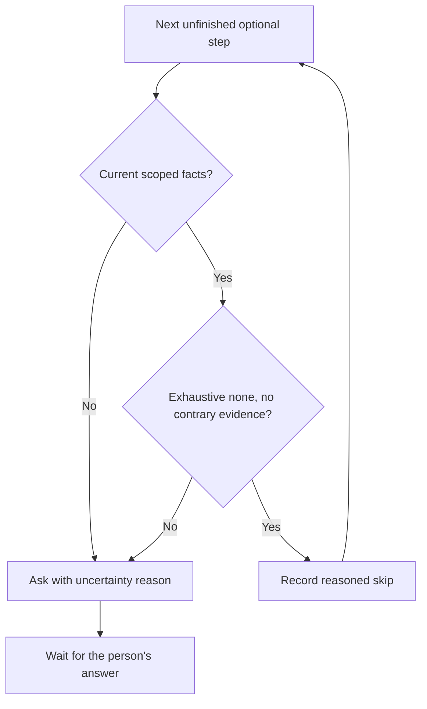

# Workflow runner (area chats)

Own `src/workflow-runner.mjs`. It runs a workflow for one GitHub issue as a few area chats. pdd has four jobs: start, gates, PR and status. The agent does the work. pdd does not watch the agent, run tests automatically, wait with a workflow timeout or merge. The explicit local [old-code proof](workflow-prove.prompt.md) command is the sole bounded supplied-command execution exception; this runner never executes a command from notes or evidence.

## Base selection

`startRun` accepts optional `base`, supplied by public `--base BRANCH`. Without it, use the repository’s actual default branch and retain the fetch-failure warning behavior. With it, require a nonempty branch name, not a revision expression, a full `refs/` name, an option or a filesystem path; slash-separated topic names are allowed. Validate as `refs/heads/BRANCH` without Git’s previous-checkout expansion. Do not alter the resolved repository/default metadata.

For an explicit base, fetch exactly `refs/heads/BRANCH` from `origin` into `refs/remotes/origin/BRANCH`, and verify that tracking ref resolves to a commit. A missing branch, rejected fetch or unavailable commit stops startup with a diagnostic naming the base: no stale/local/default fallback, worktree allocation, saved run, chat start or cancelled-run claim release. The branch must already be on origin so GitHub can use it as a PR base. Never publish the base as part of startup.

Allocate the issue branch from that selected origin ref and save the selection in `baseBranch` and its observed commit in `baseSha`. Keep that saved start commit immutable for replay anchors; inventory comparison below and old-code proof resolve their own fetched-original-base merge-bases without rewriting either saved field. Show the base in startup output. PR 1 (or a small-change PR) targets that saved branch. PR 2 stacks on an open PR 1; after PR 1 merges it starts from and targets the saved base. Existing runs retain their recorded bases. Only the allocated topic branches are pushed; choosing a base does not authorize pushing it, changing origin’s default branch, or merging.

## Adopt an existing approved corpus

`startRun` accepts optional `adoptCorpus`, the declaration path supplied by
`pdd workflow run NAME ISSUE --adopt-corpus FILE`. Preserve existing startup and
changed-scenario discovery when absent. Require a fresh run whose selected areas
explicitly opt in to replay evidence; adoption never enables a custom workflow's policy.
Before releasing a cancelled-run claim, allocating a worktree, saving a run or starting
Herdr, validate the selected base content through `adoptReplayCorpus` in
[replay evidence](workflow-replay.prompt.md#corpus-adoption). Failure exits 2 with a
finite repair reason and the replay owner's cleaned native cause when available; retain historical runs, branches and files unchanged. A failed startup fetch explicitly says that the fetch failed; a generic source-selection or local-operation failure alone is insufficient. Keep private absolute paths, credentials and Simulate URLs out of that diagnostic.

After worktree allocation, revalidate its actual content before saving an active run
or starting Herdr; report failure without fabricating success if it differs.
Save an immutable bounded copy of the declaration bytes and computed digest in the
new run folder, using a realpath-resolved temporary directory even under a symlinked TMPDIR; later validation uses this copy and pinned commit, never a caller
edit of FILE. Removing or changing the external FILE after successful startup cannot
alter or invalidate the frozen authority. Save the successful selection's provenance and the anchor produced by existing
`pinReplayVectors` as `run.replayAdoption` and `run.replayBaseline`. Preserve every
original raw hash and check identity. Adoption reuses exact content authorization;
it neither changes a prompt's approval state nor asks to reapprove unchanged content.
All ordinary workflow gates remain. Announce the external-assertion trust boundary
from the replay owner; never describe adoption as authenticated human approval or execution.

For an adopted run, prompt publication must revalidate the same approved prompt,
required dependency closure and complete declared scenario bytes against the original source.
Keep the adopted anchor; the changed-file refresh rule below applies only without
adoption. Revalidate immediately before entering code and each code publication,
including retries. Freeze declaration digest and declared scope with provenance.
After the automatic publication commit, perform one adoption validation scan per
publication and reuse its result for replay and publication decisions. Retries use
the frozen authority and revalidate current content; an invalid observation must
clear any old PASS before publication, never briefly publish stale PASS.
A changed, added, removed or unreadable covered file blocks reuse
with advice to start an ordinary approval workflow for changed requirements; it must
not replace the anchor or silently fall back to diff selection. Unrelated implementation
changes remain allowed and bind subsequent replay to the current source fingerprint.
The existing changed-scenario guard, public-boundary execution, mutation and formal
checks still apply. Adoption supplies no PASS or fresh execution attestation.

## Failed chat startup and recovery

A Herdr request failure is not evidence that an agent is working. If an initial or later-area start, or explicit open/resume, fails, keep the same run, allocated worktree, selected base, issue claim, completed steps and decisions. Save `chatFailure {area, phase, code, message, at}` (phase `start` or `open`, finite one-line reason), set the active run to `waiting`, and report the failure with `pdd workflow open N` for explicit recovery after Herdr is available. Do not retry the request automatically, restart an unavailable server, allocate again or fabricate a chat/session. A failure after the pane launch request may have dispatched: retain the prepared chat identity supplied by [area chats](workflow-chat.prompt.md), including its unconfirmed flag.

Public detailed, list, all-repository and JSON status group this failure as waiting and show its code/recovery action, never agent working. A legacy active run with no current chat also reports startup unconfirmed, even without the new failure field. A `server_unavailable` observation for an existing chat means status unavailable, not proof it stopped or works. Cancelled/completed status wins over stale failure data. Other transient inspection behavior and the normal new-agent grace period remain unchanged.

Only a successful start/open or positive observation of the same current chat clears its active failure/unconfirmed flag. Restore `running` only when no person question or approval gate is waiting; recovery never approves, advances an area or discards decisions. If Herdr remains unavailable, keep the precise external failure and preserve custody rather than claiming recovery.

## Commands

Each workflow command export takes `(input, ports)` and returns `{exitCode, message}`. The CLI prints the message.

- `startRun({name, issue, agent, base, adoptCorpus, cwd, packageRoot})`: read the areas from the pdd-NAME skill ([areas](workflow-areas.prompt.md)). Read the agent's config folder: `CODEX_HOME` for Codex, `CLAUDE_CONFIG_DIR` for Claude ([chat](workflow-chat.prompt.md) `homeVariable`, `expandHome`). A leading `~` or `~/` is the home folder (zsh leaves `~` as text in `env CODEX_HOME=~/x pdd …`, 0.1.6 tester), and a relative path is resolved from cwd. When it is set and that folder does not exist, refuse before any git, gh, worktree or Herdr work: `VAR is "PATH", but that folder does not exist. Fix VAR and run the command again.` The run keeps the full path as `configDir`, and the Claude trust check reads `.claude.json` in it. Resolve the issue with gh ([GitHub](workflow-github.prompt.md)). Refuse when the issue already has a run that is not cancelled. After a cancelled run, free the issue claim (`releaseIssueClaim`), keep the old worktree and branch, rename the old run folder to `<N>-cancelled-<first 8 of its run id>` and start fresh with a new worktree and branch; the new record lists the old one in `previous`. Select the base as described below. Make the worktree and branch ([worktree](workflow-worktree.prompt.md)). Make the run folder and write the run record ([runs](workflow-runs.prompt.md)). Start the area 1 chat ([chat](workflow-chat.prompt.md)). Print where the run is, `pdd workflow open N`, `pdd workflow status N` and `pdd workflow approve N`. Then return at once. If the main repository is not trusted by Claude, say that Claude asks to trust the folder first.
- `stepDone({step, summary, cwd})`: only the agent calls this, from the worktree. Find the run from cwd. Record the step with its summary and time. The stored summary keeps its line breaks (each line's spaces collapsed, blank lines dropped); every place that shows a summary on one line (status, the code question, the PR step list) collapses it. An unknown or out-of-order step prints a warning and is still recorded. A step that runs again after later steps of its area (for example `build` after `verify` when vectors fail) prints a warning and clears those later steps, so they run again; the area's PR opens only after its last step. Then print one of:
  - the next step of the area and the exact `done` command; use [optional-step decisions](#optional-step-decisions) for optional steps;
  - at an `approve` gate: show the result, ask the person, stop, never approve for them; how they approve; how to handle changes (revise here, run done again, ask again);
  - after the last step of a `pr` area: "pdd opens the PR now". Commit any uncommitted files (with a warning), push and open the PR for this area. The body (0.1.4 #18, 0.1.6) starts with the Runtime check lines of that summary (the check step's, else the latest step that reports one): every "Runtime check (<story>)…: …" line, one per Story (a Story that appears again keeps its place and takes its latest line), then, with two or more Stories, a total that pdd adds up itself: "Runtime check (all Stories)[ (DRAFT)]: ✓ 8 of 8 criteria · 35/35 checks · 17 AI calls" (sum the criteria, the checks and the AI calls, each only when every Story line has it; ✓ only when every Story passes, else ✗; DRAFT when any Story line is DRAFT). A pasted overall "Runtime check: …" line is dropped when Story lines exist, because it can cover only the Stories checked last; a summary with no overall line works the same. Without Story names, keep the Runtime check lines as written. Then "Report (<story>): URL (report links expire after 7 days)" for each distinct report link, in summary order (the Story name comes from a "Report (<story>): URL" entry; a bare link or "Report: URL" or "Report (DRAFT): URL" has no name). The chat pastes the lines that `pdd check` prints into the check step's summary, one per line (with a `Report:` line per Story) or joined with "; " (with one "Report (<story>): URL" per report row); a result ends at a line break, ";", a `Report` entry, a link or the next `Runtime check`. Read these lines from the stored summary, before it is collapsed. Above the Runtime check lines go the verdict line and the before → after line of a bug check (0.1.7): the first "Verdict: …" and the first "Before ✗ …" / "Before ✓ …" / "Before: no prompt …" in the step summaries (the check step's first, then the newest step), each up to its line break, or up to a "; " that starts "Before", "Runtime check" or "Report" (a "; " inside the verdict sentence stays). A report link in the before → after line gets " (report links expire after 7 days)" and is not listed again as a "Report" line. Then the PR head ("Part of #N" / "Closes #N" …), then one line per step since the previous PR, cut to about 200 characters at a word end and never inside a URL (a URL that crosses the end stays whole, and " …" follows it). Only a PR that covers a verify step carries `<run folder>/verify.md`, under "## Verify" (0.1.6 tester: 100 lines of shell before the vector table): drop a leading "# Verify" line, write each "## " heading as "### ", and fold each fenced block of more than 15 lines that is not inside a `<details>` block into `<details><summary>Commands (N lines)</summary>` (sh, bash, zsh, shell or console blocks) or `Output (N lines)`. When verify.md has no `<details>` of its own, keep the text before its first heading on top, then its sections whose heading names vectors or results, then the Formal check, then other sections with a table, then the rest, each group in file order. GitHub refuses a PR description over 65,536 characters (0.1.7 tester: a 105,489-character verify report; every retry failed the same way), so the whole body stays at most 60,000 characters (Unicode code points), which leaves room for the marker and for GitHub's own count. When verify.md does not fit in the room that the rest of the body leaves, the body keeps a summary of it. First each `<details>` block (long commands and output) becomes one line, `- <its summary text>: not shown here.` If it is still too long, keep its first lines that fit, cut at a line end (never inside a link) with an open code fence closed, and then list the lines of the cut part that report a failure (`✗`, or the word fail, fails, failed or failing) under `Lines that report a failure, from the part not shown:`, as many as fit. End the summary with: `_The full verify report has N characters, more than a PR description can hold (GitHub's limit is 65,536). This is a summary: WHAT. The PR author has the full report: verify.md in the run folder._` (WHAT: `the long blocks are not shown`, or `its first N lines; M more lines are not shown, and K of them report a failure`, with `reports` when K is 1). Before collapsing details (authored or generated from long fenced output), retain their failure lines and report references outside the collapsed block. If truncation is still required, consider failures and report references from all omitted content, including collapsed blocks. Keep whole evidence lines and links while room allows; explicitly count omitted failures and report references when they cannot all fit. The full verify.md stays byte-for-byte in the run folder. Failures are never dropped in silence. Local paths never appear: the worktree path becomes repo-relative, the run folder "<run folder>", any other `/Users/…`, `/home/…`, `/private/…`, `/var/folders/…` or `/tmp/…` path "<local path>". Before writing a PR body, replace every Try link (a URL whose path has `/s/<token>`) in the step summaries and verify.md with "(Try link removed)"; report links (`/r/`) stay. When the first line of verify.md starts with "✗" (for example "✗ 2 vectors fail"), retain that warning ahead of the replay/ordinary body while the evidence owner controls the top evidence block. When the body has an interpreter report link, add "Interpreter report links expire after 7 days." A report link is a URL with a `/r/` path segment, or a URL that starts with `PDD_RUNTIME_URL` when it is set. Never fix a runtime host in the code. When the PR exists already, refresh the label/proof top block and, for code PRs, the inventory as required below, preserving publication-pending before changed-source pushes. When the PR does not open, print the message of the [GitHub](workflow-github.prompt.md) result: it names GitHub's own reason when GitHub refused the PR, and says unconfirmed only for a real doubt. A retry builds the same intent again (same run, area, marker, branch and SHA when nothing new was committed) and does not push again. Print the PR URL and "pdd never merges".
  A cancelled or completed run prints that the agent must stop.
- Try before PR 1 (0.1.4 #13): a `pr` area with `"before":"approve"` does not open its PR after the last step. `done` sets the gate kind `approve-pr` and tells the chat to show the Runtime check line of each Story (one per Story: ✓, ✗ or no verdict, as `pdd check` prints it) with its report link and the Try link, ask the person to try it and approve or ask for changes, and stop. Status: "waiting for you: try it, then approve to open PR 1". When there is nothing to try (no step of the area left a Try link, and the try step was skipped or the worktree changes no test file), the gate text says "There is nothing to try. Ask them to approve or ask for changes." and status drops "try it, then " (0.1.6 tester: a browser-only Story). A person-declined try (done.try summary `skipped by the person`) takes precedence even when an earlier check left a Try link: use "The person skipped trying it. Ask them to approve or ask for changes." and omit "try it, then " from status; keep other gate evidence and approval requirements. For PR 1 the gate text also gives the chat the words for what PR 1 holds, read from the worktree's changes against the run base (uncommitted files count): "Tell the person what PR 1 holds, in these words: "PR 1 is ready with the approved Story[, the approved prompt X][, the draft prompt Y][, the prompt Z] and the tests."", with "the approved Stories" for two or more Stories under `user_stories/`, and without "and the tests" plus " It has no test file." when no test file (a `*.json` with `prompt-runtime.program-scenario`) changed. Only the Story area was approved, so a draft prompt is never called approved (0.1.6 tester). `approve` here works like an area gate (chat evidence: any message from the person; terminal: "Approve the AREA area and open PR 1 for …? (y/N)"); it records the decision and opens the PR. With `then: ask-code` the run moves to the code-or-stop gate (new gate time): from the chat, the reply tells the chat to ask the code question; from the terminal, when PR 1 has draft prompts, pdd does not ask about the code PR: it prints PR 1's link and the approve-first line (see Draft prompts) and sends the chat "pdd opened PR 1: URL. … Tell them exactly: "PR 1 is open: URL. <approve-first line>" Then stop."; else pdd asks "Make the code PR now …? (y/N)" — no sends PR 1's link and the stop into the chat and prints "To make the code PR later, run `pdd workflow approve N`."; yes goes on as the code gate (the code branch and chat). A PR that cannot open leaves the gate open; run approve again.
- Two PRs (bug and feature): an area with gate `pr` and `then: ask-code` opens **PR 1** (title "ISSUE TITLE (prompt, Story and tests)" and body line "PR 1 of this run: the prompt, Story and test cases. …" when the worktree changes a test file, else "ISSUE TITLE (prompt and Story)" and "PR 1 of this run: the prompt and the Story. …"; body "Part of #N"). Then `done` prints the PR 1 link, the step summaries (Runtime check line, Try link) and tells the chat to ask "Do you want the code PR now, or stop here and merge PR 1 first?" and stop. This is a gate. When the chat pushes more commits to an open PR 1 at this gate (for example the prompt approval the person asked for), the gate keeps its time, so the person's earlier yes still counts; `changes` moves it. `approve` (terminal y/N "Make the code PR now…", or the person's own words in the chat) starts the code area in a NEW chat on a new branch `<branch>-code`: from PR 1's head when PR 1 is `open` (PR 2 is stacked: base = PR 1's branch), or from the fetched saved base branch when PR 1 is `merged` (base = the run’s selected base). When PR 1 is `closed` or its state is `unknown`, refuse: make no branch, change no run field, and tell the person to check PR 1 and run `approve N` again. The last area opens **PR 2** (title "ISSUE TITLE (code)", body "Closes #N" and "Builds on PR 1: URL"). If PR 1 merges while the run waits at this gate, `status` ends the run as "done at PR 1"; `approve` still starts the code area later.
- Draft prompts: list every `*.prompt.md` that PR 1 changes (diff from the base to PR 1's branch) whose Runtime interface block ([runtime preflight](runtime-preflight.prompt.md) `interfaceBlocks`) has `"status": "draft"`. When there are any, the PR 1 body and the `done` gate text get "Draft prompts: X, Y. Approve them before you merge.", and `status` shows the same line (read again from PR 1's branch each time). The code is built only from approved prompts, so while PR 1 has a draft prompt pdd never offers the code PR (0.1.6 testers: pdd asked "Make the code PR now?" and then refused the yes). The approve-first line is "Approve the prompt[s] first: cd WORKTREE && pdd approve X[ && pdd approve Y]. Then run pdd workflow approve N to start the code PR." (paths shell-quoted). The `done` gate text then tells the chat "Do not offer the code PR yet. Tell the person exactly: "PR 1 is open: URL. <approve-first line>" Stop there." instead of the code question. Status says "PR 1 open (URL); waiting for you: approve the draft prompt[s] first, then make the code PR.", the list "waiting for you: approve the draft prompt[s], then the code PR (PR 1 open)", and Next: "cd WORKTREE && pdd approve X, then pdd workflow approve N (make the code PR)". `pdd approve` writes the prompt and commits nothing, and an approval committed by hand went to PR 2 while PR 1 still said "Draft prompts" (0.1.6 testers). So `approve` at the code gate, while the worktree is on PR 1's branch and PR 1 is open (the run is not done at PR 1, and GitHub says open), first makes PR 1 hold the approval: it commits alone each draft prompt of PR 1 that is approved (and no longer draft) in the worktree ("Approve X, Y"); it fetches PR 1's branch; when the worktree has commits that PR 1 lacks and PR 1 has none that the worktree lacks, it pushes them to PR 1 ("pdd committed your approval of X and pushed it to PR 1." or "pdd pushed N new commit(s) from the worktree to PR 1."); pdd never forces a push. After a push it reads PR 1's description and rewrites its "Draft prompts: …" line to the drafts left, or removes it ("pdd updated the PR 1 description: no draft prompts are left."); a failure there is only a warning. When the commit or the push fails, or PR 1 has other commits while there is an approval to push, `approve` changes nothing else and prints the exact commands (`cd WORKTREE && git push origin HEAD:refs/heads/BRANCH`, or `git pull --rebase origin BRANCH && git push …`) and "Then run pdd workflow approve N again." Then, when drafts remain, `approve` refuses with the approve-first line before any question or chat check. pdd never sets `approved` itself; a read problem lists no drafts. Small-change has one PR with the issue title and "Closes #N".
- `approveRun({ref, cwd})`: only a person approves. When the run's saved config folder (`configDir`, `~` expanded) does not exist, refuse before anything changes: `This run uses VAR "PATH", but that folder does not exist. Make that folder, or cancel the run (pdd workflow cancel N) and start it again with the right VAR.` When pdd runs in an agent session (`PDD_AGENT_SESSION`, `CLAUDECODE`, `CODEX_THREAD_ID`) or without a TTY, it needs chat evidence: a user message in the current area chat's native session after the gate ([approval evidence](approval-evidence.prompt.md)). Messages that pdd sent with `changes` do not count. A terminal in the run's own chat pane also needs chat evidence: `HERDR_PANE_ID` is the pane of one of the run's chats and `HERDR_SOCKET_PATH` is a socket of the Herdr session `pdd` (`…/sessions/pdd/<file>`). A person's own terminal tab in Herdr (another pane, or the person's default Herdr session) with a TTY and no agent variable asks y/N like any terminal (0.1.6 tester). Without evidence, the chat's own agent (`PDD_AGENT_SESSION`) gets plain words to pass on (0.1.6 tester: the chat said "PDD rejected recording your earlier "Go on""): "Only the person can approve, with a reply after your gate question. pdd found none: REASON." and "Do not explain this check to the person. Tell them plainly: "I still need your approval for this step. Reply "I approve" here, or run pdd workflow approve N in your terminal." Then stop and wait." Anyone else is a person in an agent-like terminal (Claude Code's `!` prefix sets `CLAUDECODE=1`, 0.1.6 tester) or in the chat's pane, and gets three lines: "pdd sees an agent environment (CLAUDECODE=1 | CODEX_THREAD_ID is set | stdin is not a terminal)" or "pdd sees the AREA chat's own Herdr pane (PANE)", then ", so it cannot ask you y/N here."; "No approval was found in the AREA chat: REASON."; "To approve, run pdd workflow approve N in a normal terminal (in another terminal tab, for the pane). Or answer the gate question in the AREA chat: pdd workflow open N". REASON is plain: "there is no reply from you (the person) after the gate question" for `user_message_missing`, else "pdd could not read this chat". Only the words differ: the evidence rules stay the same. At the code gate (after PR 1) the chat reply must also hold a yes-word ("yes", "approve", "build the code", "go ahead", "code PR now", "continue"; any case); otherwise refuse with "Not sure you approved. Run `pdd workflow approve N` in your terminal." At other gates any reply from the person counts. Otherwise ask `y/N` on the terminal; the question names the area, the repository, the issue and its title. Closed input (end of file) means no. Before the gate, the terminal may still approve after a second question; an agent may not. Record the decision with its source and text, and clear the chat's question: an approval answers it (0.1.6 tester: status showed the answered "Do you approve … so PDD can open PR 1?" after PR 1 was open). Start the NEXT area as a NEW chat. Its first message lists the approved step summaries, the changed files and the run folder. A `pr` area has nothing to approve.
- `askPerson({text, cwd})`: only the agent calls this (`pdd workflow ask "question"`), from the run worktree, when it needs the person's answer in the middle of a step. Save `question {text, at, area}`; the run waits (`status` and status.json show "waiting for you: QUESTION"). Tell the agent to ask in a plain chat message (not a question dialog) and end its turn, and that the person can answer with `pdd workflow changes N "answer"`. The next `done`, an approval and a change request at a gate clear the question. A question asked before the current gate opened counts as answered: status and `changes` ignore it.
- `changeRun({ref, text, cwd})`: at a gate, when no question is open and the text is a plain approval, send nothing and exit 2 with "This looks like an approval. To approve, run: pdd workflow approve N" and "Nothing was sent to the chat." (0.1.6 tester: "I approve. The Story and the prompt look good now." became a change request). A plain approval starts with an approval phrase ("approve", "approved", "I approve", "lgtm", "looks good, approve", optionally after "yes" or "ok"; any case) and the rest has no change word ("but", "change", "rename", "add", "remove", "fix", "use", "make", "not", "don't", "without", "only" and the like); an approval word with a change word is a change request. Otherwise deliver the text into the SAME area chat under [Change-request custody](#change-request-custody). After `ask` it is the answer ("The person answers your question: TEXT Go on with the step."); it clears the question and the run works again. Otherwise it is a change request ("The person asks for changes: TEXT …"); record the round; at a gate the gate stays open and its time moves to now. When Herdr refuses because the chat shows a question dialog (`agent_blocked`), say that pdd cannot type into a dialog and the person answers in the chat (`pdd workflow open N`). Answers, like change requests, never count as approval.
- `cancelRun({ref, cwd})`: mark the run cancelled and close its Herdr tabs. Keep the worktree and the branch.
- `runStatus({ref, cwd, all, json, cancelled})`: with ref, show one run: the issue, the area, the steps (each step summary on one line, cut to about 120 characters like the PR step lines, never inside a URL), what pdd waits for, the chat, each PR with its state and CI, the worktree and the run folder. When the newest source-compatible evidence has Runtime check lines, `status` shows "Stories: N of M Stories pass" (with "(✗ story, …)" for the failing named Stories); the list line adds "N of M Stories pass", and JSON adds `stories {pass, total, failing, unknown?, evidence?}`. Per-Story lines count, the latest line per Story; a summary with only an overall line is one Story. Status reads the current chat with one Herdr call (`agent get`) for a running run and for a run at a gate. A running run whose chat Herdr reports as `blocked` (a question dialog) shows "waiting for you: the chat asks a question in its window". When no agent runs in the chat's pane (Herdr `agent_not_found`, or `server_not_running` for the pdd session) at least 30 seconds after the chat started or resumed (Herdr sees a new agent only after it starts), a running run shows "the chat stopped. Run pdd workflow open N to start it again." and the list "the chat stopped: run pdd workflow open N" in the waiting group (0.1.6 tester: a chat that died at its start was "working" for 10 minutes). At a gate, while Herdr reports the chat as `working`, the gate text is not written yet: status shows "the agent writes the gate message for the AREA area" (list "agent writing the gate message", group working), or after a change request to that gate "the agent works on your changes to the AREA area" (list "agent working on your changes"); "waiting for you" comes when the chat ends its turn (0.1.6 tester). Any other Herdr answer or failure keeps the words status had, and status never fails because of this check. Without ref in a repository, list that repository's runs (inside a run worktree, show that run). With `all`, or without ref outside any repository, list every run on this machine ([all runs](workflow-runs.prompt.md)). A list has one line per run: `owner/repo#N · workflow · area · state words · PR #a #b · last change time`, sorted: waiting for the person, then agent working, then PR open, then done, then cancelled; newest first inside each group. State words: "waiting for you: approve the AREA", "waiting for you: code PR now or stop (PR 1 open)", "agent working on STEP", "PR open" / "PR 1 open" / "PR 2 open", "done", "done at PR 1", "cancelled". Cancelled runs are hidden unless `cancelled`; then say how many are hidden. End with "Review without resuming: pdd workflow view owner/repo#N", then "Open one: pdd workflow open owner/repo#N". Each JSON run adds `viewCommand: "pdd workflow view owner/repo#N"`. Detail status includes the same read-only review command. `json` prints `{"runs":[{ref, repo, number, workflow, area, group, words, prs:[{number,url,state}], updatedAt, root, runDir}]}` instead. Read PRs with gh only for runs that wait on a PR, and for the one shown run; a merged last PR completes the run. At the code-or-stop gate (and when the run is done at PR 1), say plainly: "To make the code PR later, run `pdd workflow approve N`." The code question itself, which the chat asks exactly, ends with that sentence (a real run showed the chat drop it after "stop"); the gate text also tells the chat to say "PR 1 is open: URL. To make the code PR later, run `pdd workflow approve N`." when the person stops, and the terminal stop path prints and sends the same sentence. Write the run record only when a PR state, run state, chat failure or launch confirmation changed, so the last-change time stays true.
- `openRun({ref, cwd})`: refuse like `approve` when the run's saved config folder does not exist. Focus or attach the current area chat. When its native session ended, resume it in its tab. When the area has no chat yet, start it.

`ref` is an issue number, `owner/repo#N` or an issue URL ([selection](workflow-runs.prompt.md)). Without ref, use the run of the current worktree, or the only run of this repository that waits for a person.

## Rules

- No workflow timeouts, no background polling loop, no foreground controller and no automatic test runs. A changes invocation may wait only for the local [area-chat readiness deadline](workflow-chat.prompt.md#message-delivery). Explicit old-code proof has its own bounded execution contract. Source fingerprints below bind evidence; they do not create execution snapshots.
- Light checks warn and never break the run. Errors that stop a command say what to do next.
- Never merge. Never push to the default branch. Never touch the person's default Herdr session.
- Messages to the agent are short. The first message of an area chat is about 10 lines: "Use the pdd-NAME skill: <the SKILL.md path that the lookup chose>" (an installed copy with the same name may be older), the issue number, title and URL, the worktree, the run folder, the area and its steps, the `done` rule, the gate rule, and "Read the PDD skills (pdd-prompting too) from <absolute package>/skills: an installed copy with the same name may be older." (an `npx skills add` or `pdd setup` copy is not updated with pdd). Never paste the guide or the workflow text.
- Commands that pdd prints for the agent use this package's absolute node and `bin/pdd.mjs` paths, shell-quoted. Export them as `pddCommand(packageRoot)`, so a bare `pdd` on an older PATH is never used.

## Informational test inventory on code PRs

For feature/bug PR 2 and the single small-change code PR, collect the [test inventory](workflow-inventory.prompt.md) after automatic commits. Resolve one committed head SHA, fetch the original `run.baseBranch` from `origin` with the explicit `refs/heads/BRANCH:refs/remotes/origin/BRANCH` refspec, then compute the merge-base of that head and the freshly fetched original base commit. Pass `{cwd:run.root,baseSha:mergeBaseSha,headSha}` with those exact resolved SHAs. The original branch remains the run's selected base (for this run, alpha), including when PR 2 targets an open PR 1 branch: using PR 1 as the comparison base would hide its test changes. A later merge of alpha must exclude alpha-only changes while retaining PR 1's cases. Do not change `run.baseSha`, replay anchors, or PR target selection; old-code proof independently selects its comparison base under its owning prompt. Recompute before every create, retry and existing-PR update, independently of replay opt-in; PR 1 receives no inventory and still follows its required label refresh. A fetch, merge-base or commit-resolution failure produces an informational unavailable comparison with a bounded cause; never substitute a stale tracking ref or the saved start SHA. The inventory owner defines recognition, availability, escaping and report limits.

Insert inventory `text` into the slot reserved by [PR evidence preparation](workflow-pr-evidence.prompt.md): after its machine old-code proof and before its Review lines. Keep the helper's other label order and its precedence over ordinary verdict, before/after and Runtime-check prose; the entire evidence block precedes all replay status blocks, and a leading verification-failure warning remains ahead of replay and ordinary body content. The first line of the inventory block starts `Tests vs base:`. Append `Test inventory commits: BASE → HEAD.` at the end of the inventory block using the first seven hexadecimal characters of the exact compared SHAs; retain the full pair only in local provenance metadata and the artifact. If no pair could be resolved, append `Test inventory commits: unavailable.` without suggesting an old pair was compared. Preserve the analyzer's exact static disclaimer.

Save the complete result and full base/head identity only in `test-inventory.json` in the run folder through the existing file-writing boundary. The run/status record keeps bounded `text` and provenance/artifact-custody metadata only; never copy `details` or the full report into it. Store only `{text,baseSha,headSha,saved}` with full resolved SHAs (empty strings if unresolved), where `saved:true` means this collection's complete artifact write succeeded and `false` means it did not. Do not store duplicate `available`, `reason` or `details` fields in this record. Warn and disclose a failed artifact write in the visible text; never claim the full report was saved. Keep existing redaction, canonical ownership marker, failure/report visibility and the 60,000-code-point whole-body budget.

An inventory failure, removal, changed assertion, new skip, or unavailable comparison never adds a gate or prevents commit, push or PR creation/update. Catch collection errors and render an explicit unavailable report. On existing code PRs refresh the body after a successful push with the current report, including runs without replay evidence. Send every refresh via argv-based `gh pr edit … --body-file -` with the complete body in the process port's `input`; never recreate a replay-body file or pass a host path as the body source. An inventory-only body-edit failure prints its cause and retry command as a warning, without undoing or refusing publication. The PR evidence owner's proof publication-pending/final-edit safety requirements and existing replay safety failures retain their stronger behavior. A failed informational body refresh can leave the previous visible inventory in GitHub. Its displayed commit pair identifies that older comparison; warn explicitly that the PR still shows the previous inventory, identify the new comparison with short SHAs when resolved, and say whether the current full report was saved locally. Do not describe that failed refresh as current. Existing push/GitHub ownership and replay safety rules still apply.

## Dependencies

- [Workflow areas](workflow-areas.prompt.md), [run records](workflow-runs.prompt.md), [approval evidence](approval-evidence.prompt.md), [GitHub](workflow-github.prompt.md) and [worktree](workflow-worktree.prompt.md).
- [Area chats](workflow-chat.prompt.md#message-delivery): required authoring/generation/verification/testing context for bounded readiness, transport acknowledgements and uncertain delivery; this runner owns request custody and retry order.
- [PR evidence preparation](workflow-pr-evidence.prompt.md): required authoring/generation/verification/testing context for the real `src/workflow-pr-evidence.mjs` module function `preparePrEvidence({run,isCode}, ports)`. Both PR creation and updates must call it with the actual saved-run projection and native ports; insert its lines/reference through the existing body protections. It owns lifted labels, machine proof freshness, reference substitution and their publication-refresh requirements. No alternative test-only renderer.
- [Old-code proof](workflow-prove.prompt.md): required generation/runtime/verification context for machine result schema, classification and provenance; runner consumes results without executing proof.
- [Test inventory](workflow-inventory.prompt.md): required authoring/generation/runtime/verification context for collection and the informational report.
- [Replay evidence](workflow-replay.prompt.md): required generation/runtime context for policy, source fingerprints, original anchors, validation and formatting.
- [Product marker format](../../skills/pdd-product/references/files.md#planned-run-identity): required generation/testing context for the optional saved product association and its PR description line.
- [Simulation command choice](simulate-command.prompt.md): required generation/runtime/verification/testing context for the single production chooseSimulationCommand function; workflow try advice calls it, and future #2760 will reuse it. The declared call maps natively to optional `ports.chooseSimulationCommand`, defaulting to the imported production function; injected instrumentation obeys the same contract and delegates to that helper without supplying policy.
- [CLI adapter](try-doors.prompt.md): required generation/runtime/verification/testing context for usable CLI entry selection, both schema conventions and the safe H1 program-name rule used by local simulation facts.
- [HTTP adapter](try-http.prompt.md): required generation/runtime/verification/testing context for the route-title method/path rules used by local simulation facts.
- Ports: `execFile` (git and gh), `herdr`, `env`, `stdin`, `stderr`, `confirm`, `readApprovalEvidence`, `stateDir`, `now`, `pdd` (the command prefix). Defaults are the real ones.

- [Run records](workflow-runs.prompt.md) supplies the existing state/selection/write and question/status representations for authoring, generation, runtime and native replay. Its runner navigation links are not required back-dependencies; no required-context cycle is introduced. Preserve all record fields outside this change.
- `runStore.load` returns an empty record string when no run exists. `runStore.save` receives compact `JSON.stringify(record)` (the existing native store still controls its on-disk formatting). `runStore.load` and `runStore.save` below transport the actual runForWorktree/writeRun boundary as compact JSON text. They map to `ports.runForWorktree(cwd, ports)` and `ports.writeRun(record, ports)`, defaulting to those existing imported functions; adapters serialize/parse the same full record, never a check-only projection. The save adapter returns `{record}` with the saved compact JSON text. Save retains run-store atomic writing and status derivation. Runtime transport takes/returns JSON strings only to preserve unknown saved fields. The runner's existing clock is resource `clock.now`; its callback `ports.now()` returns the integer timestamp (the Runtime clock port permits an audit write so fixed-reply fakes can record reads) and the supplied pdd command is `pdd` in Runtime scenarios. Native replay can supply the same command string through the existing pdd port.
- `evidence.readOptionalEvidence` is the actual injected reader above; `compute.hash_utf8` maps to `ports.hashUtf8(text)` (default native SHA-256) and returns `{value}` for exact UTF-8 bytes. These ports supply all outside facts for the optional decision. No Herdr, GitHub, provider, approval or execution port is called on a next-step decision. The Runtime entry covers stepDone's recording/next-step branch, including optional skips; existing gate/publication effects still require their native lifecycle checks.

## Recover a missing unconfirmed area tab

When opening returns restartAvailable after confirmed missing tab and agent/pane, archive that chat record with its original identity, clear it from active chats, keep the run/worktree/branch, decisions and completed steps, and leave the run waiting. Tell the person to run pdd workflow open ISSUE to start the same area again. Do not start a replacement in that invocation. An unavailable inspection or live original agent cannot clear an uncertain start. The next explicit open may create one fresh chat for that area.

Before creating PR 2's code branch, fetch its chosen remote branch with the explicit refs/heads/BRANCH:refs/remotes/origin/BRANCH refspec. A failed or rejected fetch stops before switching or creating the code branch; never silently choose a stale base. The saved selected base, repository default and other branches remain unchanged. Invalid --base examples use a neutral feature/checkout branch.

## Newest source-compatible runtime evidence

For Story counts, prefer the newest timestamped Runtime-check evidence across completed steps (including verify) and explicit evidence records, rather than always preferring check. Break equal timestamps by record order. A later partial summary updates only its named Stories; retain compatible earlier Stories and their report provenance. UNKNOWN/running/busy/not-run remain unknown, never failing. Only explicit ✗ names a failing Story. Show unknown names/counts in detail, list and JSON.

Bind each new step containing Runtime-check lines to the current Git-visible source content (paths, file bytes, executable bits and symlink targets; not commit identity alone). Recompute before using it, so uncommitted edits invalidate old evidence and byte-identical commits remain compatible. Legacy unbound or unreadable/stale evidence may identify Stories but cannot assert current passes or failures: show unknown with a source warning. Preserve prior records when steps are replaced/cleared, without changing step/gate semantics. The status/runtime-evidence change alone does not rewrite existing PR bodies; label/old-code proof publication refresh remains required below.

Export `recordEvidence({ref, summaryFile, cwd})` for `pdd workflow evidence ISSUE --summary FILE`. FILE must be saved JSON from `pdd check ... --json` or `pdd check --read BATCH --json`, with repository, nonempty unique rows/test paths, per-Story Runtime-check lines and a full source_sha256. Verify repository/worktree ownership and recapture exactly those selected tests; require the identical source SHA. Reject malformed, foreign, missing-identity or stale evidence before writing. Each row Story must match its selected test; validate per-Story summary lines against structured row states, criteria, checks and usage rather than trusting a free-form pass mark. Preserve the original supplied summary/provenance and timestamp it as newly recorded; store its selected test paths and runtime source identity. Subsequent status recomputes that capture. A record may retain an older byte-identical receipt; do not demand a new run or spend models. Missing or stale source never overrides compatible evidence.

The evidence command writes only the local run record/index and append-only evidence history. It never executes tests, changes completed steps, state, gate/question/approvals, chats, Git files/refs, commits, pushes, PR bodies or PR state, and makes no gh/Herdr/network call. It also works after a PR is open or a run completes. Explain that the saved JSON is evidence, not fresh execution or approval.

## Progress and causes

pdd always says what happens. An optional `ports.say(text)` prints one progress line to stderr in the [progress](runtime-output.prompt.md#progress-and-causes) style; without it the runner stays quiet (tests). Say one line before each slow step: `Reading issue N from GitHub…`, `Fetching origin/<base>…`, `Making the worktree and branch for #N…`, `Starting the <area> chat in Herdr…`, `Pushing <branch> to <PR label>…`, `Pushing <branch> and opening <PR label> on GitHub…`, `Reading PR 1 on GitHub…`, `Making the code branch…`, `Opening the <area> chat in Herdr…`, `Closing the chat tabs in Herdr…`, and `Reading N PRs from GitHub…` before status reads them. The final message stays the single result. A failed gh, git or Herdr call names its real reason in the failure line: a missing program is `<herdr|gh|git> is not installed or not on PATH`, else the tool's cleaned first stderr line (gh's `detail`), else its code.

## Structured replay evidence in code space

Only a saved area's explicit replay_evidence=pdd.replay-evidence.v1 activates this policy. New bundled
feature/bug code areas opt in; saved runs/custom areas without it keep their existing publication behavior.
The runner owns the anchor lifecycle and current inventory guard. After each successful prompt-space
publication or push preceding an opted-in area, refresh run.replayBaseline from the published changed
scenario files through [replay evidence](workflow-replay.prompt.md), retaining empty or blocked selections.
Include publications while waiting for code approval and the final approval publication before entering code
space. At that final transition require scenario bytes to match the published prompt-space head; refuse with
repair advice if unpublished scenario edits remain. Never silently approve or anchor dirty unpublished vectors.
Freeze the final published anchor on entry into code space; code steps, publication retries and later edits
cannot replace it. For a merged prompt-space branch retain its published anchor, never reconstruct from code.

Discover changed files with NUL-delimited Git diff and untracked-file lists, preserving each exact path,
including spaces, line breaks and non-ASCII characters; do not trim raw list output. Scenario classification
uses parsed JSON with exact schema_version `prompt-runtime.program-scenario.v1`, not a text substring.
An enumeration failure or unreadable/unclassifiable candidate makes the replay inventory unavailable;
never silently skip it or turn a failed read into an empty successful selection.
Before every opted-in code publication, after automatic
commits and also on retries or updates, independently enumerate current changed scenario files against the
saved run base. If any current scenario path is absent from the frozen anchor, report BLOCKED with the missing
paths even when the manifest covers every anchored check. An unavailable inventory cannot establish PASS.
This guard precedes replay validation and does not require a new replay-module API.
For opted-in code steps, read and save the structured result as run.replayEvidence and on the step record;
show its status separately from free-form summaries. Revalidate after automatic commits immediately before
publication, including retries and updates of an existing code PR. The canonical report goes above every
Runtime check, prose PASS claim or verify.md and retains assertion/formal failure lines. Missing, stale or
malformed reports publish as BLOCKED/NOT REPLAYED, never PASS. Real assertion failures remain publishable;
the policy qualifies evidence rather than preventing every failing review. The report and RUNBOOK explicitly
state the CLI's structure/identity trust boundary; replay validation never executes tests or supplied commands; explicit old-code proof is separate.

For a previously opened opted-in code PR, replace its body with a prominent BLOCKED publication-pending
report before pushing changed source, then set the final newly validated report after a successful push.
If either description update fails, report the exact failure and retry command; never push new source while
the description still asserts an old PASS. For non-opted existing PRs, follow the PR evidence owner's label/proof refresh and publication-pending requirements; code PRs also receive the informational inventory refresh. Inventory-only warning behavior cannot weaken either proof or replay publication safety.
Preserve the single canonical workflow ownership marker on both descriptions, rejecting stray supplied markers.
Honor structured nonzero command exits as failures. The bounded whole-description policy and redaction still apply. Full JSON stays in the run folder.
Use sourceFingerprint from the replay module for the existing runtime-evidence git-content-v1 identity,
preserving its representation. This does not turn prompt-runtime checks into code replay evidence.

## Product-run association

At startup, inspect the actual resolved `binding.issue.body` for the
[planned-run marker](../../skills/pdd-product/references/files.md#planned-run-identity).
Save its full canonical HTML comment as optional `productMarker` only when one
unambiguous planned-run marker is present. Do not persist the issue body or
infer a product association from its title or branch suffix. Multiple distinct
markers produce a warning and no `productMarker`; ordinary issues and legacy
records without this field retain their normal behavior. No new publication
lookup or gate is added for a legacy record.

Carry a saved `productMarker` once, on its own line, into both PR descriptions.
It accompanies the existing unique workflow ownership marker and never replaces
or weakens that marker's checks. The workflow allocation branch suffix and the
workflow `runId` are independent identifiers; do not infer one from the other.

## Shared Story evidence

Export module functions `matchesSource(record, root, fingerprint)`,
`storyCount(run)`, `runtimeLines(text)` and `storyEvidence(run, {comparisonRoot} = {})` for read-only product status. Preserve
existing status counts and source matching. `runtimeLines(text)` preserves the
existing parser's `{story,draft,result,line,pass}` rows, including null unnamed
Stories, DRAFT flags, result boundaries and pass recognition.
`storyEvidence` reuses the same
evidence ordering, named-line parsing and source checks; return each latest
named Story as `{story, pass, current, result, at}`, retaining the selected
record's `at` timestamp in epoch milliseconds (0 for a legacy missing timestamp).
This freshness metadata lets consumers compare receipts from different runs;
equal timestamps retain the existing stable record order. Prefer compatible evidence for a
Story, retain partial earlier compatible results, and otherwise report the latest
unverified record with `current:false`. No record means no row. It must not write
state, refresh PRs, call models or start chats. Product status may use the rows
for attribution; it must not copy this evidence policy.

`comparisonRoot` selects only the files against which the saved source is
checked. Omission preserves `run.root`; an explicit path checks that checkout
or snapshot without changing the run, its records or their location. Explicit
null means no comparison source is available: retain the latest rows as
unverified, never fall back to the old worktree or report a current pass.
Both capture-based matching and legacy Git-content matching use the selected
comparison root through the existing matching policy.

## PR evidence integration

Call the production [PR evidence preparation](workflow-pr-evidence.prompt.md) boundary for both new and updated PR bodies, including relevant PR 1 updates. Its `{lines,issueReference,proofStatus}` replaces only the owned top evidence/reference content; preserve all existing caller, approval, stacking, publication-pending-before-push ordering, marker/redaction/report/body-budget behavior. Pass `isCode` false for prompt-space and true for code/small-change, and derive the helper's known ordered step projection, workflow type and selected baseBranch from the saved run/workflow. Keep saved run.baseSha unchanged. The helper's entire top evidence block precedes all replay status blocks (including PASS, BLOCKED, NOT REPLAYED and publication-pending); this display order does not relax pending-before-push safeguards. Native integration must provide real current Git-head and direct note/machine-record readers. Compose the helper's lines with the current inventory at its reserved slot, using only the inventory collector's result; summaries and notes cannot supply machine proof or inventory text. The helper's Interpreter pass does not prove the runner uses it or that GitHub edits/pushes occur in the required order; native lifecycle tests remain required.

## Change-request custody

Module function `changeRun({ref,text,cwd}, ports)` retains its existing selection, ended-run, empty-input and approval guards. Check them before acquiring a journal claim, accepting custody or transporting, so contention cannot hide the approval hint. Normalize only this command's user input with existing `oneLine`: collapse whitespace and trim it, preserving quote characters. Save and envelope that one-line text; generic `sendToChat` messages keep their supplied line breaks. If the current area has no chat record, return the existing clear no-chat reply with `pdd workflow open N` advice immediately, accepting no request. After opening it, the person can repeat the command against that chat's own startup window.

<details>
<summary>Authoritative journal and short claims</summary>

The runner owns `<run folder>/delivery-journal.json`, with stable JSON root `{requests:[]}`. It is the sole authority for accepted request identity, normalized text, answer/change kind, original area/pane, acceptance time, state and submission intent. Ordinary run/status writes cannot change it. Initialize an absent journal empty; do not import the unreleased `run.deliveryRequests` field. Read errors or malformed data are actionable failures, never permission to erase the queue. Durable atomic journal replacement precedes any corresponding transport effect.

Use `<run folder>/.delivery-journal.lock` as the short journal claim namespace, only around journal reads/updates and immediate run-state checks, never across readiness waits or transport. Each claim acquisition retries contention asynchronously for at most 250 ms of monotonic elapsed time, permitting other owners to release, including when saving a successful submission's acknowledgement; if still busy, explain briefly to wait and retry. Claim owners carry PID and hostname. Reclaim only a confirmed dead owner on this host; preserve live, foreign-host, malformed or unverifiable owners, including permission-check failures. Age alone never establishes death. Publish ownership atomically and completely, ensure at most one claimant enters, and release/reclaim only the observed owner's record. Unrelated stray files do not establish ownership or block acquisition. Do not use per-target dispatch claims, birth/start-time comparisons, signal handlers or retry-receipt state. Leave the private locking algorithm free.

Native journal/filesystem, owner-liveness/hostname, token, clock and delay boundaries are injectable with production defaults. A failed custody or submission-intent save sends nothing. An acknowledgement-save failure cannot turn a possibly submitted request back into retryable pending. Recovering a journal claim never resets submission intent.

</details>

Within the original area/pane, identical normalized text **and kind** share the accepted id while pending or in-flight. Different text or answer/change kind creates a distinct request in acceptance order. The same target/text/kind identity governs uncertain-repeat suppression; a different kind is a distinct request, not a resend of the uncertain id. Each invocation retains its accepted id while waiting, even if the answered question later clears. Before transport, re-read that id under the short journal claim: only a definitely-unsent pending request may become in-flight. This durable pending-to-in-flight transition is the duplicate guard. Retain minimal in-flight ownership (PID, hostname and invocation identity) to distinguish a still-active sender from a confirmed abandoned submission; only same-host confirmed death or the invocation's own completed failure establishes abandonment. Foreign, live or unverifiable owners remain protected. An abandoned intent is uncertain, never automatically retryable. A cojoined caller observing in-flight reports that delivery is in progress, without claiming the request is kept for retry or printing a Retry command; one observing delivered reports already delivered and creates no round. An ordinary command first accepted after acknowledgement is a new intentional request, including identical text and repeated answers such as "yes". Acknowledged requests are never replayed.

Attempt definitely-unsent requests FIFO for the same target. An earlier definite failure or active in-flight request stops later pending requests for that target. Skip uncertain entries with a warning; they do not block later new work. Never automatically resend an uncertain request or submission intent whose outcome is unknown, including when the person repeats its text. An interrupted pending readiness wait remains retryable; interruption after recorded intent preserves possible submission and cannot permit duplicate transport.

Use [area-chat delivery](workflow-chat.prompt.md#message-delivery) for the original target, without automatic open, resume or restart. Its `beforeSubmit` callback re-reads current run identity under the short journal claim, validates the original area/pane and accepted id, and durably records submission intent before returning true. An allowed retry after a confirmed definitely-unsent rejection may reuse only this invocation's own intent. A confirmed rejection restores pending; an ambiguous result or failed acknowledgement save retains uncertainty. Release the journal claim before waiting or transporting. A changed target retains the request for its original target and never redirects it into another pane or area.

On `chat_still_starting`, exit nonzero and say the chat is still starting and the request is kept. Put brief wait/open advice before one `Retry:` command with the entire normalized request shell-quoted, even one word. A genuinely absent old chat retains the sentence `The <area> chat is not running` with open/retry advice. Blocked or unavailable results retain custody with dialog/open/retry advice. A repeated uncertain request says it **may already be in the chat** and tells the person to open/check that original chat and type it there if absent; it must not appear to be a fresh uncertain send. The same warning accompanies later new work. Never claim delivery for pending, in-flight or uncertain state.

After acknowledgement, durably mark only that request delivered and apply existing answer/change effects once: answers clear only their answered question; changes keep an approval gate open and record one change round. Re-read the latest run for these effects so newer questions, gates, steps, decisions and area progress survive. The authoritative journal prevents older run writers from reverting delivery or causing replay. Delivery never approves or advances an area, selects another session or alters approval evidence.

The Interpreter entry below is scoped to the existing public `changeRun` operation (string refs and explicit cwd). Native journal/claim durability, process recovery, merge-on-save, Herdr and Git effects are unbound here and require native tests; this declaration is not an Interpreter proof of those effects.

## Optional-step decisions

PDD owns applicability and recommendations, including the uncertainty decision. Only visual may skip automatically; try always asks and can be skipped only by the person. Preserve workflow.json version 2, saved step IDs `visual` and `try`, and public commands `pdd workflow run` and `pdd simulate`. Initial area guidance says to follow PDD's next-step decision from `workflow done`; it must not pre-authorize an optional question. For each relevant writer (understand and prompt-story), it supplies the facts block shape, absolute note path, current saved base/revision, and absolute package prompt path with `#optional-step-decisions`; refreshed guidance carries the new revision. The author can fill it without another command. At start save `optionalPolicy: "pdd.optional-facts.v1"` only for package-sourced feature/bug workflows. Only opted-in feature `visual` and feature/bug `try` use the facts below. Project/home workflows and legacy saved runs without that policy always ask with the custom-step reason below; never retrofit policy from current workflow files. Other optional steps also always ask with that reason. Do not infer applicability from repository names, extensions, filenames, Story words, absent default maps or absence of changed scenarios.



The skip branch applies only to visual. Try goes directly to the question branch regardless of empty/unknown facts. The return from a visual skip selects the next unfinished step in the same area; when none remains, use the existing gate. Never cross an approval gate, approve a prompt, open a simulation, run a command or publish a PR merely because of applicability. A required step ends this selection with its existing guidance. Already completed/person-skipped steps stay completed under the existing rerun rules.

<details>
<summary>Scoped facts in private step notes</summary>

Read exactly one fenced `pdd-optional-facts` JSON block from `<runDir>/understand.md` for feature visual, or `<runDir>/prompt-story.md` for feature/bug try. Reproduce may draft the latter facts; prompt-story owns the current simulation facts. Never extract facts from a done summary or person-facing Story prose. This is a local author assertion with recorded provenance, not independent attestation of the brief.

The block has exactly `schema_version: "pdd.optional-facts.v1"`, `base_sha` (the saved run baseSha), `revision` (run.optionalRevision, default 0), `basis` (nonblank quoted requirement/source reference), `scope` (nonempty unique `{path, planned}` rows: repository-relative prompt path and Boolean planned), `evidence` (unique `{path, sha256}` local source references), `screens` and `simulation`. Paths cannot be absolute, contain parent traversal or select symlinks. Hashes are lowercase SHA-256 of current exact UTF-8 source bytes. An empty evidence list is allowed for an explicit brief recorded in basis; inventory alone cannot author an empty fact.

A scoped path may be absent only when its scope row explicitly says planned true; a missing existing path is unknown.

`screens` is null (unknown) or an exhaustive array for this change. Each row is exactly `{id, prompt_path, app_map_path, planned}`: nonempty id, a prompt_path named in scope, Boolean planned, and app_map_path null for planned screens or the exact repository map path for existing screens. Planned screens count before their files exist; their scope row must also be planned true. Existing rows must match a usable map screen with the same id and prompt_path. Identity is `(app_map_path,id)` for existing screens and `(prompt_path,id)` for planned screens; duplicates are invalid. `screens: []` explicitly asserts no affected or planned page/screen, rather than an empty repository inventory.

`simulation` is null (unknown) or an array of `{story_path, scenario_path, entry_path, operation}`. Every field is a nonempty repository-relative path except operation, a nonempty operation name; entry_path belongs to scope. A row must resolve to an actual Git-visible Story with acceptance criteria, a locally valid program-scenario.v1 file linking that Story, and one of its steps linking entry_path/operation to a declared Runtime entry in that prompt. These local links are a "Simulator door"; HTTP routes and screens are not required. Repeated identical rows are invalid. `simulation: []` supplies no known door; it never permits skipping try. A known preview without such a door remains unknown and asks. No local fact claims remote setup will succeed.

Missing/multiple blocks, missing/extra/wrongly typed fields, unreadable sources, mismatched hashes/base/revision, incomplete inventory and conflicting declarations make the relevant decision unknown. Never treat these as empty arrays. A valid block with null for one surface can still establish the other surface. Do not reinterpret basis prose to change the typed declarations.

</details>

<details>
<summary>Repository evidence, exact outcomes and repeat questions</summary>

`ports.readOptionalEvidence({root,notePath})` supplies `{snapshot:{note,error,complete,files}}`; each file has `{path,text,error}`. Its native default reads the private direct note and enumerates Git-visible tracked/untracked JSON plus declared scope/evidence files and their local prompt/drawing links through injected Git/file ports. Preserve NUL-delimited paths; do not follow symlinks, secret-looking paths, parent traversal or remote links. `complete` is true only after successful enumeration and all selected reads. Missing planned prompt files are allowed; other missing selected files or failed reads are unknown. A thrown callback is unknown. Snapshot limits are 10,000 files / 10 MiB; exceeding them is unknown. JSON extensions select a format to inspect, never a UI/no-UI fact.

Recognize app maps by parsed schema_version `prompt-runtime.app-map.v1` and nonempty name at any enumerated path, including alternate maps. A usable screens array has unique nonempty ids and valid screen references: operation screens name prompt_path/operation, source operation, format html/text/grid and a string result_pointer; mockup screens name prompt_path, source mockup, null operation/result_pointer and format svg. Input must be an object. Duplicate/malformed rows or a malformed selected/previously recognized map/scenario are unknown. Any unparseable enumerated JSON also leaves absence unproved. This conservative inventory is local recognition, not remote app-map validation.

A screen is associated with scope by its prompt_path or a map handler's prompt reference to a scoped entry (`screen: "*"` selects all map screens). Scoped router/routes/after references whose screen cannot be resolved leave screen association unknown. Unrelated valid maps/screens cannot supply an affected-screen count or contradict a grounded no-screen declaration. Every associated existing screen must appear in the exhaustive facts; a scoped prompt's linked `.ui.svg` contradicts screens: [] unless its owning screen is accounted for. Enumerate actual scenario-to-entry links similarly: a scoped valid door absent from the declarations makes them incomplete; a malformed/unreadable candidate or unresolved entry leaves capability unknown. A malformed map affects visual; a malformed scenario affects try; unreadable/unclassifiable JSON affects both. Preserve Screen-only maps without HTTP routes.

For known empty visual facts with no contrary evidence, save `done.visual` using the ordinary `{at,area,summary}` record and summary `skipped: no screen`; print `Skipped visual: no screen.`. Continue within the area and do not prompt for that automatic skip. Never create an automatic done.try record; missing, empty or unknown simulation facts always ask.

Every actual question includes `Recommended: yes. REASON`. Visual may put this on its own line; try is exactly one line and is asked once, without follow-up persuasion after no. Visual question: `Do you want a visual design step? yes/no`. Reason for known screens: `This change has N screen.` (N=1) or `This change has N screens.`. Unknown visual reason: `PDD cannot determine this change's screens from current scoped facts.`. Try question: `Do you want to try it now? yes/no`. For a known door, call the production [simulation command chooser](simulate-command.prompt.md) exactly once with the first valid row's Story path and its validated capability counts. Use its reason verbatim and, when its command is nonempty, append ` Command: ` followed by the command in an inline code span and `; time: HINT.` on that same question line after Recommended. Use an adaptive backtick delimiter longer than any run in the command. Do not invent another chooser. Unknown try reason: `PDD cannot determine this change's runnable interface from current scoped facts.`. A chooser unknown uses its returned honest reason and no invented command/time hint. Custom question: `Do you want the STEP step? yes/no`, reason `PDD has no applicability rule for this optional step.`. Unknown recommends yes to keep the optional review available, never to claim evidence exists.

Save the generated text as the existing `question {text,at,area}`, set waiting with no approval gate, and tell the skill to relay it verbatim and wait. Return `pdd recorded STEP.`, then any skip lines, then `Next step: NEXT (optional).`, the generated question (one line for try), and `When it is done, run: PDD workflow done NEXT --summary "one line"`. A required next step uses `Next step: NEXT.` and its existing done line. A person's no is recorded only by the existing done command with a skipped summary, subject to the try guard below; a yes allows the agent to do the step, never approves another gate.

Persist `optionalDecisions[step] = {revision, fingerprint, question, at, area}` for questions. Fingerprint UTF-8 `JSON.stringify([step,baseSha,revision,predecessorSummary,note,error,complete,files])`, where files is the list of `[path,text,error]` tuples sorted by path in UTF-16 code-unit order, using the injected exact-byte hash facility. Custom steps use an empty snapshot (`note/error` empty, complete false, files empty). Never include timestamps, journalSeq or generated status. For unchanged pending facts, repeated done/open/status must not issue a second question or erase the saved one; repeated done returns `pdd recorded STEP.\nOptional step NEXT is waiting for your answer.`. A legacy run without a receipt asks once. Changed evidence yields a fresh decision only when next-step selection runs; status/open never reassess. A genuine change request (not an answer) increments optionalRevision and clears pending receipts; same-summary duplicate done does not. Existing explicit reruns still clear later done steps; when they invalidate an automatic skip, reevaluate it with current facts. Facts bound to an old revision remain unknown until the author refreshes them. Completed steps do not reopen solely because source changes. Preserve all unrelated run fields, human decisions and existing gate/publication behavior.


Before recording a summary beginning `skipped` for an actual optional try step in the current area (case-insensitive, whole word), require a saved try question receipt for the current revision and area. Accept exact summary `skipped by the person` as the agent's explicit relay of the person's current no/skip answer in their own chat, even with no Herdr area chat, terminal or native transcript reader. This relay has the existing local run.changes provenance trust boundary, not tamper-proof attestation; the skill must never fabricate it. It requires no extra approval or evidence gate.

Other skipped summaries require the latest same-stage run.changes row with answer true strictly after that receipt, or the latest eligible original native user reply from existing readApprovalEvidence after it. Compare these candidates across routes by timestamp: use only the newest answer; conflicting answers tied for the newest timestamp do not authorize a skip. Use the existing native stage/session/config selection when that route is available, decision changes, and ignore PDD's generated change/answer prefixes. Match complete trimmed case-insensitive `no`, `skip`, `skip try` or `skip it`, optionally followed by one period/exclamation mark. Stale, yes or ambiguous replies do not authorize an agent-origin skip. If none applies, return exitCode 1 and exactly `Only the person can skip try. Record their answer; do not skip it for them.` before clearing a question, recording a step or writing run state. Do not ask again, open a new gate or demand a terminal/Herdr session. An exact current-person relay is always sufficient.

Normalize every accepted decline to summary `skipped by the person`; store done.try.personAnswer {via,text,at}, using changes/native text and time for those routes, or via relay with text equal to the explicit summary and the observation time. Add sessionId for native chat evidence. Continue to the ordinary next step/gate immediately. No requires-try gate, refusal because the person declined, repeat question or persuasion is allowed; other existing Story/prompt approval gates remain independent. A proactive check may have left a Try link: retain it as evidence, but a person-declined try must still remove the try invitation from subsequent gate guidance/status, never ask again to try it before approving.


For the selected Story, derive CLI count from distinct scenario-linked entries carrying both exact input_schema/result_schema cli convention paths and the CLI adapter's safe H1 program-name rule; several distinct CLI entries cannot launch its shell. Derive named HTTP routes only from valid `input_schema.title = "HTTP METHOD /path"` declarations of scenario-linked entries, using the HTTP-door method/path rules; duplicate/ambiguous labels are unknown. Never invent routes from operation names. For try command advice, use the map that the existing unflagged invocation selects (root app-map.json, otherwise app/app-map.json); alternate-map inventory still informs visual but cannot silently select a screen for an unflagged command. Derive screen count from its associated usable rows, including Screen-only maps without HTTP routes. Ambiguous Story/test selection remains unknown rather than printing a command that assumes a selection. Malformed/unreadable required sources make command capability unknown. These are local recommendations; authenticated pinned model metadata remains authoritative when the actual simulation starts. The chooser owns the mixed-capability priority and displayed command. Future #2760 will reuse it; this issue does not change unflagged simulate dispatch, forced-mode behavior or project-wide selection.

</details>

<details>
<summary>Runtime interface</summary>

```json
{
  "status": "approved",
  "prose_sha256": "92c23b8f92fdd25d468064a0bbd7464d1f56f54035cc74d06617834c19b53d47",
  "entries": [
    {
      "operation": "stepDone",
      "input_schema": {
        "type": "object",
        "properties": {
          "step": {
            "type": "string"
          },
          "summary": {
            "type": "string"
          },
          "cwd": {
            "type": "string"
          },
          "packageRoot": {
            "type": "string"
          }
        },
        "required": [
          "step",
          "summary",
          "cwd"
        ],
        "additionalProperties": false
      },
      "result_schema": {
        "type": "object",
        "properties": {
          "exitCode": {
            "type": "integer"
          },
          "message": {
            "type": "string"
          }
        },
        "required": [
          "exitCode",
          "message"
        ],
        "additionalProperties": false
      },
      "errors": []
    },
    {
      "operation": "changeRun",
      "input_schema": {
        "type": "object",
        "properties": {
          "ref": {
            "type": "string"
          },
          "text": {
            "type": "string"
          },
          "cwd": {
            "type": "string"
          }
        },
        "required": [
          "ref",
          "text",
          "cwd"
        ],
        "additionalProperties": false
      },
      "result_schema": {
        "type": "object",
        "properties": {
          "exitCode": {
            "type": "integer"
          },
          "message": {
            "type": "string"
          }
        },
        "required": [
          "exitCode",
          "message"
        ],
        "additionalProperties": false
      },
      "errors": []
    }
  ],
  "calls": [
    {
      "operation": "chooseSimulationCommand",
      "target": "prompts/cli/simulate-command.prompt.md",
      "target_operation": "chooseSimulationCommand",
      "max_calls": 1
    }
  ],
  "resources": [
    {
      "name": "runStore",
      "kind": "port",
      "access": "write",
      "operations": [
        {
          "name": "load",
          "access": "read",
          "arguments_schema": {
            "type": "object",
            "properties": {
              "cwd": {
                "type": "string"
              }
            },
            "required": [
              "cwd"
            ],
            "additionalProperties": false
          },
          "result_schema": {
            "type": "object",
            "properties": {
              "record": {
                "type": "string"
              }
            },
            "required": [
              "record"
            ],
            "additionalProperties": false
          }
        },
        {
          "name": "save",
          "access": "write",
          "arguments_schema": {
            "type": "object",
            "properties": {
              "cwd": {
                "type": "string"
              },
              "record": {
                "type": "string"
              }
            },
            "required": [
              "cwd",
              "record"
            ],
            "additionalProperties": false
          },
          "result_schema": {
            "type": "object",
            "properties": {
              "record": {
                "type": "string"
              }
            },
            "required": [
              "record"
            ],
            "additionalProperties": false
          }
        }
      ]
    },
    {
      "name": "evidence",
      "kind": "port",
      "access": "read",
      "operations": [
        {
          "name": "readOptionalEvidence",
          "access": "read",
          "arguments_schema": {
            "type": "object",
            "properties": {
              "root": {
                "type": "string"
              },
              "notePath": {
                "type": "string"
              }
            },
            "required": [
              "root",
              "notePath"
            ],
            "additionalProperties": false
          },
          "result_schema": {
            "type": "object",
            "properties": {
              "snapshot": {
                "type": "object",
                "properties": {
                  "note": {
                    "type": "string"
                  },
                  "error": {
                    "type": "string"
                  },
                  "complete": {
                    "type": "boolean"
                  },
                  "files": {
                    "type": "array",
                    "items": {
                      "type": "object",
                      "properties": {
                        "path": {
                          "type": "string"
                        },
                        "text": {
                          "type": "string"
                        },
                        "error": {
                          "type": "string"
                        }
                      },
                      "required": [
                        "path",
                        "text",
                        "error"
                      ],
                      "additionalProperties": false
                    }
                  }
                },
                "required": [
                  "note",
                  "error",
                  "complete",
                  "files"
                ],
                "additionalProperties": false
              }
            },
            "required": [
              "snapshot"
            ],
            "additionalProperties": false
          }
        }
      ]
    },
    {
      "name": "clock",
      "kind": "port",
      "access": "write",
      "operations": [
        {
          "name": "now",
          "access": "write",
          "arguments_schema": {
            "type": "object",
            "properties": {},
            "required": [],
            "additionalProperties": false
          },
          "result_schema": {
            "type": "object",
            "properties": {
              "at": {
                "type": "integer"
              }
            },
            "required": [
              "at"
            ],
            "additionalProperties": false
          }
        }
      ]
    },
    {
      "name": "compute",
      "kind": "compute",
      "access": "read",
      "operations": [
        {
          "name": "hash_utf8",
          "access": "read",
          "arguments_schema": {
            "type": "object",
            "properties": {
              "text": {
                "type": "string"
              }
            },
            "required": [
              "text"
            ],
            "additionalProperties": false
          },
          "result_schema": {
            "type": "object",
            "properties": {
              "value": {
                "type": "string"
              }
            },
            "required": [
              "value"
            ],
            "additionalProperties": false
          }
        }
      ]
    },
    {
      "name": "person",
      "kind": "port",
      "access": "read",
      "operations": [
        {
          "name": "readApprovalEvidence",
          "access": "read",
          "arguments_schema": {
            "type": "object",
            "properties": {
              "stage": {
                "type": "object",
                "properties": {
                  "agent": {
                    "type": "string",
                    "enum": [
                      "codex",
                      "claude"
                    ]
                  },
                  "root": {
                    "type": "string"
                  },
                  "startedAt": {
                    "type": "integer"
                  },
                  "endedAt": {
                    "type": "integer"
                  },
                  "sessionId": {
                    "type": "string"
                  }
                },
                "required": [
                  "agent",
                  "root",
                  "startedAt",
                  "endedAt"
                ],
                "additionalProperties": false
              },
              "gateAskedAt": {
                "type": "integer"
              },
              "decision": {
                "type": "string",
                "const": "changes"
              },
              "ignorePrefixes": {
                "type": "array",
                "items": {
                  "type": "string"
                }
              }
            },
            "required": [
              "stage",
              "gateAskedAt",
              "decision",
              "ignorePrefixes"
            ],
            "additionalProperties": false
          },
          "result_schema": {
            "oneOf": [
              {
                "type": "object",
                "properties": {
                  "ok": {
                    "type": "boolean",
                    "const": true
                  },
                  "decision": {
                    "type": "string",
                    "const": "changes"
                  },
                  "agent": {
                    "type": "string",
                    "enum": [
                      "codex",
                      "claude"
                    ]
                  },
                  "sessionId": {
                    "type": "string"
                  },
                  "userMessage": {
                    "type": "string"
                  },
                  "userMessageAt": {
                    "type": "integer"
                  }
                },
                "required": [
                  "ok",
                  "decision",
                  "agent",
                  "sessionId",
                  "userMessage",
                  "userMessageAt"
                ],
                "additionalProperties": false
              },
              {
                "type": "object",
                "properties": {
                  "ok": {
                    "type": "boolean",
                    "const": false
                  },
                  "code": {
                    "type": "string"
                  },
                  "message": {
                    "type": "string"
                  }
                },
                "required": [
                  "ok",
                  "code",
                  "message"
                ],
                "additionalProperties": false
              }
            ]
          }
        }
      ]
    }
  ],
  "limits": {
    "max_steps": 32,
    "max_model_calls": 2
  },
  "conventions": []
}
```
</details>
