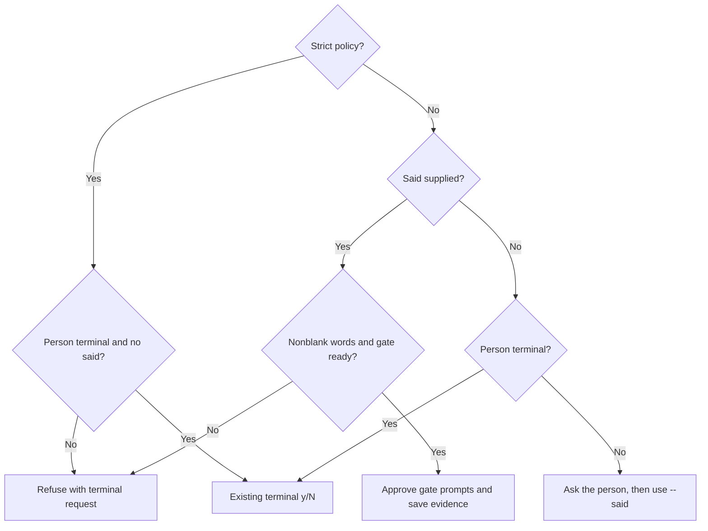
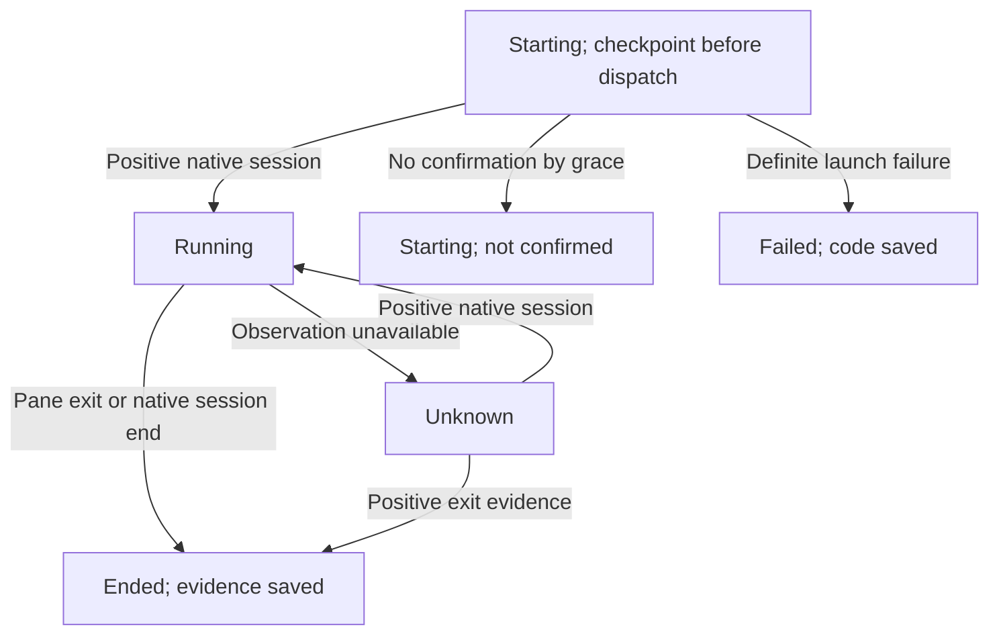
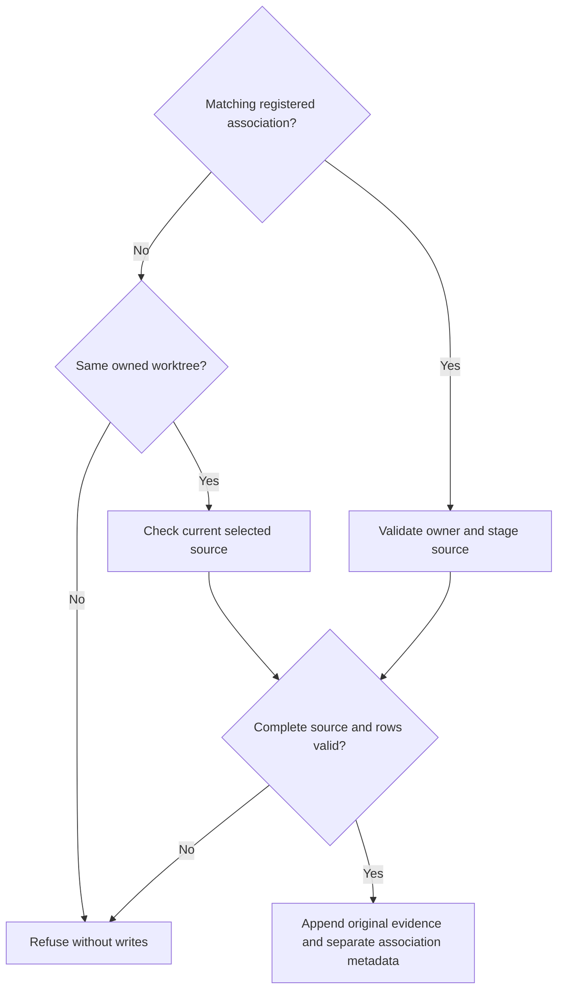

# Workflow runner (area chats)

Own `src/workflow-runner.mjs`. It runs a workflow for one GitHub issue as a few area chats. pdd has four jobs: start, gates, PR and status. The agent does the work. For an automatic fresh area chat, arm the one-shot [worker completion bridge](workflow-worker-completion.prompt.md) after its identity is saved and launch confirmed. The bridge waits for native worker completion and coordinator availability; it does not impose a workflow timeout. After saving a supported current automatic resume, arm the same bridge with its new resume anchor and require fresh activity evidence before completion. Arm a confirmed current automatic `--new` replacement with its saved fresh pane identity, and treat a resumed replacement as a resume. Reused-pane recovery needs fresh activity evidence and is not armed as a fresh turn. pdd does not run tests automatically or merge. The explicit local [old-code proof](workflow-prove.prompt.md) command and shared full-suite queue are the bounded supplied-command execution exceptions; this runner never executes a command from notes or evidence.

## Native admission lock

Native module function `acquireRunLock(runDir, filename = 'chat-replacement.lock')`
uses the existing PID and token lock format and returns an own-token release
callback. A live or uncertain owner or an acquisition failure gives `run_busy`;
reclaim only a proven-dead owner. This native interface selection has no required
context outside this section. The queue loads only this selection, so it does
not depend on the runner's execution policy.

## Full-suite execution and status

Expose module function `runSuite({cwd, command, timeout, env}, ports)` for the
explicit `workflow suite` command. Delegate execution to
[the shared full-suite queue](test-suite-queue.prompt.md), passing the supplied
ports. This is a second explicit supplied-command exception, alongside old-code
proof; no notes or evidence can cause automatic execution. In status detail and
list JSON/text, read the queue for the saved run worktree even when ordinary
mutation ownership is held. A waiting ticket shows its position; a running suite
shows test execution; a failed suite shows its own reason. Include optional
`suite` with the queue's public status shape in JSON. Completed/cancelled workflow
states keep precedence. Queue observations never write a run record or change a
gate. Every newly launched automatic area and automatic continuation must tell
the worker to run its repository's full-suite command through the absolute
invoked CLI `workflow suite --command COMMAND` and wait for its result. Focused
tests retain their normal route. The queue contract is required context for this
execution and status behavior.

## Native admission lock

Native module function `acquireRunLock(runDir, filename = 'chat-replacement.lock')`
uses the existing PID and token lock format and returns an own-token release
callback. A live or uncertain owner or an acquisition failure gives `run_busy`;
if initial lock creation fails for a reason other than an existing lock, retain
the original I/O error as its `cause`, so consumers can distinguish unavailable
storage from contention. Reclaim only a proven-dead owner. This native interface
selection has no required context outside this section. The queue loads only
this selection, so it does not depend on the runner's execution policy.

## Current Autopilot start ownership

Ordinary module function `startRun` consumes optional structured `coordinator` from
its input, or JSON `PDD_AUTOPILOT_CONTEXT` in the injected env for a launcher-originated
command. Malformed/present context fails before effects; it cannot become a manual
start. The context schema and current-read decision belong to
[dependency intake](issue-dependencies-intake.prompt.md#current-automatic-start-check).
After repository/issue resolution, before claim release/replacement, worktree
allocation, new run save or initial chat, call `checkDependencyStart` once with the
resolved cwd/repository/full issue URL and that context. Use current observations,
not the earlier launcher packet. A denied/unknown check returns exit 2 and its
finite reason, with no new allocation/chat or replacement/release of existing
custody. Enforce the existing optional --runs concurrent cap at this same ordinary
boundary from current active-run/allocation observations; starting/unconfirmed
slots count and actual same-issue reuse needs no extra slot. Unknown count under
a configured cap cannot admit new work. For automatic starts in this
repository/commonDir, reuse module function `acquireRunLock` with an admission
filename; the launcher also uses this same lock for controls:
hold it through current cap/ownership/slot reads, allocation and the first durable
starting record; release before chat. Use the existing occupied-slot classification.
Paused/stuck/question work yields only with confirmed no occupied worker; age or
labels alone cannot free it. Unknown/starting/unconfirmed slots count. Reread the
current saved cap; caller context cannot raise or erase it. Manual starts keep
their current behavior. Add no separate cap framework or new locking policy.
Use the [native admission lock](#native-admission-lock) interface below.

A permitted check continues through all existing account, base, adoption,
room and native startup rules. This decision introduces no new scheduler or lock policy.

Explicit manual starts with neither context input nor context env keep existing
behavior. Opening/resuming an active run and completing existing work after Off
keep existing custody and do not create a new automatic start. This hook does not
change profile/family selection, startup recipe or normal workflow handoff.

A `workflow run` from the current native `pdd-autopilot` coordinator pane may lack the inherited envelope after an original-thread resume. When no explicit context is present, derive the existing coordinator envelope from the enabled saved launcher state under the existing admission lock only when the caller's Herdr session and pane match that state's owned coordinator pane and owner launch. Use current repository and control state, then pass that envelope to the same automatic claim, graph and cap checks. A different pane or absent saved coordinator remains manual, including within the same Herdr session. A recognized coordinator pane with stopped or mismatched ownership refuses the automatic start; it never falls back to manual. A command outside that coordinator pane remains manual, and metrics origin or decision fields alone never supply context. Do not require unavailable native session or profile metadata, synthesize a claim, or change the coordinator or worker identity.

### Coordinator-lifetime transport

A supported launcher-originated native agent may carry `PDD_AUTOPILOT_CONTEXT` as
the versioned envelope `{version:"pdd.autopilot-coordinator.v1",repository,
coordinatorId,machine,activation,runs?}`. Before the current-start check, read the
current winning claim through the shared ownership reader and bind its exact
`commentId` and `labelEventId` only when repository, coordinatorId and machine
match the envelope. A missing, unknown or mismatched winner denies the start.
Pass the resulting full context to `checkDependencyStart`. Full contexts keep
their supplied claim identities and the strict current check; an untagged
missing-claim context denies. Never derive claim identities from a packet.


For a verified automatic-origin run, resolve the current Autopilot mode from the canonical `sourceRoot` configuration and the attributed start action from the matching enabled coordinator state; a worktree without `pdd.json` does not select manual mode. Only when that actual scope matches the run repository and active mode, and the selected workflow supplies its own `steps/autopilot.md`, direct area chats and ordinary approve-gate results to read that selected overlay and the actual owner handoff/run notes. Covered ordinary non-strict gates follow the overlay and supported explicit approval route; strict, product-specific, Try, code and merge decisions remain in force. Do not treat a checker or a coordinator summary as a person’s later words. Missing or unmatched scope retains manual guidance. Preserve project and home-only workflow selection and restrictions.

For a change request delivered to an automatic run, preserve the exact submitted text but identify it neutrally as a submitted request, not as a person’s words; a request never approves a gate. Give the worker the absolute current invoking package CLI path and direct it to read the owner handoff and applicable automatic overlay before deciding what follows. Do not unconditionally require a person to be asked again for a covered automatic gate. Manual run messages remain unchanged.

### Automatic continuation at a later area

After successful automatic admission, before the first area chat, save the verified
identity in the run's optional `automaticOrigin` field. Its value is an object with
exactly `repository`, `coordinatorId`, `machine`, and `claim`; each of the first
three is a nonempty string, and `claim` is an object with exactly the nonempty
string fields `commentId` and `labelEventId`. Preserve the admitted values. A run
without this field is manual or legacy; a present field of any other shape or type,
including null or empty values, is malformed and cannot be treated as absent.
Normal runner updates preserve this caller-owned field.

Before any `approveRun` approval or progress effect for such a run, read the local launcher state owned by [Autopilot launcher](autopilot-launcher.prompt.md): use SHA-256 of the canonical Git source checkout root, first 20 hex characters, as the JSON filename under `HOME/.local/state/pdd/autopilot` (or the injected Autopilot state root). After each terminal confirmation and before approval or progression effects, serialize the stopped-state check and those effects with the existing Autopilot admission boundary shared by STOP. Do not hold that boundary while waiting for a person. An explicit saved `enabled: false` refuses continuation with a restart instruction; absent legacy state or field is not an explicit stop. A deliberate launcher start enables later continuation, subject to the existing claim check. This does not block finishing the current step or capacity handoff.

Before `approveRun` advances such a run into a later area or requests its chat,
read current shared ownership from the admitted canonical `run.sourceRoot`, even when the caller is in its linked worker worktree; local coordinator state belongs to that source checkout. Preserve the current remote claim check. Read it for the run repository and issue using
`createDependencyReadPorts({cwd: run.sourceRoot}, ports).owners.read({repository, issues:[issue]})`.
The reader's JSON observation is scoped to that request; claims have no repository
field. Compare the saved repository to the run repository case-insensitively. Require
exactly one active claim for the requested issue, with nonempty string `owner`,
`coordinatorId`, `machine`, `commentId`, and `labelEventId`; require `localOwner`,
claim `owner`, and claim `coordinatorId` to equal the saved coordinatorId, and the
other identity values to equal the saved values. Use the shared reader's trusted
winning claim semantics. Missing, duplicate, malformed, unknown or unavailable
observation, or any mismatch, denies with an actionable recovery reason before any
approval or progress write, next chat, or custody effect. Preserve earlier approval,
claim, worktree and custody on denial. Preserve all ordinary approval, scope, draft,
review and identity guards. Manual and legacy runs retain their existing behavior.
Do not rerun start admission for continuation: this run occupies its own subject.
This boundary does not promise an atomic GitHub-to-process launch.
The same claim check runs before `done` commits, pushes or opens an area PR for
such a run. A run whose claim expired or now belongs to another coordinator gets
the same denial and pushes nothing; the issue keeps its history.

### Chat continuation ownership (#3113)

Use that same current claim check for every saved automatic run chat open,
including the current chat, explicit historical area, replacement, automatic
stopped-chat resume and parked wake. Check before chat inspection, focus,
attachment, allocation, resume dispatch or continuation delivery, and before
reserving a wake or recording a resume attempt. Read from the canonical
sourceRoot. A current matching claim permits the existing stopped-chat recovery, idle continuation and completion observer routes without changing their delivery, allowance or wait rules. Manual and legacy runs keep their existing behavior.

An unavailable, malformed, expired, absent or ambiguous observation refuses
continuation without changing the run or closing its chats. A single active,
well-formed trusted winner whose machine differs from the admitted machine
confirms a handover. Under existing run custody, first persist state cancelled
with cancelled:{state:"handed-over",at,reason}, where at is the injected epoch
millisecond time and reason explains the changed claim ownership. Then release
only the run's positively identified chat processes and panes through the
existing checkpointed forced cleanup path with reason handover. Keep the
worktree, branch, completed steps, decisions, gate, question, PRs, claim history
and saved sessions. Never release or edit the remote winner's claim. Retained
or uncertain cleanup stays visible through existing cleanup-kept diagnostics;
it is not proof of released capacity. Later open or resume attempts still
refuse, report the handover and retry only safe local cleanup. Do not offer a
native resume instruction for a handed-over run. Progress commands on that
terminal run refuse with its claim ownership reason. Cancellation retains its
handed-over marker. Existing identity and caller
pane protections still apply. A coordinator change on this same machine alone
does not establish a handover; the restart recovery owner retains that policy.

## Autopilot repair ceiling

Separate base integration from defect repair. For automatic runs, record optional
`integrationSource: {head,base,tree}` on completed steps: Git commit IDs for the
clean current HEAD, its merge base with `refs/remotes/origin/BASE` (the saved
`baseBranch`), and its tree. Dirty or unavailable Git observations supply no
snapshot. Before recording any automatic area step or publishing, compare the
current source with the newest proven applicable source baseline in that area,
including completed step snapshots and charged integration sources. This also
applies when the completing step has never been recorded, such as the first
formal after change and verify. Select by observation time/order, not by the
completing step alone; recheck the same baseline under mutation ownership.
An existing step with no source snapshot remains unknown and cannot claim an
integration exemption through another step's snapshot. A base refresh requires a strictly newer base
descending from the old base, a head descending from the old head, and a current
tree exactly equal to Git's conflict-free merge of the old head and new base.
This proves that only base integration changed the issue work. Unknown evidence,
conflicts, local edits, and extra issue changes get no exemption. Request text,
summary text and a patch ID alone cannot establish this classification.
Recheck the selected step snapshot and source content before saving an exemption;
an intervening change refuses the update and requires a fresh observation.

A proven base refresh that changes the source tree uses optional
`integrationRounds: {AREA: count}`, bounded at 2 per area, instead of
`repairRounds`. Save the count and the charged source in optional
`integrationSources: {AREA: [{head,base,tree}]}` atomically with the step and
`integration: {reason,from,to}` on that step, where reason names the base advance
and from/to are the snapshots above. Print the count, bound and reason.
Charge the integrated source content once for the area, identified by the source
tree after the merge, independently of the base commit and the step that first
recorded it. A new source-changing merge charges once on a step return even if
that return clears no later records. Any step return on a clean tree already
charged in this area consumes neither budget, including after a source-identical
base advance and across mixed verify, formal and change returns, even when that
step's snapshot predates the integration. Retain actual per-step snapshots and
history; never relabel an older result as checked on newer source.
A proven base advance that leaves the source tree identical is an unchanged-source
retry and consumes neither budget, including at the integration ceiling.
The third distinct source-changing refresh records state `stuck`, an actionable `parkReason`, and
`integrationLimit: {area,step,at}` without changing progress or either counter.
This marker refuses every later `done`, including publication retries, until the
existing cancel/new-run recovery route. Neither integration nor environment
recovery resets a defect counter or overrides a saved repair-limit refusal.
Environment retries retain their existing separate bounded recovery policy.
The bug skill's two-repair review rule remains in force.

On every automatic return, retain the replaced step and cleared later records
in append-only `stepHistory` rows `{step,record,supersededAt}` before replacing
them. Clear later steps as usual even for integration. On a proven source-changing
integration, also archive and clear every current step record whose
`integrationSource.tree` differs from the integrated tree, including earlier
steps. Keep each archived record's actual source identity. Record the returning
step on the new tree and request the first missing step before opening a PR.
Every cleared step must be recorded again on the new tree; fresh checks and
evidence are required. Use archived per-step snapshots as accounting baselines
when integration cleared a step: a further source-changing merge still uses the
integration bound, and an extra issue edit still uses the defect repair bound.
This invalidation does not add another integration charge.
Old failures remain history, never current results.
Manual and legacy runs keep their existing behavior. No new command or approval
route is introduced.

For a run with `automaticOrigin`, a repair round is a real return to an earlier
step after a failure: a `stepDone` for a step of the current area that clears
later recorded steps of that area (`build` again after a failed `verify`,
`formal` or `review`). These are not rounds:

- a `done` for a step with no recorded step after it, such as the retry that pdd
  asks for after a failed PR open, claim check or push. A publication retry is
  never refused;
- a `done` for a later step of the area (not its first step), such as `verify`,
  when the worktree content is the same as when that step was last recorded, or
  when the fingerprint is unknown now or in that record: unknown counts as no
  change. Save the content fingerprint (the [replay](workflow-replay.prompt.md)
  `sourceFingerprint`) as `worktreeSha256` in each step record of such a run,
  when it is known.

Count rounds per area name in the run's optional `repairRounds` object
(`{AREA: count}`), in the same saved update as the step, and add the line
`Repair round N of 5 in the AREA area of this Autopilot run.` After 5 rounds in
one area, refuse the next round before the step has any effect: exit 1, do not
record the step, and record the stop in one saved update: state `stuck`, the
reason `Repair limit reached in AREA: take the stuck path`, and `repairLimit`
(`{area,step,at}`). Status and list show that reason, also after a later park.
While `repairLimit` is saved, refuse every `done` of the run in the same way, so
that the run cannot record a later step or open a PR past the refused round. The
refusal tells the agent to take the stuck path: add `pdd:stuck`, write one
comment with the cause, send one `stuck` alert, keep the claim and progress, do
not retry, and let the coordinator continue with other issues. It also gives the
way out: to let Autopilot try again, a person removes `pdd:stuck` and
`pdd:working`, then runs `pdd workflow cancel N` (N is the issue) in the checkout
that holds the stuck run; the next tick starts a new run with a fresh repair
count. A stuck run is not ended, so without the cancel a new automatic start of
the issue in that checkout stays deferred ("issue has an active run"). Each run,
area and issue has its own count. The 5 is a constant, not a setting. Manual and
legacy runs save no count and no fingerprint and are never refused; their
skill's 2-repair rule applies.

## Automatic attention projection

Export `automaticAttention({repo, machine}, ports = {})`, a synchronous, read-only
projection of all saved runs on this machine from workflow-runs `allRuns`, or
injected `ports.readRuns()`. Pass `ports.env`/`stateDir` to the native reader.
Include only runs whose `automaticOrigin.machine` matches machine and whose repo
matches ignoring case. Exclude ended runs except completed runs still at an
`ask-code` gate. Emit `{number, category, cause}` rows: `stuck` with the existing
stuck reason for stuck runs; otherwise `parked` with runtimeWait.reason or
parkReason for paused runs; otherwise `decision` with the current open question
or gate kind for a question or gate. One row per run, sorted by issue number.
Ignore manual runs, other machines and repositories. Do not probe chats, wake,
approve, mutate, or infer a stop. This supplies the launcher's repository digest
across parallel runs, without changing run state or ownership.

## Record an automatic stopped run

Native module function `parkAutomaticRun({reason,runtime,cwd},ports)` records an actual automatic stop from that run's existing worktree. Its current automatic worker or authorized coordinator can invoke `pdd workflow park --reason TEXT`; no worker needs to be resumed. Resolve the current run, require its existing automatic origin and current continuation ownership, and preserve current run identity, area, gate, history, chat, claim, worktree and progress under the existing saved-run update. Require a nonblank actual reason. On a non-ended run, record state `stuck` and its reason; an ended or replaced run is not revived. A repeated identical park is harmless. Status and list output show the saved stuck reason and do not describe the agent as working. This command records the stop; the native coordinator subsequently applies Resource-free parking below. Existing STOP, current ownership and revision rules remain in force. Current native done or positively ended evidence is still required by the existing capacity handoff.

With `runtime: true` (`pdd workflow park --interpreter --reason TEXT`) the run waits for the PDD interpreter, the hosted service behind `pdd test`, instead of the stuck path. Apply the same checks, then read the run's own latest `pdd test` result (the existing own-results reader) and judge its saved rows with [workflow results](workflow-results.prompt.md) `savedCheckCause`. A failed expectation, a file-rule refusal or a step time limit (`issue`; the line also says to make the step smaller), a sign-in, access or interpreter address problem (`access`; the line says a person must fix the sign-in and names `gh auth status` and `PDD_RUNTIME_URL`) and a passed check (`passed`) refuse with one line that names the cause and says `Nothing was parked.`; nothing is saved. A result read that fails gives `unknown`, never `none`. Otherwise (`service`, `unknown`, or `none` when the read found no check) record state `paused` and `runtimeWait: {at, reason, batch, cause}` with the clipped one-line reason and the batch name or null. A plain park records `stuck` and removes any `runtimeWait`. A repeat with the same batch while waiting is harmless and keeps the first `at`. The reply tells the worker to ask no person, end its turn, that the coordinator may yield the slot, and that it reads `pdd test --read BATCH` first when woken. An interpreter wait is not a person question: status shows `waiting for the interpreter: REASON` and says that Autopilot checks the interpreter at each tick and that an Autopilot alert names any need for a person (`pdd autopilot status`); its next line needs no person unless such an alert asks, and the list shows it as parked once native cleanup is confirmed. Export `runtimeWakeTag(at)`, the first words of an Autopilot interpreter wake: `Interpreter wake for the park at ISO.` with the wait's `at`. `changeRun` with text that starts with such a tag delivers it only while the run still waits for that park; otherwise it sends nothing and says so (exit 0), so one park is woken at most once. The wait ends when a request is delivered to the current area chat (`pdd workflow changes`) or a step is recorded with `pdd workflow done`: remove `runtimeWait` and return a paused run to `waiting` when it has a gate or an open question, else `running`. Yield treats a paused run like the other waiting states.

## Explicit automatic capacity handoff

Module function `yieldAutomaticCapacity({ref, cwd}, ports)` lets a coordinator hand off a saved automatic run after its current turn has completed or its chat has positively ended. Resolve the saved run and require its current automatic ownership using the continuation rule above, except for a completed run: validate its saved automatic origin and repository association locally, then use the worktree owner to release only its matching issue allocation without requiring or restoring the removed GitHub claim. For a waiting, paused, stuck, question, completed or cancelled run, use the area chat owner's native session and lifecycle evidence: confirmed absence together with ended or failed evidence, or a registered current worker whose native status is `done` and whose observed session is exact, frees the worker. A registered completed turn does not establish process exit or end the chat. Unknown, working, starting and manual runs do not request a wake. For waiting work retain its issue allocation and all progress for continuation. For completed or cancelled work release its issue allocation with the worktree owner; if release is unavailable, retain custody and do not wake. Once these effects finish and outside run ownership, request the existing Autopilot completion tick using the source checkout and current environment. Return the ordinary command reply: success with a message identifying reconciliation or inactive Autopilot for those completion states; failure with a message identifying busy or unknown for those states. Reconciliation does not claim work started, and busy or unknown does not promise a later wake. The command is a capacity handoff, not a claim that a PR merge stopped a process. It does not approve, advance or cancel work. The coordinator invokes it after the current turn has completed or the chat has positively ended; ordinary done and status do not invoke it.

## Base selection

`startRun` accepts optional `base`, supplied by public `--base BRANCH`. Without it, use the repository’s actual default branch and retain the fetch-failure warning behavior. With it, require a nonempty branch name, not a revision expression, a full `refs/` name, an option or a filesystem path; slash-separated topic names are allowed. Validate as `refs/heads/BRANCH` without Git’s previous-checkout expansion. Do not alter the resolved repository/default metadata.

For an explicit base, fetch exactly `refs/heads/BRANCH` from `origin` into `refs/remotes/origin/BRANCH`, and verify that tracking ref resolves to a commit. A missing branch, rejected fetch or unavailable commit stops startup with a diagnostic naming the base: no stale/local/default fallback, worktree allocation, saved run, chat start or cancelled-run claim release. The branch must already be on origin so GitHub can use it as a PR base. Never publish the base as part of startup.

Allocate the issue branch from that selected origin ref and save the selection in `baseBranch` and its observed commit in `baseSha`. Keep that saved start commit immutable for replay anchors; inventory comparison below and old-code proof resolve their own fetched-original-base merge-bases without rewriting either saved field. Show the base in startup output. PR 1 (or a small-change PR) targets that saved branch. PR 2 stacks on an open PR 1; after PR 1 merges it starts from and targets the saved base. Existing runs retain their recorded bases. Only the allocated topic branches are pushed; choosing a base does not authorize pushing it, changing origin’s default branch, or merging.

## Durable scope boundary

[Workflow scope](workflow-scope.prompt.md) is required authoring, generation, runtime, verification and testing context for scope decisions. Resolve trusted common-repository and saved or planned work identity through its store boundary. On creation or reuse, serialize identity/assignment with the scope check so the same repository issue cannot receive duplicate work: an existing run for a scoped batch member is reused and inherits the batch limit; ambiguous identity or unsafe scope stops with the owner’s recovery instruction before allocation or replacement. This scoped reuse rule supersedes the ordinary active-run replacement rule below; genuinely absent applicable scope preserves that rule.

Before allocating a code area, code branch or code chat, before approving a transition that would start code, before opening or resuming a code area, and before building or publishing code (including commits, pushes and code PRs), check the current run against the scope owner. `prompt-pr` prevents those effects and the runner supplies a clear hold notice; `stop` prevents them and reports the owner's actionable inspection/recovery instruction. `default` and `code` continue only through all existing gates. Recheck at each effect boundary, including repeated starts and resumes; do not cache a decision across a scope mutation. Coordinate the check and effect against concurrent scope mutation so a newly committed restriction cannot be bypassed. Routine approvals, checker PASS and release metadata do not extend scope. Prompt-area branch and chat and prompt PR progress remain permitted by a prompt-only hold. Scope neither permits a merge nor deployment.

## Draft publication policy

Module functions `startRun` and `approveRun` accept optional Boolean `draft`.
Missing/false preserves the ready default; any supplied nonboolean refuses before
mutation. A present nonboolean saved `run.draft` also refuses before publication;
never coerce it by truthiness. A fresh start saves `run.draft` as an explicit Boolean before chat startup.
A start encountering an existing active nondraft run must refuse a requested policy change
and point to `workflow approve ISSUE --draft` at its legitimate gate; it cannot
silently ignore the request, change that record or replace it to adopt the policy.

`approveRun` may strengthen false/legacy-absent policy to true only at the current
ready approval gate while its intended publication stage is unpublished. A recorded
PR for that stage or uncertain eligibility refuses the change without effects.
Existing PRs stay unchanged. Apply all ordinary configuration, strict-policy,
step-completion, same-gate identity, current review and approval checks first;
`--draft` grants no consent and cannot use approve-anyway to bypass readiness.
Only after successful legitimate approval validation/save, persist true through
the identity-checked ordinary update before any approval-triggered publication,
branch or chat effect. Failed policy persistence stops those effects. A refused
approval never adopts draft policy. Keep saved same-gate decision/evidence/time
reuse; a missing review or different/reopened gate still needs normal review and
approval, regardless of retained words. Cancellation/replacement and changed-gate
checks win over the requested policy change.

True persists through reload, later omitted/false inputs, PR 1, code entry and PR 2;
omission/false cannot downgrade it. Pass the saved Boolean separately as `draft`
to [GitHub publication and reconciliation](workflow-github.prompt.md#one-publication-and-read-only-recovery),
including small-change publication. Preserve the exact prepared intent shape.
Draft policy does not approve code: PR-1-only approval still stops at ask-code.
These native start/approval/save/publication effects remain unbound by this prompt's
existing Runtime entries; no execution or durable-intent proof is implied here.

## Adopt an existing approved corpus

`startRun` accepts optional `adoptCorpus`, the declaration path supplied by
`pdd workflow run NAME ISSUE --adopt-corpus FILE`. Preserve existing startup and
changed-scenario discovery when absent. Require a fresh run whose selected areas
explicitly opt in to replay evidence; adoption never enables a custom workflow's policy.
Before releasing a cancelled-run claim, allocating a worktree, saving a run or starting
Herdr, validate the selected base content through `adoptReplayCorpus` in
[replay evidence](workflow-replay.prompt.md#corpus-adoption). Failure exits 2 with a
finite repair reason and the replay owner's cleaned native cause when available; retain historical runs, branches and files unchanged. A failed startup fetch explicitly says that the fetch failed; a generic source-selection or local-operation failure alone is insufficient. Keep private absolute paths, credentials and Simulate URLs out of that diagnostic.

After worktree allocation, revalidate its actual content before saving an active run
or starting Herdr; report failure without fabricating success if it differs.
Save an immutable bounded copy of the declaration bytes and computed digest in the
new run folder, using a realpath-resolved temporary directory even under a symlinked TMPDIR; later validation uses this copy and pinned commit, never a caller
edit of FILE. Removing or changing the external FILE after successful startup cannot
alter or invalidate the frozen authority. Save the successful selection's provenance and the anchor produced by existing
`pinReplayVectors` as `run.replayAdoption` and `run.replayBaseline`. Preserve every
original raw hash and check identity. Adoption reuses exact content authorization;
it neither changes a prompt's approval state nor asks to reapprove unchanged content.
All ordinary workflow gates remain. Announce the external-assertion trust boundary
from the replay owner; never describe adoption as authenticated human approval or execution.

For an adopted run, prompt publication must revalidate the same approved prompt,
required dependency closure and complete declared scenario bytes against the original source.
Keep the adopted anchor; the changed-file refresh rule below applies only without
adoption. Revalidate immediately before entering code and each code publication,
including retries. Freeze declaration digest and declared scope with provenance.
After the automatic publication commit, perform one adoption validation scan per
publication and reuse its result for replay and publication decisions. Retries use
the frozen authority and revalidate current content; an invalid observation must
clear any old PASS before publication, never briefly publish stale PASS.
A changed, added, removed or unreadable covered prompt/dependency blocks reuse
with advice to start an ordinary approval workflow for changed requirements; it must
not replace the anchor or silently fall back to diff selection. Unrelated implementation
changes remain allowed and bind subsequent replay to the current source fingerprint.
In code space revalidate using the replay owner's `scenarioReference` option, retaining original
authority and prompt/dependency checks. Scenario changes follow its saved-value warning rule and
do not block publication. Public-boundary execution, mutation and formal checks still apply.
Adoption supplies no PASS or fresh execution attestation.

## Return to prompt space after code entry

For a two-PR run whose code area has started, explicit `workflow open ISSUE prompt-pr`
(or its Story area, with optional `--new`) reopens prompt work when the owned PR 1
is still open. Manual and automatic runs use this same route and current ownership
checks. Refuse a dirty worktree, unavailable/closed/merged PR 1, or pending chat
replacement before branch or progress effects. Switch to PR 1's recorded branch; fetch its remote head and fast-forward it.
Fetch the run's selected base branch and merge its pinned current commit into
PR 1 without rewriting history. Refuse merge conflicts with explicit resolution
advice, leaving PR 1 current so the worker can resolve and rerun its checks.
All prompt checks must cover the integrated source before PR 1 is updated;

never carry code changes into that branch. Preserve both PR identities and decisions
as history. Record the return and reason (a prompt correction found during code work)
for status, area briefs and both PR descriptions. Plain historical open for other
workflows retains its inspection behavior.

Clear completed steps from the selected area onward, current gate/question, stale
code check results, inventory, proof/replay evidence and source associations. Old
results cannot become new evidence merely because source bytes match. Reopen the
selected chat through the ordinary chat path; `--new` now replaces that current
prompt chat. A prompt-only correction reruns the prompt checks. A changed Story or
scenario expected contract reopens the existing Story approval gate before prompt
publication; do not invent a new gate format or reuse the old decision. Keep prompt
work on PR 1 even while that gate is open. Finishing the prompt area updates its
existing PR 1 through ordinary publication, then uses the normal code-choice gate. Preserve the normal Story card and its
saved code-or-stop choice. Returned ask-code prompt snapshots use the current base merge-base and the approved prompt scope; inherited upstream prompts must not become new Story approval inputs. Genuine run-owned prompt additions, edits and deletions still change that snapshot. For a returned automatic run with unchanged Story
coverage, a full current prompt check pass updates PR 1 and resumes code without
a new person decision, using the existing scoped operator delegation. Record code continuation with route
`prompt-reentry`, null words and `basis {storyEvidenceId, priorCodeApprovalId}`.
The prior code approval must be the actual saved code-entry decision, not a
prompt publication decision. Strict
terminal approvals still apply. A changed Story always returns to its Story gate.

Bind every displayed Story approval gate to the selected Story files and scenario
contract, including paths and expected checks. Select the run's changed contract against the current merge-base of its saved
base branch, so unrelated base integrations do not remove valid approval.
Select Stories with the runtime's canonical Story-path rule, including `user_stories` directories at any depth and
its index-file exclusions. Additions, edits and deletions all change coverage.
Save its contract identity with the
gate and the actual approval decision. Check the shown identity both before taking
an explicit reply and immediately before saving approval. A changed or unreadable
contract, or missing saved coverage, requires showing the gate again and a later
decision; terminal confirmation displays and binds the current contract first,
including a terminal override of an incomplete legacy gate. An explicit reply
never supplies missing displayed coverage. Capture the approval invocation time
before durable gate refreshes, and preserve unrelated decisions and evidence
recorded during inspection. Recheck the bound contract after
confirmation so a concurrent edit still refuses approval.
On return, compare fetched PR 1 content against the last actual Story decision's
contract, never against content first observed during return. Changed or unknown
coverage reopens the Story gate before prompt publication or code entry. Retain
older decisions only as history. A newly displayed gate does not itself approve
the new contract. Recheck the approved Story contract and published scenario
bytes after code-entry confirmation or an explicit reply, after prompt
synchronization, and before saving the code decision or switching branches.
Bind code entry to an immutable fetched upstream commit, through the explicit
reply, terminal confirmation and normal Story-card choice routes. Validate the
fetched source itself, including Stories and scenario bytes, against the last
approved contract and published replay anchor before a code decision is saved.
After PR 1 merges, scope prompt and scenario byte comparisons to PR 1's
published paths and the saved replay anchor. Ordinary replay-anchor refresh includes PR 1's recorded owned paths even when a concurrent base merge makes them common history. Republished or synchronized PR 1 must not lose its owned scenarios merely because the base already contains them. Do not reinsert a historical owned JSON path that is confirmed absent and was never anchored: a deleted ordinary JSON file is not a scenario. Preserve absence and unreadability guards for every saved anchored scenario; other filesystem inspection errors remain unavailable inventory. Save the full run-owned publication path set as `sourcePaths` on each PR 1 record, independently of the bounded readable diff. Bind that set to the exact immutable head to be pushed; a changed head refuses publication before source is pushed. Select it against the current base merge-base at publication, retain prior owned paths across updates, and never replace the immutable run base SHA. For older records without this set, keep the conservative original-base comparison until PR 1 is republished. Unrelated prompts and scenarios
added or subsequently edited on the saved base do not invalidate this run's checks or gate. When its
approved contract and published bytes are unchanged, initial code entry starts
from the pinned merged base, including that unrelated work. Changes to owned
specifications and unsafe code merges still refuse entry.
A Story or scenario path confirmed absent from the pinned Git tree is a deletion
in the contract comparison. Preserve and fast-forward the fetched peer commit on
PR 1 and reopen Story approval before saving any code decision. Failure to read
the pinned tree or a present file is unavailable source, never evidence of
deletion; refuse code entry without saving a decision.
A changed fetched contract returns to Story approval on PR 1. Other changed
scenario bytes require prompt checks, publication and anchor refresh. Do not
validate only the unchanged local worktree. Merge only the pinned validated
commit into the existing code branch, and validate the resulting source again
before saving any code decision or advancing. A conflict or failed validation
returns to PR 1, preserves code and peer commits and records no new code decision.
After successful validation and the durable code decision, refresh PR 1’s public
approval evidence for both explicit replies and terminal confirmation. A refused
entry must not publish a code decision. Description update failure warns without
undoing the saved decision or admitting an unvalidated source.
A changed contract reopens Story approval; unpublished scenario bytes keep the
run in prompt space. Neither route records a code-entry decision. This also
applies to the second terminal confirmation immediately after opening PR 1.

When code resumes, reuse its recorded branch and PR 2. Merge the updated PR 1 into
that branch without rewriting published history; a conflict stops with recovery
advice and retains prompt-space progress. Code generation and every code check run
again. PR 2 must contain no prompt changes relative to PR 1;
Compare against the fetched remote reference for the selected PR base, including
the saved default or topic base after PR 1 merges; a stale local branch cannot
classify already published prompts as PR 2 edits. Apply this guard only to areas
after the prompt area's code-choice gate; a future code-choice area cannot make
an earlier area's publication a code publication. Refuse publication before
committing or pushing prompt edits and direct the worker
back to prompt space. Recheck the staged tree before an automatic commit. Bind
publication to one immutable candidate commit, independently of informational
inventory availability. Before any push, compare that candidate's prompt tree
with the fetched PR base and push only that checked SHA. An edit arriving during
staging, commit or publication preparation must not enter PR 2. Refuse unsafe
candidates with prompt-space recovery advice and retain the person's work. Story and scenario corrections made during this return go
to PR 1. Preserve the replay owner's saved-value warning policy for code-space vectors. The refreshed ordinary replay anchor comes only from this
run's changed scenarios, excluding unrelated scenarios brought in from the original
base branch. Compare with the current merge-base of that original branch, retaining
immutable `baseSha`; adopted runs keep their declared scope and authority.

## Failed chat startup and recovery

A Herdr request failure is not evidence that an agent is working. If an initial or later-area start, or explicit open/resume, fails, keep the same run, allocated worktree, selected base, issue claim, completed steps and decisions. Save `chatFailure {area, phase, code, message, at}` (phase `start` or `open`, finite one-line reason: the first line of the error message), set the active run to `waiting`, and report the failure with `pdd workflow open N` for explicit recovery after Herdr is available. Start, approve, open and status all report the error's code once with the first line of its message, never the code alone; a message that starts with the same code does not repeat it. Start, approve and open print the later message lines, such as the values of an [identity refusal](workflow-herdr-layout.prompt.md#identity-refusal), on the lines after that report. Do not retry the request automatically, restart an unavailable server, allocate again or fabricate a chat/session. A failure after the pane launch request may have dispatched: retain the prepared chat identity supplied by [area chats](workflow-chat.prompt.md), including its unconfirmed flag.

Public detailed, list, all-repository and JSON status group this failure as waiting and show its code/recovery action, never agent working. A legacy active run with no current chat also reports startup unconfirmed, even without the new failure field. A `server_unavailable` observation for an existing chat means status unavailable, not proof it stopped or works. Cancelled/completed status wins over stale failure data. Other transient inspection behavior and the normal new-agent grace period remain unchanged.

Only a successful start/open or positive observation of the same current chat clears its active failure/unconfirmed flag. Restore `running` only when no person question or approval gate is waiting; recovery never approves, advances an area or discards decisions. If Herdr remains unavailable, keep the precise external failure and preserve custody rather than claiming recovery.

## Preserve concurrent progress

Use the [run-record update boundary](workflow-runs.prompt.md#concurrent-record-updates)
for every modification of an existing ordinary run record: startup follow-up,
chat recovery/failure, evidence and replay metadata, steps, questions, decisions,
area/gate transitions, publication, change-delivery effects, cancellation and
status refresh, including adopted-corpus blocked and publication evidence saves.
These saves retain their intended blocked/publication-pending/replay evidence
while preserving unrelated progress; frozen adoption authority and anchor remain
governed by the adoption rules above. Initial creation retains the explicit
whole-record save. Each
update callback checks the latest `runId` and record/worktree identity against the
run selected by this invocation before changing anything. A replacement run at
the same path is not that run: fail without modifying it. This adds no step-order
or approval gate and does not change existing command validation.

Before `stepDone`, `askPerson` or `approveRun` commits any progress or gate
transition or begins publication, branch or chat effects, check the latest owned
run: cancelled or completed runs stay ended.
For a run newly ended since this invocation selected it, refuse with a nonzero
reply saying the run ended; preserve state, gate, question,
steps and decisions and start no chat. This check wins over stale command intent,
including cancellation or completion while the command waited. The explicit
existing done-at-PR-1 code continuation and review-only recovery described below
remain available to fresh invocations; neither authorizes stale intent to revive a run.
Preserve other already-ended early-return results, including successful done/ask
stop replies without reading the delivery journal.

Approval applies only to the gate actually shown for this invocation. Recheck its
area, kind and time against the latest gate before recording approval or doing
approval-triggered publication, branch or chat effects. If it changed or vanished,
refuse with "the gate changed, look again", preserving the new gate and recording
no approval. An unchanged gate keeps existing approval/evidence behavior.

Apply only this invocation's intended effects to the latest record. Retain
unrelated newer completed steps, questions, gates, decisions, area progress,
chats, evidence and PR fields; never publish an old whole snapshot. Distinct
successful concurrent completions retain both records unless the existing rerun
rule intentionally invalidates one. A known completed step running again clears
all later known steps of its own area in the latest record, including a later
step newly added or replaced since the command loaded; unrelated steps survive.
Done clears only the question it observed, leaving an independently newer
question intact. Ask deliberately saves its own requested question and derives
its existing waiting effect from the current gate. Preserve newer gates when
this invocation has no intentional gate transition.

Status applies its actual fetched PR/CI observations to the matching PR identity
without replacing unrelated newer PR fields or entries, and retains existing
completion consequences. Collect external observations before the short local
update; do not perform Git, GitHub, Herdr or model work under ordinary-record
ownership. All callers continue from the committed record, not their stale copy.
A failed existing-record update returns a finite nonzero diagnostic and never
claims that its progress was saved. Best-effort index failure after a committed
save remains harmless. No new ordering is promised for competing intentional
changes to the same field beyond these existing command effects.

Ordinary updates leave accepted requests and acknowledgement fields in the
authoritative journal untouched. Change delivery retains its existing
journal-then-ordinary update order; no ordinary update acquires a journal claim.
Keep existing custody, uptake warnings, side-effect order and approval rules.
`runStatus` uses `readRunOwnership` from the run-record owner before any
write-capable PR/chat refresh and skips those refreshes while ownership is held.
JSON adds `ordinaryOwnership` with that snapshot or `null` when absent; detailed,
list/all/cancelled text and JSON identify the held ownership path and its available
PID, hostname and token, or say ownership is unreadable/malformed. No owner means
no held-lock claim. For unverifiable ownership, give the path and explain manual
removal only after verifying no pdd command is running; do not recommend removal
while a live owner works. Reading status never reclaims ownership; busy ownership cannot
hide the saved run or turn status into a failed save. Cancellation uses the same
recoverable ownership boundary and can proceed after confirmed-dead reclamation.
The native callback, ownership and overlapping public saves remain unbound to
the Interpreter entries below.

## Commands

Each workflow command export takes `(input, ports)` and returns `{exitCode, message}`. The CLI prints the message.

- `startRun({name, issue, agent, base, adoptCorpus, draft, through, cwd, packageRoot, coordinator})`: save `through` (`prompt-pr` or `code`) when given, and save what the reporter asked (`issue.asked`, see [Normal-run gates](#normal-run-gates)). Read the areas from the pdd-NAME skill ([areas](workflow-areas.prompt.md)). Show any advisory returned by [workflow areas](workflow-areas.prompt.md#approval-gate-advisory), without blocking startup or changing areas. Resolve `agent` with [workflow agents](workflow-agents.prompt.md#named-agentsjson-entries) `workflowAgentEntry(agent,{cwd,env})` before any git, gh, worktree or Herdr work; a refusal returns exit 1 with its message. A custom agents.json entry runs as its kind: `run.agent` is the kind, and the run saves `agentDefinition: {name, kind, command, envNames}` (env names only, never values) for the [chat owner](workflow-chat.prompt.md#chat-login). Read the agent's config folder: `CODEX_HOME` for Codex, `CLAUDE_CONFIG_DIR` for Claude, `GEMINI_CLI_HOME` for Gemini, none for Antigravity CLI ([chat](workflow-chat.prompt.md) `homeVariable`, `expandHome`). For an entry, read it from the caller environment with the entry's env overrides on top, so an entry that sets `CLAUDE_CONFIG_DIR` saves that folder. A leading `~` or `~/` is the home folder (zsh leaves `~` as text in `env CODEX_HOME=~/x pdd …`, 0.1.6 tester), and a relative path is resolved from cwd. When it is set and that folder does not exist, refuse before any git, gh, worktree or Herdr work: `VAR is "PATH", but that folder does not exist. Fix VAR and run the command again.` The run keeps the full path as `configDir`, and the Claude trust check reads `.claude.json` in it. Resolve the issue with gh ([GitHub](workflow-github.prompt.md)). For an explicit manual start, a completed run permits a fresh run under the ended-run ownership rule below. After successful current automatic admission and claim verification, a completed historical run permits a fresh automatic start: release only its matching local issue claim (an absent claim is already free; a different owner refuses), retain its completed record, worktree, branch and native chat custody, archive its run folder through the existing history mechanism and record it in `previous`. Do not cancel it or infer process exit from completion. For an explicit manual start, an active run (running or waiting) never blocks a new run: it may be stuck, abandoned or left from a crash. For an automatic start, first apply [current Autopilot start ownership](#current-autopilot-start-ownership). If a saved run exists and is not ended, refuse the automatic start before replacement, claim release or custody effects, even when the current check permits reuse of the issue slot. For an explicit manual start with an active run, after the base and adoption checks pass, mark it replaced through the ordinary identity-checked update (`state: cancelled`, `cancelled: {state: replaced, at}`, `gate: null`), ask no person, and show one warning that names it: run id, workflow, worktree and checkout, and last activity (`updatedAt`, else `startedAt`). When that activity is less than an hour old, the warning says that the old run may still be working. Then treat it like a cancelled run. After a cancelled or replaced run, free the issue claim (`releaseIssueClaim`), keep the old worktree and branch, rename the old run folder to `<N>-cancelled-<first 8 of its run id>` and start fresh with a new worktree and branch; the new record lists the old one in `previous`. A replaced run cannot write over the new run: its saves and journal updates check the run identity at the plain issue folder and fail. Status shows a replaced run as `replaced`. Select the base as described below. Make the worktree and branch ([worktree](workflow-worktree.prompt.md)). Make the run folder and write the run record ([runs](workflow-runs.prompt.md)). Start the area 1 chat ([chat](workflow-chat.prompt.md)). Print where the run is, `pdd workflow open N`, `pdd workflow status N` and the shell-safe approval guidance below. Then return at once. If the main repository is not trusted by Claude, say that Claude asks to trust the folder first.
- `stepDone({step, summary, skipped, cwd})`: only the agent calls this, from the worktree. Find the run from cwd. Record the step with its summary and time, and with [pdd's own results](#pdds-own-results-and-agent-notes). The stored summary keeps its line breaks (each line's spaces collapsed, blank lines dropped); every place that shows a summary on one line (status, the code question, the PR step list) collapses it. An unknown or out-of-order step prints a warning and is still recorded. A step that runs again after later steps of its area (for example `build` after `verify` when vectors fail) prints a warning and clears those later steps, so they run again; the area's PR opens only after its last step. Then print one of:
  - the next step of the area and the exact `done` command (an optional step is a question to the person, and "skipped" is a valid summary; in a [normal run](#normal-run-gates) pdd skips the optional `try` step itself and asks nothing);
  - at an `approve` gate: show the result (in a normal run, the [Story card](#normal-run-gates) as it is), ask the person, stop, never approve for them; how they approve; how to handle changes (revise here, run done again, ask again);
  - after the last step of a `pr` area: "pdd opens the PR now". Commit any uncommitted files (with a warning), push and open the PR for this area. The warning names each committed file by its exact repository-relative destination path: preserve every character, including leading characters, spaces and literal quotes. For a rename, name the destination, not the source or Git’s `source -> destination` display. Decode Git’s quoted path representation before showing it; do not trim status output before extracting paths. Keep the existing warning wording and commit-all behavior. The body (0.1.4 #18, 0.1.6) starts with pdd's own result lines ([pdd's own results](#pdds-own-results-and-agent-notes)), then the current source-compatible Prompt tests lines selected by the current-head publication rule below: every "Prompt tests (<story>)…: …" line, one per Story (a Story that appears again keeps its place and takes its latest line), then, with two or more Stories, a total that pdd adds up itself: "Prompt tests (all Stories)[ (DRAFT)]: ✓ 8 of 8 criteria · 35/35 checks · 17 AI calls" (sum the criteria, the checks and the AI calls, each only when every Story line has it; ✓ only when every Story passes, else ✗; DRAFT when any Story line is DRAFT). A pasted overall "Prompt tests: …" line is dropped when Story lines exist, because it can cover only the Stories checked last; a summary with no overall line works the same. Without Story names, keep those lines' results as written, with the `Prompt tests` label. Then "Report (<story>): URL (report links expire after 7 days)" for each distinct report link, in summary order (the Story name comes from a "Report (<story>): URL" entry; a bare link or "Report: URL" or "Report (DRAFT): URL" has no name). The chat pastes the lines that `pdd test` prints into the check step's summary, one per line (with a `Report:` line per Story) or joined with "; " (with one "Report (<story>): URL" per report row); a result ends at a line break, ";", a `Report` entry, a link or the next `Prompt tests` or `Runtime check` label. Read these lines from the stored summary, before it is collapsed. Above the Prompt tests lines go the verdict line and the before → after line of a bug check (0.1.7): the first "Verdict: …" and the first "Before ✗ …" / "Before ✓ …" / "Before: no prompt …" in the step summaries (the check step's first, then the newest step), each up to its line break, or up to a "; " that starts "Before", "Prompt tests", "Runtime check" or "Report" (a "; " inside the verdict sentence stays). A report link in the before → after line gets " (report links expire after 7 days)" and is not listed again as a "Report" line. Then the PR head ("Part of #N" / "Closes #N" …), then the Steps overview: one line per step since the previous PR, cut to about 200 characters at a word end and never inside a URL (a URL that crosses the end stays whole, and " …" follows it) and shown as one inline code span, and below it the [full step summaries](#full-step-summaries-in-the-pr). Only a PR that covers a verify step carries `<run folder>/verify.md`, under "## Verify" (0.1.6 tester: 100 lines of shell before the vector table): drop a leading "# Verify" line, write each "## " heading as "### ", and fold each fenced block of more than 15 lines that is not inside a `<details>` block into `<details><summary>Commands (N lines)</summary>` (sh, bash, zsh, shell or console blocks) or `Output (N lines)`. When verify.md has no `<details>` of its own, keep the text before its first heading on top, then its sections whose heading names vectors or results, then the Formal check, then other sections with a table, then the rest, each group in file order. GitHub refuses a PR description over 65,536 characters (0.1.7 tester: a 105,489-character verify report; every retry failed the same way), so the whole body stays at most 60,000 characters (Unicode code points), which leaves room for the marker and for GitHub's own count. When verify.md does not fit in the room that the rest of the body leaves, the body keeps a summary of it. First each `<details>` block (long commands and output) becomes one line, `- <its summary text>: not shown here.` A tag inside an inline code span is text: it opens or closes no block and is not removed. If it is still too long, keep its first lines that fit, cut at a line end (never inside a link) with an open code fence closed, and then list the lines of the cut part that report a failure (`✗`, or the word fail, fails, failed or failing) under `Lines that report a failure, from the part not shown:`, as many as fit. End the summary with: `_The full verify report has N characters, more than a PR description can hold (GitHub's limit is 65,536). This is a summary: WHAT. The PR author has the full report: verify.md in the run folder._` (WHAT: `the long blocks are not shown`, or `its first N lines; M more lines are not shown, and K of them report a failure`, with `reports` when K is 1). Before collapsing details (authored or generated from long fenced output), retain their failure lines and report references outside the collapsed block. If truncation is still required, consider failures and report references from all omitted content, including collapsed blocks. Keep whole evidence lines and links while room allows; explicitly count omitted failures and report references when they cannot all fit. The full verify.md stays byte-for-byte in the run folder. Failures are never dropped in silence. Local paths never appear: the worktree path becomes repo-relative, the run folder "<run folder>", any other `/Users/…`, `/home/…`, `/private/…`, `/var/folders/…` or `/tmp/…` path "<local path>". Before writing a PR body, replace every Try link (a URL whose path has `/s/<token>`) in the step summaries and verify.md with "(Try link removed)"; report links (`/r/`) stay. When the first line of verify.md starts with "✗" (for example "✗ 2 vectors fail"), retain that warning ahead of the replay/ordinary body while the evidence owner controls the top evidence block. When the body has an interpreter report link, add "Interpreter report links expire after 7 days." A report link is a URL with a `/r/` path segment, or a URL that starts with `PDD_RUNTIME_URL` when it is set. Never fix a runtime host in the code. When the PR exists already, refresh the label/proof top block and, for code PRs, the inventory as required below, preserving publication-pending before changed-source pushes. When the PR does not open, print the message of the [GitHub](workflow-github.prompt.md) result: it names GitHub's own reason when GitHub refused the PR, and says unconfirmed only for a real doubt. A retry builds the same intent again (same run, area, marker, branch and SHA when nothing new was committed) and does not push again. Print the PR URL and "pdd never merges".

For automatic umbrella work, read the current issue-sort group before publication. Both PRs reference the members. Only a new per-member sort after the global fix merges may close a member. Ordinary ownership, review, claim and publication gates still apply. Project the current dependency graph too. If a group is no longer proved current and safe, omit extra closing references. Group policy belongs to [issue-sort](issue-sort.prompt.md).

  A cancelled or completed run prints that the agent must stop, except for the
  completed-at-PR-1 review-only recovery below.
- Try before PR 1 (0.1.4 #13): a `pr` area with `"before":"approve"` does not open its PR after the last step. `done` sets the gate kind `approve-pr` and tells the chat to show the Prompt tests line of each Story (one per Story: ✓, ✗ or no verdict, as `pdd test` prints it) with its report link and the Try link, ask the person to try it and approve or ask for changes, and stop. Status: "waiting for you: try it, then approve to open PR 1". When there is nothing to try (no step of the area left a Try link, and the try step was skipped or the worktree changes no test file), the gate text says "There is nothing to try. Ask them to approve or ask for changes." and status drops "try it, then " (0.1.6 tester: a browser-only Story). For PR 1 the gate text also gives the chat the words for what PR 1 holds, read from the worktree's changes against the run base (uncommitted files count): "Tell the person what PR 1 holds, in these words: "PR 1 is ready with the approved Story[, the approved prompt X][, the draft prompt Y][, the prompt Z] and the tests."", with "the approved Stories" for two or more Stories under `user_stories/`, and without "and the tests" plus " It has no test file." when no test file (a `*.json` with `prompt-runtime.program-scenario`) changed. Only the Story area was approved, so a draft prompt is never called approved (0.1.6 tester). `approve` here works like an area gate (explicit approval under the rule below; terminal: "Approve the AREA area and open PR 1 for …? (y/N)"); it records the decision and opens the PR. With `then: ask-code` the run moves to the code-or-stop gate (new gate time): from the chat, the reply tells the chat to ask the code question; from the terminal, when PR 1 has draft prompts, pdd does not ask about the code PR: it prints PR 1's link and the approve-first line (see Draft prompts) and delivers to the chat as a [pdd notice](#pdd-notices) "pdd opened PR 1: URL. … Tell them exactly: "PR 1 is open: URL. <approve-first line>" Then stop."; else pdd asks "Make the code PR now …? (y/N)" — no delivers PR 1's link and the stop to the chat as a pdd notice and prints "PR 1 is open. Tell your agent when you want the code PR."; yes goes on as the code gate (the code branch and chat). A PR that cannot open leaves the gate open; run approve again. A [normal run](#normal-run-gates) first tries the full-pass route: a full check pass opens PR 1 at `done` with no question, and the person gate stays only for a run without a saved Story approval. A card run with a failed or missing check waits for the agent to repair and check, not for person approval.
- Two PRs (bug and feature): an area with gate `pr` and `then: ask-code` opens **PR 1** (title `spec(AREA): STATEMENT (#N · part 1: spec)` and the [readable description](#readable-pr-descriptions); its pdd body keeps "Part of #N"). Then `done` prints the PR 1 link, the step summaries (Prompt tests line, Try link) and tells the chat to ask "Do you want the code PR now, or stop here and merge PR 1 first?" and stop. This is a gate. When the chat pushes more commits to an open PR 1 at this gate (for example the prompt approval the person asked for), the gate keeps its time, so an already saved explicit decision for that gate remains retryable; `changes` moves it. `approve` (terminal y/N "Make the code PR now…", or explicit --said with the person's words) starts the code area in a NEW chat on a new branch `<branch>-code`: from PR 1's head when PR 1 is `open` (PR 2 is stacked: base = PR 1's branch), or from the fetched saved base branch when PR 1 is `merged` (base = the run’s selected base). When PR 1 is `closed` or its state is `unknown`, refuse: make no branch, change no run field, and tell the person to check PR 1 and provide the safe retry guidance below. The last area opens **PR 2** (title `fix(AREA): STATEMENT (#N · part 2: fix)`, `feat(…)` in a feature run; its pdd body keeps "Closes #N", "PR 2 of this run: the code. It builds on PR 1: URL." and, when it is stacked, one merge-order line by the red-pair rule of the [readable part](workflow-pr-body.prompt.md) `pr1Order`: "It is stacked on PR 1's branch `B`: merge PR 1 first." (PR 1's CI passing or none), "It is stacked on PR 1's branch `B`. PR 1's CI fails, so this PR also merges PR 1. Do not merge PR 1 alone.", "It is stacked on PR 1's branch `B`. PR 1's CI has no result yet.", "It is stacked on PR 1's branch `B`. PR 1 is closed without a merge.", "It was stacked on PR 1's branch `B` and now targets `BASE`. This PR also merges PR 1. Do not merge PR 1 alone." (GitHub shows the run's base) or "It was stacked on PR 1's branch `B`; PR 1 is merged."; without facts (the publication identity) "It is stacked on PR 1's branch `B`."). When PR 2 opens while GitHub shows PR 1 open, PR 1 links PR 2: a PR 1 with saved readable facts gets its [readable top refreshed](#refresh-the-readable-top) with the PR 2 link; else, or when that refresh changes nothing, pdd reads PR 1's description and replaces only the `**Next:**` line of its readable part (from `readableNextLines`, keeping its issue reference). Its Details section stays byte for byte, because the worktree is on the code branch. A description without the readable part is left alone; a failure only warns ("pdd could not link PR 2 in the PR 1 description"). A title that is too long for GitHub is cut in sight: see [PR titles](#pr-titles). If PR 1 merges while the run waits at this gate, `status` ends the run as "done at PR 1"; `approve` still starts the code area later. A [normal run](#normal-run-gates) with a saved card choice does not ask the code question: it follows the choice.
- Draft prompts: list every `*.prompt.md` that PR 1 changes (diff from the base to PR 1's branch) whose Runtime interface block ([runtime preflight](runtime-preflight.prompt.md) `interfaceBlocks`) has `"status": "draft"`. When there are any, the PR 1 body and the `done` gate text get "Draft prompts: X, Y. Approve them before you merge.", and `status` shows the same line (read again from PR 1's branch each time). The code is built only from approved prompts, so while PR 1 has a draft prompt pdd never offers the code PR (0.1.6 testers: pdd asked "Make the code PR now?" and then refused the yes). The person-facing approve-first line says "Approve the code gate and its draft prompts together." Separate agent guidance uses the safe approval template below. A person terminal may answer the one batch y/N question. It does not prescribe one standalone command per draft. The `done` gate text then tells the chat "Do not offer the code PR yet. Tell the person exactly: "PR 1 is open: URL. <approve-first line>" Stop there." instead of the code question. Status says "PR 1 open (URL); waiting for you: approve the code gate and its draft prompts together.", the list "waiting for you: code gate and drafts (PR 1 open)", and Next uses the shared safe gate-approval guidance below. `pdd approve` writes the prompt and commits nothing, and an approval committed by hand went to PR 2 while PR 1 still said "Draft prompts" (0.1.6 testers). So `approve` at the code gate, while the worktree is on PR 1's branch and PR 1 is open (the run is not done at PR 1, and GitHub says open), first makes PR 1 hold the approval: it commits alone each draft prompt of PR 1 that is approved (and no longer draft) in the worktree ("Approve X, Y"); it fetches PR 1's branch; when the worktree has commits that PR 1 lacks and PR 1 has none that the worktree lacks, it pushes them to PR 1 ("pdd committed your approval of X and pushed it to PR 1." or "pdd pushed N new commit(s) from the worktree to PR 1."); pdd never forces a push. After a push it reads PR 1's description and rewrites its "Draft prompts: …" line to the drafts left, or removes it ("pdd updated the PR 1 description: no draft prompts are left."); a failure there is only a warning. When the commit or the push fails, or PR 1 has other commits while there is an approval to push, `approve` changes nothing else and prints the exact commands (`cd WORKTREE && git push origin HEAD:refs/heads/BRANCH`, or `git pull --rebase origin BRANCH && git push …`) and the shared safe retry approval guidance below. For a ready gate, the batch approval below runs before these sync/draft controls on both said and terminal routes. Remaining invalid or unapproved drafts refuse with the approve-first advice; a terminal caller first receives the fresh batch review question, not a draft-only refusal. A read problem during said selection is an error, never an empty draft list. Small-change has one PR with the issue title and "Closes #N".
- `approveRun({ref, cwd, said, draft, through})`: a person decides; `through` (`prompt-pr` or `code`) saves the person's code-or-stop choice from the Story card ([normal runs](#normal-run-gates)); a valid easy-mode said route records their supplied words. When the run's saved config folder (`configDir`, `~` expanded) does not exist, refuse before anything changes: `This run uses VAR "PATH", but that folder does not exist. Make that folder, or cancel the run (pdd workflow cancel N) and start it again with the right VAR.` Without said, apply the authorization rule below for every gate; never read latest native chat text to authorize approval. Otherwise ask `y/N` on the terminal; the question names the area, the repository, the issue and its title. Closed input (end of file) means no. Before the gate, the terminal may still approve after a second question; an agent may not. Record the decision with its source and text, and clear the chat's question: an approval answers it (0.1.6 tester: status showed the answered "Do you approve … so PDD can open PR 1?" after PR 1 was open). Start the NEXT area as a NEW chat. Its first message lists the approved step summaries, the changed files and the run folder. A `pr` area has nothing to approve.
- `askPerson({text, cwd})`: only the agent calls this (`pdd workflow ask "question"`), from the run worktree, when it needs the person's answer in the middle of a step. Save `question {text, at, area}`; the run waits (`status` and status.json show "waiting for you: QUESTION"). Tell the agent to ask in a plain chat message (not a question dialog) and end its turn, and that the person can answer with `pdd workflow changes N "answer"`. The next `done`, an approval and a change request at a gate clear the question. A question asked before the current gate opened counts as answered: status and `changes` ignore it.
- `changeRun({ref, text, cwd})`: at a gate, when no question is open and the text is a plain approval, send nothing and exit 2 with "This looks like an approval. Ask the person, then relay their words with pdd workflow approve N --said - using the quoted-heredoc template." and "Nothing was sent to the chat." (0.1.6 tester: "I approve. The Story and the prompt look good now." became a change request). A plain approval starts with an approval phrase ("approve", "approved", "I approve", "lgtm", "looks good, approve", optionally after "yes" or "ok"; any case) and the rest has no change word ("but", "change", "rename", "add", "remove", "fix", "use", "make", "not", "don't", "without", "only" and the like); an approval word with a change word is a change request. Otherwise deliver the text into the SAME area chat under [Change-request custody](#change-request-custody). After `ask` it is the answer ("The person answers your question: TEXT Go on with the step."); it clears the question and the run works again. Otherwise it is a change request ("The person asks for changes: TEXT …"); record the round; at a gate the gate stays open and its time moves to now. When Herdr refuses because the chat shows a question dialog (`agent_blocked`), say that pdd cannot type into a dialog and the person answers in the chat (`pdd workflow open N`). Answers, like change requests, never count as approval.
- `cancelRun({ref, cwd})`: mark the run cancelled and close its Herdr tabs. Keep the worktree and the branch. After the tabs close, delete every login file of the run folder with the chat owner's [`removeStaleLoginFiles(runDir, {maxAgeMs: 0})`](workflow-chat.prompt.md#chat-login): no chat of a cancelled run may still read one.
- `runStatus({ref, cwd, all, json, cancelled})`: when it shows one run (with ref, or inside a run worktree), first delete the run folder's stale login files with the chat owner's [`removeStaleLoginFiles(runDir)`](workflow-chat.prompt.md#chat-login) (default age; this never fails and changes nothing else). With ref, show one run: the issue, the area, the steps (each step summary on one line, cut to about 120 characters like the PR step lines, never inside a URL), what pdd waits for, the chat, each PR with its state and CI, the worktree and the run folder. When the newest source-compatible evidence has Prompt tests lines, `status` shows "Stories: N of M Stories pass" (with "(✗ story, …)" for the failing named Stories); the list line adds "N of M Stories pass", and JSON adds `stories {pass, total, failing, unknown?, evidence?}`. The count reads only [pdd's own results](#pdds-own-results-and-agent-notes) (`ownStoryCount`); with none, it is "Stories: no pdd result (pdd:no-verdict)" and JSON `stories {pass: 0, total: 0, failing: [], none: true}`. Per-Story lines count, the latest line per Story; a summary with only an overall line is one Story. Status reads the current chat with one Herdr call (`agent get`) for a running run and for a run at a gate; the [cannot-work check](#a-chat-that-cannot-work) can add one screen read. A running run whose alive chat cannot work shows that first. After confirmed agent/pane absence, a complete workspace inventory may establish that its workspace was closed; detailed, list and JSON status then say so and give `pdd workflow open N` as the recovery command. This observation changes no workflow progress and creates nothing. A running run whose chat Herdr reports as `blocked` (a question dialog) shows "waiting for you: the chat asks a question in its window". Chat availability and advice follow the lifecycle below; missing observations never prove stopped. At a gate, while Herdr reports the chat as `working`, the gate text is not written yet: status shows "the agent writes the gate message for the AREA area" (list "agent writing the gate message", group working), or after a change request to that gate "the agent works on your changes to the AREA area" (list "agent working on your changes"); "waiting for you" comes when the chat ends its turn (0.1.6 tester). Any other Herdr answer or failure keeps the words status had, and status never fails because of this check. Without ref in a repository, list that repository's runs (inside a run worktree, show that run). With `all`, or without ref outside any repository, list every run on this machine ([all runs](workflow-runs.prompt.md)). A list has one line per run: `owner/repo#N · workflow · area · state words · PR #a #b · last change time`, sorted: waiting for the person, then agent working, then PR open, then done, then cancelled; newest first inside each group. State words: "waiting for you: approve the AREA", "waiting for you: code PR now or stop (PR 1 open)", "agent working on STEP", "PR open" / "PR 1 open" / "PR 2 open", "done", "done at PR 1", "cancelled". Cancelled runs are hidden unless `cancelled`; then say how many are hidden. End with "Review without resuming: pdd workflow view owner/repo#N", then "Open one: pdd workflow open owner/repo#N". Each JSON run adds `viewCommand: "pdd workflow view owner/repo#N"`. Detail status includes the same read-only review command. `json` prints `{"runs":[{ref, repo, number, workflow, area, group, words, prs:[{number,url,state}], updatedAt, root, runDir}]}` instead. Read PRs with gh only for runs that wait on a PR, and for the one shown run; a merged last PR completes the run. At the code-or-stop gate (and when the run is done at PR 1), say plainly: "To make the code PR later, show the gate and ask the person. Relay their words with `pdd workflow approve N --said -` using the quoted-heredoc template, or answer terminal y/N." The code question itself, which the chat asks exactly, ends with that sentence (a real run showed the chat drop it after "stop"); the gate text also tells the chat to say "PR 1 is open: URL. To make the code PR later, show the gate and ask the person. Relay their words with `pdd workflow approve N --said -` using the quoted-heredoc template, or answer terminal y/N." when the person stops, and the terminal stop path prints and sends the same sentence. After the run lines, a list names runs that wait for a Story approval in one line: `Waiting for Story approval: owner/repo#3, owner/repo#4. Show each card: pdd workflow card N.`, and each JSON run adds `waitingForStory` (true or false). Write the run record only when a PR state, run state, chat failure or launch confirmation changed, so the last-change time stays true.
- `showStoryCard({ref, cwd})`: print the [Story card](#normal-run-gates) of the selected run, read-only.
- `openRun({ref, cwd, packageRoot, area, newSession=false}, ports)`: select/open or replace an area under the rules below. Preserve ended-run refusal and apply the account-selection and folder checks below. Before opening a saved chat, call the chat owner's closed-workspace recovery with its area start message and durable chat/layout checkpoints. This applies to ordinary open and --new, before live-workspace replacement. Pending replacement keeps its existing protocol. Persist changed workspace and initial root IDs with the selected chat, before dispatch or attachment. Rearm the current automatic chat completion bridge after successful reconstruction, through the existing saved-observation hook. With neither selector nor flag, retain current focus/resume/start behavior and missing-unconfirmed-tab recovery.

`ref` is an issue number, `owner/repo#N` or an issue URL ([selection](workflow-runs.prompt.md)). Without ref, use the run of the current worktree, or the only run of this repository that waits for a person.

## Approval through the person's words

`said` is optional and forwarded verbatim from the catalog's text option. Resolve [approval policy](approval-policy.prompt.md) from the trusted main checkout `run.sourceRoot`, never the agent worktree, and saved configuration prechecks before mutations or stdin reads. Strict mode refuses supplied said before consuming input. In easy mode resolve the marker through the shared `readSaidWords` helper. Present-but-empty, whitespace-only or nonstring said refuses without effects; it never falls through to another route. These rules authorize every gate: story/area `approve`, `approve-pr`, and `ask-code`.



In easy mode accept any nonblank said text, including "looks good", "ship it" or question-looking text. The agent judges the person's intent and passes their verbatim words obtained after displaying the gate question. pdd never grades vocabulary or meaning, and does not infer display or consent from a chat timestamp. Without said, an agent environment (`PDD_AGENT_SESSION`, `CLAUDECODE`, `CODEX_THREAD_ID`), non-TTY input or the current run's own Herdr pane refuses with a plain instruction to ask the person, then use the quoted-heredoc template in the shared approval policy with `pdd workflow approve N --said -`. Do not read approval evidence, consume stdin, save an approval or advance the gate on this refusal, even when native history contains "I approve". The own-pane identity test remains `HERDR_PANE_ID` matching a run chat and `HERDR_SOCKET_PATH` in Herdr session `pdd`; a person's separate terminal pane retains y/N. Strict mode is opt-in and permits only an unmarked person terminal without said, even if native evidence exists.

No incoming chat message, step completion, `done`, status or evidence recording can authorize or cross an approval gate by itself. `done` may establish/reopen the waiting gate and return the question; only an explicit authorized approve call crosses it. The exceptions are the covered returned automatic route in [prompt recovery](#return-to-prompt-space-after-code-entry) and the full-pass route of [Normal-run gates](#normal-run-gates): it crosses only the `approve-pr` gate of a normal run, only under a valid Story approval and a verified full check pass, and records route `automatic-check-pass` with no person words. Native history may remain available for recording, never as independent approval authority.

For said and ready-gate terminal batch approval, the existing gate must be open, all its steps complete, saved config folder present and run eligible; it cannot use terminal's approve-anyway exception. It requires no area chat/session and does not read native logs or ask terminal y/N; only the explicit stdin marker reads stdin. Select the current gate's changed Git-visible `*.prompt.md` paths against the saved base, including staged, unstaged and nonignored untracked worktree files; at ask-code include PR 1's changed prompt paths and inspect current worktree bytes. Deduplicate in lexical path order. Exclude unchanged unrelated repo drafts and deleted files; reject symlink/outside-root/unreadable selected files or unavailable comparison rather than silently skipping them. Approve every draft or stale-approved selected prompt with current prose hash; already approved/current prompts retain their bytes. Reuse prompt-approve's schema/hash and byte-preserving edit rules. Validate the complete set and journal before the first write; a malformed member cannot approve the gate or a different member. Print each newly approved path/hash. Prompts without a Runtime block retain existing non-Runtime handling; they do not acquire invented approval fields.

Bind the gate to the review shown to the person. Only when `done` shows a new or changed/reopened gate, PR publication first shows approve-pr or ask-code, or the completed-at-PR-1 recovery below shows its current gate, capture and durably save `gate.promptSnapshot`: the complete selected path/current-prose-hash rows plus a `reviewSha256` digest in lexical path order, including a valid empty selection. The review digest uses prose with Runtime interface blocks omitted, just as the existing prose hash does, then collapses whitespace runs to one space and trims outer whitespace. Thus filling Runtime hash fields or changing layout (line endings, wrapping, indentation, blank lines or trailing spaces) leaves the review unchanged. For each selected non-Runtime prompt use its complete prose without inventing an interface. Showing a gate must display these paths/hashes with the question. Selection uses the batch rule above. Both the initial `--said` review check and the final check before saving approval must use the same comparison: identical ordered paths and review digests; for a legacy row without a review digest, retain exact prose-hash comparison. A real text change, added or removed paths, unavailable inspection, or an absent legacy snapshot refuses with plain advice to show the gate again and ask the person again. After the final comparison, prepare approval edits from the current bytes and record current exact prose hashes in approval evidence, excluding the review-only digest. Never bind consent to the latest native chat words. A changed gate invalidates its prior snapshot until `done` shows it again. `workflow open` only opens/resumes the area chat: it must never create or replace an existing gate snapshot, including after prompt edits or for a legacy unbound gate.

### Completed-at-PR-1 review recovery

A fresh `stepDone` invocation from the owned worktree can show and durably refresh
an existing `ask-code` review when the run is completed at PR 1, the current area
has `then: ask-code`, all its steps are complete and the named step is one of those
completed steps. This includes `workflow done try` after a delivered change
invalidates the review and merged PR 1 completes the guidance run. Use the gate's
current selection under the binding rule above, including an explicit empty
selection; absence never means reviewed. Display the selection with the current
code-choice question, save its snapshot, and require a later explicit approval.
Inspection failure returns actionable refusal without replacing the review.

This recovery changes only the current gate's review and ordinary save metadata.
Preserve the run identity, completed state, PRs, branches, steps, question, gate
identity/time, decisions and approval history. Do not approve prompts, record a
decision, commit, push, publish, start/resume a chat or enter code. Recheck latest
run and gate identity before saving; cancellation, replacement, a changed gate or
completion in code wins. This exception permits neither ordinary progress on an
ended run nor stale command intent. A subsequent approval still passes every
existing policy, readiness, review and PR-state check and covers this code choice
only; earlier PR-1 approval cannot cover it. Successful continuation follows the
validated code-entry route above, including its post-decision PR 1 description
refresh. That later approval preserves PR identity, publication head and owned
paths; the saved readable facts may change to show the current approval and PR
state. The review-only recovery itself still preserves the entire PR record.
Cancelled and completed-code runs retain their ended replies.

A person terminal may freshly inspect the current list and hashes and answer one y/N question covering the ready gate and all selected drafts. It uses the same complete validation, byte-preserving edits, rollback and evidence batch as said, including strict mode. A legacy unbound gate may use this fresh terminal review safely. Preserve terminal's existing explicit approve-anyway handling for incomplete steps; it does not permit silently approving unseen prompts. Standalone `pdd approve PATH` still covers one prompt.

Person-facing gate questions, the status State line, code-later and approve-first replies, the exact text an agent is told to show the person, and changes replies stay short and plain. They state the pending decision and may offer a short `pdd workflow approve N` terminal command. They never include instructions addressed to the agent, a heredoc template or an absolute local executable path.

Agent-facing next-approval instructions explain the one-step gate-and-drafts route and include the shared policy's quoted-heredoc template with this gate reference, using `"$PDD_BIN"` as the command prefix for workflow chats. The template contains no full local executable path. Include the person-terminal y/N alternative. Keep these instructions separate from quoted person-facing text. Preserve Git/publication retry controls and saved same-gate evidence; retry guidance must not demand a new approval after one was already durably recorded. Do not first tell an agent to run an approval form that will necessarily refuse. Keep any native approval-looking change-request hint advisory only; it grants no consent.

One accepted said or ready-gate terminal y/N invocation approves only the current gate and its prompts. Opening PR 1 must leave the later code-or-stop gate waiting for a separate decision. Record the new approval in durable history before preparing the initial PR body, and refresh relevant existing PR bodies on later gate approvals. Preserve earlier history. Publication failure keeps the gate retryable, records no successful area advance and does not lose already saved approval evidence; a retry reuses the saved approval for the same durable gate identity instead of fabricating a fresh timestamp/decision, and must not duplicate its PR lines. Assign and persist each new gate a nonempty `id` before approval; preserve it across save/reload and publication retry. Distinct gates, including approve-pr followed immediately by ask-code in the same area, and changed/reopened gates of the same kind, require distinct identities even when the clock is fixed. Stage, kind and timestamps alone cannot identify a gate. A new decision and approvalRecord carry that `gateId`, and its shared evidence has a fresh event `id`; journal/history copies retain that event identity. A legacy open gate without id receives a durable identity before its new approval; never infer that a historical decision approved it merely from matching stage/time. Preserve historical records without inventing old actors or words. Code-branch/chat failure retains the existing recovery policy. Never invent success after a failed prompt/journal write. Strict/config/nonblank/gate validation occurs before approval, commit, push, publication or chat-start effects.

Standalone prompt journal evidence and gate decisions use [run records](workflow-runs.prompt.md) for saved shape and [PR evidence](workflow-pr-evidence.prompt.md) for safe rendering. The runner supplies the full saved approval history plus matching standalone journal entries to real PR creation and refresh. It owns no alternate approval renderer. pdd itself still never merges.

## Automatic PR 1 full-pass gate

Export `advanceAutomaticPr1({ref,cwd,packageRoot,coordinatorId,machine},ports)`.
This native boundary uses the existing run lock. It considers only a waiting,
unpublished `approve-pr` gate in a bug or feature prompt PR area whose required
steps are done, with no open question or pending chat replacement. A parking
record is eligible only in phase parked for a person blocker bound to this same
approve-pr gate, with no bound question, explicit independent blocker, runtime
wait or held check custody; the current parking policy must still classify the
wait as person. Preserve its closed chats, session identities and reservation
age. Publication binds that reservation to the new code gate without resuming a
worker, so a reply to the old approval wait cannot clear the new gate.
Other parking causes and incomplete cleanup or wake reservations stay protected.
Require a valid saved automatic origin matching this source checkout, coordinator
and machine, the current enabled matching operator start scope in `auto` mode,
the selected workflow Autopilot overlay, and non-strict policy from `sourceRoot`.
Current winning claim custody must pass the ordinary continuation check. Missing,
unavailable or changed authority never supplies approval.

Reuse the normal-run full-pass route below and its Story coverage, selected prompt
paths, saved-batch freshness/completeness and pinned publication evidence rules.
Automatic Story coverage is the latest saved decision's `storyCoverage`, falling
back to `storyApproval`. If coverage is absent, derive it once from the latest
recorded approval of the workflow's Story area. Require its identified evidence
to match the approval journal, including the approved prompt paths and hashes.
Require a saved Story contract and paths bound to that approval. An earlier
Story-step source hash, even when matched by a local ancestor and unchanged
prompt prose, cannot establish which Story the later approval covered. Missing
approval-bound evidence keeps the person gate with a coverage hold reason.
Capture the current Story contract and fingerprint from the same immutable file
snapshot so an edit between contract validation and fingerprint capture cannot
become approved coverage. Read source inventory through the program port; do
not change the source worktree while recovering its fingerprint.
Compare the snapshot contract with the approval's saved contract, and its Story,
plan, expected values and prompt paths with the current selection before saving.
Every fingerprinted Story and scenario must belong to that contract's file
inventory. An unbound file keeps the person gate. A difference or intervening
edit reopens the Story card and saves no derived coverage. Otherwise save
`storyApproval` with `gateId`, `evidenceId`, original approval `at`, `fingerprint`,
`prompts`, and `source: "derived from the recorded approval"`. Its `derivedFrom`
records `storyContract` for the approval-bound snapshot. Preserve the original
decision and journal; this is coverage recovery, not a new approval. Guard the save against changed run,
decision, gate, scope and custody, and recheck current source before publication.
Retries reuse saved coverage. Normal runs never derive coverage and retain their
person gate when it is missing. A changed Story,
plan, expected value or prompt list reopens the Story gate; an already reopened
Story gate requires explicit approval and is never crossed by this boundary.
When this command reopens a Story gate that owns an eligible parked person wait,
bind that reservation to the revised gate in the same saved transition. Replace
any earlier check-failure hold with the Story approval reason; status next-step
guidance and later ticks must retain that reason. The JSON/list summary words
for a parked run must also include its current automaticHold, beside the parking
cause, so resource release does not hide the action that still blocks PR 1. Keep the new gate identity
distinct from the old one, so an earlier reply cannot approve the revised Story.
Preserve parked chats, reservation age and every publication guard. Do not rebind
an unrelated or changed wait.
A prompt-only repair can use a fresh full pass under the same Story coverage.
Failed, partial, missing, stale or no-verdict checks keep the gate and publish
nothing. Keep a gate hold reason that status detail and list/JSON words show,
including strict policy, missing scope, missing Story coverage, Story changes,
check problems or unavailable custody. A hold reason never authorizes a gate.

On a full pass, publish PR 1 through the existing `automatic-check-pass` route,
with no words or AI decision. Its evidence basis also records `origin:"automatic"`
and the admitted `automaticOrigin` tuple. Recheck current scope and strict policy
before preparation and authorization, and winning custody before authorization.
Guard progress against the latest saved run before approval writes, Git mutations
and PR publication effects. Require the same run, area, gate, automatic origin
and Story approval coverage, with the waiting state and all eligibility guards
above still satisfied. Cancellation, a new person question or another eligibility
change during preparation or publication stops further effects and preserves the
saved blocker. The run lock alone does not exclude cancellation or questions.
Supply the current-run progress guard to the approval journal's guarded commit
boundary. After acquiring journal custody, await a fresh winning-claim ownership
read before preparing the append. Then synchronously recheck current sourceRoot
strict policy, operator scope and run progress immediately before the journal
rename, without another await. Refuse revoked authority without durable approval,
run decision, push or PR; restore unrecorded prompt edits and release journal
custody. Recheck current policy, scope and claim custody at subsequent publication
validation boundaries too. Recheck after any wait for journal custody, immediately before its
durable append. A saved blocker during that wait prevents a new journal entry
as well as a run decision, push or PR; preserve the blocker and clean up the
refused journal write through the shared approval policy.
Preserve prepared-source validation, rollback and retry behavior of that route.
For an initial PR 1 publication, leave the existing `ask-code` gate and its
scoped automatic handoff for the coordinator. Preserve the separate supported
prompt re-entry route: after a full current check republishes the same PR 1, a
returned automatic run with a saved prior code decision, current operator scope,
non-strict policy and current Story coverage continues through the existing
validated code-entry path and resumes the same PR 2. A later Story decision may
replace that coverage before continuation. Missing prior code authority, changed
Story coverage or strict policy never gains code authority from PR 1 publication.
Do not merge, answer a question or create another run. Repeating the coordinator
call after PR 1 opens makes no duplicate approval, push or PR.

## Normal-run gates

A normal run is a run with no saved automatic origin (`automaticOrigin`) whose approval policy, read from `sourceRoot` as above, is not strict. Strict mode keeps the gates above. Automatic runs reuse only the full-pass publication rules through [Automatic PR 1 full-pass gate](#automatic-pr-1-full-pass-gate); the normal-run card and code-or-stop choices do not apply to them. This section only removes routine questions. pdd never approves for the person, and a person still approves each Story with its full context.

**Run option.** A supplied `through` is only for normal runs. Refuse it before creating a run in strict mode or with an automatic origin.

**Issue text.** `startRun` saves what the reporter asked as `issue.asked`: the issue body that it already read, cut to 4000 characters. It makes no extra GitHub call. A run started before this has no `issue.asked`; the card says so.

**Story card.** At the Story gate (the first area with gate `approve`), `done` prints the card of [workflow story card](workflow-story-card.prompt.md) after the prompt lines and before the gate text. The runner supplies the changed paths against the saved base (tracked changes and nonignored untracked files), one `{path, added, removed}` row for each changed prompt from `git diff --numstat` against the base (an untracked prompt counts all its lines as added) and the run's saved `through`. The gate text tells the chat to show the card exactly as printed, then ask, and never to ask a bare "approve?". It shows how to record the person's choice: `--through code` when they want the code PR after PR 1; without it, pdd stops after PR 1. `showStoryCard({ref, cwd})` (`pdd workflow card [ISSUE]`) prints the same card for a selected run at any time. It is read-only: no GitHub, Herdr or interpreter call and no saved change. At a reopened Story gate it adds the change lines.

**Story approval.** When the person approves the Story gate in a normal run (said or terminal), save `storyApproval {gateId, evidenceId, at, fingerprint, prompts}` in the same commit that advances the area: the evidence id of the saved decision, the `storyFingerprint` of the current files and the selected prompt paths of the gate snapshot. Save `through` when the approve call gives it; else keep the run's saved `through`. An unset choice means stop after PR 1. When `done` prints the card at the Story gate or at a reopened Story gate, it saves the current fingerprint as `gate.storySnapshot`. An approval of that gate refuses with exit 1, and nothing changes, when the Story or its test cases changed after that; it tells the chat to run done again, show the new card and ask again. A given `through` is refused with exit 1, and nothing changes, in strict mode, in an automatic run, and at a gate that is not the Story gate or a reopened Story gate.

**Try.** In a normal run, when `done` records the step before an optional `try` step, pdd also records `try` as skipped by pdd (reason: not asked in a normal run; the person can ask at the card to try it in the Simulator first) and goes on as if the agent had skipped it. pdd asks nothing. The area message shows `try (optional: pdd skips it; do not ask)`.

**Full-pass route.** When `done` finishes the prompt PR area of a normal run, pdd shows the prompt lines as usual. Apply this route before opening PR 1 and before updating an open PR 1 or entering code from that update. Then:
1. With no saved `storyApproval` (for example a Story approved by an older pdd), keep the person gate of [Try before PR 1](#commands).
2. When `fingerprintChanges(storyApproval.fingerprint, current)` is not empty, or the selected prompt paths differ from `storyApproval.prompts`, reopen the Story gate. The gate becomes `approve-pr` and saves `storyChanges` (the change lines). Showing a newly changed Story gives the reopened gate a new identity, so an earlier automatic publication decision cannot stand in for the later person approval. `done` prints the card with those changes and tells the chat to show it and ask. A person's approval of this gate saves a new `storyApproval` (and a given `through`) before it verifies the full check pass and opens or updates PR 1. If the check has not passed, keep the new Story approval and wait for a passing check; ask nothing.
3. Else call `fullCheckPass` with the run root, the run start time, the changed test files and all selected prompt paths. When it passes, approve the gate's selected prompts with their current hashes (the same edits as a person's approval), and record the decision and its evidence with route `automatic-check-pass`, no words and `basis {storyEvidenceId, batches}`. Then open PR 1 at once, as the approve route does. First commit leftovers and revalidate the approved Story, selected prompt paths and full check against that prepared source. Apply only the known prompt approval metadata edits, commit them, and verify the resulting tree differs from the checked tree only by those exact edits. Record no automatic approval when this validation fails. Bind the automatic evidence to that validated commit (`basis.headSha`); a retry for a different validated commit records new evidence instead of reusing the earlier head, and push that pinned commit for both new PRs and existing-PR updates. Recheck head and clean worktree before publication effects; a changed Story reopens its gate, and changed prompt or dependency bytes need a current check. Preserve peer commits and existing ownership checks. pdd asks nothing. The message says that pdd opened PR 1 after a full check pass and gives the link.
4. With no saved check, pdd cannot verify a pass. Keep the gate, tell the agent to run the check and ask no person. Typed summaries cannot replace saved results.
5. When it does not pass, do not open PR 1. Keep the person gate open and print each problem (kind, path and detail). Tell the chat to repair and check again, then run `done check` again. When any problem is `no-verdict`, it is not a failed check: follow RUNBOOK §11 for no verdict, and do not ask the person to approve. After 2 fix rounds for the same ✗, or when the repair must change the Story or an expected value, the chat makes the change and runs `done` again; pdd then reopens the Story gate (item 2).

Every normal-run code entry, including said or terminal approval at `ask-code`, a saved-choice retry, and a run completed at PR 1, checks the current approved Story fingerprint and selected prompt paths before approval or publication effects. A changed contract reopens the Story card and records no code approval. Recheck after terminal confirmation before recording approval. Require a current full check pass before synchronizing unpublished source changes or starting code with such changes. Source identical to the saved published PR 1 head retains its publication evidence, including the prompt approval status edits made by publication. An open PR 1 does not bypass the Story fingerprint or full check. Until a revised Story is approved, push nothing, edit no PR body and start no code area. A prompt-only repair keeps the Story approval: changed prompt prose with the same prompt paths and an unchanged fingerprint goes to item 3. A change to a Story file, to `PLAN.md` or to an expected value of a test (as the fingerprint defines it) needs the person again (item 2).

**After PR 1.** When PR 1 opens in a normal run (by the full-pass route or by a person's approval of the `approve-pr` gate), the run moves to the `ask-code` gate as above. With `through` `code`, pdd goes on at once. It records the code gate with route `card-choice`, no words and `basis {storyEvidenceId}`, makes the code branch and starts the code area. The same PR 1 state, draft prompt, scenario and adoption checks apply as for an approval of that gate; a check that refuses keeps the run at the `ask-code` gate and says why. With another or no `through`, pdd stops at PR 1: the message shows the PR 1 link and the code-later sentence and tells the chat not to ask about the code PR. A said approval at `approve-pr` stops at PR 1 the same way. A terminal approval in a legacy run without a Story card asks its code question when the run has no saved `through`. A card run always follows the saved choice and asks nothing after PR 1. When `done` updates PR 1 later at the `ask-code` gate of a run with a saved `storyApproval`, the gate text does not ask the code question: it tells the chat the exact stop words to give if the person asks. The person can still make the code PR later through the `ask-code` approval.

**Status.** For a card run waiting on checks, status says the check needs attention, not that the person must approve. After stopping at PR 1, status shows the stop, with no code question. A saved code choice whose entry failed shows that code entry waits, rather than claiming the person chose to stop. Repeating the prompt-area done command retries code entry after refreshing PR 1; it uses the same card choice, with no new question, including a run marked done at PR 1 after PR 1 merged. Before that saved code-entry retry, verify the Story fingerprint again. A change reopens the Story card at `approve-pr` and waits for approval without starting code.

**Batches.** `runStatus` lists the runs that wait for a Story approval (see its list rule). The skills show the cards one after another and record one answer for each card.

## Rules

- No workflow timeouts, no background polling loop, no foreground controller and no automatic test runs. A changes invocation may wait only for the local [area-chat readiness deadline](workflow-chat.prompt.md#message-delivery). Explicit old-code proof has its own bounded execution contract. Source fingerprints below bind evidence; they do not create execution snapshots.
- Light checks warn and never break the run. Errors that stop a command say what to do next.
- Never merge. Never push to the default branch. Never touch the person's default Herdr session.
- Messages to the agent are short. The first message of an area chat is about 10 lines: an explicit instruction to read and follow the absolute `SKILL.md` path selected by workflow lookup and its adjacent supporting files (an installed copy with the same name may be older), the issue number, title and URL, the worktree, the run folder, the area and its steps, the `done` rule, the gate rule, and an explicit instruction to read the invoked package’s `skills/pdd-prompting/SKILL.md` for shared prompting context (an `npx skills add` or `pdd setup` copy is not updated with pdd). Never paste the guide or the workflow text.
- Runnable commands for workflow chats use `"$PDD_BIN"`, set by the chat owner to this running package, including approval and retry templates. Other contexts retain their existing executable guidance. Export `pddCommand(packageRoot)` for non-chat callers.

## Informational test inventory on code PRs

For feature/bug PR 2 and the single small-change code PR, collect the [test inventory](workflow-inventory.prompt.md) after automatic commits. Resolve one committed head SHA, fetch the original `run.baseBranch` from `origin` with the explicit `refs/heads/BRANCH:refs/remotes/origin/BRANCH` refspec, then compute the merge-base of that head and the freshly fetched original base commit. Pass `{cwd:run.root,baseSha:mergeBaseSha,headSha}` with those exact resolved SHAs. The original branch remains the run's selected base (for this run, alpha), including when PR 2 targets an open PR 1 branch: using PR 1 as the comparison base would hide its test changes. A later merge of alpha must exclude alpha-only changes while retaining PR 1's cases. Do not change `run.baseSha`, replay anchors, or PR target selection; old-code proof independently selects its comparison base under its owning prompt. Recompute before every create, retry and existing-PR update, independently of replay opt-in; PR 1 receives no inventory and still follows its required label refresh. A fetch, merge-base or commit-resolution failure produces an informational unavailable comparison with a bounded cause; never substitute a stale tracking ref or the saved start SHA. The inventory owner defines recognition, availability, escaping and report limits.

Insert inventory `text` into the slot reserved by [PR evidence preparation](workflow-pr-evidence.prompt.md): after its machine old-code proof and before its Review lines. Keep the helper's other label order and its precedence over ordinary verdict, before/after and Prompt tests prose; the entire evidence block precedes all replay status blocks, and a leading verification-failure warning remains ahead of replay and ordinary body content. The first line of the inventory block starts `Tests vs base:`. Append `Test inventory commits: BASE → HEAD.` at the end of the inventory block using the first seven hexadecimal characters of the exact compared SHAs; retain the full pair only in local provenance metadata and the artifact. If no pair could be resolved, append `Test inventory commits: unavailable.` without suggesting an old pair was compared. Preserve the analyzer's exact static disclaimer.

Save the complete result and full base/head identity only in `test-inventory.json` in the run folder through the existing file-writing boundary. The run/status record keeps bounded `text` and provenance/artifact-custody metadata only; never copy `details` or the full report into it. Store only `{text,baseSha,headSha,saved}` with full resolved SHAs (empty strings if unresolved), where `saved:true` means this collection's complete artifact write succeeded and `false` means it did not. Do not store duplicate `available`, `reason` or `details` fields in this record. Warn and disclose a failed artifact write in the visible text; never claim the full report was saved. Keep existing redaction, canonical ownership marker, failure/report visibility and the 60,000-code-point whole-body budget.

An inventory failure, removal, changed assertion, new skip, or unavailable comparison never adds a gate or prevents commit, push or PR creation/update. Catch collection errors and render an explicit unavailable report. On existing code PRs refresh the body after a successful push with the current report, including runs without replay evidence. Send every refresh via argv-based `gh pr edit … --body-file -` with the complete body in the process port's `input`; never recreate a replay-body file or pass a host path as the body source. An inventory-only body-edit failure prints its cause and retry command as a warning, without undoing or refusing publication. The PR evidence owner's proof publication-pending/final-edit safety requirements and existing replay safety failures retain their stronger behavior. A failed informational body refresh can leave the previous visible inventory in GitHub. Its displayed commit pair identifies that older comparison; warn explicitly that the PR still shows the previous inventory, identify the new comparison with short SHAs when resolved, and say whether the current full report was saved locally. Do not describe that failed refresh as current. Existing push/GitHub ownership and replay safety rules still apply.

<a id="chat-lifecycle"></a>
## Chat lifecycle and one owner

The durable run record owns each chat's `state`: `starting` with `startedAt`, `running` only after positive observation of the exact live agent/session, with a valid native `session`, `ended` with positive `evidence`, `failed` with `code`, or `unknown` when evidence is insufficient. Keep workflow state and chat state separate. Retain run-level layout custody `{repoWorkspaceId,workspaceId,tabId,paneId,terminalId}` for the repository/run initial roots as well as each area chat identity, checkpointed before continuing after allocation; these IDs are live-checked hints for layout lookup and custody for verified cleanup. Write starting identity in one atomic update of the latest run record before native dispatch, including initial and next-area starts (this adds no run lock to startRun or approve); never dispatch after a failed checkpoint or a cancellation observed there. Persist observations only into the same run/area/attempt identity. A late observation cannot resurrect cancellation, replace a newer chat or rewind workflow progress.



`START_GRACE_MS` is the one exported shared startup grace, 30 seconds. All readiness, replacement, status and ordinary-open consumers use that constant; no independent grace literals. The saved latest finite launch/resume request anchor defines its deadline; retries do not reset it. An absent agent, missing session file, elapsed time or unavailable Herdr alone never transitions to ended. End evidence identifies its source (pane exit or native session end), native/pane identity and observation time. Pane-exit evidence is Herdr's definite answer that no agent runs in the saved pane (`agent_not_found`, or `server_not_running` for session pdd) together with proof that the agent ran: it was observed running there, or, after the shared grace, the chat's own native session exists (Claude by its saved id; Codex by a saved id, which pdd records only after observing it, or by the worktree and the window since its latest launch or resume request; exactly one readable match). A Claude id chosen before launch proves nothing alone; a resumed chat was resumed from its own known session, so its saved id is that proof. Elapsed time or an acknowledged launch alone is not proof. A launch whose reply was lost (`startUnconfirmed`) stays starting until positive observation. Status saves only positive facts: the exact live agent (running) or end evidence; an unclear observation changes no record. Retain positive ended/failed evidence through unavailable later inspections. Legacy records without state remain readable: explicit saved pending launch custody derives starting with its saved anchor; otherwise derive unknown, never invent end evidence.

Status detail, list, JSON, phone projection and open read this same record. Ordinary open on starting waits only the remaining shared grace with injected clock/sleep and observation ports. Positive confirmation persists running; otherwise retain starting and report `starting, not confirmed` with the sole resolving action `pdd workflow open N` (or the existing resolving --new command for a pending replacement). Never call it ended or tell the person to start an agent themselves. A positive ended record may resume its exact session through the chat owner. Unknown retains custody and offers inspection/open advice without fresh dispatch. Existing gate display and output lines remain intact.

Accept `gemini` and `agy` (Antigravity CLI, displayed as Antigravity) alongside `codex` and `claude` for workflow startup, and a custom agents.json entry name (above). Display the selected agent name; for an entry, the start line says `<agent> (agents.json entry "<name>") works in Herdr session pdd` and the status heading adds ` "<name>"` after the agent kind, and preserve Gemini configuration through the chat owner. The same recorded `--said` approval route applies to Gemini and Antigravity without native chat-file evidence. An Antigravity run saves no `configDir`.

The native gh runner records each `gh` call in the GitHub call ledger of the repository that the call names, through `nativeGithubCounter` of [GitHub calls](github-calls.prompt.md#ledger). Counting never changes a call or its result; an injected `execFile` is not wrapped.

### A chat that cannot work

An agent can stay alive in its tab while every turn fails on its login or its usage limit. Herdr still reports it, so the lifecycle above says running. For a `running` run with no gate, no open person question and no active chat failure, when Herdr reports the current chat alive, status asks the chat owner's [chat health](workflow-chat.prompt.md#chat-health) check, with `live` from the same `agent get` call. A gate or a question keeps its own words. The check never sends anything to the chat. Status saves nothing for it and checks again at each status call, so a chat that works again shows its normal words. A null result keeps every other status rule, including `blocked`.

A problem wins over the `blocked` and normal working words. The run is in the `waiting` group, so the list shows it with the runs that wait for the person. `<time>` is the problem's `until` in the status time format (`Oct 28, 15:00`, in `timeZone` when set), else the agent's `resets` words. The limit has ended when `until`, else `resetsAt`, is not after now. Without both, status cannot tell, and it keeps the "not ended" words.

| Problem | Detail `State:` | List and JSON `words` | `Next:` |
|---|---|---|---|
| `login` | `the chat cannot work: the agent's login failed (<message>). Sign the agent in again (<where>), then start a new chat for this area: pdd workflow open N --new`. `<where>` is `/login in the chat, or fix its API key` for Claude and `codex login with this run's CODEX_HOME` for Codex | `the chat cannot work: the agent's login failed` | `pdd workflow open N --new (after you sign the agent in again)` |
| `usage-limit`, not ended | `the chat cannot work: usage limit until <time>. After that time, open the chat and ask it to go on: pdd workflow open N. Or start a new chat: pdd workflow open N --new.` For Codex, then ` To use another Codex account now: CODEX_HOME=<folder> pdd workflow open N --new` | `the chat cannot work: usage limit until <time>` | `pdd workflow open N` |
| `usage-limit`, ended | `the chat stopped at its usage limit. The limit reset at <time>. Open the chat and ask it to go on: pdd workflow open N. Or start a new chat: pdd workflow open N --new` | `the chat stopped at its usage limit (reset at <time>)` | `pdd workflow open N` |

Without a `<time>`, the usage-limit words have no ` until <time>`, and "After that time" is "After the limit ends". JSON status adds `chatProblem {kind, agent, until, message}` only for such a run: `until` is an ISO 8601 UTC time or null.

For a first code-space replay read, select the base anchor before classifying removed or renamed JSON paths. Known base scenarios use the saved-value reader and its advisory warnings. Unclassifiable JSON outside that anchor still blocks inventory. Prompt-space removals and renames still block.

When judging a full check for a normal run, supply each approved Story with numbered criteria to the full-pass owner as a required Story path.

For initial and reopened normal Story gates, revalidate the displayed Story/test fingerprint after terminal confirmation and before recording an approval or changing any prompt approval. Refuse a changed fingerprint and require a new card and later answer. Save the exact validated fingerprint as the Story approval; do not recapture unseen bytes for it.

## Idle workflow agents

After a confirmed current-area saved-session resume, manual or automatic, send one
continue notice through the existing change-request delivery journal and guarded
transport. This also applies after workspace reconstruction. Send it before terminal
attachment. Opening an already live chat or a historical area sends no notice.
Reopening a deliberately held chat still restores and attaches its saved session,
but sends no continue notice. Require a running state with no approval gate or
open question before saving `continueAnchor`, inside the journal claim before
creating a notice, and at submission. Paused interpreter waits are holds too. A hold
that arrives during resume or delivery wins; preserve it and send nothing.
Use the declared interpreter and full-suite queue owners to inspect the current
worktree before a resume notice or idle nudge, inside journal custody and before
submission. Waiting, running or unavailable queue observations hold automatic
continue delivery. A worker waiting for a slot or native check waits on purpose;
an unavailable observation cannot prove that it is safe to continue. Keep both
pending and confirmed `chat.closed` marks authoritative at these boundaries.
The notice names the current unfinished step, its bundled step brief and the run's
STEP.md. It preserves completed work, approvals and any gate or question; it grants
no approval. Save `continueAnchor` on the chat (epoch milliseconds of the resume)
before delivery, so repeated opens do not create another request for that resume.
Failures retain the existing pending/uncertain journal custody; never resend an
uncertain request automatically. Inject `deliverContinue(run,text,ports)` with a
native default that calls the same journal delivery as `changeRun`, as a notice.

Export `nudgeIdleRun({ref,cwd,packageRoot,coordinatorId,machine},ports)` using the
existing run lock. Return `{exitCode,message,recovery}` with recovery `skipped`,
`nudged` or `stuck`. Apply the stopped-recovery origin, source, close, state,
question, gate and replacement guards. Require a current unfinished step and no
active chat failure or PR for this area. Read Herdr through the chat owner, with
injected clock and transport; make no AI or interpreter call to inspect state.
Only an exact saved native session reported idle or done is idle evidence.
Starting, unknown, working, blocked, mismatched and unavailable observations cannot
authorize a nudge. Login and usage problems keep their existing hold.

Save `idleSince` on the current chat as epoch milliseconds at the first idle
observation and `idleAnchor`, its launch/resume anchor. Any non-idle observation or
a different anchor starts a new interval. A later resume clears the old interval.
Status uses the same observation rule. Detail, list, all-repository and JSON words
show `agent idle since HH:MM` in the status time zone (UTC when absent) while an
unfinished running area is idle. Existing gate, question, PR, failure and health
words win; idle words win over successful-resume and normal working words.

After 600000 idle milliseconds, deliver one continue notice, at most once per
600000 milliseconds. Persist `chatIdleNudges`, keyed by area, with `progress` (the
area's saved done records), `count` (attempts, 0 to 3), and `lastAt` (last attempt,
epoch milliseconds or null). Reserve an attempt before delivery, including failed
or uncertain delivery. Reuse the same continue text for an unfinished step, so the
journal retries a pending notice instead of queuing duplicate nudges; an uncertain
notice remains held. Only a changed area done record resets this allowance;
working observations, resumed or replaced chats and status reads do not. Each area
has its own allowance. After three attempts and another idle interval without
recorded progress, set state stuck, `parkReason` naming the area and idle limit,
and `chatIdleLimit:{area,at}`. Later calls for this saved stuck incident return
the same `stuck` result and `area`, before testing nudge eligibility or inspecting
Herdr. Require the same valid automatic origin, coordinator, machine and source
checkout, and no layout or current-chat intentional close mark. This durable
handoff lets the launcher retry the existing deduplicated alert service after
failure or a process restart between saving the stop and handing off the alert;
it never reserves another nudge or launches a chat. Recheck current run identity,
area, progress, chat, origin, close state, gate and question after inspection, before saving a stop
or reserving a nudge, and at delivery submission. A concurrent hold or progress
wins and sends nothing. Never change completed steps or clear person decisions.

## Automatic recovery of stopped chats

Export `resumeStoppedRun({ref,cwd,packageRoot,coordinatorId,machine}, ports)`.
It returns the ordinary `{exitCode,message}` plus `recovery` (`skipped`, `resumed`,
or `stuck`); a stuck reply includes `area`. Failed automatic open observations
retain the running state for a later tick; uncertain dispatch retains its existing
unconfirmed custody and cannot authorize another dispatch. Use the same run lock and open operation
as `openRun`, including the chat owner's workspace rebuild and exact saved-session
resume. Automatic recovery never attaches a terminal or focuses a tab.

Inside the lock, require a valid saved automatic origin matching coordinator and
machine, matching source checkout, and state running with no gate, open question,
or unfinished replacement. A run layout marked `phase: close_intent` or `closed` by the
layout owner is deliberately closing or closed: skip recovery, consume no allowance and do
not mark resume exhaustion. Recheck this disposition after asynchronous inspection
before saving exhaustion, and immediately before dispatch.
Also consume the chat owner's durable intentional-close mark `chat.closed` on
the current area's latest saved chat. Pending closure and confirmed closure both
forbid automatic recovery, allowance use, recording exhaustion and returning a
saved exhaustion result for alerting. Check this before the saved stuck-result
return, after asynchronous inspection before saving exhaustion, and on the exact
current target immediately before dispatch. A newer chat or close mark wins over
the inspected snapshot, including during workspace/tab reconstruction. Preserve
the mark through observations and process/server restart. An automatic route must
never clear it; explicit successful open is the chat owner's clearing route.
Only the current area's latest confirmed chat with a valid saved native session
UUID qualifies. Automatic recovery never starts a fresh conversation to replace
missing session history; manual open retains its existing recovery options.
A positive missing agent/pane or `server_not_running` observation and an ended
lifecycle permit recovery. For this preflight, a confirmed `pane_not_found` is
endpoint absence like `agent_not_found`; the shared open operation still verifies
and rebuilds its tab. For an acknowledged launch that status never observed running,
use the chat owner's `sessionEvidenceDue`, `ownSession` and `observedSession`
rules, just as manual open does, before judging its lifecycle. A unique matching
native session after grace can prove that launch ran; its initially chosen Claude
UUID alone cannot. Missing, unreadable or ambiguous native evidence and lost launch
acknowledgements never authorize recovery.
Workspace closure alone does not bypass lifecycle evidence. Unknown observations, starting/unconfirmed launches without that proof,
working/idle/blocked agents and completed/cancelled/paused runs do not. Before any
launch, call the shared chat-health reader on the stopped session. Login and usage
limit evidence prevents automatic recovery even after a reported limit end.

Persist `chatResumes`, an object keyed by area name whose value is an array of
dispatch-attempt times in epoch milliseconds. Keep attempts in the rolling hour (times
strictly greater than now minus 3600000); record each attempt immediately before the shared chat owner sends `pane run`,
through its `beforeLaunch` hook, after readiness and recovery checks. A failed
dispatch consumes its attempt; a failed pre-launch check consumes none. Allow at most three per area. If the chat stops again
with three attempts still in that hour, set state stuck and `parkReason` naming
area and the exhausted resume limit; save `chatResumeLimit:{area,at}`. After
asynchronous inspection, conditionally commit this stop only if run state, current
area, chat custody, progress, origin, gate, question and replacement are unchanged.
If they changed, skip recovery and send no alert. Later calls
return that same stuck result without another launch, so the launcher can retry
its deduplicated alert. Each area has an independent allowance. Manual open keeps
its existing behavior and does not spend this automatic allowance.

After an acknowledged automatic resume and a successful save of its chat custody,
persist `chatResumeSuccess:{area,at,count,paneId,sessionId,resumedAt}`: the area,
dispatch time in epoch milliseconds, attempt number within that rolling hour
(1 through 3, including earlier failed dispatches), and the resumed chat's pane,
native session and resume anchor. Failed or uncertain dispatches consume allowance
but never create this success record. Ordinary manual open never creates one.
Detail status and list/all-repository/JSON status words show
`resumed after the chat stopped (N of 3)` while this success is within the rolling
hour and still matches the current area's latest pane, native session and resume
anchor. Expiry, a later manual resume or replacement, or area advancement removes
these words from view without rewriting history. Gates, questions, completion,
stuck state, runtime waits, chat failures, stopped/blocked chats and health problems
keep their existing precedence; recovery words replace only normal working words.

Hold automatic recovery if the delivery journal cannot be read.
For either manual or automatic resume, include the current area's delivered,
unacknowledged, non-in-flight change requests in the resumed agent's startup input:
their original IDs, text and uptake commands. Use the chat owner's optional
`resumeMessage` input. For manual reconstruction with no saved session, include the same reminder in
the first message. Do not alter delivery state, retarget pending or
uncertain requests, or record uptake. Preserve run ID, worktree, branch, progress,
claims, gates and approvals. A reminder is not approval and does not rerun completed
steps.

## Ended, replaced and closed chat ownership

Use the chat owner's finished-chat cleanup at area handoff, replacement, cancel,
and sweep. Handoff records the earlier chat's endedAt before starting the next
area, then tries cleanup. Completion records endedAt for all chats; status and
view perform no Herdr close. List status counts only chats eligible under the same read-only cleanup checks (including grace, caller protection, restart-aware identity, session and occupancy), skips busy run owners, and suggests tidy only when that count is positive. Refreshing a terminal during cleanup must compare the saved pre-refresh identity at the checkpoint. `tidyRuns({dryRun=false,cwd}, ports)` returns the
usual exitCode/message plus `closed` and `kept` counts. Optional native inputs `graceMs`, `need` and `timeBudgetMs` support pressure and bounded tick sweeps; timeBudgetMs limits monotonic elapsed milliseconds between candidates, never interrupts a close already underway. Sweep all machine-indexed
runs including archived runs, globally oldest finished chat first and stopping budget cleanup as soon as the next allocation fits, taking the existing
run lock and skipping busy/uncertain owners. Include ended runs with outstanding
saved run-layout cleanup even when no chat was recorded, such as failed startup
before the first area tab. Order these shell-only candidates by cancellation or
saved update/start time. Exclude chats with confirmed close marks from the candidate
list; an ended run with retained layout custody remains a shell-only candidate.
Fully reclaimed history consumes no sweep time. Pending close marks remain
candidates for reconciliation. Apply the same lock, caller, ownership, occupancy and
pending-intent reconciliation guards; report retained shells and retry them on
later sweeps. Revalidate run/chat identity at each
checkpoint. Replacement checkpoints also persist any supplied flat-root layout custody in the same run update as their replacement envelope, before the next Herdr effect. Persist the chat owner's retained shell reason until a fresh shell
check replaces it or confirmed layout closure clears it. A sweep that skips
shell cleanup because a chat is retained cannot discard that earlier reason.
Explicit `pdd workflow tidy [--dry-run]` and each Autopilot tick use
this sweep. Before new-run Git allocation, check a 3-pane budget and cleanup;
a capacity refusal leaves the selected run, branch, worktree and folder unchanged.
Recheck at actual Herdr allocation. Automatic admission reports a `panes` hold,
never an issue failure. Cleanup never closes the current live gate chat.

A manual start may replace a completed run as well as a live run. Refresh saved
PR status before deciding whether it ended. Retain the ended record and history;
release only the matching issue allocation. Replacement marks the old run
cancelled/replaced, sets `replacedBy` to the new run UUID, and tries zero-grace
cleanup. Busy old chats stay protected and the warning names `workflow tidy`
and `workflow cancel` from the retained worktree. When archiving, update runDir
and every artifact path under the moved run folder, including prior history
references. The archived record remains discoverable by its worktree. Commands
from that worktree refuse new progress with the old run ID, replacement ID,
reason and stop instruction. They never select or modify the replacement run.
Cancellation from that worktree retries cleanup even if already cancelled. Its result reports retained chat areas and reasons instead of claiming those tabs closed.

Opening an ended run is read-only for Herdr: show saved screen paths and quoted
native resume commands with saved account folders and worktree. The native `openRun` input may include the #3068 `automaticResume` context. A marked selected chat returns `{exitCode:0,message:"",recovery:"skipped"}` before any Herdr effect; it cannot use manual open to remove the mark. Integrators must retain this guard and recheck the latest mark at automatic dispatch. A live explicit
open clears the intentional-close mark only after acknowledged open/resume and
saves openedAt. Preserve uncertain dispatch custody on failure. Capacity handoff
accepts a deliberately closed current chat with confirmed missing pane/tab as
ended evidence. Status distinguishes confirmed closed chats from pending close intents and shows retained cleanup reasons;
JSON includes `chats[].closed`.

Supply pane ownership summaries from matching saved workspace/tab/pane IDs, with repository/issue/run references, run shell count and other pane count; terminal-only drift does not hide a done run. This read-only classification never grants closure authority; labels alone never classify ownership.

Count each pane once, with live runs taking precedence over ended records for shared custody. Include `owners: {working, parked, done, unowned}` in machine status `herdr`: each field is a pane count; working includes non-ended runs, parked includes non-ended runs with parking phase parked, done includes completed/cancelled runs, unowned is the remainder.

Include `unownedWorkspaces: [{workspaceId, closeCommand}]` for live workspace IDs absent from every machine run's layout, parent and chat custody; `closeCommand` is a safely shell-quoted `herdr --session pdd workspace close ID` for manual use only. Inspect workspace inventory through the injected Herdr port.

Include `warning` as a string at 90 percent or more of a nonzero budget, otherwise null. Human list status shows these counts, unowned workspace commands and any warning, including when no runs are shown. Status remains read-only. Preserve protected legacy and adopted workspaces and report their retained cleanup reason. Machine status includes session `herdr` with
`panes`, `budget`, `finishedOpen` (null if inventory unavailable). Status never
creates or closes Herdr objects.


## Environment stops

Plain park classifies the cause through [environment recovery](autopilot-environment.prompt.md).
Store `stuckCause` for every successful park (`environment`, `interpreter`, `work`).
`parkAutomaticRun` also accepts optional `step` from `--step STEP`: a failed
validation step in this current area's check/verify/formal steps. Invalid explicit
steps refuse without saving. Environment parks require explicit `step`; absence refuses without saving. A
previously completed step is allowed only as an explicitly named failed rerun.
Environment parks save `environmentRetry` using the
shared recovery shape, retaining the same-target delivered budget. Repeating an
identical park while stuck preserves its time and budget. Runtime parks keep their
existing authority and refusal rules. Work parks keep current repair/stuck rules.
No environment park asks a person or sends an alert before retry exhaustion.
Status and list use the shared environment status before ordinary stuck words;
these waits group as working until exhaustion. At exhaustion the next action says
that retries are exhausted and directs inspection of the environment alert, never
promising another automatic retry. Other stuck states expose their cause class on a separate `Cause:` status line.

`changeRun` recognizes the shared environment wake tag. Deliver only for the
current environment park, after its nextAt, below its limit, with current host
health, existing automatic continuation ownership and STOP rules. A stale or
repeated tag sends nothing. Under journal ownership, a definitely-unsent pending
obsolete environment wake becomes `superseded` (retained history, never sent);
never retire in-flight or uncertain custody. A current but temporarily unhealthy
pending wake stays pending and is deferred so later ordinary requests can pass.
FIFO admission skips only those deferred environment wakes. Recheck wake identity
against the latest run under transport admission after health observation. Repeat this check at transport admission to prevent
stale queued requests from waking a replacement park. Preserve gate identity,
completed steps, branch, claim and area. An environment wake is a change, never an
answer to an open question; it preserves that question and stays waiting for it. Only confirmed delivery increments
attempts, records the attempt time and returns to running (or waiting for an
existing gate/question); failed or uncertain delivery consumes no retry and
retains existing journal protection. The wake instructs the worker to rerun only
the named validation step, using its original evidence and command; do not replay
build, approvals, publication or an unknown external operation. Ordinary change
requests retain their existing delivery behavior. They do not consume the automatic
retry budget. An explicit person retry can resume a stuck run: export pure
`isRetryRequest(text)` for a direct imperative retry, resume, or try-again request,
optionally prefixed by please or can/could/would you (please), or following a
sentence/clause about the repaired machine. Admit a leading command that stands
alone or names the failed validation, step, run, work, check, test, build, verify
or formal target, including now, from retained evidence, using its original
command or after the machine repair. A retry word followed by a status or policy
description is a diagnostic, not an imperative. Reported or quoted commands and
commands embedded in other diagnostic text do not authorize continuation. An
explicit negative continuation instruction anywhere in the text wins over a
positive command. Retry denials include retrying and retries, before or after the
negative term. Inflected forms alone are status or nouns, not direct commands.
This includes a forbidden or disabled continuation status and
an instruction to stop, hold or wait, including before resuming. Unrecognized
wording keeps ordinary change delivery behavior;
it grants no person retry override. This is a conservative lexical decision,
without an AI call.
The launcher uses this same predicate only after its existing trust filter.

For a stuck automatic run, such a request is a change, never a question answer.
Recognize the request before ordinary one-line text normalization, and retain that
intent in pending journal custody so a multiline request still resumes after a
blocked delivery. Recheck the saved text with the same predicate before granting
the override at delivery, including when a saved retry flag is present; the flag preserves pending intent only when the text still passes the predicate. Repaired-machine
requests remain recognizable when ordinary one-line normalization removes their
line break.
Apply STOP, current claim ownership and repair-ceiling checks before accepting
and again before worker submission. Confirmed delivery resumes running, or waiting
for an existing gate/question. Keep the original gate identity, question, completed
steps, area, branch, claim and automatic retry budget; clear the old park reason.
The worker receives the saved failed validation target when present, or instructions
to locate the failed step in retained evidence, and retries only that step with its
original command. A person retry need not wait for automatic backoff or remaining
automatic attempts. Failed or uncertain delivery resumes nothing and uses existing
journal custody without blind resend. Other ordinary requests do not unpark a stop. An unskipped successful `stepDone` for the
failed target clears its retry record. A skipped validation does not reset it. Other progress does not reset its budget.

Workflow status sets `skipCostSessions` on its storage updates. Health reads retain their existing 256 KiB tail budget; cost status owns explicit token refresh.

## Issue costs

`runCosts({ref,cwd,input}, ports)` resolves the run locally. Without input, refresh and return its public cost row as JSON. With input, validate and apply an explicit [cost measurement](cost-ledger.prompt.md) through `updateRunCosts` under ordinary run ownership, preserving the workflow progress timestamp and journal, then return the row. This route makes no GitHub, Herdr, model or approval call. At the existing PR refresh boundary, retain observed head SHA and call `captureClosedCi` for closed/merged PRs; it owns the at-most-once duration read.


## Machine interpreter waiting

Read [machine interpreter progress](interpreter-queue.prompt.md) for the run's
worktree using the same machine queue environment. Keep workflow state separate
from queue state. Show waiting with its position in workflow status. Exclude the
union of persisted queue waiting intervals from the no-progress clock. An active
wait or unavailable queue cannot establish a stuck run. Completed waiting time
remains excluded after restart. Do not wake a chat or mutate queue records during
observation. Preserve queue path and concurrency settings in launcher environments.


## Runtime coverage in status

Status detail, list and JSON retain the newest saved check/lint Runtime coverage from pddHistory or per-step pddResults; detail also considers the locally read run results. Show `Runtime coverage: N of M prompts checkable, K native-only` separately from Story pass counts and module bindings. JSON exposes runtimeCoverage {checkable,total,native_only} and nativeOnly rows from the results reader. Show native-only row states, prompt paths and reasons in status text, including all-local selections. Later Story freshness comparisons use sourceTests with excludeFixtureProjects and the separate nativeSource {tests, sha256} from the results reader. Store these as optional excludeFixtureProjects and nativeSource fields on runtime-capture-v1 source records; both captures must match, and unavailable native identity is unverified. These are saved observations, not a fresh execution or a pass claim. Never use typed agent summaries to create coverage.

## Recover a missing unconfirmed area tab

When opening returns restartAvailable after confirmed missing tab and agent/pane, archive that chat record with its original identity, clear it from active chats, keep the run/worktree/branch, decisions and completed steps, and leave the run waiting. Tell the person to run pdd workflow open ISSUE to start the same area again. Do not start a replacement in that invocation. An unavailable inspection or live original agent cannot clear an uncertain start. The next explicit open may create one fresh chat for that area.

Before creating PR 2's code branch, fetch its chosen remote branch with the explicit refs/heads/BRANCH:refs/remotes/origin/BRANCH refspec. A failed or rejected fetch stops before switching or creating the code branch; never silently choose a stale base. The saved selected base, repository default and other branches remain unchanged. Invalid --base examples use a neutral feature/checkout branch.

## Newest source-compatible runtime evidence

For Story counts, prefer the newest timestamped Prompt tests evidence across completed steps (including verify) and explicit evidence records, rather than always preferring check. Break equal timestamps by record order. A later partial summary updates only its named Stories; retain compatible earlier Stories and their report provenance. UNKNOWN/running/busy/not-run remain unknown, never failing. Only explicit ✗ names a failing Story. Show unknown names/counts in detail, list and JSON.

Bind each new step containing Prompt tests lines to the current Git-visible source content (paths, file bytes, executable bits and symlink targets; not commit identity alone). Recompute before using it, so uncommitted edits invalidate old evidence and byte-identical commits remain compatible. Legacy unbound or unreadable/stale evidence may identify Stories but cannot assert current passes or failures: show unknown with a source warning. Preserve prior records when steps are replaced/cleared, without changing step/gate semantics. The publication rules below also apply this source compatibility to PR bodies; reading status alone still does not edit a PR.

Export module function `recordEvidence({ref, summaryFile, cwd})` for `pdd workflow evidence ISSUE --summary FILE`. FILE remains original saved JSON from `pdd test ... --json` or `pdd test --read BATCH --json`: require its repository, nonempty unique rows/test paths, per-Story Prompt tests lines and full source_sha256. Keep existing same-worktree imports and completed/open-PR run support.

<a id="workspace-evidence-association"></a>
### Workspace evidence association

This section owns the association rule for all workspace consumers. Module function `associateEvidenceWorkspace({ref, workspace, stage, tests, cwd})` in `src/workflow-runner.mjs` returns the existing `{exitCode, message}` result. Dispatch it from `pdd workflow evidence-associate ISSUE --workspace PATH --stage current|pr1 --test PATH...`; the command catalog owns CLI spelling. Success exits 0; invalid input, ownership or unavailable/incompatible source exits 1 with a reason and writes no association.

Registration is an explicit ordinary local run configuration action under the existing CLI/run ownership authority. Resolve the selected current run and repository owner independently of any receipt, and require `cwd` to resolve to that run's owned worktree. Resolve `workspace` from `cwd` to the canonical existing producer Git root. Require `stage` to be `current` or `pr1` and `tests` to be a nonempty unique selection of safe authored-relative test paths. This action grants only the named run/producer/stage/selection relationship. It requires no new human gate, `--said`, strict-terminal confirmation or approval record, and changes no existing gate approval.

Persist a separate run-owned `evidenceAssociations` record: `{runId, repo, workspaceRoot, stage, sourceAnchor, tests, source_sha256, registration}`. `workspaceRoot` is the canonical producer root; `repo` is the owned repository identity. `sourceAnchor` is `{root, head}`: current source uses the owned worktree root and null head; PR 1 uses retained frozen source under the run folder and its recorded PR 1 commit. `tests` and `source_sha256` identify the exact selected source. `registration` records `{operation: "evidence-associate", cwd, at}` from the resolved invocation and local clock (`at` is epoch milliseconds), separately from the receipt and protected workflow approval fields. Match current run identity and repository owner on every use. A receipt cannot create or extend an association. Equal source, nesting, a common remote or a shared commit alone grants nothing; a nested `.pdd-runtime/project` needs its own root registration.

For `current`, registration captures the complete selected source from both producer and owned worktree and requires equality; retain that selection identity and revalidate it against current authored bytes on import. For `pr1`, derive the head solely from the owned run's recorded PR 1 identity, never caller input or receipt fields. Retain a locally resolvable frozen authored source at that head, with the exact selected source identity, through code entry and retries. No network fetch is part of registration. Its producer may be the original owned root whose files now contain code edits; only frozen PR 1 source supplies that stage's comparison. Missing, changed, unrelated or unavailable owned anchors refuse registration/import and give unknown status, with no current-source fallback.

Keep one association per owned run/repository, canonical producer root, exact test selection and source identity. A later explicit registration replaces only that key's stage, anchor and registration provenance. Preserve the stage/registration metadata already stored with imported evidence; replacement or re-import of the same original JSON cannot relabel PR 1 evidence as current code. Later eligibility must still revalidate that evidence's recorded stage against the owned association.

Select a candidate association by exact producer root, tests and original source identity; matching finds prior registration and never creates authority. Validate its run, repository owner, stage and anchor before use. An invalid candidate refuses without falling back to ordinary same-root import. Without a candidate, same-worktree evidence retains its existing current-source behavior; an alternate root is refused.



Recapture the receipt-selected tests and their **complete required source closure** under canonical preflight capture rules: tests, Stories, prompt interfaces/dependencies, explicit context and applicable source selection. Compare exact authored-relative names and captured bytes/identity, not only test files, a commit id or a caller-supplied hash. An associated root must cover exactly its registered selection; reject extra, missing, substituted or stale selected source. For `current`, both producer and current authored captures must equal the original receipt source_sha256. For `pr1`, compare that original receipt identity only with the complete frozen authored capture; the original producer path may now hold later code and is not the source comparator. Preserve existing safe path, secret, symlink, regular-file and size rules. Later code edits neither invalidate PR 1 evidence nor become evidence for it.

Reject malformed, foreign, wrong-run/owner, unassociated, missing-identity or stale evidence before writing. Each row Story must match its selected test in the registered stage; validate per-Story summary lines against structured row states, criteria, checks and usage rather than trusting a free-form pass mark. Preserve original JSON bytes and all original repository, request/report, row/test/step, expected-value and source identity. Store association/anchor metadata beside evidence, never by rewriting its receipt. Timestamp import separately. Repeated imports may retain the same original receipt without a new check or model spend; ordinary evidence-history ordering stays unchanged.

Status and later PR evidence preparation use the same registered stage/selection and retain original report provenance. A valid PR 1 result after code entry is labelled PR 1; it cannot assert a current-code pass or erase current-stage evidence. Revalidate the owned association and anchor before eligibility; missing/stale source cannot override compatible evidence. Keep existing newest-compatible evidence, partial Story update, unknown-state and publication rules. Status itself never edits a PR; later authorized publication may refresh matching PR 1 evidence.

The evidence command writes only the local run record/index and append-only evidence history. It never executes tests, changes completed steps, state, gate/question/approvals, chats, Git files/refs, commits, pushes, PR bodies or PR state, and makes no gh/Herdr/network call. Explain that saved JSON records evidence, not fresh execution or approval. Registration writes only owned association metadata and retained source under the run folder; it cannot import results, change workflow progress/approvals, execute a check or publish.

The Interpreter interface below does not bind `recordEvidence` or `associateEvidenceWorkspace`: native saved-file/realpath reads, run ownership and association persistence, exact preflight capture and frozen Git-source access lack complete supplied outside ports. Existing `storyCount` source ports do not bind these effects. Preserve the public functions; do not add a check-only decision operation or infer native custody/durability from prompt execution.

<a id="read-evidence-eligibility"></a>
### Read evidence eligibility without mutation

Additional native module function `readEvidenceEligibility({root,producerRoot,tests,source_sha256,runId=null,stage=null}, ports={})` in `src/workflow-runner.mjs` is synchronous and returns `{state,reason,runId,repo,producerRoot,tests,stage,sourceAnchor,source_sha256}`. `state` is `eligible`, `ineligible` or `unavailable`; `reason` explains a refusal or unavailable fact. Roots are canonical absolute roots. `tests` is the complete original selected repository-relative test set; `source_sha256` is the original captured source identity. Optional run/stage selectors come from the original saved evidence and its separately stored association, not a consumer's desired relabeling. `stage` resolves to `current` or `pr1` on eligibility; unresolved identity fields are null, never invented.

This read wrapper applies only the existing workspace evidence association rules above. Native defaults read owned run/index, association and retained source records and use the existing exact preflight capture/Git source readers. Injected ports supply those same local file, ownership and source observations; a supplied eligible flag is not authority. An explicit run/stage must agree with the owned record. Without a matching association, null run/stage retains the existing same-worktree current-source route. That existing route needs no new workflow run or association; an absent runId stays null and its current source anchor is `{root,head:null}`. An alternate producer needs its existing unique owned association; missing or contradictory ownership is ineligible, and unreadable records or unavailable source are unavailable. Lookup never registers a root, imports evidence or falls back past an invalid candidate.

The resolved result names the owned run/repository, original producer, complete selection, original source and validated stage/anchor. Consumers use it to admit the original record before their repository filter. An eligible associated original need not name the consumer root in its receipt. Keep all receipt bytes and original producer fields unchanged; compare source at the returned stage anchor and keep PR 1 historical scope. Each consumer retains its own receipt validity, ordering and currentness rules. Unavailable/ineligible results supply no pass and retain unknown/stale reasons. The wrapper changes no file, creates no state, signs in to no service and dispatches no work. It has no Interpreter binding; registration and import remain the separate existing operations.

## Native original intake and result consumption (draft)

Extend only the existing `recordEvidence({ref,summaryFile,cwd})` evidence route:
recognize a native import descriptor through the [native result owner](workflow-results.prompt.md#native-profile-and-criterion-assessment-draft).
Ask its `prepareNativeEvidence` to read/check originals and derive admission.
Supply the actual synchronous `readEvidenceEligibility` binding as the native
result owner's `ports.workspace`, using [the canonical read interface](#read-evidence-eligibility); preserve
same-worktree behavior, explicit alternate-root registration, exact selection,
owned run/repository, source anchor and frozen PR 1 stage. Do not make Runtime
scenario parsing a prerequisite for native report identity; native IDs still
bind to actual selected native test source under the result owner's rule.
Unavailable native source closure is unknown, never a made-up Runtime capture.
The association rule's owner/eligibility policy stays unchanged.

Persist unchanged original report/companion bytes, descriptor and the separate
derived admission record in existing append-only evidence history, using the
existing local evidence/run update boundary. Retain original source, producer,
stage, report identity, times and limits; record import time separately. Retain
unverified evidence as identified evidence/notes with its reasons, never a
current pass. Imported descriptors cannot register a workspace, approve a gate
or change workflow progress. A read failure grants no evidence and changes no
protected workflow state. Preserve every ordinary Runtime receipt import rule.

`readRunResults`, status/step readers and authorized PR preparation obtain native
judgment from the same default `assessNativeEvidence` reader for each selected
Story/profile. Recheck association, current source and approved snapshot on use.
Keep native profile completion and whole-Story proof separate from Runtime
Story counts, saved-lint outcomes and native-suite totals policy. Show criterion
IDs, mapped native IDs, observed outcomes, fixture/gate evidence, missing reasons,
origin and checked/unchecked limits. Complete profile evidence cannot fill an
unmapped/empty/unknown Story. A changed/unavailable source or review gives no
current native proof. A valid frozen PR 1 result remains labelled PR 1; it
cannot prove current code or replace another issue/run's evidence. Historical
reports stay visible as historical evidence. Result reading never edits a PR;
later authorized publication consumes that same assessment and preserves the
existing publication and current-head rules. This draft grants no approval.

## Current-head check and count claims in PRs

On every runner-owned PR create or refresh (PR 1, PR 2 and small-change), select runtime evidence by the newest source-compatible per-Story records described above, including recorded receipts; do not prefer an older check step over current verify evidence. Bind to selected effective file content: changed or deleted runtime files, changed required dependencies, unavailable capture and legacy unbound records cannot assert a current success. Byte-identical source remains compatible across commits. Recompute totals from current compatible Story rows only; no old overall total may restore removed rows. If no compatible result exists, omit its check/count claim or clearly mark it unverified, with no current ✓. Historical report links may remain only as identified historical evidence.

Apply that rule everywhere the runner renders check claims: header, step overview, full step summaries and Verify. Refresh the PR 1 contents description from actual current files too; a removed runtime scenario must not remain described as included. Keep original summaries and verify.md intact locally. Preserve explicit failures, not-checked warnings and report references with honest current/historical scope, and existing escaping, marker, redaction and body-budget protections.

Publish native-suite test totals/pass/fail counts only from structured CI evidence observed for the exact current PR head or a valid current old-code proof run's actual new-code output. Missing/pending/unavailable CI and missing/stale/unavailable proof supply no native-suite counts: show unknown when a checked field has no declared or proven value. Runtime criterion/check/AI-call counts still come from compatible runtime receipts under the preceding rule and existing summary protocol; informational static inventory retains its existing disclaimer. A receipt that `recordEvidence` checked is declared evidence with selected-source identity. Prompt tests lines that come from a step summary are agent text: they keep their place and selection rules, but each such line (and a total or Report line built from them) starts with `Agent note — not checked by pdd: `. Never infer pass, tests or counts from prose, command text, static inventory or a copied native-suite summary.

Preserve agent-written summaries and Verify content, including summary-derived Verdict and Before/after prose, uniformly under the explicit label `Agent note — not checked by pdd`, outside the checked machine section, including their warnings, failures and typed counts. Do not detect, filter or rewrite test-count claims inside that prose, and never promote a note because its label says Proof, Review, passed or failed. The evidence owner applies the same trust label to lifted notes. Selection/replacement of declared runtime receipt lines follows part 1 above; it does not authorize interpreting other prose as evidence. Preserve the Not fixed yet issue-closure safeguard and existing safe rendering/budgets. Do not add a CI/model/test execution requirement or publication gate; a valid proof can retain its existing outcome without any parsable test count.

For an existing PR, before pushing changed source clear or mark pending all previously successful checked runtime/check and machine-count claims throughout its body, alongside existing replay/proof pending edits. Arbitrary agent prose remains in its explicitly unchecked note. A failed pending edit stops the push. After push, recompute against the actual pushed head before the final edit. A failed final edit leaves the pending body and reports the failure; never claim that the old body describes the new head. Preserve approval, stacking and retry semantics.

Module function `storyCount(run)` remains the public source-aware count decision. Its Runtime entry covers nonempty saved evidence, returning the existing count object; it does not publish a body. Runtime input is the run object itself. `source.fingerprint({root})` binds the existing replay sourceFingerprint dependency and returns `{value}` (string or null); `source.capture({root,tests,appMap:null})` binds preflight captureSource and returns `{sha256,error}`, projecting its hash or caught finite failure. These are outside adapters, never model-computed digests. `git-content-v1` uses the supplied fingerprint; `runtime-capture-v1` recaptures its exact tests and compares sha256; absent/unknown identity or capture error is incompatible. Other native run fields and empty-history/null results retain their existing contract outside this entry's selected scope. No new native function is introduced.

## Progress and causes

pdd always says what happens. An optional `ports.say(text)` prints one progress line to stderr in the [progress](runtime-output.prompt.md#progress-and-causes) style; without it the runner stays quiet (tests). Say one line before each slow step: `Reading issue N from GitHub…`, `Fetching origin/<base>…`, `Making the worktree and branch for #N…`, `Starting the <area> chat in Herdr…`, `Pushing <branch> to <PR label>…`, `Pushing <branch> and opening <PR label> on GitHub…`, `Reading PR 1 on GitHub…`, `Making the code branch…`, `Opening the <area> chat in Herdr…`, `Closing the chat tabs in Herdr…`, and `Reading N PRs from GitHub…` before status reads them. The final message stays the single result. A failed gh, git or Herdr call names its real reason in the failure line: a missing program is `<herdr|gh|git> is not installed or not on PATH`, else the tool's cleaned first stderr line (gh's `detail`), else its code.

## Structured replay evidence in code space

Only a saved area's explicit replay_evidence=pdd.replay-evidence.v1 activates this policy. New bundled
feature/bug code areas opt in; saved runs/custom areas without it keep their existing publication behavior.
The runner owns the anchor lifecycle and current inventory guard. Adopted runs retain the immutable anchor and revalidation rules in [corpus adoption](#adopt-an-existing-approved-corpus); the changed-file anchor refresh below applies only to runs without adoption. After each successful prompt-space
publication or push preceding an opted-in area, refresh run.replayBaseline from the published changed
scenario files through [replay evidence](workflow-replay.prompt.md), retaining empty or blocked selections.
Build it with `pinRunAnchor` from the changed scenario files, the run's `baseSha` and its changed paths, so it
also holds the [approved scenarios on the base](workflow-replay.prompt.md#approved-scenarios-on-the-base) that
belong to the changed area (linked by a scenario, `pdd-bindings.json` or a changed file's `Generated from` header),
or all of them when the base commit's `pdd.json` sets `replay.base_scenarios` to `all`. A run whose first opted-in area has no earlier `ask-code` area, and no adoption,
has no such publication: before each replay read in that code area (step done and publication, including retries),
build the anchor with `codeSpace` from the current changed paths and scenarios and save only run.replayBaseline
through the run-record update boundary, so a publication in progress keeps its unsaved facts.
Its values come only from base blobs. Both routes need no flag and behave the same in manual and Autopilot runs.
The explicit `--adopt-corpus` route is unchanged and never adds base files.
Include publications while waiting for code approval and the final approval publication before entering code
space. At that final transition require scenario bytes to match the published prompt-space head; refuse with
repair advice if unpublished scenario edits remain. Never silently approve or anchor dirty unpublished vectors.
Freeze the final published anchor on entry into code space; code steps, publication retries and later edits
cannot replace it. For a merged prompt-space branch retain its published anchor, never reconstruct from code.

Discover changed files with NUL-delimited Git diff and untracked-file lists. Disable rename detection so
the inventory sees both the old and new paths. Disable color for parsed Git output regardless of user
settings. A scenario removed or renamed by PR 1 makes its inventory unavailable and blocks the anchor.
Preserve each exact path,
including spaces, line breaks and non-ASCII characters; do not trim raw list output. Scenario classification
uses parsed JSON with exact schema_version `prompt-runtime.program-scenario.v1`, not a text substring.
An enumeration failure or unreadable/unclassifiable candidate makes the replay inventory unavailable;
never silently skip it or turn a failed read into an empty successful selection.
Before every opted-in code publication, after automatic
commits and also on retries or updates, independently enumerate current changed scenario files against the
saved run base. Pass the union of current scenario paths and saved paths to readReplayEvidence, following
its saved-value warning rule. A deleted saved path is handled by that rule rather than making discovery
fail. Unavailable Git enumeration or unclassifiable new JSON still cannot establish PASS; a failed file
read or JSON parse names the exact repo-relative file and the cleaned parser/read cause.
For opted-in code steps, read and save the structured result as run.replayEvidence and on the step record;
show its status separately from free-form summaries. The result always holds the formal status, read on its own
(#3029); pass the run's `rulesToCheck` (readable facts below) as formatReplayEvidence option `rules` in the PR body
and in the `done` and publication output, so the formal line says "not needed" only when pdd read the run's Stories, none has Rules to check and no scenario vectors need the block. Revalidate after automatic commits immediately before
publication, including retries and updates of an existing code PR. The canonical report goes above every
Prompt tests, prose PASS claim or verify.md and retains assertion/formal failure lines. Missing, stale or
malformed reports publish as BLOCKED/NOT REPLAYED, never PASS. Real assertion failures remain publishable;
the policy qualifies evidence rather than preventing every failing review. The report and RUNBOOK explicitly
state the CLI's structure/identity trust boundary; replay validation never executes tests or supplied commands; explicit old-code proof is separate.

Keep every saved-value warning in status.json /replayEvidence/warnings. Give the replay formatter only
the space left within the whole-description budget after its fixed report, ordinary evidence and minimum
summary/verify notices. Its exact overflow count and run-record pointer keep all omitted changes reviewable.
Fit warnings before verify text and full summaries consume the remaining space. A long list or an individual
long JSON Pointer/value must not make publication exceed the budget or silently cut a change.

For a previously opened opted-in code PR, replace its body with a prominent BLOCKED publication-pending
report before pushing changed source, then set the final newly validated report after a successful push.
If either description update fails, report the exact failure and retry command; never push new source while
the description still asserts an old PASS. For non-opted existing PRs, follow the PR evidence owner's label/proof refresh and publication-pending requirements; code PRs also receive the informational inventory refresh. Inventory-only warning behavior cannot weaken either proof or replay publication safety.
Preserve the single canonical workflow ownership marker on both descriptions, rejecting stray supplied markers.
Honor structured nonzero command exits as failures. The bounded whole-description policy and redaction still apply. Full JSON stays in the run folder.
Use sourceFingerprint from the replay module for the existing runtime-evidence git-content-v1 identity,
preserving its representation. This does not turn prompt-runtime checks into code replay evidence.

## Product-run association

At startup, inspect the actual resolved `binding.issue.body` for the
[planned-run marker](../../skills/pdd-product/references/files.md#planned-run-identity).
Save its full canonical HTML comment as optional `productMarker` only when one
unambiguous planned-run marker is present. Do not persist the issue body or
infer a product association from its title or branch suffix. Multiple distinct
markers produce a warning and no `productMarker`; ordinary issues and legacy
records without this field retain their normal behavior. No new publication
lookup or gate is added for a legacy record.

Carry a saved `productMarker` once, on its own line, into both PR descriptions.
It accompanies the existing unique workflow ownership marker and never replaces
or weakens that marker's checks. The workflow allocation branch suffix and the
workflow `runId` are independent identifiers; do not infer one from the other.

## pdd's own results and agent notes

A person and a checker must tell pdd's own results from text an agent typed (#2904). The [results reader](workflow-results.prompt.md) reads pdd's saved results for the run: the newest `pdd test` check batch and the newest `pdd lint` batch of the run worktree made at or after `run.startedAt`, and the run's `pdd workflow prove` record. A read problem gives no results; it never stops a command.

- The public module function `runStatus(options, ports)` displays each step's saved `pddResults` in text status and `status --json`, associated with that step, including steps outside the current area. A step with an absent or empty results list explicitly has none: text says "none" and JSON represents no results with an empty list. JSON retains the saved result data; its per-step layout is otherwise free. Text uses the results reader's existing formatting. Reading the newest run-wide result or showing an overall Story count cannot replace these saved per-step observations. Keep agent summaries separate and retain existing status fields, grouping and refresh behavior.
- The `stepDone` record of the steps `check`, `try` and `verify` gets `pddResults` (the reader's list, possibly empty); other step records keep their shape. For these steps (not when skipped), `done` prints `pdd recorded its own results with this step:` and one `pdd result: …` line per result, or, when no result is usable (a prove result that is not `current` is shown but is not usable), `warning: pdd has no result of its own for this run yet. pdd recorded the step with the label "no pdd result".`, the unusable result lines and the reader's `pdd:no-verdict` line. Then it prints `Your summary is saved as an agent note, apart from pdd's results.` It never refuses: the step is recorded and the run goes on.
- `skipped` (from `pdd workflow done STEP --skipped REASON`) records `skipped: {reason}` on the step (blank reason: `no reason given`). The stored summary starts with `skipped: REASON`, then any `--summary` text, so the existing "skipped" rules (nothing to try) still apply. `done` prints `pdd recorded that STEP was skipped. Reason (agent note): REASON`. This is how an agent-driven run records "Try skipped, and why"; no agent writes run files by hand. In the PR Steps overview a skipped step reads `- **STEP**: skipped (recorded by pdd). Agent note — not checked by pdd: …`.
- Every runner-owned pdd body (inside the Details section of a [readable description](#readable-pr-descriptions)) and PR 1 description refresh starts its ordinary top with the reader's `pdd test` and `pdd lint` lines (the code PR's prove result is its existing `Old-code proof:` line), read fresh at publication. With neither, the line is `pdd result: none. pdd has no pdd test or pdd lint result of its own for this run (pdd:no-verdict).` While source is being published, it is `pdd result: publication-pending (source is being published).` A refresh replaces old `pdd result:` lines and old agent-labeled Prompt tests and Report lines with fresh ones.
- Publication passes `run.startedAt` to the evidence owner and its `readOldCodeProof` returns the file time as `savedAt`, so the PR top and the step record judge a proof with the same `judgeOldCodeProof`. The `Native tests (current old-code proof, …)` counts appear only when that judgment gives an outcome (not `not-run`, `stale` or `unavailable`).
- `stepDone` also appends each new `pdd test` result (with its `sourceSha256` and selected `tests`) to `run.pddHistory`, once per batch, so a later partial check keeps the Stories of an earlier one.
- Export `ownStoryCount(run, ports)` for `status` (detail, list and JSON). It gives `storyCount` only pdd's own records: each recorded `pdd test` batch (from `pddHistory` and the step `pddResults`, once per batch) as `{at, summary: its per-Story lines (else its overall line), source: {kind: 'runtime-capture-v1', sha256: sourceSha256, tests}}`, plus `run.evidence` receipts. `runtimeHistory` and step summaries never count, so a typed `Prompt tests` line never moves the count. The existing newest-compatible, per-Story and source rules of `storyCount` apply unchanged. When pdd has records, typed Prompt tests lines from `runtimeHistory` and step summaries join them without a source binding, so a Story that only typed lines name shows as unknown, never as a pass or a failure. With no pdd record, it returns `{pass: 0, total: 0, failing: [], none: true}` when the run has a done `check` step or typed Prompt tests lines, else null. `storyCount` itself keeps its contract.
- Agent text keeps the `Agent note — not checked by pdd` label everywhere, as above. pdd never reads a count or a pass from agent text as its own result.

## Prompt tests lines

`pdd test` prints one `Prompt tests (<story>): …` line per Story and a total `Prompt tests: …` line ([Prompt tests line](runtime-output.prompt.md#prompt-tests-line)). Older step summaries, PR bodies and saved `--json` results have the same lines with the label `Runtime check`. Every reader here finds both labels with the exported `PROMPT_TESTS_WORDS` pattern and treats them the same: `runtimeLines`, the choice of the summary that reports the lines, the ends of the verdict and before → after lines, `storyCount`, `storyEvidence`, the PR top lines and `recordEvidence`. pdd writes only `Prompt tests`: the PR top lines, the total line and the gate texts. `recordEvidence` compares a saved `summary_line` after it reads an old `Runtime check` label as `Prompt tests`, so a saved receipt of an older pdd still records. Forbidden: a status count, PR body, product status or evidence record that skips or refuses a line only because it says `Runtime check`. A result is only its pdd parts joined by " · ", in every form that [summaryLine](runtime-output.prompt.md#prompt-tests-line) prints: the mark (`✓`, `✗`, `no verdict`, `running`, `busy`, and the older `unknown`, `UNKNOWN`, `queued`, `refused` and `not run`) with its criteria or `passed`; criteria; `criteria details not reported`; checks; step progress (`step N[ of M][ (name)]`, or a standalone step name immediately after the progress `running` when no number is known, followed by any `N AI calls so far` and `N not yet settled`); other states (`N refused`, `N not run`, `N unknown`, `N queued`, `N running`, `N ahead`); `N Story skipped` / `N Stories skipped`; and usage (`N AI call(s)`, `N AI calls (K for reruns)` or `K for reruns`, each with an optional ` + U unknown`). Also retain the named states `waiting`, `sent`, `passed`, `failed`, `refused`, `partial` and `not run`, their parenthesized reason codes, counts of those states, and the broken-test and unchecked-criterion counts. A standalone step name may follow the progress marker `sent (awaiting-server-verdict)` as well as legacy `running`. Keep it and all subsequent pdd accounting parts. It ends at the first ". " and at the first part that is not one of these (a part keeps its longest leading words that are one). When no part is known, only the first word stays. Words an agent wrote after the result on the same line ("… 2 AI calls. Full suite: 4085 passed.", "✓ 3 of 3 criteria and all tests pass") are never part of it.

## Shared Story evidence

Export module functions `matchesSource(record, root, fingerprint)`,
`storyCount(run)`, `runtimeLines(text)`, `recordedRuntimeLines(text)` and `storyEvidence(run, {comparisonRoot} = {})` for read-only product status. `recordedRuntimeLines(text)` is `runtimeLines` over only the lines of a PR body's top block that pdd wrote as results: lines that start with `pdd result:` and lines that start with a Prompt tests label (a checked receipt, or an older body). In a [readable description](#readable-pr-descriptions) the top block starts after its `Details for tools and audits` line, so the readable part above it (which holds agent fields) is never read; in an older description it starts at the first line. The top block ends at the next Markdown heading (`#`) or `<details>` line, so the Steps overview, the full step summaries, Verify and every agent-note line or code span are never read. A remote reader never takes agent text for a result. Preserve
existing status counts and source matching. `runtimeLines(text)` preserves the
existing parser's `{story,draft,result,line,pass}` rows, including null unnamed
Stories, DRAFT flags, result boundaries and pass recognition.
`storyEvidence` reads only pdd's own records (the recorded `pdd test` batches of `ownStoryCount`) and `run.evidence` receipts, never `runtimeHistory` or step summaries (#2921). It reuses the same
evidence ordering, named-line parsing and source checks; return each latest
named Story as `{story, pass, current, result, at}`, retaining the selected
record's `at` timestamp in epoch milliseconds (0 for a legacy missing timestamp).
This freshness metadata lets consumers compare receipts from different runs;
equal timestamps retain the existing stable record order. Prefer compatible evidence for a
Story, retain partial earlier compatible results, and otherwise report the latest
unverified record with `current:false`. No record means no row. It must not write
state, refresh PRs, call models or start chats. Product status may use the rows
for attribution; it must not copy this evidence policy.

`comparisonRoot` selects only the files against which the saved source is
checked. Omission preserves `run.root`; an explicit path checks that checkout
or snapshot without changing the run, its records or their location. Explicit
null means no comparison source is available: retain the latest rows as
unverified, never fall back to the old worktree or report a current pass.
Both capture-based matching and legacy Git-content matching use the selected
comparison root through the existing matching policy.

## Full step summaries in the PR

The Steps overview cuts each summary to about 200 characters, so that a reader sees every step at a glance. The overview is never the only copy that a reviewer can read. The full summary is otherwise only in the run folder, which a GitHub reviewer cannot open, and a cut overview line once hid a late upstream issue link this way.

Below the overview, the body has exactly one `<details><summary>Full step summaries</summary>` block. It has one list item for each step of the overview, in the same order: `- **STEP**: ` and then each line of that step's whole summary as an inline code span, with `<br>` between the lines. An empty summary shows `done`. The summary gets the same cleaning as the overview first: lines that start with `Old-code proof:` or `Tests vs base:` are dropped (only pdd writes those labels), Try links become "(Try link removed)", local paths are hidden, and blank lines and repeated spaces go.

An agent writes the summary, so the body shows it only as inert text, in the Steps list and in the block. Each Steps line is `- **STEP**: ` and its cut summary as one inline code span (`done` when it is empty), with the same rules:

- Each code span has a backtick fence one longer than the longest backtick run in its line, so summary text cannot close it. Markdown, HTML and `<details>` tags, `@` mentions, issue references and closing keywords in a summary stay plain text. URLs and issue links stay readable.
- `pdd-workflow:` becomes `pdd-workflow\u003a` and `pdd-product:` becomes `pdd-product\u003a` (evidence values escape the ownership marker the same way), so a summary cannot add an ownership or product marker or stop the publication.
- No summary line starts a line of the body, so a label in a summary (`Review:`, `Not fixed yet:`, `Draft prompts:` …) is never read as a line that pdd owns. The top evidence comes only from [PR evidence preparation](workflow-pr-evidence.prompt.md); this block never feeds it.

A report link in a full summary counts for the "Interpreter report links expire after 7 days." line, like a link in the overview.

### Body budget

The block is part of the 60,000-character body budget and has the lowest priority. First pdd keeps room for the block with every summary left out (the notice below and one item per step). Then it fits the top evidence and verify.md as before, and the block gets the room that is left. When all summaries do not fit, pdd shortens the longest summaries first: each summary that is longer than one common length keeps only its first part of that length, the shorter summaries stay whole, and the common length uses about as much of the room as it can. A cut moves back to a word end (when the kept part has a space) and to the start of a URL that crosses it, so it never splits a URL or a Unicode code point. Each shortened item ends with " …" (only "…" when nothing of it fits). Above the block goes one line, for example: `_2 step summaries were shortened to fit the PR size limit: build (79,000 characters left out) and verify (12 characters left out). The PR author has the full summaries in the run folder._` ("1 step summary was shortened" for one). The counts are Unicode code points of the cleaned summary, so the kept part and the count add up to the whole summary. A summary is never cut in silence. Apart from that first room, the overview, the top evidence and verify.md never give room to this block.

### PR 1 updates

When pdd updates the PR 1 description later (new evidence or draft prompts after a push to PR 1, or at the code gate), the block keeps the same rule. pdd takes its own block and the cut notice above it out of the old description, fits the rest as before with room kept for the block with every summary left out, and then puts the block back from the current step summaries with the same fit. So when the evidence grows, the block is shortened first and its notice stays true; it never becomes one "not shown here" line. A description with no such block (an older pdd, or a person removed it) gets none.

### PR titles

GitHub refuses a PR title over 256 characters, the limit that [GitHub](workflow-github.prompt.md) checks before it sends. The [readable PR owner](workflow-pr-body.prompt.md) makes the title: `spec(AREA): STATEMENT (#N · part 1: spec)` for PR 1, `fix(AREA): … (#N · part 2: fix)` or `feat(AREA): … (#N · part 2: feat)` for PR 2, and `fix(AREA): … (#N)` for a one-PR run. STATEMENT is the agent's `Title:` field of this PR's steps, else the issue title on one line (`Issue #N` when it is empty). AREA is the agent's `Area:` field (of this PR's steps, else an earlier one), else the owning prompt, Story or code file of the run's changes. Only the statement is cut, at a Unicode character boundary, with " …". The readable PR owner breaks each closing keyword and `@` in the statement, so a title such as `Fixes #5 by padding` closes no issue when the PR merges.

### Readable PR descriptions

Every PR that the runner opens or updates (#3042) is the [readable part](workflow-pr-body.prompt.md), then one closed `<details><summary>Details for tools and audits</summary>` section that holds the whole pdd body described above (evidence, approvals, product marker, draft line, "Made with", Steps, full step summaries, Verify), then the ownership marker. Nothing moves out of Details and nothing is lost. The pdd body has no "PR 1 of this run: …" sentence: the readable Next line says what comes next. The whole description keeps the 60,000-character budget: the readable part (at most about 12,000 characters, with fewer files listed when it is longer) and its Details notes come first, and the pdd body fits in the room that is left with its rules unchanged. The publication identity for an inventory-only refresh hashes only the pdd body.

The runner gathers the readable facts for one PR:
- Agent fields: `readPrFields` over the `done` summaries of this PR's steps (since the previous PR) in step order; `Problem`, `Area` and (for a code PR) Case rows fall back to the earlier steps of the run. PR 1's Verdict is the verdict line of the bug check (the check summary first).
- User stories: select `user_stories/**/S.md` paths (not `PLAN.md` or `README.md`) that occur both in the run's changed-file inventory and in its diff against the current `origin/baseBranch`, using the same head as What changed. Add safe Story paths explicitly named by the run's step summaries or recorded in its Story approval fingerprint. Reuse the What changed diff when its base is the run's base branch. Save the selected paths as `readable.facts.storyPaths`, independently of the bounded changed-file list. A code PR also includes its own PR 1's saved Story paths, whether PR 1 is open or merged, without requiring a Story approval fingerprint. For an older PR 1 record without these paths, recover paths from GitHub's changed-file list for that specific PR (`gh api repos/REPO/pulls/NUMBER/files?per_page=100 --paginate --slurp`, through the command port). Decode the paginated JSON filenames and apply the same safe Story-path rules. This PR-specific evidence keeps its own Stories after merge or branch deletion and excludes upstream Stories introduced by either a fast-forward or a merge update. An unavailable, failed or malformed file-list read supplies no recovered paths. Neither first-parent history since the saved run start nor the stale-base inventory establishes legacy ownership. Read selected Stories from the worktree with `userStory`, once per path. The original run base SHA's whole changed-file inventory is not a Story-selection fallback: merging newer base changes must not attach inherited Stories. An unavailable current-base diff supplies no changed Stories, but does not remove PR 1's retained ownership. None found: the Details note names the Story without the line, an unreadable Story, or says "no Story applies to this PR". A documentation-only small-change with no Story of its own has no User story section.
- What changed: `git diff --numstat --no-renames -z refs/remotes/origin/BASE...HEAD` with this PR's base (PR 1's own branch ref when the worktree is on the code branch). PR 1's own "This PR" text counts its prompts, Stories, test files and other files, and says "no code change" only when there are no other files.
- Records: the results reader's newest `pdd test` result (its summary without the label, its first report link, "older source" when not current) and `pdd lint` result; the code area's replay result (the pending one while a push is pending) and, for a failed formal result, the counterexample from `replay-evidence.json`; the judged old-code proof status and the native test counts; the first line of `<run folder>/review.md` when the area has a review step; PR 1's draft prompts.
- Coverage evidence: classify the full current-base Git diff before bounding the saved file list. Set `records.proof.kind` to `coverage` only for a one-PR small-change with a current judged `old-passes` record, a complete nonempty diff consisting solely of paths under test/tests/__tests__ or executable test filenames, and at least one executable test file with added lines. Executable entries include native test filenames and JSON scenario tests under a `test` or `tests` path component: read their published-head bytes and require `schema_version: "prompt-runtime.program-scenario.v1"` and nonempty `steps`. Arbitrary JSON fixtures, malformed/unreadable JSON and empty scenarios cannot supply an executable entry. Helpers/fixtures under those test folders are allowed. Compare against the original run base branch, never a stacked PR 1 branch. Unknown/truncated diffs or fixture-only changes cannot establish coverage. Other records use `defect`; never infer this from summaries. Save the classification independently of the bounded files.
- Standalone formal evidence: for a code area with a formal step but no replay policy, call the replay owner's `readFormalEvidence` and retain it as `records.formal`, with a failed result's counterexample in `records.counterexample`. Read it after publication commits. The Proof table and the formal header in Details share this same validated status. Do not add scenario replay to small-change. Keep agent Result claims in Details; the readable Result comes from the recorded rows.
- CI and checker: only for a PR that exists, after a push or at a PR 1 refresh: [GitHub](workflow-github.prompt.md) `readWorkflowPrStatus` with `view` (CI, the base and the comments) and `readWorkflowPrChecker` for the pushed head over those comments. A new PR has no CI yet, so its row is pending. A read problem leaves the value unknown.
- PR 1 of a code PR: on every render, also for a new code PR, `readWorkflowPrStatus` of PR 1 gives `pr1 {number, url, merged, state, ci}`; PR 1 is merged when the code branch started from the merged base (`prBase` is the run base) or GitHub says merged. The code PR is `stacked` when `prBase` is PR 1's branch, and it carries PR 1 (`carriesPr1`) when it is stacked, GitHub now shows the run's base as its base and PR 1 is not merged.
- Flags: `notFixed` when the evidence's issue reference is `Refs #N`; `formalDone` when the `formal` step is done and not skipped; `rulesToCheck` (#3029) true when a Story of the run has a `## Rules to check` heading, false when pdd read at least one Story of the run and none has it, and null (unknown) when pdd found no Story file of the run. The Stories of the run here: each changed Story file, each Git-visible Story path named in a step summary (in `done`, also the summary that it records), and each anchored scenario's `story_path`. Use the [test name rule](runtime-preflight.prompt.md#test-name-rule), including Unicode, spaces and subfolders. Resolve complete named paths against the repository files, whether bare, quoted, in code spans or Markdown links; normalize a safe leading `./` before matching; do not select a relative suffix of an absolute path or a path with `..`, or a shorter filename inside a longer resolved reference. Reject absolute paths, `..` components and control characters. Check every resolved Story before reporting that none has Rules. No resolved Story keeps Rules unknown; `updatedAt` is now.
- verify.md in Details goes through `closingInert` and `balancedDetails`, so a closing keyword in it ("Fixes #8", "Resolves: #9") closes no issue and a stray `</details>` in it cannot close the Details section. The verdict and change lines of a check that go into Details as agent notes also go through `closingInert` (also when a PR 1 refresh keeps them from the earlier description). So only pdd's own `Closes #N` closes an issue.
- Mode and approval: a run with a valid saved automatic origin is automatic; its mode is `autopilot.mode` in the source checkout's `pdd.json` (`off` makes the lines manual) and the saved Autopilot start action; the date is the saved Autopilot activation, else the run start; the login is `gh api user --jq .login`, read only for an automatic run, and left out when it fails. The approval facts are the deduplicated approval records from [PR evidence](workflow-pr-evidence.prompt.md) `approvalRecords` (route, time, words).

### Refresh the readable top

After each publication of a PR (a new PR, a pushed update, a PR 1 description refresh that is not publication-pending), the runner saves the facts it rendered on that PR's run record as `readable: {head, facts}`: `head` is the published head SHA, and the copy keeps at most 40 changed files with their count (`diff.count`) and only the replay fields that the rows read. `refreshReadableTop(run, pr)` renders that PR's readable part again: it takes the description, the head and the comments from the status read (`readWorkflowPrStatus` with `view`; without them it reads `gh pr view URL --json body,headRefOid`), and leaves the PR alone when the body is not pdd's own (its one ownership marker for this run and area), has no Details line, or GitHub gives no head SHA. It takes the saved facts with the current CI (`readWorkflowPrStatus`), the checker verdict for GitHub's head (`readWorkflowPrChecker` over the comments of that read, so a refresh with no change makes no GitHub call besides the status read), `headChanged` when GitHub's head is not the saved head, `updatedAt` now, for a code PR PR 1's current state and CI and `carriesPr1` from the PR's current base, and for PR 1 the link to PR 2 when the run has one. It replaces only the lines above the Details line, and in a stacked code PR the one merge-order line after "PR 2 of this run: the code. It builds on PR 1: URL." (a line that starts with "It is stacked on PR 1's branch" or "It was stacked on PR 1's branch"); every other byte stays. When the new description says the same apart from the time of its status line (`sameReadableTop`), it writes nothing. Else, after the draft check, it reads `gh pr view URL --json body,headRefOid` and the run record again just before the write: a `done` in another process can publish in the meantime, and an edit made from the first read would put an older Details section (and a false status) back. When the description, the head or the PR record's `readable`, `publishedHeadSha` or `publicationBodySha256` changed, it writes nothing and says nothing; the next status tries again. Else `gh pr edit URL --body-file -` and the line "pdd updated the top of PR N (#M): STATUS.". Any failure only warns ("pdd could not update the top of …; it keeps its previous status line.") and never changes the run.

`runStatus` refreshes the readable top of each open PR of the run that has saved facts, after it reads the PRs (one `readWorkflowPrStatus` read per PR, with `view` for a PR that has saved facts; also when no PR state changed; the `view` part is never saved in the run record), so the status line and the Checks or Proof rows follow CI, the checker verdict, PR 1's CI and a retarget. The checker (pdd-check) runs `pdd workflow status N` after it posts its verdict, and Autopilot runs it before a merge, after any base change (handoff merge conditions). A refreshed line says `Updated <time>`. Status detail's Next line for a stacked run whose PR 1 is open with failing CI says "Review and merge PR 2 on GitHub: PR 1's CI fails, so PR 2 also merges PR 1. Do not merge PR 1 alone. pdd never merges."

## PR evidence integration

Call the production [PR evidence preparation](workflow-pr-evidence.prompt.md) boundary for both new and updated PR bodies, including relevant PR 1 updates. Its `{lines,approvalLines,issueReference,proofStatus}` replaces only the owned top evidence/reference content; preserve all existing caller, approval, stacking, publication-pending-before-push ordering, marker/redaction/report/body-budget behavior. Pass `isCode` false for prompt-space and true for code/small-change, and derive the helper's known ordered step projection, workflow type and selected baseBranch from the saved run/workflow. Keep saved run.baseSha unchanged. The helper's entire top evidence block precedes all replay status blocks (including PASS, BLOCKED, NOT REPLAYED and publication-pending); this display order does not relax pending-before-push safeguards. Native integration must provide real current Git-head and direct note/machine-record readers. Place its separate `approvalLines` after the ordinary verdict and Prompt tests head, before ordinary step prose; retain the literal Prompt tests/verdict positions required by #18. Compose the helper's lines with the current inventory at its reserved slot, using only the inventory collector's result; summaries and notes cannot supply machine proof or inventory text. The helper's Interpreter pass does not prove the runner uses it or that GitHub edits/pushes occur in the required order; native lifecycle tests remain required.

## Open a saved area or replace its session

Except for [returning to prompt space](#return-to-prompt-space-after-code-entry), this is a navigation extension; all other runner contracts remain unchanged. An explicit `area` must name an area at or before `run.area` with a recorded chat. Choose its latest saved chat. Unknown, future or unrecorded selectors refuse before persistence or native effects; an unknown-area message lists the workflow's valid area names. Without a selector choose the current area. A fresh `newSession` attempt for an earlier area refuses with advice to select the current area; recovery of an already saved attempt follows its recorded target below; a current area without a saved chat cannot replace one. Historical open delegates to `openChat`, persists only that selected chat's observations (including its same-identity startUnconfirmed flag after a failed resume), and reports its own error without setting/clearing current `chatFailure`, changing run state or invoking current-area recovery. AREA never changes `run.area`, even on failure. This navigation does not enforce read-only historical execution.

For replacement call the module function `restartChat({run,chat,message,pending}, ports)` from [area chats](workflow-chat.prompt.md#explicit-fresh-session). That owner defines native checks and the checkpoint envelope. Build the continuation with `areaMessage` for the same current area plus its completed step names/summaries, remaining steps, open gate and pending question in human-readable words, including what the person must decide; never paste a raw gate object. Explain that already completed steps must not rerun and that prior approval does not approve new work. Preserve the same agent, run/worktree/branch, completed records, question, gate, approvalRecord, decisions and PR records on success and failure; configuration follows the launch-profile rule below; replacement never advances or publishes. An eligibility or ownership refusal before intent leaves the entire saved run unchanged, including state and chatFailure. A failure after durable intent retains the pending custody for recovery, without misreporting it as a preflight refusal. After effects begin, record replacement custody, its account commit below and a current-area chat failure when necessary; successful replacement clears that failure but restores running only without a waiting gate/question.

<details>
<summary>Launch profile selection</summary>

The [launch profile owner](workflow-launch-profile.prompt.md) owns the profile shape,
validation, legacy defaults, name derivation and Codex configuration reads. Save
`launchProfile` at run start, alongside compatible `agent` and `configDir` fields.
`startRun` accepts optional `model`, `herdrAgentName`, and `codexThreads` from the CLI.
New Codex runs default to five threads, with a higher account value preserved by
the profile owner. Other agents and legacy runs keep their native thread default.
Validate these and the account folder before any Git, GitHub or Herdr effects.

`openRun` accepts the same settings, only with `newSession: true` and the current
area. For a new attempt, a nonempty caller variable for the saved agent kind
(`CODEX_HOME`, `CLAUDE_CONFIG_DIR`, or `GEMINI_CLI_HOME`) selects its existing
folder. Resolve it as at start. Empty or absent variables keep the saved folder.
The agent kind and agents.json definition stay the same. Ordinary open, historical
open, changes and approval never select a profile from the caller. They use the
chat's saved profile for resume and the run's profile for a new area.

Snapshot the entire selected profile into the replacement envelope at intent.
An existing pending attempt uses that immutable snapshot, regardless of retry
options or environment. Keep original chat inspection and rollback on the
original chat's profile. Commit the selected run profile, and compatible
`configDir`, atomically with the current area's first `launchRequested` checkpoint,
before dispatch. Failed writes send nothing. Prelaunch rollback keeps the prior
run profile. Historical or late checkpoints cannot retarget a newer area.
Keep existing progress, cancellation, replacement, ownership and refusal guards.
A valid new folder can replace a missing old folder; do not require access to the
old native session for a fresh chat. No logout, account reset, credential copy or
native session migration occurs. A fresh chat on a new account continues the same
run, with its completed steps, gates and decisions.

Detailed status shows model, account folder, Codex thread limit and the current
chat's Herdr name and pane. JSON summaries include `launchProfile` and
`chat: {herdrAgentName, paneId}` (null without a chat). Include optional
`chat.namingError: {code}` when live naming cannot be confirmed; detailed status
and open show that warning without changing the positive native lifecycle fact.

</details>

<details>
<summary>Replacement persistence and cross-process exclusion</summary>

The runner owns an exclusive per-run lock at `<runDir>/chat-replacement.lock`, acquired with exclusive creation before re-reading the saved run and kept through all opening reads, native allocation/resume and final observation writes, then released before terminal attachment. An attached terminal never owns this lock; a second plain open and --new can proceed while the first remains attached. Terminal attachment follows successful persistence and lock release; attach completion or failure must not write a stale run snapshot or selected chat over progress or a replacement saved while attached. Finish observation/error persistence before releasing the lock; an awaited caller hook before attach may provide this handoff. No attach outcome permits a late unprotected save. Its owner record contains `{pid,token}` (positive process id, unique UUID token). Never follow a symlink or overwrite an existing claim. A competing/live or unreadable owner refuses without effects, explaining in plain words that another chat-open operation is in progress and to wait and retry, without exposing the lock filename. A dead owner can be reclaimed only through an exclusive reclamation claim, rechecking identical ownership and confirmed process absence; uncertainty refuses. Release only the matching token in a finally block. This is separate from the layout lock: acquire the run lock first; chat code may acquire/release the layout lock inside it, never recursively. Use this lock for plain open, explicit AREA open and --new, including recovery. Do not add lock acquisition or pending-replacement restrictions to startRun, approve, done, ask, changes, cancel or evidence; preserve their legacy semantics, including renaming the cancelled-run folder on a new start. Cancel always works. Default open keeps its existing behavior under this lock except that it reports a pending replacement and the resolving command instead of starting another chat. Status never holds this lock during gh or Herdr calls, and cannot make done refuse busy. Never create a run folder merely to acquire a lock for a missing run. Checkpoints and final writes reread the latest run and merge only replacement-owned/chat-observation fields, preserving intervening human decisions and progress. If cancellation occurred, stop replacement effects and never restore running or resurrect the run.

Persist each awaited checkpoint atomically in `status.json` as `run.chatReplacement`, using the exact envelope defined by the chat owner. A rejected write stops before the next effect. At `intent`, append `original` once to `run.abandonedChats` with `replacementId:id`, `abandonedAt:at`, `reason:'explicit-new-session'`; preserve all original metadata and its immutable archived message record. Subsequent checkpoints replace this envelope, never append another archive. At `launchRequested`, install `replacement` as the sole active chat for this area, removing only its original record. At `launched`, install the confirmed returned chat and retain the envelope. On a thrown launch error retain `error.chat` and `startUnconfirmed` with that same replacement identity.

Legitimate approve/done progress may advance `run.area` while an attempt is pending; its recorded area and original chat remain valid custody, not a malformed envelope. A pending attempt is recoverable by `pdd workflow open ISSUE --new` before selecting any fresh replacement target: pass its saved envelope to the chat owner's recovery protocol, inspect and roll back or end the same attempt for its recorded original area/chat if the run has advanced, never dispatching a fresh historical-area session, and return that result without starting another replacement. Never redirect recovery to the newer current chat or rewind run.area. Merge observations only into the recorded area's chat; historical recovery cannot change current chatFailure, run state, gate or question. Once reconciled, that terminal historical attempt cannot prevent a later separate --new for the current area. Status State and Next lines and ordinary open name its exact phase and this single resolving command; when the chat owner proves that dispatch never ran and permits proven-unsent recovery, status explains that this command sends the saved launch once. Unknown process inspection retains pending custody and also names cancel as the way to end it. Inspection that is temporarily unavailable or genuinely ambiguous returns a retryable refusal with that command; cancel remains available. Never require hand-editing status.json or add a new human approval gate. Absence alone does not authorize blind allocation or another native session. A rolled-back attempt restores a usable chat for its recorded area or retains the explicit attempt for safe continuation, without discarding its custody history. Mark completed rollback as terminal `rolledBack`, and a safely ended historical attempt as terminal `ended`; `launched` is also terminal. Only a later separate --new may begin a new attempt after the current chat is verified. Neither recovery nor a late checkpoint may undo a concurrent cancellation or overwrite newer workflow fields.

</details>

## Change-request custody

Module function `changeRun({ref,text,cwd}, ports)` retains its existing selection, ended-run, empty-input and approval guards. Check them before acquiring a journal claim, accepting custody or transporting, so contention cannot hide the approval hint. Normalize only this command's user input with existing `oneLine`: collapse whitespace and trim it, preserving quote characters. Save and envelope that one-line text; generic `sendToChat` messages keep their supplied line breaks. If the current area has no chat record, return the existing clear no-chat reply with `pdd workflow open N` advice immediately, accepting no request. After opening it, the person can repeat the command against that chat's own startup window.

<details>
<summary>Authoritative journal and short claims</summary>

The runner owns `<run folder>/delivery-journal.json`, with stable JSON root `{requests:[]}`. It is the sole authority for accepted request identity, normalized answer/change text or exact notice text, answer/change/notice kind, original area/pane, acceptance time, state and submission intent. Ordinary run/status writes cannot change it. Under the claim, before reading or writing, refuse when the run record at that folder has another run identity: a replaced run never writes into the new run's journal. Initialize an absent journal empty; do not import the unreleased `run.deliveryRequests` field. Read errors or malformed data are actionable failures, never permission to erase the queue. Durable atomic journal replacement precedes any corresponding transport effect.

Use `<run folder>/.delivery-journal.lock` as the short journal claim namespace, only around journal reads/updates and immediate run-state checks, never across readiness waits or transport. Each claim acquisition retries contention asynchronously for at most 250 ms of monotonic elapsed time, permitting other owners to release, including when saving a successful submission's acknowledgement; if still busy, explain briefly to wait and retry. Claim owners carry PID and hostname. Reclaim only a confirmed dead owner on this host; preserve live, foreign-host, malformed or unverifiable owners, including permission-check failures. Age alone never establishes death. Publish ownership atomically and completely, ensure at most one claimant enters, and release/reclaim only the observed owner's record. Unrelated stray files do not establish ownership or block acquisition. Do not use per-target dispatch claims, birth/start-time comparisons, signal handlers or retry-receipt state. Leave the private locking algorithm free.

Native journal/filesystem, owner-liveness/hostname, token, clock and delay boundaries are injectable with production defaults. A failed custody or submission-intent save sends nothing. An acknowledgement-save failure cannot turn a possibly submitted request back into retryable pending. Recovering a journal claim never resets submission intent.

</details>

Within the original area/pane, identical normalized text **and kind** share the accepted id while pending or in-flight. Different text or answer/change kind creates a distinct request in acceptance order. The same target/text/kind identity governs uncertain-repeat suppression; a different kind is a distinct request, not a resend of the uncertain id. Each invocation retains its accepted id while waiting, even if the answered question later clears. Before transport, re-read that id under the short journal claim: only a definitely-unsent pending request may become in-flight. This durable pending-to-in-flight transition is the duplicate guard. Retain minimal in-flight ownership (PID, hostname and invocation identity) to distinguish a still-active sender from a confirmed abandoned submission; only same-host confirmed death or the invocation's own completed failure establishes abandonment. Foreign, live or unverifiable owners remain protected. An abandoned intent is uncertain, never automatically retryable. A cojoined caller observing in-flight reports that delivery is in progress, without claiming the request is kept for retry or printing a Retry command; one observing delivered reports already delivered and creates no round. An ordinary command first accepted after acknowledgement is a new intentional request, including identical text and repeated answers such as "yes". Acknowledged requests are never replayed.

Attempt definitely-unsent requests FIFO for the same target. An earlier definite failure or active in-flight request stops later pending requests for that target. Skip uncertain entries with a warning; they do not block later new work. Never automatically resend an uncertain request or submission intent whose outcome is unknown, including when the person repeats its text. An interrupted pending readiness wait remains retryable; interruption after recorded intent preserves possible submission and cannot permit duplicate transport.

Use [area-chat delivery](workflow-chat.prompt.md#message-delivery) for the original target, without automatic open, resume or restart. Its `beforeSubmit` callback re-reads current run identity under the short journal claim, validates the original area/pane and accepted id, and durably records submission intent before returning true. An allowed retry after a confirmed definitely-unsent rejection may reuse only this invocation's own intent. A confirmed rejection restores pending; an ambiguous result or failed acknowledgement save retains uncertainty. Release the journal claim before waiting or transporting. A changed target retains the request for its original target and never redirects it into another pane or area.

On `chat_still_starting`, exit nonzero and say the chat is still starting and the request is kept. Put brief wait/open advice before one `Retry:` command with the entire normalized request shell-quoted, even one word. A genuinely absent old chat retains the sentence `The <area> chat is not running` with open/retry advice. Blocked or unavailable results retain custody with dialog/open/retry advice. When the chat shows a dialog (`agent_dialog` or `agent_blocked`) or its screen cannot be read (`pane_unreadable`), save the one-line delivery reason on the pending journal entry; name it in the output, say nothing was sent and no dialog was answered, and give open/retry advice. The guard refuses before `beforeSubmit`, so creates no submission intent; retain that reason for a pending notice as well as a pending request. It adds no new wait, cap or hard stop. A later delivery retries; delivery removes the saved reason. A repeated uncertain request says it **may already be in the chat** and tells the person to open/check that original chat and type it there if absent; it must not appear to be a fresh uncertain send. The same warning accompanies later new work. Never claim delivery for pending, in-flight or uncertain state.

After acknowledgement, durably mark only that request delivered and apply existing answer/change effects once: answers clear only their answered question; changes keep an approval gate open and record one change round. Re-read the latest run for these effects so newer questions, gates, steps, decisions and area progress survive. The authoritative journal prevents older run writers from reverting delivery or causing replay. Delivery never approves or advances an area, selects another session or alters approval evidence.

<a id="pdd-notices"></a>
**pdd notices.** The runner's messages to the chat after a terminal approval opens PR 1 (draft prompts wait, or the person stops at PR 1) use the same journal custody and FIFO delivery as kind `notice`. Preserve their exact text and line breaks without one-line normalization. Identical pending notices share an id. They skip approval-hint and open-question rules and have no answer/change effects: no change round, question, gate or uptake hint. An undelivered notice leaves approval successful and adds `warning:` lines with the reason. A definitely unsent notice stays pending with its reason; the next delivery to that same chat sends it first. Never resend an uncertain notice. Status lists pending, uncertain and in-flight notices as `pdd notice:` with the first line; their JSON rows add `kind:"notice"`. With no chat record, accept no notice and warn.

For a definitely unsent pending notice whose original area is no longer current or whose run has ended, each text status view that lists it says it was not sent and will not be sent by later changes. Show the complete saved text, including line breaks, and last safe delivery reason. Keep its pending journal entry and JSON representation unchanged. Do not redirect it to the current chat or promise a retry. Other delivery and approval rules remain in force.

When approval leaves the notice's original area, append the same final non-delivery information as `warning:` lines to the approval result, including the full saved text and last safe reason. Do so even if the next chat's startup is not confirmed; retain the original approval and startup result and the notice's custody.

## Protected in-flight request visibility

A conservatively protected submission intent may outlive its original sender after PID reuse or a host-name change. Keep existing live, foreign-host and unverifiable owner protection: elapsed time alone cannot reclaim, expire or resend an intent. Visibility supplies a manual way forward without inferring delivery or agent uptake. For any such in-flight entry, show its exact id, text, original area and pane and advise the person to wait for the current send to finish before checking that original chat or typing anything. For protected ownership that remains stuck after waiting, explain that pdd will not clear or resend it automatically and that the person must first verify the original chat before manually supplying anything absent. Do not imply that repeatedly retrying pdd will clear protected ownership.

`runStatus` includes protected in-flight requests in acceptance order, separately from delivered changes. Normal JSON rows add `inFlightRequests`, an array of `{id,text,area,paneId}` (empty when none); unreadable or malformed journal rows use `inFlightRequests:null` alongside the same `requestWarning` defined below. Text detail/list/all/cancelled views concisely identify each in-flight request and its original chat with the manual advice. Use the same pure snapshot-read policy below: do not recover ownership or change submission intent to produce visibility.

A `changeRun` refusal caused by an in-flight request identifies the blocking request's exact id, text, original area and pane and gives the same wait-first original-chat advice. When a different later request is blocked, explicitly say that this new request is saved pending; do not advise typing it while the earlier submission remains in progress. This covers both a cojoined caller observing its accepted id and a different later request blocked by an earlier in-flight request. Do not label this refusal as a changed chat target, promise that a future retry will clear it, or print a Retry command. No new command, store, gate, expiry or process-birth machinery is introduced. Delivered-change uptake remains separate.

## Change-request uptake visibility

Transport acknowledgement above means delivery only. For each delivered `kind:change` request, preserve the original normalized request as the unchanged first line and include its durable id with exactly one shell-safe agent command hint derived from the catalog route and the complete current `p.pdd`/`pddFor` command prefix, retaining its individual executable/script argument quoting as for done/ask (never a bare PATH lookup). Tell the agent to record uptake with a short note after addressing that request; this explicit claim is visibility, not semantic proof or a fix for an agent ignoring part of a request. Successful change receipts, including already-delivered retries, identify the request, its saved delivery time (the injected clock after transport acknowledgement), and whether it is not yet acknowledged or already acknowledged. Never report pending/uncertain transport as delivered or taken up. Answers keep existing question semantics and are excluded from uptake warnings and this agent command.

Module function `acknowledgeRequest({requestId,summary,cwd}, ports)` finds the run from its worktree, like `stepDone`; source-repository/outside-worktree calls fail. Require an active run (running or waiting), an exact nonempty string request id (do not normalize or coerce it) and a string summary nonblank after existing `oneLine` normalization; save at most its first 500 characters, like ask. Under the existing short journal claim with submission recovery disabled (`recover:false`), find that id in this run's authoritative journal and require `kind:change` and `state:delivered`. Earlier-area requests in this same run are allowed: taking up a request later must remain visible. Reject unknown, foreign-run, answer, pending, uncertain or ended-run requests without changing custody or workflow progress. A journal/claim/read/write failure returns a finite nonzero diagnostic and never claims uptake.

A saved non-null `ackedAt`, including zero, denotes an acknowledgement. On the first successful call, atomically save only that entry's `ackedAt` (epoch milliseconds from the injected clock) and `ackSummary` (normalized note), retaining its delivered state, id, target, text and delivery time. Repeating that id succeeds with its original acknowledgement time/note, even with a different nonblank note; concurrent calls preserve the first durable acknowledgement. Reuse the journal's recoverable ownership, atomic writes and stale-writer protection; every journal normalization, recovery and delivery update retains existing acknowledgement fields. The uptake operation never performs whole-journal submission recovery, normalization or orphan-intent changes: recovery of submission intents belongs only to change delivery. Invalid, unknown and failed uptake calls preserve exact journal bytes, including unrelated confirmed-dead in-flight owners and saved acknowledgement fields. A first valid uptake changes only the selected entry's two acknowledgement fields; repeating it changes no journal bytes. Short-claim owner recovery remains allowed under the existing claim rules and is distinct from submission recovery. Never write uptake into ordinary run snapshots, send a chat message, change questions/gates/steps/decisions, approve, advance, commit, publish or start/resume an agent.

`runStatus` reads this same journal; an absent journal is empty, never imported from `run.deliveryRequests`. Detailed status shows delivered changes with id, text, original area, delivery time and either not-yet-taken-up or the agent's time/note. List/all/cancelled views identify delivered changes still open only for running or waiting runs, without changing run grouping/order. Ended runs retain historical detail/JSON facts but no lingering not-yet-acknowledged list lines. Acked changes never appear in open-only list views. Text delivery and acknowledgement timestamps use the same local-time formatter as existing status only for finite numeric epoch milliseconds within the inclusive Date range [-8640000000000000, 8640000000000000]; missing, nonnumeric (including strings), nonfinite or out-of-range saved times display as unknown without throwing. Zero remains a valid known time. JSON retains representable saved timestamp values unchanged and preserves standard JSON serialization (parsed nonfinite values serialize as null); visibility never rewrites journal bytes. Pending and uncertain requests each have their own identified text status line, distinct from in-flight and delivered rows, with their original chat and honest custody state; uncertain rows advise checking that chat without claiming delivery. A pending line with a saved reason names it, and its normal JSON `pendingRequests` row adds `reason` to `{id,text,area,paneId}`. For ended runs, pending custody lines plainly say the request was not sent and the run ended, retaining honest historical detail rather than promising future delivery. Normal JSON run rows add a `requests` array (empty when there are no delivered changes), in acceptance order, containing every delivered change as `{id,text,area,deliveredAt,ackedAt,ackSummary}`; absent legacy timestamps or uptake fields are null. An absent legacy delivery time is displayed as unknown, never acceptance/current/zero time invented as delivery. Retain saved known zero timestamps. Pending, uncertain and answer entries are not delivered change rows. For invalid/unreadable journals, JSON uses `requests:null`, `inFlightRequests:null`, `pendingRequests:null` and `uncertainRequests:null` and a bounded per-row `requestWarning` string explaining visibility is unavailable, retaining valid JSON. Normal rows omit `requestWarning`. Text detail/list/all/cancelled views show the same unavailable fact, never a false empty/open-free claim.

Every successful `stepDone` result, including an ordinary next step, an existing gate/PR ending and the existing successful unknown/out-of-order step result, appends a warning, prefixing every warning line with `warning:`, identifying delivered changes whose `ackedAt` is absent or null and their delivery times. Read the latest journal snapshot when producing the result; generic done summaries, gates and Herdr receipts never imply uptake. Advice in a done warning asks the agent to tell the person about the outstanding request; it must not tell the agent to type into its own chat. Include the same catalog-derived, full-running-package, shell-safe uptake command hint for each outstanding request, instructing the agent to use it only after actually addressing that request. Never acknowledge automatically or make acknowledgement a gate; every hint/advice line also starts with `warning:`. Acknowledged requests produce no uptake warning. A journal read failure appends the visibility-unavailable warning. Failed step validation retains its existing result and causes no additional journal read or effects. Status visibility and successful-done warning collection are pure snapshot reads: acquire no journal claim, perform no recovery or normalization, and write nothing. In-flight records, stale owner metadata and journal bytes remain unchanged. Invalid saved delivery or acknowledgement times cannot turn a successful saved completion into failure. These warnings add no gate, block no normal step/approval/PR/area progress and do not alter existing outcomes. Status and ordinary run/step/question writes cannot erase saved uptake; a later new request gets a fresh id and stays open independently.

The Interpreter entries below name the actual public module functions, including `runStatus`. For selected-run display, `runs.resolveRun` transports the existing [run-record resolver](workflow-runs.prompt.md) reply `{run}` or `{error}` as JSON text; `results.readRunResults` transports the existing injected reader reply as JSON text. `files` binds the named read-only Node filesystem operations (UTF-8 reads; null means a failed read/stat/list/realpath), and `program.execFile` binds the existing process port. Preserve native exceptions as unavailable facts, not empty successful reads. These are dependency bindings, not new public renderer/snapshot operations. Native run selection, journal/claim durability, process recovery, active chat/PR refresh and the done chain still require native tests; these declarations do not prove those effects. The display scenarios use an ended run and do not cover active refresh.

## Idle chat reclamation (#3110)

Export `sweepIdleRuns({graceMs=60000,need,timeBudgetMs}={},ports={})` returning `{closed,kept,reasonCounts}` (closed chat count, kept run count and retained counts by reason). Inspect machine run records from the existing local run index. Use the parking owner's idle classification and oldest idle time first, then issue number. Resolve the current enabled coordinator from the source checkout's saved launcher state and match repository, source and machine, recovering an older coordinator only through the stopped-run claim proof below; unavailable or changed authority refuses reclamation. Only matching valid saved automatic origins with an owned created workspace are eligible; manual, disabled, uncertain and deliberately ended chats stay. Reuse parkBlockedRun with each run's saved origin and a current expected snapshot and idleGraceMs. Revalidate idle eligibility under the run lock and current coordinator authority before every close checkpoint. A progress or recovery-ceiling timestamp change invalidates the selected idle evidence. Track cleanup-owned updatedAt writes separately so they do not conceal intervening progress. Its run lock, check-process guards, identity checks, session checkpoint and native tab-close path remain authoritative. Keep the claim, run folder, worktree, saved session and workflow state. Do not launch or deliver messages. Skip busy runs. Stop when the injected pane inventory can fit need, or the time budget expires. The ordinary runner pane-admission ports bind sweepIdle to this function, alongside finished cleanup. Normal allocation uses the grace; pressure passes zero grace. Retry incomplete parking cleanup before declaring capacity unavailable. Reclamation never closes a workspace without its positive creation record. No direct process signal or native launch path is added.

## Resource-free parking (#3091)

The owning [parking policy](autopilot-parking.prompt.md) supplies blocker shapes, clearing rules and tick order as required generation/testing context. The park command still records existing interpreter/environment/work causes before any cleanup. It additionally accepts `blocker` and `until`: `--blocker dependency --until N`, `--blocker pdd --until FIX`, `--blocker account|github --until ISO`, or `--blocker person|ci|review`. Invalid kinds or clearing values refuse without mutation. A person blocker requires an existing open question or person gate; otherwise refuse without mutation. Absence of a wait is not evidence of a reply. Store explicit waits as `blockedOn: {kind,until}` (until null for person/CI/review); they set state paused and keep the reason. PDD FIX accepts #N, capability:NAME or commit:HEX; retain legacy VERSION records without treating the number as installed-fix evidence. Export frozen WORKFLOW_CAPABILITIES containing prompt-reentry for the supported PR 1 re-entry route and route-interface-drafting for the installed interface draft command. The default installed capability list must clear saved waits for that drafting route without an injected capability override. An installed PDD capability or ancestor commit clears pdd, never a merged fix alone.

Export `parkBlockedRun({ref,cwd,blocker,coordinatorId,machine,expected?,interpreterBatch?,interpreterCheck?},ports)` and `wakeParkedRun({ref,cwd,at,text,coordinatorId,machine,packageRoot,expectedBlocker?},ports)`, returning the ordinary `{exitCode,message}` plus optional `recovery` (`parked`, `resumed`, `skipped`). Use the existing run lock and origin/source/identity guards. Save `parking:{at,blocker,phase}` before cleanup; for an interpreter blocker save interpreterWait using the parking owner, including an inferred wait on an old stuck/waiting run; bind its existing approve-pr gate as interpreterGate (null when absent), so a later gate cannot inherit permission to wake; for person waits also save `personWait:{gate,question}` with the pending gate/question (absent values null), so a missing wait cannot masquerade as a reply; phase is closing, parked, waking or releasing. A parking entry keeps the original workflow state, area, gate, question, done evidence, saved session, worktree, branch and claim. Refuse a current chat deliberately closed for area-end, run-end, budget or cancel. Require layout.createdWorkspaceId to match layout.workspaceId before any parking close. Close only positively identified saved chats, retaining native session IDs, through the existing checkpointed close path with reason park. Confirm chat and shell pane absence before phase parked. A missing session or ambiguous native ownership stays occupied and retries; no blind process signal. Park only from the coordinator, never close the invoking worker's own pane. Guard every checkpoint against changed blocker/progress/custody, including the selected run snapshot supplied by the launcher. Recheck check-process custody inside the run lock and at closure checkpoints. The runner-owned beforeClose callback must recheck current progress, the matching enabled saved coordinator authority and check-process custody after final native reads, for both chat-tab and run-workspace closure; held or unknown checks refuse closure. This authority recheck applies to ordinary parking as well as idle admission cleanup. Resolve authority from the caller-supplied autopilotStateFile port when present, otherwise the source checkout's canonical file in autopilotStateRoot (or its existing default); validate the saved source, repository, coordinator, machine and enabled state in either case. A newly arriving person gate/question prevents an automatic interpreter/environment wake. A preserved approve-pr gate already bound to an inferred interpreter wait permits its read-first notice, without granting approval. PDD fix notices preserve questions and gates and never record a person answer. A run with active queued/running check processes is occupied and cannot have its process killed for parking. Refresh parking.checkHeld for existing parks from live check custody, including unavailable observations, before returning parked; clear it only on positive idle evidence.

Waking uses the existing open/rebuild/resume path and the existing continuation journal (#3068/#3072), in background, preserving the same native session. Extend that route to a deliberately parked closed chat; do not add a native launch implementation. Keep a waking reservation occupied after dispatch failure or restart. An accepted park command updates the saved parking blocker and its bound person wait when the wait changes, preserving park age and capacity reservations. On entry or replacement of an interpreter wait, save the current interpreterWait and bind the current gate as interpreterGate, using the parking owner's evidence rules even when the blocker kind stays interpreter. For a finished-check inference, interpreterCheck is {step,result}: step is the current done.check or null; result is {batch,at,states}, with absent fields null, or null when absent or unreadable. Save it as parking.interpreterCheck. Compare it and the gate with the previous binding before accepting a cached wait. Changed evidence creates a wait at the current observation time with the current batch, advancing at by at least one millisecond from the previous wait when the clock has not advanced; unchanged evidence keeps the previous wait. Remove interpreterCheck for explicit interpreter causes. Remove interpreterWait/interpreterGate/interpreterCheck when another blocker supersedes it. Preserve an unchanged interpreter wait's identity across ticks; never carry its batch into a later wait. These evidence updates preserve the saved session, workflow gates and questions. Recheck origin, park timestamp and the current blocker before effects. Automatic wakes supply expectedBlocker and the injected parkingBlockerCleared(run) port; revalidate current clearing evidence under run custody before first reserving a wake, and refuse a changed blocker or active/uncertain check. A waking reservation retries its already accepted clearance. On the first accepted wake reservation, clear runtimeWait/blockedOn for that wake and retire its consumed parkReason/stuckCause before resume or delivery can save a new stop. Keep environment causes until their existing retry delivery applies its effects. A waking retry must not clear a newly saved cause; completing delivery removes only the matching parking reservation. Later stops use their new evidence, never the consumed cause. Preserve person gates/questions, and deliver the provided interpreter read-first text once as a notice (environment retry text keeps its change effects), or the existing continue notice when no special text is supplied. A failed resume leaves the reservation for retry. A confirmed native rejection before dispatch (agent_not_found or pane_not_found) clears only that attempt's unconfirmed-start flag and keeps the saved session as ended for the existing open path to retry. Unknown dispatch stays unconfirmed and occupied. No approval is granted. Normal stopped-chat recovery and idle nudging must skip parking records. The existing request journal accepts an internal stable requestKey for one park continuation across restarts. queueOnly saves a group join as pending through that journal without launching a chat or submitting text. Reopening carries pending group requests through the ordinary resume message. Only acknowledged native resume dispatch marks those exact pending group journal entries delivered; a failed or unknown dispatch retains their custody. Do not send those group entries again as a separate prompt. Environment wakes retain their existing change-request effects and retry accounting. An explicit manual open can use the same resume route. A queued personRetry identity survives the wake transition to running: revalidate its current repair limit, enabled coordinator and claim before reserving a wake, again at delivery and immediately before submission, and retain the retry-only failed-step and unknown-outcome instructions. A refusal leaves the request pending and grants no approval. An ordinary parked reply saves its answer or change in the existing delivery journal, bound to the park timestamp and current question/gate, under run custody; it never opens a pane or bypasses normal capacity. Export hasParkedReply(run,ports) to read this durable ready evidence without writes. Pending, definitely unsent replies for the bound current wait make a person park ready for the coordinator's oldest-first admission; uncertain or in-flight requests do not. After admitted resume, deliver those replies by their existing journal identities once, preserving FIFO, answer effects and unknown-delivery custody; do not also send a continue notice for the same reply. A retry before admission reuses its pending journal entry. Never send an answer into an absent closed pane.

Export `releaseParkedRun({ref,cwd,runId,at,coordinatorId,machine},ports)` with ordinary `{exitCode,message}` and recovery `released` or `skipped`. Hold the existing run lock through revalidation, the injected `releaseParkedClaim(run)` effect, matching local allocation release and cancellation. Require matching runId, park timestamp, origin/source and parked/releasing phase. Under the run lock, revalidate live check custody before each claim effect and cancellation; queued, running or unavailable check custody refuses release. Save phase releasing before the first claim effect. Refused, failed or unknown effects retain that reservation for retry. Revalidate before each effect and cancellation; never cancel a replaced or resumed run. Open, changes and workflow progress commands refuse a releasing reservation, including after restart; cancel remains available. Park cleanup and wakes leave it alone.

## Person-authorized lost check resend (#3097)

Export `resendChecks({refs,cwd,said,packageRoot},ports)` for one or more distinct run references. This command is a person decision about another paid attempt, never an approval of a prompt, Story, gate or expected value. Require nonblank words through the existing readSaidWords port, or one terminal y/N after listing the runs, old batches and earlier call costs. Apply strict_approvals from each sourceRoot: strict requires a person terminal and refuses --said. No configured automatic workflow authority supplies resend authority. Do not implement an implicit resend budget.

Resolve all runs and validate before sending; take their existing run locks in stable order. Each run must be stopped, have no active/uncertain interpreter queue entry, and have its own latest check admitted by workflow-results savedLostCheck. Preserve independent questions, gates, claims, parking and completed steps. Reject a consumed old batch, ended runs, changed source and missing call caps. Validate the saved source hash against captureSource for the original batch selection, excluding fixture projects as originally saved. Recheck source and latest batch after reading the decision and immediately before consuming each send; changed evidence sends nothing further. A partial receipt may contain successful or failed rows: only its lost rows can be sent.

Before a paid attempt, durably append `checkResends` with `{id,at,actor,route,words,oldBatch,oldCost,tests,maxCalls,state,newBatch}`. On completion also save finishedAt (epoch milliseconds). id is shared by the decision's runs, at is epoch milliseconds, actor uses approvalActor, route is said or terminal, words preserves exact --said text (terminal uses null), oldCost is the saved receipt's cost, state starts authorized, newBatch starts null. Set state sending before dispatch; this consumes the old batch even if the process reply is lost. A crash or repeated command must never replay a sending attempt. All selected runs get their authorization before the first send.

Invoke the installed package's `pdd test` process once per run with only lost test paths, `--json`, `--max-calls` equal to maxCalls, and `--cache-clear` to request the selected checks again. Use argv and env, never a shell; use the injected execFile port. Set the internal child environment PDD_CHECK_SINGLE_ATTEMPT=1 so the runtime-client single-attempt contract applies to this batch and its later reads. This is the ordinary test boundary, not a second interpreter client. Parse its JSON even on a nonzero exit and save the returned batch as newBatch before judging its outcome. A valid new receipt must belong to that root and differ from oldBatch. Save state verdict only when every selected row passed or failed; otherwise save no-verdict, report the new batch for the interpreter owner and stop the whole group immediately. An absent/invalid reply saves uncertain and stops, with no automatic retry. For an invalid reply, also inspect the own-results reader for a newer batch created during this attempt and retain its identity when available. Native exit 0 or 1 reflects real pass/fail results; no-verdict/uncertain returns nonzero. Preserve records for unused authorizations. No Herdr, GitHub writes, workflow advancement or prompt approval.

## Record a missing PDD route

parkAutomaticRun accepts optional route from --route. In an owned automatic run, `workflow park --route KIND --reason TEXT [--until FIX] [--step STEP]` records run.routeWait = {kind,step,question,at,until} and blockedOn = {kind:"pdd-route",until}, pauses and keeps all work. KIND is a lowercase slug beginning with a letter. Step defaults to the current unfinished step then area name; an explicit step must belong to this area. TEXT is the full agent question, not clipped to the ordinary ask limit. FIX defaults to capability:route-KIND (prompt-reentry uses #2897); explicit FIX must be a PDD capability, issue or commit clearing value, not a version. Reject combinations with --interpreter or --blocker before saving. Repeating the same kind/step/question/fix preserves the record timestamp. Atomically append each distinct report to run.routeReports (an array of the same shape), before a later route or other park can replace routeWait. The central tick ledger deduplicates this durable source history; clearing a wait never erases an uncollected report. This command never approves a prompt, answers a person question or changes expected values. Existing independent questions/gates survive. pdd-route wakes use the same guarded installed-fix path as pdd. When accepting that wake, retire only routeWait and a saved legacy question whose text matches the currently classified route; keep the question in the central ledger, never mark it answered. Preserve existing #2897 compatibility.

## Stopped-run reclamation (#3123)

Parking has no all-chats saved-session precheck. Delegate per-chat evidence and legacy workspace adoption to workflow-chat; keep partial cleanup and its named reasons durable and retry it. Only confirmed absence of all chat panes and the owned shell frees the parking reservation. Status, tick, tidy and sweep persist positively found chat session IDs, including older finished chats, through the existing guarded observation/checkpoint paths. Live UUIDs must satisfy workflow-chat's live-identity and naming proof before they become resume custody; unproved observations may use only its independent bounded native evidence. Tidy and idle sweep return reasonCounts (reason to count); tidy prints those counts. Session observations and cleanup checkpoints are maintenance, not worker progress: when a legacy run has no progressAt, retain its prior updatedAt (then startedAt, then 0) as progressAt before the maintenance write. Finished cleanup must not restart idle grace before the idle sweep.

Export recoverAutomaticRunOwner({ref,cwd,coordinatorId,machine},ports), with the existing guarded command envelope plus recovery `recovered` or `skipped` and the optional recovered claim. It performs only the owner-recovery/handover route below, without waking a worker. When admission sweeps a run with an older coordinator ID, read the current enabled coordinator for the same repository, source folder and machine. Under the run lock, revalidate the origin and use live stable GitHub claim ownership and the existing claim recovery path before changing local coordinator custody. Unknown claim evidence retains the run with claim-unavailable for retry. Proven transfer to another machine, a superseding claim era, or a complete observation with no active claim uses the normal handed-over cleanup and local allocation release path. This older-owner cleanup uses zero grace but retains busy agents and uncertain panes; unknown or incomplete claim evidence never authorizes release. Never adopt a manual run, another folder or another machine. Do not leave a skipped older owner permanently outside reconciliation.

A manual park retains any previous parking blocker and its bound metadata. Confirmed manual clearance before a remote release attempt restores that park or permits its ordinary wake. Persist a remote-release attempt before calling the release service; after this point retry idempotently regardless of later label clearance, never waking potentially unowned work. A legacy releasing reservation without a recorded pre-attempt state is uncertain and must also reconcile as attempted.

## Dependencies

- [Restart replacement boundary](runtime-client.prompt.md#one-replacement-after-a-confirmed-runtime-restart): required native generation and testing context, limited to this section, for the resend child's single-attempt batch policy.

- [Parking policy](autopilot-parking.prompt.md): required generation/testing context for blocker shapes, clearing evidence and coordinator policy.

- [Automatic base](autopilot-base.prompt.md): required native generation and verification context for automatic base selection and merge safety.

- [Shared full-suite queue](test-suite-queue.prompt.md): required execution, status and paused inactivity contract.

- [Environment recovery](autopilot-environment.prompt.md): required native generation and verification context for classification, retry records and host admission.

- [Cost ledger](cost-ledger.prompt.md): required native generation and verification context for local cost capture and reports.

- [Machine interpreter queue](interpreter-queue.prompt.md): required progress and waiting-clock contract.

- [Launch profiles](workflow-launch-profile.prompt.md): required generation and verification context for selecting, validating and saving run and chat launch settings.

- [Readable PR descriptions](workflow-pr-body.prompt.md): required authoring/generation/verification/testing context for the readable part, the titles and the Details section of every PR description.

- [Sort](issue-sort.prompt.md): required generation, runtime and verification context for safe group publication references and post-merge member closure.

- [GitHub calls](github-calls.prompt.md): native generation and verification context for counting `gh` calls.

- [Metrics store](metrics-store.prompt.md): required native generation/verification context for the pure canonical validateSnapshot function used before origin matching; validation failure leaves measurement unknown.

- [Metrics capture](metrics-capture.prompt.md): required native generation/verification context for filtered start/outcome/readiness observations; [approval evidence](approval-evidence.prompt.md) supplies native metadata discovery without altering approval semantics.

- [Autopilot launcher](autopilot-launcher.prompt.md): required authoring, generation, runtime, verification and testing context for local launcher control state and supported start and stop.

- [Dependency intake](issue-dependencies-intake.prompt.md#current-automatic-start-check): required authoring, generation, runtime, verification and testing context for the current Autopilot start check. Preserve explicit manual starts and active-run open/resume behavior.

- [Shared ownership reader](issue-dependencies-github.prompt.md): required authoring, generation, runtime, verification and testing context for `createDependencyReadPorts` and its current trusted ownership and winning-claim observation used by automatic continuation. This dependency is scoped to that reader and its required context.

- [Workflow scope](workflow-scope.prompt.md): required authoring, generation, runtime, verification and testing context for scope checks and effect boundaries.

- [Approval policy and journal](approval-policy.prompt.md) and [prompt approval](prompt-approve.prompt.md): required authoring/generation/native-production/verification/testing context for said approval policy, actor/journal and prompt edit validation.
- [Command catalog](command-catalog.prompt.md): required authoring/generation/verification/testing context for the stable `workflow.request-uptake` route; the catalog owns command names. Derive every printed uptake command, including delivery envelopes and missing-input hints, from its prefix using the complete current `p.pdd`/`pddFor` command prefix exactly like done/ask hints, preserving the prefix's individually shell-quoted executable and script arguments without wrapping the whole prefix as one executable; this runner owns no public spelling. Render the exact request id as one shell-single-quoted argument, escaping each embedded single quote with the standard close-quote, quoted-single-quote, reopen-quote sequence. Include a shell-quoted short-note placeholder for the summary option. Never interpolate request ids or notes as executable shell syntax, even when injected ids contain quotes, spaces, dollar signs, backticks or command substitution characters.
- [Workflow areas](workflow-areas.prompt.md), [run records](workflow-runs.prompt.md), [approval evidence](approval-evidence.prompt.md), [GitHub](workflow-github.prompt.md) and [worktree](workflow-worktree.prompt.md).
- [Area chats](workflow-chat.prompt.md): required authoring/generation/native-production/verification/testing context for bounded readiness, transport acknowledgements, uncertain delivery, replacement checkpoints and attempt configuration and chat health; this runner owns request custody, retry order and caller account selection. Its checkpoint interface supplies the effective profile to native effects without a required dependency back to this runner. Recovery also consumes the owner's durable `chat.closed` disposition supplied by finished-chat cleanup; this consumer requires its presence only, regardless of close reason or confirmation.
- [Workflow agents](workflow-agents.prompt.md#named-agentsjson-entries): required authoring/generation/testing context for `workflowAgentEntry`, which resolves a built-in agent or an agents.json entry name at start.
- [PR evidence preparation](workflow-pr-evidence.prompt.md): required authoring/generation/native-production/verification/testing context for the real `src/workflow-pr-evidence.mjs` module function `preparePrEvidence({run,isCode}, ports)`. Both PR creation and updates must call it with the actual saved-run projection and native ports; insert its lines/reference through the existing body protections. It owns lifted labels, machine proof freshness, reference substitution and their publication-refresh requirements. No alternative test-only renderer.
- [Results reader](workflow-results.prompt.md): required generation/runtime/verification context for pdd's own saved results and their lines.
- [Story card](workflow-story-card.prompt.md): required authoring/generation/verification/testing context for the Story card, the Story fingerprint and the full check pass of [Normal-run gates](#normal-run-gates).
- [Old-code proof](workflow-prove.prompt.md): required generation/runtime/verification context for machine result schema, classification and provenance; runner consumes results without executing proof.
- [Test inventory](workflow-inventory.prompt.md): required authoring/generation/runtime/verification context for collection and the informational report.
- [Replay evidence](workflow-replay.prompt.md): required generation/runtime context for policy, source fingerprints, original anchors, validation and formatting.
- [Product marker format](../../skills/pdd-product/references/files.md#planned-run-identity): required generation/testing context for the optional saved product association and its PR description line.
- Ports: `execFile` (git and gh), `herdr`, `env`, `stdin`, `stderr`, `confirm`, `readApprovalEvidence`, `stateDir`, `now`, `pdd` (the command prefix). Defaults are the real ones.

The installed workflow advertises `issue-3129`, `manual-label`, and `route-manual-label` capabilities for saved capability waits. A manual-label release rechecks its current hold before remote claim release; changed or unknown evidence keeps custody. Before parking for that hold, require the current exact native session to be idle or done, or its chat to be confirmed closed. Recheck before closing. Busy or unknown custody keeps the chat and claim.

<details><summary>Runtime interface</summary>

```json
{"kind":"partial","status":"draft","prose_sha256":"289f39c2c0dadd84fd1039f083963ec744ac6bcf3b39d534df6082e4667a774b","entries":[{"operation":"changeRun","input_schema":{"type":"object","properties":{"ref":{"type":"string"},"text":{"type":"string"},"cwd":{"type":"string"}},"required":["ref","text","cwd"],"additionalProperties":false},"result_schema":{"type":"object","properties":{"exitCode":{"type":"integer"},"message":{"type":"string"}},"required":["exitCode","message"],"additionalProperties":false},"errors":[]},{"operation":"acknowledgeRequest","input_schema":{"type":"object","properties":{"requestId":{"type":"string"},"summary":{"type":"string"},"cwd":{"type":"string"}},"required":["requestId","summary","cwd"],"additionalProperties":false},"result_schema":{"type":"object","properties":{"exitCode":{"type":"integer"},"message":{"type":"string"}},"required":["exitCode","message"],"additionalProperties":false},"errors":[]},{"operation":"storyCount","input_schema":{"type":"object","properties":{"root":{"type":"string"},"runtimeHistory":{"type":"array","items":{"type":"object","properties":{"summary":{"type":"string"},"at":{"type":"integer"},"source":{"type":"object","properties":{"kind":{"type":"string"},"sha256":{"type":"string"},"tests":{"type":"array","items":{"type":"string"}}},"required":["kind","sha256"],"additionalProperties":false}},"required":["summary","at"],"additionalProperties":false}},"done":{"type":"object","properties":{},"required":[],"additionalProperties":false},"evidence":{"type":"array","items":{"type":"object","properties":{"summary":{"type":"string"},"at":{"type":"integer"},"source":{"type":"object","properties":{"kind":{"type":"string"},"sha256":{"type":"string"},"tests":{"type":"array","items":{"type":"string"}}},"required":["kind","sha256"],"additionalProperties":false}},"required":["summary","at"],"additionalProperties":false}}},"required":["root","runtimeHistory","done","evidence"],"additionalProperties":false},"result_schema":{"type":"object","properties":{"pass":{"type":"integer"},"total":{"type":"integer"},"failing":{"type":"array","items":{"type":"string"}},"unknown":{"type":"array","items":{"type":"string"}},"evidence":{"type":"string"}},"required":["pass","total","failing"],"additionalProperties":false},"errors":[]},{"operation":"runStatus","input_schema":{"type":"object","properties":{"ref":{"type":"string"},"cwd":{"type":"string"},"json":{"type":"boolean"},"all":{"type":"boolean"},"cancelled":{"type":"boolean"}},"required":["cwd"],"additionalProperties":false},"result_schema":{"type":"object","properties":{"exitCode":{"type":"integer"},"message":{"type":"string"}},"required":["exitCode","message"],"additionalProperties":false},"errors":[]}],"calls":[],"resources":[{"name":"source","kind":"port","access":"read","operations":[{"name":"fingerprint","access":"read","arguments_schema":{"type":"object","properties":{"root":{"type":"string"}},"required":["root"],"additionalProperties":false},"result_schema":{"type":"object","properties":{"value":{"oneOf":[{"type":"string"},{"type":"null"}]}},"required":["value"],"additionalProperties":false}},{"name":"capture","access":"read","arguments_schema":{"type":"object","properties":{"root":{"type":"string"},"tests":{"type":"array","items":{"type":"string"}},"appMap":{"type":"null"}},"required":["root","tests","appMap"],"additionalProperties":false},"result_schema":{"type":"object","properties":{"sha256":{"type":"string"},"error":{"type":"string"}},"required":["sha256","error"],"additionalProperties":false}}]},{"name":"runs","kind":"port","access":"read","operations":[{"name":"resolveRun","access":"read","arguments_schema":{"type":"object","properties":{"ref":{"type":"string"},"cwd":{"type":"string"}},"required":["cwd"],"additionalProperties":false},"result_schema":{"type":"object","properties":{"json":{"type":"string"}},"required":["json"],"additionalProperties":false}}]},{"name":"files","kind":"port","access":"read","operations":[{"name":"readFileSync","access":"read","arguments_schema":{"type":"object","properties":{"path":{"type":"string"}},"required":["path"],"additionalProperties":false},"result_schema":{"type":"object","properties":{"content":{"oneOf":[{"type":"string"},{"type":"null"}]}},"required":["content"],"additionalProperties":false}},{"name":"readdirSync","access":"read","arguments_schema":{"type":"object","properties":{"path":{"type":"string"}},"required":["path"],"additionalProperties":false},"result_schema":{"type":"object","properties":{"entries":{"oneOf":[{"type":"array","items":{"type":"string"}},{"type":"null"}]}},"required":["entries"],"additionalProperties":false}},{"name":"realpathSync","access":"read","arguments_schema":{"type":"object","properties":{"path":{"type":"string"}},"required":["path"],"additionalProperties":false},"result_schema":{"type":"object","properties":{"path":{"oneOf":[{"type":"string"},{"type":"null"}]}},"required":["path"],"additionalProperties":false}},{"name":"lstatSync","access":"read","arguments_schema":{"type":"object","properties":{"path":{"type":"string"}},"required":["path"],"additionalProperties":false},"result_schema":{"type":"object","properties":{"stat":{"oneOf":[{"type":"object","properties":{"isFile":{"type":"boolean"},"isDirectory":{"type":"boolean"},"size":{"type":"integer"}},"required":["isFile","isDirectory","size"],"additionalProperties":false},{"type":"null"}]}},"required":["stat"],"additionalProperties":false}},{"name":"existsSync","access":"read","arguments_schema":{"type":"object","properties":{"path":{"type":"string"}},"required":["path"],"additionalProperties":false},"result_schema":{"type":"object","properties":{"exists":{"type":"boolean"}},"required":["exists"],"additionalProperties":false}}]},{"name":"program","kind":"port","access":"read","operations":[{"name":"execFile","access":"read","arguments_schema":{"type":"object","properties":{"file":{"type":"string"},"args":{"type":"array","items":{"type":"string"}},"cwd":{"type":"string"}},"required":["file","args","cwd"],"additionalProperties":false},"result_schema":{"type":"object","properties":{"stdout":{"type":"string"},"code":{"type":"integer"}},"required":["stdout","code"],"additionalProperties":false}}]},{"name":"results","kind":"port","access":"read","operations":[{"name":"readRunResults","access":"read","arguments_schema":{"type":"object","properties":{"root":{"type":"string"},"runDir":{"oneOf":[{"type":"string"},{"type":"null"}]},"runId":{"oneOf":[{"type":"string"},{"type":"null"}]},"since":{"type":"integer"},"baseBranch":{"oneOf":[{"type":"string"},{"type":"null"}]}},"required":["root"],"additionalProperties":false},"result_schema":{"type":"object","properties":{"json":{"type":"string"}},"required":["json"],"additionalProperties":false}}]}],"limits":{"max_steps":12,"max_model_calls":6},"conventions":[]}
```
</details>


Workflow run accepts explicit origin, decision token and required outcome metadata. An Autopilot origin requires a durable offered launcher decision and an actually committed selector snapshot, regardless of whether pendingSnapshot is absent, false or true. Match the exact decision token, canonical repository and issue, snapshot identifier, and the same schema-valid selection event (its identity, type, repository, issue and data.snapshotId) in both records. Before matching origin, call the canonical metrics-store module function validateSnapshot on the complete committed snapshot and resolved canonical repository. Its full envelope/data/header/membership validation is required; do not treat a matching schema label or partial fields as schema validity. Require the complete matching selection observation, not a different event sharing its id. Missing, malformed, incomplete or mismatched records leave origin unknown; measurement uncertainty must not reject or change normal workflow startup. Record a start only with positively matching explicit native session identities and an authoritative actual start time; observation time and launch request time are not actual start times. Otherwise retain unknown coverage, including a fast-ended worker. Capture package and selected skill versions as observed.

Candidate identity is a deterministic SHA-256 digest over installed runtime bytes and selected skill bytes, without exporting paths or contents; unavailable bytes yield unknown. When the explicit code-choice transition advances into code, record required outcome code; do not derive authority from approval text. Record candidate readiness only after the final native code area (named `code`, or reached after an `ask-code` area), or the final area of a `small-change` workflow, completes and a matching published PR head exists. Caller-supplied required outcome is observational metadata and cannot establish a code area or readiness. Missing structured assistance capture is incomplete coverage, not evidence of no recovery.

Metrics readiness records the published PR and exact head only when the terminal code-area step is explicitly completed in that publication invocation. Republishing or refreshing an existing PR does not establish readiness for a new head. Attach this observation to the existing post-publication waiting transition, with the same concurrency checks and duplicate protection. Measurement-only saves elsewhere must not block native responses: if such a save fails, retain the existing incomplete-coverage fact where possible and retry the observation on a later call; native state-write failures retain their ordinary errors. This observation adds no workflow gate.

For a bridge completion, validate its run, current area, pane and launch anchor under the existing run lock before changing the run. Refuse a mismatch. Release that lock before invoking the Autopilot completion hook.

## Automatic base authority

For an admitted automatic start, select the base with [automatic base selection](autopilot-base.prompt.md) using the source checkout config and the repository default from the issue binding. A supplied --base must equal that selection or startup refuses before allocation. Treat automatic base fetching as explicit: failure stops instead of falling back to stale refs. Manual base rules above stay unchanged. Save baseBranch and baseSha at start and keep both immutable. Each area brief and next-step response states the saved base and tells agents not to take a base from repository documents or ask which document to follow. Stacked PR 2 behavior remains as above.
