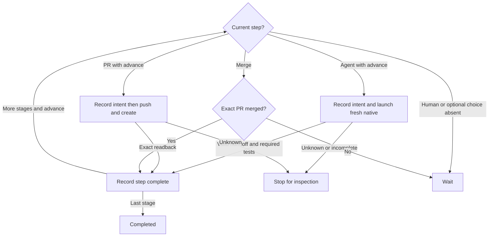

# Local workflow runner

`src/workflow-runner.mjs` owns sequential local workflows for the user's current Git project. It resolves a real same-repository GitHub issue, starts a fresh native coding-agent conversation for each agent stage, preserves observable file handoffs, asks for human choices, creates actual PRs and observes their merge. The supplied background stage adapter owns the assigned issue worktree and full-access native launch policy, preserving native login without global configuration writes. Do not merge automatically or embed credentials.

## Public module functions and ports

Export `WORKFLOW_STAGES` from the definitions module. Export async module functions:

- `runWorkflow({name,issue,agent,cwd,packageRoot}, ports)` begins any validated editable workflow with codex or claude. A still-active same-repo/name/issue run is reported rather than duplicated.
- `resumeWorkflow({runId,cwd,packageRoot,decision}, ports)` loads a UUIDv4 run, retaining its saved workflow, provider, repository and issue. `decision` is absent, `approve` or `skip`; it is never a new provider or arbitrary input.

Return `{exitCode,state,runId,stage,message}`. `state` is completed, waiting, failed or recovery_required. Exit zero for completed, two for an ordinary wait, and one for failure or uncertain effect. The CLI prints the single message including actual run/stage identity. Missing/malformed inputs fail before effects. Do not export a second integer/callback API or add a status command.

Background agent stages use the [Herdr stage port](workflow-stage-herdr.prompt.md); ordinary pdd session remains unchanged.

Canonical base guidance uses `loadGuidance({packageRoot,cwd,workflows:false}) -> string`; append the actual docs/workflows.md overview and the exact saved resolved definition/Markdown, keeping the full canonical guide first. Snapshot the complete canonical base guidance and resolved recipe from the original source project before worktree allocation. After assignment, compose and save the exact stage context with its actual worktree cwd and SHA256 before a native effect. Recompute against the saved definition and guide source before further progress and refuse changed source rather than silently switching context. Never request a hardcoded bundled workflow name for custom workflows.

Native ports are `runHerdrStage({runId,stageId,attemptId,agent,cwd,context,instructions,backend?,checkpoint})`, read-only `inspectHerdrStage({backend,cwd})`, active `attachHerdrStage({backend})`, and `closeHerdrStage({backend,acceptance})`. The native owner alone defines actual backend fields and Herdr operations. Awaited checkpoint snapshots are durably journaled before create/start/prompt and record returned actual backend IDs before stage delivery. A local UUID attempt identifies the runner attempt, never an invented native turn receipt. Submit one full guide-first current-stage request to a fresh owned ready native conversation with no prior prompt. Same-agent observed working to ready/settled is a transport candidate only. Main also requires the exact caller-bound closed handoff, unchanged input/currentness and pinned files, actual output hashes/ancestry and required real argv test results before acceptance. Idle alone, prose, a completed model turn or native lifecycle never certifies the stage.

Record acceptance with the exact backend/evidence and handoff digest before requesting owned settled-pane cleanup; fresh identity/quiescence must be checked by the native owner. Never close blocked, working, unknown or unrelated panes. Cleanup uncertainty retains the original accepted stage and stops before a new stage; it never resubmits a prompt. Interrupted/unknown delivery is inspection only and never automatically launches again. An explicit approve may continue the SAME original first dispatch only when the saved agent backend phase is start_intent or ready. Pass runHerdrStage the exact original run/stage/attempt/provider/cwd/context/instructions/backend/checkpoint; never allocate or start another agent. New intents retain instruction bytes; older intents may reconstruct only from saved fields and must match the original full prompt digest before this call. The native adapter owns proof of the exact existing workspace/tab/pane/terminal, only pre-prompt ready evidence, current server/agent/cwd identity and actual readiness under the shared guard. Blocked setup remains blocked with the original attach guidance; actual ready may checkpoint its first actual nativeSession and ready sequence, then durable prompt_intent before its ONE first prompt. Any prompt_intent, submitted, candidate or later backend stays inspection-only and never resends. No-decision resume remains read-only. Snapshot/source/currentness and all established checkpoint identity pins remain unchanged. A blocked stage pauses with its existing identity. The person may attach the exact active conversation; archived completed stages return finite archive information, never a new native conversation. The controller is the foreground pdd run/resume process: no daemon or promise of advancement after it exits.

Stage requests carry exact run/stage/attempt, assigned cwd, issue, starting HEAD/fingerprint, unique absolute handoff path, accepted prior artifacts and reports, and current instructions. The agent must read the full guide before Story, complete real files, write the closed handoff and report the result. It must not launch future stages, terminate the controller, push/PR/merge, change permissions/login or overwrite unrelated work. Main owns progression. No foreground-native-exit action is required for background stage completion. Optional execFile uses argv arrays, no shell; preserve defaults of helper modules unless an executor was explicitly injected.

## Identity and local records

Accept ISSUE as a positive decimal, owner/repo#number or HTTPS github.com/owner/repo/issues/number. Reject PR URLs, ambiguous paths, cross-repo issues and an issue number that is actually a PR. Resolve the current repo through normal Git/gh reads and bind its canonical owner/name to the actual origin. Use the normal GitHub user's `gh` authorization. Save canonical issue URL/number/title/body, repository, default branch, original source root, assigned worktree cwd, workflow, provider, resolved definition and UUIDv4 identity. Use [worktree assignment](workflow-worktree.prompt.md): allocateIssueWorktree({cwd,repository,issueNumber,runId,workflowName,baseRef},ports) returns ready/conflict/recovery_required and a real assignment; lookupIssueWorktree({cwd,runId},ports) finds that assignment read-only from either original or assigned checkout. A common-repo issue claim applies across workflow names. An allocation conflict may return no assignment. For an existing issue, read only the documented common-directory issue claim to discover its original run UUID, then use lookupIssueWorktree to validate that exact saved physical assignment. Claim discovery requires canonical ordinary metadata and never trusts the claim as a ready assignment or repairs/replays allocation. Check canonical repository/issue/commonDir and load the original journal under its controller lock before reporting that saved run; no second provider or workflow replaces it. Main never chooses another existing checkout, creates/deletes worktrees itself or touches the original working files. Validate actual assignment run/repo/issue/commonDir/root/gitDir/branch, execute every stage/check/artifact/PR in its immutable assigned worktree, and keep its journal in that worktree gitDir. Missing/ambiguous assignments or incomplete post-allocation journals refuse, never allocate another attempt automatically.

Keep append-only durable journal snapshots and artifacts under the actual absolute Git directory's `pdd/workflows/<UUID>/`, never a tracked product file or global config. Metadata directories and journal files must be canonical ordinary paths, never symlink redirects or multiply linked journal files; refuse before writing through an alias. Serialize active commands with an exclusive local lock; a concurrent live owner refuses. Resume acquires the assigned controller lock before reading its journal snapshot, checking the saved assignment or selecting progress; never act on a snapshot read before exclusion was acquired. A stale dead-owner lock can be recovered without restarting or killing a process; simultaneous recovery must never displace a live successor. An interrupted lock acquisition that cannot be proved stale refuses for inspection. Bind every snapshot to the saved repository/worktree, stage and current expected HEAD. Refuse changed definition source or canonical context, and retain the exact saved definition/Markdown/context snapshots. New runs use loader selection from the original project root before allocation; a complete local recipe overrides the bundle, including for arbitrary safe workflow names. Read durable JSONL incrementally with memory bounded by the current record rather than total journal size. Validate every historical sequence and run binding in order before returning the complete latest state; a large valid journal must not require one whole-file string. Preserve append-only bytes, terminal-newline completeness, malformed-history refusal and controller-lock ordering; do not compact, drop records or replace saved context. A malformed or torn journal refuses rather than inventing state.

Before any native launch, push or PR create, flush its specific intent. After crash or unknown delivery, reconcile existing state; never blindly replay a native session, push or PR create. No-decision resume may inspect journal/artifacts and read existing PR/merge state, but cannot launch a new agent, push, create a PR or automatically advance into an effect. Explicit approve permits ordinary next progress, with the same guards; skip is confined to optional steps.

## Stage progression

Optional steps wait before execution. A flushed optional decision governs recovery even if interruption occurs before its stage completion record. Revalidate its saved input, apply a saved skip before any native/PR effect, and skip a matching merge; a later approve cannot resurrect that skipped step. A saved approval does not authorize effects on an inspection-only resume. Approve chooses the optional step; skip records its omission and continues under that explicit command. Human Story approval is a current decision, bound to the actual HEAD and independently authored prompt/Story/cases/test-plan file hashes. A skipped optional prompt PR causes its matching merge step to skip. Rejection or missing approval never becomes approval. Human/optional decisions made after input changes refuse. Only after an actual prompt PR merge may explicit approve at the following build boundary accept a clean user-prepared branch containing that exact merged commit, with all pinned contract artifacts unchanged. Record the old/new input binding; never checkout, reset or rewrite the base automatically.

## Agent handoff and verification

Before launch, supply an absolute handoff path under the run artifact directory. The agent writes a regular JSON file with exactly `version:1`, `runId`, `stageId`, `issueUrl`, `inputRevision`, a nonempty `summary`, and `files:[{path,sha256,role}]`; optional `testCommands` is an array of argument arrays. Allowed roles are prompt, story, cases, implementation, tests, evidence and notes. Paths name regular files within the current project, not `.git`, symlinks or traversal. Verify their actual SHA256, not just reported names. Reject extra/malformed identity, duplicates, stale input or missing artifacts. Verify actual output HEAD and retain file hashes as a real handoff. Uncertain native delivery or exceptions cannot trigger a new launch. A saved attempt is inspected under its original identity; only an explicit advance may accept a fresh valid candidate for that same attempt. Unknown transport never becomes pass, and no resume resends its prompt.

Report protocol stages may retain their substantive handoff summary in the journal artifact without claiming executable evidence. Work stages still require project files. A proposal supplies its declared contract/independent-case roles plus the project's concrete native test argv plan. Bundled feature/bug proposals require prompt, Story and cases; the small-change proposal requires cases. Human approval (or explicit optional/advance decision for small changes) pins that input. Preserve pinned prompt/Story/cases through implementation. Reject output history that abandons the starting commit. After real tests, re-read and compare the exact closed handoff, recheck the pinned and output file hashes, and require unchanged test input HEAD/worktree fingerprint and retained starting ancestry. A test that mutates the execution input or handoff cannot certify that changed result. After a separate prompt PR merge, require the subsequent code branch to contain the exact recorded merged commit before further code PR publication, without forced checkout or silently changing bases. The verify stage runs that exact test plan with ordinary execFile and records actual command exit status. A missing command, nonzero exit or changed expectations refuses completion; neither an agent's prose nor native transport settlement stands in for running tests. Passing finite tests is not formal proof or prompt execution.

## GitHub PR effects and merge observations

PR stages require a clean committed non-default branch with commits beyond the saved default base, unchanged accepted input files and current repository/HEAD. A verified publication additionally requires a completed successful verify record bound to the exact current HEAD/worktree fingerprint and accepted argv plan, with actual zero-exit results for every command. Persist that verification binding with its accepted evidence and carry it into completion. A later agent edit, including a report stage writing files, cannot reuse earlier test results for changed source. Proposal publication keeps its independently accepted proposal semantics. Save branch, base, head commit and stable `pdd-workflow:<runId>:<stageId>` body marker before effects. Use ordinary non-force Git push to origin and `gh pr create --repo ... --base ... --head ... --title ... --body-file ...`. The run command authorizes its defined real PR stages; do not imply it merely prepares text. Do not create empty PRs, alter login/protection/config or merge.

Read back the actual PR and require exact repo, branch, base, head commit and marker. Unknown push/create delivery remains recovery_required; on resume use read-only remote-head/PR queries to find the same effect. Multiple matches, changed head/base/repo or unproved state refuses. For a saved pending PR only, explicit approve may authorize one bounded unpublished-original attempt after read-only reconciliation fails: revalidate current saved inputs and durably append `pr.unpublished_retry_intent` without replacing the saved intent, then call `publishWorkflowPr({cwd,intent,unpublishedOnly:true},ports)`. The helper must freshly prove both original PR lookups and exact saved remote head absent and validate the original binding before effects; any present or unreadable state refuses. A lost reply remains pending; no-decision resume only reconciles, and another attempt requires another explicit approval and fresh absence proof. This exception neither retries native stages nor invents historical push-phase or body-byte proof absent from legacy intents. Persist exact PR number/URL/head. A merge stage must compare the observed PR number and URL exactly with its saved original PR identity in addition to the intent binding. A replacement with the same marker/repository/head/base/SHA is not that original and refuses. It advances only when the original is actually merged with that same head; open remains waiting, closed unmerged refuses. Missing-decision resume may reconcile/observe but stops before any new mutating stage.

## Dependencies

- [Artifact handoffs](workflow-artifacts.prompt.md): required helper for closed handoff validation, regular contained files/hash checks and real native test argv. Caller retains HEAD/currentness, accepted source and journal decisions.
- [GitHub effects](workflow-github.prompt.md): required helper for actual same-repository issue binding, prepared PR intent, publish and read-only original reconciliation. Caller durably saves intent before publish; helper never owns journal, stage advance or merge.
- [Stage definitions](workflow-definitions.prompt.md): required orchestration input at authoring and runtime through `src/workflow-definitions.mjs`.
- [Guidance](guidance.prompt.md): supplied loadGuidance port must actually load the full guide before Story and the selected bundled Markdown.
- [Background stage](workflow-stage-herdr.prompt.md): the supplied four native stage functions own transport, exact native identity and verified owned cleanup; ordinary native-session remains separate.
- Node built-ins provide filesystem durability, crypto UUID/hash and process argument execution; Git and gh must already be installed and signed in by the user. No dependency installation or model call is performed by unit tests.

## Editable semantic protocol

Use resolved stage protocol fields, never reserved stage IDs, to decide report/proposal/work/verify behavior. Proposal roles and native argv plan come from its handoff; approval mode is human or next-advance. The latter pauses before subsequent effects until an explicit current advance. Human stages accept the one current proposal. A verify protocol executes the accepted plan. requiresMerge binds work or PR to the referenced exact observed merge; a clean explicit advance may accept a user-prepared branch containing that recorded revision with pinned artifacts unchanged, never while native intent is pending. Preserve optional-decision and exact recorded-merge refusal boundaries for every renamed optional/PR/merge stage.

Export `attachWorkflow({runId,cwd,packageRoot},ports)` for the CLI's `pdd workflow attach RUN_ID`. Resolve the original assignment/journal read-only using the common-repo run index; save no placeholder on a missing run. Attach only the current exact active saved backend after normal identity checks, not completed history or a different stage/session. Return the existing V1 result shape for finite archive/missing information; normal attach exit is not workflow success or advancement.

Additional required dependencies: [editable definition loader](workflow-definition-loader.prompt.md), [issue worktree](workflow-worktree.prompt.md), [background native stage](workflow-stage-herdr.prompt.md). Each owns its separate helper contract; main consumes those helpers without duplicating their policy.

## Shared attach and acceptance exclusion

The runner supplies native `ports.withStageGuard(backend, action)` using the actual assignment commonDir and runId. This is a shared exclusive filesystem guard distinct from the controller's command lock. Hold it for the whole foreground attachment or for fresh candidate/currentness/handoff/test validation through durable acceptance and cleanup, never throughout native polling. Same-call nested native inspection/cleanup may reenter through async-local ownership; concurrent processes or independent calls may not. Active guard contention pauses rather than displacing its owner. After acquiring the guard, reload the actual journal and revalidate assignment and saved inputs before selecting an active backend; a previously read pending stage may already be accepted or closed. Attach records a separate fsynced attachment epoch without racing the controller's journal sequence. A captured candidate predating attachment cannot be accepted; preserve and invalidate it, then require explicit fresh same-attempt inspection under the guard. New activity/input changes invalidate prior evidence. Do not supply a no-op guard.

## Independent issue stages

Do not cap active or unresolved native stages across a repository. Each running stage is a full Codex or Claude session on the person's computer. Distinct issues may retain independent unresolved stages concurrently; this does not promise tested throughput or automatic cleanup. Preserve one assigned run per issue and one active stage per run, controller and attachment exclusion, exact identity/currentness checks and uncertain-delivery refusal. Do not allocate or release repository admission slots. Historical admission metadata and claims may remain on disk; ignore them without clearing or rewriting live journals or claims.

## Bound person decisions

Export `applyWorkflowDecision(input, ports)` for the decide module. Under the
existing assignment/run lock, read the complete validated journal, compare the
current stage and positive journal seq, and revalidate saved input before any
admission. Gates persist `waitingDecision:{stage,seq,at,decisions}`; `at` is epoch
ms, seq includes that gate's durable record. Repeated inspection retains the
same gate/time/seq. A new run saves startedAt for native session discovery.
Only a settled human, optional or next-advance proposal gate admits decisions;
active/recovery work and external merge waits do not. Skip needs an optional
stage. Changes needs a completed proposal before this gate.

Check historical decisions before current-gate checks: same id and exact
payload/expected binding returns recorded without authorization or new effects;
changed payload is bad_args. For a new id, call `ports.authorizeDecision` with
the authoritative state and require `{ok:true,approvalRecord}`. Persist the
binding and evidence as `decisions[]` and latest `approvalRecord` before advance.
A crash after admission must never repeat the effect on retry.

Approve/skip use existing foreground advancement, preserving artifact/issue and
native validation. Changes preserves removed completion/proposal/acceptance in
revisionHistory, clears downstream acceptance and optional choices, records the
person's text in changes, and starts a fresh attempt of the most recent proposal
stage. The prompt supplied to that stage includes the changes text. No published
PR or accepted merge is rewound. Result recorded certifies admission, never stage
completion; failed/uncertain advancement retains the recorded id and evidence.
Area-chat composition may provide the same applyWorkflowDecision port and must
honor all admission/evidence rules while starting one fresh next/revision chat.

`readWorkflowDecision({runId,cwd},ports)` is the read-only selector for CLI adapters:
validate assignment and journal, return ready with runId,stage,journalSeq,issue,
repo,root for a current saved person gate; otherwise refuse without mutation.
Its result supplies no authority: applyWorkflowDecision rechecks under lock.

A stopped foreground run with a pending attempt also saves an approve-only
recovery gate. A person can authorize reconciliation of that original attempt;
the runner still refuses duplicate launch/PR effects and unresolved native work.
This preserves legacy explicit recovery without bypassing evidence. Recovery
validates original pending ancestry/artifacts rather than assuming its worktree
still equals the pre-agent fingerprint. Recovery gates never offer changes/skip.
Gate evidenceStage selects the current pending or most recent completed native
stage's actual start/end window, so earlier chats cannot make later approval
ambiguous; a missing historical time window fails chat verification closed.

When the independently supplied14a workflow-run-records module is present, finish
both ordinary and decide advancement by writing runStatusFromState phase exit
through writeRunStatus under the same run lock; a newly saved decision gate must
project waiting, not running. An admitted but uncertain advancement projects
recovery_required. Projection failures never change authoritative journal results.

A failed journal append prevents further records from that in-memory state and
prevents final status projection from advertising its uncommitted sequence.
Preserve the last complete status for inspection; never fill a journal gap.
