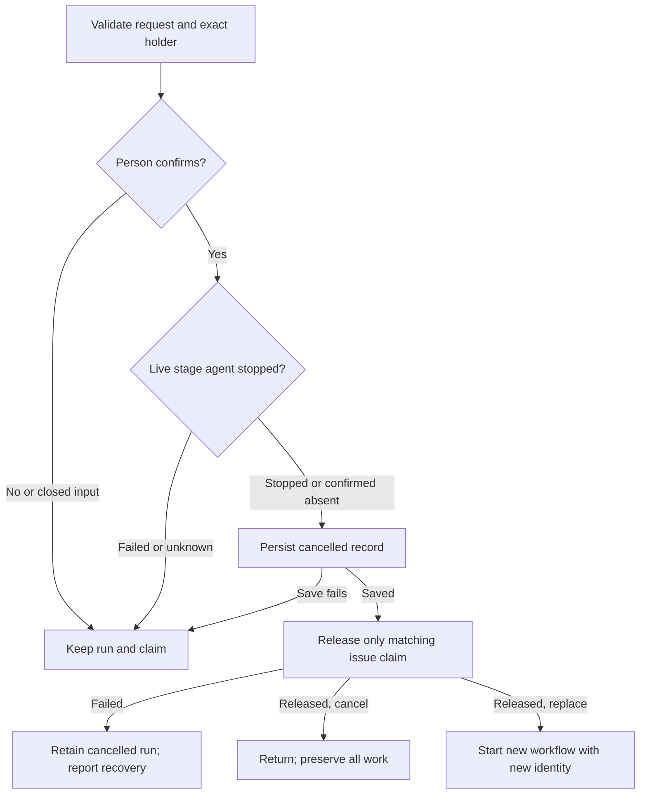

# Workflow runner (area chats)

Own `src/workflow-runner.mjs`. It runs a workflow for one GitHub issue as a few area chats. pdd has four jobs: start, gates, PR and status. Preserve existing issue-reference commands and module exports except the authorized cancellation/replacement extensions below. The agent does the work. pdd does not watch the agent, run tests, wait with a timeout or merge.

## Base selection

`startRun` accepts optional `base`, supplied by public `--base BRANCH`. Without it, use the repository’s actual default branch and retain the fetch-failure warning behavior. With it, require a nonempty branch name, not a revision expression, a full `refs/` name, an option or a filesystem path; slash-separated topic names are allowed. Validate as `refs/heads/BRANCH` without Git’s previous-checkout expansion. Do not alter the resolved repository/default metadata.

For an explicit base, fetch exactly `refs/heads/BRANCH` from `origin` into `refs/remotes/origin/BRANCH`, and verify that tracking ref resolves to a commit. A missing branch, rejected fetch or unavailable commit stops startup with a diagnostic naming the base: no stale/local/default fallback, worktree allocation, saved run, chat start or cancelled-run claim release. The branch must already be on origin so GitHub can use it as a PR base. Never publish the base as part of startup.

Allocate the issue branch by passing `baseRef: "refs/remotes/origin/BRANCH"` to `allocateIssueWorktree`, where `BRANCH` is the selected branch name, for both the repository-default and explicit-base selections. Save the selection in `baseBranch` and its observed commit in `baseSha`. Show the base in startup output. PR 1 (or a small-change PR) targets that saved branch. PR 2 stacks on an open PR 1; after PR 1 merges it starts from and targets the saved base. Existing runs retain their recorded bases. Only the allocated topic branches are pushed; choosing a base does not authorize pushing it, changing origin’s default branch, or merging.

## Failed chat startup and recovery

A Herdr request failure is not evidence that an agent is working. If an initial or later-area start, or explicit open/resume, fails, keep the same run, allocated worktree, selected base, issue claim, completed steps and decisions. Save `chatFailure {area, phase, code, message, at}` (phase `start` or `open`, finite one-line reason), set the active run to `waiting`, and report the failure with `pdd workflow open N` for explicit recovery after Herdr is available. Do not retry the request automatically, restart an unavailable server, allocate again or fabricate a chat/session. A failure after the pane launch request may have dispatched: retain the prepared chat identity supplied by [area chats](workflow-chat.prompt.md), including its unconfirmed flag.

Public detailed, list, all-repository and JSON status group this failure as waiting and show its code/recovery action, never agent working. A legacy active run with no current chat also reports startup unconfirmed, even without the new failure field. A `server_unavailable` observation for an existing chat means status unavailable, not proof it stopped or works. Cancelled/completed status wins over stale failure data. Other transient inspection behavior and the normal new-agent grace period remain unchanged.

Only a successful start/open or positive observation of the same current chat clears its active failure/unconfirmed flag. Restore `running` only when no person question or approval gate is waiting; recovery never approves, advances an area or discards decisions. If Herdr remains unavailable, keep the precise external failure and preserve custody rather than claiming recovery.

## Cancel or replace a holding run

This module owns confirmation, custody and the person-facing recovery advice. Keep all existing alpha issue-reference commands. Only cancellation adds exact run-ID selection; `startRun` adds optional `replace`, supplied by `workflow run NAME ISSUE --replace RUN_ID`. Resolve a run ID unambiguously across known repositories, including retained cancelled records. Missing/ambiguous IDs and a replacement ID that is not the issue's current holder refuse without confirmation or effects; never cancel a different repository/issue or silently fall back to its current run.



Confirmation identifies repository, issue, holding run ID and workflow, and the requested replacement workflow when present. Ask once before any cancellation mutation or stopping/closing a chat. An absent person answer is no; agent approval and an earlier gate approval cannot substitute. A declined request exits successfully and leaves the original record, claim, chats and files unchanged. Cancelling an already-cancelled run is an idempotent success, without a second stop. Validate workflow/agent/config/repository/issue/base before requesting replacement confirmation; preserve the explicit-base fetch-before-release promise.

After confirmation, inspect and stop every live stage agent belonging to this run before releasing custody. A failed stop, unavailable inspection or an uncertain start is not proof of absence: refuse, preserve the claim, and do not start another run. Closing a tab alone is not evidence of a stopped agent. Persist `state: cancelled`, `cancelled: {state: cancelled, at: now}`, and a cleared gate; keep the cancelled run's identity readable through status/index/archive, including its C3 cancelled view. Release only the matching issue claim after this durable save. If release or later replacement allocation fails, report the real cause, retain the cancelled history, and do not resurrect the run or delete/reuse its worktree. Concurrent requests recheck holder identity under exclusive custody so two replacements cannot both start.

Cancellation/replacement preserve all worktrees, branches, journals, artifacts, completed summaries, decisions and every PR (including open PRs). They push nothing, close no PR and never merge. A replacement uses the ordinary new-run path after cancellation, with a distinct run ID/worktree/branch and the existing `previous` link/archive convention. A delayed `done` from the cancelled run must stop and cannot mutate the replacement.

A conflict refusal names the holder's run ID, workflow, current step/stage, state and elapsed age from `startedAt`, and prints `pdd workflow status ISSUE`, `pdd workflow open ISSUE`, the actionable current-alpha `pdd workflow approve ISSUE` continuation at an approval gate, and exactly `pdd workflow run NAME ISSUE --replace RUN_ID` for the requested workflow. Holder detail labels are `stage STAGE`, `state STATE` and `age N min`. Display elapsed age as whole minutes (`floor(max(0, now-startedAt)/60000) min`), a diagnostic rather than a timeout. Use repository-qualified issue references when needed to avoid ambiguity. At a nonapproval stage, opening the chat is the continuation; never claim an approval advances an active step. Do not print obsolete resume/decision forms.

When a scope summary recommends another workflow, retain the recommendation and its reason with the original summary. At that scope gate and every later holding-run refusal, show the recommendation and the exact replacement command for the recommended workflow. At a refusal whose requested workflow differs, show both the requested replacement and the recommendation. A recommendation never cancels, approves or switches a run automatically.

Standard runtime ports: confirmation, current time, run-record storage, chat lifecycle and isolated worktree allocation. The required interface reference below declares the executable transport for these dependencies; it supplies no replacement ownership policy. The owner links in Dependencies are required context for authoring and generation. The runtime operations in this slice cover cancellation and the holding-run branch of startup; other runner behavior retains its contracts above.

<details>
<summary>Required interface reference — runner dependencies</summary>

Runtime entries bind the actual module functions `cancelRun(input, ports)` and `startRun(input, ports)` in `src/workflow-runner.mjs`; return `{exitCode, message}` as above. Resource calls are transport for the ordinary production dependencies (clock/UUID invocations may be audited as port events without changing their production return semantics), not additional public runner operations. For transport, confirmation asks exactly `Cancel run RUN_ID (WORKFLOW, REPO#ISSUE)? (y/N)` or `Replace run RUN_ID (WORKFLOW, REPO#ISSUE) with NAME? (y/N)`. The question has no trailing newline. `records.load` resolves the supplied reference (or startup issue) through `workflow-runs.resolveRun`; `records.save` represents the call to `writeRun(run, ports)`: its value is the complete serialized INPUT record immediately before writeRun derives C3/journal fields. Its key is run.runId. Its simulation records the latest input argument per run ID in a write-input ledger; it does not model a status.json file, index update, durability or the post-write mutation/return value. The runner does not consume writeRun's return, so this transport returns an empty object. Code verification must invoke the public runner with real temporary storage, compare every non-lifecycle field/file/PR, and separately assert persisted cancelled state, C3 cancellation and journal/index updates. These are not proved by runtime write-ledger assertions. Load values are complete JSON-serialized representative records (null or empty string means not found); transport serialization is compact JSON retaining input key order. Preserve every unrelated field, not merely the fields read here. `clock.now` supplies epoch milliseconds. `person.confirm` is the injected confirmation callback, with a question identifying the run as above. `chats.stop` serializes the actual `workflow-chat.stopChats(run, ports)` call: its `stopped` result is true only after the run's agents are confirmed stopped or absent; false includes inspection failure/uncertainty. `claims.release` binds `releaseIssueClaim({cwd,runId,issueNumber})`; `identity.uuid` binds Node crypto.randomUUID. `github.resolve` serializes `resolveWorkflowIssue({cwd, issue})` as a binding JSON string with repository, issue and defaultBranch. `worktrees.allocate` binds `allocateIssueWorktree({cwd,repository,issueNumber,runId,workflowName,baseRef})` and returns its state/message plus a JSON-serialized assignment. Generate the replacement ID once with identity.uuid, resolve its GitHub binding with github.resolve, then allocate from its selected base. `workflows.read` serializes readWorkflowAreas({packageRoot,name,cwd,home}); use its selected areas and skill metadata. On ready, archive the original run folder with archives.rename (Node fs.renameSync from/to), save the new run with its distinct identity and previous link, call chats.start (the actual startChat({run,area,message},ports), serializing run and returned chat), then retain that confirmed chat in the new record. Return success only after those resources confirm ordinary startup. An allocation receipt alone is not proof of chat startup. These simulated receipts still require real-store/native code verification. The chats resource receives the complete serialized run; claim/allocation resources receive their exact public input fields. All cancellation effects bind the original run ID. Successful cancellation calls save once then release once; declined/failed-stop requests call neither. No push/PR operation is available in this slice. For `stepDone`, load the current-worktree record using `cwd` as the key. Recording a scope summary that recommends a bundled workflow saves `scopeRecommendation: {workflow, reason}` (the reason is the supplied summary) beside the unchanged `done.scope.summary`; its gate message includes the recommendation and exact replacement command. A completed scope step at an approve gate leaves state waiting. For a cancelled record, return a stop message and save nothing. Startup without a holder continues through ordinary allocation; a holding-run refusal allocates nothing. Missing or wrong replacement IDs, including a run belonging to another issue or repository, are not authorization to cancel any holder.

</details>

## Commands

Each export takes `(input, ports)` and returns `{exitCode, message}`. Success/decline/idempotent cancellation returns exitCode 0. Operational refusals, including absent/stale/wrong/cross-issue replacement IDs and failed or uncertain stops, return exitCode 1 as ordinary results, not Runtime errors. Parser syntax errors are exit 2 before runner dispatch. The CLI prints the message.

- `startRun({name, issue, agent, base, replace, cwd, packageRoot})`: read the areas from the pdd-NAME skill ([areas](workflow-areas.prompt.md)). Read the agent's config folder: `CODEX_HOME` for Codex, `CLAUDE_CONFIG_DIR` for Claude ([chat](workflow-chat.prompt.md) `homeVariable`, `expandHome`). A leading `~` or `~/` is the home folder (zsh leaves `~` as text in `env CODEX_HOME=~/x pdd …`, 0.1.6 tester), and a relative path is resolved from cwd. When it is set and that folder does not exist, refuse before any git, gh, worktree or Herdr work: `VAR is "PATH", but that folder does not exist. Fix VAR and run the command again.` The run keeps the full path as `configDir`, and the Claude trust check reads `.claude.json` in it. Resolve the issue with gh ([GitHub](workflow-github.prompt.md)). Apply the holding-run and confirmed replacement rules below when the issue already has a run that is not cancelled. After a cancelled run, free the issue claim (`releaseIssueClaim`), keep the old worktree and branch, rename the old run folder to `<N>-cancelled-<first 8 of its run id>` and start fresh with a new worktree and branch; the new record lists the old one in `previous`. Select the base as described below. Make the worktree and branch ([worktree](workflow-worktree.prompt.md)). Make the run folder and write the run record ([runs](workflow-runs.prompt.md)). Start the area 1 chat ([chat](workflow-chat.prompt.md)). Print where the run is, `pdd workflow open N`, `pdd workflow status N` and `pdd workflow approve N`. Then return at once. If the main repository is not trusted by Claude, say that Claude asks to trust the folder first.
- `stepDone({step, summary, cwd})`: only the agent calls this, from the worktree. Find the run from cwd. Record the step with its summary and time. The stored summary keeps its line breaks (each line's spaces collapsed, blank lines dropped); every place that shows a summary on one line (status, the code question, the PR step list) collapses it. An unknown or out-of-order step prints a warning and is still recorded. A step that runs again after later steps of its area (for example `build` after `verify` when vectors fail) prints a warning and clears those later steps, so they run again; the area's PR opens only after its last step. Then print one of:
  - the next step of the area and the exact `done` command (an optional step is a question to the person, and "skipped" is a valid summary);
  - at an `approve` gate: show the result, ask the person, stop, never approve for them; how they approve; how to handle changes (revise here, run done again, ask again);
  - after the last step of a `pr` area: "pdd opens the PR now". Commit any uncommitted files (with a warning), push and open the PR for this area. The body (0.1.4 #18, 0.1.6) starts with the Runtime check lines of that summary (the check step's, else the latest step that reports one): every "Runtime check (<story>)…: …" line, one per Story (a Story that appears again keeps its place and takes its latest line), then, with two or more Stories, a total that pdd adds up itself: "Runtime check (all Stories)[ (DRAFT)]: ✓ 8 of 8 criteria · 35/35 checks · 17 AI calls" (sum the criteria, the checks and the AI calls, each only when every Story line has it; ✓ only when every Story passes, else ✗; DRAFT when any Story line is DRAFT). A pasted overall "Runtime check: …" line is dropped when Story lines exist, because it can cover only the Stories checked last; a summary with no overall line works the same. Without Story names, keep the Runtime check lines as written. Then "Report (<story>): URL (report links expire after 7 days)" for each distinct report link, in summary order (the Story name comes from a "Report (<story>): URL" entry; a bare link or "Report: URL" or "Report (DRAFT): URL" has no name). The chat pastes the lines that `pdd check` prints into the check step's summary, one per line (with a `Report:` line per Story) or joined with "; " (with one "Report (<story>): URL" per report row); a result ends at a line break, ";", a `Report` entry, a link or the next `Runtime check`. Read these lines from the stored summary, before it is collapsed. Above the Runtime check lines go the verdict line and the before → after line of a bug check (0.1.7): the first "Verdict: …" and the first "Before ✗ …" / "Before ✓ …" / "Before: no prompt …" in the step summaries (the check step's first, then the newest step), each up to its line break, or up to a "; " that starts "Before", "Runtime check" or "Report" (a "; " inside the verdict sentence stays). A report link in the before → after line gets " (report links expire after 7 days)" and is not listed again as a "Report" line. Then the PR head ("Part of #N" / "Closes #N" …), then one line per step since the previous PR, cut to about 200 characters at a word end and never inside a URL (a URL that crosses the end stays whole, and " …" follows it). Only a PR that covers a verify step carries `<run folder>/verify.md`, under "## Verify" (0.1.6 tester: 100 lines of shell before the vector table): drop a leading "# Verify" line, write each "## " heading as "### ", and fold each fenced block of more than 15 lines that is not inside a `<details>` block into `<details><summary>Commands (N lines)</summary>` (sh, bash, zsh, shell or console blocks) or `Output (N lines)`. When verify.md has no `<details>` of its own, keep the text before its first heading on top, then its sections whose heading names vectors or results, then the Formal check, then other sections with a table, then the rest, each group in file order. GitHub refuses a PR description over 65,536 characters (0.1.7 tester: a 105,489-character verify report; every retry failed the same way), so the whole body stays at most 60,000 characters (Unicode code points), which leaves room for the marker and for GitHub's own count. When verify.md does not fit in the room that the rest of the body leaves, the body keeps a summary of it. First each `<details>` block (long commands and output) becomes one line, `- <its summary text>: not shown here.` If it is still too long, keep its first lines that fit, cut at a line end (never inside a link) with an open code fence closed, and then list the lines of the cut part that report a failure (`✗`, or the word fail, fails, failed or failing) under `Lines that report a failure, from the part not shown:`, as many as fit. End the summary with: `_The full verify report has N characters, more than a PR description can hold (GitHub's limit is 65,536). This is a summary: WHAT. The PR author has the full report: verify.md in the run folder._` (WHAT: `the long blocks are not shown`, or `its first N lines; M more lines are not shown, and K of them report a failure`, with `reports` when K is 1). Before collapsing details (authored or generated from long fenced output), retain their failure lines and report references outside the collapsed block. If truncation is still required, consider failures and report references from all omitted content, including collapsed blocks. Keep whole evidence lines and links while room allows; explicitly count omitted failures and report references when they cannot all fit. The full verify.md stays byte-for-byte in the run folder. Failures are never dropped in silence. Local paths never appear: the worktree path becomes repo-relative, the run folder "<run folder>", any other `/Users/…`, `/home/…`, `/private/…`, `/var/folders/…` or `/tmp/…` path "<local path>". Before writing a PR body, replace every Try link (a URL whose path has `/s/<token>`) in the step summaries and verify.md with "(Try link removed)"; report links (`/r/`) stay. When the first line of verify.md starts with "✗" (for example "✗ 2 vectors fail"), that line is also the first line of the PR body. When the body has a runtime report link, add "Runtime report links expire after 7 days." A report link is a URL with a `/r/` path segment, or a URL that starts with `PDD_RUNTIME_URL` when it is set. Never fix a runtime host in the code. When the PR exists already, push the new commits only. When the PR does not open, print the message of the [GitHub](workflow-github.prompt.md) result: it names GitHub's own reason when GitHub refused the PR, and says unconfirmed only for a real doubt. A retry builds the same intent again (same run, area, marker, branch and SHA when nothing new was committed) and does not push again. Print the PR URL and "pdd never merges".
  A cancelled or completed run prints that the agent must stop.
- Try before PR 1 (0.1.4 #13): a `pr` area with `"before":"approve"` does not open its PR after the last step. `done` sets the gate kind `approve-pr` and tells the chat to show the Runtime check line with its report link and the Try link, ask the person to try it and approve or ask for changes, and stop. Status: "waiting for you: try it, then approve to open PR 1". When there is nothing to try (no step of the area left a Try link, and the try step was skipped or the worktree changes no test file), the gate text says "There is nothing to try. Ask them to approve or ask for changes." and status drops "try it, then " (0.1.6 tester: a browser-only Story). For PR 1 the gate text also gives the chat the words for what PR 1 holds, read from the worktree's changes against the run base (uncommitted files count): "Tell the person what PR 1 holds, in these words: "PR 1 is ready with the approved Story[, the approved prompt X][, the draft prompt Y][, the prompt Z] and the tests."", with "the approved Stories" for two or more Stories under `user_stories/`, and without "and the tests" plus " It has no test file." when no test file (a `*.json` with `prompt-runtime.program-scenario`) changed. Only the Story area was approved, so a draft prompt is never called approved (0.1.6 tester). `approve` here works like an area gate (chat evidence: any message from the person; terminal: "Approve the AREA area and open PR 1 for …? (y/N)"); it records the decision and opens the PR. With `then: ask-code` the run moves to the code-or-stop gate (new gate time): from the chat, the reply tells the chat to ask the code question; from the terminal, when PR 1 has draft prompts, pdd does not ask about the code PR: it prints PR 1's link and the approve-first line (see Draft prompts) and sends the chat "pdd opened PR 1: URL. … Tell them exactly: "PR 1 is open: URL. <approve-first line>" Then stop."; else pdd asks "Make the code PR now …? (y/N)" — no sends PR 1's link and the stop into the chat and prints "To make the code PR later, run `pdd workflow approve N`."; yes goes on as the code gate (the code branch and chat). A PR that cannot open leaves the gate open; run approve again.
- Two PRs (bug and feature): an area with gate `pr` and `then: ask-code` opens **PR 1** (title "ISSUE TITLE (prompt, Story and tests)" and body line "PR 1 of this run: the prompt, Story and test cases. …" when the worktree changes a test file, else "ISSUE TITLE (prompt and Story)" and "PR 1 of this run: the prompt and the Story. …"; body "Part of #N"). Then `done` prints the PR 1 link, the step summaries (Runtime check line, Try link) and tells the chat to ask "Do you want the code PR now, or stop here and merge PR 1 first?" and stop. This is a gate. When the chat pushes more commits to an open PR 1 at this gate (for example the prompt approval the person asked for), the gate keeps its time, so the person's earlier yes still counts; `changes` moves it. `approve` (terminal y/N "Make the code PR now…", or the person's own words in the chat) starts the code area in a NEW chat on a new branch `<branch>-code`: from PR 1's head when PR 1 is `open` (PR 2 is stacked: base = PR 1's branch), or from the fetched saved base branch when PR 1 is `merged` (base = the run’s selected base). When PR 1 is `closed` or its state is `unknown`, refuse: make no branch, change no run field, and tell the person to check PR 1 and run `approve N` again. The last area opens **PR 2** (title "ISSUE TITLE (code)", body "Closes #N" and "Builds on PR 1: URL"). If PR 1 merges while the run waits at this gate, `status` ends the run as "done at PR 1"; `approve` still starts the code area later.
- Draft prompts: list every `*.prompt.md` that PR 1 changes (diff from the base to PR 1's branch) whose Runtime interface block ([runtime preflight](runtime-preflight.prompt.md) `interfaceBlocks`) has `"status": "draft"`. When there are any, the PR 1 body and the `done` gate text get "Draft prompts: X, Y. Approve them before you merge.", and `status` shows the same line (read again from PR 1's branch each time). The code is built only from approved prompts, so while PR 1 has a draft prompt pdd never offers the code PR (0.1.6 testers: pdd asked "Make the code PR now?" and then refused the yes). The approve-first line is "Approve the prompt[s] first: cd WORKTREE && pdd approve X[ && pdd approve Y]. Then run pdd workflow approve N to start the code PR." (paths shell-quoted). The `done` gate text then tells the chat "Do not offer the code PR yet. Tell the person exactly: "PR 1 is open: URL. <approve-first line>" Stop there." instead of the code question. Status says "PR 1 open (URL); waiting for you: approve the draft prompt[s] first, then make the code PR.", the list "waiting for you: approve the draft prompt[s], then the code PR (PR 1 open)", and Next: "cd WORKTREE && pdd approve X, then pdd workflow approve N (make the code PR)". `pdd approve` writes the prompt and commits nothing, and an approval committed by hand went to PR 2 while PR 1 still said "Draft prompts" (0.1.6 testers). So `approve` at the code gate, while the worktree is on PR 1's branch and PR 1 is open (the run is not done at PR 1, and GitHub says open), first makes PR 1 hold the approval: it commits alone each draft prompt of PR 1 that is approved (and no longer draft) in the worktree ("Approve X, Y"); it fetches PR 1's branch; when the worktree has commits that PR 1 lacks and PR 1 has none that the worktree lacks, it pushes them to PR 1 ("pdd committed your approval of X and pushed it to PR 1." or "pdd pushed N new commit(s) from the worktree to PR 1."); pdd never forces a push. After a push it reads PR 1's description and rewrites its "Draft prompts: …" line to the drafts left, or removes it ("pdd updated the PR 1 description: no draft prompts are left."); a failure there is only a warning. When the commit or the push fails, or PR 1 has other commits while there is an approval to push, `approve` changes nothing else and prints the exact commands (`cd WORKTREE && git push origin HEAD:refs/heads/BRANCH`, or `git pull --rebase origin BRANCH && git push …`) and "Then run pdd workflow approve N again." Then, when drafts remain, `approve` refuses with the approve-first line before any question or chat check. pdd never sets `approved` itself; a read problem lists no drafts. Small-change has one PR with the issue title and "Closes #N".
- `approveRun({ref, cwd})`: only a person approves. When the run's saved config folder (`configDir`, `~` expanded) does not exist, refuse before anything changes: `This run uses VAR "PATH", but that folder does not exist. Make that folder, or cancel the run (pdd workflow cancel N) and start it again with the right VAR.` When pdd runs in an agent session (`PDD_AGENT_SESSION`, `CLAUDECODE`, `CODEX_THREAD_ID`) or without a TTY, it needs chat evidence: a user message in the current area chat's native session after the gate ([approval evidence](approval-evidence.prompt.md)). Messages that pdd sent with `changes` do not count. A terminal in the run's own chat pane also needs chat evidence: `HERDR_PANE_ID` is the pane of one of the run's chats and `HERDR_SOCKET_PATH` is a socket of the Herdr session `pdd` (`…/sessions/pdd/<file>`). A person's own terminal tab in Herdr (another pane, or the person's default Herdr session) with a TTY and no agent variable asks y/N like any terminal (0.1.6 tester). Without evidence, the chat's own agent (`PDD_AGENT_SESSION`) gets plain words to pass on (0.1.6 tester: the chat said "PDD rejected recording your earlier "Go on""): "Only the person can approve, with a reply after your gate question. pdd found none: REASON." and "Do not explain this check to the person. Tell them plainly: "I still need your approval for this step. Reply "I approve" here, or run pdd workflow approve N in your terminal." Then stop and wait." Anyone else is a person in an agent-like terminal (Claude Code's `!` prefix sets `CLAUDECODE=1`, 0.1.6 tester) or in the chat's pane, and gets three lines: "pdd sees an agent environment (CLAUDECODE=1 | CODEX_THREAD_ID is set | stdin is not a terminal)" or "pdd sees the AREA chat's own Herdr pane (PANE)", then ", so it cannot ask you y/N here."; "No approval was found in the AREA chat: REASON."; "To approve, run pdd workflow approve N in a normal terminal (in another terminal tab, for the pane). Or answer the gate question in the AREA chat: pdd workflow open N". REASON is plain: "there is no reply from you (the person) after the gate question" for `user_message_missing`, else "pdd could not read this chat". Only the words differ: the evidence rules stay the same. At the code gate (after PR 1) the chat reply must also hold a yes-word ("yes", "approve", "build the code", "go ahead", "code PR now", "continue"; any case); otherwise refuse with "Not sure you approved. Run `pdd workflow approve N` in your terminal." At other gates any reply from the person counts. Otherwise ask `y/N` on the terminal; the question names the area, the repository, the issue and its title. Closed input (end of file) means no. Before the gate, the terminal may still approve after a second question; an agent may not. Record the decision with its source and text, and clear the chat's question: an approval answers it (0.1.6 tester: status showed the answered "Do you approve … so PDD can open PR 1?" after PR 1 was open). Start the NEXT area as a NEW chat. Its first message lists the approved step summaries, the changed files and the run folder. A `pr` area has nothing to approve.
- `askPerson({text, cwd})`: only the agent calls this (`pdd workflow ask "question"`), from the run worktree, when it needs the person's answer in the middle of a step. Save `question {text, at, area}`; the run waits (`status` and status.json show "waiting for you: QUESTION"). Tell the agent to ask in a plain chat message (not a question dialog) and end its turn, and that the person can answer with `pdd workflow changes N "answer"`. The next `done`, an approval and a change request at a gate clear the question. A question asked before the current gate opened counts as answered: status and `changes` ignore it.
- `changeRun({ref, text, cwd})`: at a gate, when no question is open and the text is a plain approval, send nothing and exit 2 with "This looks like an approval. To approve, run: pdd workflow approve N" and "Nothing was sent to the chat." (0.1.6 tester: "I approve. The Story and the prompt look good now." became a change request). A plain approval starts with an approval phrase ("approve", "approved", "I approve", "lgtm", "looks good, approve", optionally after "yes" or "ok"; any case) and the rest has no change word ("but", "change", "rename", "add", "remove", "fix", "use", "make", "not", "don't", "without", "only" and the like); an approval word with a change word is a change request. Otherwise send the text into the SAME area chat. After `ask` it is the answer ("The person answers your question: TEXT Go on with the step."); it clears the question and the run works again. Otherwise it is a change request ("The person asks for changes: TEXT …"); record the round; at a gate the gate stays open and its time moves to now. When Herdr refuses because the chat shows a question dialog (`agent_blocked`), say that pdd cannot type into a dialog and the person answers in the chat (`pdd workflow open N`). Answers, like change requests, never count as approval.
- `cancelRun({ref, cwd})`: apply confirmed cancellation below; accept the existing issue references and an exact run ID.
- `runStatus({ref, cwd, all, json, cancelled})`: with ref, show one run: the issue, the area, the steps (each step summary on one line, cut to about 120 characters like the PR step lines, never inside a URL), what pdd waits for, the chat, each PR with its state and CI, the worktree and the run folder. When the newest source-compatible evidence has Runtime check lines, `status` shows "Stories: N of M Stories pass" (with "(✗ story, …)" for the failing named Stories); the list line adds "N of M Stories pass", and JSON adds `stories {pass, total, failing, unknown?, evidence?}`. Per-Story lines count, the latest line per Story; a summary with only an overall line is one Story. Status reads the current chat with one Herdr call (`agent get`) for a running run and for a run at a gate. A running run whose chat Herdr reports as `blocked` (a question dialog) shows "waiting for you: the chat asks a question in its window". When no agent runs in the chat's pane (Herdr `agent_not_found`, or `server_not_running` for the pdd session) at least 30 seconds after the chat started or resumed (Herdr sees a new agent only after it starts), a running run shows "the chat stopped. Run pdd workflow open N to start it again." and the list "the chat stopped: run pdd workflow open N" in the waiting group (0.1.6 tester: a chat that died at its start was "working" for 10 minutes). At a gate, while Herdr reports the chat as `working`, the gate text is not written yet: status shows "the agent writes the gate message for the AREA area" (list "agent writing the gate message", group working), or after a change request to that gate "the agent works on your changes to the AREA area" (list "agent working on your changes"); "waiting for you" comes when the chat ends its turn (0.1.6 tester). Any other Herdr answer or failure keeps the words status had, and status never fails because of this check. Without ref in a repository, list that repository's runs (inside a run worktree, show that run). With `all`, or without ref outside any repository, list every run on this machine ([all runs](workflow-runs.prompt.md)). A list has one line per run: `owner/repo#N · workflow · area · state words · PR #a #b · last change time`, sorted: waiting for the person, then agent working, then PR open, then done, then cancelled; newest first inside each group. State words: "waiting for you: approve the AREA", "waiting for you: code PR now or stop (PR 1 open)", "agent working on STEP", "PR open" / "PR 1 open" / "PR 2 open", "done", "done at PR 1", "cancelled". Cancelled runs are hidden unless `cancelled`; then say how many are hidden. End with "Review without resuming: pdd workflow view owner/repo#N", then "Open one: pdd workflow open owner/repo#N". Each JSON run adds `viewCommand: "pdd workflow view owner/repo#N"`. Detail status includes the same read-only review command. `json` prints `{"runs":[{ref, repo, number, workflow, area, group, words, prs:[{number,url,state}], updatedAt, root, runDir}]}` instead. Read PRs with gh only for runs that wait on a PR, and for the one shown run; a merged last PR completes the run. At the code-or-stop gate (and when the run is done at PR 1), say plainly: "To make the code PR later, run `pdd workflow approve N`." The code question itself, which the chat asks exactly, ends with that sentence (a real run showed the chat drop it after "stop"); the gate text also tells the chat to say "PR 1 is open: URL. To make the code PR later, run `pdd workflow approve N`." when the person stops, and the terminal stop path prints and sends the same sentence. Write the run record only when a PR state, run state, chat failure or launch confirmation changed, so the last-change time stays true.
- `openRun({ref, cwd})`: refuse like `approve` when the run's saved config folder does not exist. Focus or attach the current area chat. When its native session ended, resume it in its tab. When the area has no chat yet, start it.

`ref` is an issue number, `owner/repo#N` or an issue URL ([selection](workflow-runs.prompt.md)). Without ref, use the run of the current worktree, or the only run of this repository that waits for a person.

## Rules

- No timeouts, no polling loop, no foreground controller and no test runs. Source fingerprints below bind evidence; they do not create execution snapshots.
- Light checks warn and never break the run. Errors that stop a command say what to do next.
- Never merge. Never push to the default branch. Never touch the person's default Herdr session.
- Messages to the agent are short. The first message of an area chat is about 10 lines: "Use the pdd-NAME skill: <the SKILL.md path that the lookup chose>" (an installed copy with the same name may be older), the issue number, title and URL, the worktree, the run folder, the area and its steps, the `done` rule, the gate rule, and "Read the PDD skills (pdd-prompting too) from <absolute package>/skills: an installed copy with the same name may be older." (an `npx skills add` or `pdd setup` copy is not updated with pdd). Never paste the guide or the workflow text.
- Commands that pdd prints for the agent use this package's absolute node and `bin/pdd.mjs` paths, shell-quoted. Export them as `pddCommand(packageRoot)`, so a bare `pdd` on an older PATH is never used.

## Dependencies

Required for authoring and generation: load these canonical owners and their required context. For runtime/verification, their public dependency boundaries are represented by the resource transport declared above; their policies remain authoritative, with no duplicate ownership here.

- [Workflow areas](workflow-areas.prompt.md), [run records](workflow-runs.prompt.md), [area chats](workflow-chat.prompt.md), [approval evidence](approval-evidence.prompt.md), [GitHub](workflow-github.prompt.md) and [worktree](workflow-worktree.prompt.md).
- [Replay evidence](workflow-replay.prompt.md): required generation/runtime context for policy, source fingerprints, original anchors, validation and formatting.
- Ports: `execFile` (git and gh), `herdr`, `env`, `stdin`, `stderr`, `confirm`, `readApprovalEvidence`, `stateDir`, `now`, `pdd` (the command prefix). Defaults are the real ones.

## Recover a missing unconfirmed area tab

When opening returns restartAvailable after confirmed missing tab and agent/pane, archive that chat record with its original identity, clear it from active chats, keep the run/worktree/branch, decisions and completed steps, and leave the run waiting. Tell the person to run pdd workflow open ISSUE to start the same area again. Do not start a replacement in that invocation. An unavailable inspection or live original agent cannot clear an uncertain start. The next explicit open may create one fresh chat for that area.

Before creating PR 2's code branch, fetch its chosen remote branch with the explicit refs/heads/BRANCH:refs/remotes/origin/BRANCH refspec. A failed or rejected fetch stops before switching or creating the code branch; never silently choose a stale base. The saved selected base, repository default and other branches remain unchanged. Invalid --base examples use a neutral feature/checkout branch.

## Newest source-compatible runtime evidence

For Story counts, prefer the newest timestamped Runtime-check evidence across completed steps (including verify) and explicit evidence records, rather than always preferring check. Break equal timestamps by record order. A later partial summary updates only its named Stories; retain compatible earlier Stories and their report provenance. UNKNOWN/running/busy/not-run remain unknown, never failing. Only explicit ✗ names a failing Story. Show unknown names/counts in detail, list and JSON.

Bind each new step containing Runtime-check lines to the current Git-visible source content (paths, file bytes, executable bits and symlink targets; not commit identity alone). Recompute before using it, so uncommitted edits invalidate old evidence and byte-identical commits remain compatible. Legacy unbound or unreadable/stale evidence may identify Stories but cannot assert current passes or failures: show unknown with a source warning. Preserve prior records when steps are replaced/cleared, without changing step/gate semantics. Existing PR bodies are unchanged by this status/evidence change.

Export `recordEvidence({ref, summaryFile, cwd})` for `pdd workflow evidence ISSUE --summary FILE`. FILE must be saved JSON from `pdd check ... --json` or `pdd check --read BATCH --json`, with repository, nonempty unique rows/test paths, per-Story Runtime-check lines and a full source_sha256. Verify repository/worktree ownership and recapture exactly those selected tests; require the identical source SHA. Reject malformed, foreign, missing-identity or stale evidence before writing. Each row Story must match its selected test; validate per-Story summary lines against structured row states, criteria, checks and usage rather than trusting a free-form pass mark. Preserve the original supplied summary/provenance and timestamp it as newly recorded; store its selected test paths and runtime source identity. Subsequent status recomputes that capture. A record may retain an older byte-identical receipt; do not demand a new run or spend models. Missing or stale source never overrides compatible evidence.

The evidence command writes only the local run record/index and append-only evidence history. It never executes tests, changes completed steps, state, gate/question/approvals, chats, Git files/refs, commits, pushes, PR bodies or PR state, and makes no gh/Herdr/network call. It also works after a PR is open or a run completes. Explain that the saved JSON is evidence, not fresh execution or approval.

## Progress and causes

pdd always says what happens. An optional `ports.say(text)` prints one progress line to stderr in the [progress](runtime-output.prompt.md#progress-and-causes) style; without it the runner stays quiet (tests). Say one line before each slow step: `Reading issue N from GitHub…`, `Fetching origin/<base>…`, `Making the worktree and branch for #N…`, `Starting the <area> chat in Herdr…`, `Pushing <branch> to <PR label>…`, `Pushing <branch> and opening <PR label> on GitHub…`, `Reading PR 1 on GitHub…`, `Making the code branch…`, `Opening the <area> chat in Herdr…`, `Closing the chat tabs in Herdr…`, and `Reading N PRs from GitHub…` before status reads them. The final message stays the single result. A failed gh, git or Herdr call names its real reason in the failure line: a missing program is `<herdr|gh|git> is not installed or not on PATH`, else the tool's cleaned first stderr line (gh's `detail`), else its code.

## Structured replay evidence in code space

Only a saved area's explicit replay_evidence=pdd.replay-evidence.v1 activates this policy. New bundled
feature/bug code areas opt in; saved runs/custom areas without it keep their existing publication behavior.
The runner owns the anchor lifecycle and current inventory guard. After each successful prompt-space
publication or push preceding an opted-in area, refresh run.replayBaseline from the published changed
scenario files through [replay evidence](workflow-replay.prompt.md), retaining empty or blocked selections.
Include publications while waiting for code approval and the final approval publication before entering code
space. At that final transition require scenario bytes to match the published prompt-space head; refuse with
repair advice if unpublished scenario edits remain. Never silently approve or anchor dirty unpublished vectors.
Freeze the final published anchor on entry into code space; code steps, publication retries and later edits
cannot replace it. For a merged prompt-space branch retain its published anchor, never reconstruct from code.

Discover changed files with NUL-delimited Git diff and untracked-file lists, preserving each exact path,
including spaces, line breaks and non-ASCII characters; do not trim raw list output. Scenario classification
uses parsed JSON with exact schema_version `prompt-runtime.program-scenario.v1`, not a text substring.
An enumeration failure or unreadable/unclassifiable candidate makes the replay inventory unavailable;
never silently skip it or turn a failed read into an empty successful selection.
Before every opted-in code publication, after automatic
commits and also on retries or updates, independently enumerate current changed scenario files against the
saved run base. If any current scenario path is absent from the frozen anchor, report BLOCKED with the missing
paths even when the manifest covers every anchored check. An unavailable inventory cannot establish PASS.
This guard precedes replay validation and does not require a new replay-module API.
For opted-in code steps, read and save the structured result as run.replayEvidence and on the step record;
show its status separately from free-form summaries. Revalidate after automatic commits immediately before
publication, including retries and updates of an existing code PR. The canonical report goes above every
Runtime check, prose PASS claim or verify.md and retains assertion/formal failure lines. Missing, stale or
malformed reports publish as BLOCKED/NOT REPLAYED, never PASS. Real assertion failures remain publishable;
the policy qualifies evidence rather than preventing every failing review. The report and RUNBOOK explicitly
state the CLI's structure/identity trust boundary; pdd never executes tests or supplied commands.

For a previously opened opted-in code PR, replace its body with a prominent BLOCKED publication-pending
report before pushing changed source, then set the final newly validated report after a successful push.
If either description update fails, report the exact failure and retry command; never push new source while
the description still asserts an old PASS. Preserve ordinary non-opted existing-PR push-only behavior.
Preserve the single canonical workflow ownership marker on both descriptions, rejecting stray supplied markers.
Honor structured nonzero command exits as failures. The bounded whole-description policy and redaction still apply. Full JSON stays in the run folder.
Use sourceFingerprint from the replay module for the existing runtime-evidence git-content-v1 identity,
preserving its representation. This does not turn prompt-runtime checks into code replay evidence.

<details>
<summary>Runtime interface</summary>

```json
{"status":"approved","prose_sha256":"911025c09b68aed257a62eb7d681f1790aae9f7cf5e71a304efc7ab26f6d830c","entries":[{"operation":"cancelRun","input_schema":{"type":"object","properties":{"ref":{"type":"string"},"cwd":{"type":"string"}},"required":["ref","cwd"],"additionalProperties":false},"result_schema":{"type":"object","properties":{"exitCode":{"type":"integer"},"message":{"type":"string"}},"required":["exitCode","message"],"additionalProperties":false},"errors":[]},{"operation":"startRun","input_schema":{"type":"object","properties":{"name":{"type":"string"},"issue":{"type":"string"},"cwd":{"type":"string"},"replace":{"type":"string"},"base":{"type":"string"},"agent":{"type":"string"}},"required":["name","issue","cwd"],"additionalProperties":false},"result_schema":{"type":"object","properties":{"exitCode":{"type":"integer"},"message":{"type":"string"}},"required":["exitCode","message"],"additionalProperties":false},"errors":[]},{"operation":"stepDone","input_schema":{"type":"object","properties":{"step":{"type":"string"},"summary":{"type":"string"},"cwd":{"type":"string"}},"required":["step","summary","cwd"],"additionalProperties":false},"result_schema":{"type":"object","properties":{"exitCode":{"type":"integer"},"message":{"type":"string"}},"required":["exitCode","message"],"additionalProperties":false},"errors":[]}],"calls":[],"resources":[{"name":"records","kind":"port","access":"write","operations":[{"name":"load","access":"read","arguments_schema":{"type":"object","properties":{"key":{"type":"string"},"cwd":{"type":"string"}},"required":["key","cwd"],"additionalProperties":false},"result_schema":{"type":"object","properties":{"value":{"oneOf":[{"type":"string"},{"type":"null"}]}},"required":["value"],"additionalProperties":false}},{"name":"save","access":"write","arguments_schema":{"type":"object","properties":{"key":{"type":"string"},"value":{"type":"string"}},"required":["key","value"],"additionalProperties":false},"result_schema":{"type":"object","properties":{},"required":[],"additionalProperties":false}}]},{"name":"clock","kind":"port","access":"write","operations":[{"name":"now","access":"write","arguments_schema":{"type":"object","properties":{},"required":[],"additionalProperties":false},"result_schema":{"type":"object","properties":{"now":{"type":"integer"}},"required":["now"],"additionalProperties":false}}]},{"name":"person","kind":"port","access":"write","operations":[{"name":"confirm","access":"read","arguments_schema":{"type":"object","properties":{"question":{"type":"string"}},"required":["question"],"additionalProperties":false},"result_schema":{"type":"object","properties":{"answer":{"type":"boolean"}},"required":["answer"],"additionalProperties":false}}]},{"name":"chats","kind":"port","access":"write","operations":[{"name":"stop","access":"write","arguments_schema":{"type":"object","properties":{"run":{"type":"string"}},"required":["run"],"additionalProperties":false},"result_schema":{"type":"object","properties":{"stopped":{"type":"boolean"}},"required":["stopped"],"additionalProperties":false}},{"name":"start","access":"write","arguments_schema":{"type":"object","properties":{"run":{"type":"string"},"area":{"type":"string"},"message":{"type":"string"}},"required":["run","area","message"],"additionalProperties":false},"result_schema":{"type":"object","properties":{"chat":{"type":"string"}},"required":["chat"],"additionalProperties":false}}]},{"name":"claims","kind":"port","access":"write","operations":[{"name":"release","access":"write","arguments_schema":{"type":"object","properties":{"cwd":{"type":"string"},"runId":{"type":"string"},"issueNumber":{"type":"integer"}},"required":["cwd","runId","issueNumber"],"additionalProperties":false},"result_schema":{"type":"object","properties":{"state":{"type":"string"},"message":{"type":"string"}},"required":["state","message"],"additionalProperties":false}}]},{"name":"worktrees","kind":"port","access":"write","operations":[{"name":"allocate","access":"write","arguments_schema":{"type":"object","properties":{"cwd":{"type":"string"},"repository":{"type":"string"},"issueNumber":{"type":"integer"},"runId":{"type":"string"},"workflowName":{"type":"string"},"baseRef":{"type":"string"}},"required":["cwd","repository","issueNumber","runId","workflowName","baseRef"],"additionalProperties":false},"result_schema":{"type":"object","properties":{"state":{"type":"string"},"assignment":{"type":"string"},"message":{"type":"string"}},"required":["state","assignment","message"],"additionalProperties":false}}]},{"name":"identity","kind":"port","access":"write","operations":[{"name":"uuid","access":"write","arguments_schema":{"type":"object","properties":{},"required":[],"additionalProperties":false},"result_schema":{"type":"object","properties":{"runId":{"type":"string","pattern":"^[0-9a-f]{8}-[0-9a-f]{4}-4[0-9a-f]{3}-[89ab][0-9a-f]{3}-[0-9a-f]{12}$"}},"required":["runId"],"additionalProperties":false}}]},{"name":"github","kind":"port","access":"read","operations":[{"name":"resolve","access":"read","arguments_schema":{"type":"object","properties":{"cwd":{"type":"string"},"issue":{"type":"string"}},"required":["cwd","issue"],"additionalProperties":false},"result_schema":{"type":"object","properties":{"binding":{"type":"string"}},"required":["binding"],"additionalProperties":false}}]},{"name":"archives","kind":"port","access":"write","operations":[{"name":"rename","access":"write","arguments_schema":{"type":"object","properties":{"from":{"type":"string"},"to":{"type":"string"}},"required":["from","to"],"additionalProperties":false},"result_schema":{"type":"object","properties":{},"required":[],"additionalProperties":false}}]},{"name":"workflows","kind":"port","access":"read","operations":[{"name":"read","access":"read","arguments_schema":{"type":"object","properties":{"name":{"type":"string"},"cwd":{"type":"string"},"packageRoot":{"type":"string"},"home":{"type":"string"}},"required":["name","cwd"],"additionalProperties":false},"result_schema":{"type":"object","properties":{"workflow":{"type":"string"}},"required":["workflow"],"additionalProperties":false}}]}],"limits":{"max_steps":32,"max_model_calls":24},"conventions":[]}
```
</details>
