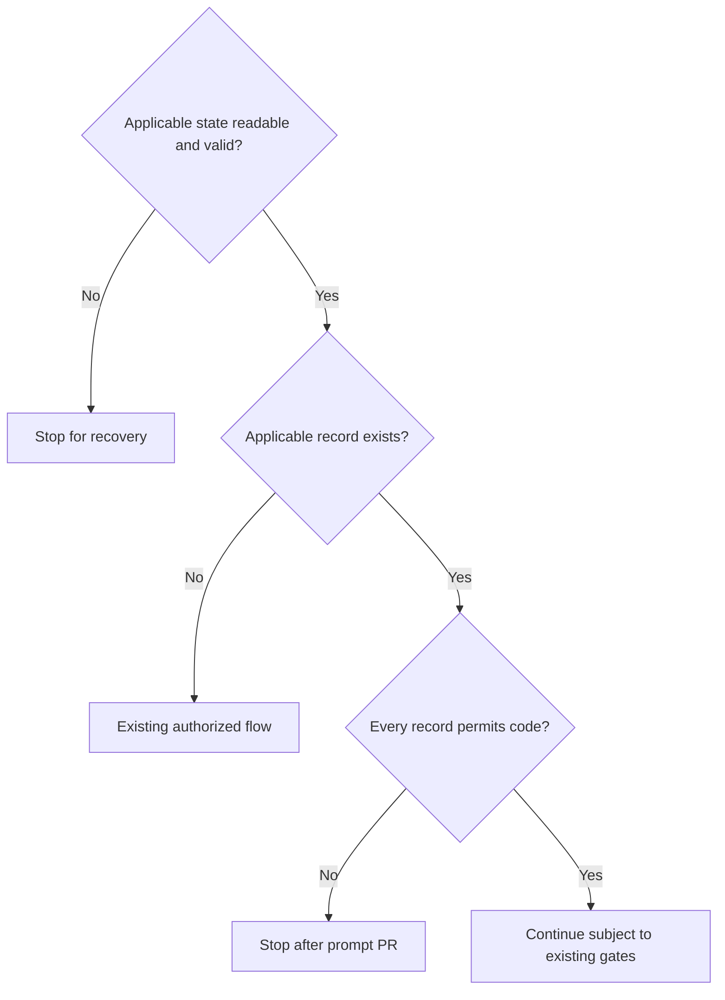

# Workflow scope

`src/workflow-scope.mjs` owns local durable prompt-only scope. Its public module function `manageScope(request, ports)` handles scope commands and decides whether a particular run may proceed to code. This new interface permits implementation design; work with genuinely absent applicable scope retains its existing authorized flow. Records survive process, chat, account and PDD restarts or updates within the repository's common Git identity. No transfer between machines is promised.

The CLI dispatches these forms to this module: `pdd workflow scope set --batch NAME --issues 3,4,5 --through prompt-pr`, `pdd workflow scope set --runs RUN_ID[,RUN_ID...] --through prompt-pr`, `pdd workflow scope show --batch NAME` or `--runs RUN_ID[,RUN_ID...]`, `pdd workflow scope revoke` with either selector, and `pdd workflow scope extend` with either selector and `--through code`. There is no batch member-addition form. This contract does not itself implement CLI dispatch or enforce downstream effects.

For a checked run, what happens at the code boundary?



A prompt-only hold permits progress through the prompt PR and stops before allocating a code area, branch or chat, building or publishing code. Neither this decision nor an extension grants merge or deployment permission. Routine gate approvals, checker passes, release detection, restarts, repeated starts, ticks, opens and resumes do not widen scope. Assignment and reuse must not assign an issue twice; an existing run for a batch member inherits that batch's scope.

<details><summary>Identity, selection and check</summary>

All identities are nonempty exact strings. `repository` is the trusted canonical common Git directory identity, shared by linked worktrees. A trusted resolved work identity is `{repository,issue,run}`; `issue` is empty only for work with no issue, and `run` is a stable nonempty run ID. The store resolves it from saved or planned work, not request-provided issue or untrusted worktree configuration. It supplies running-code status for all work affected by a mutation. Missing, ambiguous or inconsistent resolution stops; no guessing or duplicate assignment is allowed.

A selector has `kind`, `name`, `issues`, and `runs`. A batch selector has a nonempty name and no runs; set requires a nonempty distinct issue list, while show/revoke/extend require an empty issue list and resolve the fixed members from the record. A runs selector has empty name and issues and a nonempty list of distinct run IDs. For check use an empty batch-shaped selector and put the checked run ID in `run`; otherwise `run` is empty. Set requires `through` prompt-pr; extend requires code; all other actions require empty through. Mutations choose terminal or said route; other actions use empty route. Reject malformed fields, duplicates and unsupported combinations before loading.

Each batch record is keyed by repository and name and contains its fixed issue members; each run record is keyed by repository and one run ID. Set of any existing key refuses the entire request, including overlapping run selections. Show, revoke and extend by runs require a record for every selected ID; missing any refuses all, with no partial mutation. A batch cannot be overwritten or expanded. Show returns only selected records, in requested run order, or the selected batch. Each record includes identity, current limit and immutable history.

Check loads the complete repository snapshot and trusted work identity. A batch applies when repository and an issue member both match; a run record applies when repository and run both match. Ignore unrelated records. A revoked record holds at prompt-pr; otherwise its `through` is effective. All applicable records combine restrictively: any hold returns `prompt-pr`, all permitting code return `code`, and no applicable records returns `default`. A genuinely absent store or a valid snapshot containing only unrelated records gives default. Unavailable or malformed state, or inconsistent applicable records or work identity, returns `stop` with an inspection/recovery instruction. An absent store cannot hide known applicable state. An inability to determine applicability is not absence.

</details>

<details><summary>Authorization, mutation and concurrency</summary>

Set, revoke and extend each require explicit permission for the exact selected action and scope. A question, change request, earlier unrelated approval or routine gate approval is not that permission. The caller judges the person's decision; this module never infers consent from words. `store.load` resolves trusted strict policy from the main checkout and reports complete records and affected work. An unavailable policy or snapshot stops before authorization or mutation. Strict policy refuses said before `permission.authorize` can consume input. The permission port implements the shared route and returns actual evidence; its `authorized` means that exact action was explicitly authorized. Refusal, failure, or invalid evidence changes nothing. Terminal evidence has null words; said evidence has exact nonblank supplied words. Evidence uses the shared actor, event ID, epoch milliseconds and prompts schema; scope events use an empty prompts array. Each event ID is nonempty and distinct across new events, even when other evidence is identical. The port supplies trusted identity and time; do not invent a speaker or historical evidence.

Refuse any mutation affecting already-running code before requesting permission; do not terminate it. Set creates prompt-pr records, one per selected run or one batch. Revoke sets each selected record to revoked and prompt-pr. Extend clears revocation and sets code for each selected record. Extension is a separate permission; it does not alter overlapping records. Append the same immutable event to each record affected by one command, including action, exact selector and actual evidence. Retain all prior events unchanged, including after repeated revoke or extend. Event selector for batch mutations includes the resolved fixed members, and for run mutations contains the exact requested run IDs. Never fabricate evidence or treat a previous event as permission for a new one.

After all validation and permission, `store.commit` receives the complete updated records and the version loaded. It atomically compares that version and commits the complete records and history together only if unchanged. Report `changed` only on confirmed `committed`; stale, failed, thrown or uncertain commit returns `stop` directing inspection, never silently retries or reports success. A stale or failed commit changes no records; an uncertain result may have committed, so inspection is required before another attempt. Read-only and refused operations never commit. No effect may rely on an uncommitted proposal.

</details>

<details><summary>Required interface and outcomes</summary>

The Runtime interface below is the required concrete representation. `store.load` receives repository, action, selector and run and returns a versioned complete snapshot: state `trusted`, `absent`, `unavailable` or `malformed`, trusted `strict`, resolved `works` and `records`. For absent, records are empty; the port still resolves policy and requested work. `works` covers the checked run or every affected work, including existing runs for batch issues; its identity repository must equal the request. The store supplies a version even for absence. For show it need not resolve work. For set of a not-yet-started batch issue, no run identity is required; known existing runs must be included. A port failure is unavailable. Trusted snapshots must have unique record keys, valid immutable histories and coherent current state; malformed unrelated records may be ignored only if their identity can reliably establish that they are unrelated.

Records have repository, kind, name, issues, run, through, revoked and history. Batch records have nonempty name and distinct nonempty issues and empty run; run records have empty name and issues and a nonempty run. History is nonempty and starts with set, and its actions and scope must account for current state. For a run selection each affected record has the same command event; for a batch, its selector identifies the batch and fixed members. Histories must not contradict one another for the same event ID. Evidence follows the required dependency; `prompts` is empty here.

Validate request first (`refused`); then load and validate state and required identities (`stop` on unsafe state); then require all selected keys and reject existing keys for set (`refused`); then reject running code (`refused`); then enforce strict route and obtain permission (`refused`); then commit (`stop` unless confirmed). Check and show do not authorize or commit. `shown` returns selected records; `changed` returns committed selected records; `default`, `prompt-pr` and `code` return applicable records in store order. Refusals and stops return an empty records array and a nonempty actionable message; other outcomes may use an empty message. A missing selected record is refusal, not default. Port exceptions follow their respective failure rules.

</details>

## Dependencies

[Approval policy and journal](approval-policy.prompt.md) is required authoring, generation, runtime, verification and testing context for policy source, routes and evidence. This module applies those rules to its own permission boundary. The injected `store` and `permission` ports provide outside effects; native persistence, parser and consumer wiring remain separate responsibilities.

<details><summary>Runtime interface</summary>

```json
{
  "status":"draft",
  "prose_sha256":"",
  "entries": [
    {
      "operation": "manageScope",
      "input_schema": {
        "type": "object",
        "properties": {
          "action": {
            "type": "string",
            "enum": [
              "set",
              "show",
              "revoke",
              "extend",
              "check"
            ]
          },
          "repository": {
            "type": "string"
          },
          "selector": {
            "type": "object",
            "properties": {
              "kind": {
                "type": "string",
                "enum": [
                  "batch",
                  "runs"
                ]
              },
              "name": {
                "type": "string"
              },
              "issues": {
                "type": "array",
                "items": {
                  "type": "string"
                }
              },
              "runs": {
                "type": "array",
                "items": {
                  "type": "string"
                }
              }
            },
            "required": [
              "kind",
              "name",
              "issues",
              "runs"
            ],
            "additionalProperties": false
          },
          "through": {
            "type": "string",
            "enum": [
              "",
              "prompt-pr",
              "code"
            ]
          },
          "run": {
            "type": "string"
          },
          "route": {
            "type": "string",
            "enum": [
              "",
              "terminal",
              "said"
            ]
          }
        },
        "required": [
          "action",
          "repository",
          "selector",
          "through",
          "run",
          "route"
        ],
        "additionalProperties": false
      },
      "result_schema": {
        "type": "object",
        "properties": {
          "outcome": {
            "type": "string",
            "enum": [
              "changed",
              "shown",
              "refused",
              "stop",
              "default",
              "prompt-pr",
              "code"
            ]
          },
          "records": {
            "type": "array",
            "items": {
              "type": "object",
              "properties": {
                "repository": {
                  "type": "string"
                },
                "kind": {
                  "type": "string",
                  "enum": [
                    "batch",
                    "run"
                  ]
                },
                "name": {
                  "type": "string"
                },
                "issues": {
                  "type": "array",
                  "items": {
                    "type": "string"
                  }
                },
                "run": {
                  "type": "string"
                },
                "through": {
                  "type": "string",
                  "enum": [
                    "prompt-pr",
                    "code"
                  ]
                },
                "revoked": {
                  "type": "boolean"
                },
                "history": {
                  "type": "array",
                  "items": {
                    "type": "object",
                    "properties": {
                      "action": {
                        "type": "string",
                        "enum": [
                          "set",
                          "revoke",
                          "extend"
                        ]
                      },
                      "selector": {
                        "type": "object",
                        "properties": {
                          "kind": {
                            "type": "string",
                            "enum": [
                              "batch",
                              "runs"
                            ]
                          },
                          "name": {
                            "type": "string"
                          },
                          "issues": {
                            "type": "array",
                            "items": {
                              "type": "string"
                            }
                          },
                          "runs": {
                            "type": "array",
                            "items": {
                              "type": "string"
                            }
                          }
                        },
                        "required": [
                          "kind",
                          "name",
                          "issues",
                          "runs"
                        ],
                        "additionalProperties": false
                      },
                      "evidence": {
                        "type": "object",
                        "properties": {
                          "id": {
                            "type": "string"
                          },
                          "actor": {
                            "type": "object",
                            "properties": {
                              "kind": {
                                "type": "string",
                                "enum": [
                                  "agent",
                                  "terminal"
                                ]
                              },
                              "id": {
                                "type": "string"
                              }
                            },
                            "required": [
                              "kind",
                              "id"
                            ],
                            "additionalProperties": false
                          },
                          "at": {
                            "type": "integer"
                          },
                          "route": {
                            "type": "string",
                            "enum": [
                              "terminal",
                              "said"
                            ]
                          },
                          "words": {
                            "oneOf": [
                              {
                                "type": "string"
                              },
                              {
                                "type": "null"
                              }
                            ]
                          },
                          "prompts": {
                            "type": "array",
                            "items": {
                              "type": "object",
                              "properties": {
                                "path": {
                                  "type": "string"
                                },
                                "proseSha256": {
                                  "type": "string"
                                }
                              },
                              "required": [
                                "path",
                                "proseSha256"
                              ],
                              "additionalProperties": false
                            }
                          }
                        },
                        "required": [
                          "id",
                          "actor",
                          "at",
                          "route",
                          "words",
                          "prompts"
                        ],
                        "additionalProperties": false
                      }
                    },
                    "required": [
                      "action",
                      "selector",
                      "evidence"
                    ],
                    "additionalProperties": false
                  }
                }
              },
              "required": [
                "repository",
                "kind",
                "name",
                "issues",
                "run",
                "through",
                "revoked",
                "history"
              ],
              "additionalProperties": false
            }
          },
          "message": {
            "type": "string"
          }
        },
        "required": [
          "outcome",
          "records",
          "message"
        ],
        "additionalProperties": false
      },
      "errors": []
    }
  ],
  "calls": [],
  "resources": [
    {
      "name": "store",
      "kind": "port",
      "access": "write",
      "operations": [
        {
          "name": "load",
          "access": "read",
          "arguments_schema": {
            "type": "object",
            "properties": {
              "repository": {
                "type": "string"
              },
              "action": {
                "type": "string"
              },
              "selector": {
                "type": "object",
                "properties": {
                  "kind": {
                    "type": "string",
                    "enum": [
                      "batch",
                      "runs"
                    ]
                  },
                  "name": {
                    "type": "string"
                  },
                  "issues": {
                    "type": "array",
                    "items": {
                      "type": "string"
                    }
                  },
                  "runs": {
                    "type": "array",
                    "items": {
                      "type": "string"
                    }
                  }
                },
                "required": [
                  "kind",
                  "name",
                  "issues",
                  "runs"
                ],
                "additionalProperties": false
              },
              "run": {
                "type": "string"
              }
            },
            "required": [
              "repository",
              "action",
              "selector",
              "run"
            ],
            "additionalProperties": false
          },
          "result_schema": {
            "type": "object",
            "properties": {
              "version": {
                "type": "string"
              },
              "state": {
                "type": "string",
                "enum": [
                  "trusted",
                  "absent",
                  "unavailable",
                  "malformed"
                ]
              },
              "strict": {
                "type": "boolean"
              },
              "works": {
                "type": "array",
                "items": {
                  "type": "object",
                  "properties": {
                    "identity": {
                      "type": "object",
                      "properties": {
                        "repository": {
                          "type": "string"
                        },
                        "issue": {
                          "type": "string"
                        },
                        "run": {
                          "type": "string"
                        }
                      },
                      "required": [
                        "repository",
                        "issue",
                        "run"
                      ],
                      "additionalProperties": false
                    },
                    "runningCode": {
                      "type": "boolean"
                    }
                  },
                  "required": [
                    "identity",
                    "runningCode"
                  ],
                  "additionalProperties": false
                }
              },
              "records": {
                "type": "array",
                "items": {
                  "type": "object",
                  "properties": {
                    "repository": {
                      "type": "string"
                    },
                    "kind": {
                      "type": "string",
                      "enum": [
                        "batch",
                        "run"
                      ]
                    },
                    "name": {
                      "type": "string"
                    },
                    "issues": {
                      "type": "array",
                      "items": {
                        "type": "string"
                      }
                    },
                    "run": {
                      "type": "string"
                    },
                    "through": {
                      "type": "string",
                      "enum": [
                        "prompt-pr",
                        "code"
                      ]
                    },
                    "revoked": {
                      "type": "boolean"
                    },
                    "history": {
                      "type": "array",
                      "items": {
                        "type": "object",
                        "properties": {
                          "action": {
                            "type": "string",
                            "enum": [
                              "set",
                              "revoke",
                              "extend"
                            ]
                          },
                          "selector": {
                            "type": "object",
                            "properties": {
                              "kind": {
                                "type": "string",
                                "enum": [
                                  "batch",
                                  "runs"
                                ]
                              },
                              "name": {
                                "type": "string"
                              },
                              "issues": {
                                "type": "array",
                                "items": {
                                  "type": "string"
                                }
                              },
                              "runs": {
                                "type": "array",
                                "items": {
                                  "type": "string"
                                }
                              }
                            },
                            "required": [
                              "kind",
                              "name",
                              "issues",
                              "runs"
                            ],
                            "additionalProperties": false
                          },
                          "evidence": {
                            "type": "object",
                            "properties": {
                              "id": {
                                "type": "string"
                              },
                              "actor": {
                                "type": "object",
                                "properties": {
                                  "kind": {
                                    "type": "string",
                                    "enum": [
                                      "agent",
                                      "terminal"
                                    ]
                                  },
                                  "id": {
                                    "type": "string"
                                  }
                                },
                                "required": [
                                  "kind",
                                  "id"
                                ],
                                "additionalProperties": false
                              },
                              "at": {
                                "type": "integer"
                              },
                              "route": {
                                "type": "string",
                                "enum": [
                                  "terminal",
                                  "said"
                                ]
                              },
                              "words": {
                                "oneOf": [
                                  {
                                    "type": "string"
                                  },
                                  {
                                    "type": "null"
                                  }
                                ]
                              },
                              "prompts": {
                                "type": "array",
                                "items": {
                                  "type": "object",
                                  "properties": {
                                    "path": {
                                      "type": "string"
                                    },
                                    "proseSha256": {
                                      "type": "string"
                                    }
                                  },
                                  "required": [
                                    "path",
                                    "proseSha256"
                                  ],
                                  "additionalProperties": false
                                }
                              }
                            },
                            "required": [
                              "id",
                              "actor",
                              "at",
                              "route",
                              "words",
                              "prompts"
                            ],
                            "additionalProperties": false
                          }
                        },
                        "required": [
                          "action",
                          "selector",
                          "evidence"
                        ],
                        "additionalProperties": false
                      }
                    }
                  },
                  "required": [
                    "repository",
                    "kind",
                    "name",
                    "issues",
                    "run",
                    "through",
                    "revoked",
                    "history"
                  ],
                  "additionalProperties": false
                }
              }
            },
            "required": [
              "version",
              "state",
              "strict",
              "works",
              "records"
            ],
            "additionalProperties": false
          }
        },
        {
          "name": "commit",
          "access": "write",
          "arguments_schema": {
            "type": "object",
            "properties": {
              "repository": {
                "type": "string"
              },
              "expectedVersion": {
                "type": "string"
              },
              "records": {
                "type": "array",
                "items": {
                  "type": "object",
                  "properties": {
                    "repository": {
                      "type": "string"
                    },
                    "kind": {
                      "type": "string",
                      "enum": [
                        "batch",
                        "run"
                      ]
                    },
                    "name": {
                      "type": "string"
                    },
                    "issues": {
                      "type": "array",
                      "items": {
                        "type": "string"
                      }
                    },
                    "run": {
                      "type": "string"
                    },
                    "through": {
                      "type": "string",
                      "enum": [
                        "prompt-pr",
                        "code"
                      ]
                    },
                    "revoked": {
                      "type": "boolean"
                    },
                    "history": {
                      "type": "array",
                      "items": {
                        "type": "object",
                        "properties": {
                          "action": {
                            "type": "string",
                            "enum": [
                              "set",
                              "revoke",
                              "extend"
                            ]
                          },
                          "selector": {
                            "type": "object",
                            "properties": {
                              "kind": {
                                "type": "string",
                                "enum": [
                                  "batch",
                                  "runs"
                                ]
                              },
                              "name": {
                                "type": "string"
                              },
                              "issues": {
                                "type": "array",
                                "items": {
                                  "type": "string"
                                }
                              },
                              "runs": {
                                "type": "array",
                                "items": {
                                  "type": "string"
                                }
                              }
                            },
                            "required": [
                              "kind",
                              "name",
                              "issues",
                              "runs"
                            ],
                            "additionalProperties": false
                          },
                          "evidence": {
                            "type": "object",
                            "properties": {
                              "id": {
                                "type": "string"
                              },
                              "actor": {
                                "type": "object",
                                "properties": {
                                  "kind": {
                                    "type": "string",
                                    "enum": [
                                      "agent",
                                      "terminal"
                                    ]
                                  },
                                  "id": {
                                    "type": "string"
                                  }
                                },
                                "required": [
                                  "kind",
                                  "id"
                                ],
                                "additionalProperties": false
                              },
                              "at": {
                                "type": "integer"
                              },
                              "route": {
                                "type": "string",
                                "enum": [
                                  "terminal",
                                  "said"
                                ]
                              },
                              "words": {
                                "oneOf": [
                                  {
                                    "type": "string"
                                  },
                                  {
                                    "type": "null"
                                  }
                                ]
                              },
                              "prompts": {
                                "type": "array",
                                "items": {
                                  "type": "object",
                                  "properties": {
                                    "path": {
                                      "type": "string"
                                    },
                                    "proseSha256": {
                                      "type": "string"
                                    }
                                  },
                                  "required": [
                                    "path",
                                    "proseSha256"
                                  ],
                                  "additionalProperties": false
                                }
                              }
                            },
                            "required": [
                              "id",
                              "actor",
                              "at",
                              "route",
                              "words",
                              "prompts"
                            ],
                            "additionalProperties": false
                          }
                        },
                        "required": [
                          "action",
                          "selector",
                          "evidence"
                        ],
                        "additionalProperties": false
                      }
                    }
                  },
                  "required": [
                    "repository",
                    "kind",
                    "name",
                    "issues",
                    "run",
                    "through",
                    "revoked",
                    "history"
                  ],
                  "additionalProperties": false
                }
              }
            },
            "required": [
              "repository",
              "expectedVersion",
              "records"
            ],
            "additionalProperties": false
          },
          "result_schema": {
            "type": "object",
            "properties": {
              "status": {
                "type": "string",
                "enum": [
                  "committed",
                  "stale",
                  "uncertain",
                  "failed"
                ]
              }
            },
            "required": [
              "status"
            ],
            "additionalProperties": false
          }
        }
      ]
    },
    {
      "name": "permission",
      "kind": "port",
      "access": "write",
      "operations": [
        {
          "name": "authorize",
          "access": "write",
          "arguments_schema": {
            "type": "object",
            "properties": {
              "repository": {
                "type": "string"
              },
              "action": {
                "type": "string"
              },
              "selector": {
                "type": "object",
                "properties": {
                  "kind": {
                    "type": "string",
                    "enum": [
                      "batch",
                      "runs"
                    ]
                  },
                  "name": {
                    "type": "string"
                  },
                  "issues": {
                    "type": "array",
                    "items": {
                      "type": "string"
                    }
                  },
                  "runs": {
                    "type": "array",
                    "items": {
                      "type": "string"
                    }
                  }
                },
                "required": [
                  "kind",
                  "name",
                  "issues",
                  "runs"
                ],
                "additionalProperties": false
              },
              "through": {
                "type": "string"
              },
              "strict": {
                "type": "boolean"
              },
              "route": {
                "type": "string"
              }
            },
            "required": [
              "repository",
              "action",
              "selector",
              "through",
              "strict",
              "route"
            ],
            "additionalProperties": false
          },
          "result_schema": {
            "type": "object",
            "properties": {
              "authorized": {
                "type": "boolean"
              },
              "evidence": {
                "type": "object",
                "properties": {
                  "id": {
                    "type": "string"
                  },
                  "actor": {
                    "type": "object",
                    "properties": {
                      "kind": {
                        "type": "string",
                        "enum": [
                          "agent",
                          "terminal"
                        ]
                      },
                      "id": {
                        "type": "string"
                      }
                    },
                    "required": [
                      "kind",
                      "id"
                    ],
                    "additionalProperties": false
                  },
                  "at": {
                    "type": "integer"
                  },
                  "route": {
                    "type": "string",
                    "enum": [
                      "terminal",
                      "said"
                    ]
                  },
                  "words": {
                    "oneOf": [
                      {
                        "type": "string"
                      },
                      {
                        "type": "null"
                      }
                    ]
                  },
                  "prompts": {
                    "type": "array",
                    "items": {
                      "type": "object",
                      "properties": {
                        "path": {
                          "type": "string"
                        },
                        "proseSha256": {
                          "type": "string"
                        }
                      },
                      "required": [
                        "path",
                        "proseSha256"
                      ],
                      "additionalProperties": false
                    }
                  }
                },
                "required": [
                  "id",
                  "actor",
                  "at",
                  "route",
                  "words",
                  "prompts"
                ],
                "additionalProperties": false
              }
            },
            "required": [
              "authorized",
              "evidence"
            ],
            "additionalProperties": false
          }
        }
      ]
    }
  ],
  "limits": {
    "max_steps": 12,
    "max_model_calls": 2
  },
  "conventions": []
}
```
</details>
