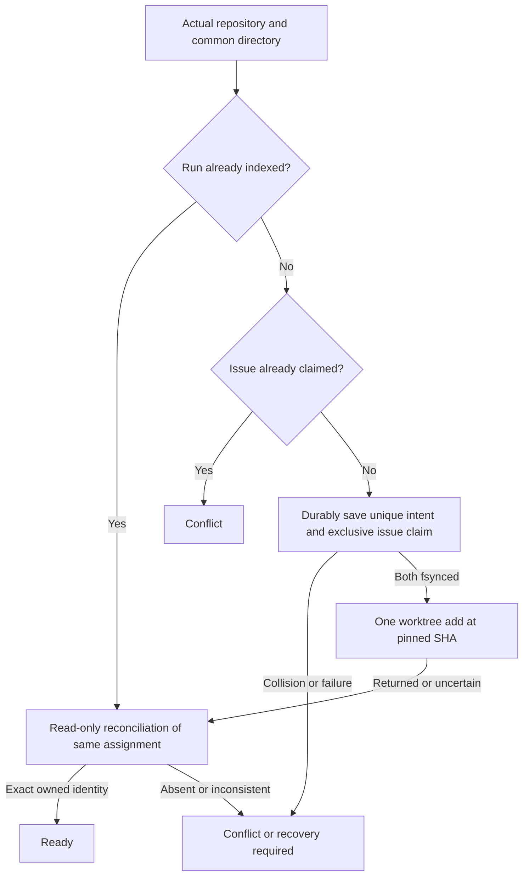

# Isolated issue workflow worktrees

Own `src/workflow-worktree.mjs`, exporting the module functions `allocateIssueWorktree`, `lookupIssueWorktree`, `releaseIssueClaim` and `lookupRepositoryParent`. Give each issue run an actual separate Git worktree without switching, resetting, stashing or otherwise changing the person's checkout. The helper owns durable allocation and exclusive issue claims; the runner owns its per-worktree journal and workflow stages. Preserve the literal interfaces and identity below. All claims and uncertain work persist: there is no cleanup, release, delete, retry or native/GitHub operation in this slice.

`allocateIssueWorktree({cwd,repository,issueNumber,runId,workflowName,baseRef},ports={execFile})` returns `{state,assignment,message}`. States are ready, conflict or recovery_required; assignment is null unless the actual owned worktree is verified. Conflict means an invalid/colliding request or an issue claimed by another run. Missing, incomplete, changed or unreadable durable/physical identity yields recovery_required without another allocation. A refusal before durable intent creation leaves no run allocation record or issue claim; distinguish it in the diagnostic from an unconfirmed allocation whose saved intent must be preserved.

`lookupIssueWorktree({cwd,runId},ports={execFile})` uses the same result envelope. It reads the common-repository run index from the original checkout or another checkout sharing that common repository. It performs only filesystem/Git reads; missing or uncertain identity remains recovery_required. Never repair metadata or repeat add while looking up or resuming an existing intent.

`releaseIssueClaim({cwd,runId,issueNumber},ports={execFile})` frees an issue for a new run after the runner cancelled the old run. It removes only the issue claim link `<commonDir>/pdd/worktree-assignments/issues/<N>.json`, and only when that claim names the same run and issue. It keeps the run record, the worktree and the branch. A missing claim is already released. It returns `{state:'released'|'conflict'|'recovery_required',message}` and never throws.

## Verified repository parent

Export `lookupRepositoryParent({cwd,repository,commonDir},ports={execFile})` as a read-only lookup returning
`{state:"ready",root,bare}` or `{state:"recovery_required",root:null,bare:null}`. Reuse the exact primary
registration/origin/common-directory validation that owns external allocation. Normal and linked callers
resolve to the registered primary checkout; a verified bare primary resolves to its canonical bare directory.
Never substitute a linked caller, change Git/configuration, or alter sourceRoot in an existing assignment.

## Allocate once, then reconcile the original

The exclusive key is the actual canonical Git common directory plus issue number, across workflow names. Run IDs are nonempty safe ASCII identifiers (letters/digits/dot/underscore/hyphen, maximum160); issue numbers are positive safe integers. Workflow names are safe identifiers, maximum80. Require a saved canonical owner/repo matching the checkout's actual GitHub origin, with ordinary HTTPS or Git SSH origin, no embedded credentials or alternate host. Repository comparison ignores case; retain the supplied canonical repository spelling. Resolve the actual source root and common directory through Git and canonical filesystem paths. Dirty user files are permitted and must remain byte/status unchanged.

A new allocation pins an existing local baseRef to its actual40hex commit SHA; never fetch. Persist the complete intended assignment before add, including an independently generated UUIDv4 worktree directory at `<repo-parent>/<repo>.pdd-worktrees/<UUID>`, unique safe branch `pdd/<safeName>-<issueNumber>-<uuidshort>`, and intended Git metadata directory `<commonDir>/worktrees/<UUID>`. Refuse preexisting paths, branch refs, symlinks/redirected metadata directories and unowned worktrees. The branch name derives from workflowName but issue ownership is independent of it. The external directory is a sibling of the canonical primary registration from Git’s first worktree record, bound to the same common repository/origin; use this same directory when allocating from linked checkouts. A normal primary must resolve to its registered checkout root. A bare primary is supported when its registered canonical directory is the actual bare Git directory and equals the caller’s common Git directory, with the same GitHub origin. Use `<bare-repository-name>.pdd-worktrees` beside that bare directory, independent of which linked checkout calls. Never change `core.bare` or choose an arbitrary linked checkout as the primary. Its full path must have no `.git` ancestor, so ordinary project loaders and test discovery do not treat source as Git metadata. Metadata and journals remain in their existing common-repository and per-worktree Git directories. Refuse a symlink, non-directory or redirected external allocation parent rather than writing through it. Use ordinary `git worktree add -b <branch> <worktreePath> <baseSha>` once. Never reuse the current worktree, switch branches, reset/stash, adopt another allocation or remove a failed add.

Durable run metadata and issue ownership must be exclusive across concurrent processes, not just promises in one process. The common-repository run index is a directory of immutable exclusively created per-run files, not a read/modify/replace shared JSON object; concurrent different-issue entries must both persist. Issue claims atomically link their run intent, serializing the contested issue name across all linked checkouts. The run index and claim precede add, so no post-add index registration is needed. File creation, file content and containing-directory entries are fsynced before add. A partial write, missing claim/index, interrupted add or lost reply never authorizes another add. Read the same saved path/branch afterward; actual matching state may prove ready even if the add reply was lost. Otherwise preserve uncertainty. No automatic overwrite, rollback, deletion, release or second generated identity is permitted for an existing run.

Assignment schema, identity checks and command port

A verified assignment has exactly `{version:1,runId,repository,issueNumber,workflowName,commonDir,sourceRoot,worktreePath,gitDir,branch,baseRef,baseSha}`. All paths are absolute canonical paths. Bind the run index and exclusive issue claim to the same durable intent. Validate their complete closed schema, exact UUID paths and branch, canonical repository, common-repository identity and original source root. The same version1 schema accepts both the new external path and the original exact `<commonDir>/pdd/worktrees/<UUID>` layout. Existing assignments always use their saved path and Git directory: lookup/resume neither creates an external parent nor moves, migrates, rebinds, repairs or deletes an old worktree/claim/journal. New allocations exclusively use the external layout. For external assignments verify the saved parent equals the canonical primary repository’s sibling directory; arbitrary outside paths are not adopted. Validate actual registered worktree path, ordinary `.git` file, actual Git directory/common directory/root, exact named branch, and actual HEAD descending from the pinned baseSha. New commits and dirty files inside an assigned worktree are allowed on later lookup; the pinned base is never moved to a newer ref. Unknown/multiple/mismatched Git registration refuses. Git's initializing lock can coexist with matching path, HEAD, branch and Git directory before checkout has completed; that state remains recovery_required. Neither lookup nor existing-run allocation unlocks, repairs, repeats add or deletes it. A completed original can recover ready, including later dirt/commits. Ordinary protective locks after checkout (with no reason or a noninitializing reason) do not by themselves invalidate a completed worktree. An unrelated existing worktree or directory is never adopted.

`ports.execFile(file,args,{cwd})` optionally replaces ordinary subprocess execution, returning/resolving `{stdout,stderr?,code?}`. Missing code is successful execFile-style completion; nonzero or rejection fails, including rejected numeric code zero. Normal nonzero process exit data can distinguish absent refs; operational rejection cannot become success. Production uses Node execFile, argv arrays, shell:false, normal inherited environment/cwd, no timeout and bounded output. No auth copies, private dependencies or bypass options. Capture public inputs before awaits. Use finite messages without raw subprocess output; outcome never implies workflow execution, publication or merge.

## Dependencies

- Load the complete [Prompting guide](../../docs/prompting-guide.md) for authoring/generation; it owns module contracts and preservation.
- Runtime: Node `child_process.execFile`, `crypto.randomUUID`, `fs/promises`, `fs.constants`, `path`, `util`, and installed normal Git. Filesystem metadata creation/reads/fsync are helper-owned; execFile is the sole injected port. Tests use disposable real local repositories and injected command failures, with no live GitHub/native actions.
