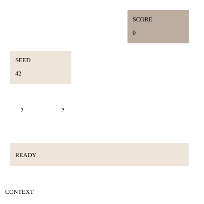

# 2048-like browser screen

Show score and seed data from game state. Provide four touch-sized direction
buttons with ids `move-left`, `move-right`, `move-up` and `move-down`.



<details><summary>Runtime interface</summary>

```json
{"properties":{"READY":{},"region score":{},"region seed":{}}}
```
</details>
